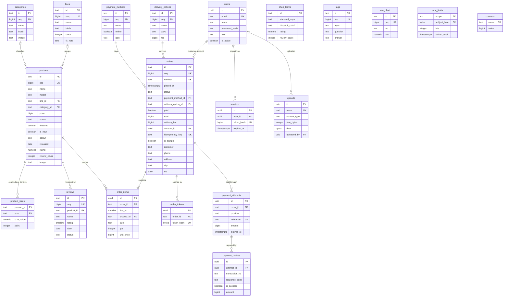
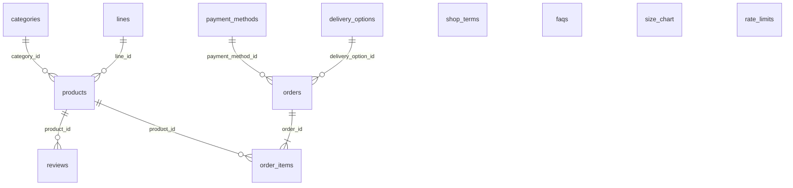

<!-- GENERATED from docs/architecture/erd/ — DO NOT EDIT THIS FILE.
     Every write here is overwritten the next time a story's technical design
     merges. This document is the whole contract and is what every reader,
     review and gate reads; it is assembled from one file per story so that
     twenty stories do not edit one file. Add or change what YOUR story needs
     in docs/architecture/erd/<your-story-slug>.md. -->

# Database Design (ERD) — Đôi

Engine: PostgreSQL 16 (pgx v5, hand-written parameterised SQL, no ORM)
Last updated: 2026-11-25
Source requirements: `docs/data/SRS.md` (DATA-001…005), `docs/catalogue/SRS.md` (CAT-001…004), `docs/orders/SRS.md` (ORD-001…023), `docs/payments/SRS.md` (PAY-001…022), `docs/admin/SRS.md` (ADMIN-001…031), `docs/accounts/SRS.md` (ACC-001…008). `docs/site/SRS.md` (SITE-001…016) was read and stores nothing of its own: every page it describes reads tables below. Stack and runner: `docs/architecture/overview.md`.

## 1. Overview

The schema stores four groups of data:

- **The catalogue** — the ten collections the approved design read from JSON (`products`, `lines`, `categories`, `reviews`, `faqs`, `shop_terms`, `delivery_options`, `payment_methods`, `size_chart`, `orders`), plus `product_sizes`, the one place pairs on the shelf are counted.
- **Orders and payment** — `orders` with its pairs (`order_items`), its access tokens (`order_tokens`), and VNPay/MoMo attempts and notices (`payment_attempts`, `payment_notices`).
- **People** — one `users` table for the admin, staff and customers, with `sessions`.
- **Plumbing** — `uploads` (shoe pictures), `rate_limits` (sign-in, sign-up and order-lookup locks), `counters` (the order-number counter).

Aggregate roots: `products` (owns `product_sizes` and `reviews`), `orders` (owns `order_items`, `order_tokens`, `payment_attempts` → `payment_notices`), `users` (owns `sessions`).

**Deliberately outside the database**

| What | Where it lives | Why |
|---|---|---|
| Contact-form messages (SITE-012) | Agent Team's own API; the owner reads them there | The brief says so; the backend has no endpoint and no table for it |
| The bag / cart (SITE-007) | The browser | Nothing is promised to a visitor until an order is placed |
| Order tokens a browser holds, "Ordered on this phone" (ORD-023) | The browser's storage | Per-browser by definition; the database holds only the token's hash |
| VNPay keys, MoMo keys, the shop's bank account (PAY-005, PAY-020) | Environment settings the owner supplies | Secrets and owner settings are not records; they are never returned by an API |
| Shop images under `/images/…` | The frontend's static files | Records hold the address only |
| Refunds (payments SRS §3) | VNPay's merchant portal | Not recorded by the shop |
| Delivery fee thresholds, express options | Nowhere | The owner chose free delivery on every order; `delivery_options` holds `standard` with fee 0 |

### 1.1 Decisions this design makes

| # | Decision | Reason, and what it costs |
|---|---|---|
| D1 | **Ids.** The ten collection tables keep the **text** ids the JSON and the routes use (`samba-og-w-core-black`, `doi-24817`, `r-01`). Every other table uses `uuid` (`gen_random_uuid()`, built in since PG 13). | The SRS acceptance criteria name the text ids and `/v1/<collection>/<id>` is public. Cost: a slug is a business-visible key — it is never changed after creation (ADMIN-010 item 4), and a CHECK keeps it URL-safe. |
| D2 | **Four tables are not named after their collection:** `delivery`→`delivery_options`, `payments`→`payment_methods`, `shop`→`shop_terms`, `sizes`→`size_chart`. | `payments` / `sizes` would collide with `payment_attempts` and `product_sizes`; `shop` is a singleton, not a plural. Cost: the generic reader maps collection → table through one allow-list. |
| D3 | **One count of pairs per shoe and EU size**: `product_sizes.pairs`. A shoe's `sizes`, `sizes_low`, `sizes_out` and `stock` are **derived** through the view `product_stock`, never stored (ORD-005, ADMIN-015 item 1: "there is no second copy of stock"). | Cost: the first data story (S3) must still seed those four fields exactly as the JSON has them (DATA-001 AC-2), so they exist as plain columns on `products` until the orders story (S5) moves them into `product_sizes` and drops them. §8 (migration 4) describes the step. |
| D4 | **An order holds its pairs in `order_items`.** The `orders` collection's `product`, `size` and `qty` fields are the order's first pair (`line_no = 1`), read with a lateral join. | ORD-003 item 5: orders hold several pairs; the 14 sample orders are one-pair orders. Cost: the generic reader needs one special case for `orders`. |
| D5 | **An order has many access tokens, each stored hashed** (`order_tokens`). | A lookup by number and phone must hand back "the token the order page reads with" (ORD-021) — for a sample order, or after the browser lost its token, there is none to return, and a stored hash cannot be reversed. The lookup mints a new token; so does a repeated submission with the same key (ORD-010 item 3). |
| D6 | **Search folds text in SQL with one function, `doi_fold(text)`**, and matches words with `strpos`. No extension (`unaccent`, `pg_trgm`) and no stored search column. | Extensions need privileges the project's database role may not have; `strpos` means `%` and `_` need no escaping (CAT-001 AC-8/9); no stored folded column means a renamed line or category can never leave a stale copy. Cost: no index serves `q`, so it scans — acceptable below ~20,000 shoes (§6). |
| D7 | **Order numbers come from a one-row counter** (`counters`, name `order_number`), incremented inside the order's transaction. | ORD-003 item 3: "one more than the highest number held, never repeating", with no gaps from refused orders. A `SEQUENCE` is not rolled back, so a refused order would burn a number. Cost: order placement serialises on one row for a few milliseconds. |
| D8 | **Locks are counters with a window**, one row per (scope, hashed subject): `rate_limits`. | ADMIN-003, ORD-022 and ACC-001 all need "N failures within a period, then refused until a time". In-memory would reset on restart. |
| D9 | **At most one admin row** (partial unique index). | "The shop is never left without an admin" and "the admin" are singular throughout ADMIN-003/031. Start-up updates that row if `ADMIN_EMAIL` changes instead of adding a second admin. |
| D10 | **Uploaded pictures are `bytea` rows in `uploads`.** | Forced by the runtime: the backend container is read-only with no volume (project decision `uploads_sessions`). The conventions prefer object storage; see §3.20 for the mitigations. |

## 2. Diagram

The diagram shows the **final** shape. Section 8 says which story creates which part.



Cardinality notation: `||` exactly one, `|o` / `o|` zero or one, `}o` / `o{` zero or many, `}|` / `|{` one or many. Read left to right. `shop_terms`, `faqs`, `size_chart`, `rate_limits` and `counters` have no foreign keys by design (§3).

### 2.1 Field-name mapping (API ↔ column)

The API keeps the JSON's field names (DATA-002 item 6). The generic reader (S3) builds its column allow-list from `schema.json` with these rules — nothing else is renamed:

| API field | Column | Rule |
|---|---|---|
| `_source`, `_invented` | `source`, `invented` | Leading underscore dropped; both are owner-only bookkeeping (DATA-004 item 2) |
| `products.line`, `products.category`, `reviews.product` | `line_id`, `category_id`, `product_id` | Every `ref:` field is `<key>_id` (foreign-key naming) |
| `orders.payment`, `orders.delivery` | `payment_method_id`, `delivery_option_id` | Text ids of the way to pay and delivery option |
| `orders.product`, `orders.size`, `orders.qty` | `order_items.product_id/size/qty` of `line_no = 1` | D4 |
| `products.sizes`, `sizes_low`, `sizes_out`, `stock` | view `product_stock` (after S5) | D3 |
| A nullable column the JSON writes as text (`eta`, a shoe's `line` / `category` when unset) or as a number (`since`, `cm`) | presented as `""` for text, `null` for numbers | A field never changes type: the frontend reads `string` fields. NULL exists only where `''` cannot be stored (a foreign key, a date) or `0` would be a sentinel (a number) |
| `date`, `timestamptz` columns | `released`, `date`, `eta` as `YYYY-MM-DD`; `placed_at` as RFC 3339 with `+07:00` | `services.md` fixes the exact format; the frontend already reads both date forms |
| Private order fields `phone`, `email`, `address`, `note` | same names | Selected only by dealer/owner read paths, never into a public type (overview §4) |

## 3. Entities

### 3.0 Rules applied to every table

- Names, keys and types follow the project's schema conventions: `snake_case` plural tables, `{table}_id` foreign keys, `timestamptz` (UTC) for every instant, `bigint` VND for money (VND has no minor unit), `text` plus `CHECK` for constrained text, no `pg enum`.
- `NOT NULL` is the default. For optional text, "not set" and "empty" mean the same thing, so the column is `NOT NULL DEFAULT ''`; NULL is used only where `''` cannot be stored (a foreign key, a date, a number) and each such column says why.
- Every table has `created_at` and `updated_at` (`timestamptz NOT NULL DEFAULT now()`), `updated_at` kept by one trigger function `set_updated_at()` (`BEFORE UPDATE`, one trigger per table named `trg_{table}_updated_at`) so no handler can forget it. **Exceptions, stated per table:** append-only tables (`order_items`, `order_tokens`, `payment_attempts`, `payment_notices`) have no `updated_at`; tables whose identity is a natural composite key (`product_sizes`, `rate_limits`) or a name (`counters`) have no surrogate `id`.
- Every foreign key states `ON DELETE` explicitly; `ON UPDATE` is `NO ACTION` everywhere because no key is ever changed (ids are immutable).
- Length limits of the admin SRS (200 characters, 5,000 for long text) and of checkout (ORD-002) are checked by the API, not by `CHECK`s: seeded text may predate them and the migration must not fail on it (DATA-001 item 3).
- Soft delete is used nowhere. Deletion rules come from ADMIN-014 and are expressed as `RESTRICT` / `CASCADE` below.

### 3.1 Columns every collection table has

Applies to `categories`, `lines`, `products`, `reviews`, `shop_terms`, `delivery_options`, `payment_methods`, `faqs`, `size_chart` and `orders`. Each table's section lists only its own columns after these.

| Column | Type | Null | Default | Unique | Description |
|---|---|---|---|---|---|
| `id` | `text` | no | — | PK | The record's id (D1). `CHECK ck_{table}_id_slug`: `id ~ '^[a-z0-9][a-z0-9._-]*$' AND length(id) <= 100` — every seeded id already matches; a seed that did not would fail loudly (DATA-001) |
| `seq` | `bigint` | no | `GENERATED ALWAYS AS IDENTITY` | `uq_{table}_seq` | Position in the seed, then insertion order: the stable order of every list and the tie-break of every sort (DATA-002 item 5, CAT-001 item 5). The seed inserts in file order |
| `source` | `text` | no | `''` | | The record's `_source` note (`owner`, `assumed`, `web:<url>`) |
| `invented` | `text[]` | no | `'{}'` | | The record's `_invented` list. Present on all ten tables because the seed files carry it on records of tables whose schema does not list it |
| `created_at` | `timestamptz` | no | `now()` | | |
| `updated_at` | `timestamptz` | no | `now()` | | |

**Lifecycle (all ten):** hard delete, under the rules of each section. `source` and `invented` are never returned to a caller with no session (DATA-004 item 2).

### 3.2 `categories`

**Purpose** — "For" groups: Women, Men, Kids. **Traces to** — DATA-001, CAT-002 item 2 (heading and picture), CAT-003, ADMIN-010/011/014.

| Column | Type | Null | Default | Unique | Description |
|---|---|---|---|---|---|
| *(§3.1)* | | | | | |
| `name` | `text` | no | — | | `CHECK ck_categories_name_not_blank`: `btrim(name) <> ''` (required by ADMIN-010) |
| `blurb` | `text` | no | `''` | | One line about it |
| `image` | `text` | no | `''` | | Picture address (a `/images/…` file or an `/api/v1/uploads/<name>` address) |

**Nullable columns** — none.

**Foreign keys** — none (it is referenced by `products.category_id`).

**Constraints** — as above. Name is not unique: the dealer may keep two categories with one name, and nothing in the SRS forbids it.

**Indexes** — none beyond the key (3 rows at launch).

**Lifecycle** — hard delete, refused with 409 while any shoe uses it (ADMIN-014 item 3), which the `RESTRICT` on `products.category_id` enforces underneath the API's message.

### 3.3 `lines`

**Purpose** — shoe lines (Samba, Gazelle…). **Traces to** — DATA-001, CAT-002/003, ADMIN-010/014.

| Column | Type | Null | Default | Unique | Description |
|---|---|---|---|---|---|
| *(§3.1)* | | | | | |
| `name` | `text` | no | — | | `CHECK ck_lines_name_not_blank` |
| `blurb` | `text` | no | `''` | | |
| `since` | `integer` | **yes** | — | | Year first made. `CHECK ck_lines_since_positive`: `since > 0` |
| `fit_note` | `text` | no | `''` | | "How it fits" |

**Nullable columns** — `since`: a line the dealer adds may not know the year; `''` or `0` would be a sentinel for "unknown". API shows NULL as `null`.

**Foreign keys** — none. **Indexes** — none beyond the key (5 rows). **Lifecycle** — hard delete, refused while a shoe uses it (`RESTRICT` on `products.line_id`, ADMIN-014 item 3).

### 3.4 `products`

**Purpose** — a shoe: what the shop sells, its price, pictures and display state. **Traces to** — DATA-001…005, CAT-001…003, ADMIN-010…015, SITE-004…006, ORD-004/005.

| Column | Type | Null | Default | Unique | Description |
|---|---|---|---|---|---|
| *(§3.1)* | | | | | |
| `name` | `text` | no | — | | `CHECK ck_products_name_not_blank` (required: ADMIN-010) |
| `model` | `text` | no | `''` | | Shoes with one model show as colour dots on each other's page |
| `line_id` | `text` | **yes** | — | | FK `lines` |
| `category_id` | `text` | **yes** | — | | FK `categories` |
| `price` | `bigint` | no | — | | VND. `CHECK ck_products_price_not_negative`: `price >= 0` (0 is allowed, ADMIN-010 AC-7) |
| `price_listed` | `text` | no | `''` | | Price on the source page; never returned to a visitor (DATA-004 item 2) |
| `status` | `text` | no | `'draft'` | | `CHECK ck_products_status`: `live` or `draft`. A shoe is public only when a person sets it live |
| `featured` | `boolean` | no | `false` | | Opens the home page. Unique partial index below: one at a time |
| `is_new` | `boolean` | no | `false` | | "New this month" |
| `description` | `text` | no | `''` | | |
| `code` | `text` | no | `''` | | Style code (searched) |
| `colourway` | `text` | no | `''` | | |
| `colour` | `text` | no | `''` | | Main colour. `CHECK ck_products_colour`: `''` or one of black, white, pink, purple, brown, yellow, blue, grey, green |
| `swatch` | `text` | no | `''` | | Dot colour (a CSS colour name the design reads) |
| `upper`, `lining`, `sole`, `fit` | `text` | no | `''` | | Detail lines |
| `care` | `text` | no | `''` | | |
| `released` | `date` | no | today, Vietnam time | | "In the shop since". The default means a shoe the dealer adds without a date sorts as the newest under "Newest first" (CAT-002 item 7). Default expression: `(now() AT TIME ZONE 'Asia/Ho_Chi_Minh')::date` |
| `rating` | `numeric(2,1)` | no | `0` | | Average of the shoe's live reviews' stars, one decimal. Stored, recalculated in the same transaction as every review change (ADMIN-013 item 2). Seeded values are placeholders until a review of that shoe first changes (ADMIN-013 item 4). `CHECK`: 0 to 5 |
| `review_count` | `integer` | no | `0` | | Number of the shoe's live reviews, same rule. `CHECK`: `>= 0` |
| `image` | `text` | no | `''` | | Side view |
| `image_back` | `text` | no | `''` | | Front pair — under the pointer on a card, second in the gallery |
| `image_detail` | `text` | no | `''` | | Back pair |
| **S3 only** `sizes`, `sizes_low`, `sizes_out` | `text[]` | no | `'{}'` | | Seeded exactly as the JSON has them (DATA-001 AC-2). **Dropped by S5** and served from `product_stock` (D3) |
| **S3 only** `stock` | `integer` | no | `0` | | Same: seeded as in the JSON, dropped by S5. `CHECK`: `>= 0` |

**Nullable columns**

- `line_id`, `category_id`: the schema does not make them required (only name and price are, ADMIN-010 item 2), and `''` cannot be a foreign key. API shows NULL as `""`.

**Foreign keys**

| Column | References | On delete | On update | Why |
|---|---|---|---|---|
| `line_id` | `lines(id)` | `RESTRICT` | `NO ACTION` | A line used by a shoe cannot be deleted (ADMIN-014 item 3); the API counts the shoes for its "<n> shoes use this" sentence |
| `category_id` | `categories(id)` | `RESTRICT` | `NO ACTION` | Same |

**Constraints** — the checks named above; `rating` between 0 and 5 (`ck_products_rating_range`), `review_count >= 0` (`ck_products_review_count`).

**Indexes**

| Name | Columns | Type | Query it serves |
|---|---|---|---|
| `uq_products_featured` | `(featured) WHERE featured` | unique, partial | "One shoe at a time opens the home page" (ADMIN-010 item 6) enforced by the database, and the home page's lookup of that shoe. The handler clears the old one in the same transaction before setting the new one; a concurrent second save loses the race with a unique violation and retries once |
| `idx_products_status_released_seq` | `(status, released DESC, seq)` | btree | The shop page's default: live shoes, "Newest first", twelve at a time, ties in seed order (CAT-002 items 1, 7) |
| `idx_products_line_id` | `(line_id)` | btree | "Shoes of a line" filter (CAT-003) and the "<n> shoes use this" count before deleting a line |
| `idx_products_category_id` | `(category_id)` | btree | Same for categories |

Searching, price, colour and rating filters scan: a shoe list is hundreds of rows, and no index could serve `strpos` over folded text (D6, §5 pattern 2).

**Lifecycle** — hard delete. A shoe that any `order_items` row names cannot be deleted (`RESTRICT`, ADMIN-014 item 1): "set it to draft instead". A shoe with no order is deleted together with its reviews and its `product_sizes` (both `CASCADE`, ADMIN-014 item 2). Draft shoes stay readable by the dealer and by the orders that name them (ADMIN-014 AC-2).

### 3.5 `reviews`

**Purpose** — a customer's review of a shoe, entered and hidden by the dealer. **Traces to** — DATA-001, CAT-001 item 2, ADMIN-010, ADMIN-013, SITE-006.

| Column | Type | Null | Default | Unique | Description |
|---|---|---|---|---|---|
| *(§3.1)* | | | | | |
| `product_id` | `text` | no | — | | FK `products` (API field `product`) |
| `name` | `text` | no | — | | The customer's name. `CHECK ck_reviews_name_not_blank` |
| `rating` | `smallint` | **yes** | — | | Stars. `CHECK ck_reviews_rating_range`: `rating BETWEEN 1 AND 5` |
| `date` | `date` | no | today, Vietnam time | | Review date. Named as the API field; `date` is not a reserved word in PostgreSQL |
| `size_bought` | `text` | no | `''` | | |
| `fit` | `text` | no | `''` | | `CHECK ck_reviews_fit`: `''`, `small`, `true` or `large` |
| `body` | `text` | no | `''` | | The review text |
| `status` | `text` | no | `'live'` | | `CHECK ck_reviews_status`: `live` (shown) or `hidden`. Only the dealer creates reviews, so a new one is shown unless hidden |

**Nullable columns** — `rating`: the schema does not require stars (only shoe and customer are, ADMIN-010 item 2). A review without stars counts in `review_count` and is left out of the average.

**Foreign keys**

| Column | References | On delete | On update | Why |
|---|---|---|---|---|
| `product_id` | `products(id)` | `CASCADE` | `NO ACTION` | A review has no meaning without its shoe; ADMIN-014 item 2 deletes a shoe with its reviews. Blast radius: only the dealer can delete a shoe, and only one no order refers to |

**Constraints** — the checks above.

**Indexes**

| Name | Columns | Type | Query it serves |
|---|---|---|---|
| `idx_reviews_product_id_date` | `(product_id, date DESC, seq)` | btree | "That shoe's reviews, newest first" (CAT-001 AC-28, SITE-006) and the rating recalculation `WHERE product_id = $1 AND status = 'live'` |

**Lifecycle** — hard delete, always allowed (ADMIN-014 item 4). The shoe's and the shop's `rating`/`review_count` are recalculated in the same transaction.

### 3.6 `shop_terms`

**Purpose** — the singleton record of the shop's terms and figures (`GET /v1/shop/shop`). **Traces to** — DATA-001 items 1–3, DATA-003 AC-2, ADMIN-013 item 3, SITE-009/011.

| Column | Type | Null | Default | Unique | Description |
|---|---|---|---|---|---|
| *(§3.1)* | | | | | `id` is always `shop` |
| `standard_days` | `text` | no | `''` | | "2–4"; the longest number is the working days an order's expected date adds (ORD-003 item 3) |
| `dispatch_cutoff` | `text` | no | `''` | | `15:00`, Vietnam time |
| `reply_time` | `text` | no | `''` | | "the same working day" |
| `rating` | `numeric(2,1)` | no | `0` | | Average over the live reviews of live shoes (ADMIN-013 item 3). Seeded 4.8 is a placeholder until a review event recalculates it. `CHECK`: 0 to 5 |
| `review_count` | `integer` | no | `0` | | Count over the same reviews. `CHECK`: `>= 0` |

There are no columns for free-delivery threshold, express days or cities, exchange days or refund days: the owner chose free delivery and "no exchanges", so the data story seeds none of them even if a stale JSON file still carries them (DATA-001 item 3).

**Nullable columns** — none. **Foreign keys** — none.

**Constraints** — `ck_shop_terms_singleton`: `id = 'shop'` (one record, DATA-003 AC-2). **Indexes** — none (one row). **Lifecycle** — never created or deleted by the API; updated only by the rating recalculation and, later, by the dealer if a story adds an editor.

### 3.7 `delivery_options`

**Purpose** — how an order is delivered. After "Free delivery on every order" it holds one record, `standard`, fee 0. **Traces to** — DATA-001 AC-9, ORD-003 items 2, 8, SITE-016.

| Column | Type | Null | Default | Unique | Description |
|---|---|---|---|---|---|
| *(§3.1)* | | | | | |
| `name` | `text` | no | — | | `CHECK ck_delivery_options_name_not_blank` |
| `days` | `text` | no | `''` | | "2–4 working days" |
| `fee` | `bigint` | no | `0` | | VND, `CHECK ck_delivery_options_fee_not_negative`: `fee >= 0`. Always 0 at launch |
| `note` | `text` | no | `''` | | |

**Nullable columns** — none. **Foreign keys** — none (referenced by `orders.delivery_option_id`). **Indexes** — none (1 row). **Lifecycle** — seed-managed; hard delete is refused by `RESTRICT` while any order uses it.

### 3.8 `payment_methods`

**Purpose** — the ways to pay the shop knows (`cod`, `bank`, `vnpay`, `momo`). All four rows stay in the table although only VNPay is offered at launch (ORD-006 item 2). **Traces to** — DATA-001, ORD-006, PAY-020…022.

| Column | Type | Null | Default | Unique | Description |
|---|---|---|---|---|---|
| *(§3.1)* | | | | | |
| `name` | `text` | no | — | | `CHECK ck_payment_methods_name_not_blank` |
| `note` | `text` | no | `''` | | What happens |
| `online` | `boolean` | no | `false` | | Paid online |
| `icon` | `text` | no | `''` | | The design's icon key (returned; not private) |

Whether a method is **offered** is not stored: it is code plus the owner's settings (VNPay needs both keys; VietQR needs the shop's bank account; MoMo needs its keys; cash on delivery is never offered). A stored flag would drift from the settings it depends on.

**Nullable columns** — none. **Foreign keys** — none (referenced by `orders.payment_method_id`). **Indexes** — none (4 rows). **Lifecycle** — seed-managed; delete refused by `RESTRICT` while an order uses it.

### 3.9 `faqs`

**Purpose** — the questions on the Returns, Delivery, Size chart, Payment and Track pages. Public. **Traces to** — DATA-001, DATA-004 item 5, SITE-008…010.

| Column | Type | Null | Default | Unique | Description |
|---|---|---|---|---|---|
| *(§3.1)* | | | | | |
| `topic` | `text` | no | — | | `CHECK ck_faqs_topic`: `shipping`, `returns`, `sizing`, `payment` or `orders` |
| `question` | `text` | no | — | | `CHECK ck_faqs_question_not_blank` |
| `answer` | `text` | no | `''` | | |

**Nullable columns** — none. **Foreign keys** — none.

**Indexes** — none: `GET /v1/faqs?topic=returns` reads a table of a few dozen rows. **Lifecycle** — seed-managed; no admin screen exists for it.

### 3.10 `size_chart`

**Purpose** — the EU/UK/US/foot-length chart. **Traces to** — DATA-001 AC-3, SITE-008.

| Column | Type | Null | Default | Unique | Description |
|---|---|---|---|---|---|
| *(§3.1)* | | | | | |
| `eu` | `text` | no | — | `uq_size_chart_eu` | EU size as written (`35 1/2`) |
| `uk` | `text` | no | `''` | | |
| `us_m` | `text` | no | `''` | | US men |
| `us_w` | `text` | no | `''` | | US women |
| `cm` | `numeric(4,1)` | **yes** | — | | Foot length in cm (`21.6`), returned as a JSON number. `CHECK`: `cm > 0` |

**Nullable columns** — `cm`: a row whose length is not known has no number; `0` would be a sentinel. API shows `null`.

**Foreign keys** — none. It is deliberately **not** referenced by `product_sizes`: staff may list a size the chart does not (a kids' EU 28), and a foreign key would block it.

**Indexes** — none beyond the keys (17 rows). **Lifecycle** — seed-managed; no admin screen.

### 3.11 `product_sizes` and the view `product_stock`

**Purpose** — the one count of pairs on the shelf for each EU size of each shoe. Created by S5 (D3). **Traces to** — ORD-004, ORD-005, ADMIN-015, ADMIN-020, CAT-001 item 6, SITE-005.

| Column | Type | Null | Default | Unique | Description |
|---|---|---|---|---|---|
| `product_id` | `text` | no | — | PK (1/2) | FK `products` |
| `size` | `text` | no | — | PK (2/2) | EU size as written: `38`, `36 2/3`, `35 1/2`. `CHECK ck_product_sizes_size_not_blank`: `btrim(size) <> '' AND length(size) <= 20` |
| `size_value` | `numeric(5,2)` | no | — | | The size as a number, written by the API from `size` (`38` → 38.00, `36 2/3` → 36.67, `35 1/2` → 35.50): the ordering key for "growing order" in a shoe's `sizes` list and in the Size (EU) pills (CAT-002 item 8). A size the API cannot read as a number is refused with 422 naming the size. `CHECK`: `size_value > 0` |
| `pairs` | `integer` | no | `0` | | Pairs on the shelf. `CHECK ck_product_sizes_pairs_not_negative`: `pairs >= 0` — the database floor under "never a count below 0" (ORD-004 item 2) |
| `created_at`, `updated_at` | `timestamptz` | no | `now()` | | |

**Key** — composite primary key `(product_id, size)`: the row has no identity beyond "this shoe, this size", nothing references it, and it is deleted with either parent. This is the one table with a composite key that is not a pure join table; the alternative (a uuid nobody ever uses) adds an index for nothing.

**Nullable columns** — none.

**Foreign keys**

| Column | References | On delete | On update | Why |
|---|---|---|---|---|
| `product_id` | `products(id)` | `CASCADE` | `NO ACTION` | Counts have no meaning without the shoe (ADMIN-014 item 2). There is **no** foreign key from `order_items` to this table: taking a size off a shoe removes its count (ADMIN-015 item 3) and must not be blocked by old orders |

**Constraints** — the checks above. No cross-row rule: the three states are derived (below).

**Indexes**

| Name | Columns | Type | Query it serves |
|---|---|---|---|
| *(primary key)* | `(product_id, size)` | btree | The conditional decrement `UPDATE … SET pairs = pairs - $q WHERE product_id = $1 AND size = $2 AND pairs >= $q` (ORD-004); the staff count change `… SET pairs = $new WHERE … AND pairs = $seen` (ADMIN-015 item 4, 409 on zero rows); cancel's `pairs = pairs + $q`; a shoe's sizes |
| `idx_product_sizes_size_in_stock` | `(size, product_id) WHERE pairs > 0` | btree, partial | `size=a,b` filter: "at least one given size is listed and not sold out — a size on its last pairs still counts" (CAT-001 item 6) |

**Lifecycle** — hard delete: a row goes when staff take the size off the shoe or the shoe is deleted. If an order is cancelled after its size was taken off the shoe, the pairs have nowhere to return and the update changes zero rows; that is correct (the size no longer exists).

**The view `product_stock`** — the derived figures. It is the only source of a shoe's `sizes`, `sizes_low`, `sizes_out` and `stock` (the API's field names), so no list or total can disagree with the counts (ADMIN-015 item 2, ORD-005 item 1):

```sql
CREATE VIEW product_stock AS
SELECT p.id AS product_id,
       coalesce(array_agg(s.size ORDER BY s.size_value, s.size)
                FILTER (WHERE s.size IS NOT NULL), '{}'::text[])        AS sizes,
       coalesce(array_agg(s.size ORDER BY s.size_value, s.size)
                FILTER (WHERE s.pairs BETWEEN 1 AND 2), '{}'::text[])   AS sizes_low,
       coalesce(array_agg(s.size ORDER BY s.size_value, s.size)
                FILTER (WHERE s.pairs = 0), '{}'::text[])               AS sizes_out,
       coalesce(sum(s.pairs), 0)::integer                               AS stock
FROM products p
LEFT JOIN product_sizes s ON s.product_id = p.id
GROUP BY p.id;
```

0 pairs is sold out, 1 or 2 is "last pairs", 3 or more is in neither list. The overview's "running low" (a size with 1–2 pairs and fewer than 15 pairs in all, ADMIN-020) reads the same view.

### 3.12 `orders`

**Purpose** — one placed order: who, where, how it is paid and where it stands. The pairs are in `order_items` (D4). **Traces to** — DATA-001, DATA-004, ORD-002…010, ORD-020…023, ADMIN-016, ADMIN-020, PAY-001…003, ACC-003…006.

| Column | Type | Null | Default | Unique | Description |
|---|---|---|---|---|---|
| *(§3.1)* | | | | | `id` is `doi-<n>`; created by the API, never by the client |
| `number` | `text` | no | — | `uq_orders_number` | `DOI-<n>`. `CHECK ck_orders_number_format`: `number ~ '^DOI-[0-9]+$'`. Lookup normalises the typed digits to this form and reads by this index (ORD-021) |
| `placed_at` | `timestamptz` | no | `now()` | | Seeds are written without a zone and are read as Vietnam time (`+07:00`) (ADMIN-020 item 3) |
| `status` | `text` | no | `'placed'` | | `CHECK ck_orders_status`: `placed`, `confirmed`, `packed`, `shipped`, `delivered`, `cancelled`. Allowed steps (one forward at a time; cancel from the first three) are enforced by the API with `UPDATE … WHERE status = $from`, not by the database |
| `payment_method_id` | `text` | no | — | | FK `payment_methods` (API field `payment`) |
| `paid` | `boolean` | no | `false` | | Set by a verified notice (PAY-002) or, from S11, by the dealer for a bank transfer (PAY-020) — by `UPDATE … WHERE NOT paid` so a repeated notice pays once |
| `delivery_option_id` | `text` | no | — | | FK `delivery_options` (API field `delivery`); always `standard` (ORD-003 item 8) |
| `delivery_fee` | `bigint` | no | `0` | | The fee as sold; 0 at launch (ORD-003 AC-3). `CHECK ck_orders_delivery_fee_not_negative`. Not in `schema.json`, so not in the generic reader |
| `carrier` | `text` | no | `''` | | Set by the dealer |
| `tracking` | `text` | no | `''` | | Set by the dealer |
| `eta` | `date` | **yes** | — | | Expected date |
| `customer` | `text` | no | — | | Name. `CHECK ck_orders_customer_not_blank` |
| `phone` | `text` | no | — | | **Private.** `CHECK ck_orders_phone_not_blank`. Compared by digits with a leading `84` read as `0` (ORD-021 item 3) |
| `email` | `text` | no | `''` | | **Private.** Checkout has no email field today; the dealer may add one |
| `address` | `text` | no | — | | **Private.** `CHECK ck_orders_address_not_blank` |
| `city` | `text` | no | — | | City or province; public. `CHECK ck_orders_city_not_blank` |
| `note` | `text` | no | `''` | | **Private.** The courier note typed at checkout and the dealer's internal note are one field (ORD-002, ADMIN-016 item 5) |
| `total` | `bigint` | no | — | | VND. The shop's own sum of `unit_price × qty` plus `delivery_fee`; no client ever sends one (ORD-003 item 2). `CHECK ck_orders_total_not_negative` |
| `is_sample` | `boolean` | no | `false` | | True for the 14 orders seeded from the first design. The 30-minute rule never cancels them (PAY-003 item 4), so the figures in ADMIN-020 hold |
| `account_id` | `uuid` | **yes** | — | | **Added by S14.** FK `users`: the customer account an order is linked to (ACC-005). Set only for a session of role `customer`; NULL for a guest and for a team member's order |
| `idempotency_key` | `text` | **yes** | — | `uq_orders_idempotency_key` | **Added by S5.** The client's key for one submission (ORD-010 item 3). `CHECK ck_orders_idempotency_key_length`: `length BETWEEN 8 AND 100` |

**Nullable columns**

- `eta`: a cancelled order, or one the dealer has not dated, has no expected date; there is no empty date. API shows NULL as `""`.
- `account_id`: a guest order, or one placed by an admin or staff session, belongs to no account (ACC-005 items 3, 5).
- `idempotency_key`: the 14 seeded orders were never submitted by a client.

**Foreign keys**

| Column | References | On delete | On update | Why |
|---|---|---|---|---|
| `payment_method_id` | `payment_methods(id)` | `RESTRICT` | `NO ACTION` | History must keep saying how an order was paid |
| `delivery_option_id` | `delivery_options(id)` | `RESTRICT` | `NO ACTION` | Same |
| `account_id` | `users(id)` | `SET NULL` | `NO ACTION` | The order is history the shop keeps (and the buyer's details are on it); losing the account must not lose the order. No endpoint deletes a customer today (ACC out of scope), so this is a safety net |

**Constraints** — the checks above. Which fields change after which status (ADMIN-016 items 4–5) and who may read what (ORD-008) are API rules.

**Indexes**

| Name | Columns | Type | Query it serves |
|---|---|---|---|
| `uq_orders_number` | `(number)` | unique | Lookup by number and phone (ORD-021), the dealer's number search, the placement's uniqueness guard |
| `uq_orders_idempotency_key` | `(idempotency_key)` | unique (NULLs are distinct) | "Same key again returns the first order" (ORD-010 AC-4); two tabs at once make one order |
| `idx_orders_placed_at` | `(placed_at DESC)` | btree | The dealer's list "newest first", the overview's five latest orders, this month's sales and the 14-day series (a range on `placed_at`) |
| `idx_orders_status_placed_at` | `(status, placed_at DESC)` | btree | The dealer's Status filter and the "waiting to be packed" count (`status IN ('placed','confirmed')`) |
| `idx_orders_payment_method_id_placed_at` | `(payment_method_id, placed_at DESC)` | btree | The dealer's Payment filter (ADMIN-011 item 2). `delivery_option_id` has no index: it has one value and no screen filters on it |
| `idx_orders_account_id_placed_at` | `(account_id, placed_at DESC) WHERE account_id IS NOT NULL` | btree, partial | **S14.** "My orders", newest first, ten at a time (ACC-003); "is this order mine" |
| `idx_orders_unpaid_open` | `(placed_at) WHERE NOT paid AND NOT is_sample AND status IN ('placed','confirmed','packed')` | btree, partial | **S7.** The once-a-minute ticker that gives up unpaid online orders after 30 minutes (PAY-003) and the 24-hour bank-transfer rule (PAY-020): the candidate set is tiny, so the scan is too |

Order search (`q` = number or customer, CAT-001 item 2) scans the orders the filters leave: the dealer's list is admin-only and 10,000 orders is a sequential scan of a few milliseconds.

**Lifecycle** — hard delete, only a cancelled order (ADMIN-014 item 5; the API answers 409 "Cancel the order first." otherwise). Deleting removes its items, tokens and payment attempts (`CASCADE` from each). A cancelled order that was also paid (a late VNPay notice, PAY-002 item 9) carries a payment record the dealer may still need to refund against; the API therefore refuses to delete an order with `paid = true` (open question Q3).

**Placement contract (one transaction, S5).** Lock order matters, so two orders never deadlock: (1) for each pair, sorted by `(product_id, size)`, the conditional decrement on `product_sizes`; (2) `UPDATE counters SET value = value + 1 WHERE name = 'order_number' RETURNING value`; (3) insert `orders`, then `order_items`, then `order_tokens`. A failed decrement rolls the whole transaction back, so no pair leaves the shelf and no number is used (ORD-004 items 1–3).

### 3.13 `order_items`

**Purpose** — one pair line of an order: shoe, EU size, quantity and the price it was sold at. **Traces to** — ORD-003 items 4–5, ADMIN-014 item 1, ADMIN-016 item 6, ADMIN-020.

| Column | Type | Null | Default | Unique | Description |
|---|---|---|---|---|---|
| `id` | `uuid` | no | `gen_random_uuid()` | PK | |
| `order_id` | `text` | no | — | `uq_order_items_order_id_line_no` (1/2) | FK `orders` |
| `line_no` | `smallint` | no | — | `uq_order_items_order_id_line_no` (2/2) | 1, 2, … in the order the pairs were sent. `CHECK`: `line_no > 0`. Line 1 is "the order's shoe" in lists (ADMIN-016 item 7) |
| `product_id` | `text` | no | — | | FK `products` |
| `size` | `text` | no | — | | EU size as sold. No foreign key to `product_sizes` (see §3.11) |
| `qty` | `integer` | no | — | | `CHECK ck_order_items_qty_positive`: `qty > 0` |
| `unit_price` | `bigint` | no | — | | VND per pair **as sold**: a later price change does not touch it (ORD-003 AC-13). `CHECK`: `unit_price >= 0` |
| `created_at` | `timestamptz` | no | `now()` | | Append-only: the dealer cannot change an order's pairs (ADMIN-016 item 5), so there is no `updated_at` |

**Nullable columns** — none.

**Foreign keys**

| Column | References | On delete | On update | Why |
|---|---|---|---|---|
| `order_id` | `orders(id)` | `CASCADE` | `NO ACTION` | A pair line has no meaning without its order; orders are deletable only when cancelled |
| `product_id` | `products(id)` | `RESTRICT` | `NO ACTION` | A shoe an order refers to cannot be deleted (ADMIN-014 item 1) |

**Indexes**

| Name | Columns | Type | Query it serves |
|---|---|---|---|
| `uq_order_items_order_id_line_no` | `(order_id, line_no)` | unique | An order's pairs in order; the lateral "first pair" join the orders collection uses |
| `idx_order_items_product_id` | `(product_id)` | btree | "Does any order refer to this shoe" before a delete (ADMIN-014); pairs sold by line in the overview (join to `products.line_id`) |

**Lifecycle** — never updated; removed only with its order.

**Seeding the sample orders (S3).** Each of the 14 orders gets one line: `line_no = 1`, the file's `product`, `size` and `qty`, and `unit_price = total / qty`. The price **as sold** is used, not the shoe's current price: after "Free delivery on every order" `doi-24815` totals 5.890.000 ₫ while its shoe lists 5.940.000 ₫, and the order must keep reading 5.890.000 ₫ (DATA-001 AC-10). Every sample total is divisible by its quantity; the migration asserts it and fails loudly if not.

### 3.14 `order_tokens`

**Purpose** — the unguessable tokens that let a browser read one order (ORD-008). An order has many: one returned at placement, a fresh one for every successful lookup, a fresh one for a repeated submission. **Traces to** — ORD-003 items 6–7, ORD-008, ORD-010 item 3, ORD-021.

| Column | Type | Null | Default | Unique | Description |
|---|---|---|---|---|---|
| `id` | `uuid` | no | `gen_random_uuid()` | PK | |
| `order_id` | `text` | no | — | | FK `orders` |
| `token_hash` | `bytea` | no | — | `uq_order_tokens_token_hash` | SHA-256 of the token (32 bytes), `CHECK`: `octet_length(token_hash) = 32`. The token itself (≥128 bits from `crypto/rand`) exists only in the answer and the customer's browser, never in the database or a log |
| `created_at` | `timestamptz` | no | `now()` | | Append-only; no `updated_at` |

**Nullable columns** — none.

**Foreign keys** — `order_id` → `orders(id)` `ON DELETE CASCADE`: a token opens one order and is meaningless without it.

**Indexes**

| Name | Columns | Type | Query it serves |
|---|---|---|---|
| `uq_order_tokens_token_hash` | `(token_hash)` | unique | "Read this order with this token": `WHERE token_hash = $1 AND order_id = $2` (ORD-008); the unique index also makes a hash collision impossible to store silently |
| `idx_order_tokens_order_id` | `(order_id)` | btree | Cascading an order's delete |

**Lifecycle** — no expiry is specified (the browser keeps the token for as long as it likes); rows go with their order. At one row per lookup, which is itself rate-limited, growth is negligible.

### 3.15 `counters`

**Purpose** — the order-number counter (D7). **Traces to** — ORD-003 item 3 and AC-1/2.

| Column | Type | Null | Default | Unique | Description |
|---|---|---|---|---|---|
| `name` | `text` | no | — | PK | `order_number`. `CHECK`: `btrim(name) <> ''` |
| `value` | `bigint` | no | `0` | | The highest number issued. `CHECK`: `value >= 0`. S5's migration sets it to the highest seeded number (24817), so the next order is `DOI-24818` |
| `updated_at` | `timestamptz` | no | `now()` | | |

No surrogate `id` and no `created_at`: the name is the identity of a counter, and a counter is never deleted. **Nullable columns** — none. **Foreign keys** — none. **Indexes** — the key. **Lifecycle** — never deleted; incremented only inside the order transaction. Because `UPDATE` locks the row until commit, two simultaneous orders get different numbers, and deleting the newest cancelled order (ADMIN-014 item 5) can never cause a number to be issued twice.

### 3.16 `payment_attempts`

**Purpose** — one attempt to pay an order on a provider's page; every "Pay now" or "Try again" is a new row with a new reference. **Traces to** — PAY-001 items 1–5, PAY-004, PAY-021 item 2.

| Column | Type | Null | Default | Unique | Description |
|---|---|---|---|---|---|
| `id` | `uuid` | no | `gen_random_uuid()` | PK | |
| `order_id` | `text` | no | — | | FK `orders` |
| `provider` | `text` | no | — | | `CHECK ck_payment_attempts_provider`: `vnpay` or `momo`. Bank transfer has no attempt: its QR is static and the dealer marks it paid (PAY-020) |
| `reference` | `text` | no | — | `uq_payment_attempts_reference` | The reference sent to the provider (VNPay's `vnp_TxnRef`), different for every attempt and holding the order number (PAY-001 AC-1, AC-3). `CHECK`: `length(reference) BETWEEN 1 AND 100` (VNPay's limit). Every earlier reference still leads to its order (item 5) |
| `amount` | `bigint` | no | — | | VND, read from `orders.total` when the attempt is made, never from the browser (PAY-001 item 3). `CHECK`: `amount >= 0`. VNPay's ×100 unit is applied only when building and checking the address |
| `expires_at` | `timestamptz` | no | — | | The order's 30-minute deadline, `placed_at + 30 minutes`; the payment page stops accepting payment then (PAY-001 AC-6) |
| `created_at` | `timestamptz` | no | `now()` | | Append-only; no `updated_at` |

**Nullable columns** — none.

**Foreign keys** — `order_id` → `orders(id)` `ON DELETE CASCADE`: an attempt has no meaning without its order; the API refuses to delete a paid order (§3.12).

**Indexes**

| Name | Columns | Type | Query it serves |
|---|---|---|---|
| `uq_payment_attempts_reference` | `(reference)` | unique | The notice and the return page find the order from the provider's reference (PAY-002 item 2, PAY-004 item 1) |
| `idx_payment_attempts_order_id` | `(order_id)` | btree | An order's attempts and its transaction number; cascading an order's delete |

**Lifecycle** — removed only with its order.

### 3.17 `payment_notices`

**Purpose** — what the provider told the shop about an attempt, kept for each **verified** notice: the order's "paid" badge and VNPay transaction number come from here. **Traces to** — PAY-002 items 3–9, ADMIN-016 item 4 / AC-9, PAY-021 item 3.

| Column | Type | Null | Default | Unique | Description |
|---|---|---|---|---|---|
| `id` | `uuid` | no | `gen_random_uuid()` | PK | |
| `attempt_id` | `uuid` | no | — | | FK `payment_attempts` |
| `transaction_no` | `text` | no | — | | The provider's transaction number (`vnp_TransactionNo`) |
| `bank_code` | `text` | no | `''` | | Bank or card scheme the customer paid with |
| `amount` | `bigint` | no | — | | VND the provider says it took (converted from VNPay's ×100). `CHECK`: `amount >= 0` |
| `response_code` | `text` | no | — | | `vnp_ResponseCode` (`00` = success) |
| `transaction_status` | `text` | no | `''` | | `vnp_TransactionStatus` |
| `is_success` | `boolean` | no | — | | Response code `00` **and** transaction status `00` (PAY-002 item 4), decided once by the API when the row is written |
| `paid_time` | `timestamptz` | **yes** | — | | The provider's payment time (`vnp_PayDate`, Vietnam time) |
| `received_at` | `timestamptz` | no | `now()` | | When the shop received it. Append-only; no `updated_at` |

**Only verified notices are stored** — signature valid and reference known. A notice with a bad signature, unknown reference or wrong amount changes nothing (PAY-002 item 7) and is only logged: the notice address needs no sign-in (item 1), so storing what strangers send would let anyone fill this table.

**Nullable columns** — `paid_time`: a failed or cancelled payment has no payment time.

**Foreign keys** — `attempt_id` → `payment_attempts(id)` `ON DELETE CASCADE`: a notice is the record of one attempt.

**Indexes**

| Name | Columns | Type | Query it serves |
|---|---|---|---|
| `uq_payment_notices_attempt_id_success` | `(attempt_id) WHERE is_success` | unique, partial | Two copies of one success notice at the same moment keep one transaction (PAY-002 AC-4): the second insert conflicts and the API answers `02`. Failed notices may repeat |
| `idx_payment_notices_attempt_id` | `(attempt_id)` | btree | An order's transaction number: attempts of the order joined to their success notice |

**Lifecycle** — removed only with its order. "Paid exactly once" is *not* enforced here but by the conditional `UPDATE orders SET paid = true WHERE id = $1 AND NOT paid` in the same transaction as the notice insert.

### 3.18 `users`

**Purpose** — every person who signs in: the admin, staff and customers. **Traces to** — ADMIN-001…004, ADMIN-030, ADMIN-031, ACC-001…008.

| Column | Type | Null | Default | Unique | Description |
|---|---|---|---|---|---|
| `id` | `uuid` | no | `gen_random_uuid()` | PK | Exposed in `/v1/admin/staff/<id>`, so a uuid, not a counter |
| `email` | `text` | no | — | `uq_users_email` | Stored lower-case by the API, so uniqueness is case-insensitive **across all roles** (ADMIN-001 boundary, ACC-001 item 4, ADMIN-030 item 2). `CHECK ck_users_email_lowercase`: `email = lower(email) AND email <> '' AND length(email) <= 200` |
| `name` | `text` | no | `''` | | At most 100 characters (API). Empty for the admin made from settings: the displayed name is then the email's local part, capitalised (ADMIN-002 item 2) |
| `phone` | `text` | no | `''` | | Customers only (ACC-001, ACC-004); empty for the team |
| `address` | `text` | no | `''` | | Saved delivery details, customers only (ACC-004) |
| `city` | `text` | no | `''` | | Same |
| `password_hash` | `text` | no | — | | argon2id encoded string (`$argon2id$v=19$m=19456,t=2,p=1$<salt>$<hash>`): salted, slow, never returned, shown or logged. `CHECK`: `password_hash <> ''` |
| `role` | `text` | no | — | | `CHECK ck_users_role`: `admin`, `staff` or `customer`. No endpoint changes it (ADMIN-031 item 5) |
| `is_active` | `boolean` | no | `true` | | Switched-off accounts cannot sign in and their requests answer 401 at once, because every request re-reads this row (ADMIN-031 item 3) |
| `created_at`, `updated_at` | `timestamptz` | no | `now()` | | |

**Nullable columns** — none.

**Foreign keys** — none out. Referenced by `sessions` (`CASCADE`), `orders.account_id` (`SET NULL`), `uploads.uploaded_by` (`SET NULL`).

**Constraints** — the checks above; `uq_users_one_admin`: `CREATE UNIQUE INDEX … ON users ((true)) WHERE role = 'admin'` (D9). Start-up makes the admin by updating the existing admin row (email, password hash, `is_active = true`) or inserting it when none exists (ADMIN-003 item 1). A password under 10 characters leaves the table untouched (item 3).

**Indexes**

| Name | Columns | Type | Query it serves |
|---|---|---|---|
| `uq_users_email` | `(email)` | unique | Sign-in (`WHERE email = $1`), sign-up and staff creation conflicts (409 / 422) |
| `uq_users_one_admin` | `((true)) WHERE role = 'admin'` | unique, partial | At most one admin row |

The staff list (`role IN ('admin','staff')`, ADMIN-030) scans a table of a few staff plus customers; at 100,000 customers it would want `idx_users_team (role) WHERE role <> 'customer'`, which is not added now because no volume is promised.

**Lifecycle** — hard delete for **staff only** (ADMIN-031 item 4): the account and its sessions go, the email can be reused, and what the person saved stays (`uploads.uploaded_by` and the like are `SET NULL`, orders never reference a team member). The admin row is never deleted, switched off or re-roled (409). Customers are never deleted (out of scope).

### 3.19 `sessions`

**Purpose** — a signed-in browser. **Traces to** — ADMIN-002 items 1, 6, ADMIN-031 item 3.

| Column | Type | Null | Default | Unique | Description |
|---|---|---|---|---|---|
| `id` | `uuid` | no | `gen_random_uuid()` | PK | |
| `user_id` | `uuid` | no | — | | FK `users` |
| `token_hash` | `bytea` | no | — | `uq_sessions_token_hash` | SHA-256 of the opaque cookie token (≥128 bits). `CHECK`: `octet_length(token_hash) = 32` |
| `created_at` | `timestamptz` | no | `now()` | | |
| `expires_at` | `timestamptz` | no | — | | `created_at + 7 days`; fixed, not sliding (ADMIN-002 AC-13: 8 days old → 401; exactly 7 days → expired). `CHECK ck_sessions_expiry_after_created`: `expires_at > created_at` |

No `updated_at`: a session row is never modified. The role is **not** stored on the session: each request joins `users`, so a role or `is_active` change takes effect immediately.

**Nullable columns** — none.

**Foreign keys**

| Column | References | On delete | On update | Why |
|---|---|---|---|---|
| `user_id` | `users(id)` | `CASCADE` | `NO ACTION` | A session has no meaning without its user; removing a staff account must end its sessions at once (ADMIN-031 item 4). Only the admin can delete a user, and only staff rows |

**Indexes**

| Name | Columns | Type | Query it serves |
|---|---|---|---|
| `uq_sessions_token_hash` | `(token_hash)` | unique | Every authenticated request: `WHERE token_hash = $1 AND expires_at > now()` joined to `users` |
| `idx_sessions_user_id` | `(user_id)` | btree | End every session of a user on switch-off, password reset or removal (ADMIN-031) |
| `idx_sessions_expires_at` | `(expires_at)` | btree | The ticker's purge of expired rows |

**Lifecycle** — hard delete: sign-out deletes its row (204 even with none, ADMIN-002 AC-14); expired rows are purged by the in-process ticker; a password reset by the admin deletes the user's sessions.

### 3.20 `uploads`

**Purpose** — shoe and category pictures the dealer uploads, served to everyone. **Traces to** — ADMIN-012; decision `uploads_sessions`.

| Column | Type | Null | Default | Unique | Description |
|---|---|---|---|---|---|
| `id` | `uuid` | no | `gen_random_uuid()` | PK | |
| `name` | `text` | no | — | `uq_uploads_name` | The server's own name, 32 random hex characters plus `.jpg`, `.png` or `.webp`: it is the address's last segment (`GET /v1/uploads/<name>`). `CHECK ck_uploads_name_format`: `name ~ '^[a-f0-9]{32}\.(jpg\|png\|webp)$'` — a client-supplied name or path can never be stored (ADMIN-012 AC-6) |
| `content_type` | `text` | no | — | | Judged from the file's content, not its name. `CHECK`: `image/jpeg`, `image/png` or `image/webp` (415 for anything else) |
| `size_bytes` | `integer` | no | — | | `CHECK ck_uploads_size_range`: `size_bytes BETWEEN 1 AND 5242880` (5 MB read as 5 MiB; exactly that is accepted, one byte more is 413 — open question Q4) |
| `data` | `bytea` | no | — | | The file. `ALTER COLUMN data SET STORAGE EXTERNAL` (already-compressed images need no TOAST compression) |
| `uploaded_by` | `uuid` | **yes** | — | | FK `users` |
| `created_at` | `timestamptz` | no | `now()` | | Immutable; no `updated_at` |

**Why `bytea`, against the convention** — the backend container is read-only with no volume and the project has no object storage (decision `uploads_sessions`). Mitigations: the 5 MB cap is also a `CHECK`; `data` lives in its own table and **no list query ever selects it** (only `GET /v1/uploads/<name>` does, by the unique `name`, with long cache headers); the column is `STORAGE EXTERNAL`. If the shop outgrows this (≈ 10 GB of pictures), moving to object storage means adding a `key` column and a backfill — the record fields hold addresses, not ids, so no record changes.

**Nullable columns** — `uploaded_by`: removing a staff member must not delete the pictures they uploaded ("nothing the person saved is removed", ADMIN-031 item 4), so the link is cleared, not the row.

**Foreign keys** — `uploaded_by` → `users(id)` `ON DELETE SET NULL`.

**Indexes** — `uq_uploads_name (name)` unique: serving a picture. `uploaded_by` has no index: `SET NULL` on a staff removal scans a table of a few hundred rows at most.

**Lifecycle** — rows are never deleted: no requirement removes a picture, and records may still hold its address. Pictures replaced on a shoe stay as orphans (accepted at shop scale; a clean-up job is not in the plan).

### 3.21 `rate_limits`

**Purpose** — "too many tries" locks (D8). **Traces to** — ADMIN-003 item 5, ORD-022, ACC-001 item 6, ACC-002 item 2.

| Column | Type | Null | Default | Unique | Description |
|---|---|---|---|---|---|
| `scope` | `text` | no | — | PK (1/2) | `CHECK ck_rate_limits_scope`: `sign_in_email`, `sign_in_address`, `order_lookup_number`, `order_lookup_address`, `sign_up_address` |
| `subject_hash` | `bytea` | no | — | PK (2/2) | SHA-256 of `scope ‖ ':' ‖ subject` (the lower-cased email, the network address, or the order number's digits). A hash, so the table holds no email, no IP address and no order number. `CHECK`: `octet_length = 32` |
| `hits` | `integer` | no | `0` | | Failures (sign-in, lookup) or attempts (sign-up) in the current window. `CHECK`: `hits >= 0` |
| `window_started_at` | `timestamptz` | no | `now()` | | When the current window began (its first failure) |
| `locked_until` | `timestamptz` | **yes** | — | | While in the future, the subject is refused with 429 and a wait of `locked_until − now()` seconds (ORD-022 AC-9) |
| `updated_at` | `timestamptz` | no | `now()` | | |

**Rules (code, one `INSERT … ON CONFLICT (scope, subject_hash) DO UPDATE` per event, so concurrent failures are counted atomically and "no more than five are answered before the lock begins", ORD-022):**

- Sign-in and lookup: window 15 minutes, limit 5. The fifth failure sets `locked_until = now() + 15 minutes` ("counted from the fifth failure"); the sixth and later tries are refused **without** counting, even with the right credentials. A window older than 15 minutes with no lock starts again at 1. A right lookup neither adds nor clears (ORD-022 item 1, AC-7).
- Sign-up: window 1 hour; the eleventh attempt from an address sets `locked_until = window_started_at + 1 hour`.
- A lookup of a number that does not exist counts against that number and the address like any other (ORD-022 item 2), which is why the subject is the typed digits, not an order id.

**Nullable columns** — `locked_until`: absent means "not locked"; a past timestamp would mean the same thing but could not be told apart from an expired lock without clock comparison everywhere.

**Foreign keys** — none (subjects are hashes of values that may not exist).

**Indexes**

| Name | Columns | Type | Query it serves |
|---|---|---|---|
| *(primary key)* | `(scope, subject_hash)` | btree | Every sign-in, lookup and sign-up: check and update one row |
| `idx_rate_limits_window_started_at` | `(window_started_at)` | btree | The ticker's purge: rows whose window began over a day ago and whose lock has ended. Anyone can create rows by trying emails, so the table must not grow unbounded |

**Lifecycle** — hard delete by the purge; no soft delete. Composite natural key and no `id`/`created_at`: the row is a counter, not a record.

## 4. Enumerations

Closed sets are `CHECK` constraints: only a deploy adds a value, and removing a value from a `pg enum` needs a type rewrite. Sets the owner edits are rows in a lookup table.

| Name | Values | Mechanism | Why |
|---|---|---|---|
| `products.status` | `live`, `draft` | check `ck_products_status` | ADMIN-010 item 2: a closed set |
| `products.colour` | `''`, black, white, pink, purple, brown, yellow, blue, grey, green | check `ck_products_colour` | The design draws one swatch per colour; a new colour needs a design change anyway |
| `reviews.status` | `live`, `hidden` | check `ck_reviews_status` | "Shown" / "Hidden" |
| `reviews.fit` | `''`, `small`, `true`, `large` | check `ck_reviews_fit` | "Runs small / True to size / Runs large" |
| `orders.status` | `placed`, `confirmed`, `packed`, `shipped`, `delivered`, `cancelled` | check `ck_orders_status` | Steps are code (ADMIN-016 item 1); `shipped` is shown to customers as "On its way" |
| `faqs.topic` | `shipping`, `returns`, `sizing`, `payment`, `orders` | check `ck_faqs_topic` | One per page that reads questions |
| `payment_attempts.provider` | `vnpay`, `momo` | check `ck_payment_attempts_provider` | A provider is code (signature scheme, notice format) |
| `users.role` | `admin`, `staff`, `customer` | check `ck_users_role` | Permissions are code (`auth.Require`) |
| `rate_limits.scope` | five scopes (§3.21) | check `ck_rate_limits_scope` | A scope is code |
| `uploads.content_type` | `image/jpeg`, `image/png`, `image/webp` | check | ADMIN-012 item 2 |
| `orders.payment_method_id`, `orders.delivery_option_id` | the rows of `payment_methods`, `delivery_options` | lookup tables | They are the owner's records, shown on pages and returned by the API with their text |

## 5. Access patterns

The queries that drove the index choices. "Scan" means no index serves it and why that is acceptable.

| # | Pattern | Frequency | Index used |
|---|---|---|---|
| 1 | Shop page: live shoes filtered by category, line, colour, price band, ordered by release, price or rating, twelve per page, with the true total | Very high (every shop view) | `idx_products_status_released_seq` for the default order; `idx_products_category_id`, `idx_products_line_id` for the common filters. Price, colour and rating filters and their sorts scan: hundreds of rows. Ties break on `seq` (CAT-001 AC-19) |
| 2 | `q`: every word must be found as part of a value in at least one searched field — `strpos(doi_fold(name \|\| ' ' \|\| model \|\| ' ' \|\| colourway \|\| ' ' \|\| code \|\| ' ' \|\| description), doi_fold($w)) > 0`, or in the line's or category's name (joined live) | High | Scan of `products` ⨝ `lines` ⨝ `categories`. Folding ~5 short text fields per shoe is microseconds; fine to ~20,000 shoes. Beyond that: a generated folded column plus a `pg_trgm` GIN index in a later migration |
| 3 | `size=a,b`: at least one given size listed and not sold out | High | `idx_product_sizes_size_in_stock` (`EXISTS` on `(size, product_id) WHERE pairs > 0`) |
| 4 | The shop's filter options: colours of live shoes, sizes any live shoe lists in growing order (CAT-002 item 8) | High (every shop view) | Scan of `products` and `product_sizes` ordered by `size_value`; both small. Cacheable by the API |
| 5 | A shoe page: the shoe by id, its `product_stock` row, its live reviews newest first, shoes of the same `model` | High | `products` PK; `product_sizes` PK prefix; `idx_reviews_product_id_date`; `model` scans `products` (hundreds of rows — no index, because no query on it is large enough to name) |
| 6 | Home page: the featured shoe, the new shoes | High | `uq_products_featured`; `is_new` scans live shoes |
| 7 | Place an order: conditional decrement per pair, counter bump, inserts | Medium (every sale) | `product_sizes` PK; `counters` PK; `uq_orders_idempotency_key` |
| 8 | Read one order: by id, then authorised by token hash, dealer session, or `account_id` | High | `orders` PK; `uq_order_tokens_token_hash`; `idx_orders_account_id_placed_at` |
| 9 | Lookup by number and phone | Medium | `uq_orders_number`; `rate_limits` PK |
| 10 | My orders: a customer's, newest first, ten at a time with a total | Medium | `idx_orders_account_id_placed_at` |
| 11 | The dealer's orders list: Status and Payment filters, number/customer search, sort by any column, paged | Medium, dealer only | `idx_orders_status_placed_at`, `idx_orders_payment_method_id_placed_at`, `idx_orders_placed_at`. Search and other sorts scan the filtered set — ten thousand rows, a few milliseconds |
| 12 | The overview in one request: this month's sales and count (`placed_at` range from Vietnam month start), orders waiting (`status IN ('placed','confirmed')`), the 14-day series (grouped by `(placed_at AT TIME ZONE 'Asia/Ho_Chi_Minh')::date`, zero-filled with `generate_series`), pairs sold by line over all non-cancelled orders (`order_items` ⨝ `orders` ⨝ `products`), five latest orders, shoes running low and pairs on the shelf (`product_stock`) | Medium, dealer only | `idx_orders_placed_at`, `idx_orders_status_placed_at`, `idx_order_items_product_id`, `product_sizes` PK. p95 500 ms at 10,000 orders and 1,000 shoes: the month and 14-day windows are range scans; the by-line sum touches at most ~15,000 item rows |
| 13 | A notice or the return page finds its order from the provider's reference | Medium | `uq_payment_attempts_reference` |
| 14 | The once-a-minute ticker: unpaid online orders past 30 minutes (and unpaid bank-transfer orders past 24 hours), `FOR UPDATE SKIP LOCKED` | Constant, tiny | `idx_orders_unpaid_open` |
| 15 | Every authenticated request: session by token hash joined to its user | Very high | `uq_sessions_token_hash`, `users` PK |
| 16 | Sign-in, sign-up and staff creation by email | Medium | `uq_users_email` |
| 17 | The staff list (`role IN ('admin','staff')`) | Rare, admin only | Scan: a handful of team rows plus customers. See §3.18 for when it would earn an index |
| 18 | Serve a picture | High (each shop image uploaded) | `uq_uploads_name`; long cache headers keep it off the database |
| 19 | Delete checks: orders naming a shoe, shoes using a line or category | Rare | `idx_order_items_product_id`, `idx_products_line_id`, `idx_products_category_id` |
| 20 | Recalculating ratings after a review event: the shoe's live reviews; the shop's live reviews of live shoes | Rare | `idx_reviews_product_id_date`; the shop-wide figure scans `reviews` ⨝ `products` |
| 21 | One size's count changed by staff, with the count last seen | Rare | `product_sizes` PK |
| 22 | Purges: expired sessions, finished rate-limit windows | Constant, tiny | `idx_sessions_expires_at`, `idx_rate_limits_window_started_at` |

## 6. Data volume and growth

No volumes are given in the brief; these are planning figures for an online shoe dealer with a handful of staff. Nothing approaches 10 million rows in a year, so no partitioning or archiving is planned.

| Table | Rows at launch | Growth | Retention |
|---|---|---|---|
| `products` | 12 placeholders, then what staff post | tens a month | Indefinite; drafts kept |
| `product_sizes` | ~100 | ~10 per new shoe | With the shoe |
| `reviews` | dozens | dealer-entered, a few a week | Indefinite |
| `categories`, `lines`, `faqs`, `size_chart`, `payment_methods`, `delivery_options`, `shop_terms` | 3 / 5 / dozens / 17 / 4 / 1 / 1 | ~0 | Indefinite |
| `orders` | 14 samples | hundreds a month at most | Indefinite (Q5); the overview is tested at 10,000 |
| `order_items` | 14 | ~1.2 per order | With the order |
| `order_tokens` | 0 | 1–3 per order (placement, each lookup) | With the order |
| `payment_attempts`, `payment_notices` | 0 | ~1.2 and ~1.2 per online order | With the order |
| `users` | 1 admin | staff a few; customers hundreds a month | Indefinite |
| `sessions` | 0 | one per sign-in | Deleted at expiry (7 days) |
| `uploads` | 0 | ~3 pictures per shoe, 5 MB at most each | Indefinite. Worst case 1,000 shoes × 3 × 5 MB = 15 GB, typical < 2 GB; revisit object storage near 10 GB (§3.20) |
| `rate_limits` | 0 | bounded by the purge | One day after the window ends |
| `counters` | 1 | 0 | Forever |

## 7. Integrity, privacy, and security

**Enforced by the database** (so no handler bug can break them): primary and unique keys, including case-insensitive unique emails (all roles share one table), unique order numbers, unique featured shoe, unique idempotency key and token hashes, at most one admin; every foreign key and its delete behaviour (a shoe with orders cannot be deleted, a line in use cannot be deleted, a review dies with its shoe); `pairs >= 0`, `price >= 0`, `qty > 0`; closed sets; non-blank required text; the singleton `shop` row; the upload name format and size cap; one successful notice per payment attempt.

**Enforced by the application** (and why): order status transitions and which fields change at which status (they depend on the *old* row; done with `UPDATE … WHERE status = $from`); validation lengths and the "422 naming every field" body (a database error cannot name fields); "total equals the sum of its pairs" (a cross-row sum, written by one function); `paid` flipping once (`WHERE NOT paid`); which fields each role may read (ORD-008, DATA-004); the 409 for a stale per-size count (conditional `UPDATE … AND pairs = $seen`); the rule that an order is linked only to a `customer`'s account; the rule that a paid order is not deleted (Q3).

**Personal data**

| Where | Columns | Rule |
|---|---|---|
| `orders` | `customer`, `phone`, `email`, `address`, `city`, `note` | Phone, email, address and note are **never selected into a public type**; the generic reader's allow-list leaves them out of the query (DATA-004 item 1), a filter naming one is 400, and `q` never searches them (CAT-001 item 2). Only a dealer session, or the customer's own linked order *without* them, sees them (ORD-008) |
| `users` | `email`, `name`, `phone`, `address`, `city` | Returned only to the person themself (`GET /v1/account`) and, for email/name/role/active, to the admin on the staff list |
| `rate_limits` | none | Subjects are SHA-256 hashes: no email, address or IP is stored |
| Logs | none | Never a password, hash, token, cookie or DSN |

No retention or deletion rule exists in the SRS; personal data is kept until the owner asks otherwise (Q5).

**Secrets**

| Column | Stored as |
|---|---|
| `users.password_hash` | argon2id, per-password salt, OWASP minimum parameters. Never returned or logged |
| `sessions.token_hash`, `order_tokens.token_hash`, `rate_limits.subject_hash` | SHA-256. The tokens are ≥ 128 bits from `crypto/rand`, so a fast unsalted hash is enough; a database leak does not yield a usable cookie or order token |
| VNPay and MoMo keys, bank account | Not in the database (environment settings) |

**Row-level access** — none in PostgreSQL (no RLS, one database role): the API is the only reader and each module reads through a query that already names the caller's rows (`account_id = $caller`, `token_hash = $1`). "Not yours" and "does not exist" run the same query shape and answer the same 404 body (overview §4). The idempotency key is only a client-made value; a retry that presents a key for an order whose phone digits differ from the retry's phone must be refused by the handler (409), so a guessed key cannot mint a token for someone else's order.

## 8. Migrations

Files are `code/backend/migrations/YYYYMMDDHHMMSS_<name>.up.sql` and `.down.sql`, applied on boot by the runner in `internal/db/migrate.go` (one transaction per file; a file containing `CONCURRENTLY` runs outside a transaction, one idempotent statement at a time). **The server never runs a `.down.sql`**; the backward files exist for local resets and review. Timestamps are chosen by Dev when each story's migration is written; the names below fix order within a story, and stories that touch the same tables are already serialised by the plan (S3 → S5 → {S6, S7, S14}; S3 → S8 → {S9, S10, S13, S14}). A merged migration is never edited: a correction is a new file.

| # | Story | Change (file name part) | Forward | Backward | Safe on a populated table |
|---|---|---|---|---|---|
| 1 | S3 Site data | `helpers_and_rate_limits` | `CREATE FUNCTION doi_fold(text)`, `CREATE FUNCTION set_updated_at()`, `CREATE TABLE rate_limits` + index | drop them | New objects only. `rate_limits` is created here, not by S6/S8, because S6 (track) and S8 (sign-in) both need it and run in parallel after S3 |
| 2 | S3 | `collections` | Create `categories`, `lines`, `products` (with the four S3-only stock columns and `uq_products_featured`), `reviews`, `shop_terms`, `delivery_options`, `payment_methods`, `faqs`, `size_chart`, `orders` (without `account_id`, `idempotency_key`), `order_items`, with their triggers, checks and indexes | Drop in reverse foreign-key order | New, empty tables |
| 3 | S3 | `seed_collections` | Plain `INSERT`s, in each file's order, of every record of the ten JSON files **as they stand after "Free delivery on every order"** (DATA-001 item 3); `is_sample = true` on the 14 orders; one `order_items` row per order (§3.13); every list and flag as in the file. Assertions inside the migration, failing loudly: per-table counts equal the files', every reference resolves, every sample total is divisible by its quantity, at most one `featured` shoe | `DELETE` the seeded ids in reverse order (stops with a foreign-key error once newer orders refer to seeded shoes — acceptable for a local reset) | Plain inserts, never `ON CONFLICT`: a pre-existing id fails loudly and leaves the record untouched (DATA-001 failure table). Re-running is the runner skipping an applied file, so restarts never insert twice or overwrite later edits (AC-6) |
| 4 | S5 Checkout | `stock_per_size` | Create `product_sizes`, `idx_product_sizes_size_in_stock`, view `product_stock`; backfill every shoe's counts from its S3 list columns (rule below); assert the view's lists equal the seeded lists; drop `products.sizes`, `sizes_low`, `sizes_out`, `stock` | Re-add the four columns, fill them from the view, drop the view and `product_sizes` | Expand → migrate → contract in one transaction; `products` is hundreds of rows, so the brief `ACCESS EXCLUSIVE` lock of `DROP COLUMN` is harmless. The S5 code and migration ship together and the migration runs before the server listens, so no request ever sees the old columns with the new code |
| 5 | S5 | `order_checkout` | `CREATE TABLE order_tokens`, `CREATE TABLE counters` + `INSERT … ('order_number', max seeded number)`, `ALTER TABLE orders ADD COLUMN idempotency_key text NULL` + check | Drop both tables and the column | Adding a nullable column without a default is instant. Counter seed is computed from the data, not hard-coded |
| 6 | S5 | `orders_idempotency_index` | `CREATE UNIQUE INDEX CONCURRENTLY IF NOT EXISTS uq_orders_idempotency_key` | `DROP INDEX CONCURRENTLY IF EXISTS` | Own file because of `CONCURRENTLY`; safe at any size |
| 7 | S8 Dealer sign-in | `users_and_sessions` | `CREATE TABLE users`, `uq_users_one_admin`, `CREATE TABLE sessions` + indexes | Drop `sessions`, then `users` | New, empty tables. The admin row is made by the server at start-up, not by a migration (it needs the owner's settings) |
| 8 | S7 VNPay | `payments` | `CREATE TABLE payment_attempts`, `payment_notices` + indexes | Drop both | New tables |
| 9 | S7 | `orders_unpaid_open_index` | `CREATE INDEX CONCURRENTLY IF NOT EXISTS idx_orders_unpaid_open … WHERE …` | `DROP INDEX CONCURRENTLY IF EXISTS` | Own file; safe at any size |
| 10 | S9 Manage records | `uploads` | `CREATE TABLE uploads`, `ALTER COLUMN data SET STORAGE EXTERNAL` | Drop it | New table. Rolling it back orphans picture addresses held on records, which is why the backward file is for local resets only |
| 11 | S14 Accounts | `orders_account_id` | `ALTER TABLE orders ADD COLUMN account_id uuid NULL`, `ADD CONSTRAINT fk_orders_account_id … ON DELETE SET NULL NOT VALID`, then `VALIDATE CONSTRAINT` | Drop the constraint and column | Nullable add is instant; `NOT VALID` then `VALIDATE` takes only a weak lock on a populated `orders` |
| 12 | S14 | `orders_account_id_index` | `CREATE INDEX CONCURRENTLY IF NOT EXISTS idx_orders_account_id_placed_at … WHERE account_id IS NOT NULL` | `DROP INDEX CONCURRENTLY IF EXISTS` | Own file; safe at any size |

Stories S2 (frontend and JSON only), S4 (search: queries only, uses `doi_fold`), S6 (track: `order_tokens`, `rate_limits`, `uq_orders_number`), S10 (dashboard: reads), S11 (MoMo and VietQR: the attempt and notice tables already take `momo`; a bank-transfer "mark paid" sets `orders.paid`), S12 (frontend bug) and S13 (staff: `users` rows) need no migration.

**`doi_fold(text)`** — one pure SQL function, `IMMUTABLE`, so the same fold is applied to stored text and to the typed words:
`lower(translate(normalize($1, NFC), '<every Vietnamese letter with a diacritic, upper and lower case, plus Đ and đ>', '<the same number of plain a, e, i, o, u, y, d letters>'))`.
`normalize(…, NFC)` makes a pasted decomposed `ử` match a composed one. Both cases are listed in `translate` so the result does not depend on the database's locale (an Alpine image may run in the C locale, where `lower()` does not fold non-ASCII). `normalize` needs a UTF-8 database, which every image and the shared server use. The migration's test asserts `char_length(from) = char_length(to)` (a shorter `to` would silently *delete* letters) and that `doi_fold('Cửa Lò')` is `cua lo`, `doi_fold('Đại')` is `dai` and `doi_fold('100%')` is `100%`.

**Placeholder stock backfill (migration 4).** The sample shoes carry lists and a total, not counts (ORD-005 item 4 leaves the fill to this design). For each shoe: a size in `sizes_out` gets 0; a size in `sizes_low` gets 1; every other listed size gets 3. If the seeded `stock` is larger than that minimum, the surplus is added one pair at a time — first lifting last-pairs sizes from 1 to 2, then round-robin over the other sizes; if it is smaller, the minimum stands. The derived lists therefore equal the seeded lists exactly, and the derived total is `max(seeded stock, minimum)`. Example: `samba-og-w-core-black` has nine sizes, two last-pairs and one sold out, so its minimum is 2×1 + 6×3 = 20 and it reads 20 pairs, not the seeded 18 (open question Q1). The placeholders are meant to be set to draft or deleted by staff anyway (ADMIN-015 item 7).

## 9. Open questions

None of these blocks a story; each has the default the design uses until someone says otherwise.

| # | Question | Owner | Blocking |
|---|---|---|---|
| Q1 | After S5 the sample shoes' "pairs in stock" can exceed the seeded figure (`samba-og-w-core-black`: 20, seeded 18) because 3-or-more pairs are needed for a size to be in neither list (ORD-005 item 1) and the JSON's totals are not reachable with consistent lists. Default: the lists win, the total follows. PM should make sure no acceptance criterion after S5 pins a *sample* shoe's total (DATA-001 AC-2 holds at S3, when the columns still exist) | PM | no |
| Q2 | `products.released`, `reviews.date` and `orders.eta` are `date` columns (the JSON typed them as text). The shoe form's "In the shop since" and the review form's date therefore need a 422 for something that is not a date (`2026-11-03`); ADMIN-010 item 2 lists no such rule. Default: Dev adds it | PM | no |
| Q3 | A cancelled order that is also paid (a late VNPay notice, PAY-002 item 9) can be deleted by ADMIN-014 item 5 as written, which would delete the payment record the dealer needs to refund against. Default: the API refuses to delete an order with `paid = true` (409) and PM words the sentence | PM | no |
| Q4 | "5 MB" for uploads is read as 5 MiB = 5,242,880 bytes (exactly that is accepted, one byte more is 413) | PM | no |
| Q5 | No SRS says how long customers' phone, address and order history are kept, or how a customer asks for deletion. Default: kept indefinitely, no job | Stakeholder | no |
| Q6 | A shoe saved without a status becomes `draft` (the column default), so a half-filled shoe is never public. The Add dialog is expected to send the status explicitly; confirm it does | PM | no |

<!-- story 2: Free delivery on every order, wording to match -->
# ERD — Free delivery on every order, wording to match (plan item 2)

Module `site` · Requirement SITE-016 (with SITE-004, 006, 007, 009, 012 and ORD-001, 006, 007, 020 where they touch checkout, the order page and the track page) · Story `docs/site/stories/free-delivery-on-every-order-wording-to-match.md` · UI PR #24 · Engine PostgreSQL 16.

## 1. Verdict: this story adds nothing to the schema

**No table, column, constraint, index, trigger, function or migration is created, changed or dropped by this story.** The story is frontend and JSON only: it edits the files in `code/frontend/src/data/` that "Site data from the database" (S3) later copies into the first migrations. The database does not exist yet when this story lands.

The project ERD already holds the owner's two decisions, written when the architecture was designed, so there is nothing to extend:

| Owner decision | Where the schema already says it |
|---|---|
| Free delivery on every order: no fee, no threshold, no express | `erd/_base.md` §1 "Deliberately outside the database": *Delivery fee thresholds, express options — Nowhere*. `delivery_options` holds `standard`, fee 0. `shop_terms` has **no column** for `free_delivery_from`, `express_days` or `express_cities` (S3 ERD §4.5). `orders.delivery_option_id` is always `standard`; `orders.delivery_fee` is 0 (S3 ERD §4.10) |
| Pay online only, through VNPay; no cash on delivery | `payment_methods` keeps the four rows because sample orders refer to all four (FK `RESTRICT`); *which are offered* is code and settings, not data (S3 ERD §4.7) — `GET /v1/payment-options` never lists `cod` |

This file therefore does three things only: it pins **what S3's seed must find in the files** once this story has landed (§2), it **checks every sample-order total** against the seed's assertion (§3), and it records the decisions that keep the owner's rules from drifting between the pages and the database (§5).

## 2. The seed input after this story (the contract S3 reads)

S3's migration 3 is literal SQL generated from these files **as this story leaves them**. Each row below is a fact S3's seed and its assertions rely on (S3 ERD §5 and §6).

| File (`code/frontend/src/data/`) | Table | Content after this story | What S3 must do with it |
|---|---|---|---|
| `delivery.json` | `delivery_options` | **1 record**: `standard`, name "Standard", days "2–4 working days", fee `0`, note "Nationwide with GHN or GHTK, tracked from our door to yours." No `express` | Seed as written. Row count of the table = 1 |
| `shop.json` | `shop_terms` | `id` `shop`, `standard_days` "2–4", `dispatch_cutoff` "15:00", `reply_time`, `rating`, `review_count`. **No** `free_delivery_from`, `express_days`, `express_cities`, `exchange_days`, `refund_days` | Seed the five columns. There is no column for the removed fields (S3 ERD §4.5), so a stale file could never place them |
| `schema.json` | — (not seeded) | `shop` collection lists no removed field; `orders.delivery` options `[["standard","Standard"]]`; `delivery.fee` and the `cod` option of `orders.payment` unchanged | The registry's drift-guard test (services S3 §4) reads this file: it passes only once the three fields are gone from it |
| `orders.json` | `orders` + `order_items` | All 14 sample orders have `delivery` = `standard`. DOI-24815 total 5890000, DOI-24810 total 3290000, DOI-24806 total 3090000. Every total = the shoe's price × qty | `order_items.unit_price` = `total / qty`, `delivery_fee` = 0. The seed's assertion 2 (`total = unit_price × qty + delivery_fee`, `unit_price` = the shoe's price) passes |
| `payments.json` | `payment_methods` | Four rows in the order `cod`, `bank`, `vnpay`, `momo`. Only `vnpay`'s note changed: "Pay by card or banking app on VNPay's secure page." | Seed all four as written (sample orders refer to all four) |
| `faqs.json` | `faqs` | `f-delivery-time`, `f-payment-how` (replaces `f-payment-cod` in the same position), `f-orders-number` reworded; 12 rows as before | Seed as written. Topic `payment` still passes `ck_faqs_topic` |
| `reviews.json` | `reviews` | `r-04` and `r-07` lose their last sentence; 36 rows as before | Seed as written |

Row counts S3 reports are unchanged by this story except `delivery_options` (the design's two rows become the one S3's ERD already counts). No count is hard-coded in the migration: the generator writes the number it emitted.

## 3. The 14 sample totals, checked against the seed's assertion

S3's assertion 2 requires, for each sample order, `total = unit_price × qty + delivery_fee` with `unit_price` equal to its shoe's price and `delivery_fee = 0`. I checked every order in `orders.json` against `products.json` as the PR #24 branch leaves them:

| Order | Shoe | Shoe price | Pairs | Total in file | Holds |
|---|---|---|---|---|---|
| DOI-24817 | samba-og-w-crystal-white | 3090000 | 1 | 3090000 | yes |
| DOI-24816 | handball-spezial-w-earth-strata | 3290000 | 1 | 3290000 | yes |
| DOI-24815 | megaride-bones-halo-green | 5890000 | 1 | 5890000 | yes (was 5940000) |
| DOI-24814 | samba-og-kids-cloud-white | 2290000 | 1 | 2290000 | yes |
| DOI-24813 | gazelle-indoor-solar-gold | 3590000 | 1 | 3590000 | yes |
| DOI-24812 | samba-og-w-wonder-quartz | 2790000 | 2 | 5580000 | yes |
| DOI-24811 | adizero-adios-wonder-blue | 4090000 | 1 | 4090000 | yes |
| DOI-24810 | samba-og-w-core-black | 3290000 | 1 | 3290000 | yes (was 3340000) |
| DOI-24809 | megaride-s2-cloud-white | 5090000 | 1 | 5090000 | yes |
| DOI-24808 | samba-og-kids-wonder-mauve | 2290000 | 1 | 2290000 | yes |
| DOI-24807 | adizero-evo-sl-charcoal | 3790000 | 1 | 3790000 | yes |
| DOI-24806 | samba-og-w-crystal-white | 3090000 | 1 | 3090000 | yes (was 3140000) |
| DOI-24805 | gazelle-indoor-solar-gold | 3590000 | 1 | 3590000 | yes |
| DOI-24804 | samba-og-w-wonder-quartz | 2790000 | 1 | 2790000 | yes |

All 14 hold, so S3's seed can run on these files without editing a total. (On `main` today three of them still hold the old totals; the assertion would stop S3 there — see §6.)

## 4. Entities this story touches — none changed

| Entity (defined elsewhere) | Effect of this story |
|---|---|
| `delivery_options` | None. One seeded row, fee 0. Defined in S3 ERD §4.6 |
| `shop_terms` | None. Five seeded columns. Defined in S3 ERD §4.5 |
| `orders`, `order_items` | None. `delivery_option_id` = `standard`, `delivery_fee` = 0 on every row, `total` = the pairs' total. S3 ERD §4.10–4.11 |
| `payment_methods` | None. Four rows; the `vnpay` note's text changes in the seed file only. S3 ERD §4.7 |
| `faqs`, `reviews` | None. Text values only |

## 5. Decisions

| # | Question | Decision | Rejected alternative, and why |
|---|---|---|---|
| F1 | Does the owner's "free delivery" need a column, a flag or a setting? | **No.** "Free" is a rule of the shop, not a value anyone edits. The server writes `orders.delivery_fee = 0` as a **constant** when it places an order (services §3.10 already says so) and **never reads `delivery_options.fee`** to price one | A `shop_terms.free_delivery boolean`, or reading `delivery_options.fee` at checkout: either would let one stray edit (a hand-run `UPDATE`, a future dealer form) make the server charge what no page says, which breaks the story's first sentence — the total on the page is the total paid. If the owner later wants a fee, it is a new story with a migration and every page's words, which is the honest size of that decision |
| F2 | Drop `delivery_options.fee` and `orders.delivery_fee` now that both are always 0? | **Keep both.** `schema.json` still declares `delivery.fee` (SC-3 forbids removing it); `orders.delivery_fee` records "the fee as sold" so an order's history is exact whatever the shop decides next year | Dropping them: two always-zero columns saved, at the price of a breaking edit to the frozen schema and a migration on a table that will hold real orders. A column nobody reads costs nothing; a dropped column cannot be taken back |
| F3 | Keep the `cod`, `bank` and `momo` rows in `payment_methods`? | **Keep.** Five sample orders (DOI-24816, -24814, -24811, -24808, -24804) were "paid" by `cod`, and `orders.payment_method_id` is `RESTRICT`: history must keep saying how an order was paid | Deleting `cod` and re-pointing the five orders to `vnpay`: it rewrites sample history for a wording reason, and the orders would then read "paid by VNPay" for an order that never was |
| F4 | The sample orders paid by `cod` | Seeded exactly as the file has them (payment `cod`, `paid` as stored). They are placeholders; their page names the stored record. They are not an offer | Setting them to `vnpay` — see F3 |
| F5 | Where does "offered" live, now that checkout lists one way to pay? | In code and settings: `GET /v1/payment-options` (services §3.5) lists `vnpay` always and **never** `cod`. Until the Checkout story swaps the source, the UI reads the one `vnpay` record from the `payments` collection (story §8 decision 3) | A boolean `payment_methods.offered`: a second copy of a rule that already depends on the owner's keys (`vnpay` is offered only with `VNPAY_TMN_CODE` and `VNPAY_HASH_SECRET`), and a column no dealer form edits |

### Conflicts with merged decisions

None. I checked this story against `erd/_base.md` (D1–D10, §1, §3.x), the S3 ERD (§4.5, §4.6, §4.7, §4.10, §5, §6, open question 1) and `overview.md` §8 row 2: all say the same thing as the story. The one tension that existed — S3's seed assertion would stop on the three old express totals while PR #24 is open — is the ordering rule of §6, not a design conflict.

## 6. Migration plan

| Step | Forward | Backward | Safe on a populated table |
|---|---|---|---|
| This story | **No migration file.** The files in `src/data/` are edited in PR #24; nothing runs against any database | Revert PR #24 | Not applicable: no table exists yet, and nothing writes to one |

**Ordering rule (the real risk).** S3 copies the files **as they stand when its seed is generated**. PR #24 must therefore be merged before S3's backend PR is, or S3's own seed assertion fails on `main`'s old files (three orders still total 5940000 / 3340000 / 3140000; `delivery.json` still has an `express` row at fee 50000). That failure is by design — S3 ERD §5 says Dev stops and tells PM rather than editing a total. It is also the safety net: **no database can have been seeded from the old files**, because the seed would not have completed. So there is no populated table to repair, and no corrective migration is needed. A developer's local database that somehow holds old values is reset (migrations are never edited once merged — convention `migrations`).

**Backward path of the seed (S3's, unchanged).** S3's `…seed_collections.down.sql` deletes the seeded ids; it is a local-reset tool, not run by the server. This story adds nothing to it.

## 7. Hand-over

| Story | What it must know from this design |
|---|---|
| S3 "Site data from the database" | Seed from the files as §2 describes; do not merge before PR #24; the registry's `shop` entry lists five fields; the `delivery` collection answers one record and `GET /v1/delivery/express` is `404` |
| S5 "Checkout and placing an order" | `delivery_fee` is the constant 0 (F1); `POST /v1/orders` requires `delivery: "standard"` and rejects `cod`; `eta` comes from the **longest number of `shop_terms.standard_days`** (the mock's hard-coded `STANDARD_DAYS = 4` is deleted with the mock) |
| PM | `design/design-system.md` §2.1.17 and §2.1.21 still say cash on delivery and "size exchange"; this design changes no table, so it is a wording sync only |


<!-- story 3: Site data from the database -->
# ERD — Site data from the database (plan item 3, "S3")

Module `data` · Requirements DATA-001, DATA-002, DATA-003, DATA-004 (DATA-005 is frontend only and stores nothing) · Story `docs/data/stories/site-data-from-the-database.md` · Engine PostgreSQL 16, pgx v5, hand-written SQL.

This file defines **the entities this story creates and nothing else**: the ten collection tables, the order's pair lines, the two helper functions and the lock-counter table. They are the project's first migrations (the scaffold ships none). Entities of later stories (`product_sizes`, `order_tokens`, `counters`, `payment_*`, `users`, `sessions`, `uploads`) are defined in those stories' own files; the few columns a later story adds to a table defined here are named in §7 and not defined.

The project-wide decisions this story builds on, unchanged: **D1** text slug ids for the ten collection tables and `uuid` elsewhere; **D2** four tables are not named after their collection; **D3** a shoe's `sizes`, `sizes_low`, `sizes_out` and `stock` are plain columns until the orders story moves them; **D4** an order's pairs live in `order_items`; **D6** one SQL function `doi_fold(text)` does all accent folding; **D8** `rate_limits` is one row per (scope, hashed subject).

## 1. What this story creates

| Migration | Creates |
|---|---|
| 1 `helpers_and_rate_limits` | functions `doi_fold(text)` and `set_updated_at()`; table `rate_limits` |
| 2 `collections` | `categories`, `lines`, `products`, `reviews`, `shop_terms`, `delivery_options`, `payment_methods`, `faqs`, `size_chart`, `orders`, `order_items` — with their checks, triggers and indexes |
| 3 `seed_collections` | rows only: every record of the ten JSON files, one `order_items` row per sample order |

| Collection (API name) | Table | Rows seeded (at the time of writing) |
|---|---|---|
| `categories` | `categories` | 3 |
| `lines` | `lines` | 5 |
| `products` | `products` | 12 |
| `reviews` | `reviews` | 36 |
| `shop` | `shop_terms` | 1 |
| `delivery` | `delivery_options` | 1 (`standard`, fee 0) |
| `payments` | `payment_methods` | 4 (`cod`, `bank`, `vnpay`, `momo` — sample orders refer to all four; which are *offered* is code, not data) |
| `faqs` | `faqs` | 12 |
| `sizes` | `size_chart` | 17 |
| `orders` | `orders` (+ `order_items`) | 14 (+ 14) |



`shop_terms`, `faqs`, `size_chart` and `rate_limits` have no foreign keys by design.

## 2. Conventions applied

- `snake_case` plural tables, `{table}_id` foreign keys, `bigint` VND (no minor unit, no float), `text` + `CHECK` for closed sets (no `pg enum`), `timestamptz` for instants, `date` for days.
- `NOT NULL` by default. Optional text is `NOT NULL DEFAULT ''` (the JSON writes it as `""` and the frontend reads `string`). NULL only where `''` cannot be stored (a foreign key, a date, a timestamp) or `0` would be a sentinel (a number): each such column says why.
- Every foreign key states `ON DELETE`; `ON UPDATE` is `NO ACTION` everywhere (ids never change).
- Length limits (200 / 5,000 characters) are **not** `CHECK`s: seeded text may predate them and the seed must never fail on length (DATA-001 item 3). The write API checks them in the admin story.
- Constraint and index names are `ck_{table}_…`, `uq_{table}_…`, `idx_{table}_…`, `fk_{table}_{column}`, `trg_{table}_updated_at`; every one named, so a later story can drop or replace it by name.
- No soft delete. No PostgreSQL extension (`unaccent`, `pg_trgm`) — the project's database role may not have the privilege (D6). `gen_random_uuid()` is built in since PostgreSQL 13.

## 3. Columns every collection table has

Applies to `categories`, `lines`, `products`, `reviews`, `shop_terms`, `delivery_options`, `payment_methods`, `faqs`, `size_chart`, `orders`. Each table's section below lists only its own columns after these.

| Column | Type | Null | Default | Unique | Description |
|---|---|---|---|---|---|
| `id` | `text` | no | — | PK | The record's id (D1). `CHECK ck_{table}_id_slug`: `id ~ '^[a-z0-9][a-z0-9._-]*$' AND length(id) <= 100` — every seeded id already matches; one that did not would fail the seed loudly. The same pattern guards the `/v1/<collection>/{id}` route, so a path segment that cannot be an id never reaches a query |
| `seq` | `bigint` | no | `GENERATED ALWAYS AS IDENTITY` | `uq_{table}_seq` | Position in the seed, then insertion order: the one stable order of every list (DATA-002 item 5). The seed inserts in file order, so `seq` follows the file; `ALWAYS` means nobody can write a `seq` by hand and break the order |
| `source` | `text` | no | `''` | | The record's `_source` note (`owner`, `assumed`, `web:<url>`). **Bookkeeping: never returned to a caller with no session** (DATA-004 item 2) |
| `invented` | `text[]` | no | `'{}'` | | The record's `_invented` list. Present on **all ten** tables because the seed files carry it on records of collections whose schema does not list it. **Bookkeeping**, same rule |
| `created_at` | `timestamptz` | no | `now()` | | |
| `updated_at` | `timestamptz` | no | `now()` | | Moved by trigger `trg_{table}_updated_at` (`BEFORE UPDATE … EXECUTE FUNCTION set_updated_at()`), so no handler can forget it |

Neither `created_at` nor `updated_at` is in `schema.json`, so neither is served.

## 4. Tables

### 4.1 `categories`

| Column | Type | Null | Default | Description |
|---|---|---|---|---|
| *(§3)* | | | | |
| `name` | `text` | no | — | `CHECK ck_categories_name_not_blank`: `btrim(name) <> ''` |
| `blurb` | `text` | no | `''` | One line about it |
| `image` | `text` | no | `''` | A picture address (`/images/…` today, an upload address later) |

No other foreign key points out of this table. Referenced by `products.category_id`. Lifecycle: records are seeded; the admin story creates, edits and deletes them (a category a shoe uses cannot be deleted — `RESTRICT` below).

### 4.2 `lines`

| Column | Type | Null | Default | Description |
|---|---|---|---|---|
| *(§3)* | | | | |
| `name` | `text` | no | — | `CHECK ck_lines_name_not_blank` |
| `blurb` | `text` | no | `''` | |
| `since` | `integer` | **yes** | — | Year first made. NULL = "not known": `0` would be a sentinel. `CHECK ck_lines_since_positive`: `since > 0`. The API serves NULL as JSON `null` |
| `fit_note` | `text` | no | `''` | "How it fits" |

### 4.3 `products`

| Column | Type | Null | Default | Description |
|---|---|---|---|---|
| *(§3)* | | | | |
| `name` | `text` | no | — | `CHECK ck_products_name_not_blank` |
| `model` | `text` | no | `''` | Shoes with one model show as colour dots on each other's page |
| `line_id` | `text` | **yes** | — | FK `lines`. API field `line`. The schema does not make a line required; `''` cannot be a foreign key, so "no line" is NULL and the API shows it as `""` |
| `category_id` | `text` | **yes** | — | FK `categories`. API field `category`. Same |
| `price` | `bigint` | no | — | VND. `CHECK ck_products_price_not_negative`: `price >= 0` |
| `price_listed` | `text` | no | `''` | The price on the source shop's page (`US$130`). **Bookkeeping: never returned to a caller with no session** |
| `status` | `text` | no | `'draft'` | `CHECK ck_products_status`: `live` or `draft`. A shoe is public only when a person sets it live; the default means a half-filled shoe is never public. The seed sets every shoe's status as the file has it (all `live`) |
| `featured` | `boolean` | no | `false` | Opens the home page; one at a time (`uq_products_featured`) |
| `is_new` | `boolean` | no | `false` | "New this month" |
| `description` | `text` | no | `''` | |
| `code` | `text` | no | `''` | Style code |
| `colourway` | `text` | no | `''` | |
| `colour` | `text` | no | `''` | Main colour. `CHECK ck_products_colour`: `''` or one of `black white pink purple brown yellow blue grey green` |
| `swatch` | `text` | no | `''` | Dot colour — a CSS colour name the design reads. Returned (the design draws it) |
| `upper`, `lining`, `sole`, `fit`, `care` | `text` | no | `''` | Detail lines |
| `released` | `date` | no | today, Vietnam time | "In the shop since": `(now() AT TIME ZONE 'Asia/Ho_Chi_Minh')::date`. The seed always writes the file's date |
| `rating` | `numeric(2,1)` | no | `0` | `CHECK ck_products_rating_range`: `rating BETWEEN 0 AND 5`. Seeded as the file has it; recalculation arrives with the admin story (ADMIN-013) |
| `review_count` | `integer` | no | `0` | `CHECK ck_products_review_count_not_negative`: `>= 0`. Same |
| `image`, `image_back`, `image_detail` | `text` | no | `''` | Side view, front pair, back pair |
| `sizes`, `sizes_low`, `sizes_out` | `text[]` | no | `'{}'` | **S3 only (D3).** Seeded in the file's order; an empty list is `'{}'`, served as `[]`, never null. Dropped by the orders story and served from `product_stock` |
| `stock` | `integer` | no | `0` | **S3 only (D3).** `CHECK ck_products_stock_not_negative`: `>= 0`. Dropped with the three lists |

Foreign keys:

| Column | References | On delete | Why |
|---|---|---|---|
| `line_id` | `lines(id)` | `RESTRICT` | A line a shoe uses cannot be deleted (ADMIN-014 item 3); the API counts the shoes for its message |
| `category_id` | `categories(id)` | `RESTRICT` | Same |

Indexes:

| Name | Columns | Type | Query it serves |
|---|---|---|---|
| `uq_products_seq` | `(seq)` | unique | Every `products` list: `ORDER BY seq LIMIT n OFFSET m` (DATA-002 item 5) |
| `uq_products_featured` | `(featured) WHERE featured` | unique, partial | "One shoe at a time opens the home page" enforced by the database; the home page's `featured=true` read |
| `idx_products_status_released_seq` | `(status, released DESC, seq)` | btree | Created now because the search story's default order (live shoes, newest first, ties by seed position) needs it and an index on a populated table later would need its own `CONCURRENTLY` file. This story's `status=live` read uses `uq_products_seq` plus a filter: at ≤ 1,000 rows the difference is not measurable |
| `idx_products_line_id` | `(line_id)` | btree | `products?line=samba` and the "<n> shoes use this" count before a line is deleted |
| `idx_products_category_id` | `(category_id)` | btree | `products?category=women`, and the same count for categories |

### 4.4 `reviews`

| Column | Type | Null | Default | Description |
|---|---|---|---|---|
| *(§3)* | | | | |
| `product_id` | `text` | no | — | FK `products`. API field `product` |
| `name` | `text` | no | — | The customer's name. `CHECK ck_reviews_name_not_blank` |
| `rating` | `smallint` | **yes** | — | Stars; NULL = "no stars given" (`0` would read as a rating). `CHECK ck_reviews_rating_range`: `rating BETWEEN 1 AND 5`. Served as JSON `null` when unset |
| `date` | `date` | no | today, Vietnam time | Review date, `YYYY-MM-DD` in the API |
| `size_bought` | `text` | no | `''` | |
| `fit` | `text` | no | `''` | `CHECK ck_reviews_fit`: `''`, `small`, `true` or `large` |
| `body` | `text` | no | `''` | The review text |
| `status` | `text` | no | `'live'` | `CHECK ck_reviews_status`: `live` (shown) or `hidden` |

| Column | References | On delete | Why |
|---|---|---|---|
| `product_id` | `products(id)` | `CASCADE` | A review has no meaning without its shoe; ADMIN-014 item 2 deletes a shoe with its reviews. Blast radius: only the dealer can delete a shoe, and only one no order refers to (`order_items.product_id` is `RESTRICT`) |

| Name | Columns | Type | Query it serves |
|---|---|---|---|
| `uq_reviews_seq` | `(seq)` | unique | Every `reviews` list |
| `idx_reviews_product_id_date` | `(product_id, date DESC, seq)` | btree | `reviews?product=<id>` (the shoe page's three reviews) and, later, "that shoe's reviews, newest first" |

### 4.5 `shop_terms` (collection `shop`)

| Column | Type | Null | Default | Description |
|---|---|---|---|---|
| *(§3)* | | | | `id` is always `shop`: one row |
| `standard_days` | `text` | no | `''` | `2–4`. The longest number is the working days an order's expected date adds (checkout story) |
| `dispatch_cutoff` | `text` | no | `''` | `15:00`, Vietnam time |
| `reply_time` | `text` | no | `''` | "the same working day" |
| `rating` | `numeric(2,1)` | no | `0` | `CHECK ck_shop_terms_rating_range`: 0 to 5. Seeded as the file has it |
| `review_count` | `integer` | no | `0` | `CHECK ck_shop_terms_review_count_not_negative`: `>= 0` |

There is **no column** for a free-delivery threshold, express days or cities, exchange days or refund days: the owner chose free delivery on every order and "no exchanges", so the seed carries none of them even if a stale JSON file still holds them (DATA-001 item 3, SC-7).

### 4.6 `delivery_options` (collection `delivery`)

| Column | Type | Null | Default | Description |
|---|---|---|---|---|
| *(§3)* | | | | |
| `name` | `text` | no | — | `CHECK ck_delivery_options_name_not_blank` |
| `days` | `text` | no | `''` | "2–4 working days" |
| `fee` | `bigint` | no | `0` | VND. `CHECK ck_delivery_options_fee_not_negative`: `fee >= 0`. Always 0 at launch |
| `note` | `text` | no | `''` | Public (a column called `note` here is **not** private; only `orders.note` is) |

### 4.7 `payment_methods` (collection `payments`)

| Column | Type | Null | Default | Description |
|---|---|---|---|---|
| *(§3)* | | | | |
| `name` | `text` | no | — | `CHECK ck_payment_methods_name_not_blank` |
| `note` | `text` | no | `''` | What happens. Public |
| `online` | `boolean` | no | `false` | Paid online |
| `icon` | `text` | no | `''` | The design's icon key. Returned (the design draws it); `schema.json` calls it `hidden`, which means "not for the dealer's form", not "private" |

Whether a method is **offered** is not stored (code plus the owner's settings).

### 4.8 `faqs`

| Column | Type | Null | Default | Description |
|---|---|---|---|---|
| *(§3)* | | | | |
| `topic` | `text` | no | — | `CHECK ck_faqs_topic`: `shipping`, `returns`, `sizing`, `payment` or `orders` |
| `question` | `text` | no | — | `CHECK ck_faqs_question_not_blank` |
| `answer` | `text` | no | `''` | |

Public: the Returns, Delivery, Size chart and Track pages read it (PM correction recorded in the story).

### 4.9 `size_chart` (collection `sizes`)

| Column | Type | Null | Default | Unique | Description |
|---|---|---|---|---|---|
| *(§3)* | | | | | |
| `eu` | `text` | no | — | `uq_size_chart_eu` | EU size as written (`35 1/2`, `36 2/3`) |
| `uk`, `us_m`, `us_w` | `text` | no | `''` | | |
| `cm` | `numeric(4,1)` | **yes** | — | | Foot length (`21.6`). NULL = "not measured" (`0` would be a size of nothing); served as a JSON number or `null`. `CHECK ck_size_chart_cm_positive`: `cm > 0` |

### 4.10 `orders`

The 14 sample orders from the first design. Placing, numbering, tokens and payment arrive with later stories; this story only stores and reads them.

| Column | Type | Null | Default | Description |
|---|---|---|---|---|
| *(§3)* | | | | `id` is `doi-<n>` |
| `number` | `text` | no | — | `DOI-<n>`. `CHECK ck_orders_number_format`: `number ~ '^DOI-[0-9]+$'`. Unique: `uq_orders_number` |
| `placed_at` | `timestamptz` | no | `now()` | The seed writes the file's zone-less `2026-11-23T16:05:00` **as Vietnam time**, with an explicit `+07:00`. Served as RFC 3339 with `+07:00` (§7 C4) |
| `status` | `text` | no | `'placed'` | `CHECK ck_orders_status`: `placed`, `confirmed`, `packed`, `shipped`, `delivered`, `cancelled` |
| `payment_method_id` | `text` | no | — | FK `payment_methods`. API field `payment` |
| `paid` | `boolean` | no | `false` | |
| `delivery_option_id` | `text` | no | — | FK `delivery_options`. API field `delivery`; always `standard` |
| `delivery_fee` | `bigint` | no | `0` | The fee as sold; 0. `CHECK ck_orders_delivery_fee_not_negative`. **Not in `schema.json`, so never served** |
| `carrier` | `text` | no | `''` | |
| `tracking` | `text` | no | `''` | |
| `eta` | `date` | **yes** | — | Expected date. A cancelled order, or one nobody has dated, has no expected date and a date cannot be `''`: NULL, served as `""` (the JSON writes it as text) |
| `customer` | `text` | no | — | Name. `CHECK ck_orders_customer_not_blank` |
| `phone` | `text` | no | — | **Private.** `CHECK ck_orders_phone_not_blank` |
| `email` | `text` | no | `''` | **Private** |
| `address` | `text` | no | — | **Private.** `CHECK ck_orders_address_not_blank` |
| `city` | `text` | no | — | Public. `CHECK ck_orders_city_not_blank` |
| `note` | `text` | no | `''` | **Private** |
| `total` | `bigint` | no | — | VND. `CHECK ck_orders_total_not_negative` |
| `is_sample` | `boolean` | no | `false` | True for the 14 seeded orders. **Not in `schema.json`, never served.** Later stories read it (the 30-minute expiry never cancels a sample) |

| Column | References | On delete | Why |
|---|---|---|---|
| `payment_method_id` | `payment_methods(id)` | `RESTRICT` | History must keep saying how an order was paid |
| `delivery_option_id` | `delivery_options(id)` | `RESTRICT` | Same |

| Name | Columns | Type | Query it serves |
|---|---|---|---|
| `uq_orders_seq` | `(seq)` | unique | `GET /v1/orders` in seed order |
| `uq_orders_number` | `(number)` | unique | Lookup by number (the track story) and `orders?number=DOI-24817` |
| `idx_orders_placed_at` | `(placed_at DESC)` | btree | The dealer's list "newest first", the overview's latest orders and the 14-day series (admin stories). Created now: the table is tiny today and a later index on a populated `orders` needs its own file |
| `idx_orders_status_placed_at` | `(status, placed_at DESC)` | btree | `orders?status=…` and the dealer's "waiting to be packed" count |
| `idx_orders_payment_method_id_placed_at` | `(payment_method_id, placed_at DESC)` | btree | `orders?payment=…`; also what makes the `RESTRICT` check on a payment-method delete an index probe. `delivery_option_id` has no index: one value, no screen filters on it |

Later stories add to this table and define the additions themselves: `idempotency_key` (checkout), `account_id` (customer accounts). Neither exists here.

### 4.11 `order_items`

One row per pair line. An order's `product`, `size` and `qty` in the API are its first line (`line_no = 1`) — D4. The sample orders are one-pair orders; "orders hold several pairs" is the checkout story's.

| Column | Type | Null | Default | Description |
|---|---|---|---|---|
| `id` | `uuid` | no | `gen_random_uuid()` | PK. Not exposed |
| `order_id` | `text` | no | — | FK `orders`. Unique with `line_no` |
| `line_no` | `smallint` | no | — | 1, 2, … `CHECK ck_order_items_line_no_positive`: `line_no > 0` |
| `product_id` | `text` | no | — | FK `products` |
| `size` | `text` | no | — | EU size as sold. No foreign key to a size row (the table that would hold it belongs to the orders story and must not block removing a size) |
| `qty` | `integer` | no | — | `CHECK ck_order_items_qty_positive`: `qty > 0` |
| `unit_price` | `bigint` | no | — | VND per pair **as sold**; a later change of the shoe's price never touches it. `CHECK ck_order_items_unit_price_not_negative` |
| `created_at` | `timestamptz` | no | `now()` | Append-only: no `updated_at`, no trigger |

| Column | References | On delete | Why |
|---|---|---|---|
| `order_id` | `orders(id)` | `CASCADE` | A pair line has no meaning without its order |
| `product_id` | `products(id)` | `RESTRICT` | A shoe an order refers to cannot be deleted (ADMIN-014 item 1) |

| Name | Columns | Type | Query it serves |
|---|---|---|---|
| `uq_order_items_order_id_line_no` | `(order_id, line_no)` | unique | The `LEFT JOIN … ON oi.order_id = o.id AND oi.line_no = 1` the orders collection reads through; an order's pairs in order |
| `idx_order_items_product_id` | `(product_id)` | btree | `orders?product=<id>` (the filter reads `order_items.product_id`) and "does any order refer to this shoe" before a delete |

## 5. Helper objects (migration 1)

### 5.1 `set_updated_at()`

`CREATE OR REPLACE FUNCTION set_updated_at() RETURNS trigger LANGUAGE plpgsql AS $$ BEGIN NEW.updated_at := now(); RETURN NEW; END $$;`

Used by `trg_{table}_updated_at` on the ten collection tables and on `rate_limits`. `now()` is the transaction's start: a test that inserts and updates in one transaction sees equal values — commit between the two (SC-9).

### 5.2 `doi_fold(text)`

`doi_fold(t text) RETURNS text LANGUAGE sql IMMUTABLE STRICT PARALLEL SAFE`, body `lower(translate(normalize(t, NFC), <from>, <to>))`.

- `<from>` lists every Vietnamese letter that carries a diacritic, **lower and upper case**, plus `Đ` and `đ`: the `a` group (`à á ả ã ạ ă ằ ắ ẳ ẵ ặ â ầ ấ ẩ ẫ ậ`), `e` (`è é ẻ ẽ ẹ ê ề ế ể ễ ệ`), `i` (`ì í ỉ ĩ ị`), `o` (`ò ó ỏ õ ọ ô ồ ố ổ ỗ ộ ơ ờ ớ ở ỡ ợ`), `u` (`ù ú ủ ũ ụ ư ừ ứ ử ữ ự`), `y` (`ỳ ý ỷ ỹ ỵ`) and `d` (`đ`), each followed by its capital. `<to>` is the same number of plain letters in the same order. Both cases are written out so the result does not depend on the database's locale (an Alpine image may run in the `C` locale, where `lower()` does not fold non-ASCII).
- `normalize(…, NFC)` first, so a pasted decomposed `ử` (letter + combining marks) meets the composed one. It needs a UTF-8 database, which every image and the shared server use.
- A `to` shorter than `from` would silently **delete** letters. The migration's own test asserts `char_length(from) = char_length(to)`.
- Required results (SC-9): `doi_fold('Cửa Lò')` = `cua lo`; `doi_fold('Đại')` = `dai`; `doi_fold('100%')` = `100%` (`%` and `_` mean themselves); `doi_fold(NULL)` = NULL (callers `coalesce`).
- No endpoint calls it in this story. It is created here so the search, track and sign-in stories — which run in parallel after this one — never create it twice.

### 5.3 `rate_limits`

One row per (scope, hashed subject): the failure counters for sign-in, order lookup and sign-up (D8). Created here because the track story and the sign-in story both need it and run in parallel; neither may create it. No endpoint in this story reads or writes it.

| Column | Type | Null | Default | Unique | Description |
|---|---|---|---|---|---|
| `scope` | `text` | no | — | PK (1/2) | `CHECK ck_rate_limits_scope`: `sign_in_email`, `sign_in_address`, `order_lookup_number`, `order_lookup_address`, `sign_up_address` |
| `subject_hash` | `bytea` | no | — | PK (2/2) | SHA-256 of `scope ‖ ':' ‖ subject`. A hash, so the table holds no email, no network address and no order number. `CHECK ck_rate_limits_subject_hash_length`: `octet_length(subject_hash) = 32` |
| `hits` | `integer` | no | `0` | | Failures (or attempts) in the current window. `CHECK ck_rate_limits_hits_not_negative`: `hits >= 0` |
| `window_started_at` | `timestamptz` | no | `now()` | | When the current window began |
| `locked_until` | `timestamptz` | **yes** | — | | NULL = not locked; while in the future the subject is refused with 429 |
| `updated_at` | `timestamptz` | no | `now()` | | Trigger `trg_rate_limits_updated_at` |

No surrogate `id` and no `created_at`: the pair is the identity and `window_started_at` says when it began. Index `idx_rate_limits_window_started_at (window_started_at)` serves the purge of rows whose window began over a day ago and whose lock has ended — anyone can create rows by trying emails, so the table must not grow without bound. Rows are deleted by that purge only. Window rules (15 minutes, limit 5, 1-hour sign-up window) belong to the stories that use the table.

## 6. Seed rules (migration 3)

Plain `INSERT … VALUES`, **never** `ON CONFLICT`: an id that already exists fails the migration loudly and leaves that row untouched (DATA-001 conflict row, SC-5). The file is committed as literal SQL; it does **not** read the JSON at run time, because the frontend pull request deletes the JSON files and the backend image has no access to them.

| JSON | Column | Rule |
|---|---|---|
| `id` | `id` | as written |
| `_source` | `source` | as written; `''` when a record has none |
| `_invented` | `invented` | as written, in order; `'{}'` when absent |
| a text field | the column | as written, accents and quotes included (a `'` is doubled) |
| a field the file leaves out | the column default | `''` for text, `'{}'` for a list; NULL only where §4 says |
| `price`, `total`, `fee`, `stock`, `qty`, `review_count`, `since` | numeric column | the JSON number, not changed |
| `rating`, `cm` | `numeric(2,1)`, `numeric(4,1)` | the JSON number (`4.8`, `21.6`, `25.0`) |
| a list | `text[]` | the same items in the same order; an empty list is `'{}'`, not NULL |
| a true/false field | `boolean` | as written |
| `line`, `category`, `product`, `payment`, `delivery` | `*_id` | the referenced id; an empty value is NULL (shoe `line`/`category` only) |
| `released`, `date`, `eta` | `date` | `YYYY-MM-DD` as written; `eta: ""` is NULL |
| `placed_at` | `timestamptz` | `'<value>+07:00'` — the file's zone-less time read as Vietnam time |
| an order | `orders` + one `order_items` row | `line_no` 1, `product_id`/`size`/`qty` from the file, `unit_price` = `total / qty` (fee 0). `delivery_fee` 0. `is_sample` true |

**What is not seeded, whatever the files hold when the migration is written** (DATA-001 item 3, SC-7): any `delivery` record other than `standard`, a non-zero `fee` (`standard` is seeded with fee 0), and the `shop` fields `free_delivery_from`, `express_days`, `express_cities`, `exchange_days`, `refund_days`. Nothing else is re-priced or renamed. If a sample order's total does not equal its shoe's price times its pairs (the three former express orders, if "Free delivery on every order" has not landed), the seed's assertion below fails — the totals are **not** edited silently; Dev stops and tells PM.

**Assertions inside the migration** (a `DO $$ … RAISE EXCEPTION … $$` block at the end of the file, so a failure rolls back the whole file):

1. After the inserts, each table holds exactly the number of rows the file inserted (the generator writes the count it emitted; no number is hard-coded from this document).
2. Every `order_items` row of a sample order has `unit_price` equal to its shoe's `price`, and its order's `total = unit_price × qty + delivery_fee`.

"Every reference resolves" and "at most one featured shoe" are **not** re-asserted: the foreign keys and `uq_products_featured` already make a violation impossible, so a separate check could only repeat them. (The project ERD's migration table listed both; this is the one deviation, and it removes no protection.)

## 7. Decisions made in this design, and conflicts with merged ones

| # | Question | Decision | Rejected alternative, and why |
|---|---|---|---|
| C1 | The services contract (§2.4) says a visitor sees only live shoes and shown reviews, and that orders are "not public". The story serves every row and orders minus four fields | **The story wins for this story only.** The schema stores everything; visibility is a property of the *query*, not the table. The reader's column and row rules are a per-collection value that the sign-in and admin stories extend (services file §3). No draft shoe or hidden review can exist before the admin story, and no real order before checkout | Hiding drafts now: needs a session to tell dealer from visitor, which does not exist yet (story §3) |
| C2 | The sample orders' `unit_price` | Derived from `total / qty` and **asserted** equal to the shoe's price | Copying the shoe's price blindly: a stale total would then pass unnoticed |
| C3 | How SC-5 "names the id" when a seed id clashes | A duplicate-key failure carries the id in PostgreSQL's `DETAIL` line (`Key (id)=(samba) already exists.`), which `pgconn.PgError.Error()` omits. **`internal/db/migrate.go` appends the `DETAIL` to the error it returns** (one `errors.As` on `*pgconn.PgError`; covered by a test in `migrate_test.go`) | Wrapping each of the ten inserts in a `DO` block with an `EXCEPTION` handler that re-raises with the id: ten blocks of boilerplate the seed generator must keep in step, and no benefit to any later migration. The runner change helps every future migration fail readably |
| C4 | `placed_at` is zone-less text in the JSON | Stored as `timestamptz`, served as RFC 3339 with `+07:00` (`2026-11-23T16:05:00+07:00`) | Keeping text: no range query, no dashboard day-grouping, no ordering that survives a later zone. **Frontend impact: none.** `AdminOverview` does `placed_at.slice(0, 10)` (the Vietnam date, as before) and string-compares two values of one format; `formatDateTime` builds a `Date` and shows the same wall time to a visitor in Vietnam, and the correct instant to anyone elsewhere (zone-less text was read in the viewer's zone) |
| C5 | `delivery_fee` and `is_sample` have no `schema.json` entry | Stored, never served by the generic reader | Adding them to `schema.json`: a frozen file the admin forms are built from; they are not the dealer's to edit |
| C6 | `released`, `reviews.date` and `eta` are `text` in `schema.json` | `date` columns; the API serves `YYYY-MM-DD` and `""` | `text` to match the schema: allows `"next week"` into a column the shop sorts and filters on. The admin story's forms must answer a non-date with 422 (project open question Q2) |
| C7 | A seed value that a `CHECK` refuses (a `fit` outside `small/true/large`, a colour outside the closed set, a topic outside the five) | The migration fails and Dev reports it to PM; **the check is not loosened to fit the data** | Dropping the check: the closed sets are what the dealer forms offer |
| C8 | Per-collection tables or one `records(collection, id, data jsonb)` table | Ten tables | One jsonb table is simpler to seed but loses every foreign key, type and `CHECK` the SRS asks for (DATA-001 items 1, 2, 4) |

## 8. Migration plan

Files live in `code/backend/migrations/` as `YYYYMMDDHHMMSS_<name>.up.sql` + `.down.sql`, applied on boot, before the server listens, one transaction per file together with its `schema_migrations` row. **The server never runs a `.down.sql`**: the backward files are for local resets and review. Dev stamps each file with the UTC time it is written; the three keep the order below, and every later story's file sorts after `…seed_collections` because those stories start after this one merges.

| # | Name | Forward | Backward | Safe on a populated table |
|---|---|---|---|---|
| 1 | `helpers_and_rate_limits` | `CREATE OR REPLACE FUNCTION doi_fold`, `CREATE OR REPLACE FUNCTION set_updated_at`, `CREATE TABLE IF NOT EXISTS rate_limits` + `CREATE INDEX IF NOT EXISTS idx_rate_limits_window_started_at` + its trigger | `DROP TABLE rate_limits; DROP FUNCTION doi_fold(text); DROP FUNCTION set_updated_at()` — the last, only after migration 2's down has dropped the triggers that use it (downs run newest first) | New objects only; nothing existing is touched. `IF NOT EXISTS` / `OR REPLACE` because the objects are shared: running the file by hand twice changes nothing |
| 2 | `collections` | Plain `CREATE TABLE` for the eleven tables in foreign-key order (`categories`, `lines`, `products`, `reviews`, `shop_terms`, `delivery_options`, `payment_methods`, `faqs`, `size_chart`, `orders`, `order_items`), then their indexes and `trg_{table}_updated_at` triggers | `DROP TABLE` in reverse order (`order_items`, `orders`, …, `categories`); triggers and indexes go with the tables | New, empty tables. Plain `CREATE` (not `IF NOT EXISTS`): a table that already exists is a surprise the migration must not hide |
| 3 | `seed_collections` | Plain inserts in file order, in foreign-key order (`categories`, `lines`, `products`, `reviews`, `shop_terms`, `delivery_options`, `payment_methods`, `faqs`, `size_chart`, `orders`, `order_items`); then the assertions of §6 | `DELETE` the seeded ids in reverse order. It stops with a foreign-key error once later orders refer to seeded shoes — acceptable: it is a local reset tool and the error says why | Inserts only. Never `ON CONFLICT`. The runner skips an applied file, so a restart inserts nothing and overwrites nothing (SC-5); a pre-existing id fails the file, which rolls back whole, so no half-seeded database exists |

No migration needs `CONCURRENTLY`: every index is created on a table that is empty at that moment. No migration is irreversible in the sense of losing data the system cannot recreate before the admin story (nothing writes these tables until then); after it, rolling back migration 2 would drop dealer-entered records, which is why the backward files are for local resets only.

A **deployment that already holds a database** gets the three files on its next boot, in order, before the listener starts; an empty database gets the same three. The two-instance case is covered by the runner's advisory lock.

## 9. Query patterns and volumes

| # | Pattern | Frequency | Served by |
|---|---|---|---|
| 1 | A page of one collection: `WHERE <exact filters> ORDER BY seq LIMIT n OFFSET m`, plus the matching `count(*)` | Very high (every page view reads 1–4) | `uq_{table}_seq` for the order; `idx_products_line_id`, `idx_products_category_id`, `idx_reviews_product_id_date`, `idx_orders_status_placed_at` and `uq_orders_number` when their column is filtered; every other filter scans — see below |
| 2 | One record: `WHERE id = $1` | Very high (twelve shoe cards each read their line) | the primary key |
| 3 | An order's first pair: `LEFT JOIN order_items oi ON oi.order_id = o.id AND oi.line_no = 1` | With every order read | `uq_order_items_order_id_line_no` |

Planning figures (no volume is promised; these are for an online shoe dealer with a handful of staff): `products` 12 today and a few hundred later (SC-38 tests 1,000), `reviews` dozens, `orders` 14 (the overview is later tested at 10,000), every other table under 20 rows. At these sizes a filter on an unindexed column (`featured`, `is_new`, `colour`, `sizes_low`, a list `= ANY(...)`) scans a table that fits in a few pages; no GIN index is justified. `OFFSET` paging is acceptable because no screen goes deeper than a few pages and `limit` is capped at 100. Deep pages are not a pattern here.

## 10. Privacy of columns

The classification the reader's allow-list is built from (services file §3):

| Table | Never returned to a caller with no session | Returned |
|---|---|---|
| every collection table | `source`, `invented` (bookkeeping, DATA-004 item 2), `created_at`, `updated_at`, `seq` (not in `schema.json`) | everything else the schema lists |
| `products` | `price_listed` | including `swatch`, `image`, `image_back`, `image_detail` |
| `orders` | `phone`, `email`, `address`, `note` (DATA-004 item 1); `delivery_fee`, `is_sample` (not in the schema) | `customer` and `city` — **temporarily public** until the checkout, track and sign-in stories make orders readable only with an order token or a dealer session (DATA-004 item 4, D-7) |
| `payment_methods` | — | `icon`, `online`, `note` |
| `delivery_options` | — | `note` |

`rate_limits` holds only hashes and is never served. No column in this story is encrypted or hashed: nothing here is a credential.

## 11. Open items

None blocks the story.

| # | Question | Default used | Owner |
|---|---|---|---|
| 1 | The seed is generated from JSON that "Free delivery on every order, wording to match" (PR #24) rewrites. At the time of this design that PR is open and the files on `main` still hold two delivery rows, a fee of 30,000 and three express orders with the old totals | The seed follows SC-7 whatever the files hold; if the three totals are still 5940000 / 3340000 / 3140000 when Dev reaches the seed, the assertion fails and Dev stops and tells PM rather than editing them | PM (merge order) |
| 2 | `shop_terms.rating` and `review_count` (4.8 / 181) and each shoe's `rating` / `review_count` are the first design's placeholders and do not equal the 36 seeded reviews | Stored as the file has them (SC-2); the admin story recalculates them on the first review event (ADMIN-013) | PM |

