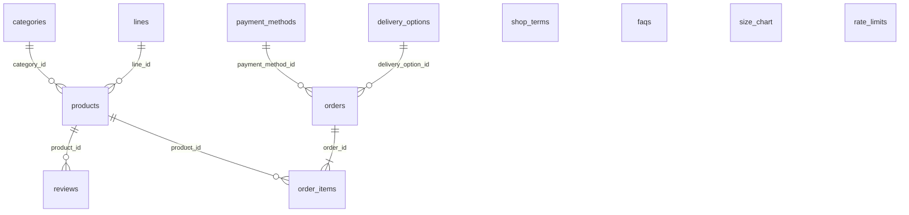
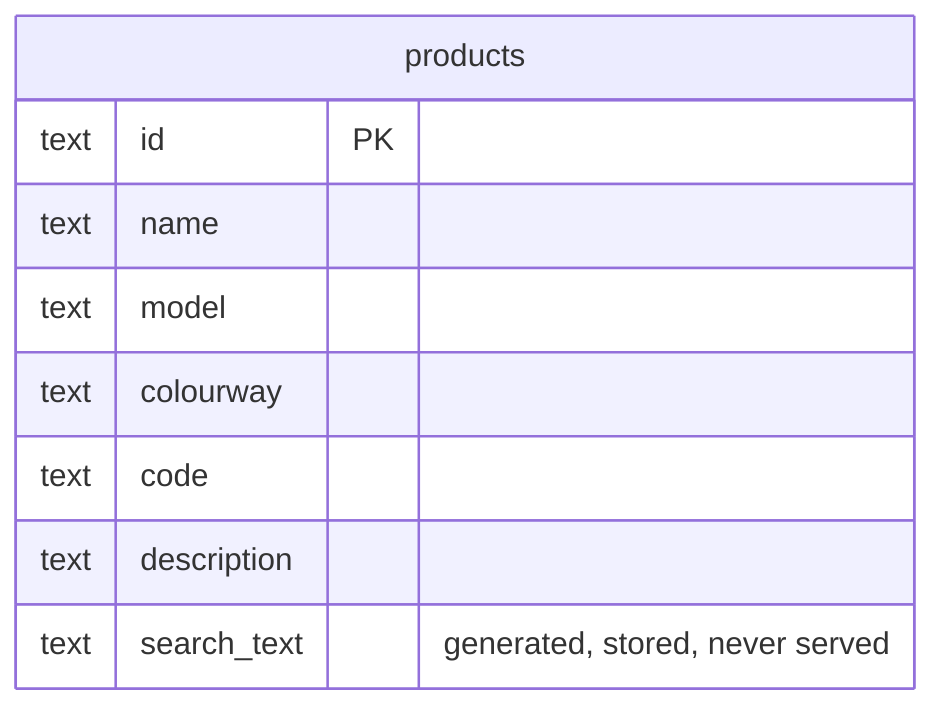
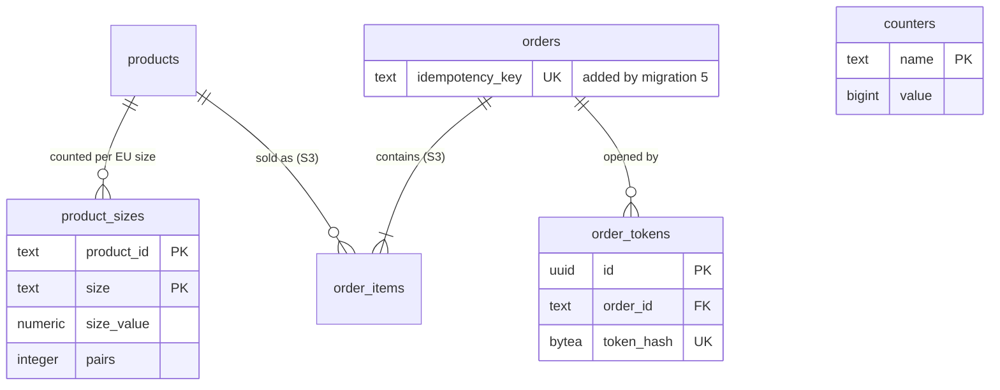
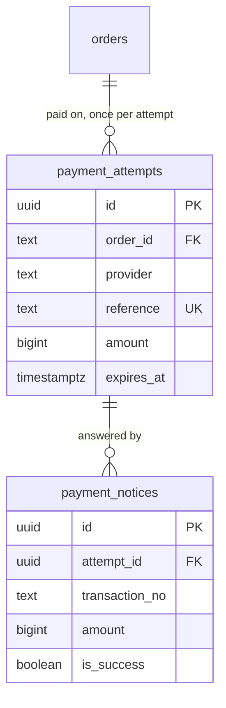
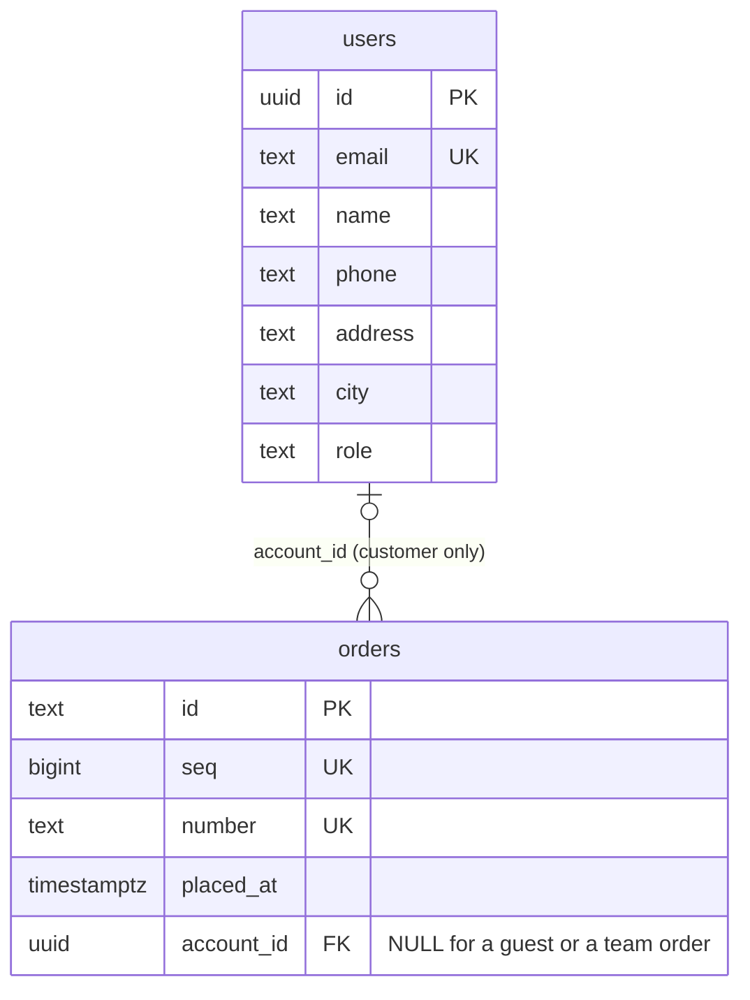
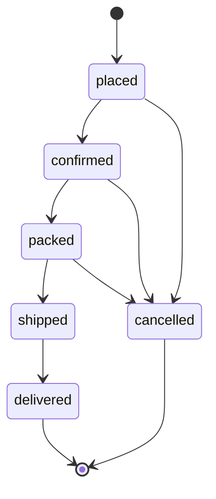

<!-- GENERATED from docs/architecture/erd/ — DO NOT EDIT THIS FILE.
     Every write here is overwritten the next time a story's technical design
     merges. This document is the whole contract and is what every reader,
     review and gate reads; it is assembled from one file per story so that
     twenty stories do not edit one file. Add or change what YOUR story needs
     in docs/architecture/erd/<your-story-slug>.md. -->

# Database Design (ERD) — Đôi

Engine: PostgreSQL 16 (pgx v5, hand-written parameterised SQL, no ORM)
Last updated: 2026-11-25
Source requirements: `docs/data/SRS.md` (DATA-001…005), `docs/catalogue/SRS.md` (CAT-001…004), `docs/orders/SRS.md` (ORD-001…023), `docs/payments/SRS.md` (PAY-001…022), `docs/admin/SRS.md` (ADMIN-001…031), `docs/accounts/SRS.md` (ACC-001…008). `docs/site/SRS.md` (SITE-001…016) was read and stores nothing of its own: every page it describes reads tables below. Stack and runner: `docs/architecture/overview.md`.

## 1. Overview

The schema stores four groups of data:

- **The catalogue** — the ten collections the approved design read from JSON (`products`, `lines`, `categories`, `reviews`, `faqs`, `shop_terms`, `delivery_options`, `payment_methods`, `size_chart`, `orders`), plus `product_sizes`, the one place pairs on the shelf are counted.
- **Orders and payment** — `orders` with its pairs (`order_items`), its access tokens (`order_tokens`), and VNPay/MoMo attempts and notices (`payment_attempts`, `payment_notices`).
- **People** — one `users` table for the admin, staff and customers, with `sessions`.
- **Plumbing** — `uploads` (shoe pictures), `rate_limits` (sign-in, sign-up and order-lookup locks), `counters` (the order-number counter).

Aggregate roots: `products` (owns `product_sizes` and `reviews`), `orders` (owns `order_items`, `order_tokens`, `payment_attempts` → `payment_notices`), `users` (owns `sessions`).

**Deliberately outside the database**

| What | Where it lives | Why |
|---|---|---|
| Contact-form messages (SITE-012) | Agent Team's own API; the owner reads them there | The brief says so; the backend has no endpoint and no table for it |
| The bag / cart (SITE-007) | The browser | Nothing is promised to a visitor until an order is placed |
| Order tokens a browser holds, "Ordered on this phone" (ORD-023) | The browser's storage | Per-browser by definition; the database holds only the token's hash |
| VNPay keys, MoMo keys, the shop's bank account (PAY-005, PAY-020) | Environment settings the owner supplies | Secrets and owner settings are not records; they are never returned by an API |
| Shop images under `/images/…` | The frontend's static files | Records hold the address only |
| Refunds (payments SRS §3) | VNPay's merchant portal | Not recorded by the shop |
| Delivery fee thresholds, express options | Nowhere | The owner chose free delivery on every order; `delivery_options` holds `standard` with fee 0 |

### 1.1 Decisions this design makes

| # | Decision | Reason, and what it costs |
|---|---|---|
| D1 | **Ids.** The ten collection tables keep the **text** ids the JSON and the routes use (`samba-og-w-core-black`, `doi-24817`, `r-01`). Every other table uses `uuid` (`gen_random_uuid()`, built in since PG 13). | The SRS acceptance criteria name the text ids and `/v1/<collection>/<id>` is public. Cost: a slug is a business-visible key — it is never changed after creation (ADMIN-010 item 4), and a CHECK keeps it URL-safe. |
| D2 | **Four tables are not named after their collection:** `delivery`→`delivery_options`, `payments`→`payment_methods`, `shop`→`shop_terms`, `sizes`→`size_chart`. | `payments` / `sizes` would collide with `payment_attempts` and `product_sizes`; `shop` is a singleton, not a plural. Cost: the generic reader maps collection → table through one allow-list. |
| D3 | **One count of pairs per shoe and EU size**: `product_sizes.pairs`. A shoe's `sizes`, `sizes_low`, `sizes_out` and `stock` are **derived** through the view `product_stock`, never stored (ORD-005, ADMIN-015 item 1: "there is no second copy of stock"). | Cost: the first data story (S3) must still seed those four fields exactly as the JSON has them (DATA-001 AC-2), so they exist as plain columns on `products` until the orders story (S5) moves them into `product_sizes` and drops them. §8 (migration 4) describes the step. |
| D4 | **An order holds its pairs in `order_items`.** The `orders` collection's `product`, `size` and `qty` fields are the order's first pair (`line_no = 1`), read with a lateral join. | ORD-003 item 5: orders hold several pairs; the 14 sample orders are one-pair orders. Cost: the generic reader needs one special case for `orders`. |
| D5 | **An order has many access tokens, each stored hashed** (`order_tokens`). | A lookup by number and phone must hand back "the token the order page reads with" (ORD-021) — for a sample order, or after the browser lost its token, there is none to return, and a stored hash cannot be reversed. The lookup mints a new token; so does a repeated submission with the same key (ORD-010 item 3). |
| D6 | **Search folds text in SQL with one function, `doi_fold(text)`**, and matches words with `strpos`. No extension (`unaccent`, `pg_trgm`) and no stored search column. | Extensions need privileges the project's database role may not have; `strpos` means `%` and `_` need no escaping (CAT-001 AC-8/9); no stored folded column means a renamed line or category can never leave a stale copy. Cost: no index serves `q`, so it scans — acceptable below ~20,000 shoes (§6). |
| D7 | **Order numbers come from a one-row counter** (`counters`, name `order_number`), incremented inside the order's transaction. | ORD-003 item 3: "one more than the highest number held, never repeating", with no gaps from refused orders. A `SEQUENCE` is not rolled back, so a refused order would burn a number. Cost: order placement serialises on one row for a few milliseconds. |
| D8 | **Locks are counters with a window**, one row per (scope, hashed subject): `rate_limits`. | ADMIN-003, ORD-022 and ACC-001 all need "N failures within a period, then refused until a time". In-memory would reset on restart. |
| D9 | **At most one admin row** (partial unique index). | "The shop is never left without an admin" and "the admin" are singular throughout ADMIN-003/031. Start-up updates that row if `ADMIN_EMAIL` changes instead of adding a second admin. |
| D10 | **Uploaded pictures are `bytea` rows in `uploads`.** | Forced by the runtime: the backend container is read-only with no volume (project decision `uploads_sessions`). The conventions prefer object storage; see §3.20 for the mitigations. |

## 2. Diagram

The diagram shows the **final** shape. Section 8 says which story creates which part.


Cardinality notation: `||` exactly one, `|o` / `o|` zero or one, `}o` / `o{` zero or many, `}|` / `|{` one or many. Read left to right. `shop_terms`, `faqs`, `size_chart`, `rate_limits` and `counters` have no foreign keys by design (§3).

### 2.1 Field-name mapping (API ↔ column)

The API keeps the JSON's field names (DATA-002 item 6). The generic reader (S3) builds its column allow-list from `schema.json` with these rules — nothing else is renamed:

| API field | Column | Rule |
|---|---|---|
| `_source`, `_invented` | `source`, `invented` | Leading underscore dropped; both are owner-only bookkeeping (DATA-004 item 2) |
| `products.line`, `products.category`, `reviews.product` | `line_id`, `category_id`, `product_id` | Every `ref:` field is `<key>_id` (foreign-key naming) |
| `orders.payment`, `orders.delivery` | `payment_method_id`, `delivery_option_id` | Text ids of the way to pay and delivery option |
| `orders.product`, `orders.size`, `orders.qty` | `order_items.product_id/size/qty` of `line_no = 1` | D4 |
| `products.sizes`, `sizes_low`, `sizes_out`, `stock` | view `product_stock` (after S5) | D3 |
| A nullable column the JSON writes as text (`eta`, a shoe's `line` / `category` when unset) or as a number (`since`, `cm`) | presented as `""` for text, `null` for numbers | A field never changes type: the frontend reads `string` fields. NULL exists only where `''` cannot be stored (a foreign key, a date) or `0` would be a sentinel (a number) |
| `date`, `timestamptz` columns | `released`, `date`, `eta` as `YYYY-MM-DD`; `placed_at` as RFC 3339 with `+07:00` | `services.md` fixes the exact format; the frontend already reads both date forms |
| Private order fields `phone`, `email`, `address`, `note` | same names | Selected only by dealer/owner read paths, never into a public type (overview §4) |

## 3. Entities

### 3.0 Rules applied to every table

- Names, keys and types follow the project's schema conventions: `snake_case` plural tables, `{table}_id` foreign keys, `timestamptz` (UTC) for every instant, `bigint` VND for money (VND has no minor unit), `text` plus `CHECK` for constrained text, no `pg enum`.
- `NOT NULL` is the default. For optional text, "not set" and "empty" mean the same thing, so the column is `NOT NULL DEFAULT ''`; NULL is used only where `''` cannot be stored (a foreign key, a date, a number) and each such column says why.
- Every table has `created_at` and `updated_at` (`timestamptz NOT NULL DEFAULT now()`), `updated_at` kept by one trigger function `set_updated_at()` (`BEFORE UPDATE`, one trigger per table named `trg_{table}_updated_at`) so no handler can forget it. **Exceptions, stated per table:** append-only tables (`order_items`, `order_tokens`, `payment_attempts`, `payment_notices`) have no `updated_at`; tables whose identity is a natural composite key (`product_sizes`, `rate_limits`) or a name (`counters`) have no surrogate `id`.
- Every foreign key states `ON DELETE` explicitly; `ON UPDATE` is `NO ACTION` everywhere because no key is ever changed (ids are immutable).
- Length limits of the admin SRS (200 characters, 5,000 for long text) and of checkout (ORD-002) are checked by the API, not by `CHECK`s: seeded text may predate them and the migration must not fail on it (DATA-001 item 3).
- Soft delete is used nowhere. Deletion rules come from ADMIN-014 and are expressed as `RESTRICT` / `CASCADE` below.

### 3.1 Columns every collection table has

Applies to `categories`, `lines`, `products`, `reviews`, `shop_terms`, `delivery_options`, `payment_methods`, `faqs`, `size_chart` and `orders`. Each table's section lists only its own columns after these.

| Column | Type | Null | Default | Unique | Description |
|---|---|---|---|---|---|
| `id` | `text` | no | — | PK | The record's id (D1). `CHECK ck_{table}_id_slug`: `id ~ '^[a-z0-9][a-z0-9._-]*$' AND length(id) <= 100` — every seeded id already matches; a seed that did not would fail loudly (DATA-001) |
| `seq` | `bigint` | no | `GENERATED ALWAYS AS IDENTITY` | `uq_{table}_seq` | Position in the seed, then insertion order: the stable order of every list and the tie-break of every sort (DATA-002 item 5, CAT-001 item 5). The seed inserts in file order |
| `source` | `text` | no | `''` | | The record's `_source` note (`owner`, `assumed`, `web:<url>`) |
| `invented` | `text[]` | no | `'{}'` | | The record's `_invented` list. Present on all ten tables because the seed files carry it on records of tables whose schema does not list it |
| `created_at` | `timestamptz` | no | `now()` | | |
| `updated_at` | `timestamptz` | no | `now()` | | |

**Lifecycle (all ten):** hard delete, under the rules of each section. `source` and `invented` are never returned to a caller with no session (DATA-004 item 2).

### 3.2 `categories`

**Purpose** — "For" groups: Women, Men, Kids. **Traces to** — DATA-001, CAT-002 item 2 (heading and picture), CAT-003, ADMIN-010/011/014.

| Column | Type | Null | Default | Unique | Description |
|---|---|---|---|---|---|
| *(§3.1)* | | | | | |
| `name` | `text` | no | — | | `CHECK ck_categories_name_not_blank`: `btrim(name) <> ''` (required by ADMIN-010) |
| `blurb` | `text` | no | `''` | | One line about it |
| `image` | `text` | no | `''` | | Picture address (a `/images/…` file or an `/api/v1/uploads/<name>` address) |

**Nullable columns** — none.

**Foreign keys** — none (it is referenced by `products.category_id`).

**Constraints** — as above. Name is not unique: the dealer may keep two categories with one name, and nothing in the SRS forbids it.

**Indexes** — none beyond the key (3 rows at launch).

**Lifecycle** — hard delete, refused with 409 while any shoe uses it (ADMIN-014 item 3), which the `RESTRICT` on `products.category_id` enforces underneath the API's message.

### 3.3 `lines`

**Purpose** — shoe lines (Samba, Gazelle…). **Traces to** — DATA-001, CAT-002/003, ADMIN-010/014.

| Column | Type | Null | Default | Unique | Description |
|---|---|---|---|---|---|
| *(§3.1)* | | | | | |
| `name` | `text` | no | — | | `CHECK ck_lines_name_not_blank` |
| `blurb` | `text` | no | `''` | | |
| `since` | `integer` | **yes** | — | | Year first made. `CHECK ck_lines_since_positive`: `since > 0` |
| `fit_note` | `text` | no | `''` | | "How it fits" |

**Nullable columns** — `since`: a line the dealer adds may not know the year; `''` or `0` would be a sentinel for "unknown". API shows NULL as `null`.

**Foreign keys** — none. **Indexes** — none beyond the key (5 rows). **Lifecycle** — hard delete, refused while a shoe uses it (`RESTRICT` on `products.line_id`, ADMIN-014 item 3).

### 3.4 `products`

**Purpose** — a shoe: what the shop sells, its price, pictures and display state. **Traces to** — DATA-001…005, CAT-001…003, ADMIN-010…015, SITE-004…006, ORD-004/005.

| Column | Type | Null | Default | Unique | Description |
|---|---|---|---|---|---|
| *(§3.1)* | | | | | |
| `name` | `text` | no | — | | `CHECK ck_products_name_not_blank` (required: ADMIN-010) |
| `model` | `text` | no | `''` | | Shoes with one model show as colour dots on each other's page |
| `line_id` | `text` | **yes** | — | | FK `lines` |
| `category_id` | `text` | **yes** | — | | FK `categories` |
| `price` | `bigint` | no | — | | VND. `CHECK ck_products_price_not_negative`: `price >= 0` (0 is allowed, ADMIN-010 AC-7) |
| `price_listed` | `text` | no | `''` | | Price on the source page; never returned to a visitor (DATA-004 item 2) |
| `status` | `text` | no | `'draft'` | | `CHECK ck_products_status`: `live` or `draft`. A shoe is public only when a person sets it live |
| `featured` | `boolean` | no | `false` | | Opens the home page. Unique partial index below: one at a time |
| `is_new` | `boolean` | no | `false` | | "New this month" |
| `description` | `text` | no | `''` | | |
| `code` | `text` | no | `''` | | Style code (searched) |
| `colourway` | `text` | no | `''` | | |
| `colour` | `text` | no | `''` | | Main colour. `CHECK ck_products_colour`: `''` or one of black, white, pink, purple, brown, yellow, blue, grey, green |
| `swatch` | `text` | no | `''` | | Dot colour (a CSS colour name the design reads) |
| `upper`, `lining`, `sole`, `fit` | `text` | no | `''` | | Detail lines |
| `care` | `text` | no | `''` | | |
| `released` | `date` | no | today, Vietnam time | | "In the shop since". The default means a shoe the dealer adds without a date sorts as the newest under "Newest first" (CAT-002 item 7). Default expression: `(now() AT TIME ZONE 'Asia/Ho_Chi_Minh')::date` |
| `rating` | `numeric(2,1)` | no | `0` | | Average of the shoe's live reviews' stars, one decimal. Stored, recalculated in the same transaction as every review change (ADMIN-013 item 2). Seeded values are placeholders until a review of that shoe first changes (ADMIN-013 item 4). `CHECK`: 0 to 5 |
| `review_count` | `integer` | no | `0` | | Number of the shoe's live reviews, same rule. `CHECK`: `>= 0` |
| `image` | `text` | no | `''` | | Side view |
| `image_back` | `text` | no | `''` | | Front pair — under the pointer on a card, second in the gallery |
| `image_detail` | `text` | no | `''` | | Back pair |
| **S3 only** `sizes`, `sizes_low`, `sizes_out` | `text[]` | no | `'{}'` | | Seeded exactly as the JSON has them (DATA-001 AC-2). **Dropped by S5** and served from `product_stock` (D3) |
| **S3 only** `stock` | `integer` | no | `0` | | Same: seeded as in the JSON, dropped by S5. `CHECK`: `>= 0` |

**Nullable columns**

- `line_id`, `category_id`: the schema does not make them required (only name and price are, ADMIN-010 item 2), and `''` cannot be a foreign key. API shows NULL as `""`.

**Foreign keys**

| Column | References | On delete | On update | Why |
|---|---|---|---|---|
| `line_id` | `lines(id)` | `RESTRICT` | `NO ACTION` | A line used by a shoe cannot be deleted (ADMIN-014 item 3); the API counts the shoes for its "<n> shoes use this" sentence |
| `category_id` | `categories(id)` | `RESTRICT` | `NO ACTION` | Same |

**Constraints** — the checks named above; `rating` between 0 and 5 (`ck_products_rating_range`), `review_count >= 0` (`ck_products_review_count`).

**Indexes**

| Name | Columns | Type | Query it serves |
|---|---|---|---|
| `uq_products_featured` | `(featured) WHERE featured` | unique, partial | "One shoe at a time opens the home page" (ADMIN-010 item 6) enforced by the database, and the home page's lookup of that shoe. The handler clears the old one in the same transaction before setting the new one; a concurrent second save loses the race with a unique violation and retries once |
| `idx_products_status_released_seq` | `(status, released DESC, seq)` | btree | The shop page's default: live shoes, "Newest first", twelve at a time, ties in seed order (CAT-002 items 1, 7) |
| `idx_products_line_id` | `(line_id)` | btree | "Shoes of a line" filter (CAT-003) and the "<n> shoes use this" count before deleting a line |
| `idx_products_category_id` | `(category_id)` | btree | Same for categories |

Searching, price, colour and rating filters scan: a shoe list is hundreds of rows, and no index could serve `strpos` over folded text (D6, §5 pattern 2).

**Lifecycle** — hard delete. A shoe that any `order_items` row names cannot be deleted (`RESTRICT`, ADMIN-014 item 1): "set it to draft instead". A shoe with no order is deleted together with its reviews and its `product_sizes` (both `CASCADE`, ADMIN-014 item 2). Draft shoes stay readable by the dealer and by the orders that name them (ADMIN-014 AC-2).

### 3.5 `reviews`

**Purpose** — a customer's review of a shoe, entered and hidden by the dealer. **Traces to** — DATA-001, CAT-001 item 2, ADMIN-010, ADMIN-013, SITE-006.

| Column | Type | Null | Default | Unique | Description |
|---|---|---|---|---|---|
| *(§3.1)* | | | | | |
| `product_id` | `text` | no | — | | FK `products` (API field `product`) |
| `name` | `text` | no | — | | The customer's name. `CHECK ck_reviews_name_not_blank` |
| `rating` | `smallint` | **yes** | — | | Stars. `CHECK ck_reviews_rating_range`: `rating BETWEEN 1 AND 5` |
| `date` | `date` | no | today, Vietnam time | | Review date. Named as the API field; `date` is not a reserved word in PostgreSQL |
| `size_bought` | `text` | no | `''` | | |
| `fit` | `text` | no | `''` | | `CHECK ck_reviews_fit`: `''`, `small`, `true` or `large` |
| `body` | `text` | no | `''` | | The review text |
| `status` | `text` | no | `'live'` | | `CHECK ck_reviews_status`: `live` (shown) or `hidden`. Only the dealer creates reviews, so a new one is shown unless hidden |

**Nullable columns** — `rating`: the schema does not require stars (only shoe and customer are, ADMIN-010 item 2). A review without stars counts in `review_count` and is left out of the average.

**Foreign keys**

| Column | References | On delete | On update | Why |
|---|---|---|---|---|
| `product_id` | `products(id)` | `CASCADE` | `NO ACTION` | A review has no meaning without its shoe; ADMIN-014 item 2 deletes a shoe with its reviews. Blast radius: only the dealer can delete a shoe, and only one no order refers to |

**Constraints** — the checks above.

**Indexes**

| Name | Columns | Type | Query it serves |
|---|---|---|---|
| `idx_reviews_product_id_date` | `(product_id, date DESC, seq)` | btree | "That shoe's reviews, newest first" (CAT-001 AC-28, SITE-006) and the rating recalculation `WHERE product_id = $1 AND status = 'live'` |

**Lifecycle** — hard delete, always allowed (ADMIN-014 item 4). The shoe's and the shop's `rating`/`review_count` are recalculated in the same transaction.

### 3.6 `shop_terms`

**Purpose** — the singleton record of the shop's terms and figures (`GET /v1/shop/shop`). **Traces to** — DATA-001 items 1–3, DATA-003 AC-2, ADMIN-013 item 3, SITE-009/011.

| Column | Type | Null | Default | Unique | Description |
|---|---|---|---|---|---|
| *(§3.1)* | | | | | `id` is always `shop` |
| `standard_days` | `text` | no | `''` | | "2–4"; the longest number is the working days an order's expected date adds (ORD-003 item 3) |
| `dispatch_cutoff` | `text` | no | `''` | | `15:00`, Vietnam time |
| `reply_time` | `text` | no | `''` | | "the same working day" |
| `rating` | `numeric(2,1)` | no | `0` | | Average over the live reviews of live shoes (ADMIN-013 item 3). Seeded 4.8 is a placeholder until a review event recalculates it. `CHECK`: 0 to 5 |
| `review_count` | `integer` | no | `0` | | Count over the same reviews. `CHECK`: `>= 0` |

There are no columns for free-delivery threshold, express days or cities, exchange days or refund days: the owner chose free delivery and "no exchanges", so the data story seeds none of them even if a stale JSON file still carries them (DATA-001 item 3).

**Nullable columns** — none. **Foreign keys** — none.

**Constraints** — `ck_shop_terms_singleton`: `id = 'shop'` (one record, DATA-003 AC-2). **Indexes** — none (one row). **Lifecycle** — never created or deleted by the API; updated only by the rating recalculation and, later, by the dealer if a story adds an editor.

### 3.7 `delivery_options`

**Purpose** — how an order is delivered. After "Free delivery on every order" it holds one record, `standard`, fee 0. **Traces to** — DATA-001 AC-9, ORD-003 items 2, 8, SITE-016.

| Column | Type | Null | Default | Unique | Description |
|---|---|---|---|---|---|
| *(§3.1)* | | | | | |
| `name` | `text` | no | — | | `CHECK ck_delivery_options_name_not_blank` |
| `days` | `text` | no | `''` | | "2–4 working days" |
| `fee` | `bigint` | no | `0` | | VND, `CHECK ck_delivery_options_fee_not_negative`: `fee >= 0`. Always 0 at launch |
| `note` | `text` | no | `''` | | |

**Nullable columns** — none. **Foreign keys** — none (referenced by `orders.delivery_option_id`). **Indexes** — none (1 row). **Lifecycle** — seed-managed; hard delete is refused by `RESTRICT` while any order uses it.

### 3.8 `payment_methods`

**Purpose** — the ways to pay the shop knows (`cod`, `bank`, `vnpay`, `momo`). All four rows stay in the table although only VNPay is offered at launch (ORD-006 item 2). **Traces to** — DATA-001, ORD-006, PAY-020…022.

| Column | Type | Null | Default | Unique | Description |
|---|---|---|---|---|---|
| *(§3.1)* | | | | | |
| `name` | `text` | no | — | | `CHECK ck_payment_methods_name_not_blank` |
| `note` | `text` | no | `''` | | What happens |
| `online` | `boolean` | no | `false` | | Paid online |
| `icon` | `text` | no | `''` | | The design's icon key (returned; not private) |

Whether a method is **offered** is not stored: it is code plus the owner's settings (VNPay needs both keys; VietQR needs the shop's bank account; MoMo needs its keys; cash on delivery is never offered). A stored flag would drift from the settings it depends on.

**Nullable columns** — none. **Foreign keys** — none (referenced by `orders.payment_method_id`). **Indexes** — none (4 rows). **Lifecycle** — seed-managed; delete refused by `RESTRICT` while an order uses it.

### 3.9 `faqs`

**Purpose** — the questions on the Returns, Delivery, Size chart, Payment and Track pages. Public. **Traces to** — DATA-001, DATA-004 item 5, SITE-008…010.

| Column | Type | Null | Default | Unique | Description |
|---|---|---|---|---|---|
| *(§3.1)* | | | | | |
| `topic` | `text` | no | — | | `CHECK ck_faqs_topic`: `shipping`, `returns`, `sizing`, `payment` or `orders` |
| `question` | `text` | no | — | | `CHECK ck_faqs_question_not_blank` |
| `answer` | `text` | no | `''` | | |

**Nullable columns** — none. **Foreign keys** — none.

**Indexes** — none: `GET /v1/faqs?topic=returns` reads a table of a few dozen rows. **Lifecycle** — seed-managed; no admin screen exists for it.

### 3.10 `size_chart`

**Purpose** — the EU/UK/US/foot-length chart. **Traces to** — DATA-001 AC-3, SITE-008.

| Column | Type | Null | Default | Unique | Description |
|---|---|---|---|---|---|
| *(§3.1)* | | | | | |
| `eu` | `text` | no | — | `uq_size_chart_eu` | EU size as written (`35 1/2`) |
| `uk` | `text` | no | `''` | | |
| `us_m` | `text` | no | `''` | | US men |
| `us_w` | `text` | no | `''` | | US women |
| `cm` | `numeric(4,1)` | **yes** | — | | Foot length in cm (`21.6`), returned as a JSON number. `CHECK`: `cm > 0` |

**Nullable columns** — `cm`: a row whose length is not known has no number; `0` would be a sentinel. API shows `null`.

**Foreign keys** — none. It is deliberately **not** referenced by `product_sizes`: staff may list a size the chart does not (a kids' EU 28), and a foreign key would block it.

**Indexes** — none beyond the keys (17 rows). **Lifecycle** — seed-managed; no admin screen.

### 3.11 `product_sizes` and the view `product_stock`

**Purpose** — the one count of pairs on the shelf for each EU size of each shoe. Created by S5 (D3). **Traces to** — ORD-004, ORD-005, ADMIN-015, ADMIN-020, CAT-001 item 6, SITE-005.

| Column | Type | Null | Default | Unique | Description |
|---|---|---|---|---|---|
| `product_id` | `text` | no | — | PK (1/2) | FK `products` |
| `size` | `text` | no | — | PK (2/2) | EU size as written: `38`, `36 2/3`, `35 1/2`. `CHECK ck_product_sizes_size_not_blank`: `btrim(size) <> '' AND length(size) <= 20` |
| `size_value` | `numeric(5,2)` | no | — | | The size as a number, written by the API from `size` (`38` → 38.00, `36 2/3` → 36.67, `35 1/2` → 35.50): the ordering key for "growing order" in a shoe's `sizes` list and in the Size (EU) pills (CAT-002 item 8). A size the API cannot read as a number is refused with 422 naming the size. `CHECK`: `size_value > 0` |
| `pairs` | `integer` | no | `0` | | Pairs on the shelf. `CHECK ck_product_sizes_pairs_not_negative`: `pairs >= 0` — the database floor under "never a count below 0" (ORD-004 item 2) |
| `created_at`, `updated_at` | `timestamptz` | no | `now()` | | |

**Key** — composite primary key `(product_id, size)`: the row has no identity beyond "this shoe, this size", nothing references it, and it is deleted with either parent. This is the one table with a composite key that is not a pure join table; the alternative (a uuid nobody ever uses) adds an index for nothing.

**Nullable columns** — none.

**Foreign keys**

| Column | References | On delete | On update | Why |
|---|---|---|---|---|
| `product_id` | `products(id)` | `CASCADE` | `NO ACTION` | Counts have no meaning without the shoe (ADMIN-014 item 2). There is **no** foreign key from `order_items` to this table: taking a size off a shoe removes its count (ADMIN-015 item 3) and must not be blocked by old orders |

**Constraints** — the checks above. No cross-row rule: the three states are derived (below).

**Indexes**

| Name | Columns | Type | Query it serves |
|---|---|---|---|
| *(primary key)* | `(product_id, size)` | btree | The conditional decrement `UPDATE … SET pairs = pairs - $q WHERE product_id = $1 AND size = $2 AND pairs >= $q` (ORD-004); the staff count change `… SET pairs = $new WHERE … AND pairs = $seen` (ADMIN-015 item 4, 409 on zero rows); cancel's `pairs = pairs + $q`; a shoe's sizes |
| `idx_product_sizes_size_in_stock` | `(size, product_id) WHERE pairs > 0` | btree, partial | `size=a,b` filter: "at least one given size is listed and not sold out — a size on its last pairs still counts" (CAT-001 item 6) |

**Lifecycle** — hard delete: a row goes when staff take the size off the shoe or the shoe is deleted. If an order is cancelled after its size was taken off the shoe, the pairs have nowhere to return and the update changes zero rows; that is correct (the size no longer exists).

**The view `product_stock`** — the derived figures. It is the only source of a shoe's `sizes`, `sizes_low`, `sizes_out` and `stock` (the API's field names), so no list or total can disagree with the counts (ADMIN-015 item 2, ORD-005 item 1):

```sql
CREATE VIEW product_stock AS
SELECT p.id AS product_id,
       coalesce(array_agg(s.size ORDER BY s.size_value, s.size)
                FILTER (WHERE s.size IS NOT NULL), '{}'::text[])        AS sizes,
       coalesce(array_agg(s.size ORDER BY s.size_value, s.size)
                FILTER (WHERE s.pairs BETWEEN 1 AND 2), '{}'::text[])   AS sizes_low,
       coalesce(array_agg(s.size ORDER BY s.size_value, s.size)
                FILTER (WHERE s.pairs = 0), '{}'::text[])               AS sizes_out,
       coalesce(sum(s.pairs), 0)::integer                               AS stock
FROM products p
LEFT JOIN product_sizes s ON s.product_id = p.id
GROUP BY p.id;
```

0 pairs is sold out, 1 or 2 is "last pairs", 3 or more is in neither list. The overview's "running low" (a size with 1–2 pairs and fewer than 15 pairs in all, ADMIN-020) reads the same view.

### 3.12 `orders`

**Purpose** — one placed order: who, where, how it is paid and where it stands. The pairs are in `order_items` (D4). **Traces to** — DATA-001, DATA-004, ORD-002…010, ORD-020…023, ADMIN-016, ADMIN-020, PAY-001…003, ACC-003…006.

| Column | Type | Null | Default | Unique | Description |
|---|---|---|---|---|---|
| *(§3.1)* | | | | | `id` is `doi-<n>`; created by the API, never by the client |
| `number` | `text` | no | — | `uq_orders_number` | `DOI-<n>`. `CHECK ck_orders_number_format`: `number ~ '^DOI-[0-9]+$'`. Lookup normalises the typed digits to this form and reads by this index (ORD-021) |
| `placed_at` | `timestamptz` | no | `now()` | | Seeds are written without a zone and are read as Vietnam time (`+07:00`) (ADMIN-020 item 3) |
| `status` | `text` | no | `'placed'` | | `CHECK ck_orders_status`: `placed`, `confirmed`, `packed`, `shipped`, `delivered`, `cancelled`. Allowed steps (one forward at a time; cancel from the first three) are enforced by the API with `UPDATE … WHERE status = $from`, not by the database |
| `payment_method_id` | `text` | no | — | | FK `payment_methods` (API field `payment`) |
| `paid` | `boolean` | no | `false` | | Set by a verified notice (PAY-002) or, from S11, by the dealer for a bank transfer (PAY-020) — by `UPDATE … WHERE NOT paid` so a repeated notice pays once |
| `delivery_option_id` | `text` | no | — | | FK `delivery_options` (API field `delivery`); always `standard` (ORD-003 item 8) |
| `delivery_fee` | `bigint` | no | `0` | | The fee as sold; 0 at launch (ORD-003 AC-3). `CHECK ck_orders_delivery_fee_not_negative`. Not in `schema.json`, so not in the generic reader |
| `carrier` | `text` | no | `''` | | Set by the dealer |
| `tracking` | `text` | no | `''` | | Set by the dealer |
| `eta` | `date` | **yes** | — | | Expected date |
| `customer` | `text` | no | — | | Name. `CHECK ck_orders_customer_not_blank` |
| `phone` | `text` | no | — | | **Private.** `CHECK ck_orders_phone_not_blank`. Compared by digits with a leading `84` read as `0` (ORD-021 item 3) |
| `email` | `text` | no | `''` | | **Private.** Checkout has no email field today; the dealer may add one |
| `address` | `text` | no | — | | **Private.** `CHECK ck_orders_address_not_blank` |
| `city` | `text` | no | — | | City or province; public. `CHECK ck_orders_city_not_blank` |
| `note` | `text` | no | `''` | | **Private.** The courier note typed at checkout and the dealer's internal note are one field (ORD-002, ADMIN-016 item 5) |
| `total` | `bigint` | no | — | | VND. The shop's own sum of `unit_price × qty` plus `delivery_fee`; no client ever sends one (ORD-003 item 2). `CHECK ck_orders_total_not_negative` |
| `is_sample` | `boolean` | no | `false` | | True for the 14 orders seeded from the first design. The 30-minute rule never cancels them (PAY-003 item 4), so the figures in ADMIN-020 hold |
| `account_id` | `uuid` | **yes** | — | | **Added by S14.** FK `users`: the customer account an order is linked to (ACC-005). Set only for a session of role `customer`; NULL for a guest and for a team member's order |
| `idempotency_key` | `text` | **yes** | — | `uq_orders_idempotency_key` | **Added by S5.** The client's key for one submission (ORD-010 item 3). `CHECK ck_orders_idempotency_key_length`: `length BETWEEN 8 AND 100` |

**Nullable columns**

- `eta`: a cancelled order, or one the dealer has not dated, has no expected date; there is no empty date. API shows NULL as `""`.
- `account_id`: a guest order, or one placed by an admin or staff session, belongs to no account (ACC-005 items 3, 5).
- `idempotency_key`: the 14 seeded orders were never submitted by a client.

**Foreign keys**

| Column | References | On delete | On update | Why |
|---|---|---|---|---|
| `payment_method_id` | `payment_methods(id)` | `RESTRICT` | `NO ACTION` | History must keep saying how an order was paid |
| `delivery_option_id` | `delivery_options(id)` | `RESTRICT` | `NO ACTION` | Same |
| `account_id` | `users(id)` | `SET NULL` | `NO ACTION` | The order is history the shop keeps (and the buyer's details are on it); losing the account must not lose the order. No endpoint deletes a customer today (ACC out of scope), so this is a safety net |

**Constraints** — the checks above. Which fields change after which status (ADMIN-016 items 4–5) and who may read what (ORD-008) are API rules.

**Indexes**

| Name | Columns | Type | Query it serves |
|---|---|---|---|
| `uq_orders_number` | `(number)` | unique | Lookup by number and phone (ORD-021), the dealer's number search, the placement's uniqueness guard |
| `uq_orders_idempotency_key` | `(idempotency_key)` | unique (NULLs are distinct) | "Same key again returns the first order" (ORD-010 AC-4); two tabs at once make one order |
| `idx_orders_placed_at` | `(placed_at DESC)` | btree | The dealer's list "newest first", the overview's five latest orders, this month's sales and the 14-day series (a range on `placed_at`) |
| `idx_orders_status_placed_at` | `(status, placed_at DESC)` | btree | The dealer's Status filter and the "waiting to be packed" count (`status IN ('placed','confirmed')`) |
| `idx_orders_payment_method_id_placed_at` | `(payment_method_id, placed_at DESC)` | btree | The dealer's Payment filter (ADMIN-011 item 2). `delivery_option_id` has no index: it has one value and no screen filters on it |
| `idx_orders_account_id_placed_at` | `(account_id, placed_at DESC) WHERE account_id IS NOT NULL` | btree, partial | **S14.** "My orders", newest first, ten at a time (ACC-003); "is this order mine" |
| `idx_orders_unpaid_open` | `(placed_at) WHERE NOT paid AND NOT is_sample AND status IN ('placed','confirmed','packed')` | btree, partial | **S7.** The once-a-minute ticker that gives up unpaid online orders after 30 minutes (PAY-003) and the 24-hour bank-transfer rule (PAY-020): the candidate set is tiny, so the scan is too |

Order search (`q` = number or customer, CAT-001 item 2) scans the orders the filters leave: the dealer's list is admin-only and 10,000 orders is a sequential scan of a few milliseconds.

**Lifecycle** — hard delete, only a cancelled order (ADMIN-014 item 5; the API answers 409 "Cancel the order first." otherwise). Deleting removes its items, tokens and payment attempts (`CASCADE` from each). A cancelled order that was also paid (a late VNPay notice, PAY-002 item 9) carries a payment record the dealer may still need to refund against; the API therefore refuses to delete an order with `paid = true` (open question Q3).

**Placement contract (one transaction, S5).** Lock order matters, so two orders never deadlock: (1) for each pair, sorted by `(product_id, size)`, the conditional decrement on `product_sizes`; (2) `UPDATE counters SET value = value + 1 WHERE name = 'order_number' RETURNING value`; (3) insert `orders`, then `order_items`, then `order_tokens`. A failed decrement rolls the whole transaction back, so no pair leaves the shelf and no number is used (ORD-004 items 1–3).

### 3.13 `order_items`

**Purpose** — one pair line of an order: shoe, EU size, quantity and the price it was sold at. **Traces to** — ORD-003 items 4–5, ADMIN-014 item 1, ADMIN-016 item 6, ADMIN-020.

| Column | Type | Null | Default | Unique | Description |
|---|---|---|---|---|---|
| `id` | `uuid` | no | `gen_random_uuid()` | PK | |
| `order_id` | `text` | no | — | `uq_order_items_order_id_line_no` (1/2) | FK `orders` |
| `line_no` | `smallint` | no | — | `uq_order_items_order_id_line_no` (2/2) | 1, 2, … in the order the pairs were sent. `CHECK`: `line_no > 0`. Line 1 is "the order's shoe" in lists (ADMIN-016 item 7) |
| `product_id` | `text` | no | — | | FK `products` |
| `size` | `text` | no | — | | EU size as sold. No foreign key to `product_sizes` (see §3.11) |
| `qty` | `integer` | no | — | | `CHECK ck_order_items_qty_positive`: `qty > 0` |
| `unit_price` | `bigint` | no | — | | VND per pair **as sold**: a later price change does not touch it (ORD-003 AC-13). `CHECK`: `unit_price >= 0` |
| `created_at` | `timestamptz` | no | `now()` | | Append-only: the dealer cannot change an order's pairs (ADMIN-016 item 5), so there is no `updated_at` |

**Nullable columns** — none.

**Foreign keys**

| Column | References | On delete | On update | Why |
|---|---|---|---|---|
| `order_id` | `orders(id)` | `CASCADE` | `NO ACTION` | A pair line has no meaning without its order; orders are deletable only when cancelled |
| `product_id` | `products(id)` | `RESTRICT` | `NO ACTION` | A shoe an order refers to cannot be deleted (ADMIN-014 item 1) |

**Indexes**

| Name | Columns | Type | Query it serves |
|---|---|---|---|
| `uq_order_items_order_id_line_no` | `(order_id, line_no)` | unique | An order's pairs in order; the lateral "first pair" join the orders collection uses |
| `idx_order_items_product_id` | `(product_id)` | btree | "Does any order refer to this shoe" before a delete (ADMIN-014); pairs sold by line in the overview (join to `products.line_id`) |

**Lifecycle** — never updated; removed only with its order.

**Seeding the sample orders (S3).** Each of the 14 orders gets one line: `line_no = 1`, the file's `product`, `size` and `qty`, and `unit_price = total / qty`. The price **as sold** is used, not the shoe's current price: after "Free delivery on every order" `doi-24815` totals 5.890.000 ₫ while its shoe lists 5.940.000 ₫, and the order must keep reading 5.890.000 ₫ (DATA-001 AC-10). Every sample total is divisible by its quantity; the migration asserts it and fails loudly if not.

### 3.14 `order_tokens`

**Purpose** — the unguessable tokens that let a browser read one order (ORD-008). An order has many: one returned at placement, a fresh one for every successful lookup, a fresh one for a repeated submission. **Traces to** — ORD-003 items 6–7, ORD-008, ORD-010 item 3, ORD-021.

| Column | Type | Null | Default | Unique | Description |
|---|---|---|---|---|---|
| `id` | `uuid` | no | `gen_random_uuid()` | PK | |
| `order_id` | `text` | no | — | | FK `orders` |
| `token_hash` | `bytea` | no | — | `uq_order_tokens_token_hash` | SHA-256 of the token (32 bytes), `CHECK`: `octet_length(token_hash) = 32`. The token itself (≥128 bits from `crypto/rand`) exists only in the answer and the customer's browser, never in the database or a log |
| `created_at` | `timestamptz` | no | `now()` | | Append-only; no `updated_at` |

**Nullable columns** — none.

**Foreign keys** — `order_id` → `orders(id)` `ON DELETE CASCADE`: a token opens one order and is meaningless without it.

**Indexes**

| Name | Columns | Type | Query it serves |
|---|---|---|---|
| `uq_order_tokens_token_hash` | `(token_hash)` | unique | "Read this order with this token": `WHERE token_hash = $1 AND order_id = $2` (ORD-008); the unique index also makes a hash collision impossible to store silently |
| `idx_order_tokens_order_id` | `(order_id)` | btree | Cascading an order's delete |

**Lifecycle** — no expiry is specified (the browser keeps the token for as long as it likes); rows go with their order. At one row per lookup, which is itself rate-limited, growth is negligible.

### 3.15 `counters`

**Purpose** — the order-number counter (D7). **Traces to** — ORD-003 item 3 and AC-1/2.

| Column | Type | Null | Default | Unique | Description |
|---|---|---|---|---|---|
| `name` | `text` | no | — | PK | `order_number`. `CHECK`: `btrim(name) <> ''` |
| `value` | `bigint` | no | `0` | | The highest number issued. `CHECK`: `value >= 0`. S5's migration sets it to the highest seeded number (24817), so the next order is `DOI-24818` |
| `updated_at` | `timestamptz` | no | `now()` | | |

No surrogate `id` and no `created_at`: the name is the identity of a counter, and a counter is never deleted. **Nullable columns** — none. **Foreign keys** — none. **Indexes** — the key. **Lifecycle** — never deleted; incremented only inside the order transaction. Because `UPDATE` locks the row until commit, two simultaneous orders get different numbers, and deleting the newest cancelled order (ADMIN-014 item 5) can never cause a number to be issued twice.

### 3.16 `payment_attempts`

**Purpose** — one attempt to pay an order on a provider's page; every "Pay now" or "Try again" is a new row with a new reference. **Traces to** — PAY-001 items 1–5, PAY-004, PAY-021 item 2.

| Column | Type | Null | Default | Unique | Description |
|---|---|---|---|---|---|
| `id` | `uuid` | no | `gen_random_uuid()` | PK | |
| `order_id` | `text` | no | — | | FK `orders` |
| `provider` | `text` | no | — | | `CHECK ck_payment_attempts_provider`: `vnpay` or `momo`. Bank transfer has no attempt: its QR is static and the dealer marks it paid (PAY-020) |
| `reference` | `text` | no | — | `uq_payment_attempts_reference` | The reference sent to the provider (VNPay's `vnp_TxnRef`), different for every attempt and holding the order number (PAY-001 AC-1, AC-3). `CHECK`: `length(reference) BETWEEN 1 AND 100` (VNPay's limit). Every earlier reference still leads to its order (item 5) |
| `amount` | `bigint` | no | — | | VND, read from `orders.total` when the attempt is made, never from the browser (PAY-001 item 3). `CHECK`: `amount >= 0`. VNPay's ×100 unit is applied only when building and checking the address |
| `expires_at` | `timestamptz` | no | — | | The order's 30-minute deadline, `placed_at + 30 minutes`; the payment page stops accepting payment then (PAY-001 AC-6) |
| `created_at` | `timestamptz` | no | `now()` | | Append-only; no `updated_at` |

**Nullable columns** — none.

**Foreign keys** — `order_id` → `orders(id)` `ON DELETE CASCADE`: an attempt has no meaning without its order; the API refuses to delete a paid order (§3.12).

**Indexes**

| Name | Columns | Type | Query it serves |
|---|---|---|---|
| `uq_payment_attempts_reference` | `(reference)` | unique | The notice and the return page find the order from the provider's reference (PAY-002 item 2, PAY-004 item 1) |
| `idx_payment_attempts_order_id` | `(order_id)` | btree | An order's attempts and its transaction number; cascading an order's delete |

**Lifecycle** — removed only with its order.

### 3.17 `payment_notices`

**Purpose** — what the provider told the shop about an attempt, kept for each **verified** notice: the order's "paid" badge and VNPay transaction number come from here. **Traces to** — PAY-002 items 3–9, ADMIN-016 item 4 / AC-9, PAY-021 item 3.

| Column | Type | Null | Default | Unique | Description |
|---|---|---|---|---|---|
| `id` | `uuid` | no | `gen_random_uuid()` | PK | |
| `attempt_id` | `uuid` | no | — | | FK `payment_attempts` |
| `transaction_no` | `text` | no | — | | The provider's transaction number (`vnp_TransactionNo`) |
| `bank_code` | `text` | no | `''` | | Bank or card scheme the customer paid with |
| `amount` | `bigint` | no | — | | VND the provider says it took (converted from VNPay's ×100). `CHECK`: `amount >= 0` |
| `response_code` | `text` | no | — | | `vnp_ResponseCode` (`00` = success) |
| `transaction_status` | `text` | no | `''` | | `vnp_TransactionStatus` |
| `is_success` | `boolean` | no | — | | Response code `00` **and** transaction status `00` (PAY-002 item 4), decided once by the API when the row is written |
| `paid_time` | `timestamptz` | **yes** | — | | The provider's payment time (`vnp_PayDate`, Vietnam time) |
| `received_at` | `timestamptz` | no | `now()` | | When the shop received it. Append-only; no `updated_at` |

**Only verified notices are stored** — signature valid and reference known. A notice with a bad signature, unknown reference or wrong amount changes nothing (PAY-002 item 7) and is only logged: the notice address needs no sign-in (item 1), so storing what strangers send would let anyone fill this table.

**Nullable columns** — `paid_time`: a failed or cancelled payment has no payment time.

**Foreign keys** — `attempt_id` → `payment_attempts(id)` `ON DELETE CASCADE`: a notice is the record of one attempt.

**Indexes**

| Name | Columns | Type | Query it serves |
|---|---|---|---|
| `uq_payment_notices_attempt_id_success` | `(attempt_id) WHERE is_success` | unique, partial | Two copies of one success notice at the same moment keep one transaction (PAY-002 AC-4): the second insert conflicts and the API answers `02`. Failed notices may repeat |
| `idx_payment_notices_attempt_id` | `(attempt_id)` | btree | An order's transaction number: attempts of the order joined to their success notice |

**Lifecycle** — removed only with its order. "Paid exactly once" is *not* enforced here but by the conditional `UPDATE orders SET paid = true WHERE id = $1 AND NOT paid` in the same transaction as the notice insert.

### 3.18 `users`

**Purpose** — every person who signs in: the admin, staff and customers. **Traces to** — ADMIN-001…004, ADMIN-030, ADMIN-031, ACC-001…008.

| Column | Type | Null | Default | Unique | Description |
|---|---|---|---|---|---|
| `id` | `uuid` | no | `gen_random_uuid()` | PK | Exposed in `/v1/admin/staff/<id>`, so a uuid, not a counter |
| `email` | `text` | no | — | `uq_users_email` | Stored lower-case by the API, so uniqueness is case-insensitive **across all roles** (ADMIN-001 boundary, ACC-001 item 4, ADMIN-030 item 2). `CHECK ck_users_email_lowercase`: `email = lower(email) AND email <> '' AND length(email) <= 200` |
| `name` | `text` | no | `''` | | At most 100 characters (API). Empty for the admin made from settings: the displayed name is then the email's local part, capitalised (ADMIN-002 item 2) |
| `phone` | `text` | no | `''` | | Customers only (ACC-001, ACC-004); empty for the team |
| `address` | `text` | no | `''` | | Saved delivery details, customers only (ACC-004) |
| `city` | `text` | no | `''` | | Same |
| `password_hash` | `text` | no | — | | argon2id encoded string (`$argon2id$v=19$m=19456,t=2,p=1$<salt>$<hash>`): salted, slow, never returned, shown or logged. `CHECK`: `password_hash <> ''` |
| `role` | `text` | no | — | | `CHECK ck_users_role`: `admin`, `staff` or `customer`. No endpoint changes it (ADMIN-031 item 5) |
| `is_active` | `boolean` | no | `true` | | Switched-off accounts cannot sign in and their requests answer 401 at once, because every request re-reads this row (ADMIN-031 item 3) |
| `created_at`, `updated_at` | `timestamptz` | no | `now()` | | |

**Nullable columns** — none.

**Foreign keys** — none out. Referenced by `sessions` (`CASCADE`), `orders.account_id` (`SET NULL`), `uploads.uploaded_by` (`SET NULL`).

**Constraints** — the checks above; `uq_users_one_admin`: `CREATE UNIQUE INDEX … ON users ((true)) WHERE role = 'admin'` (D9). Start-up makes the admin by updating the existing admin row (email, password hash, `is_active = true`) or inserting it when none exists (ADMIN-003 item 1). A password under 10 characters leaves the table untouched (item 3).

**Indexes**

| Name | Columns | Type | Query it serves |
|---|---|---|---|
| `uq_users_email` | `(email)` | unique | Sign-in (`WHERE email = $1`), sign-up and staff creation conflicts (409 / 422) |
| `uq_users_one_admin` | `((true)) WHERE role = 'admin'` | unique, partial | At most one admin row |

The staff list (`role IN ('admin','staff')`, ADMIN-030) scans a table of a few staff plus customers; at 100,000 customers it would want `idx_users_team (role) WHERE role <> 'customer'`, which is not added now because no volume is promised.

**Lifecycle** — hard delete for **staff only** (ADMIN-031 item 4): the account and its sessions go, the email can be reused, and what the person saved stays (`uploads.uploaded_by` and the like are `SET NULL`, orders never reference a team member). The admin row is never deleted, switched off or re-roled (409). Customers are never deleted (out of scope).

### 3.19 `sessions`

**Purpose** — a signed-in browser. **Traces to** — ADMIN-002 items 1, 6, ADMIN-031 item 3.

| Column | Type | Null | Default | Unique | Description |
|---|---|---|---|---|---|
| `id` | `uuid` | no | `gen_random_uuid()` | PK | |
| `user_id` | `uuid` | no | — | | FK `users` |
| `token_hash` | `bytea` | no | — | `uq_sessions_token_hash` | SHA-256 of the opaque cookie token (≥128 bits). `CHECK`: `octet_length(token_hash) = 32` |
| `created_at` | `timestamptz` | no | `now()` | | |
| `expires_at` | `timestamptz` | no | — | | `created_at + 7 days`; fixed, not sliding (ADMIN-002 AC-13: 8 days old → 401; exactly 7 days → expired). `CHECK ck_sessions_expiry_after_created`: `expires_at > created_at` |

No `updated_at`: a session row is never modified. The role is **not** stored on the session: each request joins `users`, so a role or `is_active` change takes effect immediately.

**Nullable columns** — none.

**Foreign keys**

| Column | References | On delete | On update | Why |
|---|---|---|---|---|
| `user_id` | `users(id)` | `CASCADE` | `NO ACTION` | A session has no meaning without its user; removing a staff account must end its sessions at once (ADMIN-031 item 4). Only the admin can delete a user, and only staff rows |

**Indexes**

| Name | Columns | Type | Query it serves |
|---|---|---|---|
| `uq_sessions_token_hash` | `(token_hash)` | unique | Every authenticated request: `WHERE token_hash = $1 AND expires_at > now()` joined to `users` |
| `idx_sessions_user_id` | `(user_id)` | btree | End every session of a user on switch-off, password reset or removal (ADMIN-031) |
| `idx_sessions_expires_at` | `(expires_at)` | btree | The ticker's purge of expired rows |

**Lifecycle** — hard delete: sign-out deletes its row (204 even with none, ADMIN-002 AC-14); expired rows are purged by the in-process ticker; a password reset by the admin deletes the user's sessions.

### 3.20 `uploads`

**Purpose** — shoe and category pictures the dealer uploads, served to everyone. **Traces to** — ADMIN-012; decision `uploads_sessions`.

| Column | Type | Null | Default | Unique | Description |
|---|---|---|---|---|---|
| `id` | `uuid` | no | `gen_random_uuid()` | PK | |
| `name` | `text` | no | — | `uq_uploads_name` | The server's own name, 32 random hex characters plus `.jpg`, `.png` or `.webp`: it is the address's last segment (`GET /v1/uploads/<name>`). `CHECK ck_uploads_name_format`: `name ~ '^[a-f0-9]{32}\.(jpg\|png\|webp)$'` — a client-supplied name or path can never be stored (ADMIN-012 AC-6) |
| `content_type` | `text` | no | — | | Judged from the file's content, not its name. `CHECK`: `image/jpeg`, `image/png` or `image/webp` (415 for anything else) |
| `size_bytes` | `integer` | no | — | | `CHECK ck_uploads_size_range`: `size_bytes BETWEEN 1 AND 5242880` (5 MB read as 5 MiB; exactly that is accepted, one byte more is 413 — open question Q4) |
| `data` | `bytea` | no | — | | The file. `ALTER COLUMN data SET STORAGE EXTERNAL` (already-compressed images need no TOAST compression) |
| `uploaded_by` | `uuid` | **yes** | — | | FK `users` |
| `created_at` | `timestamptz` | no | `now()` | | Immutable; no `updated_at` |

**Why `bytea`, against the convention** — the backend container is read-only with no volume and the project has no object storage (decision `uploads_sessions`). Mitigations: the 5 MB cap is also a `CHECK`; `data` lives in its own table and **no list query ever selects it** (only `GET /v1/uploads/<name>` does, by the unique `name`, with long cache headers); the column is `STORAGE EXTERNAL`. If the shop outgrows this (≈ 10 GB of pictures), moving to object storage means adding a `key` column and a backfill — the record fields hold addresses, not ids, so no record changes.

**Nullable columns** — `uploaded_by`: removing a staff member must not delete the pictures they uploaded ("nothing the person saved is removed", ADMIN-031 item 4), so the link is cleared, not the row.

**Foreign keys** — `uploaded_by` → `users(id)` `ON DELETE SET NULL`.

**Indexes** — `uq_uploads_name (name)` unique: serving a picture. `uploaded_by` has no index: `SET NULL` on a staff removal scans a table of a few hundred rows at most.

**Lifecycle** — rows are never deleted: no requirement removes a picture, and records may still hold its address. Pictures replaced on a shoe stay as orphans (accepted at shop scale; a clean-up job is not in the plan).

### 3.21 `rate_limits`

**Purpose** — "too many tries" locks (D8). **Traces to** — ADMIN-003 item 5, ORD-022, ACC-001 item 6, ACC-002 item 2.

| Column | Type | Null | Default | Unique | Description |
|---|---|---|---|---|---|
| `scope` | `text` | no | — | PK (1/2) | `CHECK ck_rate_limits_scope`: `sign_in_email`, `sign_in_address`, `order_lookup_number`, `order_lookup_address`, `sign_up_address` |
| `subject_hash` | `bytea` | no | — | PK (2/2) | SHA-256 of `scope ‖ ':' ‖ subject` (the lower-cased email, the network address, or the order number's digits). A hash, so the table holds no email, no IP address and no order number. `CHECK`: `octet_length = 32` |
| `hits` | `integer` | no | `0` | | Failures (sign-in, lookup) or attempts (sign-up) in the current window. `CHECK`: `hits >= 0` |
| `window_started_at` | `timestamptz` | no | `now()` | | When the current window began (its first failure) |
| `locked_until` | `timestamptz` | **yes** | — | | While in the future, the subject is refused with 429 and a wait of `locked_until − now()` seconds (ORD-022 AC-9) |
| `updated_at` | `timestamptz` | no | `now()` | | |

**Rules (code, one `INSERT … ON CONFLICT (scope, subject_hash) DO UPDATE` per event, so concurrent failures are counted atomically and "no more than five are answered before the lock begins", ORD-022):**

- Sign-in and lookup: window 15 minutes, limit 5. The fifth failure sets `locked_until = now() + 15 minutes` ("counted from the fifth failure"); the sixth and later tries are refused **without** counting, even with the right credentials. A window older than 15 minutes with no lock starts again at 1. A right lookup neither adds nor clears (ORD-022 item 1, AC-7).
- Sign-up: window 1 hour; the eleventh attempt from an address sets `locked_until = window_started_at + 1 hour`.
- A lookup of a number that does not exist counts against that number and the address like any other (ORD-022 item 2), which is why the subject is the typed digits, not an order id.

**Nullable columns** — `locked_until`: absent means "not locked"; a past timestamp would mean the same thing but could not be told apart from an expired lock without clock comparison everywhere.

**Foreign keys** — none (subjects are hashes of values that may not exist).

**Indexes**

| Name | Columns | Type | Query it serves |
|---|---|---|---|
| *(primary key)* | `(scope, subject_hash)` | btree | Every sign-in, lookup and sign-up: check and update one row |
| `idx_rate_limits_window_started_at` | `(window_started_at)` | btree | The ticker's purge: rows whose window began over a day ago and whose lock has ended. Anyone can create rows by trying emails, so the table must not grow unbounded |

**Lifecycle** — hard delete by the purge; no soft delete. Composite natural key and no `id`/`created_at`: the row is a counter, not a record.

## 4. Enumerations

Closed sets are `CHECK` constraints: only a deploy adds a value, and removing a value from a `pg enum` needs a type rewrite. Sets the owner edits are rows in a lookup table.

| Name | Values | Mechanism | Why |
|---|---|---|---|
| `products.status` | `live`, `draft` | check `ck_products_status` | ADMIN-010 item 2: a closed set |
| `products.colour` | `''`, black, white, pink, purple, brown, yellow, blue, grey, green | check `ck_products_colour` | The design draws one swatch per colour; a new colour needs a design change anyway |
| `reviews.status` | `live`, `hidden` | check `ck_reviews_status` | "Shown" / "Hidden" |
| `reviews.fit` | `''`, `small`, `true`, `large` | check `ck_reviews_fit` | "Runs small / True to size / Runs large" |
| `orders.status` | `placed`, `confirmed`, `packed`, `shipped`, `delivered`, `cancelled` | check `ck_orders_status` | Steps are code (ADMIN-016 item 1); `shipped` is shown to customers as "On its way" |
| `faqs.topic` | `shipping`, `returns`, `sizing`, `payment`, `orders` | check `ck_faqs_topic` | One per page that reads questions |
| `payment_attempts.provider` | `vnpay`, `momo` | check `ck_payment_attempts_provider` | A provider is code (signature scheme, notice format) |
| `users.role` | `admin`, `staff`, `customer` | check `ck_users_role` | Permissions are code (`auth.Require`) |
| `rate_limits.scope` | five scopes (§3.21) | check `ck_rate_limits_scope` | A scope is code |
| `uploads.content_type` | `image/jpeg`, `image/png`, `image/webp` | check | ADMIN-012 item 2 |
| `orders.payment_method_id`, `orders.delivery_option_id` | the rows of `payment_methods`, `delivery_options` | lookup tables | They are the owner's records, shown on pages and returned by the API with their text |

## 5. Access patterns

The queries that drove the index choices. "Scan" means no index serves it and why that is acceptable.

| # | Pattern | Frequency | Index used |
|---|---|---|---|
| 1 | Shop page: live shoes filtered by category, line, colour, price band, ordered by release, price or rating, twelve per page, with the true total | Very high (every shop view) | `idx_products_status_released_seq` for the default order; `idx_products_category_id`, `idx_products_line_id` for the common filters. Price, colour and rating filters and their sorts scan: hundreds of rows. Ties break on `seq` (CAT-001 AC-19) |
| 2 | `q`: every word must be found as part of a value in at least one searched field — `strpos(doi_fold(name \|\| ' ' \|\| model \|\| ' ' \|\| colourway \|\| ' ' \|\| code \|\| ' ' \|\| description), doi_fold($w)) > 0`, or in the line's or category's name (joined live) | High | Scan of `products` ⨝ `lines` ⨝ `categories`. Folding ~5 short text fields per shoe is microseconds; fine to ~20,000 shoes. Beyond that: a generated folded column plus a `pg_trgm` GIN index in a later migration |
| 3 | `size=a,b`: at least one given size listed and not sold out | High | `idx_product_sizes_size_in_stock` (`EXISTS` on `(size, product_id) WHERE pairs > 0`) |
| 4 | The shop's filter options: colours of live shoes, sizes any live shoe lists in growing order (CAT-002 item 8) | High (every shop view) | Scan of `products` and `product_sizes` ordered by `size_value`; both small. Cacheable by the API |
| 5 | A shoe page: the shoe by id, its `product_stock` row, its live reviews newest first, shoes of the same `model` | High | `products` PK; `product_sizes` PK prefix; `idx_reviews_product_id_date`; `model` scans `products` (hundreds of rows — no index, because no query on it is large enough to name) |
| 6 | Home page: the featured shoe, the new shoes | High | `uq_products_featured`; `is_new` scans live shoes |
| 7 | Place an order: conditional decrement per pair, counter bump, inserts | Medium (every sale) | `product_sizes` PK; `counters` PK; `uq_orders_idempotency_key` |
| 8 | Read one order: by id, then authorised by token hash, dealer session, or `account_id` | High | `orders` PK; `uq_order_tokens_token_hash`; `idx_orders_account_id_placed_at` |
| 9 | Lookup by number and phone | Medium | `uq_orders_number`; `rate_limits` PK |
| 10 | My orders: a customer's, newest first, ten at a time with a total | Medium | `idx_orders_account_id_placed_at` |
| 11 | The dealer's orders list: Status and Payment filters, number/customer search, sort by any column, paged | Medium, dealer only | `idx_orders_status_placed_at`, `idx_orders_payment_method_id_placed_at`, `idx_orders_placed_at`. Search and other sorts scan the filtered set — ten thousand rows, a few milliseconds |
| 12 | The overview in one request: this month's sales and count (`placed_at` range from Vietnam month start), orders waiting (`status IN ('placed','confirmed')`), the 14-day series (grouped by `(placed_at AT TIME ZONE 'Asia/Ho_Chi_Minh')::date`, zero-filled with `generate_series`), pairs sold by line over all non-cancelled orders (`order_items` ⨝ `orders` ⨝ `products`), five latest orders, shoes running low and pairs on the shelf (`product_stock`) | Medium, dealer only | `idx_orders_placed_at`, `idx_orders_status_placed_at`, `idx_order_items_product_id`, `product_sizes` PK. p95 500 ms at 10,000 orders and 1,000 shoes: the month and 14-day windows are range scans; the by-line sum touches at most ~15,000 item rows |
| 13 | A notice or the return page finds its order from the provider's reference | Medium | `uq_payment_attempts_reference` |
| 14 | The once-a-minute ticker: unpaid online orders past 30 minutes (and unpaid bank-transfer orders past 24 hours), `FOR UPDATE SKIP LOCKED` | Constant, tiny | `idx_orders_unpaid_open` |
| 15 | Every authenticated request: session by token hash joined to its user | Very high | `uq_sessions_token_hash`, `users` PK |
| 16 | Sign-in, sign-up and staff creation by email | Medium | `uq_users_email` |
| 17 | The staff list (`role IN ('admin','staff')`) | Rare, admin only | Scan: a handful of team rows plus customers. See §3.18 for when it would earn an index |
| 18 | Serve a picture | High (each shop image uploaded) | `uq_uploads_name`; long cache headers keep it off the database |
| 19 | Delete checks: orders naming a shoe, shoes using a line or category | Rare | `idx_order_items_product_id`, `idx_products_line_id`, `idx_products_category_id` |
| 20 | Recalculating ratings after a review event: the shoe's live reviews; the shop's live reviews of live shoes | Rare | `idx_reviews_product_id_date`; the shop-wide figure scans `reviews` ⨝ `products` |
| 21 | One size's count changed by staff, with the count last seen | Rare | `product_sizes` PK |
| 22 | Purges: expired sessions, finished rate-limit windows | Constant, tiny | `idx_sessions_expires_at`, `idx_rate_limits_window_started_at` |

## 6. Data volume and growth

No volumes are given in the brief; these are planning figures for an online shoe dealer with a handful of staff. Nothing approaches 10 million rows in a year, so no partitioning or archiving is planned.

| Table | Rows at launch | Growth | Retention |
|---|---|---|---|
| `products` | 12 placeholders, then what staff post | tens a month | Indefinite; drafts kept |
| `product_sizes` | ~100 | ~10 per new shoe | With the shoe |
| `reviews` | dozens | dealer-entered, a few a week | Indefinite |
| `categories`, `lines`, `faqs`, `size_chart`, `payment_methods`, `delivery_options`, `shop_terms` | 3 / 5 / dozens / 17 / 4 / 1 / 1 | ~0 | Indefinite |
| `orders` | 14 samples | hundreds a month at most | Indefinite (Q5); the overview is tested at 10,000 |
| `order_items` | 14 | ~1.2 per order | With the order |
| `order_tokens` | 0 | 1–3 per order (placement, each lookup) | With the order |
| `payment_attempts`, `payment_notices` | 0 | ~1.2 and ~1.2 per online order | With the order |
| `users` | 1 admin | staff a few; customers hundreds a month | Indefinite |
| `sessions` | 0 | one per sign-in | Deleted at expiry (7 days) |
| `uploads` | 0 | ~3 pictures per shoe, 5 MB at most each | Indefinite. Worst case 1,000 shoes × 3 × 5 MB = 15 GB, typical < 2 GB; revisit object storage near 10 GB (§3.20) |
| `rate_limits` | 0 | bounded by the purge | One day after the window ends |
| `counters` | 1 | 0 | Forever |

## 7. Integrity, privacy, and security

**Enforced by the database** (so no handler bug can break them): primary and unique keys, including case-insensitive unique emails (all roles share one table), unique order numbers, unique featured shoe, unique idempotency key and token hashes, at most one admin; every foreign key and its delete behaviour (a shoe with orders cannot be deleted, a line in use cannot be deleted, a review dies with its shoe); `pairs >= 0`, `price >= 0`, `qty > 0`; closed sets; non-blank required text; the singleton `shop` row; the upload name format and size cap; one successful notice per payment attempt.

**Enforced by the application** (and why): order status transitions and which fields change at which status (they depend on the *old* row; done with `UPDATE … WHERE status = $from`); validation lengths and the "422 naming every field" body (a database error cannot name fields); "total equals the sum of its pairs" (a cross-row sum, written by one function); `paid` flipping once (`WHERE NOT paid`); which fields each role may read (ORD-008, DATA-004); the 409 for a stale per-size count (conditional `UPDATE … AND pairs = $seen`); the rule that an order is linked only to a `customer`'s account; the rule that a paid order is not deleted (Q3).

**Personal data**

| Where | Columns | Rule |
|---|---|---|
| `orders` | `customer`, `phone`, `email`, `address`, `city`, `note` | Phone, email, address and note are **never selected into a public type**; the generic reader's allow-list leaves them out of the query (DATA-004 item 1), a filter naming one is 400, and `q` never searches them (CAT-001 item 2). Only a dealer session, or the customer's own linked order *without* them, sees them (ORD-008) |
| `users` | `email`, `name`, `phone`, `address`, `city` | Returned only to the person themself (`GET /v1/account`) and, for email/name/role/active, to the admin on the staff list |
| `rate_limits` | none | Subjects are SHA-256 hashes: no email, address or IP is stored |
| Logs | none | Never a password, hash, token, cookie or DSN |

No retention or deletion rule exists in the SRS; personal data is kept until the owner asks otherwise (Q5).

**Secrets**

| Column | Stored as |
|---|---|
| `users.password_hash` | argon2id, per-password salt, OWASP minimum parameters. Never returned or logged |
| `sessions.token_hash`, `order_tokens.token_hash`, `rate_limits.subject_hash` | SHA-256. The tokens are ≥ 128 bits from `crypto/rand`, so a fast unsalted hash is enough; a database leak does not yield a usable cookie or order token |
| VNPay and MoMo keys, bank account | Not in the database (environment settings) |

**Row-level access** — none in PostgreSQL (no RLS, one database role): the API is the only reader and each module reads through a query that already names the caller's rows (`account_id = $caller`, `token_hash = $1`). "Not yours" and "does not exist" run the same query shape and answer the same 404 body (overview §4). The idempotency key is only a client-made value; a retry that presents a key for an order whose phone digits differ from the retry's phone must be refused by the handler (409), so a guessed key cannot mint a token for someone else's order.

## 8. Migrations

Files are `code/backend/migrations/YYYYMMDDHHMMSS_<name>.up.sql` and `.down.sql`, applied on boot by the runner in `internal/db/migrate.go` (one transaction per file; a file containing `CONCURRENTLY` runs outside a transaction, one idempotent statement at a time). **The server never runs a `.down.sql`**; the backward files exist for local resets and review. Timestamps are chosen by Dev when each story's migration is written; the names below fix order within a story, and stories that touch the same tables are already serialised by the plan (S3 → S5 → {S6, S7, S14}; S3 → S8 → {S9, S10, S13, S14}). A merged migration is never edited: a correction is a new file.

| # | Story | Change (file name part) | Forward | Backward | Safe on a populated table |
|---|---|---|---|---|---|
| 1 | S3 Site data | `helpers_and_rate_limits` | `CREATE FUNCTION doi_fold(text)`, `CREATE FUNCTION set_updated_at()`, `CREATE TABLE rate_limits` + index | drop them | New objects only. `rate_limits` is created here, not by S6/S8, because S6 (track) and S8 (sign-in) both need it and run in parallel after S3 |
| 2 | S3 | `collections` | Create `categories`, `lines`, `products` (with the four S3-only stock columns and `uq_products_featured`), `reviews`, `shop_terms`, `delivery_options`, `payment_methods`, `faqs`, `size_chart`, `orders` (without `account_id`, `idempotency_key`), `order_items`, with their triggers, checks and indexes | Drop in reverse foreign-key order | New, empty tables |
| 3 | S3 | `seed_collections` | Plain `INSERT`s, in each file's order, of every record of the ten JSON files **as they stand after "Free delivery on every order"** (DATA-001 item 3); `is_sample = true` on the 14 orders; one `order_items` row per order (§3.13); every list and flag as in the file. Assertions inside the migration, failing loudly: per-table counts equal the files', every reference resolves, every sample total is divisible by its quantity, at most one `featured` shoe | `DELETE` the seeded ids in reverse order (stops with a foreign-key error once newer orders refer to seeded shoes — acceptable for a local reset) | Plain inserts, never `ON CONFLICT`: a pre-existing id fails loudly and leaves the record untouched (DATA-001 failure table). Re-running is the runner skipping an applied file, so restarts never insert twice or overwrite later edits (AC-6) |
| 4 | S5 Checkout | `stock_per_size` | Create `product_sizes`, `idx_product_sizes_size_in_stock`, view `product_stock`; backfill every shoe's counts from its S3 list columns (rule below); assert the view's lists equal the seeded lists; drop `products.sizes`, `sizes_low`, `sizes_out`, `stock` | Re-add the four columns, fill them from the view, drop the view and `product_sizes` | Expand → migrate → contract in one transaction; `products` is hundreds of rows, so the brief `ACCESS EXCLUSIVE` lock of `DROP COLUMN` is harmless. The S5 code and migration ship together and the migration runs before the server listens, so no request ever sees the old columns with the new code |
| 5 | S5 | `order_checkout` | `CREATE TABLE order_tokens`, `CREATE TABLE counters` + `INSERT … ('order_number', max seeded number)`, `ALTER TABLE orders ADD COLUMN idempotency_key text NULL` + check | Drop both tables and the column | Adding a nullable column without a default is instant. Counter seed is computed from the data, not hard-coded |
| 6 | S5 | `orders_idempotency_index` | `CREATE UNIQUE INDEX CONCURRENTLY IF NOT EXISTS uq_orders_idempotency_key` | `DROP INDEX CONCURRENTLY IF EXISTS` | Own file because of `CONCURRENTLY`; safe at any size |
| 7 | S8 Dealer sign-in | `users_and_sessions` | `CREATE TABLE users`, `uq_users_one_admin`, `CREATE TABLE sessions` + indexes | Drop `sessions`, then `users` | New, empty tables. The admin row is made by the server at start-up, not by a migration (it needs the owner's settings) |
| 8 | S7 VNPay | `payments` | `CREATE TABLE payment_attempts`, `payment_notices` + indexes | Drop both | New tables |
| 9 | S7 | `orders_unpaid_open_index` | `CREATE INDEX CONCURRENTLY IF NOT EXISTS idx_orders_unpaid_open … WHERE …` | `DROP INDEX CONCURRENTLY IF EXISTS` | Own file; safe at any size |
| 10 | S9 Manage records | `uploads` | `CREATE TABLE uploads`, `ALTER COLUMN data SET STORAGE EXTERNAL` | Drop it | New table. Rolling it back orphans picture addresses held on records, which is why the backward file is for local resets only |
| 11 | S14 Accounts | `orders_account_id` | `ALTER TABLE orders ADD COLUMN account_id uuid NULL`, `ADD CONSTRAINT fk_orders_account_id … ON DELETE SET NULL NOT VALID`, then `VALIDATE CONSTRAINT` | Drop the constraint and column | Nullable add is instant; `NOT VALID` then `VALIDATE` takes only a weak lock on a populated `orders` |
| 12 | S14 | `orders_account_id_index` | `CREATE INDEX CONCURRENTLY IF NOT EXISTS idx_orders_account_id_placed_at … WHERE account_id IS NOT NULL` | `DROP INDEX CONCURRENTLY IF EXISTS` | Own file; safe at any size |

Stories S2 (frontend and JSON only), S4 (search: queries only, uses `doi_fold`), S6 (track: `order_tokens`, `rate_limits`, `uq_orders_number`), S10 (dashboard: reads), S11 (MoMo and VietQR: the attempt and notice tables already take `momo`; a bank-transfer "mark paid" sets `orders.paid`), S12 (frontend bug) and S13 (staff: `users` rows) need no migration.

**`doi_fold(text)`** — one pure SQL function, `IMMUTABLE`, so the same fold is applied to stored text and to the typed words:
`lower(translate(normalize($1, NFC), '<every Vietnamese letter with a diacritic, upper and lower case, plus Đ and đ>', '<the same number of plain a, e, i, o, u, y, d letters>'))`.
`normalize(…, NFC)` makes a pasted decomposed `ử` match a composed one. Both cases are listed in `translate` so the result does not depend on the database's locale (an Alpine image may run in the C locale, where `lower()` does not fold non-ASCII). `normalize` needs a UTF-8 database, which every image and the shared server use. The migration's test asserts `char_length(from) = char_length(to)` (a shorter `to` would silently *delete* letters) and that `doi_fold('Cửa Lò')` is `cua lo`, `doi_fold('Đại')` is `dai` and `doi_fold('100%')` is `100%`.

**Placeholder stock backfill (migration 4).** The sample shoes carry lists and a total, not counts (ORD-005 item 4 leaves the fill to this design). For each shoe: a size in `sizes_out` gets 0; a size in `sizes_low` gets 1; every other listed size gets 3. If the seeded `stock` is larger than that minimum, the surplus is added one pair at a time — first lifting last-pairs sizes from 1 to 2, then round-robin over the other sizes; if it is smaller, the minimum stands. The derived lists therefore equal the seeded lists exactly, and the derived total is `max(seeded stock, minimum)`. Example: `samba-og-w-core-black` has nine sizes, two last-pairs and one sold out, so its minimum is 2×1 + 6×3 = 20 and it reads 20 pairs, not the seeded 18 (open question Q1). The placeholders are meant to be set to draft or deleted by staff anyway (ADMIN-015 item 7).

## 9. Open questions

None of these blocks a story; each has the default the design uses until someone says otherwise.

| # | Question | Owner | Blocking |
|---|---|---|---|
| Q1 | After S5 the sample shoes' "pairs in stock" can exceed the seeded figure (`samba-og-w-core-black`: 20, seeded 18) because 3-or-more pairs are needed for a size to be in neither list (ORD-005 item 1) and the JSON's totals are not reachable with consistent lists. Default: the lists win, the total follows. PM should make sure no acceptance criterion after S5 pins a *sample* shoe's total (DATA-001 AC-2 holds at S3, when the columns still exist) | PM | no |
| Q2 | `products.released`, `reviews.date` and `orders.eta` are `date` columns (the JSON typed them as text). The shoe form's "In the shop since" and the review form's date therefore need a 422 for something that is not a date (`2026-11-03`); ADMIN-010 item 2 lists no such rule. Default: Dev adds it | PM | no |
| Q3 | A cancelled order that is also paid (a late VNPay notice, PAY-002 item 9) can be deleted by ADMIN-014 item 5 as written, which would delete the payment record the dealer needs to refund against. Default: the API refuses to delete an order with `paid = true` (409) and PM words the sentence | PM | no |
| Q4 | "5 MB" for uploads is read as 5 MiB = 5,242,880 bytes (exactly that is accepted, one byte more is 413) | PM | no |
| Q5 | No SRS says how long customers' phone, address and order history are kept, or how a customer asks for deletion. Default: kept indefinitely, no job | Stakeholder | no |
| Q6 | A shoe saved without a status becomes `draft` (the column default), so a half-filled shoe is never public. The Add dialog is expected to send the status explicitly; confirm it does | PM | no |

<!-- story 2: Free delivery on every order, wording to match -->
# ERD — Free delivery on every order, wording to match (plan item 2)

Module `site` · Requirement SITE-016 (with SITE-004, 006, 007, 009, 012 and ORD-001, 006, 007, 020 where they touch checkout, the order page and the track page) · Story `docs/site/stories/free-delivery-on-every-order-wording-to-match.md` · UI PR #24 · Engine PostgreSQL 16.

## 1. Verdict: this story adds nothing to the schema

**No table, column, constraint, index, trigger, function or migration is created, changed or dropped by this story.** The story is frontend and JSON only: it edits the files in `code/frontend/src/data/` that "Site data from the database" (S3) later copies into the first migrations. The database does not exist yet when this story lands.

The project ERD already holds the owner's two decisions, written when the architecture was designed, so there is nothing to extend:

| Owner decision | Where the schema already says it |
|---|---|
| Free delivery on every order: no fee, no threshold, no express | `erd/_base.md` §1 "Deliberately outside the database": *Delivery fee thresholds, express options — Nowhere*. `delivery_options` holds `standard`, fee 0. `shop_terms` has **no column** for `free_delivery_from`, `express_days` or `express_cities` (S3 ERD §4.5). `orders.delivery_option_id` is always `standard`; `orders.delivery_fee` is 0 (S3 ERD §4.10) |
| Pay online only, through VNPay; no cash on delivery | `payment_methods` keeps the four rows because sample orders refer to all four (FK `RESTRICT`); *which are offered* is code and settings, not data (S3 ERD §4.7) — `GET /v1/payment-options` never lists `cod` |

This file therefore does three things only: it pins **what S3's seed must find in the files** once this story has landed (§2), it **checks every sample-order total** against the seed's assertion (§3), and it records the decisions that keep the owner's rules from drifting between the pages and the database (§5).

## 2. The seed input after this story (the contract S3 reads)

S3's migration 3 is literal SQL generated from these files **as this story leaves them**. Each row below is a fact S3's seed and its assertions rely on (S3 ERD §5 and §6).

| File (`code/frontend/src/data/`) | Table | Content after this story | What S3 must do with it |
|---|---|---|---|
| `delivery.json` | `delivery_options` | **1 record**: `standard`, name "Standard", days "2–4 working days", fee `0`, note "Nationwide with GHN or GHTK, tracked from our door to yours." No `express` | Seed as written. Row count of the table = 1 |
| `shop.json` | `shop_terms` | `id` `shop`, `standard_days` "2–4", `dispatch_cutoff` "15:00", `reply_time`, `rating`, `review_count`. **No** `free_delivery_from`, `express_days`, `express_cities`, `exchange_days`, `refund_days` | Seed the five columns. There is no column for the removed fields (S3 ERD §4.5), so a stale file could never place them |
| `schema.json` | — (not seeded) | `shop` collection lists no removed field; `orders.delivery` options `[["standard","Standard"]]`; `delivery.fee` and the `cod` option of `orders.payment` unchanged | The registry's drift-guard test (services S3 §4) reads this file: it passes only once the three fields are gone from it |
| `orders.json` | `orders` + `order_items` | All 14 sample orders have `delivery` = `standard`. DOI-24815 total 5890000, DOI-24810 total 3290000, DOI-24806 total 3090000. Every total = the shoe's price × qty | `order_items.unit_price` = `total / qty`, `delivery_fee` = 0. The seed's assertion 2 (`total = unit_price × qty + delivery_fee`, `unit_price` = the shoe's price) passes |
| `payments.json` | `payment_methods` | Four rows in the order `cod`, `bank`, `vnpay`, `momo`. Only `vnpay`'s note changed: "Pay by card or banking app on VNPay's secure page." | Seed all four as written (sample orders refer to all four) |
| `faqs.json` | `faqs` | `f-delivery-time`, `f-payment-how` (replaces `f-payment-cod` in the same position), `f-orders-number` reworded; 12 rows as before | Seed as written. Topic `payment` still passes `ck_faqs_topic` |
| `reviews.json` | `reviews` | `r-04` and `r-07` lose their last sentence; 36 rows as before | Seed as written |

Row counts S3 reports are unchanged by this story except `delivery_options` (the design's two rows become the one S3's ERD already counts). No count is hard-coded in the migration: the generator writes the number it emitted.

## 3. The 14 sample totals, checked against the seed's assertion

S3's assertion 2 requires, for each sample order, `total = unit_price × qty + delivery_fee` with `unit_price` equal to its shoe's price and `delivery_fee = 0`. I checked every order in `orders.json` against `products.json` as the PR #24 branch leaves them:

| Order | Shoe | Shoe price | Pairs | Total in file | Holds |
|---|---|---|---|---|---|
| DOI-24817 | samba-og-w-crystal-white | 3090000 | 1 | 3090000 | yes |
| DOI-24816 | handball-spezial-w-earth-strata | 3290000 | 1 | 3290000 | yes |
| DOI-24815 | megaride-bones-halo-green | 5890000 | 1 | 5890000 | yes (was 5940000) |
| DOI-24814 | samba-og-kids-cloud-white | 2290000 | 1 | 2290000 | yes |
| DOI-24813 | gazelle-indoor-solar-gold | 3590000 | 1 | 3590000 | yes |
| DOI-24812 | samba-og-w-wonder-quartz | 2790000 | 2 | 5580000 | yes |
| DOI-24811 | adizero-adios-wonder-blue | 4090000 | 1 | 4090000 | yes |
| DOI-24810 | samba-og-w-core-black | 3290000 | 1 | 3290000 | yes (was 3340000) |
| DOI-24809 | megaride-s2-cloud-white | 5090000 | 1 | 5090000 | yes |
| DOI-24808 | samba-og-kids-wonder-mauve | 2290000 | 1 | 2290000 | yes |
| DOI-24807 | adizero-evo-sl-charcoal | 3790000 | 1 | 3790000 | yes |
| DOI-24806 | samba-og-w-crystal-white | 3090000 | 1 | 3090000 | yes (was 3140000) |
| DOI-24805 | gazelle-indoor-solar-gold | 3590000 | 1 | 3590000 | yes |
| DOI-24804 | samba-og-w-wonder-quartz | 2790000 | 1 | 2790000 | yes |

All 14 hold, so S3's seed can run on these files without editing a total. (On `main` today three of them still hold the old totals; the assertion would stop S3 there — see §6.)

## 4. Entities this story touches — none changed

| Entity (defined elsewhere) | Effect of this story |
|---|---|
| `delivery_options` | None. One seeded row, fee 0. Defined in S3 ERD §4.6 |
| `shop_terms` | None. Five seeded columns. Defined in S3 ERD §4.5 |
| `orders`, `order_items` | None. `delivery_option_id` = `standard`, `delivery_fee` = 0 on every row, `total` = the pairs' total. S3 ERD §4.10–4.11 |
| `payment_methods` | None. Four rows; the `vnpay` note's text changes in the seed file only. S3 ERD §4.7 |
| `faqs`, `reviews` | None. Text values only |

## 5. Decisions

| # | Question | Decision | Rejected alternative, and why |
|---|---|---|---|
| F1 | Does the owner's "free delivery" need a column, a flag or a setting? | **No.** "Free" is a rule of the shop, not a value anyone edits. The server writes `orders.delivery_fee = 0` as a **constant** when it places an order (services §3.10 already says so) and **never reads `delivery_options.fee`** to price one | A `shop_terms.free_delivery boolean`, or reading `delivery_options.fee` at checkout: either would let one stray edit (a hand-run `UPDATE`, a future dealer form) make the server charge what no page says, which breaks the story's first sentence — the total on the page is the total paid. If the owner later wants a fee, it is a new story with a migration and every page's words, which is the honest size of that decision |
| F2 | Drop `delivery_options.fee` and `orders.delivery_fee` now that both are always 0? | **Keep both.** `schema.json` still declares `delivery.fee` (SC-3 forbids removing it); `orders.delivery_fee` records "the fee as sold" so an order's history is exact whatever the shop decides next year | Dropping them: two always-zero columns saved, at the price of a breaking edit to the frozen schema and a migration on a table that will hold real orders. A column nobody reads costs nothing; a dropped column cannot be taken back |
| F3 | Keep the `cod`, `bank` and `momo` rows in `payment_methods`? | **Keep.** Five sample orders (DOI-24816, -24814, -24811, -24808, -24804) were "paid" by `cod`, and `orders.payment_method_id` is `RESTRICT`: history must keep saying how an order was paid | Deleting `cod` and re-pointing the five orders to `vnpay`: it rewrites sample history for a wording reason, and the orders would then read "paid by VNPay" for an order that never was |
| F4 | The sample orders paid by `cod` | Seeded exactly as the file has them (payment `cod`, `paid` as stored). They are placeholders; their page names the stored record. They are not an offer | Setting them to `vnpay` — see F3 |
| F5 | Where does "offered" live, now that checkout lists one way to pay? | In code and settings: `GET /v1/payment-options` (services §3.5) lists `vnpay` always and **never** `cod`. Until the Checkout story swaps the source, the UI reads the one `vnpay` record from the `payments` collection (story §8 decision 3) | A boolean `payment_methods.offered`: a second copy of a rule that already depends on the owner's keys (`vnpay` is offered only with `VNPAY_TMN_CODE` and `VNPAY_HASH_SECRET`), and a column no dealer form edits |

### Conflicts with merged decisions

None. I checked this story against `erd/_base.md` (D1–D10, §1, §3.x), the S3 ERD (§4.5, §4.6, §4.7, §4.10, §5, §6, open question 1) and `overview.md` §8 row 2: all say the same thing as the story. The one tension that existed — S3's seed assertion would stop on the three old express totals while PR #24 is open — is the ordering rule of §6, not a design conflict.

## 6. Migration plan

| Step | Forward | Backward | Safe on a populated table |
|---|---|---|---|
| This story | **No migration file.** The files in `src/data/` are edited in PR #24; nothing runs against any database | Revert PR #24 | Not applicable: no table exists yet, and nothing writes to one |

**Ordering rule (the real risk).** S3 copies the files **as they stand when its seed is generated**. PR #24 must therefore be merged before S3's backend PR is, or S3's own seed assertion fails on `main`'s old files (three orders still total 5940000 / 3340000 / 3140000; `delivery.json` still has an `express` row at fee 50000). That failure is by design — S3 ERD §5 says Dev stops and tells PM rather than editing a total. It is also the safety net: **no database can have been seeded from the old files**, because the seed would not have completed. So there is no populated table to repair, and no corrective migration is needed. A developer's local database that somehow holds old values is reset (migrations are never edited once merged — convention `migrations`).

**Backward path of the seed (S3's, unchanged).** S3's `…seed_collections.down.sql` deletes the seeded ids; it is a local-reset tool, not run by the server. This story adds nothing to it.

## 7. Hand-over

| Story | What it must know from this design |
|---|---|
| S3 "Site data from the database" | Seed from the files as §2 describes; do not merge before PR #24; the registry's `shop` entry lists five fields; the `delivery` collection answers one record and `GET /v1/delivery/express` is `404` |
| S5 "Checkout and placing an order" | `delivery_fee` is the constant 0 (F1); `POST /v1/orders` requires `delivery: "standard"` and rejects `cod`; `eta` comes from the **longest number of `shop_terms.standard_days`** (the mock's hard-coded `STANDARD_DAYS = 4` is deleted with the mock) |
| PM | `design/design-system.md` §2.1.17 and §2.1.21 still say cash on delivery and "size exchange"; this design changes no table, so it is a wording sync only |


<!-- story 3: Site data from the database -->
# ERD — Site data from the database (plan item 3, "S3")

Module `data` · Requirements DATA-001, DATA-002, DATA-003, DATA-004 (DATA-005 is frontend only and stores nothing) · Story `docs/data/stories/site-data-from-the-database.md` · Engine PostgreSQL 16, pgx v5, hand-written SQL.

This file defines **the entities this story creates and nothing else**: the ten collection tables, the order's pair lines, the two helper functions and the lock-counter table. They are the project's first migrations (the scaffold ships none). Entities of later stories (`product_sizes`, `order_tokens`, `counters`, `payment_*`, `users`, `sessions`, `uploads`) are defined in those stories' own files; the few columns a later story adds to a table defined here are named in §7 and not defined.

The project-wide decisions this story builds on, unchanged: **D1** text slug ids for the ten collection tables and `uuid` elsewhere; **D2** four tables are not named after their collection; **D3** a shoe's `sizes`, `sizes_low`, `sizes_out` and `stock` are plain columns until the orders story moves them; **D4** an order's pairs live in `order_items`; **D6** one SQL function `doi_fold(text)` does all accent folding; **D8** `rate_limits` is one row per (scope, hashed subject).

## 1. What this story creates

| Migration | Creates |
|---|---|
| 1 `helpers_and_rate_limits` | functions `doi_fold(text)` and `set_updated_at()`; table `rate_limits` |
| 2 `collections` | `categories`, `lines`, `products`, `reviews`, `shop_terms`, `delivery_options`, `payment_methods`, `faqs`, `size_chart`, `orders`, `order_items` — with their checks, triggers and indexes |
| 3 `seed_collections` | rows only: every record of the ten JSON files, one `order_items` row per sample order |

| Collection (API name) | Table | Rows seeded (at the time of writing) |
|---|---|---|
| `categories` | `categories` | 3 |
| `lines` | `lines` | 5 |
| `products` | `products` | 12 |
| `reviews` | `reviews` | 36 |
| `shop` | `shop_terms` | 1 |
| `delivery` | `delivery_options` | 1 (`standard`, fee 0) |
| `payments` | `payment_methods` | 4 (`cod`, `bank`, `vnpay`, `momo` — sample orders refer to all four; which are *offered* is code, not data) |
| `faqs` | `faqs` | 12 |
| `sizes` | `size_chart` | 17 |
| `orders` | `orders` (+ `order_items`) | 14 (+ 14) |



`shop_terms`, `faqs`, `size_chart` and `rate_limits` have no foreign keys by design.

## 2. Conventions applied

- `snake_case` plural tables, `{table}_id` foreign keys, `bigint` VND (no minor unit, no float), `text` + `CHECK` for closed sets (no `pg enum`), `timestamptz` for instants, `date` for days.
- `NOT NULL` by default. Optional text is `NOT NULL DEFAULT ''` (the JSON writes it as `""` and the frontend reads `string`). NULL only where `''` cannot be stored (a foreign key, a date, a timestamp) or `0` would be a sentinel (a number): each such column says why.
- Every foreign key states `ON DELETE`; `ON UPDATE` is `NO ACTION` everywhere (ids never change).
- Length limits (200 / 5,000 characters) are **not** `CHECK`s: seeded text may predate them and the seed must never fail on length (DATA-001 item 3). The write API checks them in the admin story.
- Constraint and index names are `ck_{table}_…`, `uq_{table}_…`, `idx_{table}_…`, `fk_{table}_{column}`, `trg_{table}_updated_at`; every one named, so a later story can drop or replace it by name.
- No soft delete. No PostgreSQL extension (`unaccent`, `pg_trgm`) — the project's database role may not have the privilege (D6). `gen_random_uuid()` is built in since PostgreSQL 13.

## 3. Columns every collection table has

Applies to `categories`, `lines`, `products`, `reviews`, `shop_terms`, `delivery_options`, `payment_methods`, `faqs`, `size_chart`, `orders`. Each table's section below lists only its own columns after these.

| Column | Type | Null | Default | Unique | Description |
|---|---|---|---|---|---|
| `id` | `text` | no | — | PK | The record's id (D1). `CHECK ck_{table}_id_slug`: `id ~ '^[a-z0-9][a-z0-9._-]*$' AND length(id) <= 100` — every seeded id already matches; one that did not would fail the seed loudly. The same pattern guards the `/v1/<collection>/{id}` route, so a path segment that cannot be an id never reaches a query |
| `seq` | `bigint` | no | `GENERATED ALWAYS AS IDENTITY` | `uq_{table}_seq` | Position in the seed, then insertion order: the one stable order of every list (DATA-002 item 5). The seed inserts in file order, so `seq` follows the file; `ALWAYS` means nobody can write a `seq` by hand and break the order |
| `source` | `text` | no | `''` | | The record's `_source` note (`owner`, `assumed`, `web:<url>`). **Bookkeeping: never returned to a caller with no session** (DATA-004 item 2) |
| `invented` | `text[]` | no | `'{}'` | | The record's `_invented` list. Present on **all ten** tables because the seed files carry it on records of collections whose schema does not list it. **Bookkeeping**, same rule |
| `created_at` | `timestamptz` | no | `now()` | | |
| `updated_at` | `timestamptz` | no | `now()` | | Moved by trigger `trg_{table}_updated_at` (`BEFORE UPDATE … EXECUTE FUNCTION set_updated_at()`), so no handler can forget it |

Neither `created_at` nor `updated_at` is in `schema.json`, so neither is served.

## 4. Tables

### 4.1 `categories`

| Column | Type | Null | Default | Description |
|---|---|---|---|---|
| *(§3)* | | | | |
| `name` | `text` | no | — | `CHECK ck_categories_name_not_blank`: `btrim(name) <> ''` |
| `blurb` | `text` | no | `''` | One line about it |
| `image` | `text` | no | `''` | A picture address (`/images/…` today, an upload address later) |

No other foreign key points out of this table. Referenced by `products.category_id`. Lifecycle: records are seeded; the admin story creates, edits and deletes them (a category a shoe uses cannot be deleted — `RESTRICT` below).

### 4.2 `lines`

| Column | Type | Null | Default | Description |
|---|---|---|---|---|
| *(§3)* | | | | |
| `name` | `text` | no | — | `CHECK ck_lines_name_not_blank` |
| `blurb` | `text` | no | `''` | |
| `since` | `integer` | **yes** | — | Year first made. NULL = "not known": `0` would be a sentinel. `CHECK ck_lines_since_positive`: `since > 0`. The API serves NULL as JSON `null` |
| `fit_note` | `text` | no | `''` | "How it fits" |

### 4.3 `products`

| Column | Type | Null | Default | Description |
|---|---|---|---|---|
| *(§3)* | | | | |
| `name` | `text` | no | — | `CHECK ck_products_name_not_blank` |
| `model` | `text` | no | `''` | Shoes with one model show as colour dots on each other's page |
| `line_id` | `text` | **yes** | — | FK `lines`. API field `line`. The schema does not make a line required; `''` cannot be a foreign key, so "no line" is NULL and the API shows it as `""` |
| `category_id` | `text` | **yes** | — | FK `categories`. API field `category`. Same |
| `price` | `bigint` | no | — | VND. `CHECK ck_products_price_not_negative`: `price >= 0` |
| `price_listed` | `text` | no | `''` | The price on the source shop's page (`US$130`). **Bookkeeping: never returned to a caller with no session** |
| `status` | `text` | no | `'draft'` | `CHECK ck_products_status`: `live` or `draft`. A shoe is public only when a person sets it live; the default means a half-filled shoe is never public. The seed sets every shoe's status as the file has it (all `live`) |
| `featured` | `boolean` | no | `false` | Opens the home page; one at a time (`uq_products_featured`) |
| `is_new` | `boolean` | no | `false` | "New this month" |
| `description` | `text` | no | `''` | |
| `code` | `text` | no | `''` | Style code |
| `colourway` | `text` | no | `''` | |
| `colour` | `text` | no | `''` | Main colour. `CHECK ck_products_colour`: `''` or one of `black white pink purple brown yellow blue grey green` |
| `swatch` | `text` | no | `''` | Dot colour — a CSS colour name the design reads. Returned (the design draws it) |
| `upper`, `lining`, `sole`, `fit`, `care` | `text` | no | `''` | Detail lines |
| `released` | `date` | no | today, Vietnam time | "In the shop since": `(now() AT TIME ZONE 'Asia/Ho_Chi_Minh')::date`. The seed always writes the file's date |
| `rating` | `numeric(2,1)` | no | `0` | `CHECK ck_products_rating_range`: `rating BETWEEN 0 AND 5`. Seeded as the file has it; recalculation arrives with the admin story (ADMIN-013) |
| `review_count` | `integer` | no | `0` | `CHECK ck_products_review_count_not_negative`: `>= 0`. Same |
| `image`, `image_back`, `image_detail` | `text` | no | `''` | Side view, front pair, back pair |
| `sizes`, `sizes_low`, `sizes_out` | `text[]` | no | `'{}'` | **S3 only (D3).** Seeded in the file's order; an empty list is `'{}'`, served as `[]`, never null. Dropped by the orders story and served from `product_stock` |
| `stock` | `integer` | no | `0` | **S3 only (D3).** `CHECK ck_products_stock_not_negative`: `>= 0`. Dropped with the three lists |

Foreign keys:

| Column | References | On delete | Why |
|---|---|---|---|
| `line_id` | `lines(id)` | `RESTRICT` | A line a shoe uses cannot be deleted (ADMIN-014 item 3); the API counts the shoes for its message |
| `category_id` | `categories(id)` | `RESTRICT` | Same |

Indexes:

| Name | Columns | Type | Query it serves |
|---|---|---|---|
| `uq_products_seq` | `(seq)` | unique | Every `products` list: `ORDER BY seq LIMIT n OFFSET m` (DATA-002 item 5) |
| `uq_products_featured` | `(featured) WHERE featured` | unique, partial | "One shoe at a time opens the home page" enforced by the database; the home page's `featured=true` read |
| `idx_products_status_released_seq` | `(status, released DESC, seq)` | btree | Created now because the search story's default order (live shoes, newest first, ties by seed position) needs it and an index on a populated table later would need its own `CONCURRENTLY` file. This story's `status=live` read uses `uq_products_seq` plus a filter: at ≤ 1,000 rows the difference is not measurable |
| `idx_products_line_id` | `(line_id)` | btree | `products?line=samba` and the "<n> shoes use this" count before a line is deleted |
| `idx_products_category_id` | `(category_id)` | btree | `products?category=women`, and the same count for categories |

### 4.4 `reviews`

| Column | Type | Null | Default | Description |
|---|---|---|---|---|
| *(§3)* | | | | |
| `product_id` | `text` | no | — | FK `products`. API field `product` |
| `name` | `text` | no | — | The customer's name. `CHECK ck_reviews_name_not_blank` |
| `rating` | `smallint` | **yes** | — | Stars; NULL = "no stars given" (`0` would read as a rating). `CHECK ck_reviews_rating_range`: `rating BETWEEN 1 AND 5`. Served as JSON `null` when unset |
| `date` | `date` | no | today, Vietnam time | Review date, `YYYY-MM-DD` in the API |
| `size_bought` | `text` | no | `''` | |
| `fit` | `text` | no | `''` | `CHECK ck_reviews_fit`: `''`, `small`, `true` or `large` |
| `body` | `text` | no | `''` | The review text |
| `status` | `text` | no | `'live'` | `CHECK ck_reviews_status`: `live` (shown) or `hidden` |

| Column | References | On delete | Why |
|---|---|---|---|
| `product_id` | `products(id)` | `CASCADE` | A review has no meaning without its shoe; ADMIN-014 item 2 deletes a shoe with its reviews. Blast radius: only the dealer can delete a shoe, and only one no order refers to (`order_items.product_id` is `RESTRICT`) |

| Name | Columns | Type | Query it serves |
|---|---|---|---|
| `uq_reviews_seq` | `(seq)` | unique | Every `reviews` list |
| `idx_reviews_product_id_date` | `(product_id, date DESC, seq)` | btree | `reviews?product=<id>` (the shoe page's three reviews) and, later, "that shoe's reviews, newest first" |

### 4.5 `shop_terms` (collection `shop`)

| Column | Type | Null | Default | Description |
|---|---|---|---|---|
| *(§3)* | | | | `id` is always `shop`: one row |
| `standard_days` | `text` | no | `''` | `2–4`. The longest number is the working days an order's expected date adds (checkout story) |
| `dispatch_cutoff` | `text` | no | `''` | `15:00`, Vietnam time |
| `reply_time` | `text` | no | `''` | "the same working day" |
| `rating` | `numeric(2,1)` | no | `0` | `CHECK ck_shop_terms_rating_range`: 0 to 5. Seeded as the file has it |
| `review_count` | `integer` | no | `0` | `CHECK ck_shop_terms_review_count_not_negative`: `>= 0` |

There is **no column** for a free-delivery threshold, express days or cities, exchange days or refund days: the owner chose free delivery on every order and "no exchanges", so the seed carries none of them even if a stale JSON file still holds them (DATA-001 item 3, SC-7).

### 4.6 `delivery_options` (collection `delivery`)

| Column | Type | Null | Default | Description |
|---|---|---|---|---|
| *(§3)* | | | | |
| `name` | `text` | no | — | `CHECK ck_delivery_options_name_not_blank` |
| `days` | `text` | no | `''` | "2–4 working days" |
| `fee` | `bigint` | no | `0` | VND. `CHECK ck_delivery_options_fee_not_negative`: `fee >= 0`. Always 0 at launch |
| `note` | `text` | no | `''` | Public (a column called `note` here is **not** private; only `orders.note` is) |

### 4.7 `payment_methods` (collection `payments`)

| Column | Type | Null | Default | Description |
|---|---|---|---|---|
| *(§3)* | | | | |
| `name` | `text` | no | — | `CHECK ck_payment_methods_name_not_blank` |
| `note` | `text` | no | `''` | What happens. Public |
| `online` | `boolean` | no | `false` | Paid online |
| `icon` | `text` | no | `''` | The design's icon key. Returned (the design draws it); `schema.json` calls it `hidden`, which means "not for the dealer's form", not "private" |

Whether a method is **offered** is not stored (code plus the owner's settings).

### 4.8 `faqs`

| Column | Type | Null | Default | Description |
|---|---|---|---|---|
| *(§3)* | | | | |
| `topic` | `text` | no | — | `CHECK ck_faqs_topic`: `shipping`, `returns`, `sizing`, `payment` or `orders` |
| `question` | `text` | no | — | `CHECK ck_faqs_question_not_blank` |
| `answer` | `text` | no | `''` | |

Public: the Returns, Delivery, Size chart and Track pages read it (PM correction recorded in the story).

### 4.9 `size_chart` (collection `sizes`)

| Column | Type | Null | Default | Unique | Description |
|---|---|---|---|---|---|
| *(§3)* | | | | | |
| `eu` | `text` | no | — | `uq_size_chart_eu` | EU size as written (`35 1/2`, `36 2/3`) |
| `uk`, `us_m`, `us_w` | `text` | no | `''` | | |
| `cm` | `numeric(4,1)` | **yes** | — | | Foot length (`21.6`). NULL = "not measured" (`0` would be a size of nothing); served as a JSON number or `null`. `CHECK ck_size_chart_cm_positive`: `cm > 0` |

### 4.10 `orders`

The 14 sample orders from the first design. Placing, numbering, tokens and payment arrive with later stories; this story only stores and reads them.

| Column | Type | Null | Default | Description |
|---|---|---|---|---|
| *(§3)* | | | | `id` is `doi-<n>` |
| `number` | `text` | no | — | `DOI-<n>`. `CHECK ck_orders_number_format`: `number ~ '^DOI-[0-9]+$'`. Unique: `uq_orders_number` |
| `placed_at` | `timestamptz` | no | `now()` | The seed writes the file's zone-less `2026-11-23T16:05:00` **as Vietnam time**, with an explicit `+07:00`. Served as RFC 3339 with `+07:00` (§7 C4) |
| `status` | `text` | no | `'placed'` | `CHECK ck_orders_status`: `placed`, `confirmed`, `packed`, `shipped`, `delivered`, `cancelled` |
| `payment_method_id` | `text` | no | — | FK `payment_methods`. API field `payment` |
| `paid` | `boolean` | no | `false` | |
| `delivery_option_id` | `text` | no | — | FK `delivery_options`. API field `delivery`; always `standard` |
| `delivery_fee` | `bigint` | no | `0` | The fee as sold; 0. `CHECK ck_orders_delivery_fee_not_negative`. **Not in `schema.json`, so never served** |
| `carrier` | `text` | no | `''` | |
| `tracking` | `text` | no | `''` | |
| `eta` | `date` | **yes** | — | Expected date. A cancelled order, or one nobody has dated, has no expected date and a date cannot be `''`: NULL, served as `""` (the JSON writes it as text) |
| `customer` | `text` | no | — | Name. `CHECK ck_orders_customer_not_blank` |
| `phone` | `text` | no | — | **Private.** `CHECK ck_orders_phone_not_blank` |
| `email` | `text` | no | `''` | **Private** |
| `address` | `text` | no | — | **Private.** `CHECK ck_orders_address_not_blank` |
| `city` | `text` | no | — | Public. `CHECK ck_orders_city_not_blank` |
| `note` | `text` | no | `''` | **Private** |
| `total` | `bigint` | no | — | VND. `CHECK ck_orders_total_not_negative` |
| `is_sample` | `boolean` | no | `false` | True for the 14 seeded orders. **Not in `schema.json`, never served.** Later stories read it (the 30-minute expiry never cancels a sample) |

| Column | References | On delete | Why |
|---|---|---|---|
| `payment_method_id` | `payment_methods(id)` | `RESTRICT` | History must keep saying how an order was paid |
| `delivery_option_id` | `delivery_options(id)` | `RESTRICT` | Same |

| Name | Columns | Type | Query it serves |
|---|---|---|---|
| `uq_orders_seq` | `(seq)` | unique | `GET /v1/orders` in seed order |
| `uq_orders_number` | `(number)` | unique | Lookup by number (the track story) and `orders?number=DOI-24817` |
| `idx_orders_placed_at` | `(placed_at DESC)` | btree | The dealer's list "newest first", the overview's latest orders and the 14-day series (admin stories). Created now: the table is tiny today and a later index on a populated `orders` needs its own file |
| `idx_orders_status_placed_at` | `(status, placed_at DESC)` | btree | `orders?status=…` and the dealer's "waiting to be packed" count |
| `idx_orders_payment_method_id_placed_at` | `(payment_method_id, placed_at DESC)` | btree | `orders?payment=…`; also what makes the `RESTRICT` check on a payment-method delete an index probe. `delivery_option_id` has no index: one value, no screen filters on it |

Later stories add to this table and define the additions themselves: `idempotency_key` (checkout), `account_id` (customer accounts). Neither exists here.

### 4.11 `order_items`

One row per pair line. An order's `product`, `size` and `qty` in the API are its first line (`line_no = 1`) — D4. The sample orders are one-pair orders; "orders hold several pairs" is the checkout story's.

| Column | Type | Null | Default | Description |
|---|---|---|---|---|
| `id` | `uuid` | no | `gen_random_uuid()` | PK. Not exposed |
| `order_id` | `text` | no | — | FK `orders`. Unique with `line_no` |
| `line_no` | `smallint` | no | — | 1, 2, … `CHECK ck_order_items_line_no_positive`: `line_no > 0` |
| `product_id` | `text` | no | — | FK `products` |
| `size` | `text` | no | — | EU size as sold. No foreign key to a size row (the table that would hold it belongs to the orders story and must not block removing a size) |
| `qty` | `integer` | no | — | `CHECK ck_order_items_qty_positive`: `qty > 0` |
| `unit_price` | `bigint` | no | — | VND per pair **as sold**; a later change of the shoe's price never touches it. `CHECK ck_order_items_unit_price_not_negative` |
| `created_at` | `timestamptz` | no | `now()` | Append-only: no `updated_at`, no trigger |

| Column | References | On delete | Why |
|---|---|---|---|
| `order_id` | `orders(id)` | `CASCADE` | A pair line has no meaning without its order |
| `product_id` | `products(id)` | `RESTRICT` | A shoe an order refers to cannot be deleted (ADMIN-014 item 1) |

| Name | Columns | Type | Query it serves |
|---|---|---|---|
| `uq_order_items_order_id_line_no` | `(order_id, line_no)` | unique | The `LEFT JOIN … ON oi.order_id = o.id AND oi.line_no = 1` the orders collection reads through; an order's pairs in order |
| `idx_order_items_product_id` | `(product_id)` | btree | `orders?product=<id>` (the filter reads `order_items.product_id`) and "does any order refer to this shoe" before a delete |

## 5. Helper objects (migration 1)

### 5.1 `set_updated_at()`

`CREATE OR REPLACE FUNCTION set_updated_at() RETURNS trigger LANGUAGE plpgsql AS $$ BEGIN NEW.updated_at := now(); RETURN NEW; END $$;`

Used by `trg_{table}_updated_at` on the ten collection tables and on `rate_limits`. `now()` is the transaction's start: a test that inserts and updates in one transaction sees equal values — commit between the two (SC-9).

### 5.2 `doi_fold(text)`

`doi_fold(t text) RETURNS text LANGUAGE sql IMMUTABLE STRICT PARALLEL SAFE`, body `lower(translate(normalize(t, NFC), <from>, <to>))`.

- `<from>` lists every Vietnamese letter that carries a diacritic, **lower and upper case**, plus `Đ` and `đ`: the `a` group (`à á ả ã ạ ă ằ ắ ẳ ẵ ặ â ầ ấ ẩ ẫ ậ`), `e` (`è é ẻ ẽ ẹ ê ề ế ể ễ ệ`), `i` (`ì í ỉ ĩ ị`), `o` (`ò ó ỏ õ ọ ô ồ ố ổ ỗ ộ ơ ờ ớ ở ỡ ợ`), `u` (`ù ú ủ ũ ụ ư ừ ứ ử ữ ự`), `y` (`ỳ ý ỷ ỹ ỵ`) and `d` (`đ`), each followed by its capital. `<to>` is the same number of plain letters in the same order. Both cases are written out so the result does not depend on the database's locale (an Alpine image may run in the `C` locale, where `lower()` does not fold non-ASCII).
- `normalize(…, NFC)` first, so a pasted decomposed `ử` (letter + combining marks) meets the composed one. It needs a UTF-8 database, which every image and the shared server use.
- A `to` shorter than `from` would silently **delete** letters. The migration's own test asserts `char_length(from) = char_length(to)`.
- Required results (SC-9): `doi_fold('Cửa Lò')` = `cua lo`; `doi_fold('Đại')` = `dai`; `doi_fold('100%')` = `100%` (`%` and `_` mean themselves); `doi_fold(NULL)` = NULL (callers `coalesce`).
- No endpoint calls it in this story. It is created here so the search, track and sign-in stories — which run in parallel after this one — never create it twice.

### 5.3 `rate_limits`

One row per (scope, hashed subject): the failure counters for sign-in, order lookup and sign-up (D8). Created here because the track story and the sign-in story both need it and run in parallel; neither may create it. No endpoint in this story reads or writes it.

| Column | Type | Null | Default | Unique | Description |
|---|---|---|---|---|---|
| `scope` | `text` | no | — | PK (1/2) | `CHECK ck_rate_limits_scope`: `sign_in_email`, `sign_in_address`, `order_lookup_number`, `order_lookup_address`, `sign_up_address` |
| `subject_hash` | `bytea` | no | — | PK (2/2) | SHA-256 of `scope ‖ ':' ‖ subject`. A hash, so the table holds no email, no network address and no order number. `CHECK ck_rate_limits_subject_hash_length`: `octet_length(subject_hash) = 32` |
| `hits` | `integer` | no | `0` | | Failures (or attempts) in the current window. `CHECK ck_rate_limits_hits_not_negative`: `hits >= 0` |
| `window_started_at` | `timestamptz` | no | `now()` | | When the current window began |
| `locked_until` | `timestamptz` | **yes** | — | | NULL = not locked; while in the future the subject is refused with 429 |
| `updated_at` | `timestamptz` | no | `now()` | | Trigger `trg_rate_limits_updated_at` |

No surrogate `id` and no `created_at`: the pair is the identity and `window_started_at` says when it began. Index `idx_rate_limits_window_started_at (window_started_at)` serves the purge of rows whose window began over a day ago and whose lock has ended — anyone can create rows by trying emails, so the table must not grow without bound. Rows are deleted by that purge only. Window rules (15 minutes, limit 5, 1-hour sign-up window) belong to the stories that use the table.

## 6. Seed rules (migration 3)

Plain `INSERT … VALUES`, **never** `ON CONFLICT`: an id that already exists fails the migration loudly and leaves that row untouched (DATA-001 conflict row, SC-5). The file is committed as literal SQL; it does **not** read the JSON at run time, because the frontend pull request deletes the JSON files and the backend image has no access to them.

| JSON | Column | Rule |
|---|---|---|
| `id` | `id` | as written |
| `_source` | `source` | as written; `''` when a record has none |
| `_invented` | `invented` | as written, in order; `'{}'` when absent |
| a text field | the column | as written, accents and quotes included (a `'` is doubled) |
| a field the file leaves out | the column default | `''` for text, `'{}'` for a list; NULL only where §4 says |
| `price`, `total`, `fee`, `stock`, `qty`, `review_count`, `since` | numeric column | the JSON number, not changed |
| `rating`, `cm` | `numeric(2,1)`, `numeric(4,1)` | the JSON number (`4.8`, `21.6`, `25.0`) |
| a list | `text[]` | the same items in the same order; an empty list is `'{}'`, not NULL |
| a true/false field | `boolean` | as written |
| `line`, `category`, `product`, `payment`, `delivery` | `*_id` | the referenced id; an empty value is NULL (shoe `line`/`category` only) |
| `released`, `date`, `eta` | `date` | `YYYY-MM-DD` as written; `eta: ""` is NULL |
| `placed_at` | `timestamptz` | `'<value>+07:00'` — the file's zone-less time read as Vietnam time |
| an order | `orders` + one `order_items` row | `line_no` 1, `product_id`/`size`/`qty` from the file, `unit_price` = `total / qty` (fee 0). `delivery_fee` 0. `is_sample` true |

**What is not seeded, whatever the files hold when the migration is written** (DATA-001 item 3, SC-7): any `delivery` record other than `standard`, a non-zero `fee` (`standard` is seeded with fee 0), and the `shop` fields `free_delivery_from`, `express_days`, `express_cities`, `exchange_days`, `refund_days`. Nothing else is re-priced or renamed. If a sample order's total does not equal its shoe's price times its pairs (the three former express orders, if "Free delivery on every order" has not landed), the seed's assertion below fails — the totals are **not** edited silently; Dev stops and tells PM.

**Assertions inside the migration** (a `DO $$ … RAISE EXCEPTION … $$` block at the end of the file, so a failure rolls back the whole file):

1. After the inserts, each table holds exactly the number of rows the file inserted (the generator writes the count it emitted; no number is hard-coded from this document).
2. Every `order_items` row of a sample order has `unit_price` equal to its shoe's `price`, and its order's `total = unit_price × qty + delivery_fee`.

"Every reference resolves" and "at most one featured shoe" are **not** re-asserted: the foreign keys and `uq_products_featured` already make a violation impossible, so a separate check could only repeat them. (The project ERD's migration table listed both; this is the one deviation, and it removes no protection.)

## 7. Decisions made in this design, and conflicts with merged ones

| # | Question | Decision | Rejected alternative, and why |
|---|---|---|---|
| C1 | The services contract (§2.4) says a visitor sees only live shoes and shown reviews, and that orders are "not public". The story serves every row and orders minus four fields | **The story wins for this story only.** The schema stores everything; visibility is a property of the *query*, not the table. The reader's column and row rules are a per-collection value that the sign-in and admin stories extend (services file §3). No draft shoe or hidden review can exist before the admin story, and no real order before checkout | Hiding drafts now: needs a session to tell dealer from visitor, which does not exist yet (story §3) |
| C2 | The sample orders' `unit_price` | Derived from `total / qty` and **asserted** equal to the shoe's price | Copying the shoe's price blindly: a stale total would then pass unnoticed |
| C3 | How SC-5 "names the id" when a seed id clashes | A duplicate-key failure carries the id in PostgreSQL's `DETAIL` line (`Key (id)=(samba) already exists.`), which `pgconn.PgError.Error()` omits. **`internal/db/migrate.go` appends the `DETAIL` to the error it returns** (one `errors.As` on `*pgconn.PgError`; covered by a test in `migrate_test.go`) | Wrapping each of the ten inserts in a `DO` block with an `EXCEPTION` handler that re-raises with the id: ten blocks of boilerplate the seed generator must keep in step, and no benefit to any later migration. The runner change helps every future migration fail readably |
| C4 | `placed_at` is zone-less text in the JSON | Stored as `timestamptz`, served as RFC 3339 with `+07:00` (`2026-11-23T16:05:00+07:00`) | Keeping text: no range query, no dashboard day-grouping, no ordering that survives a later zone. **Frontend impact: none.** `AdminOverview` does `placed_at.slice(0, 10)` (the Vietnam date, as before) and string-compares two values of one format; `formatDateTime` builds a `Date` and shows the same wall time to a visitor in Vietnam, and the correct instant to anyone elsewhere (zone-less text was read in the viewer's zone) |
| C5 | `delivery_fee` and `is_sample` have no `schema.json` entry | Stored, never served by the generic reader | Adding them to `schema.json`: a frozen file the admin forms are built from; they are not the dealer's to edit |
| C6 | `released`, `reviews.date` and `eta` are `text` in `schema.json` | `date` columns; the API serves `YYYY-MM-DD` and `""` | `text` to match the schema: allows `"next week"` into a column the shop sorts and filters on. The admin story's forms must answer a non-date with 422 (project open question Q2) |
| C7 | A seed value that a `CHECK` refuses (a `fit` outside `small/true/large`, a colour outside the closed set, a topic outside the five) | The migration fails and Dev reports it to PM; **the check is not loosened to fit the data** | Dropping the check: the closed sets are what the dealer forms offer |
| C8 | Per-collection tables or one `records(collection, id, data jsonb)` table | Ten tables | One jsonb table is simpler to seed but loses every foreign key, type and `CHECK` the SRS asks for (DATA-001 items 1, 2, 4) |

## 8. Migration plan

Files live in `code/backend/migrations/` as `YYYYMMDDHHMMSS_<name>.up.sql` + `.down.sql`, applied on boot, before the server listens, one transaction per file together with its `schema_migrations` row. **The server never runs a `.down.sql`**: the backward files are for local resets and review. Dev stamps each file with the UTC time it is written; the three keep the order below, and every later story's file sorts after `…seed_collections` because those stories start after this one merges.

| # | Name | Forward | Backward | Safe on a populated table |
|---|---|---|---|---|
| 1 | `helpers_and_rate_limits` | `CREATE OR REPLACE FUNCTION doi_fold`, `CREATE OR REPLACE FUNCTION set_updated_at`, `CREATE TABLE IF NOT EXISTS rate_limits` + `CREATE INDEX IF NOT EXISTS idx_rate_limits_window_started_at` + its trigger | `DROP TABLE rate_limits; DROP FUNCTION doi_fold(text); DROP FUNCTION set_updated_at()` — the last, only after migration 2's down has dropped the triggers that use it (downs run newest first) | New objects only; nothing existing is touched. `IF NOT EXISTS` / `OR REPLACE` because the objects are shared: running the file by hand twice changes nothing |
| 2 | `collections` | Plain `CREATE TABLE` for the eleven tables in foreign-key order (`categories`, `lines`, `products`, `reviews`, `shop_terms`, `delivery_options`, `payment_methods`, `faqs`, `size_chart`, `orders`, `order_items`), then their indexes and `trg_{table}_updated_at` triggers | `DROP TABLE` in reverse order (`order_items`, `orders`, …, `categories`); triggers and indexes go with the tables | New, empty tables. Plain `CREATE` (not `IF NOT EXISTS`): a table that already exists is a surprise the migration must not hide |
| 3 | `seed_collections` | Plain inserts in file order, in foreign-key order (`categories`, `lines`, `products`, `reviews`, `shop_terms`, `delivery_options`, `payment_methods`, `faqs`, `size_chart`, `orders`, `order_items`); then the assertions of §6 | `DELETE` the seeded ids in reverse order. It stops with a foreign-key error once later orders refer to seeded shoes — acceptable: it is a local reset tool and the error says why | Inserts only. Never `ON CONFLICT`. The runner skips an applied file, so a restart inserts nothing and overwrites nothing (SC-5); a pre-existing id fails the file, which rolls back whole, so no half-seeded database exists |

No migration needs `CONCURRENTLY`: every index is created on a table that is empty at that moment. No migration is irreversible in the sense of losing data the system cannot recreate before the admin story (nothing writes these tables until then); after it, rolling back migration 2 would drop dealer-entered records, which is why the backward files are for local resets only.

A **deployment that already holds a database** gets the three files on its next boot, in order, before the listener starts; an empty database gets the same three. The two-instance case is covered by the runner's advisory lock.

## 9. Query patterns and volumes

| # | Pattern | Frequency | Served by |
|---|---|---|---|
| 1 | A page of one collection: `WHERE <exact filters> ORDER BY seq LIMIT n OFFSET m`, plus the matching `count(*)` | Very high (every page view reads 1–4) | `uq_{table}_seq` for the order; `idx_products_line_id`, `idx_products_category_id`, `idx_reviews_product_id_date`, `idx_orders_status_placed_at` and `uq_orders_number` when their column is filtered; every other filter scans — see below |
| 2 | One record: `WHERE id = $1` | Very high (twelve shoe cards each read their line) | the primary key |
| 3 | An order's first pair: `LEFT JOIN order_items oi ON oi.order_id = o.id AND oi.line_no = 1` | With every order read | `uq_order_items_order_id_line_no` |

Planning figures (no volume is promised; these are for an online shoe dealer with a handful of staff): `products` 12 today and a few hundred later (SC-38 tests 1,000), `reviews` dozens, `orders` 14 (the overview is later tested at 10,000), every other table under 20 rows. At these sizes a filter on an unindexed column (`featured`, `is_new`, `colour`, `sizes_low`, a list `= ANY(...)`) scans a table that fits in a few pages; no GIN index is justified. `OFFSET` paging is acceptable because no screen goes deeper than a few pages and `limit` is capped at 100. Deep pages are not a pattern here.

## 10. Privacy of columns

The classification the reader's allow-list is built from (services file §3):

| Table | Never returned to a caller with no session | Returned |
|---|---|---|
| every collection table | `source`, `invented` (bookkeeping, DATA-004 item 2), `created_at`, `updated_at`, `seq` (not in `schema.json`) | everything else the schema lists |
| `products` | `price_listed` | including `swatch`, `image`, `image_back`, `image_detail` |
| `orders` | `phone`, `email`, `address`, `note` (DATA-004 item 1); `delivery_fee`, `is_sample` (not in the schema) | `customer` and `city` — **temporarily public** until the checkout, track and sign-in stories make orders readable only with an order token or a dealer session (DATA-004 item 4, D-7) |
| `payment_methods` | — | `icon`, `online`, `note` |
| `delivery_options` | — | `note` |

`rate_limits` holds only hashes and is never served. No column in this story is encrypted or hashed: nothing here is a credential.

## 11. Open items

None blocks the story.

| # | Question | Default used | Owner |
|---|---|---|---|
| 1 | The seed is generated from JSON that "Free delivery on every order, wording to match" (PR #24) rewrites. At the time of this design that PR is open and the files on `main` still hold two delivery rows, a fee of 30,000 and three express orders with the old totals | The seed follows SC-7 whatever the files hold; if the three totals are still 5940000 / 3340000 / 3140000 when Dev reaches the seed, the assertion fails and Dev stops and tells PM rather than editing them | PM (merge order) |
| 2 | `shop_terms.rating` and `review_count` (4.8 / 181) and each shoe's `rating` / `review_count` are the first design's placeholders and do not equal the 36 seeded reviews | Stored as the file has them (SC-2); the admin story recalculates them on the first review event (ADMIN-013) | PM |


<!-- story 4: Search, filters and sorting served by the API -->
# ERD — Search, filters and sorting served by the API (plan item 4, "S4")

Module `catalogue` · Requirements CAT-001, CAT-002 (the options read), CAT-003 items 1–5 (the request side) · Story `docs/catalogue/stories/search-filters-and-sorting-served-by-the-api.md` · UI PR #38 · Engine PostgreSQL 16, pgx v5, hand-written SQL.

This file defines **the one column this story adds and the queries it runs**, and nothing else: no table, no index, no constraint, no change to a table another story owns. The project ERD (§8) listed this story as "queries only"; §3 below changes that to *queries and one derived column*, with the reason (decision E1). The endpoints and the query language are in `docs/architecture/services/search-filters-and-sorting-served-by-the-api.md`.

Project decisions this story builds on: **D1** (text slug ids), **D3** (a shoe's `sizes`, `sizes_low`, `sizes_out`, `stock` are plain columns until S5 moves them to `product_sizes` / `product_stock`), **D6** (accent folding by the one SQL function `doi_fold`, words matched with `strpos`, no extension) — D6 is **amended** by E1. The conventions of the S3 file §2 apply (`NOT NULL` by default, named constraints, no extensions, no `pg enum`).

## 1. What this story creates

| # | Migration (file-name part) | Creates or changes |
|---|---|---|
| 7 | `products_search_text` | column `products.search_text` (stored, generated, never served) |

Nothing else. Every other table, index and function this story reads exists already: `products`, `lines`, `categories`, `reviews`, `orders`, `order_items` and `doi_fold(text)` (S3 migrations 1–2), and — once S5 has merged — `product_sizes`, `idx_product_sizes_size_in_stock` and the view `product_stock` (S5 migration 4).



## 2. Entity change

### 2.1 `products.search_text`

**Purpose** — the folded text a shop search looks in, kept by the database itself so a search costs one `strpos` per word per shoe instead of a Unicode normalisation per shoe per word. **Traces to** — CAT-001 items 1–2, SC-1 to SC-4, SC-19.

| Column | Type | Null | Default | Unique | Description |
|---|---|---|---|---|---|
| `search_text` | `text` | no | `GENERATED ALWAYS AS (…) STORED` | | `doi_fold(name \|\| ' ' \|\| model \|\| ' ' \|\| colourway \|\| ' ' \|\| code \|\| ' ' \|\| description)`. The five searched own fields of CAT-001 item 2, one space between them so a word can never straddle two fields (a word holds no space). Every input is `NOT NULL`, so the value is never NULL; `NOT NULL` is stated on the column anyway |

The expression is written with `||`, not `concat_ws`: `concat_ws` is `STABLE` and a generated column needs an `IMMUTABLE` expression. `doi_fold` is `IMMUTABLE` (S3 file §5.2); the migration fails loudly with PostgreSQL's own "generation expression is not immutable" if the merged function is not, and Dev then stops and reports it rather than re-declaring the function.

**Nullable columns** — none. **Foreign keys** — none. **Constraints** — `NOT NULL`; the generation clause is the only rule.

**Indexes** — none. A btree cannot serve a substring match, and the one structure that can (`pg_trgm` GIN) is an extension the project's database role may not be allowed to create (D6, S3 file §2). The scan is over one narrow text column of at most ~10,000 shoes (§4).

**What it holds, and what it must never hold** — only public shoe fields (`name`, `model`, `colourway`, `code`, `description`), so it is not a private or bookkeeping value even if it were ever selected; it is nevertheless **never selected**: it is not a registry column (S3 services §4), not in a `SELECT` list, not in `schema.json`, and `TestPublicSQLNamesNoPrivateColumn` is extended to assert no read statement names it in a select list. It cannot be written: `GENERATED ALWAYS` refuses an `INSERT` or `UPDATE` that names the column, so a handler that lists its columns (every one does) cannot forget or corrupt it.

**Lifecycle** — recomputed by PostgreSQL on every `INSERT` of a shoe and on every `UPDATE` of one, in the same statement; there is nothing to keep in step and nothing to backfill. It disappears with the row. **A change to the body of `doi_fold` does not recompute stored values** (a generated column is not recomputed by `CREATE OR REPLACE FUNCTION`): such a change ships with its own migration that drops and re-adds this column (§5), and the S3 `TestTheHelpersExist` assertions (`Cửa Lò` → `cua lo`, `Đại` → `dai`, `100%` → `100%`) are the tripwire.

**Not stored here, on purpose** — the line's and the category's name (CAT-001 item 2). They are matched live (E3): a stored copy would go stale the moment the dealer renames a line, which is exactly what D6 set out to prevent.

## 3. Decisions and conflicts with merged decisions

| # | Question | Decision | Rejected alternative, and why |
|---|---|---|---|
| **E1** | **D6 says "no stored search column" and that a scan with `doi_fold` is fine to ~20,000 shoes. SC-19 asks 500 ms at p95 for 10,000 shoes with a two-word `q`, one `category` and a sort.** This is a conflict with a merged decision. | **Amend D6 for the shoe's own five fields only**: a generated, stored `search_text` (§2.1). The folding of the *typed words* stays in SQL (`doi_fold`, once per request — services file §3.5); line and category names stay live (E3); `orders`, `reviews` and the small collections keep D6's scan. Why D6's figure does not hold: it assumed "microseconds" per shoe, but the merged `doi_fold` is `normalize(…, NFD)` followed by a regular-expression replace, and a shoe's folded text is 300–500 characters. At an *estimated* 50–100 µs per shoe (this role cannot run SQL, so this is a model, not a measurement) a 10,000-shoe scan is 0.5–1 s, and the list statement reads the table twice (the count and the page). With the column the same scan is one `strpos` per word per shoe, an estimated 1–3 µs, so the list is tens of milliseconds. The owner's plan item also says "Indexed so a search on the full catalogue stays fast". **SC-19 stays the measurement that decides whether this is enough** (§6); the design does not wait for it to find out | Keep D6 and let SC-19 decide: a failed verification then costs a rework round and the same migration, written under pressure. A `pg_trgm` GIN index: needs `CREATE EXTENSION`, which D6 ruled out for good reason. An expression index on `doi_fold(...)`: it cannot serve a substring search. Folding in Go and sending folded text to SQL: two fold implementations that must agree on every character forever |
| **E2** | One column for the five fields, or one per field | One column. The searched fields are always matched together ("every word in at least one of them"), never singly, so a per-field column would only add storage and a bigger `OR` | Five columns: five times the storage and no query that could use any of them alone |
| **E3** | Line and category names | Matched live: `t.line_id IN (SELECT l.id FROM lines l WHERE strpos(doi_fold(l.name), <word>) > 0)`, and the same for categories. Each is an uncorrelated subquery over 5 and 3 rows, evaluated once per statement, not per shoe | Folding them into `search_text`: needs a trigger on `lines` and `categories` to rewrite every shoe on a rename, and a missed trigger is a silent stale search |
| **E4** | The `size=` condition before and after S5 | One meaning, two spellings, written in the services file §3.7. Before S5 it reads the S3 columns `sizes` and `sizes_out`; after S5 it reads `product_sizes` and is served by S5's `idx_product_sizes_size_in_stock`. **Whichever of the two stories merges second rewrites the clause** (S5's services file §5 `data` item 3 already says so). No migration of this story depends on either form | Waiting for S5: it would hold this story's backend for a story that only changes where the same two facts are read from |
| **E5** | `GET /v1/product-filters` | Computed from the live shoes on every request, no cache and no summary table. Before S5: distinct values of `products.colour` and `unnest(products.sizes)`; after: of `products.colour` and `product_sizes.size` | A materialised list or a cache: the dealer's edit must show on the next read (ADMIN-010 item 9), and the cost at 10,000 shoes is one pass over a few hundred thousand array elements — tens of milliseconds |
| **E6** | A shoe with no rating comes last, whichever way `rating` is sorted (CAT-001 item 5, AC-18) | `products.rating` is `NOT NULL DEFAULT 0` ("0 when none", project ERD §3.4), so "no rating" is `0`. The sort key of that one column is `NULLIF(t.rating, 0)` with `NULLS LAST`; a real average is 1.0–5.0 and is never 0. No column or default changes | Making `rating` nullable: a migration on a populated table, a null check in every reader of the shoe, and a changed contract field type (services §2.1 says a field never changes type) |

### Conflicts, stated

E1 amends D6 and nothing else. The S3 services file §4.1 ("Search, filters and sorting … inside `query.go`'s parameter loop … Adds no table") stays true: this story adds a column, not a table, and the loop is where the grammar goes. The S5 files' instruction to **remove** the `orders` collection from the `data` registry is refined, not contradicted: the orders search and sort definition must **move** with the collection to `internal/orders`, not be deleted (services file §5, "orders seam").

## 4. Access patterns

The queries that drove E1 to E6. "Form A" is the shape while the S3 columns `sizes`, `sizes_low`, `sizes_out` exist on `products`; "Form B" is the shape once S5's migration 4 has dropped them (services file §3.7 gives both spellings). Frequency and budget: the project's lists budget is p95 ≤ 300 ms (services `_base.md` §6); SC-19 allows 500 ms.

| # | Pattern | Frequency | Index or scan, and the estimated cost at 10,000 shoes |
|---|---|---|---|
| S4-1 | **The shop list**: `status = 'live'`, any-of `category` / `line` / `colour`, price ranges, `size`, every word of `q` found, `ORDER BY` one field then `seq`, twelve rows and the true count | Very high | Planner choice among `idx_products_status_released_seq`, `idx_products_category_id`, `idx_products_line_id` and a sequential scan. The structured conditions run first (cheapest quals first), so `strpos` runs only on the shoes that survive them. Words cost one `strpos` over `search_text` each. Estimate: a few ms per scan, two scans (count and page), so tens of ms in all |
| S4-2 | The shop's default order, no `q`: `status = 'live' ORDER BY released DESC, seq` | Very high | `idx_products_status_released_seq`, walked in order and stopped at the limit. The sort emits **no** `NULLS` clause for a `NOT NULL` column, so the index order matches (`released DESC` means `NULLS FIRST` in an index; an explicit `NULLS LAST` would break the match). One value in an any-of list is written as plain `=`, not `= ANY(array)`, for the same reason |
| S4-3 | `size=a,b` | High | Form A: `EXISTS` over the two arrays of the shoe, a few elements each, inside the S4-1 scan. Form B: `EXISTS` on `product_sizes (size, product_id) WHERE pairs > 0` — S5's `idx_product_sizes_size_in_stock` |
| S4-4 | `GET /v1/product-filters`: distinct colours and sizes of the live shoes | High (every shop view) | Scan of `products` and its size arrays (A) or `product_sizes` (B), `DISTINCT`. Estimate: tens of ms at 10,000 shoes, under 1 ms at the launch size |
| S4-5 | `q` on `orders` (number, customer) | Dealer only | Scan with `doi_fold` on ~30 characters per row, once per word. Estimate: ≤ 100 ms at 10,000 orders. No SLO is attached to it; if one is, the same generated-column step applies |
| S4-6 | `q` on `reviews` (customer, text, the shoe's name) | Dealer and, by `product=`, the shoe page | Scan with `doi_fold`. The shoe's name is matched by one uncorrelated subquery over `products`, evaluated once per word |
| S4-7 | `q` on `lines`, `categories`, `faqs`, `sizes`, `delivery`, `payments`, `shop` | Rare | Tables of under 20 rows |
| S4-8 | Any other filter, range or sort on a collection | Medium | Existing indexes where they exist (`idx_orders_placed_at`, `idx_orders_status_placed_at`, `idx_reviews_product_id_date`, the `seq` unique keys); otherwise a scan and a top-N sort of at most 10,000 narrow rows. Text sorts fold the first 100 characters (services §3.6) and are a dealer-only path |

No new index is added by this story. The ERD §6 volume table is unchanged except that `products` is now tested at 10,000 rows by SC-19 (a test fixture, not a planning figure; the planning figure stays "a few hundred").

## 5. Migration plan

File `code/backend/migrations/<UTC timestamp>_products_search_text.up.sql` and `.down.sql`, **stamped later than S3's `…seed_collections` (`20261125100200`)**; suggested `20261125130000_products_search_text`. Applied on boot, before the server listens, one transaction with its `schema_migrations` row. It touches no object S5's three migrations touch (S5 drops `sizes`, `sizes_low`, `sizes_out`, `stock`; this one reads none of them), so the two stories' files apply in either order; the runner applies whatever is pending by name.

| # | Forward | Backward | Safe on a populated table |
|---|---|---|---|
| 7 `products_search_text` | `ALTER TABLE products ADD COLUMN search_text text NOT NULL GENERATED ALWAYS AS (doi_fold(name \|\| ' ' \|\| model \|\| ' ' \|\| colourway \|\| ' ' \|\| code \|\| ' ' \|\| description)) STORED;` — plain `ADD COLUMN` (no `IF NOT EXISTS`: a column that already exists is a surprise the file must not hide). Then a `DO` block that asserts, in the migration itself, `doi_fold('Cửa Lò') = 'cua lo'`, `doi_fold('Đại') = 'dai'`, `doi_fold('100%') = '100%'`, and that no row has an empty `search_text` while its `name` is not empty | `ALTER TABLE products DROP COLUMN search_text;` — lossless: the column is derived, nothing else refers to it. The backward file is for local resets and review, as for every migration (the server never runs one) | **Rewrites the table** under `ACCESS EXCLUSIVE`, computing `doi_fold` once per row: ≈ 1 s at 10,000 shoes on the estimate above, milliseconds at the launch size of 12 and at a few hundred. It is safe because the migration runs **before the server listens** and the runner holds an advisory lock, so no request is waiting on `products` while it runs and no second instance can start it. Nothing is lost on failure: the transaction rolls back and the server does not start. At 100,000 shoes the rewrite would take ~10 s and would deserve a two-step (nullable column, batched fill, trigger) — outside every planning figure here |
| *(if `doi_fold` ever changes)* | A new file: `DROP COLUMN search_text`, then the forward statement again | — | Same rewrite; its own file, so a merged file is never edited |

Nothing is irreversible. A file with `CONCURRENTLY` is not needed: no index is created.

## 6. Verification hooks (what a test can read)

All DB tests read `TEST_DATABASE_URL`, build their rows with plain SQL in a schema of their own, and skip without it (as S3's do).

| Criterion | Read from |
|---|---|
| SC-1 to SC-4 — words, accents, `đ`, `%` and `_` | Shoes inserted by the test (a "Cửa Lò" description, an "Đại" name, a `100%` description, an `_` name); the list endpoint asked with `q=…`. A direct assertion that `search_text` of the "Cửa Lò" shoe contains `cua lo` and that an `UPDATE` of its description changes `search_text` in the same statement |
| SC-3 — line and category names are live | Rename a line with `UPDATE lines SET name = …` and ask again: the shoes follow with no write to `products` |
| SC-9, SC-10, SC-30 — the size condition | Fixtures through **one helper** (`insertShoe`) that knows which form is on `main`: Form A writes the three S3 arrays, Form B writes `product_sizes` rows (3 pairs, 1 pair in a last-pairs size, 0 in a sold-out size). The tests above the helper do not change when S5 lands |
| SC-12 — 30 matches, page 2 | 30 live shoes inserted by the test; `total` 30, 12 items |
| SC-19 — p95 | `generate_series(1, 10000)` inserts 10,000 shoes in one statement (`search_text` fills itself); 200 sequential requests of the SC-19 shape (two words, one `category`, `sort`) through the real handler on the real pool; the test prints p50 and p95 and fails above 500 ms. A run without `TEST_DATABASE_URL` skips, and the same run against the running API (`run_project`) is Verify's |
| Migration safety | `migrations_test.go` (pairs and ordering) passes with the new pair; a DB test runs the whole set on an empty schema and again on a schema holding 10,000 shoes made by the earlier files, and checks the forward file leaves `count(*)` unchanged |

## 7. Privacy and integrity notes

- **Personal data** — none is added. The orders search reads `number` and `customer` only; the statement for `orders?q=…` names none of `phone`, `email`, `address`, `note` (the existing SQL-capture test is extended with `q`, `sort` and `size` parameters for every collection).
- **Enforced by the database** — `search_text` cannot be written and cannot be NULL. **Enforced by the application** — which fields a collection's `q` reads (a registry value, services §3.5), which columns may be filtered or sorted (the registry's public columns), and that no request text reaches SQL except as a bound value.
- **Retention** — unchanged.

## 8. Open questions

None blocks the story.

| # | Question | Default used | Owner |
|---|---|---|---|
| 1 | Is the `search_text` column enough for SC-19 on the machine Verify uses? | It should be by two orders of magnitude on the estimate; the SC-19 test (§6) is the measurement. If it fails the cause is something else (a plan that ignores an index, a `doi_fold` evaluated per row), and the fix is a rewritten statement, not a new migration | TL, at Verify |
| 2 | After S5 the orders list is a 401 stub until the sign-in story, so SC-13 cannot be read over HTTP | SC-13 is proven by a DB test on the orders definition (services §5, "orders seam") and, over HTTP, only while the S3 reader still serves orders | TL |


<!-- story 5: Checkout and placing an order -->
# ERD — Checkout and placing an order (plan item 5, "S5")

Module `orders` · Requirements ORD-003, ORD-004, ORD-005, ORD-008, ORD-010 (and the stored side of ORD-006) · Story `docs/orders/stories/checkout-and-placing-an-order.md` · UI PR #32 · Engine PostgreSQL 16, pgx v5, hand-written SQL.

This file defines **the entities this story creates or changes, and nothing else**: the per-size stock (`product_sizes`, the view `product_stock`), the order's access tokens (`order_tokens`), the order-number counter (`counters`) and one column of `orders` (`idempotency_key`). The ten collection tables, `order_items`, `rate_limits` and the two helper functions are `erd/site-data-from-the-database.md`'s; `payment_attempts`, `users`, `sessions`, `uploads` and `orders.account_id` belong to later stories' files.

Project decisions this story builds on, unchanged: **D1** (text slug ids for collections, `uuid` elsewhere), **D3** (one count of pairs per shoe and size; the four stock fields are derived), **D4** (an order's pairs live in `order_items`), **D5** (many hashed tokens per order), **D7** (order numbers from a one-row counter). The conventions of the S3 file §2 apply (`NOT NULL` by default, named constraints, explicit `ON DELETE`, no extensions, no `pg enum`).

## 1. What this story creates

| # | Migration (file-name part) | Creates or changes |
|---|---|---|
| 4 | `stock_per_size` | table `product_sizes` + `idx_product_sizes_size_in_stock` + trigger; view `product_stock`; backfill of every shoe's counts from the four S3 columns; an assertion that the view reproduces the seeded lists; **drops** `products.sizes`, `products.sizes_low`, `products.sizes_out`, `products.stock` |
| 5 | `order_checkout` | tables `order_tokens` and `counters`; `counters` seeded with the highest seeded order number; column `orders.idempotency_key` + check; assertions on the shop terms the order's expected date reads |
| 6 | `orders_idempotency_index` | `uq_orders_idempotency_key` built `CONCURRENTLY` |

Not created here: the `order_items` rows of the 14 seeded orders. S3's seed already writes exactly one per order (`line_no` 1, `unit_price = total / qty`); this story only **proves** it (SC-19, §7). No row of any collection table is added, edited or deleted except the four dropped columns.



`counters` has no relation: it is read and bumped by name.

## 2. Entities

### 2.1 `product_sizes` — the one count of pairs per shoe and EU size

**Purpose** — what is on the shelf, by size (D3). The only place a pair is counted: a shoe's `sizes`, `sizes_low`, `sizes_out` and `stock` are derived from it (§2.2), so no list or total can disagree with the counts (ORD-005 item 1: "there is no second copy"). **Traces to** — ORD-004, ORD-005, DATA-001 AC-2.

| Column | Type | Null | Default | Unique | Description |
|---|---|---|---|---|---|
| `product_id` | `text` | no | — | PK (1/2) | FK `products`. API field: the shoe's `id` |
| `size` | `text` | no | — | PK (2/2) | The EU size **exactly as the shoe lists it** and as the bag sends it: `38`, `36 2/3`, `35 1/2`. `CHECK ck_product_sizes_size_not_blank`: `btrim(size) <> '' AND length(size) <= 20`. Compared as written (`36 2/3` is not `36.67`): the order's pair must name a size the shoe lists |
| `size_value` | `numeric(5,2)` | no | — | | The size as a number: the ordering key for "growing order" in a shoe's `sizes` list. `38` → 38.00, `36 2/3` → 36.67, `35 1/2` → 35.50. Written by the migration's backfill (§4) and later by the staff screens; a size that cannot be read as a number is refused with 422 there. `CHECK ck_product_sizes_size_value_positive`: `size_value > 0` |
| `pairs` | `integer` | no | `0` | | Pairs on the shelf. `CHECK ck_product_sizes_pairs_not_negative`: `pairs >= 0` — the database floor under "never a count below 0" (ORD-004 item 2): even a handler bug cannot sell a pair twice |
| `created_at`, `updated_at` | `timestamptz` | no | `now()` | | `updated_at` moved by `trg_product_sizes_updated_at` (`set_updated_at()`, S3 migration 1) |

**Key** — composite primary key `(product_id, size)`. The row has no identity beyond "this shoe, this size", nothing references it, and it goes with either parent; a surrogate uuid nobody uses would add an index for nothing.

**Nullable columns** — none.

**Foreign keys**

| Column | References | On delete | On update | Why |
|---|---|---|---|---|
| `product_id` | `products(id)` | `CASCADE` | `NO ACTION` | Counts have no meaning without the shoe (ADMIN-014 item 2). Blast radius: only the dealer can delete a shoe and only one no order refers to (`order_items.product_id` is `RESTRICT`), so a cascade here never removes the count of a shoe that has been sold. There is **no** foreign key from `order_items` to this table: taking a size off a shoe deletes its count (ADMIN-015 item 3) and must not be blocked by old orders |

**Indexes**

| Name | Columns | Type | Query it serves |
|---|---|---|---|
| *(primary key)* | `(product_id, size)` | btree | Placement's `SELECT … FOR UPDATE` of the pairs an order names and the conditional `UPDATE … SET pairs = pairs - $q WHERE product_id = $1 AND size = $2 AND pairs >= $q` (ORD-004); a shoe's sizes (`WHERE product_id = $1`, the view's join); the staff count change and cancel's `pairs = pairs + $q` (later stories) |
| `idx_product_sizes_size_in_stock` | `(size, product_id) WHERE pairs > 0` | btree, partial | The shop filter `size=a,b` — "at least one given size is listed **and** has a pair" — answered as `EXISTS (… WHERE size = ANY($n) AND pairs > 0)` (CAT-001 item 6, search story) |

**Lifecycle** — rows are created by the migration's backfill and by the staff screens ("add a size", admin story); the order only ever lowers `pairs`. A row is deleted when staff take the size off the shoe or the shoe is deleted. A cancelled order whose size was taken off the shoe meanwhile changes zero rows when its pairs go back; that is correct (the size no longer exists).

### 2.2 `product_stock` — the derived view

**Purpose** — the only source of a shoe's `sizes`, `sizes_low`, `sizes_out` and `stock` (the API's field names). 0 pairs is sold out; 1 or 2 is "last pairs"; 3 or more is in neither list (ORD-005 item 1). Exactly the view of the project ERD §3.11:

```sql
CREATE VIEW product_stock AS
SELECT p.id AS product_id,
       coalesce(array_agg(s.size ORDER BY s.size_value, s.size)
                FILTER (WHERE s.size IS NOT NULL), '{}'::text[])        AS sizes,
       coalesce(array_agg(s.size ORDER BY s.size_value, s.size)
                FILTER (WHERE s.pairs BETWEEN 1 AND 2), '{}'::text[])   AS sizes_low,
       coalesce(array_agg(s.size ORDER BY s.size_value, s.size)
                FILTER (WHERE s.pairs = 0), '{}'::text[])               AS sizes_out,
       coalesce(sum(s.pairs), 0)::integer                               AS stock
FROM products p
LEFT JOIN product_sizes s ON s.product_id = p.id
GROUP BY p.id;
```

One row for **every** shoe (a shoe with no sizes has empty lists and `stock` 0), so `products JOIN product_stock` never drops a shoe. A view, not a materialised view: a list that is stale by one refresh is exactly what ORD-005 AC-1 to AC-3 forbid ("the moment an order is saved"). The view reads every `product_sizes` row (about 100 today, a few thousand at the planned volume); a join by shoe id is pushed into the group by the planner, and a 12-shoe page costs one pass over a few hundred rows.

**What reads it** — the `data` registry's four expressions for `products` (`ps.sizes`, `ps.sizes_low`, `ps.sizes_out`, `ps.stock`; S3 services §4.1), the shoe-page availability, the dealer's overview "running low" (later).

### 2.3 `order_tokens`

**Purpose** — the unguessable tokens that let one browser read one order (ORD-008, D5). An order has many: one at placement, a fresh one for every replay of the same key (ORD-010 item 3) and for every successful lookup (track story). **Traces to** — ORD-003 items 6–7, ORD-008 items 2–4, ORD-010 item 3.

| Column | Type | Null | Default | Unique | Description |
|---|---|---|---|---|---|
| `id` | `uuid` | no | `gen_random_uuid()` | PK | Not exposed |
| `order_id` | `text` | no | — | | FK `orders` |
| `token_hash` | `bytea` | no | — | `uq_order_tokens_token_hash` | SHA-256 of the token (32 bytes). `CHECK ck_order_tokens_hash_length`: `octet_length(token_hash) = 32`. The token itself — 24 bytes from `crypto/rand`, base64url without padding, 32 characters, 192 bits — exists only in the answer and in the customer's browser: never in the database, a log, an address or a message (ORD-008 item 4) |
| `created_at` | `timestamptz` | no | `now()` | | Append-only: no `updated_at`, no trigger |

**Nullable columns** — none. **Foreign keys** — `order_id` → `orders(id)` `ON DELETE CASCADE`, `ON UPDATE NO ACTION`: a token has no meaning without its order (an order is deletable only when cancelled and unpaid, so the cascade removes access to nothing the customer still needs).

| Name | Columns | Type | Query it serves |
|---|---|---|---|
| `uq_order_tokens_token_hash` | `(token_hash)` | unique | "Read this order with this token": `WHERE o.id = $1 AND EXISTS (SELECT 1 FROM order_tokens t WHERE t.order_id = o.id AND t.token_hash = $2)`. The lookup is **by hash**, so no comparison of the secret itself ever runs (no timing signal), and the unique index makes a hash collision impossible to store silently |
| `idx_order_tokens_order_id` | `(order_id)` | btree | Cascading an order's delete; an order's tokens |

**Lifecycle** — insert only; deleted with the order. A token never expires (the order page must keep working after a refresh, a week later); revoking one is not a requirement.

### 2.4 `counters` — the order-number counter

**Purpose** — "one more than the highest number held, never repeating" (ORD-003 item 3, D7). A `SEQUENCE` is not rolled back, so a refused order would burn a number and leave a gap; the counter row is bumped inside the order's transaction and rolls back with it.

| Column | Type | Null | Default | Unique | Description |
|---|---|---|---|---|---|
| `name` | `text` | no | — | PK | `order_number`. `CHECK ck_counters_name_not_blank`: `btrim(name) <> ''` |
| `value` | `bigint` | no | `0` | | The highest number issued. `CHECK ck_counters_value_not_negative`: `value >= 0`. Seeded by migration 5 with the highest number the orders hold (24817 today), **computed from the data, not written in the file** |
| `updated_at` | `timestamptz` | no | `now()` | | `trg_counters_updated_at` |

No surrogate `id` and no `created_at`: the name is the identity of a counter. **Nullable columns** — none. **Foreign keys** — none. **Indexes** — the key. **Lifecycle** — never deleted, never decremented: deleting the newest cancelled order (ADMIN-014 item 5) cannot make a number come back. `UPDATE … SET value = value + 1 … RETURNING value` locks the row until commit, so two simultaneous orders get different numbers (ORD-003 AC-2). The lock is the one point where placement serialises; the update is therefore the **last** statement before the inserts (services file §3.1 lock order), so it is held for a few milliseconds.

`orders.number` is unique (`uq_orders_number`, S3) and is the backstop: no code path other than `orders.Place` may insert an order. A test or a script that inserts one by hand must also move the counter.

### 2.5 `orders.idempotency_key` (the one column this story adds to `orders`)

| Column | Type | Null | Default | Unique | Description |
|---|---|---|---|---|---|
| `idempotency_key` | `text` | **yes** | — | `uq_orders_idempotency_key` | The client's key for one submission (ORD-010 item 3): a random UUID the browser makes once per bag and set of details. `CHECK ck_orders_idempotency_key_length`: `idempotency_key IS NULL OR length(idempotency_key) BETWEEN 8 AND 100`. The API also holds the key to `[A-Za-z0-9._-]` (services file) — the database checks only what a hand-run insert could break |

**Why nullable** — the 14 seeded orders were never submitted by a client, and `''` would collide with itself under a unique index; NULLs are distinct. **Why a column and not a table** — one key belongs to one order for ever, so a key table would be a second row to keep in step. **Retention** — for ever: it is a column of the order. A key is a bearer secret for the replay, so the replay also demands the same phone digits (services file §3.1); the key is never logged and never returned.

| Name | Columns | Type | Query it serves |
|---|---|---|---|
| `uq_orders_idempotency_key` | `(idempotency_key)` | unique (NULLs distinct) | "The same key again returns the first order" (ORD-010 AC-4): `SELECT … FROM orders WHERE idempotency_key = $1`; and the backstop under the advisory lock that makes two tabs with one key make one order (services file §3.1 step 0). Built by migration 6, `CONCURRENTLY` |

## 3. Access patterns this story adds

| # | Pattern | Frequency | Index used |
|---|---|---|---|
| 1 | Place an order: replay check by key; lock the named shoes (`FOR SHARE`) and sizes (`FOR UPDATE`); conditional decrement; counter bump; inserts into `orders`, `order_items`, `order_tokens` | Medium (every sale), p95 ≤ 1.5 s over 100 sequential orders (SC-22); about ten statements, each by key | `uq_orders_idempotency_key`; `products` PK; `product_sizes` PK; `counters` PK; `uq_order_items_order_id_line_no` |
| 2 | Read one order with a token (and its pairs, with each shoe's live name, colourway and picture) | High (every order page, refresh and poll) | `orders` PK; `uq_order_tokens_token_hash`; `uq_order_items_order_id_line_no`; `products` PK |
| 3 | A shoe list or record with its sizes, last-pairs, sold-out and stock | Very high (every shop view) | `product_sizes` PK through the view; `idx_product_sizes_size_in_stock` for `size=` |
| 4 | The shop's payment options | Medium | `payment_methods` PK (`WHERE id = ANY($1)`, one row) |

Nothing here needs another index: every statement of placement is by primary or unique key, and the views scan a few hundred rows.

## 4. Placeholder stock backfill (migration 4)

The 12 sample shoes carry lists and a total, not counts (ORD-005 item 4 leaves the fill to this design). For each shoe, for each size in its seeded `sizes` list:

| The size is in | Pairs written |
|---|---|
| `sizes_out` | 0 |
| `sizes_low` | 1 |
| neither | 3 |

The derived lists therefore equal the seeded lists exactly, every size that is not sold out can be ordered (SC-29), and a "last pairs" size can be bought once (SC-24 needs a one-pair size; the seeded last-pairs sizes are that, and the 3-pair sizes serve SC-27's 3 → 2 → 1 → 0 walk).

**This departs from the project ERD §8**, which also spread the seeded `stock` surplus over the sizes one pair at a time. Dropped: the surplus is a round-robin over arrays, the one part of the backfill that could not be written as three plain statements, in a project whose seed SQL has never yet run on a real Postgres before CI (the seed's own risk note); and the figure it protects is an `_invented` placeholder that no criterion pins (SC-29, project Q1). Cost: a sample shoe reads `2×1 + n×3` pairs, which may be a little more or less than the old figure (`samba-og-w-core-black`: 20, seeded 18; a shoe seeded at 40 with nine sizes reads about 25). The lists, which the shop page shows, are exact.

The size's number is read from its text in SQL, no function needed:

```sql
round(
  substring(s.size from '^[0-9]+(?:\.[0-9]+)?')::numeric
  + coalesce(substring(s.size from ' ([0-9]+)/[0-9]+$')::numeric
             / nullif(substring(s.size from ' [0-9]+/([0-9]+)$')::numeric, 0), 0),
  2)
```

`36 2/3` → 36.67, `35 1/2` → 35.50, `38` → 38.00. A size that does not start with a number gives NULL and the `NOT NULL` column fails the whole file, naming the shoe and the size in PostgreSQL's "failing row" detail; the migration does not guess. The insert is `INSERT INTO product_sizes (product_id, size, size_value, pairs) SELECT p.id, s.size, <expression>, CASE WHEN s.size = ANY(p.sizes_out) THEN 0 WHEN s.size = ANY(p.sizes_low) THEN 1 ELSE 3 END FROM products p CROSS JOIN LATERAL unnest(p.sizes) AS s(size)` — a size listed twice would break the primary key, loudly.

**The assertion that comes before the drop** (a `DO $$ … RAISE EXCEPTION … $$` block, in the same transaction as the drop, so a failure rolls the whole file back): for every shoe, the view's `sizes`, `sizes_low` and `sizes_out` equal the seeded columns **as sets** (compare `ARRAY(SELECT unnest(x) ORDER BY 1)`), and the exception names every shoe that differs. A seeded `sizes_low` or `sizes_out` entry that is not in `sizes` fails here: the data is wrong and Dev tells PM, the migration is not loosened. Order is not compared: the view's order is the defined one (growing size), the seed's order was only convention.

## 5. Decisions, and where this departs from the project design

| # | Question | Decision | Rejected alternative, and why |
|---|---|---|---|
| E1 | Is a count per size one row or one array/JSON on `products`? | One row per (shoe, size): `product_sizes` (D3). The conditional decrement, the lock and the `CHECK pairs >= 0` all work on one row | An `integer[]` or `jsonb` on `products`: a concurrent order for another size of the same shoe would lock and rewrite the whole shoe row, and `CHECK` could not say "never below 0" per size |
| E2 | Backfill rule | 0 / 1 / 3 without the surplus (§4) | The project ERD's surplus spread: closer totals, no visible benefit, one more risk in a seed file |
| E3 | How an order and a retry meet when two tabs send one key at once | **A transaction-scoped advisory lock on the key**, taken first in the transaction, then the replay check (services file §3.1 step 0). The unique index stays as the backstop | Relying on the unique index alone, as the project's services text says ("the second waits on the unique index and gets the replay"): the second order would first take stock and the counter, so with the last pair gone it would answer `409 stock_conflict` to a retry of an order that was in fact saved. The index can only fire after the stock step, which is too late. Reserving the order row first (insert, then take stock): the counter would be bumped for an order that may be refused, leaving gaps |
| E4 | Lock on the shoes during placement | `products` rows `FOR SHARE` (sorted by id), then `product_sizes` rows `FOR UPDATE` (sorted by `(product_id, size)`) | `FOR UPDATE` on `products` as the project's text says: it would make every order of one shoe wait for every other, for a lock whose only job is to hold the shoe's price and `live` status still while the order is saved. `FOR SHARE` gives the same guarantee (a dealer's price or status edit waits a few milliseconds) and lets orders of one shoe run side by side. The stock rows are where they must queue |
| E5 | Where the order-number counter lives | `counters` (D7), bumped late in the transaction | `SELECT max(number)+1`: two orders read the same maximum. A sequence: gaps from every refused order |
| E6 | `idempotency_key` as a column, not a table | Column on `orders` | A key table: a second row per order and a join on every replay, for no extra capability |
| E7 | Token size | 24 random bytes (192 bits), 32 URL-safe characters | 16 bytes / 22 characters, which is the SRS's floor (128 bits): it works, but there is no cost to the margin |
| E8 | The expected date's source text | `shop_terms.standard_days` ("2–4", the largest number), as the project ERD and services say | `delivery_options.days` ("2–4 working days"), which the SRS's wording ("the longest working days of the `standard` option") could also mean. The two texts hold the same figure and no endpoint writes either (`shop` and `delivery` have no write route), so they cannot drift except by a migration; migration 5 asserts the row and a number are there, so a missing figure fails at boot, not on a customer's order |

### Conflicts with merged decisions

E3 and E4 correct the mechanism the project's services text gives for placement (§3.10 step 1 and §2.6's "waits on the unique index") without changing any outcome it promises; they are written into this story's services file, which wins for placement. E2 changes a rule of the project ERD's §8 that no story has built. Nothing already merged (S3's tables, the free-delivery records) is restructured.

## 6. Migration plan

Files `code/backend/migrations/<UTC timestamp>_<name>.up.sql` and `.down.sql`, in this order, **stamped later than S3's `…seed_collections` (`20261125100200`)**; suggested `20261125120000_stock_per_size`, `20261125120100_order_checkout`, `20261125120200_orders_idempotency_index`. Applied on boot before the server listens; a merged file is never edited (convention `migrations`).

| # | Forward | Backward | Safe on a populated table |
|---|---|---|---|
| 4 `stock_per_size` | `CREATE TABLE product_sizes` + index + trigger; `CREATE VIEW product_stock`; the backfill insert (§4); the assertion (§4); `ALTER TABLE products DROP COLUMN sizes, DROP COLUMN sizes_low, DROP COLUMN sizes_out, DROP COLUMN stock` — plain `DROP COLUMN`, **no `CASCADE`**, so an object that still depends on a column (an index or view a later change added) fails the file instead of vanishing | Re-add the four columns (`text[] NOT NULL DEFAULT '{}'` ×3, `integer NOT NULL DEFAULT 0` with its `>= 0` check), fill them from `product_stock`, drop the view, drop `product_sizes`. Lossless: sold pairs stay sold; a sold-out size stays listed | Expand, migrate and contract in **one** file because the code and the migration ship together and the runner applies before listening. `DROP COLUMN` takes `ACCESS EXCLUSIVE` on `products` for the length of the file (hundreds of rows: milliseconds). **Deployment assumption**: one backend container is replaced, never two versions side by side (services map: one deploy unit); with two versions the old one would query a column that is gone, which is the reason a rolling deploy would need two releases |
| 5 `order_checkout` | `CREATE TABLE order_tokens` + two indexes; `CREATE TABLE counters` + trigger; `INSERT INTO counters (name, value) SELECT 'order_number', coalesce(max(substring(number from '^DOI-([0-9]+)$')::bigint), 0) FROM orders`; `ALTER TABLE orders ADD COLUMN idempotency_key text NULL` + `ADD CONSTRAINT ck_orders_idempotency_key_length CHECK (…)`; a `DO` block asserting that `counters.order_number` is at least the highest seeded number, that `shop_terms` row `shop` has a digit in `standard_days` and a `HH:MM` `dispatch_cutoff`, and that `delivery_options` holds `standard` | Drop the column, then `counters`, then `order_tokens` (after migration 6's down) | New tables and a nullable column with no default: instant, no rewrite. The `CHECK` scans the 14 existing rows. **Rolling this back after real orders exist deletes every customer's access token and every key**: those customers lose their order pages until they use Track, and a retry could duplicate an order. The backward file is for local resets only, as the project ERD says for every migration |
| 6 `orders_idempotency_index` | `DROP INDEX CONCURRENTLY IF EXISTS uq_orders_idempotency_key;` then `CREATE UNIQUE INDEX CONCURRENTLY uq_orders_idempotency_key ON orders (idempotency_key)` — two statements, run outside a transaction (a file with `CONCURRENTLY` does). The drop first, because a `CONCURRENTLY` build that fails leaves an **invalid** index of that name, and `IF NOT EXISTS` would then skip it silently | `DROP INDEX CONCURRENTLY IF EXISTS uq_orders_idempotency_key` | Safe at any size: no write lock on `orders`. The file runs again only when it was not recorded as applied, so the leading drop can only remove an index this file itself made or left invalid |

Nothing is irreversible in the sense of losing data the system cannot recreate before real orders exist. After they do, only 5's backward is destructive (above).

## 7. Verification hooks (what a test can read)

| Criterion | Read from |
|---|---|
| SC-19 — each of the 14 seeded orders holds exactly one pair; `doi-24817` is one pair of `samba-og-w-crystal-white`, EU `39 1/3` | A backend test with `TEST_DATABASE_URL`: `SELECT count(*) FROM order_items GROUP BY order_id` over `is_sample` orders is 14 rows of 1; the line of `doi-24817` by `line_no = 1`. No dealer session exists to read it any other way |
| SC-27, SC-28, SC-29 — lists and total follow the counts | `product_stock` after each order; the shoe's public record (`GET /v1/products/{id}`) shows the same lists |
| SC-23, SC-24 — exact counts, 50 simultaneous orders on a size holding 10 pairs | A backend test sets the count with plain SQL (`UPDATE product_sizes SET pairs = $n …`, or inserts a size on a shoe it creates) because no staff endpoint exists yet; the running-API verification uses the seeded sizes (3 pairs, 1 pair in a last-pairs size, 0 in a sold-out size) |
| SC-13 — numbering | The test reads `counters.value`; a test that inserts orders by hand moves it |

## 8. Privacy and integrity notes

- **Never stored in clear** — the order token and the idempotency key are bearer secrets: the token only as SHA-256, the key as given (it is useless without the same phone digits) and never logged.
- **Personal data** — this story writes `orders.customer`, `phone`, `address`, `city`, `note` and reads them back to nobody: the public view omits `phone`, `email`, `address` and `note` by construction (the statements never select them, services file §3.2). Retention is unchanged (project Q5).
- **Enforced by the database** — `pairs >= 0`; unique order number, unique token hash, unique idempotency key; every foreign key. **Enforced by the application** — `total = Σ unit_price × qty` (one function writes both), the status is `placed` and `paid` is `false` on every new order, `delivery_fee` is the constant 0.


<!-- story 6: Order page and Pay now -->
# ERD — Order page and Pay now (plan item 6, "S6")

Module `orders` · Requirements ORD-007 (all 26 criteria), ORD-006 items 4–6 and AC-12, ORD-009 AC-5 · Story `docs/orders/stories/order-page-and-pay-now.md` · UI PR #41 · Engine PostgreSQL 16, pgx v5, hand-written SQL.

## 1. Verdict: this story adds nothing to the schema

**No table, column, constraint, index, trigger, view, function or migration is created, changed or dropped by this story.** The story reads one order and its pairs (both built by "Checkout and placing an order", S5) and answers one `POST` that **writes nothing** until "Online payment with VNPay" (S7) exists. Every fact the page and the route need is already stored:

| What the page or the route needs to know | Where the schema already says it |
|---|---|
| "This caller holds a token that opens this order" | `order_tokens.token_hash` (`uq_order_tokens_token_hash`, 32 bytes, S5 ERD §2.3) joined to `orders.id` by `order_tokens.order_id` |
| The order's number, placed time, status, total, way to pay, paid flag, delivery, carrier, tracking, expected date, customer and city | `orders` (`number`, `placed_at`, `status`, `total`, `payment_method_id`, `paid`, `delivery_option_id`, `carrier`, `tracking`, `eta`, `customer`, `city`) — project ERD §3.12 |
| Every pair: shoe, size, quantity, price as sold | `order_items` (`product_id`, `size`, `qty`, `unit_price`, `line_no`) — project ERD §3.13 |
| A pair's name, colourway and picture, read **live** | `products` (`name`, `colourway`, `image`) by `order_items.product_id` (`RESTRICT`, so the shoe is always there, even when it is a draft) |
| The names of the delivery option and of the way to pay | `delivery_options.name/days`, `payment_methods.name` — read by the page through `GET /v1/delivery` and `GET /v1/payments` (S3), **not** joined into the order |
| "Cancelled", "paid" | `orders.status = 'cancelled'` (`ck_orders_status`), `orders.paid` (`NOT NULL DEFAULT false`) |
| "Its way to pay is not an online one the shop completes" | **Not stored.** It is code: the ordered list of ways to pay the shop offers (`["vnpay"]`, `orders` package, S5 services §3.4). See decision E2 |
| "No payment page was ever asked for" | Nothing is stored for a press of "Pay now". `payment_attempts` is S7's table and does not exist yet |

## 2. Entities this story touches — none changed

| Entity (defined elsewhere) | Read by this story | Written by this story |
|---|---|---|
| `orders` | `id`, `number`, `placed_at`, `status`, `paid`, `total`, `delivery_fee`, `delivery_option_id`, `payment_method_id`, `carrier`, `tracking`, `eta`, `customer`, `city` — by the one access statement (services §4). **Never** `phone`, `email`, `address`, `note`, `is_sample`, `idempotency_key`, `account_id` | Nothing |
| `order_tokens` | `token_hash`, `order_id` (the `EXISTS` of the access statement) | Nothing. Only S5's placement, a replay and the track story insert rows |
| `order_items` | `line_no`, `product_id`, `size`, `qty`, `unit_price` (S5's `Read`, unchanged) | Nothing |
| `products` | `name`, `colourway`, `image` (S5's `Read`, unchanged) | Nothing |
| `payment_methods` | **Not read by the API** for this story. `payment_methods.online` is *not* the test of "an online one the shop completes" (E2) | Nothing |
| `payment_attempts`, `payment_notices` | Do not exist yet (S7's migration) | Nothing — no row, no table |

`POST /v1/orders/{id}/payment` is a **read-only call** in this story: no `UPDATE`, no `INSERT`, no lock, no transaction. An order is exactly as it was after any number of presses (SC-2 to SC-5: "nothing changes"; SC-5: "still unpaid, no `payment_attempts` row").

## 3. Access patterns

| # | Pattern | Frequency | Index used |
|---|---|---|---|
| 1 | **Authorise and read the order's row**: `SELECT <public columns> FROM orders o WHERE o.id = $1 AND EXISTS (SELECT 1 FROM order_tokens t WHERE t.order_id = o.id AND t.token_hash = $2)` — one statement, one row or none. Used by `GET /v1/orders/{id}` (as its first step) and by `POST /v1/orders/{id}/payment` (as its only statement) | High (every order page, refresh and "Pay now") | `orders` primary key; `uq_order_tokens_token_hash` (a lookup by hash — no comparison of the secret itself runs). The row is read by id, so the planner never scans |
| 2 | The order's pairs with each shoe's live name, colourway and picture (`GET` only; S5 ERD §3 pattern 2, unchanged) | High | `uq_order_items_order_id_line_no`; `products` primary key |

Nothing here needs another index: both statements are by primary or unique key. **No index is added**, and none is dropped.

## 4. Decisions

| # | Question | Decision | Rejected alternative, and why |
|---|---|---|---|
| E1 | Should pressing "Pay now" leave a row (an audit of requests, a counter of attempts, a timestamp on the order) so the dealer can see who tried to pay? | **No.** This story's call writes nothing. S7 inserts one `payment_attempts` row per call because VNPay needs a unique reference; that row, not a second one, is the record of an attempt | A `pay_requests` table or `orders.last_pay_pressed_at`: a write on a path whose only job before S7 is to refuse, with no requirement that reads it (no criterion asks the dealer to see presses), and a second record that S7's attempts would then contradict |
| E2 | How does the shop know that an order's way to pay is "not an online one the shop completes" (SC-4: `cod`, `bank`, `momo`)? | **Code, not data**: `id` of the order's way to pay is in the ordered list of ways the shop offers (`["vnpay"]`, shared with `GET /v1/payment-options`). The seed's `payment_methods.online` is **not** used: `bank` and `momo` are `online = true` there ("pay online" describes the method, not that the shop can complete it), so reading the column would send a `bank` or `momo` order to "not available yet" and fail SC-4. The project ERD §3.7 already says whether a method is offered "is not stored: it is code plus the owner's settings" | Reading `payment_methods.online`: wrong for two of the three methods SC-4 names. A new column `payment_methods.completed`: a stored copy of a rule that depends on the owner's keys and on which provider code exists, which would drift the day "More ways to pay" ships a provider |
| E3 | Does "unpaid and cancelled", "paid and cancelled" or "expired" need a status value or a column? | **No.** `status = 'cancelled'` and `paid` already say it; the two can both be true (an order cancelled after payment, refunded in VNPay's portal) and the route's answer for that case is the cancelled sentence (services §5 and decision P3). Expiry (S7, 30 minutes) is `placed_at + interval '30 minutes'`, computed, never stored on the order | `orders.payable boolean` or `orders.expires_at`: a derived value stored beside the values it derives from |
| E4 | Index the token lookup further (`order_tokens (order_id, token_hash)`)? | **No.** `uq_order_tokens_token_hash` finds the one row by the hash; the other column is checked on that row. A composite index would double the write cost of every token insert (placement, replay, every lookup of the track story) to speed a read that is already a single index probe | A composite or covering index: no measurable gain on a table that holds a few thousand rows per thousand orders |
| E5 | Which lock does a future attempt take, so S7 and the cancel story do not deadlock with each other and with placement? | Nothing is locked here. For **S7**: the attempt's transaction takes the **order's row** `FOR UPDATE` first, re-checks `paid` / `status` under it, then inserts the attempt. It follows S5's global lock order (`products` → `product_sizes` → `counters` → inserts) because it never touches the earlier tables, and the cancel story's order (`orders` → `product_sizes`, S5 services §8) because it takes `orders` first | Re-checking without a lock: a notice marking the order paid at the same instant could let an attempt be created for a paid order |

### Conflicts with merged decisions

None. I read `erd/_base.md` §3.7, §3.12–3.14 and decisions D4, D5; `erd/checkout-and-placing-an-order.md` §2.3, §3 and decisions E1–E7; `erd/site-data-from-the-database.md` for the four collections the page reads; and `services/_base.md` §2.2, §3.11, §3.13. Nothing in them is restated or changed.

## 5. Migration plan

| Step | Forward | Backward | Safe on a populated table |
|---|---|---|---|
| This story | **No migration file.** The next free migration number is not consumed; S7 and the later stories stamp theirs as the project ERD says | Revert the backend PR; nothing in any database changes | Not applicable: no statement is added to any migration, no table, row or index is touched. The story is deployable and revertable with the schema exactly as S5 left it |

No merged migration is edited (convention `migrations`).

## 6. Arranging test data (no staff screen or dealer session exists yet)

The story sets an order's state directly in the test database. These are the only statements a test needs; none touches the schema and every one is undone by the case that ran it.

```sql
-- A token the test knows, for any order (sample or placed). sha256(bytea) is built in since PostgreSQL 11.
INSERT INTO order_tokens (order_id, token_hash)
VALUES ('doi-24816', sha256(convert_to('tok-doi-24816-a', 'UTF8')));
-- A state. The API enforces the allowed steps; the database allows any of the six statuses.
UPDATE orders SET status = 'shipped', paid = true, carrier = 'GHN', tracking = 'GHN-PT27XM', eta = '2026-11-26' WHERE id = 'doi-24817';
-- Clean up
DELETE FROM order_tokens WHERE order_id = 'doi-24816' AND token_hash = sha256(convert_to('tok-doi-24816-a', 'UTF8'));
```

A token the test makes up must be 1 to 128 characters of `[A-Za-z0-9_-]` (the API treats anything else as no token). The 14 seeded orders have no token until a test inserts one. By way to pay, as seeded: `cod` — DOI-24816 (placed, unpaid), DOI-24814 (packed, unpaid), DOI-24811 (cancelled), DOI-24808 and DOI-24804 (delivered, paid); `bank` — DOI-24812, DOI-24807; `momo` — DOI-24817, DOI-24813, DOI-24809, DOI-24805; `vnpay` — DOI-24815, DOI-24810, DOI-24806. An unpaid `bank` or `momo` order is made by `UPDATE orders SET paid = false WHERE id = …`. A test that only updates and inserts tokens does **not** move `counters`; one that inserts an *order* by hand must (S5 ERD §2.4).

## 7. Hand-over

| Who | What they must know from this design |
|---|---|
| Dev, backend step | **No migration.** The whole backend change is one route and one function (services §3–§6). The schema is exactly S5's |
| Test lead | SC-5's "no `payment_attempts` row exists" cannot count rows of a table that does not exist yet: assert `to_regclass('payment_attempts') IS NULL OR (SELECT count(*) FROM payment_attempts WHERE order_id = $1) = 0`, so the same case stays valid after S7 |
| "Online payment with VNPay" (S7) | Creates `payment_attempts` and `payment_notices`; takes the order row `FOR UPDATE` before inserting an attempt (E5); adds its expiry refusal as one case in the route's decision (services §5); changes no column of `orders` this story reads |
| "Customer accounts", "Dealer sign-in" | Extend the one access statement and function (services §4) — add `OR o.account_id = $3` and the dealer branch there, nowhere else; `orders.account_id` is their migration |

## 8. As built (backend PR #65)

The ERD was checked again against the backend PR: its file list and its description show **no file under `code/backend/migrations/`**, and every statement the package now holds for this story is one of access patterns 1 and 2 of §3 — the access statement (`accessSQL`: `orders` by primary key with the `EXISTS` on `order_tokens.token_hash`) and the unchanged pair read (`viewSQL`). The route writes nothing and opens no transaction; `GET` now reads inside one `REPEATABLE READ, READ ONLY` snapshot, which changes no table, index or lock. `pay_db_test.go` arranges data exactly as §6 does (`INSERT INTO order_tokens` with the Go-side SHA-256 of a token the test knows; `UPDATE orders` for status and paid). **§1–§7 stand unchanged**; the as-built rulings on the API and the client are in `services/order-page-and-pay-now.md` §12.


<!-- story 7: Track an order by number and phone -->
# ERD — Track an order by number and phone (plan item 7)

Module `orders` · Requirements ORD-020 to ORD-023 · Story `docs/orders/stories/track-an-order-by-number-and-phone.md` · UI PR #71 · Engine PostgreSQL 16, pgx v5, hand-written SQL.

## 1. Verdict: this story adds nothing to the schema

**No table, column, constraint, index, trigger, view, function or migration is created, changed or dropped by this story.** It is one route, `POST /v1/order-lookups`, that reads one `orders` row by its number, compares a phone in code, inserts one `order_tokens` row and moves two `rate_limits` counters. Every one of those is already in the schema.

| What the route needs | Where the schema already says it |
|---|---|
| Find the order by the typed number's digits | `orders.number` (`DOI-<n>`, `ck_orders_number_format`) read by `uq_orders_number`: `WHERE number = 'DOI-' \|\| $1` with `$1` the typed digits, one row or none (project ERD §3.12) |
| The stored phone to compare with | `orders.phone` (private, `NOT NULL`). It is read into the transaction's memory, compared by `PhoneKey` (digits, a leading `84` read as `0`, whole phone) and never returned, logged or stored again |
| The id, number and time of a right order | `orders.id`, `orders.number`, `orders.placed_at` (the answer is those three and the token) |
| Whether the order is a guest's, another account's or none | `orders.account_id` (**S14's column**, migration `20261125150000_orders_account_id`). The shared matcher reads it for `POST /v1/account/orders`; this route ignores it. It is the one reason this story's backend waits for S14 (services file §4) |
| A new token for the order | `order_tokens (order_id, token_hash)`: `token_hash` is `bytea`, 32 bytes, unique (`uq_order_tokens_token_hash`); `order_id` is a `CASCADE` foreign key (project ERD §3.14, decision D5: "the lookup mints a new token") |
| Five failures in 15 minutes per number and per address, a 15-minute lock, a wait to report | `rate_limits` (project ERD §3.21): scopes `order_lookup_number` and `order_lookup_address` are already in `ck_rate_limits_scope` |

## 2. Entities this story touches — none changed

| Entity (defined elsewhere) | Read | Written |
|---|---|---|
| `orders` | `id`, `number`, `placed_at`, `phone`, and (through the shared matcher) `status`, `total`, `account_id` — by one statement, by `number` | Nothing. A lookup never changes an order |
| `order_tokens` | Nothing | **One `INSERT` per right pair** (`order_id`, `token_hash`). Never an update, never a delete; earlier tokens stay valid |
| `rate_limits` | `locked_until` of two rows (`Check`) | **One upsert per miss and per scope** (`Fail`): `order_lookup_number` (only when the typed number has digits) and `order_lookup_address`. A right pair, a refused try and a request refused before the match write nothing |
| `order_items`, `products`, `users`, `sessions` | Nothing | Nothing |

### 2.1 Subjects of the two counters

`rate_limits.subject_hash = sha256(scope ‖ ':' ‖ subject)` (`ratelimit.Subject`). For this story:

| Scope | Subject text | Notes |
|---|---|---|
| `order_lookup_number` | the **typed number's ASCII digits**, 1 to 18 of them (`24817` for `DOI-24817`, `doi 24817` and `  DOI - 24817 `) | A number that does not exist counts like any other (ORD-022 item 2), which is why the subject is what was typed and never an order id. Leading zeros are kept (`00024817` is another subject and matches no order), so a counter cannot be dodged by padding a number |
| `order_lookup_address` | `httpx.ClientAddr(r)`, the right-most `X-Forwarded-For` entry | Never the left-most (the client writes it) |

A number with no digits, or with more than 18, counts on the address scope only: a shared bucket for "no digits" would let one visitor lock every other empty try. Nothing here is stored in clear: the table holds neither a number nor an address.

## 3. Access patterns

| # | Pattern | Frequency | Index used |
|---|---|---|---|
| 1 | Take the number's lock: `SELECT pg_advisory_xact_lock(hashtextextended('order_lookup:' \|\| $1, 0))` | Once per try that has digits | None (a lock in memory, released at the end of the transaction) |
| 2 | Is the number or the address locked: `SELECT ceil(extract(epoch FROM locked_until - now()))::int FROM rate_limits WHERE scope = $1 AND subject_hash = $2 AND locked_until > now()` — twice | Every try | `rate_limits` primary key `(scope, subject_hash)`: one row each |
| 3 | Find the order: `SELECT … FROM orders WHERE number = 'DOI-' \|\| $1` | Every try with digits that is not refused | `uq_orders_number`: one index probe, never a scan |
| 4 | Count a miss: `ratelimit.Fail` (one `INSERT … ON CONFLICT DO UPDATE` per scope; the SQL is merged and is not restated here) | Every miss | `rate_limits` primary key |
| 5 | Give the order a token: `INSERT INTO order_tokens (order_id, token_hash) VALUES ($1, $2)` | Every right pair | `order_tokens` primary key; the unique index on `token_hash` is checked on the insert |

All five run in **one transaction at the default isolation (`READ COMMITTED`)** — the transaction `orders.Attempt` opens (services file §4). The number's advisory lock is what serialises tries for one number, and the second of two waiting tries must **see the first one's committed counter**: a `REPEATABLE READ` or `SERIALIZABLE` transaction would take its snapshot before the wait and would count a stale value, which is how a sixth failure would get through. No statement is slow: every one is a probe by key.

**No index is added and none is dropped.** `idx_rate_limits_window_started_at` already serves the hourly purge of the counters this route creates (`auth.RunPurge` calls `ratelimit.Purge`).

## 4. Decisions

| # | Question | Decision | Rejected alternative, and why |
|---|---|---|---|
| E1 | Keep a log of lookups (who looked, from where, when) for the owner? | **No.** The counters are the only record, and they hold hashes | An `order_lookups` table: it would store a phone-and-address trail for a feature that no requirement asks the owner to read, and a second place that must be purged |
| E2 | Mark a token with the lookup that made it, an expiry or a last-used time? | **No.** A token opens one order and does not expire (SRS; project ERD §3.14 "no expiry is specified"). Marks would be columns nothing reads | `order_tokens.created_via`, `expires_at`: a rule the SRS does not have, and an expiry would silently break "Ordered on this phone", which holds tokens in the browser for good |
| E3 | Reuse a customer's earlier token instead of minting a new one? | **Cannot.** Only a hash is stored, so an earlier token is unrecoverable; a new one is the only way to hand a token back (project ERD D5) | Storing the token to hand it back: a database leak would then open every order |
| E4 | Index or generate a column of the stored phone's digits so the phone can be matched in SQL? | **No.** The match is by number first (unique), so exactly one row's phone is compared, in Go, by the one `PhoneKey` function that the account story shares. A second copy of the rule in SQL would be a second implementation that must be kept equal, and a stored digits column is one more copy of a private value | A generated `phone_key` column with an index: faster for a query nobody makes (a lookup by phone alone is out of scope) and a duplicate of `orders.phone` |
| E5 | Cap the number of tokens an order may hold? | **No** (accepted risk R-1). A cap would have to refuse a right pair, which the contract says always succeeds, or delete a token the customer's other browser holds | A cap of N tokens per order: breaks a device the customer did not touch |

**Accepted risk R-1.** A right pair mints one `order_tokens` row per call and a right pair neither counts nor is limited (ORD-022 items 1 and 5), so a person who already holds a number and its phone can add rows without bound. Each row is 32 bytes of hash plus a uuid and a time, and the rows go with the order (`ON DELETE CASCADE`). The caller must already know the phone, so this is not a way in for a stranger; if the owner ever sees growth, the fix is a per-order cap decided with a product rule, not a schema change made here.

### Conflicts with merged decisions

None. I read `erd/_base.md` §3.12, §3.14, §3.21 and decisions D5, D8; `erd/customer-accounts-sign-up-sign-in-my-orders.md` (the `orders.account_id` column and the matcher's statement A7) and `erd/checkout-and-placing-an-order.md` (the token's insert). Nothing in them is restated or changed.

## 5. Migration plan

| Step | Forward | Backward | Safe on a populated table |
|---|---|---|---|
| This story | **No migration file.** The next free migration number is not consumed | Revert the backend PR; nothing in any database changes. Tokens and counters it made are ordinary rows of existing tables, valid and harmless without the route | Not applicable: no statement is added to any migration; no table, row or index is touched at deploy time |

No merged migration is edited. **Dependency, not a migration:** the shared matcher selects `orders.account_id`, so S14's migrations `20261125150000_orders_account_id` and `20261125150100_orders_account_id_index` must be on `main` before this story's backend merges (services file §4).

## 6. Arranging and reading test data

No dealer session and no test switch exists in this story (project decision S4: no backend switch for delay, failure or lock). These statements are all a test needs; none touches the schema and each is undone by the case that ran it.

```sql
-- A clean slate for the lookup counters (the limits count per address, so run it before each case that tries a lookup)
DELETE FROM rate_limits WHERE scope IN ('order_lookup_number', 'order_lookup_address');

-- SC-24 / SC-25: the order's state, set directly
UPDATE orders SET status = 'shipped', carrier = 'GHN', tracking = 'GHN-PT27XM', eta = '2026-11-26' WHERE id = 'doi-24817';
UPDATE orders SET status = 'cancelled' WHERE id = 'doi-24817';

-- SC-9: move a lock back in time (14 or 16 minutes) instead of waiting; the database's now() is the only clock
UPDATE rate_limits
   SET window_started_at = window_started_at - interval '14 minutes',
       locked_until      = locked_until      - interval '14 minutes'
 WHERE scope IN ('order_lookup_number', 'order_lookup_address');

-- SC-10 / SC-8: the stored count for one number (24817)
SELECT hits, locked_until FROM rate_limits
 WHERE scope = 'order_lookup_number' AND subject_hash = sha256(convert_to('order_lookup_number:' || '24817', 'UTF8'));

-- SC-4 / SC-5 / SC-6: tokens made for an order (a miss and a refused try make none)
SELECT count(*) FROM order_tokens WHERE order_id = 'doi-24817';
-- the token text is in no table: its hash is the row, and the token itself is never equal to it
SELECT count(*) FROM order_tokens WHERE token_hash = sha256(convert_to($1, 'UTF8'));   -- $1 = the token from the answer: 1
```

A lock exists for 15 minutes from the fifth failure (`locked_until = now() + 15 minutes` at that moment), so moving both columns back by 14 minutes leaves 1 minute of lock (`Retry-After` 1 to 60) and by 16 minutes ends it: the next miss then counts as the first failure of a new count (`Fail` resets a row whose lock has ended). The 14 sample orders have no token until a test mints one with the route.

## 7. Hand-over

| Who | What they must know from this design |
|---|---|
| Dev, backend step | **No migration.** One route, one handler file and one line in `Register`, over the matcher S14 creates (services file §2, §4). Do not write a second matcher |
| Test lead | The statements of §6 are the whole fixture; subjects are `sha256('<scope>:<digits or address>')` |
| Customer accounts (S14) | Nothing to change: this story adopts `lookup.go`, `phone.go` and the scope constants as S14 merges them |


<!-- story 8: Online payment with VNPay -->
# ERD — Online payment with VNPay (plan item 8, "S7")

Module `payments` · Requirements PAY-001, PAY-002, PAY-003 (PAY-004 and PAY-005 store nothing) · Story `docs/payments/stories/online-payment-with-vnpay.md` · UI PR #75 · Engine PostgreSQL 16, pgx v5, hand-written SQL.

This file defines **the entities this story creates and the one index it adds to an existing table, and nothing else**: `payment_attempts`, `payment_notices` and `idx_orders_unpaid_open`. The project ERD (§3.16, §3.17, §3.12) already names all three; this file is what they are **as built**, and §7 lists every place it departs from that text and why. `orders`, `order_items`, `product_sizes`, `order_tokens` and `counters` are other stories' (`erd/site-data-from-the-database.md`, `erd/checkout-and-placing-an-order.md`) and are **not changed**: no column is added to `orders`, `paid` and `status` keep their meaning, and `is_sample` (which already exists) is only read.

Project decisions this story builds on, unchanged: **D1** (`uuid` ids outside the ten collections), **D3** (one count of pairs per shoe and size; a shoe's lists and "pairs in stock" are the view `product_stock`, never stored), **D4** (an order's pairs live in `order_items`). The conventions of the checkout ERD §2 apply (`NOT NULL` by default, named constraints `fk_` / `uq_` / `ck_` / `idx_`, explicit `ON DELETE`, no extensions, no `pg enum`, append-only tables have no `updated_at`).

## 1. What this story creates

| # | Migration (file-name part) | Creates |
|---|---|---|
| 1 | `payment_attempts` | table `payment_attempts`, its checks, `uq_payment_attempts_reference`, `idx_payment_attempts_order_id` |
| 2 | `payment_notices` | table `payment_notices`, its checks, `uq_payment_notices_attempt_id_success`, `uq_payment_notices_attempt_id_failure`, `idx_payment_notices_attempt_id` |
| 3 | `orders_unpaid_open_index` | `idx_orders_unpaid_open` on `orders`, built `CONCURRENTLY` (a table that already has rows) |

Each is its own file, in that order (§8). Nothing else in any table is added, changed, copied or deleted: the two new tables start empty.



## 2. Entities

### 2.1 `payment_attempts`

**Purpose** — one attempt to pay an order on a provider's page. Every "Pay now", "Try again" and placing with VNPay makes a **new** row with a **new** reference; every earlier reference still leads to its order, so a customer who pays on the first page after opening a second is still found (PAY-001 items 1, 5). **Traces to** — PAY-001, PAY-002 item 2, PAY-004 item 1, PAY-021 item 2 (the same table serves MoMo later).

| Column | Type | Null | Default | Unique | Description |
|---|---|---|---|---|---|
| `id` | `uuid` | no | `gen_random_uuid()` | PK | Not exposed |
| `order_id` | `text` | no | — | | FK `orders` (a text slug, `doi-24818`) |
| `provider` | `text` | no | — | | `CHECK ck_payment_attempts_provider`: `provider IN ('vnpay','momo')`. A bank transfer has no attempt: its QR is static and the dealer marks it paid (PAY-020). Today only `vnpay` is written |
| `reference` | `text` | no | — | `uq_payment_attempts_reference` | `<order number>-<n>` (`DOI-24818-1`): what is sent to the provider as `vnp_TxnRef`. `CHECK ck_payment_attempts_reference_length`: `length(reference) BETWEEN 1 AND 100` (VNPay's own limit). `n` is the number of the order's attempts + 1, counted under the order's row lock (§6) |
| `amount` | `bigint` | no | — | | VND, copied from `orders.total` **under the lock**, when the attempt is made; the browser never supplies one (PAY-001 item 3). `CHECK ck_payment_attempts_amount_not_negative`: `amount >= 0`. VNPay's ×100 unit exists only in the address and in the notice check, never in a column |
| `expires_at` | `timestamptz` | no | — | | `orders.placed_at + 30 minutes`: the moment the payment page stops taking payment, as it was told to VNPay (`vnp_ExpireDate`). It is derivable from the order and kept anyway, because it is the record of what VNPay was promised if the window ever changes (§7, E7) |
| `created_at` | `timestamptz` | no | `now()` | | Append-only: no `updated_at`, no trigger |

**Nullable columns** — none.

**Foreign keys**

| Column | References | On delete | On update | Why |
|---|---|---|---|---|
| `order_id` | `orders(id)` | `CASCADE` | `NO ACTION` | An attempt has no meaning without its order. Blast radius: an order is deletable only when cancelled (ADMIN-014) and **never when paid** (the dealer's `DELETE` answers 409, services §3.16 and project ERD Q3), so the cascade can only remove attempts of an order that took no money |

**Indexes**

| Name | Columns | Type | Query it serves |
|---|---|---|---|
| `uq_payment_attempts_reference` | `(reference)` | unique | The notice finds its attempt and order from `vnp_TxnRef` (`WHERE reference = $1 AND provider = 'vnpay'`, PAY-002 item 2); two attempts at the same moment cannot share a reference even if the lock were bypassed |
| `idx_payment_attempts_order_id` | `(order_id)` | btree | `SELECT count(*) FROM payment_attempts WHERE order_id = $1` under the lock (the next `n`, and the 50-attempt cap, §7 E9); an order's attempts joined to their success notice (the dealer reads the VNPay transaction number); the cascade |

**Lifecycle** — insert only, by `payments`; deleted only with its order. Nothing updates it.

### 2.2 `payment_notices`

**Purpose** — what VNPay told the shop about an attempt, **for each notice the shop accepted**: the dealer's "paid" badge and VNPay's transaction number come from here, and a refund in VNPay's portal is made against it. **Traces to** — PAY-002 items 3–9, ADMIN-016 item 4 / AC-9, PAY-021 item 3. No card number is received by the shop and none is stored: VNPay's page takes the card.

| Column | Type | Null | Default | Unique | Description |
|---|---|---|---|---|---|
| `id` | `uuid` | no | `gen_random_uuid()` | PK | Not exposed |
| `attempt_id` | `uuid` | no | — | | FK `payment_attempts` |
| `transaction_no` | `text` | no | — | | `vnp_TransactionNo`, as sent; `''` when the notice carries none |
| `bank_code` | `text` | no | `''` | | `vnp_BankCode` (the bank or scheme the customer paid with), `''` when absent |
| `amount` | `bigint` | no | — | | VND: `vnp_Amount ÷ 100`. Only a notice whose amount equals the attempt's is ever stored, so it equals the attempt's `amount`. `CHECK ck_payment_notices_amount_not_negative`: `amount >= 0` |
| `response_code` | `text` | no | — | | `vnp_ResponseCode` as sent (`00` = success, `24` = the customer cancelled); `''` when absent |
| `transaction_status` | `text` | no | `''` | | `vnp_TransactionStatus` as sent; `''` when absent |
| `is_success` | `boolean` | no | — | | `response_code = '00'` **and** `transaction_status = '00'` (PAY-002 item 4), decided once by the handler. `CHECK ck_payment_notices_success_is_00`: `NOT is_success OR (response_code = '00' AND transaction_status = '00')` — the database refuses a "success" the codes do not support |
| `paid_time` | `timestamptz` | **yes** | — | | `vnp_PayDate` (`yyyyMMddHHmmss`, Vietnam time, read as `+07:00`). NULL when the notice carries none or it does not parse: a payment is never refused for a date |
| `received_at` | `timestamptz` | no | `now()` | | When the shop received it. Append-only: no `updated_at` |

**Nullable columns** — `paid_time` only: a cancelled or failed payment has no payment time, and `''` cannot be a `timestamptz`.

**Foreign keys**

| Column | References | On delete | On update | Why |
|---|---|---|---|---|
| `attempt_id` | `payment_attempts(id)` | `CASCADE` | `NO ACTION` | A notice is the record of one attempt and goes with it; an attempt goes only with an order that took no money |

**What is stored and what is not** — a row is written **only when the shop answered `00`** (PAY-002 items 4, 5, 9): a notice with a bad signature (`97`), an unknown reference (`01`), a wrong amount (`04`), for an order already paid (`02`) or that hit a database error (`99`) leaves **no row**. The notice address needs no sign-in, so what strangers send is only logged (project ERD §3.17); the checks that gate a row are all cryptographic or arithmetic and run before the first write.

**Indexes**

| Name | Columns | Type | Query it serves |
|---|---|---|---|
| `uq_payment_notices_attempt_id_success` | `(attempt_id) WHERE is_success` | unique, partial | Two copies of one success notice at the same moment keep one transaction: the second finds the row and the shop answers `02` (PAY-002 AC-4). It is the backstop under `orders.MarkPaid` (§6), which already lets exactly one notice per order through. Also: "this order's transaction number" |
| `uq_payment_notices_attempt_id_failure` | `(attempt_id, transaction_no, response_code, transaction_status) WHERE NOT is_success` | unique, partial | A failure notice VNPay sends twice, or one a customer replays from their own return address (it carries the same signed fields), is **one** row: `INSERT … ON CONFLICT DO NOTHING`, still answered `00`. Without it a stranger holding one signed failure address could grow the table without bound (§7, E3). Failure notices that differ (another transaction number, another code) all stay |
| `idx_payment_notices_attempt_id` | `(attempt_id)` | btree | "Every notice of this attempt", unfiltered (the dealer's payment history), and the cascade from `payment_attempts`; neither partial index can serve a query that does not say `is_success` |

**Lifecycle** — insert only, by `payments`, in the same transaction as `orders.MarkPaid` for a success notice; deleted only with its attempt. "Paid exactly once" is **not** enforced by this table's index but by the conditional `UPDATE orders SET paid = true … WHERE id = $1 AND NOT paid` (§6): the index is the second line.

### 2.3 `idx_orders_unpaid_open` (the one index this story adds to `orders`)

| Name | Columns | Type | Query it serves |
|---|---|---|---|
| `idx_orders_unpaid_open` | `(placed_at) WHERE NOT paid AND NOT is_sample AND status IN ('placed','confirmed','packed')` | btree, partial | The expiry check that runs every 30 seconds (PAY-003): *"the unpaid, live, non-sample orders placed at least 30 minutes ago, oldest first"* — `WHERE NOT paid AND NOT is_sample AND status IN ('placed','confirmed','packed') AND placed_at <= $1 AND payment_method_id = ANY($2) ORDER BY placed_at LIMIT 100`. The candidate set is the orders waiting to be paid (a handful), so the scan reads a handful of index entries instead of the whole table; the later 24-hour bank-transfer rule (PAY-020) reads the same set. `payment_method_id` is not in the index: it is a filter over a tiny set and a wider key would be written on every order's every status change |

The predicate is exactly the project ERD's (§3.12 `idx_orders_unpaid_open`); the query must repeat its terms literally for PostgreSQL to use a partial index. A row leaves the index when it is paid, cancelled, shipped or delivered.

## 3. Access patterns

| # | Pattern | Frequency | Index used |
|---|---|---|---|
| 1 | **Make an attempt**: lock the order's row; `count(*)` of its attempts; insert one | Low (a press of "Pay now", "Try again", or a placing) | `orders` PK; `idx_payment_attempts_order_id` |
| 2 | **Find the attempt of a notice**: `SELECT a.id, a.order_id, a.amount, o.number, o.paid, o.status FROM payment_attempts a JOIN orders o ON o.id = a.order_id WHERE a.reference = $1 AND a.provider = 'vnpay'` | Low (one or two per payment; a few more when VNPay retries) | `uq_payment_attempts_reference`; `orders` PK. p95 ≤ 2 s over 100 sequential notices (SC-19) with about four statements each |
| 3 | **Record a success**: `UPDATE orders … WHERE id = $1 AND NOT paid`, then insert the notice | Low | `orders` PK; `uq_payment_notices_attempt_id_success` (the conflict check) |
| 4 | **Record a failure**: insert the notice, `ON CONFLICT DO NOTHING` | Low | `uq_payment_notices_attempt_id_failure` |
| 5 | **Give up the orders whose 30 minutes ran out**: the candidate scan (§2.3) every 30 seconds, then one single-cancel transaction per candidate (services §6) | Every 30 s, forever; an empty result almost always | `idx_orders_unpaid_open`; then `orders` PK, `uq_order_items_order_id_line_no` (the pairs), `product_sizes` PK (the counts) |
| 6 | **An order's VNPay transaction number** (read by the dealer's order screens, a later story's code, so named here once): `SELECT n.transaction_no, n.bank_code, n.amount, n.paid_time FROM payment_notices n JOIN payment_attempts a ON a.id = n.attempt_id WHERE a.order_id = $1 AND n.is_success` | Medium (every dealer read of one order) | `idx_payment_attempts_order_id`, then `uq_payment_notices_attempt_id_success` |

Nothing else needs an index: every statement is by primary key, a unique key or the partial index. A shoe's sold-out list, last-pairs list and "pairs in stock" are the view `product_stock` over `product_sizes` (D3), so **returning pairs updates them with no statement of their own** — there is no list to maintain (PAY-003 item 2, ORD-005).

## 4. What this story does not change

| Entity | Read by this story | Written by this story |
|---|---|---|
| `orders` | `id`, `number`, `placed_at`, `total`, `status`, `paid`, `payment_method_id`, `is_sample` | `paid` and `status`, **only** through `orders.MarkPaid` (a verified notice) and `orders.Cancel` (the expiry; the dealer's cancel is the same function). No column is added. The order's other columns are never written here |
| `order_items` | `product_id`, `size`, `qty` of every pair of a cancelled order | Nothing |
| `product_sizes` | — | `pairs` only, `+ qty`, only through `stock.Return` inside `orders.Cancel`, once per cancelled order |
| `payment_methods` | Not read by the payment code: the set of ways whose 30-minute rule this story enforces is **code** (`vnpay` today), as "offered" is (order-page ERD E2) | Nothing |
| `order_tokens`, `counters`, `users`, `sessions`, `rate_limits` | — | Nothing |

## 5. Left out of the schema, on purpose

- **No refund, no refund status.** A refund is made by the dealer in VNPay's portal and is not recorded (payments SRS §3). A paid, cancelled order is simply `paid = true` with `status = 'cancelled'`: the dealer sees both and refunds it (PAY-002 item 9).
- **No card data of any kind.** VNPay's page takes the card; the notice carries a bank code, a transaction number and amounts only, and those are the only columns.
- **No raw notice or request log table.** The query of a notice contains the signed fields and the signature; only the parsed, accepted facts are kept.
- **No attempt state** (`pending`, `expired`, `paid`). An attempt's outcome is the notice that answers it, or none; the order's own `paid` and `status` say what became of the order.

## 6. Locks and write shapes

**Every transaction of this story takes the order's row first** and never takes an order row after a `product_sizes` row:

| Transaction | Locks, in order |
|---|---|
| Make an attempt | `orders` row `FOR UPDATE` → insert into `payment_attempts` (its foreign key takes a key-share lock on the row already held by the same transaction) |
| Success notice | `orders` row (by `UPDATE … WHERE NOT paid`) → insert into `payment_notices` (key-share on the attempt row) |
| Failure notice | the insert alone; no order lock (a failure changes nothing about the order) |
| Cancel (expiry, and the dealer's later) | `orders` row (by `UPDATE … SET status = 'cancelled' WHERE status IN (…)`) → `product_sizes` rows in `(product_id, size)` order |

Against placement (`orders.Place`: advisory key → shoes `FOR SHARE` → counts `FOR UPDATE` → counter → inserts, checkout ERD §2.4): placement only **inserts** an order row nobody else can refer to yet, so a transaction here that holds an old order and wants counts, and a placement that holds counts and inserts a new order, can never wait on each other. Two cancels return pairs in the same sorted order, so they cannot deadlock either. Every transaction here sets `SET LOCAL lock_timeout = '3s'`, as placement does: a stuck lock is a retryable error (500 on the route, `99` on the notice, the next 30-second run for the expiry), never a hang.

```sql
-- make an attempt (one transaction)
SELECT id, number, status, paid, total, placed_at, payment_method_id FROM orders WHERE id = $1 FOR UPDATE;
SELECT count(*) FROM payment_attempts WHERE order_id = $1;                          -- n - 1
INSERT INTO payment_attempts (order_id, provider, reference, amount, expires_at)
VALUES ($1, 'vnpay', $2 /* 'DOI-24818-' || n */, $3 /* the locked row's total */, $4 /* placed_at + 30 min */);

-- a success notice (one transaction; either 0-row result rolls it back and the answer is 02)
UPDATE orders SET paid = true, status = CASE WHEN status = 'placed' THEN 'confirmed' ELSE status END
WHERE id = $1 AND NOT paid;
INSERT INTO payment_notices (attempt_id, transaction_no, bank_code, amount, response_code, transaction_status, is_success, paid_time)
VALUES ($1, $2, $3, $4, $5, $6, true, $7)
ON CONFLICT (attempt_id) WHERE is_success DO NOTHING;

-- a failure notice
INSERT INTO payment_notices (…, is_success, …) VALUES (…, false, …)
ON CONFLICT (attempt_id, transaction_no, response_code, transaction_status) WHERE NOT is_success DO NOTHING;
```

## 7. Decisions, and where this departs from the project design

| # | Question | Decision | Rejected alternative, and why |
|---|---|---|---|
| E1 | Where does the attempt number `n` of `DOI-24818-n` come from? | **Counted** under the order's row lock: `count(*) + 1`. Attempts are append-only and leave only with their order, so the count only grows. `uq_payment_attempts_reference` is the backstop | An `attempt_no` column with `UNIQUE (order_id, attempt_no)`: a second copy of what the reference already holds. A sequence: not per order, and the references would be `DOI-24818-7731`, not the `-1`, `-2` the story names (SC-2). A random suffix: same |
| E2 | Which notices are stored? | Only those the shop answered `00` (§2.2). The project ERD says the same in other words ("verified") | Every call, for an audit trail: the address needs no sign-in, so the table's size would be set by strangers |
| E3 | **May a failure notice repeat?** Project ERD §3.17: "Failed notices may repeat" | **No: identical failure notices are one row** (`uq_payment_notices_attempt_id_failure`, `ON CONFLICT DO NOTHING`, still answered `00`). **This departs from the project text.** The return address VNPay sends the customer carries the same signed fields as the notice, so anyone holding a failure address can replay it against the notice address as often as they like; every replay would otherwise be a row. Cost: a genuine second notice identical in transaction number, response code and status collapses into the first; nothing reads a count of failures | Leaving them to repeat, as written: unbounded growth from one captured address. Rate-limiting the notice address: VNPay's retries and one shared proxy address make a limit refuse real notices |
| E4 | **Statement order of a success notice.** Project services §3.17 step 6 and ERD §3.17 insert the notice first, then `UPDATE orders` | **`UPDATE orders` first, then the notice** (§6). **This departs from the project text; the observable result is the same** — one `00`, every other `02`, one row — and the table of §6 stays true: every writer takes the order's row first. A notice for an order already paid writes nothing at all, where the project's order would insert a row and roll it back | Notice first: two notices wait on a unique-index entry instead of on the order row, and a twin writes and rolls back a row for nothing |
| E5 | Which lock does an attempt take? | The order's row `FOR UPDATE`, then re-checks `paid`, `status` and the 30-minute deadline under it (order-page ERD E5, built here). A notice marking the order paid at the same instant either commits first (the attempt is refused 409) or after (the attempt exists, the order is paid; harmless) | No lock: an attempt could be written for an order a notice has just paid |
| E6 | Which clock decides "30 minutes"? | **The application's**, passed in (`orders.Options.Now`; `payments` takes the same). `orders.Place` writes `placed_at` from that clock, not from the column's `now()` default, so the three places that ask "has the window run out" — the refusal on the route, `payment_attempts.expires_at`, the expiry's `placed_at <= $now - interval '30 minutes'` — all use the one value and a test can set it | The database's `now()`: the boundary would move by the skew between two hosts, and "an order exactly 30 minutes old is cancelled by the next run" could not be tested without sleeping |
| E7 | Keep `payment_attempts.expires_at` although it is `placed_at + 30 min`? | **Yes** (as the project ERD has it): it is what VNPay was told, so if the window is ever changed the old attempts still say what each address promised | Dropping it: the record of the promise is lost. Putting it on `orders`: a derived value stored beside its source |
| E8 | A column on `orders` for the payment time, the transaction number or the deadline? | **No.** The transaction number, bank and time are the success notice's (access pattern 6, one join); the deadline is `placed_at + 30 min` | Copying them onto `orders`: a second copy written in the same transaction as the first, to save one join on the dealer's single-order read |
| E9 | How many attempts may one order have? | **50**, an application rule (a `409 conflict` on the 51st press) and no schema constraint: a `CHECK` cannot count other rows. Every press inserts a row, the order's token is a bearer secret and the window is 30 minutes, so without a bound one loop could write for half an hour; 50 is far above what a person retries | A rate limit in `rate_limits`: a second table write per press for the same bound. No bound: the red flag of an unbounded write on a token-only route |
| E10 | `idx_orders_unpaid_open`: how is it built? | In its own file, `CONCURRENTLY`, with a leading `DROP INDEX CONCURRENTLY IF EXISTS` (a failed concurrent build leaves an invalid index that `IF NOT EXISTS` would keep — the same rule as `uq_orders_idempotency_key` and the accounts ERD E6), because `orders` already has rows | `CREATE INDEX` in a transaction: a write lock on `orders` for the build. `IF NOT EXISTS` alone: may keep an invalid index |
| E11 | Down migrations | Written, **for local resets only**, with the reason in the file: dropping the two tables deletes the only record of what VNPay took | None: every `.up.sql` has a `.down.sql` (migrations README) |

### Conflicts with merged decisions

1. **E3** against project ERD §3.17 ("Failed notices may repeat") — resolved as written in E3; the project text is the one to read as superseded for `payment_notices`.
2. **E4** against project services §3.17 step 6 and ERD §3.17 lifecycle (statement order) — resolved as written in E4; the contract's answers (`00` / `02`, one row) do not change.
3. The project ERD's `payment_attempts` and `payment_notices` columns are carried **exactly** (names, types, nullability, `ON DELETE`); this file adds only constraints that make an impossible row unstorable (`ck_payment_attempts_reference_length`, `ck_payment_attempts_amount_not_negative`, `ck_payment_notices_amount_not_negative`, `ck_payment_notices_success_is_00`). A row the other stories' tests insert by hand (`INSERT INTO payment_attempts (order_id, provider, reference, amount, expires_at)`, `INSERT INTO payment_notices (attempt_id, transaction_no, amount, response_code, transaction_status, is_success)`) is valid as written: every column they leave out has a default or is nullable.

No other. I read `erd/_base.md` §3.12, §3.16, §3.17, decisions D1, D3, D4; `erd/checkout-and-placing-an-order.md` §2.3, §2.4 and §5 (lock order); `erd/order-page-and-pay-now.md` E2, E5; `erd/customer-accounts-sign-up-sign-in-my-orders.md` E6; the migrations README and `20261125120200_orders_idempotency_index`.

## 8. Migration plan

Three files, in this order, stamped after `20261125140000_users_and_sessions` (the next free stamps; if another merged story took them, take the next free ones — the three only need to sort in this order):

| Step | File | Forward | Backward | Safe on a populated table |
|---|---|---|---|---|
| 1 | `20261126100000_payment_attempts` | `CREATE TABLE payment_attempts` with its constraints, `uq_payment_attempts_reference`, `idx_payment_attempts_order_id` (the indexes on a table that is created in the same file are built in the transaction: it is empty) | `DROP TABLE IF EXISTS payment_attempts` — **local resets only** (comment in the file): it deletes every attempt and, through the cascade, every notice | New table, no rows: nothing to lock or rewrite. The foreign key reads `orders(id)`, which already has its primary key |
| 2 | `20261126100100_payment_notices` | `CREATE TABLE payment_notices` with its constraints and three indexes | `DROP TABLE IF EXISTS payment_notices` — **local resets only**: it deletes the record of what VNPay took | Same |
| 3 | `20261126100200_orders_unpaid_open_index` | `DROP INDEX CONCURRENTLY IF EXISTS idx_orders_unpaid_open;` then `CREATE INDEX CONCURRENTLY idx_orders_unpaid_open ON orders (placed_at) WHERE NOT paid AND NOT is_sample AND status IN ('placed','confirmed','packed');` — plain statements only, one `;` each, no `$$` (the runner runs a `CONCURRENTLY` file outside a transaction) | `DROP INDEX CONCURRENTLY IF EXISTS idx_orders_unpaid_open;` — reversible with no loss: an index holds no data of its own | No write lock on `orders` while it builds; `orders` has a few dozen rows today. Safe to run twice |

**Why each backward step is acceptable.** The two table drops are irreversible in the sense that matters — after real payments exist they erase the only shop-side record of a VNPay transaction (the refund is made against it) — so the file says so and the server never runs a `.down.sql` (overview §4). Reverting this story's code does **not** run them: the tables stay, unread, and a revert of the backend PR leaves a schema the previous build ignores (it neither reads nor writes either table). **No data is migrated or backfilled**: no order has ever had an attempt, and the 14 sample orders keep `is_sample = true` and are excluded by the index predicate itself.

**Assertions in the migrations.** None needed: nothing is seeded. Dev adds a database test (skips without `TEST_DATABASE_URL`, as the project's others) that applies the three files and proves the constraints of §2 refuse what they are there for: a 101-character reference, a second attempt with an existing reference, a success notice with response code `24`, two success notices of one attempt, two identical failure notices of one attempt.

## 9. Arranging test data

The dealer's screens and VNPay's page do not exist in a `.localhost` run, so the cases arrange state with SQL. None of these touches the schema; each is undone by the case that ran it (the order's delete cascades to its attempts and notices, so `DELETE FROM orders WHERE id = $1` cleans a case up; the pairs put back with `UPDATE product_sizes SET pairs = pairs + $q`).

```sql
-- an order that is N minutes old: the window and the expiry read placed_at
UPDATE orders SET placed_at = now() - interval '31 minutes' WHERE id = $1;
-- a state the dealer's screens would set
UPDATE orders SET status = 'packed' WHERE id = $1;            -- or 'confirmed', 'shipped', 'delivered', 'cancelled'
UPDATE orders SET is_sample = true WHERE id = $1;             -- only to prove the rule skips samples
-- what the shop kept
SELECT a.reference, n.transaction_no, n.bank_code, n.amount, n.response_code, n.transaction_status, n.is_success, n.paid_time
FROM payment_attempts a LEFT JOIN payment_notices n ON n.attempt_id = a.id WHERE a.order_id = $1 ORDER BY a.created_at, n.received_at;
```

An order placed through `POST /v1/orders` is made unpayable only by moving `placed_at`: **an order that is 31 minutes old is also past its attempt's `expires_at`** (its `placed_at + 30 minutes`), and `POST /v1/orders/{id}/payment` for it is `409` before any attempt is written (services §3). A notice is signed by the test itself with the sandbox secret (services §4.4); the shop cannot be asked for one. A test that inserts an *order* by hand also moves `counters`.

## 10. Hand-over

| Who | What they must know from this design |
|---|---|
| Dev, backend step | Three migrations (§8) and **no column on an existing table**. `payments` is the only writer of the two tables; it calls `orders.LockOrder`, `orders.MarkPaid` and `orders.Cancel` (services §5) rather than writing `orders`, and `stock.Return` is reached only through `orders.Cancel`. Every transaction takes the order's row first (§6). `payment_notices` rows are written only for an answer `00` (§2.2); a failure notice is `ON CONFLICT DO NOTHING` (E3) |
| Test lead | Hand-inserted rows are valid as the dealer story's cases write them (§7, conflict 3). To age an order set `placed_at` (§9); the 31-minute order is also unpayable. Clean-up is `DELETE FROM orders WHERE id = $1` (cascades) |
| "Dealer handles orders" (item 17) and "Manage … orders" (item 10) | Read an order's VNPay transaction number with access pattern 6, not a column of `orders`. Cancel through `orders.Cancel` (services §5): the same single-cancel rule, so a pair is never returned twice. A cancelled **paid** order must not be deleted (project ERD Q3: 409); the cascade here would delete the record a refund needs |
| "More ways to pay" (PAY-020 to PAY-022) | Reuses both tables (`provider = 'momo'` is already allowed) and `idx_orders_unpaid_open`; adds MoMo to the set of ways the 30-minute rule covers and its own 24-hour rule for bank transfer, **without a new migration for the index** |


<!-- story 9: Dealer sign-in and protected admin area -->
# Database design — Dealer sign-in and protected admin area (plan item 9, "S8")

Module `admin` · Requirements ADMIN-001 to ADMIN-004 · Story `docs/admin/stories/dealer-sign-in-and-protected-admin-area.md` · UI PR #34 · Contracts: `docs/architecture/services/dealer-sign-in-and-protected-admin-area.md`.

This file **extends** `erd/_base.md`. That file already designs `users` (§3.18), `sessions` (§3.19) and `rate_limits` (§3.21), and migration 7 (§8) says this story creates the first two. Nothing in them is redesigned or restated here. This file adds: the exact migration, the four places where I made a choice `_base.md` left open, the queries each index serves, and the write rules for the `users` row the server makes itself. `rate_limits` is **not touched**: S3's migration 1 created it with every scope this story and the later ones use, and its columns, checks and purge index are exactly what the rules below need.

## 1. What this story creates

| Object | From `_base.md` | This story's note |
|---|---|---|
| `users` | §3.18 — every column, check and index as written | Creates **all** of `_base.md`'s columns, including `phone`, `address`, `city`. The customer-accounts story (plan item 15) therefore needs no `ALTER TABLE users`; it only writes those columns (this closes the question its story file leaves to this design) |
| `uq_users_one_admin` | §3.18 / D9 | As written |
| `sessions` | §3.19 — every column, check, foreign key and index as written | As written |
| `trg_users_updated_at` | §3.0 | `BEFORE UPDATE … EXECUTE FUNCTION set_updated_at()`; the function is S3's migration 1, which is why this migration is stamped after it. `sessions` has no `updated_at` and no trigger |

No other table, view, function, extension or column changes. `orders.account_id` and `uploads.uploaded_by` (which point at `users`) belong to the stories that need them and are created **after** this migration.

## 2. Choices `_base.md` left open

| # | Choice | Reason, and what it costs |
|---|---|---|
| U1 | **`CHECK ck_users_email_ascii`: `email ~ '^[!-~]+$'`** (printable ASCII, no space) in addition to `ck_users_email_lowercase`. | The shared `auth.NormalizeEmail` (services file §3) refuses non-ASCII addresses so two spellings of one letter can never be two accounts; `lower()` in a `CHECK` is locale-dependent for non-ASCII, so the code rule needs a database backstop that does not depend on locale. Cost: an address with an accented letter cannot be an account (the owner's shop sells to people who type ASCII addresses; the staff design already assumes it). A row written by hand that breaks it fails with a constraint error, never silently |
| U2 | **No cap on rows in `sessions` per user.** | Two sign-ins at once must both succeed (SC-11) and a person has a phone and a laptop. Rows are 100 bytes, live 7 days and are purged hourly (§4). A cap would need a rule for *which* session to drop, which the SRS never asks for |
| U3 | **The admin row's `name` is `''`.** The displayed name is computed (services file §3.4), never stored. | `_base.md` §3.18 says so; recorded so the start-up code never writes `'Dealer'` into the column and later "fixes" it |
| U4 | **No `last_sign_in_at`, no failure counter and no address on `users` or `sessions`.** | Failure counting lives only in `rate_limits` (hashed). Storing an address would put a personal datum in a table nothing needs it from; the SRS reads none |

## 3. Migration plan

Files `code/backend/migrations/<UTC timestamp>_users_and_sessions.up.sql` and `.down.sql`, **stamped later than S3's `…seed_collections` (`20261125100200`)** and earlier than any later story that references `users`; suggested `20261125140000_users_and_sessions`. Applied on boot before the server listens (one transaction with its `schema_migrations` row); a merged file is never edited.

**Forward**

```sql
CREATE TABLE users (
    id            uuid        NOT NULL DEFAULT gen_random_uuid(),
    email         text        NOT NULL,
    name          text        NOT NULL DEFAULT '',
    phone         text        NOT NULL DEFAULT '',
    address       text        NOT NULL DEFAULT '',
    city          text        NOT NULL DEFAULT '',
    password_hash text        NOT NULL,
    role          text        NOT NULL,
    is_active     boolean     NOT NULL DEFAULT true,
    created_at    timestamptz NOT NULL DEFAULT now(),
    updated_at    timestamptz NOT NULL DEFAULT now(),
    CONSTRAINT pk_users PRIMARY KEY (id),
    CONSTRAINT uq_users_email UNIQUE (email),
    CONSTRAINT ck_users_email_lowercase CHECK (email = lower(email) AND email <> '' AND length(email) <= 200),
    CONSTRAINT ck_users_email_ascii CHECK (email ~ '^[!-~]+$'),
    CONSTRAINT ck_users_password_hash_not_blank CHECK (password_hash <> ''),
    CONSTRAINT ck_users_role CHECK (role IN ('admin', 'staff', 'customer'))
);
CREATE UNIQUE INDEX uq_users_one_admin ON users ((true)) WHERE role = 'admin';
CREATE TRIGGER trg_users_updated_at BEFORE UPDATE ON users
    FOR EACH ROW EXECUTE FUNCTION set_updated_at();

CREATE TABLE sessions (
    id         uuid        NOT NULL DEFAULT gen_random_uuid(),
    user_id    uuid        NOT NULL,
    token_hash bytea       NOT NULL,
    created_at timestamptz NOT NULL DEFAULT now(),
    expires_at timestamptz NOT NULL,
    CONSTRAINT pk_sessions PRIMARY KEY (id),
    CONSTRAINT uq_sessions_token_hash UNIQUE (token_hash),
    CONSTRAINT ck_sessions_token_hash_length CHECK (octet_length(token_hash) = 32),
    CONSTRAINT ck_sessions_expiry_after_created CHECK (expires_at > created_at),
    CONSTRAINT fk_sessions_user_id FOREIGN KEY (user_id) REFERENCES users (id)
        ON DELETE CASCADE ON UPDATE NO ACTION
);
CREATE INDEX idx_sessions_user_id    ON sessions (user_id);
CREATE INDEX idx_sessions_expires_at ON sessions (expires_at);
```

**Backward** — `DROP TABLE IF EXISTS sessions; DROP TABLE IF EXISTS users;` (indexes, constraints and the trigger go with the tables; `set_updated_at()` stays, it is S3's). The server never runs it; it exists for a local reset.

**Safety on a populated table.** Both tables are new, so the forward file locks nothing that exists and is safe whatever else is in the database. Rolling it back deletes every account and session, which is why it is a local-reset file: in a deployment a wrong migration is fixed by a new file. The admin row is **not** made by the migration (it needs the owner's settings); the server makes it at start-up (§5), so an empty `users` table after migrating is correct.

**Order against other stories.** Needs only S3's migration 1 (`set_updated_at()`). It touches no object S4's or S5's migrations touch, so the files apply in either order; the runner applies whatever is pending by name.

## 4. Queries, and the index each one uses

All SQL is parameterised; the only strings spliced in are none. "The clock" is always the database's `now()`: the application never compares times itself, so a test moves stored timestamps instead of waiting (story §8).

| # | When | Statement (shape) | Index |
|---|---|---|---|
| Q1 | Every `/v1` request that carries a well-formed `session` cookie (`auth.Resolve`) | `SELECT u.id::text, u.email, u.name, u.role FROM sessions s JOIN users u ON u.id = s.user_id WHERE s.token_hash = $1 AND s.expires_at > now() AND u.is_active` | `uq_sessions_token_hash`, then the primary key of `users`. One row or none. A session exactly 7 days old has `expires_at = now()` and is not `>` it, so it is expired (SC-15) |
| Q2 | Sign-in, after the checks that cost nothing | `SELECT id::text, name, role, is_active, password_hash FROM users WHERE email = $1` | `uq_users_email` |
| Q3 | Sign-in, after the password verified | `INSERT INTO sessions (user_id, token_hash, expires_at) SELECT u.id, $2, now() + interval '7 days' FROM users u WHERE u.id = $1 AND u.is_active AND u.password_hash = $3 FOR SHARE OF u RETURNING expires_at` | primary key of `users`. Zero rows returned means the account was switched off, deleted or given a new password after Q2 read it: the answer is the generic 401 and **no session exists** (rule R2, §6) |
| Q4 | Sign-out | `DELETE FROM sessions WHERE token_hash = $1` | `uq_sessions_token_hash` |
| Q5 | In-process purge, hourly | `DELETE FROM sessions WHERE expires_at < now()` | `idx_sessions_expires_at` |
| Q6 | Ending every session of one user (switch-off, password reset, `EnsureAdmin` change) — by the later stories' functions and by `EnsureAdmin` | `DELETE FROM sessions WHERE user_id = $1` | `idx_sessions_user_id` |
| Q7 | Start-up | the `EnsureAdmin` statements of §5 | `uq_users_one_admin` (the `WHERE role = 'admin'` lookup) |
| Q8 | Sign-in limits | the `rate_limits` statements of the services file §4 | its primary key `(scope, subject_hash)`; the purge uses `idx_rate_limits_window_started_at` |

## 5. Writes to `users` made by the server itself: the admin row

`auth.EnsureAdmin` is the only code that writes the admin row. It runs once after migrations and before the listener starts, in **one transaction**, and never logs the password, the hash or (on a rejected address) the address.

| State found | Action | Sessions |
|---|---|---|
| `ADMIN_EMAIL` or `ADMIN_PASSWORD` unset or empty | Nothing. Logged (`admin account not made: settings missing`). **An admin row made by an earlier run stays and keeps working**: removing a setting never locks the owner out; changing the password is how to do that | unchanged |
| The address is not accepted by `NormalizeEmail`, or the password has fewer than 10 characters (counted in characters, not trimmed) or more than 100 | Nothing. Logged with the reason only (`admin password shorter than 10 characters`) | unchanged |
| No row with `role = 'admin'` | `INSERT` with the normalised email, `name = ''`, a fresh argon2id hash, `role = 'admin'`, `is_active = true` | — |
| A row exists, its email equals the setting, the password verifies against the stored hash, `is_active` is true | **Nothing is written** (no new salt, no `updated_at` change) | kept |
| A row exists and the email differs, **or** the password does not verify, or `is_active` is false | `UPDATE` email, `password_hash` (new hash, new salt) and `is_active = true` (R3, §6); then `DELETE FROM sessions WHERE user_id = $id` | **all ended** (SC-3; the owner's way to lock out someone who has the old password) |
| The new email is already used by a staff or customer row (`uq_users_email`, SQLSTATE 23505) | Roll back; the existing admin row is left exactly as it was. Logged (`ADMIN_EMAIL belongs to another account`). The server starts | unchanged |
| Two instances start together and both try to insert | The loser gets 23505 on `uq_users_one_admin`; it re-reads once and takes the "row exists" path | — |

The row is found with `SELECT id::text, email, password_hash, is_active FROM users WHERE role = 'admin' FOR UPDATE`, so a concurrent sign-in or a second instance waits for the decision. The role of a row is never changed by any statement: the admin row never becomes staff and a staff row never becomes admin.

## 6. Invariants every later writer of `users` and `sessions` keeps

These are stated here because the staff, accounts and manage stories are designed in parallel and must not each rediscover them. The BE review of this story checks R1–R3; the later stories' reviews check R4–R6.

| # | Rule |
|---|---|
| R1 | **`auth.Resolve` requires `u.is_active`** (Q1). A switched-off account never has a live session, even if a delete failed to run |
| R2 | **A session row is only ever inserted by Q3's shape** (or its twin for a freshly created account, which passes the hash it just wrote): `INSERT … SELECT … FROM users WHERE id AND is_active AND password_hash = $given … FOR SHARE OF u`. A sign-in racing a switch-off or a password reset therefore either sees the change and inserts nothing, or inserts first and has its session deleted by the writer's `DELETE` (READ COMMITTED: the writer's second statement sees the committed row) |
| R3 | **`EnsureAdmin` writes `is_active = true`** whenever it updates the row (§5) |
| R4 | A function that switches an account off, replaces its password, or deletes it ends its sessions **in the same transaction** as the `users` write (Q6). Deleting a user relies on `ON DELETE CASCADE`; switching off and a password reset do the explicit `DELETE` |
| R5 | Every email written to `users` passes `auth.NormalizeEmail` first; the unique index `uq_users_email` is the arbiter of a race, and its 23505 is translated by the caller (422 on staff creation and sign-up, never 500) |
| R6 | Hashing happens **before** the transaction opens (`auth.HashPassword`), never inside it: an argon2id hash takes tens of milliseconds and must not hold a row lock |

## 7. What is deliberately not stored

Raw session tokens (only the SHA-256, 32 bytes); the typed email of a failed sign-in (only `sha256('sign_in_email:' ‖ email)` in `rate_limits`); client addresses (only a hash); any role on the session (the role is read from `users` on every request, so a changed role is effective at once, SC-16).


<!-- story 10: Manage shoes, lines, categories, reviews and orders -->
# ERD — Manage shoes, lines, categories, reviews and orders (plan item 10, "S9")

Module `admin` · Requirements ADMIN-010, ADMIN-011, ADMIN-012, ADMIN-013, ADMIN-014, ADMIN-015, ADMIN-004 (write half) · Story `docs/admin/stories/manage-shoes-lines-categories-reviews-and-orders.md` · UI PR #79 · Engine PostgreSQL 16, pgx v5, hand-written SQL.

The order half of the original item (moving an order along, cancelling, deleting an order) is plan item 17 and is **not** designed here. This story writes `products`, `product_sizes`, `lines`, `categories`, `reviews`, `shop_terms` (two figures) and `uploads`, and nothing else.

## 1. Verdict: one new table, no change to any existing one

| Change | What |
|---|---|
| **New table** | `uploads` (project ERD §3.20, migration 10 `uploads`). The columns, checks and the `bytea` decision are already written there and are not restated; §7 gives the exact DDL the migration must hold so that nobody has to re-derive it |
| **Existing tables** | **No column, constraint, index, trigger or view is added, changed or dropped.** Every rule this story enforces already has its backstop in the schema (§3) |
| **Seed / data migration** | None. The twelve placeholder shoes, their reviews, their ratings and the shop's 4.8 from 181 reviews stay exactly as seeded until an event of §4 recalculates them (story decision 6) |
| **Indexes** | None added. Every new statement is by primary key, by a unique key or by an index that exists (§5) |

**Why nothing else is needed.** The counts live only in `product_sizes` (D3); a shoe's `sizes`, `sizes_low`, `sizes_out` and `stock` are read from the view `product_stock` and are never stored. A shoe's `rating` and `review_count` and the shop's two figures are stored columns the project ERD already declares as "recalculated in the same transaction as every review change" (§3.3, §3.6); this story is the code that does it. A second copy of stock would need a column; there is none and none is added.

## 2. Who writes what

Each row is **the only code allowed to write that table**, matching the ownership table of `services/_base.md` §1.1.

| Table | Writer | Statements this story adds |
|---|---|---|
| `products` | `internal/admin` | `INSERT`; `UPDATE` of the columns the body carries (column names come from a Go allow-list, never from the request); `UPDATE … SET featured = false` on the previously featured shoe; `UPDATE … SET rating, review_count` (recalculation); `DELETE` |
| `lines`, `categories` | `internal/admin` | `INSERT`, `UPDATE`, `DELETE` |
| `reviews` | `internal/admin` | `INSERT`, `UPDATE`, `DELETE` |
| `shop_terms` | `internal/admin` | `UPDATE … SET rating, review_count WHERE id = 'shop'` — two columns, nothing else |
| `product_sizes` | **`internal/stock`**, called by `internal/admin` | `Set` (insert or update counts), `Remove` (delete sizes), `SetOne` (compare-and-set of one count). `internal/orders` keeps `Take` and, from plan item 17, `Return` |
| `uploads` | `internal/admin` | `INSERT` (never `UPDATE` or `DELETE`) |
| `order_items`, `orders` | — | **Read only**: `SELECT EXISTS (SELECT 1 FROM order_items WHERE product_id = $1)` before a shoe is deleted |

`internal/stock` is not given a second owner: `admin` never issues SQL against `product_sizes`; it calls the three functions of `services/manage-shoes-lines-categories-reviews-and-orders.md` §9.

## 3. What the schema already enforces, and how each failure is read

| Rule of the story | Enforced by | SQLSTATE the code maps |
|---|---|---|
| A price is never below 0 | `ck_products_price_not_negative` | `23514` is a bug (the API refused it first with 422): logged, answered `500 internal` |
| A count is never below 0, even if every other layer fails | `ck_product_sizes_pairs_not_negative` | same |
| One shoe at a time opens the home page | `uq_products_featured` (partial unique). The handler clears the old one first; the index is the backstop | `23505` on `uq_products_featured`: the whole transaction is retried once (it cannot happen under the write lock of §6; the retry is for a second server instance) |
| An id is unique | primary keys of the ten tables | `23505` on `<table>_pkey`: the id is generated again (next suffix, or new hex) up to 5 times, then `500` |
| A line or category used by a shoe is not deleted | `fk_products_line_id`, `fk_products_category_id` `ON DELETE RESTRICT` | `23503` on delete: re-count, answer `409` with the sentence |
| A shoe an order refers to is not deleted | `order_items.product_id → products(id)` `RESTRICT` | `23503` on delete: answer `409` with the sentence (this is the backstop; the handler checks first, under the lock) |
| A review dies with its shoe; a shoe's counts die with it | `reviews.product_id` and `product_sizes.product_id` `ON DELETE CASCADE` | — |
| A review points at a shoe, a shoe at a line and category | the foreign keys | `23503` on insert or update: the handler checked first; if it fires, answer `422` naming `product` / `line` / `category` |
| A closed set (status, colour, fit) | `ck_products_status`, `ck_products_colour`, `ck_reviews_status`, `ck_reviews_fit` | `23514` is a bug: `500` |
| A review's stars are 1 to 5 or empty | `ck_reviews_rating_range`, nullable `rating` | same |
| A required name is not blank | `ck_products_name_not_blank`, `ck_lines_name_not_blank`, `ck_categories_name_not_blank`, `ck_reviews_name_not_blank` | same |
| An upload's name, type and size | `ck_uploads_name_format`, `ck_uploads_content_type`, `ck_uploads_size_range` | same |

Lengths (200, 5,000), the date format of `released` and `date`, the number of sizes and the size of a count have **no** `CHECK`: the project convention (§2.1 of the ERD) keeps them in the API, because seeded text may predate them. Two technical bounds exist only to keep the view's `sum(pairs)::integer` and `bigint` money safe and are API rules, stated in the services file §3: a count is at most 1,000,000, a shoe lists at most 50 sizes, a price is at most 999,999,999,999.

## 4. Derived figures: the exact statements

These are written once, in `internal/admin`, and every event below calls the same two functions.

**A shoe's own figures** (`recomputeShoe(tx, id)`):

```sql
UPDATE products p
SET rating = coalesce(r.mean, 0), review_count = coalesce(r.n, 0)
FROM (SELECT round(avg(rating)::numeric, 1) AS mean, count(*)::integer AS n
      FROM reviews WHERE product_id = $1 AND status = 'live') r
WHERE p.id = $1
```

`avg` ignores a review with no stars; `count(*)` counts every live review (ADMIN-013 item 2: "its review count is the number of its live reviews"). `round(numeric, 1)` rounds half away from zero: 5, 4, 4 is 4.3; 4, 4, 5, 4 is 4.3. A shoe whose live reviews all have no stars has `rating` 0 and a non-zero count.

**The shop's figures** (`recomputeShop(tx)`):

```sql
UPDATE shop_terms t
SET rating = coalesce(r.mean, 0), review_count = coalesce(r.n, 0)
FROM (SELECT round(avg(v.rating)::numeric, 1) AS mean, count(*)::integer AS n
      FROM reviews v JOIN products p ON p.id = v.product_id
      WHERE v.status = 'live' AND p.status = 'live') r
WHERE t.id = 'shop'
```

Zero rows updated means the seed is missing: an error, logged, `500`.

**The events**, and nothing else, call them (decision E2 explains the shoe-save wording of ADMIN-013 item 2):

| Event | `recomputeShoe` for | `recomputeShop` |
|---|---|---|
| A review is **created** | its shoe | yes |
| A review's `rating`, `status` or `product` **changes** to a different value | its old shoe and its new shoe (in id order; one shoe when `product` did not change) | yes |
| A review is **deleted**, whatever its status | its shoe | yes |
| A shoe's `status` **changes** (`live` ↔ `draft`) | — (its own reviews did not change) | yes |
| A live shoe is **deleted** | — (its reviews and counts go with it) | yes |
| A shoe is created; a shoe is saved with the same status; a review's `name`, `body`, `date`, `fit`, `size_bought` change | — | — |

A seeded placeholder rating therefore stays until one of these events touches that shoe (ADMIN-013 item 4, SC-13), and a price-only save changes nothing else (SC-8).

**The visitor's view and the dealer's `pairs`** are read statements, not schema; they are specified in the services file §2 and use only `products.status`, `reviews.status`, `reviews.product_id` and `product_sizes`.

## 5. Access patterns

| # | Pattern | Frequency | Index used |
|---|---|---|---|
| 1 | The write lock: `SELECT pg_advisory_xact_lock(hashtextextended('admin:records', 0))` — first statement of every `POST`, `PUT` and `DELETE` on the four collections | Per dealer write (a few a minute at most) | none (a lock, not a row) |
| 2 | Lock one shoe: `SELECT status, featured FROM products WHERE id = $1 FOR NO KEY UPDATE` (`FOR UPDATE` before a delete) | Per shoe write | `products` primary key |
| 3 | The shoe to turn off when another is featured: `SELECT id FROM products WHERE id = $1 OR featured ORDER BY id FOR NO KEY UPDATE`, then `UPDATE products SET featured = false WHERE featured AND id <> $1` | Rare | `uq_products_featured` (the partial index holds the one featured row); the primary key |
| 4 | A free slug: `SELECT id FROM <table> WHERE id = $1 OR id LIKE $2` (`$2` is the slug plus `-%`; the slug holds only `a–z`, `0–9`, `-`, so no escaping) | Per create | primary key; the table is hundreds of rows, so a prefix scan is a few microseconds and no `text_pattern_ops` index is added |
| 5 | The shoe's counts under lock: `SELECT size, pairs FROM product_sizes WHERE product_id = $1 ORDER BY size FOR UPDATE` | Per shoe `PUT` that carries `pairs` | `product_sizes` primary key prefix |
| 6 | Write counts: one `INSERT … SELECT … FROM unnest(…) ON CONFLICT (product_id, size) DO UPDATE SET pairs = EXCLUDED.pairs` and one `DELETE … WHERE product_id = $1 AND size = ANY($2)` | Per shoe `PUT` / `POST` that carries `pairs` | primary key |
| 7 | One size: `UPDATE product_sizes SET pairs = $3 WHERE product_id = $1 AND size = $2 AND pairs = $4` (compare-and-set), then on zero rows `SELECT pairs FROM product_sizes WHERE product_id = $1 AND size = $2` to tell 404 from 409, then `SELECT sizes, sizes_low, sizes_out, stock FROM product_stock WHERE product_id = $1` | Per count edit on the shoe page | primary key |
| 8 | Does an order refer to this shoe: `SELECT EXISTS (SELECT 1 FROM order_items WHERE product_id = $1)` | Per shoe delete | `idx_order_items_product_id` |
| 9 | How many shoes use this line / category: `SELECT count(*) FROM products WHERE line_id = $1` | Per line / category delete | `idx_products_line_id`, `idx_products_category_id` |
| 10 | Do these addresses name uploaded pictures: `SELECT name FROM uploads WHERE name = ANY($1)` (at most three names) | Per shoe or category save that carries an `/api/v1/uploads/…` address | `uq_uploads_name` |
| 11 | Recalculation (§4): the shoe's live reviews; the shop's live reviews of live shoes | Per review event | `idx_reviews_product_id_date`; the shop figure scans `reviews ⨝ products` (dozens to hundreds of rows) |
| 12 | The dealer's read of a shoe or a list adds `pairs`: `(SELECT coalesce(jsonb_object_agg(z.size, z.pairs), '{}'::jsonb) FROM product_sizes z WHERE z.product_id = t.id)` per returned row | Every admin list page (at most 100 rows) | `product_sizes` primary key prefix |
| 13 | The visitor's read adds `t.status = 'live'` (shoes) or `t.status = 'live' AND EXISTS (SELECT 1 FROM products p WHERE p.id = t.product_id AND p.status = 'live')` (reviews) to the condition of the one list statement | Every public page | `idx_products_status_released_seq` serves the shoes' default order exactly as before; reviews are a scan of dozens of rows |
| 14 | Store and serve a picture: one `INSERT INTO uploads …`; one `SELECT content_type, size_bytes, data FROM uploads WHERE name = $1` | Per upload; per picture request (long cache headers keep it off the database) | `uq_uploads_name` |

No statement is a join of more than two tables and none is unbounded: every list is paged (`limit` at most 100), and the only scans are over the shop's own hundreds of rows.

## 6. Concurrency: what is locked, in which order, and what each race ends as

**One lock order for the whole project, so nothing here can deadlock with another story:**

1. (writers of this story only) the write lock, `pg_advisory_xact_lock(hashtextextended('admin:records', 0))`;
2. `products` rows, **in id order** — `FOR NO KEY UPDATE` here, `FOR SHARE` in `Place`;
3. `product_sizes` rows, **in `(product_id, size)` order**, `FOR UPDATE`;
4. `reviews` rows;
5. `shop_terms`.

`orders.Place` takes (its own advisory key) → products `FOR SHARE` by id → counts `FOR UPDATE` by `(product_id, size)` → counter → inserts (checkout design, E3/E4). Plan item 17's `Cancel` takes the order row, then counts in the same order. Neither takes the write lock of step 1, and this story never takes an `orders` row, so a cycle would need a statement that holds a count and then asks for a product, which no one issues.

**Why a write lock at all.** Without it a review save, a status save and a featured save would each have to reason about two others over `reviews`, `shop_terms` and the one featured row. One advisory lock makes every dealer write of the four collections a queue of one: the recalculations of §4 always read a settled state (ADMIN-013 "two reviews change at once"), two saves that both set `featured` cannot interleave (SC-10), and two `PUT`s of one price both succeed with the later winning (SC-9). The cost is that two staff saves in the same instant wait for each other for the few milliseconds a save takes; at a handful of saves a minute this is invisible, and a save still answers within 1 s at p95 (SC-39). The lock is transaction-scoped, so a crash or rollback releases it. A transaction that fails with `40P01` or `40001` is retried once as a whole.

| Race | Ends as |
|---|---|
| Two `PUT`s of one shoe's price | Both `200`; the second to take the lock wins; the record is whole |
| Two saves that turn `featured` on, on two shoes | Both `200`; the later one is the only featured shoe; `uq_products_featured` is never violated |
| A staff save of counts and an order for the same shoe | They meet at the product row (`FOR NO KEY UPDATE` against `FOR SHARE`): one waits for the other. If the order commits first, the save's `seen_pairs` no longer matches and the save is `409` (SC-23); if the save commits first, the order takes its pairs from the new counts |
| A count edit (`PATCH`) and an order for the same size | They meet at the `product_sizes` row. The order's `UPDATE … WHERE pairs >= $q` and the edit's `UPDATE … WHERE pairs = $seen` are each atomic; whichever runs second re-reads the committed row. A count never goes below 0 and an order's pairs are never overwritten |
| A count edit and the shoe being deleted | The delete holds the product row and cascades to the counts; the edit then finds no row and answers `404` |
| A shoe delete and an order placed at the same moment | The delete waits for the order's `FOR SHARE` on the product; once the order commits, the "does an order refer to it" check sees it and answers `409`. `order_items` `RESTRICT` is the backstop |
| Two creates of the same name | Serialised by the lock; the second gets `-2`. A second server instance racing the first hits `23505` on the key and takes the next suffix (up to 5 times) |
| A review save and a shoe going to draft | Serialised by the lock; the shop's figures are the figures of the final state |

## 7. Migration plan

One migration, `20261126…_uploads` (the timestamp is chosen by Dev when the PR is cut, later than the newest file on `main`; the name fixes the order inside this story). It is migration 10 of the project table (§8).

**Forward** (`.up.sql`, one transaction — there is no `CONCURRENTLY`):

```sql
CREATE TABLE uploads (
    id           uuid        NOT NULL DEFAULT gen_random_uuid(),
    name         text        NOT NULL,
    content_type text        NOT NULL,
    size_bytes   integer     NOT NULL,
    data         bytea       NOT NULL,
    uploaded_by  uuid        NULL,
    created_at   timestamptz NOT NULL DEFAULT now(),
    CONSTRAINT uploads_pkey PRIMARY KEY (id),
    CONSTRAINT uq_uploads_name UNIQUE (name),
    CONSTRAINT fk_uploads_uploaded_by FOREIGN KEY (uploaded_by) REFERENCES users (id) ON DELETE SET NULL,
    CONSTRAINT ck_uploads_name_format CHECK (name ~ '^[a-f0-9]{32}\.(jpg|png|webp)$'),
    CONSTRAINT ck_uploads_content_type CHECK (content_type IN ('image/jpeg', 'image/png', 'image/webp')),
    CONSTRAINT ck_uploads_size_range CHECK (size_bytes BETWEEN 1 AND 5242880)
);
ALTER TABLE uploads ALTER COLUMN data SET STORAGE EXTERNAL;
```

No `updated_at` and no trigger (a row is immutable, §3.20). `users` exists (migration 7, merged).

**Backward** (`.down.sql`): `DROP TABLE uploads;`. The server never runs it. Running it orphans every picture address held on a shoe or a category, which is why it exists for a local reset only.

**Safe on a populated database.** The table is new and empty; the only lock taken on an existing table is the brief `SHARE ROW EXCLUSIVE` the foreign key takes on `users`. No existing row is read, rewritten or revalidated. The migration runs before the server listens, so no request ever sees the new routes without the table. Application code of this story has **no** schema dependency on any other pending migration: it reads `product_sizes` and `product_stock` (migration 4, merged) and `users` (merged), and does not need `orders.account_id` (plan item 15) or the payment tables (plan item 8).

**Test data.** The seed has at most 3 pairs per size (0 in each sold-out size, 1 in each last-pairs size). A test that needs more sets them with plain SQL on a shoe it creates, as the checkout tests do.

## 8. Decisions

| # | Question | Decision | Rejected alternative, and why |
|---|---|---|---|
| E1 | How are dealer writes kept from interleaving | One transaction-scoped advisory lock, first statement of every write (§6) | Row locks only: three tables (`reviews`, `products`, `shop_terms`) and the one featured row would each need their own order and retry rule, and the recalculations could read a half-settled state |
| E2 | ADMIN-013 item 2 says a shoe's rating is recalculated "when its shoe is saved"; SC-8 says a price-only save changes nothing else and SC-13 says a seeded rating stays until a review event | **A shoe save never recalculates that shoe's own figures** (they depend only on its reviews, which a shoe save does not touch). A change of `status` recalculates the shop's figures only | Recalculating on every shoe save: the first price edit on a placeholder would silently replace its seeded 4.7 with a figure from the two review rows the seed holds, contradicting SC-8 and SC-13 |
| E3 | A live review with no stars | Counts in `review_count`, adds nothing to the average | Counting only starred reviews: the count would disagree with the number of reviews a visitor can read |
| E4 | Where the counts of one shoe are checked against the form | In the transaction, under the shoe's lock, per size, compare-and-set (services §5) | Comparing in the handler before the transaction: an order could land between the read and the write |
| E5 | `uploads.data` as `bytea` | As the project ERD decided (D10): the container has no volume | Files on disk: forced out by the runtime |
| E6 | Index for `LIKE 'slug-%'` on ids | None | `text_pattern_ops` index: hundreds of rows; the scan is faster than the index's upkeep |


<!-- story 11: Dealer dashboard figures and charts -->
# ERD — Dealer dashboard figures and charts (plan item 11, "S10")

Module `admin` · Requirements ADMIN-020, ADMIN-021, ADMIN-004 (overview rows) · Story `docs/admin/stories/dealer-dashboard-figures-and-charts.md` · UI PR #76 · Engine PostgreSQL 16, pgx v5, hand-written SQL.

## 1. Verdict: this story adds nothing to the schema

**No table, column, constraint, index, trigger, view, function or migration is created, changed or dropped.** The story asked TL to decide whether an index helps the aggregates at 10,000 orders. It does not (§4). `erd/_base.md` §8 already said "S10 (dashboard: reads) needs no migration" and §5 pattern 12 already named the indexes this story reads; this design confirms both against the merged migrations (`20261125100100_collections`, `20261125120000_stock_per_size`).

| What the overview needs to know | Where the schema already says it |
|---|---|
| Orders placed in a calendar month, and in each of 14 days, in Vietnam time | `orders.placed_at` (`timestamptz`, so the instant is stored and the zone is only ever applied when it is read), `idx_orders_placed_at (placed_at DESC)` |
| An order that is cancelled is left out | `orders.status` (`ck_orders_status`), `idx_orders_status_placed_at (status, placed_at DESC)` |
| Orders waiting to be packed | `orders.status IN ('placed','confirmed')`, the same index |
| A sale's value | `orders.total` (`bigint`, VND, `>= 0`) — the shop's own sum; never recomputed from `order_items` here |
| Pairs on the shelf, the number of shoes, the shoes running low and their last-pairs sizes | the view `product_stock` (`stock`, `sizes_low`; one row per shoe, drafts included, via `LEFT JOIN`) over `product_sizes`. **The one definition of stock** (D3): the overview adds no second copy of it |
| Pairs sold by line | `order_items.qty` joined to `orders` (cancelled left out) and `products.line_id`, then to `lines`; `idx_order_items_product_id` |
| The order's first pair (shoe and size) | `order_items` with `line_no = 1` (`uq_order_items_order_id_line_no`), then `products.name` |
| Ties "in the shoes' own order", "in the lines' own order", "newest first" | `products.seq`, `lines.seq`, `orders.seq` — the unique, stable position every list of the project already uses (`erd/_base.md` §3.1) |

## 2. Entities this story touches — none changed, none written

The story is **read-only**: one `REPEATABLE READ, READ ONLY` transaction, five `SELECT`s. The database itself refuses a write inside it.

| Entity (defined elsewhere) | Columns read | Never read |
|---|---|---|
| `orders` | `id`, `seq`, `number`, `placed_at`, `status`, `customer`, `total` | **`phone`, `email`, `address`, `city`, `note`**, `carrier`, `tracking`, `eta`, `paid`, `payment_method_id`, `delivery_*`, `account_id`, `idempotency_key`, `is_sample`, `source`, `invented`. The five columns a customer's privacy depends on are in no `SELECT` list of this story, so no struct, map or `SELECT *` can carry them into a body (a test reads the SQL text for them, services file §8) |
| `order_items` | `order_id`, `line_no`, `product_id`, `size`, `qty` | `unit_price` (the order's `total` already is the sale), `id`, `created_at` |
| `products` | `id`, `seq`, `name`, `category_id`, `line_id`, `image` | everything else (price, status, description, bookkeeping). **Drafts are read like live shoes** — the dealer sees the whole shelf |
| `lines` | `id`, `seq`, `name` | `blurb`, `since`, `fit_note`, bookkeeping |
| `product_stock` (view over `products` ⟕ `product_sizes`) | `product_id`, `stock`, `sizes_low` | `sizes`, `sizes_out` |
| `users`, `sessions` | nothing here — the guard (`auth.Resolve`, `auth.Require`) reads them before the handler runs | — |

Nothing is written, so there is no lifecycle, retention or deletion rule to state: the answer is computed on every request and kept nowhere (no cache, no summary table — decision O3).

## 3. The shop's calendar

Every instant is stored as `timestamptz`. The overview reads the shop's day in **one expression**, from **one instant** the caller passes in (the handler's clock; the real clock in the running server, a fixed instant in a test):

```sql
($1::timestamptz AT TIME ZONE 'Asia/Ho_Chi_Minh')::date          -- "today", the shop's calendar date
```

| Window | From (inclusive) | To (exclusive) |
|---|---|---|
| This month | `date_trunc('month', today::timestamp) AT TIME ZONE 'Asia/Ho_Chi_Minh'` | the same plus `interval '1 month'` |
| The 14 days | `(today - 13)::timestamp AT TIME ZONE 'Asia/Ho_Chi_Minh'` | `(today + 1)::timestamp AT TIME ZONE 'Asia/Ho_Chi_Minh'` |
| One day of the 14 | `(placed_at AT TIME ZONE 'Asia/Ho_Chi_Minh')::date` equals that date | — |

`timestamp AT TIME ZONE zone` reads a local time in that zone and gives the instant; `timestamptz AT TIME ZONE zone` gives the local time. Written this way, an order at exactly `00:00:00` Vietnam time on the first of a month is **in** the new month and one at `23:59:59` the day before is **in** the old one, **whatever zone its value was written in** (a `+07:00` literal, a UTC one, `-05:00`): the comparison is between instants, so no session setting (`TimeZone`) can change a figure. Vietnam has no daylight saving and `Asia/Ho_Chi_Minh` is a fixed UTC+7, which is why the answer's text offset can be the literal `+07:00` (the same convention as `orders/read.go` and `orders/list.go`).

The upper bounds are **calendar boundaries, not "now"**: an order stamped later today than the clock still belongs to today and to this month. On the running shop this cannot happen (no order is in the future); in a test with a fixed clock it is the only reading that does not depend on the order's own time of day.

The 14 days may begin in the month before: `month` counts the current month only, `sales_by_day` counts the 14 days wherever they fall, so the 14 amounts add up to `month.sales` only when no day of the window is in an earlier month (they do at the SRS clock, 25/11/2026; they do not on 3/12/2026, by design — SC-6 and SC-15 say which sum is compared with which window).

## 4. Access patterns

| # | Pattern | Frequency | Index used | Cost at 10,000 orders, 1,000 shoes |
|---|---|---|---|---|
| 1 | **The figures** (one row): `sum(total)` and `count(*)` of non-cancelled orders in the month's range; `count(*)` where `status IN ('placed','confirmed')`; `sum(stock)` and `count(*)` of `product_stock` | Once per page view of `/admin` (a few a day; "Try again") | `idx_orders_placed_at` range scan for the month (≈ 2,500 orders if the shop sold 10,000 in four months), then the heap for `status` and `total`; `idx_orders_status_placed_at` for the waiting count (leading column `status`); `product_sizes` primary key order for the view's aggregate | milliseconds: three small scans and one aggregate of ≈ 10,000 `product_sizes` rows |
| 2 | **The 14 days**: group the window's non-cancelled orders by Vietnam date, joined to a 14-row series so a day with no sale is present as 0 | same | `idx_orders_placed_at` range scan (the window is ≤ 14 days) | milliseconds: the window holds a few hundred orders |
| 3 | **Pairs by line**: `order_items` ⨝ non-cancelled `orders` ⨝ `products` grouped by `line_id`, then `lines` left-joined to it | same | `orders` primary key and `products` primary key probes for each item; **every non-cancelled order is read** (all time, not the month) | ≈ 15,000–30,000 item rows: a hash aggregate of a few tens of milliseconds at most. **The only statement whose cost grows with the whole history** |
| 4 | **Running low**: `product_stock` ⨝ `products`, `cardinality(sizes_low) > 0 AND stock < 15`, fewest first, ties by `seq` | same | the view's aggregate (all shoes, because the filter is on aggregates); `products` primary key | milliseconds: ≈ 10,000 `product_sizes` rows aggregated, a handful of rows returned |
| 5 | **The five latest**: `ORDER BY placed_at DESC, seq DESC LIMIT 5`, each with its first pair (`line_no = 1`) and the shoe's name | same | `idx_orders_placed_at` gives the order; `uq_order_items_order_id_line_no` and `products` primary key give the five lookups | milliseconds |

**The five statements run in one transaction on one snapshot**, so the month's total, the waiting count, the 14 amounts, the line counts and the five latest are figures of the **same instant of the database**. With one statement per autocommit, an order placed between statement 1 and statement 2 would be in the chart and not in the month, and a test that adds them up would fail by exactly that order once in a while.

## 5. Decisions

| # | Question | Decision | Rejected alternative, and why |
|---|---|---|---|
| O1 | Does the story need a table, column or migration? | **No.** Every figure is a sum, a count or a list over columns that exist (§1). Nothing is stored for the overview | A `daily_sales` summary table: written by every order and every cancel, read by one page a few times a day, and a second place that must be kept equal to `orders` (ADMIN-020 AC-19 says the figures **equal** the sums over the stored orders) |
| O2 | Does an index help the aggregates at 10,000 orders and 1,000 shoes? | **No new index.** The month and the 14 days are range scans of `idx_orders_placed_at`; the waiting count is served by `idx_orders_status_placed_at`; the by-line sum reads each item once and probes by primary key; every other statement is over a few thousand rows. The p95 bound of 500 ms (SC-17) is two orders of magnitude above the cost in §4. **If SC-17 fails on the running shop, the failure is reported to TL and a follow-up design item adds the index, `CONCURRENTLY` in a file of its own (`erd/_base.md` §8 migrations 6, 9, 12 are the pattern); Dev does not add one on his own.** The first candidate, not built: `idx_orders_live_placed_at ON orders (placed_at DESC) INCLUDE (total) WHERE status <> 'cancelled'`, which makes the month and 14-day sums index-only | Building it now: every order placement and every status change would pay for it, for a read of a few milliseconds. An index that nobody has measured a need for is the cheapest thing to add later and the dearest to carry |
| O3 | Cache the answer, or keep a materialised copy? | **No.** `Cache-Control: no-store` on the answer; no in-process cache. A dealer who presses "Try again" or returns to `/admin` must see the order that arrived a minute ago (story decision 5; ADMIN-020 AC-16, AC-17) | A 30-second in-process cache: a stale figure is the one defect this page cannot have, and the cost it would save is a few milliseconds |
| O4 | One transaction or five? | **One `REPEATABLE READ, READ ONLY` transaction**, five statements, as the staff list does for its count and page (`staff_store.go`). It takes no lock and blocks no writer (MVCC), and it holds one pooled connection for the length of the request | One giant `SELECT … json_build_object(…)` statement: one snapshot as well, but a 60-line statement that nobody can test a part of; separate autocommit statements: no common snapshot (§4) |
| O5 | Is "pairs sold by line" this month's, or all time? | **All time**, as `services/_base.md` §3.25 and ADMIN-020 AC-4 / AC-19 say ("the sums over the stored, non-cancelled orders' … pairs"). Statement 3 therefore reads every non-cancelled order's items. At the stated 10,000 orders this is the dearest statement and still tens of milliseconds; at 1,000,000 orders it would not be. That is not a promised volume. **If it ever is, the answer is a window (a month or a year) — a change of the requirement, decided by PM — not a cache** | A month window now: it would change the SRS's own literal (Samba 8 over the month) and the old page's behaviour, for a cost nobody has measured |
| O6 | Where does the SQL live? | In `internal/admin/overview_store.go`, **read-only**, over `orders`, `order_items`, `products`, `lines` and the view `product_stock`. The ownership table of `services/_base.md` §1.1 names the only **writer** of each table; this file writes none of them, and its transaction is `READ ONLY`, so the database enforces it | A function in each owner (`orders.Totals`, `stock.Low`, `data.Lines`…): five exports used by one page, and the shared snapshot would still need one transaction passed through all of them |
| O7 | How is a shoe's stock counted for the shelf figure? | From **`product_stock`**, both `pairs_on_shelf` (`sum(stock)`) and `shoes` (`count(*)`). The view is "the only source of a shoe's `stock`" (D3), so the shelf figure, the running-low `stock` and the stock on a product page cannot disagree | `sum(product_sizes.pairs)` and `count(*) FROM products`: the same numbers today, and a second definition of stock that has to be kept equal to the view |
| O8 | What is "a shoe's own order", "a line's own order" and the order of equal orders? | `products.seq` for shoes, `lines.seq` for lines, `orders.seq` for orders. Ties in the five latest are broken by the **later** `seq` first (the order that was added last is the newer one). This is the order `GET /v1/products` and `GET /v1/lines` give with no `sort` (`services/_base.md` §2.4), which is how the test cases check it | An `ORDER BY name`: not the project's tie-break anywhere |
| O9 | An order with no first pair, a shoe with no category | Cannot happen through the API (`order_items` line 1 is written with the order; `RESTRICT` stops a shoe being deleted while ordered), but a repaired database could have it. The statement uses `LEFT JOIN` and `coalesce(…, '')`, so an order is **never dropped from the five latest** and a NULL never reaches a `string`. A shoe with no category answers `category: ""` (the project's rule: `NULL` is `""` for text, `erd/_base.md` §2.2) | An `INNER JOIN`: one damaged row would silently remove an order from the dealer's list |
| O10 | Is the running-low list capped? | **No** (story decision 6; `services/_base.md` §3.25 lists "every shoe running low"). Its bound is the number of shoes — at 1,000 shoes at most ≈ 150 KB. The page's "Running low" figure is the **length of the list**, so a cap would make the figure wrong unless the answer also carried a total, which is a contract change nobody has asked for | `LIMIT 10`: the figure would read 10 for a shop with 40 shoes running low |

### Conflicts with merged decisions

None. I read `erd/_base.md` §2, §3.2–§3.4, §3.9–§3.13, §5 pattern 12, §8, `erd/checkout-and-placing-an-order.md` (the view `product_stock`) and the merged migrations; `services/_base.md` §1.1, §2.2–§2.4, §3.25. Three statements are **refinements of silence**, not overrides: the upper bound of a window is a calendar boundary (§3), "a shoe's own order" is `seq` (O8), and the 14-day and month windows are compared as instants, not as session-zone text.

## 6. Migration plan

| Step | Forward | Backward | Safe on a populated table |
|---|---|---|---|
| This story | **No migration file.** The next free timestamp is not consumed | Revert the backend PR; nothing in any database changes | Not applicable: no statement is added to any migration, no table, row or index is touched at deploy time. Deployable and revertable with the schema exactly as migrations 1–12 of `erd/_base.md` §8 left it |

The story **depends on** `product_stock`, `idx_orders_placed_at`, `idx_orders_status_placed_at` and `idx_order_items_product_id` being as the merged migrations made them. The backend PR therefore ships one test, `TestOverviewSchemaAssumptions` (skips without `TEST_DATABASE_URL`), that reads the catalogue and fails loudly if any of these is not true: `orders.placed_at` is `timestamp with time zone`; the view `product_stock` exists and has the columns `product_id`, `sizes_low` (`text[]`) and `stock` (`integer`); the three indexes exist and are valid (`pg_index.indisvalid`); `orders`, `products` and `lines` each have the unique `seq` column. No merged migration is edited (convention `migrations`).

## 7. Arranging and checking test data

No statement below touches the schema. A database test makes its own schema with `dbtest.Migrated(t)` (the 14 sample orders, 12 shoes, 5 lines, the placeholder counts), so the SRS literals can be asserted at a **fixed clock of 25/11/2026 12:00 Vietnam time** (`time.Date(2026, 11, 25, 12, 0, 0, 0, time.FixedZone("ICT", 7*3600))`). On the running shop the clock is real and the page is compared with the endpoint and the endpoint with sums, never with a literal.

```sql
-- The oracle of SC-15: written independently of the handler's statements (a plain join and a filter, no CTE, no generate_series).
-- This month (the month of the clock, Vietnam time):
SELECT coalesce(sum(total), 0), count(*) FROM orders
 WHERE status <> 'cancelled'
   AND to_char(placed_at AT TIME ZONE 'Asia/Ho_Chi_Minh', 'YYYY-MM') = $1;            -- $1 = '2026-11'
-- One day:
SELECT coalesce(sum(total), 0) FROM orders
 WHERE status <> 'cancelled'
   AND to_char(placed_at AT TIME ZONE 'Asia/Ho_Chi_Minh', 'YYYY-MM-DD') = $1;         -- $1 = '2026-11-25'
-- One line's pairs:
SELECT coalesce(sum(i.qty), 0) FROM order_items i
  JOIN orders o ON o.id = i.order_id JOIN products p ON p.id = i.product_id
 WHERE o.status <> 'cancelled' AND p.line_id = $1;                                    -- $1 = 'samba'
-- Waiting:
SELECT count(*) FROM orders WHERE status = 'placed' OR status = 'confirmed';

-- SC-9 / SC-10: a database holding only the shoes a case names (a test's own schema, so it may empty the tables):
DELETE FROM order_items; DELETE FROM orders; DELETE FROM products;                     -- product_sizes goes by CASCADE
INSERT INTO products (id, name, price, status) VALUES ('t-a', 'A', 1, 'live'), ('t-b', 'B', 1, 'draft');
INSERT INTO product_sizes (product_id, size, size_value, pairs) VALUES ('t-a', '40', 40, 2), ('t-a', '41', 41, 3), ('t-b', '42', 42, 10);

-- SC-11: an order at the first instant of a month, written three ways; all three are in December (month starts 2026-11-30 17:00 UTC):
INSERT INTO orders (id, number, placed_at, status, payment_method_id, delivery_option_id, customer, phone, address, city, total)
VALUES ('t-1', 'DOI-90001', '2026-12-01T00:00:00+07:00', 'delivered', 'vnpay', 'standard', 'T', '0900000001', 'A', 'C', 1000000),
       ('t-2', 'DOI-90002', '2026-11-30T17:00:00+00:00', 'delivered', 'vnpay', 'standard', 'T', '0900000002', 'A', 'C', 2000000),
       ('t-3', 'DOI-90003', '2026-11-30T12:00:00-05:00', 'delivered', 'vnpay', 'standard', 'T', '0900000003', 'A', 'C', 4000000);
-- and one second earlier, in November, whatever its zone:
--   '2026-11-30T23:59:59+07:00'  '2026-11-30T16:59:59+00:00'  '2026-11-30T11:59:59-05:00'

-- SC-14 (cancel half, no cancel route on main until item 17): the status set by SQL
UPDATE orders SET status = 'cancelled' WHERE id = 'doi-24816';

-- SC-16 / SC-17: the big set (generated; every status, 1-3 pairs, the sentinels)
INSERT INTO orders (id, number, placed_at, status, payment_method_id, delivery_option_id, customer, phone, email, address, city, note, total)
SELECT 'tc-ov-big-' || g, 'DOI-' || (100000 + g), now() - (random() * interval '120 days'),
       (ARRAY['placed','confirmed','packed','shipped','delivered','cancelled'])[1 + g % 6],
       'vnpay', 'standard', 'Big ' || g, '0999000TCOV', 'tcov@example.invalid', 'TCOV ADDRESS', 'C', 'TCOV NOTE', 1000000 + (g % 7) * 100000
FROM generate_series(1, 10000) g;
-- (and one to three order_items rows each, line_no 1..n, from any ten of the shoes; then 1,000 shoes with 5-12 sizes of 3-9 pairs)
ANALYZE orders; ANALYZE order_items; ANALYZE product_sizes;                              -- before timing SC-17
```

## 8. Hand-over

| Who | What they must know from this design |
|---|---|
| Dev, backend step | **No migration.** Two files in `internal/admin` (`overview.go`, `overview_store.go`), the five statements of the services file §5 written as given, one `Register` line in `server.go`, the swap of the services file §9. Every identifier of the two files starts with `overview` so that "Manage shoes…" (also adding files to `internal/admin`, in parallel) collides with nothing |
| Test lead | The statements of §7 are the fixture and the oracle. The SRS literals (47.660.000 ₫, 13 orders, the 14 amounts, the line counts, the five latest) hold at the **fixed clock** in a backend test over the migrated sample set; on the running shop compare sums, as the story's §8 says. SC-14's cancel half is a SQL `UPDATE` until item 17 lands |
| "Manage shoes, lines, categories, reviews and orders" (item 10) and "Dealer handles orders" (item 17) | They write the rows this story reads (pairs, shoes, lines, order status). A shoe's pairs change through `internal/stock` and an order's status through `internal/orders`; this story takes no lock, so neither waits for it and it waits for neither |


<!-- story 13: Product page waits for the shoe before saying it is missing -->
# ERD — Product page waits for the shoe before saying it is missing (plan item 13)

> **Revision 2 (the design step ran again after "Site data from the database" merged, PR #39):** re-read against the merged `erd/site-data-from-the-database.md` and `internal/data`; the verdict is unchanged, no schema is added, and §5 is brought up to date.

Module `site` · Requirement SITE-014 (with the not-found row of SITE-005; ADMIN-013 item 1 for the draft case) · Story `docs/site/stories/product-page-waits-for-the-shoe-before-saying-it-i.md` · UI PR #27 · Engine PostgreSQL 16.

## 1. Verdict: this story adds nothing to the schema

**No table, column, constraint, index, trigger, function or migration is created, changed or dropped by this story.** It edits one page (`Product.tsx`) and adds one test file. The page decides what to draw from what `GET /v1/products/{id}` answers, and the answers it branches on already exist.

| What the page needs to know | Where the schema already says it |
|---|---|
| "A live shoe with this id exists" → the record | `products` row with `status = 'live'` (ERD `_base.md` §3.4; the column list is S3's public view) |
| "No live shoe has this id" → 404 | No row, **or** a row with `status = 'draft'`. Both answer the same way (see D1). `ck_products_status` allows exactly `live` and `draft` |
| "The shop could not answer" → neither of the above | Not data: a failed query is `500 internal`, a stopped API is a gateway answer. Nothing is stored for it |

The read this story depends on is a primary-key lookup: `SELECT <public columns> FROM products t WHERE t.id = $1` (S3 services §1.5). The primary key already serves it, so **no index is added**. The later visitor rule (`AND t.status = 'live'`, see services §5) is a filter on that single row and needs no index either.

## 2. Entities this story touches — none changed

| Entity (defined elsewhere) | Effect of this story |
|---|---|
| `products` (`erd/_base.md` §3.4; seeded by S3) | Read by id only, through S3's reader. Not changed. `status` is the one column whose value decides 200 or 404 for a visitor (once ADMIN-013's visitor rule lands) |
| `lines`, `categories`, `shop_terms`, `payment_methods`, `reviews` | Read by the same page through their own S3 requests (`GET /v1/lines/{id}`, `/v1/categories/{id}`, `/v1/shop/shop`, …). Not changed; the page does not wait for them |

## 3. Decisions

| # | Question | Decision | Rejected alternative, and why |
|---|---|---|---|
| D1 | Should the database tell a withdrawn shoe (a draft, or one the dealer deleted) apart from an id that never existed, so the page can say something different? | **No.** A draft and an unknown id answer 404 with one and the same body (`erd/_base.md` §3.4 lifecycle; ADMIN-013 AC-1, AC-11). The page has one missing view and says "That pair is not in the shop any more." for both | A tombstone table, a `deleted_at` column or a `410 Gone` for deleted shoes: it would let any visitor probe which ids ever existed, and tell a stranger that a draft shoe exists before the dealer has published it. The story asks for one missing view, so there is nothing to show for the difference |
| D2 | Does "waiting" or "unreachable" need a stored state (a status flag, a cache table, a last-seen timestamp)? | **No.** Both are client states of one in-flight or failed request. Nothing is written for them and nothing is read from the database to tell them apart | A server-side "is the shop up" row: the page already learns it from the request itself (a refused connection, a gateway 502, a `500 internal`), and a second source could disagree with the first |
| D3 | Does the page need a new column so a shoe can be fetched faster (a slug, a denormalised card row)? | **No.** `GET /v1/products/{id}` is one statement over the primary key. The shoe's own record is the only thing the shoe view waits for; the line, category, terms, payments, reviews and related pairs are separate reads by design (story §3) | A single "product page" join returning everything: it would make the shoe wait for its slowest part, which is the opposite of SC-6 |

### Conflicts with merged decisions

None. I read `erd/_base.md` §3.4 and §3.1, `erd/site-data-from-the-database.md` §7 (decision C1), and `services/_base.md` §2.2–2.3. One interaction is recorded in `services/product-page-waits-for-the-shoe-before-saying-it-i.md` §5 (the draft case waits for ADMIN-013's visitor rule); it is an ordering fact, not a change to any table.

## 4. Migration plan

| Step | Forward | Backward | Safe on a populated table |
|---|---|---|---|
| This story | **No migration file.** Nothing runs against any database | Revert the frontend PR (#27) | Not applicable: no table is touched, no statement is added |

No migration is added and none is edited (convention `migrations`: a merged migration is never edited).

## 5. Hand-over

| Story | What it must know from this design |
|---|---|
| "Site data from the database" (S3) | Merged (PR #39). Nothing to add to the schema; its `useRecord` meets what this page needs (`services/product-page-waits-for-the-shoe-before-saying-it-i.md` §3.1) |
| "Manage shoes, lines, categories, reviews and orders" | `products.status = 'draft'` must answer a visitor's `GET /v1/products/{id}` with the same 404 as an unknown id (services §5). No schema change is needed for it |
| Dev (backend step of this story) | There is no backend work: no table, no endpoint, no migration. The step has nothing to implement |


<!-- story 14: Staff accounts managed by the owner -->
# ERD — Staff accounts managed by the owner (plan item 14, "S13")

Module `admin` · Requirements ADMIN-030, ADMIN-031, ADMIN-004 (account-endpoint half) · Story `docs/admin/stories/staff-accounts-managed-by-the-owner.md` · UI PR #36 · Engine PostgreSQL 16, pgx v5, hand-written SQL.

## 1. Verdict: this story adds nothing to the schema

**No table, column, constraint, index, trigger, view, function or migration is created, changed or dropped.** The story's story file expected this ("no new table is expected"), and the design confirms it: every fact the four endpoints need is already in `users` and `sessions` (project ERD §3.18, §3.19, created by "Dealer sign-in and protected admin area", migration 7 `users_and_sessions`) or in the one foreign key `uploads.uploaded_by` (§3.20).

| What the endpoints need to know or keep | Where the schema already says it |
|---|---|
| An account: name, email, role, switched on or off | `users.name`, `email`, `role` (`ck_users_role`), `is_active` |
| "Not a second admin", "never without an admin" | `uq_users_one_admin` (at most one admin row). "Never zero" is code: no statement of this story can touch a row whose role is not `staff` (decision S4) |
| "The email belongs to no account of any role, any case" | `uq_users_email` on the stored lower-case email (`ck_users_email_lowercase`). The unique index is the arbiter of the add race (decision S2) |
| A password kept as a salted slow hash | `users.password_hash` (argon2id string, `<> ''`) |
| A switched-off, reset or removed account loses its sessions | `sessions` rows keyed by `user_id`: `idx_sessions_user_id` finds them, `ON DELETE CASCADE` removes them with the user |
| "Nothing the person saved is removed" when staff are deleted | `uploads.uploaded_by` → `users(id)` `ON DELETE SET NULL` (§3.20); `orders.account_id` → `users(id)` `ON DELETE SET NULL` (§3.12, never set for a team member) |
| The team list, admin first, then by creation | `users.role`, `users.created_at`, `users.id` (decision S3: no new index) |

## 2. Entities this story touches — none changed

| Entity (defined elsewhere) | Read by this story | Written by this story |
|---|---|---|
| `users` | `id`, `name`, `email`, `role`, `is_active`, `created_at` (the list, the target lookup, the answer to a write). **Never** `phone`, `address`, `city`; `password_hash` is read by no statement of this story | `INSERT` (role `staff`, always); `UPDATE name`, `is_active`, `password_hash` of a row whose role is `staff`; `DELETE` of a row whose role is `staff`. Every such statement carries `role = 'staff'` in its `WHERE` |
| `sessions` | Nothing | `DELETE … WHERE user_id = $1` when an account is switched off or its password is reset, in the same transaction as the `users` update. Rows also leave by `CASCADE` when the user is deleted |
| `uploads` | Nothing | Nothing. Its `uploaded_by` is cleared by the database when a staff row is deleted (S9's table, if it exists by then) |
| `orders` | Nothing | Nothing. `account_id` is `NULL` for a team member's order; a staff delete changes no order, shoe, line, category or review (SC-33) |
| `rate_limits` | Nothing | Nothing. These routes are admin-only and are not limited (decision S12) |

## 3. Access patterns

| # | Pattern | Frequency | Index used |
|---|---|---|---|
| 1 | **The team page**: `SELECT id, name, email, role, is_active FROM users WHERE role IN ('admin','staff') ORDER BY (role <> 'admin'), created_at, id LIMIT $1 OFFSET $2`, and `SELECT count(*) FROM users WHERE role IN ('admin','staff')`, both in one `REPEATABLE READ, READ ONLY` transaction so `total` and `items` agree | Rare (admin opens the page; "Try again") | **Scan** of `users`: a handful of team rows among the customers. At 100,000 customers a scan of a narrow table is a few tens of milliseconds, and the page is opened a few times a day. `idx_users_team (role) WHERE role <> 'customer'` is the one ERD §3.18 names for later; it stays unbuilt (decision S3) |
| 2 | **Who is this id** (before the body is read, and again under a lock): `SELECT … FROM users WHERE id = $1` (`FOR UPDATE` inside a write transaction) | Per `PUT` / `DELETE` | `users` primary key |
| 3 | **Is this email taken** (so a 422 can name `email` beside the other faulty fields): `SELECT EXISTS (SELECT 1 FROM users WHERE email = $1)` | Per `POST` that passes the shape rules | `uq_users_email` |
| 4 | **Create**: `INSERT INTO users (name, email, password_hash, role) VALUES ($1,$2,$3,'staff') RETURNING …` | Rare | `uq_users_email` (the constraint is also the race arbiter, S2) |
| 5 | **Change**: `UPDATE users SET name = $2` / `SET is_active = $2` / `SET password_hash = $2` `WHERE id = $1 AND role = 'staff'` (one statement per field sent, one transaction); then, if the account was switched off or its password reset, `DELETE FROM sessions WHERE user_id = $1` | Rare | `users` primary key; `idx_sessions_user_id` |
| 6 | **Remove**: `DELETE FROM users WHERE id = $1 AND role = 'staff'` (sessions go by `CASCADE`, `uploads.uploaded_by` and `orders.account_id` by `SET NULL`) | Rare | `users` primary key; `idx_sessions_user_id` for the cascade; `uploads.uploaded_by` has no index (ERD §3.20: a scan of at most a few hundred rows) |
| 7 | *Relied on, owned by "Dealer sign-in"*: every request's `sessions ⨝ users` read, and sign-in's session insert (§4, rules R1 and R2) | Very high | `uq_sessions_token_hash`; `users` primary key |

Nothing here needs another index: statements 2–6 are by primary or unique key, and 1 is a scan whose size is the customers' count and whose frequency is a few reads a day. **No index is added, none is dropped.**

## 4. Concurrency: what is locked, in which order, and what each race ends as

**Lock order for this story and for sign-in: `users` row first, then `sessions` rows.** `Resolve` takes no lock (a plain `SELECT`, snapshot per statement), so a busy site never waits on a staff change. A statement of this story that deletes `sessions` rows runs **after** the `UPDATE users` of the same transaction has taken the row lock, and in `READ COMMITTED` every statement sees what had committed before it began — so a session that sign-in committed while the update waited is seen and deleted.

| Race | What happens | Ends as |
|---|---|---|
| Two `POST`s of one email | Both pass the pre-check (§3 #3); both `INSERT`; the unique index lets one in and the other waits, then fails with `23505` on `uq_users_email` | One `201`; the other `422` naming `email` (the handler maps exactly that constraint name; any other `23505` is `500`). One row (SC-20) |
| **Sign-in** × **switch-off** | Sign-in creates its session with one statement that locks the user row and re-checks it: `INSERT INTO sessions … SELECT … FROM users u WHERE u.id = $1 AND u.is_active AND u.password_hash = $3 FOR SHARE OF u` (rule R2). `FOR SHARE` conflicts with the `UPDATE` of a switch-off | If the switch-off holds the row first, the insert waits, re-reads the committed row, finds `is_active = false`, inserts **nothing**, and sign-in answers as a wrong password. If sign-in is first, the switch-off's `UPDATE` waits for it, then its `DELETE FROM sessions` sees and removes the new session. **No `sessions` row ever belongs to a switched-off user** — the invariant the test asserts (SC-30) |
| Sign-in × **password reset** | Same statement; its `u.password_hash = $3` is the hash the sign-in verified | A reset that commits first changes the hash, so the insert adds nothing and sign-in fails; a sign-in that commits first has its session deleted by the reset. The old password never leaves a live session behind |
| Sign-in × **remove** | `FOR SHARE` conflicts with `DELETE`; the foreign key also takes a key lock | The insert finds no row (or fails the foreign key) and adds nothing; or the delete waits and the cascade removes the session |
| `PUT` × `PUT`, `PUT` × `DELETE` | Each `PUT` transaction first locks the target (`SELECT … FOR UPDATE`, §3 #2) | Serialised. A `PUT` that waits behind a `DELETE` re-reads, finds no row and answers `404`; two `PUT`s apply in turn, the later value of a field wins |
| The 10-minute purge of expired sessions × a switch-off | Both delete `sessions` rows; the purge locks them in index order, the switch-off by `user_id` | Rows touched by both can deadlock (`40P01`) once in a long while. PostgreSQL aborts one; the handler retries its transaction **once** (services §5.1) and the purge simply runs again in ten minutes |
| `EnsureAdmin` at start-up × a staff add | `EnsureAdmin` writes only the row of role `admin` | No shared row; an add of `ADMIN_EMAIL`'s address before start-up is a taken email (`422`) |

Isolation is `READ COMMITTED` everywhere except the team page's read-only snapshot. The password is hashed **before** any transaction opens (hashing takes tens of milliseconds and 19 MiB), so no row lock is held while it runs, and a request that fails validation is never hashed.

## 5. Decisions

| # | Question | Decision | Rejected alternative, and why |
|---|---|---|---|
| S1 | Does the story need a table, column or migration (a `created_by`, an audit log, a "last signed in", a `password_changed_at`)? | **No.** Nothing in the SRS reads one: no log of who added or removed whom, no last-sign-in time, no list of sessions (story §3, out of scope) | `users.created_by` / an audit table: written by every action and read by nothing, with a foreign key that would then make removing the admin's staff harder. Add it with the requirement that reads it |
| S2 | Who decides that two adds of one email are one add? | **The unique index.** The handler pre-checks the email only so a `422` can name every faulty field at once (a short password and a taken email in one answer, SC-18); the `INSERT` still catches `23505` on `uq_users_email` and gives the same `422` sentence. Any other constraint violation is `500` | An advisory lock or `SERIALIZABLE` around check-then-insert: holds a lock through a hash and still needs the index for a second instance. Mapping the race to `409`: the SRS and `services.md` §3.26 say `422` naming `email` |
| S3 | Index the team list (`idx_users_team`)? | **No.** The list is read a few times a day, over a table whose size is the customers' count; ERD §3.18 already names the index and the volume at which it would earn its place (≈100,000 customers). Building it now would slow every sign-up for a read nobody waits on | `CREATE INDEX CONCURRENTLY idx_users_team … WHERE role <> 'customer'`: a migration and a write cost per sign-up for no promised volume |
| S4 | Where does "the shop is never left without an admin" live? | **In every statement and in one pre-check.** The handler answers `409` for any target whose role is `admin` before the body is read; and, whatever that check says, every `UPDATE` and `DELETE` of this story has `role = 'staff'` in its `WHERE`, so a bug in the check still cannot touch the admin row. `uq_users_one_admin` stops a second admin from being made | A trigger refusing `DELETE` or `is_active = false` on an admin row: `EnsureAdmin` legitimately updates that row (email, password), the trigger would need an escape hatch, and it is a second place to keep in step with a rule that is already in every statement |
| S5 | How does an account end its sessions "at once"? | **Delete the `sessions` rows in the same transaction** as the switch-off or reset (`auth.SetActive(false)` and `auth.SetPassword` do it themselves, so no caller can forget), and let `Resolve` re-read `users.is_active` on every request (rule R1). Switch-on restores nothing: the rows are gone | `users.session_epoch` / `credentials_version` compared on every request: one more column and one more compare on the hottest path, and the old rows would stay in the table until the purge. Relying on `Resolve`'s `is_active` filter alone: a switch-on would bring the old cookies back to life (SC-29 forbids it) |
| S6 | What does the admin's own row show as its name? | **The same display name `/v1/auth/me` gives**: the stored name, or — when it is empty, as it is for the admin made from settings — the email's local part with its words capitalised (`auth.DisplayName`, services §3.7). Nothing is stored; the list, `POST` and `PUT` answers all apply the same function | Returning the raw `''`: the first row of the table would have an empty name cell (SC-1), and the one rule `/v1/auth/me` already has would be written twice differently. A stored display name written at start-up: a copy that drifts when `ADMIN_EMAIL` changes |
| S7 | Which emails can be stored? | **ASCII only**, trimmed, lower-cased by an ASCII-only fold (`A`–`Z`), exactly one `@`, a non-empty local part, a domain with a dot that is neither first nor last, no space or control character, ≤ 200 characters (`auth.NormalizeEmail`, shared with sign-in and sign-up). Anything else is "That does not look like an email address." | Go's `strings.ToLower` on any Unicode address: Go and PostgreSQL's `lower()` disagree on some non-ASCII letters, and `lower()` depends on the database's locale (an Alpine image may run in the `C` locale). An address Go lowered but `lower()` would not leaves `ck_users_email_lowercase` failing — a `500` where the person should see a sentence. Relaxing the merged `CHECK`: it is the guarantee that case-insensitive uniqueness holds |
| S8 | Who may be deleted, and what is kept? | A row whose role is `staff` only. The account and its sessions go; `uploads.uploaded_by` and `orders.account_id` are set to `NULL` by their own foreign keys; nothing else references `users` | Soft delete (`deleted_at`): the project uses it nowhere (ERD §2), and the SRS wants the email free again at once (ADMIN-031 item 4) |

### Conflicts with merged decisions

None. I read `erd/_base.md` §2, §3.12, §3.18–3.20, §5 patterns 15–17, §8 migration 7 and the lock rules; `services/_base.md` §1.1, §2.2, §2.5, §3.7, §3.9, §3.26, §3.27. Two statements are **refinements of silence**, not overrides: S6 (the list's `name` for an account with no stored name) and S7 (what "looks like an email" means for non-ASCII text); neither changes a column or a merged rule.

## 6. Migration plan

| Step | Forward | Backward | Safe on a populated table |
|---|---|---|---|
| This story | **No migration file.** The next free timestamp is not consumed | Revert the backend PR; nothing in any database changes | Not applicable: no statement is added to any migration. Deployable and revertable with the schema exactly as "Dealer sign-in" (migration 7) left it. Rows created through the endpoints are ordinary `users` rows and need no clean-up on a revert |

This story **depends on** migration 7 having made `users` and `sessions` as `erd/_base.md` §3.18–3.19 say. The backend PR therefore ships one test, `TestStaffSchemaAssumptions` (skips without `TEST_DATABASE_URL`), that reads the catalogue and fails loudly if any of these is not true: `uq_users_email` is unique on `email`; `uq_users_one_admin` is a unique partial index `WHERE role = 'admin'`; `ck_users_email_lowercase` and `ck_users_role` exist; `sessions.user_id` references `users` with `ON DELETE CASCADE`; `idx_sessions_user_id` exists; and, when the table `uploads` exists, `uploads.uploaded_by` references `users` with `ON DELETE SET NULL` and `orders.account_id` (when the column exists) the same. No merged migration is edited (convention `migrations`).

**As built (PR #56, merged).** The story shipped **no migration**: `code/backend/migrations/` holds `20261125140000_users_and_sessions` as its last user-table file and nothing named for this story. `TestStaffSchemaAssumptions` is in `internal/admin/staff_db_test.go` and skips without `TEST_DATABASE_URL`. The ERD was checked again against the code: every statement of `internal/auth/accounts.go` is one of access patterns 1–6 of §3 (the list is the `ORDER BY (role <> 'admin'), created_at, id` read; every write carries `role = 'staff'`), so §1–§5 stand unchanged.

## 7. Arranging test data (no customer sign-up exists until "Customer accounts" lands)

No statement below touches the schema; each is undone by the case that ran it.

```sql
-- A customer row whose hash the backend itself wrote, so it signs in with a password the test knows:
-- 1) make an account through POST /v1/admin/staff (name, email tc-customer@example.com, password customer-pass-1) as the admin;
-- 2) turn it into a customer (the sign-in endpoint serves any row of any role):
UPDATE users SET role = 'customer' WHERE email = 'tc-customer@example.com';
-- A switched-off staff row that has never had a session:
UPDATE users SET is_active = false WHERE email = 'tc-sb@example.com';
-- The invariant of SC-30 (must be 0 after any number of sign-ins racing any number of switch-offs):
SELECT count(*) FROM sessions s JOIN users u ON u.id = s.user_id WHERE NOT u.is_active;
-- What a removal must have done (SC-32): both counts 0 for the removed id
SELECT count(*) FROM users WHERE id = $1;  SELECT count(*) FROM sessions WHERE user_id = $1;
-- A picture the removed account uploaded, if the uploads table exists (SC-33): afterwards uploaded_by IS NULL and the row remains
INSERT INTO uploads (name, content_type, size_bytes, data, uploaded_by)
VALUES (repeat('a',32) || '.png', 'image/png', 1, '\x00'::bytea, (SELECT id FROM users WHERE email = 'tc-sa@example.com'));
-- Clean up (sessions go by CASCADE)
DELETE FROM users WHERE email LIKE 'tc-%' OR email IN ('lan@example.com','mai@example.com');
```

`SELECT password_hash FROM users …` is for the schema test and the "two equal passwords give two different hashes" case only; the answer of no endpoint may contain it, and a test that prints it must not be left in a log.

## 8. Hand-over

| Who | What they must know from this design |
|---|---|
| Dev, backend step | **No migration.** Four routes in `internal/admin/staff*.go`, the functions of services §5 in `internal/auth`, the swap of services §7. Two statements of "Dealer sign-in" are checked and, if they are not as rules R1 and R2 say, edited in this PR (services §5.2) |
| Test lead | The invariant query of §7 is the strongest assertion for SC-27, SC-29, SC-30 and SC-32: no session row may belong to a switched-off or removed user. The race cases are repeated rounds of two requests in the same instant (SC-20, SC-30) and cannot prove absence — the invariant after many rounds, plus the Go race test of services §6, together do |
| "Dealer sign-in and protected admin area" (item 9) | Its BE review checks rules R1 (`Resolve` requires `u.is_active`), R2 (the session `INSERT … SELECT … FOR SHARE OF u … AND u.password_hash = $3`), R3 (`EnsureAdmin` writes `is_active = true` on the admin row) and the shared `NormalizeEmail` of decision S7 |
| "Customer accounts" (item 15) | Uses the same `auth.NormalizeEmail` and `auth.HashPassword`; an address staff creation would refuse as non-ASCII is refused at sign-up with the same sentence, so no row can break `ck_users_email_lowercase` from either side. `orders.account_id` is its migration and is never set for a team member |
| "Manage shoes, lines, categories, reviews and orders" (item 10) | Its `uploads` migration must keep `uploaded_by … ON DELETE SET NULL` exactly as §3.20 says; the schema test above fails if it does not. It also creates the `internal/admin` package or finds this story's `staff.go` there; each registers its own routes (services §1) so neither edits the other's file |


<!-- story 15: Customer accounts: sign up, sign in, my orders -->
# Database design — Customer accounts: sign up, sign in, my orders (plan item 15, "S14")

Module `accounts` · Requirements ACC-001 to ACC-008 · Story `docs/accounts/stories/customer-accounts-sign-up-sign-in-my-orders.md` · UI PR #43 · Contracts: `docs/architecture/services/customer-accounts-sign-up-sign-in-my-orders.md` · Engine PostgreSQL 16, pgx v5, hand-written SQL.

This file **extends** `erd/_base.md`. `users` (§3.18), `sessions` (§3.19), `rate_limits` (§3.21) and `orders` (§3.12, with its `account_id` row) are designed there, and `erd/dealer-sign-in-and-protected-admin-area.md` (merged, PR #47) creates `users`, `sessions` and their constraints. Nothing in them is redesigned or restated here. This file adds the one column and the one index this story creates, answers the question the story left to TL ("which of `users.phone`, `address`, `city` does the sign-in migration already hold"), states the rules that keep `orders.account_id` true, and gives the migration plan.

## 1. What this story creates

| # | Migration (file-name part) | Creates or changes |
|---|---|---|
| 11 | `orders_account_id` | column `orders.account_id uuid NULL`; foreign key `fk_orders_account_id` to `users(id)` `ON DELETE SET NULL` |
| 12 | `orders_account_id_index` | `idx_orders_account_id_placed_at`, built `CONCURRENTLY`, in a file of its own |

**Answer to the story's open question: the sign-in migration holds all three.** `users_and_sessions` (item 9, ERD file §1 and §3) creates `users` with `phone`, `address` and `city` already (`text NOT NULL DEFAULT ''`) and says so in as many words: "the customer-accounts story needs no `ALTER TABLE users`". So this story has **no change to `users`**, none to `sessions`, and none to `rate_limits`: S3's migration 1 already lists `sign_up_address` in `ck_rate_limits_scope`, and the columns the sign-up counter needs (`hits`, `window_started_at`, `locked_until`) are the ones sign-in uses.



## 2. `orders.account_id`

**Purpose** — the link between an order and the customer account that owns it (ACC-005, ACC-006). It answers three questions: "my orders" (ACC-003), "may this session open this order without a token" (ACC-003 item 4, ACC-008 item 3), and "is this order already someone's" (ACC-006). **Traces to** — ACC-003, ACC-005, ACC-006, ACC-008.

| Column | Type | Null | Default | Unique | Description |
|---|---|---|---|---|---|
| `account_id` | `uuid` | **yes** | — | | The `users.id` of the **customer** the order belongs to. NULL for a guest order, for an order placed by a staff or admin session, for every order that existed before this story, and for an order whose customer row was deleted. Never returned by any endpoint, public or dealer (`orders` selects it only to compare it) |

**Why nullable** — a guest order is the normal case, not an exception (ACC-005 item 3), and `''` cannot be a foreign key. NULL is also what the 14 seeded orders and every order placed before this story hold, so the migration needs no backfill.

**Foreign key**

| Column | References | On delete | On update | Why |
|---|---|---|---|---|
| `account_id` | `users(id)` | `SET NULL` | `NO ACTION` | The order is history the shop keeps and carries the buyer's own typed details; losing the account must not lose the order or block the delete. No endpoint deletes a customer today (ACC out of scope), so this is a safety net — and it is what lets a future "delete my account" story anonymise the link without touching the order. (`sessions.user_id` is `CASCADE`, so deleting a user also ends their sessions.) |

**Invariants** — what makes the column mean what the SRS says. The first four are enforced in SQL, not only in a handler, so a later handler cannot break them by forgetting a check.

| # | Rule | Enforced by |
|---|---|---|
| I1 | Only a user whose `role = 'customer'` and who is `is_active` can be an order's `account_id`. A staff or admin id, a switched-off account and an id that no longer exists are never stored | Placement inserts `account_id` as `(SELECT u.id FROM users u WHERE u.id = $n AND u.role = 'customer' AND u.is_active)`, so a session that ended, or a role that is not customer, becomes NULL — "the order is placed as a guest, never refused" (ACC-005 item 4). The link statement (§4, A8) carries the same predicate in a join |
| I2 | An order is linked **once**: the link statement is `… WHERE account_id IS NULL`. No endpoint moves an order to another account, unlinks it, or overwrites it | The statement's `WHERE`; there is no other `UPDATE` of this column. `ON DELETE SET NULL` is the only other writer |
| I3 | Placement sets `account_id` only on the **insert** of a new order. A replay of an `Idempotency-Key` returns the first order and **never** links or relinks it | `orders.Place` writes the column only in the insert statement (services file §6) |
| I4 | Linking changes nothing else about the order: not `phone`, `customer`, `address`, `city`, `note`, its tokens or its status. The typed details stay what the buyer typed; a customer's saved details are never copied onto an order or back (ACC-005 item 2) | The `UPDATE` sets one column |
| I5 | A phone, an address or a number typed into "Add an order" is never stored; only a SHA-256 of the typed digits reaches `rate_limits` | The attempt function (services file §3.4) |

**Nullable columns** — this one only; the reason is above. **Lifecycle** — written by placement (insert) or by one successful "Add an order" (I2); read by "My orders", by the order read and by "is it already someone's"; set back to NULL only by the foreign key when a user row is deleted. An order deleted by the dealer (cancelled orders only, ADMIN-014) leaves the account's list one shorter; nothing else references it.

**Rejected: a join table `order_accounts (order_id, account_id, linked_at)`.** It would hold the link's history. The SRS has no unlink, no move, no audit and no screen that shows when an order was added, so the history would be written and never read; every "My orders" read would pay a join; and "is this order already someone's" would need a second unique index to keep one owner. The column gives one owner by construction and a one-index read. If a story ever asks for unlinking or an audit trail, that is a new table with its own migration; the column then becomes its cached copy or is migrated away.

**Rejected: `CHECK`ing the role in the database** (a trigger that reads `users.role` on `orders` writes). A cross-table trigger on the hottest write of the shop to protect a rule that two statements already carry (I1) and that a unit test per statement pins.

## 3. Indexes

| Name | Columns | Type | Query it serves |
|---|---|---|---|
| `idx_orders_account_id_placed_at` | `(account_id, placed_at DESC) WHERE account_id IS NOT NULL` | btree, partial | **"My orders", newest first, ten at a time** (A5): `WHERE account_id = $1 ORDER BY placed_at DESC, seq DESC LIMIT 10 OFFSET …` reads the customer's rows already in `placed_at` order, and the `seq DESC` tie-break is an incremental sort over runs of equal `placed_at` (a handful of rows at most). `count(*) WHERE account_id = $1` is an index-only count of that customer's rows. **"Is this order mine"** (A6) starts from the order's primary key and compares the column, so it does not need this index. The **foreign key's own check** — what `ON DELETE SET NULL` runs when a user row is deleted: `… WHERE account_id = $1` — is served by it too, because an equality with a non-null value implies the partial index's predicate. A guest order is never in the index, and guests are nearly all of the history, so the index stays as small as the accounts' orders |

The definition is the project ERD's (§3.12); this story only builds it. `seq DESC` is not added to the index: at the volume a customer reaches (tens of orders) the incremental sort costs nothing, and the index stays the one the merged design and the story's SC-17 name. **No other index is added.** `uq_orders_number` (S3) serves the number lookup (A7); `uq_users_email` serves sign-up's conflict (A1); the primary key of `users` serves every session-based read.

## 4. Access patterns this story adds

All SQL is parameterised; the only strings spliced into a statement are none. "The clock" is always the database's `now()`.

| # | Pattern | Frequency | Statement (shape) | Index |
|---|---|---|---|---|
| A1 | Sign-up: make the account | Low (≤ 10 an hour per address) | `INSERT INTO users (email, name, phone, address, city, password_hash, role) VALUES ($1, $2, $3, '', '', $4, 'customer') RETURNING id::text` — through `auth.CreateUser`; SQLSTATE 23505 on `uq_users_email` is `auth.ErrEmailTaken` → 409 | `uq_users_email` (the arbiter of a race) |
| A2 | Sign-up: the first session | Same | Q3 of the sign-in design, in the **same transaction** as A1, passing the hash just written | primary key of `users` |
| A3 | `GET /v1/account` | Medium (My account, every checkout of a signed-in customer) | `SELECT name, email, phone, address, city FROM users WHERE id = $1 AND role = 'customer' AND is_active`; no row = the account vanished since `Resolve` → 401 | primary key of `users` |
| A4 | `PUT /v1/account` | Low | `UPDATE users SET name = COALESCE($2, name), phone = COALESCE($3, phone), address = COALESCE($4, address), city = COALESCE($5, city) WHERE id = $1 AND role = 'customer' AND is_active RETURNING name, email, phone, address, city`. A field left out is bound as NULL and keeps its value; `''` is a value and clears `address` and `city`. `trg_users_updated_at` moves `updated_at`. No row = 401 | primary key of `users` |
| A5 | `GET /v1/account/orders` | Medium (every My account open and every "Show more") | Inside one `REPEATABLE READ`, read-only transaction so the page and the total agree: `SELECT id, number, placed_at, status, total FROM orders WHERE account_id = $1 ORDER BY placed_at DESC, seq DESC LIMIT $2 OFFSET $3`, then `SELECT count(*) FROM orders WHERE account_id = $1`. Public columns only | `idx_orders_account_id_placed_at` |
| A6 | Read one order as its linked customer (`GET /v1/orders/{id}`, `GET /v1/account/orders/{id}`, `POST /v1/orders/{id}/payment`) | High | The one statement of `authorize` (order-page design §4) with the third way in: `… WHERE o.id = $1 AND (EXISTS (SELECT 1 FROM order_tokens t WHERE t.order_id = o.id AND t.token_hash = $2) OR (o.account_id IS NOT NULL AND o.account_id = $3::uuid))`. `$2` and `$3` are NULL when the request carries no token / is not a customer's | `orders` primary key; `uq_order_tokens_token_hash` |
| A7 | Add an order / look an order up: find by number | Low | `SELECT id, number, placed_at, status, total, phone, coalesce(account_id::text, '') FROM orders WHERE number = $1`. The phone is read **only** to be compared in Go (`PhoneKey`) and is never copied into the value the function returns | `uq_orders_number` |
| A8 | Link a guest order | Low | `UPDATE orders o SET account_id = u.id FROM users u WHERE o.id = $2 AND o.account_id IS NULL AND u.id = $1 AND u.role = 'customer' AND u.is_active RETURNING o.id`. One row = linked; none = it was linked meanwhile or the account is gone (answered as "no match") | `orders` primary key |
| A9 | Place an order while signed in | Medium | The checkout design's `INSERT INTO orders (…)` gains one column, `account_id`, bound as `(SELECT u.id FROM users u WHERE u.id = $n AND u.role = 'customer' AND u.is_active)` (I1) | none new |
| A10 | The attempt counters | Low | `ratelimit` statements of the sign-in design §4.1 and, for sign-up, `Hit` (services file §3.3) | `rate_limits` primary key |

Nothing here scans a table: A1, A3, A4, A7, A8 and A9 are by primary or unique key; A5 is a range on one partial index; A6 is one primary-key row plus one unique-index probe. At 100 orders for one customer (SC-17) A5 reads at most ten index entries and ten rows plus an index-only count of 100: a few milliseconds, against the 300 ms budget.

## 5. Migration plan

Files `code/backend/migrations/<UTC timestamp>_<name>.up.sql` and `.down.sql`, in this order, **stamped later than item 9's `20261125140000_users_and_sessions`** (the foreign key needs `users`), later than S5's three files (they change `orders`), and later than S3's `…seed_collections`; suggested `20261125150000_orders_account_id` and `20261125150100_orders_account_id_index`. Applied on boot before the server listens; a merged file is never edited (convention `migrations`). Because the runner applies pending files in name order, a database that somehow held migration 11 without `users` would fail loudly at the constraint, never silently.

### Migration 11 — `orders_account_id` (one transaction)

**Forward**

```sql
ALTER TABLE orders ADD COLUMN account_id uuid;
ALTER TABLE orders ADD CONSTRAINT fk_orders_account_id
    FOREIGN KEY (account_id) REFERENCES users (id) ON DELETE SET NULL ON UPDATE NO ACTION NOT VALID;
ALTER TABLE orders VALIDATE CONSTRAINT fk_orders_account_id;
```

**Backward** — `ALTER TABLE orders DROP CONSTRAINT IF EXISTS fk_orders_account_id; ALTER TABLE orders DROP COLUMN IF EXISTS account_id;` (the index of migration 12 goes with the column; its own backward file runs first).

**Safe on a populated table** — yes. Adding a nullable column with no default is a catalog change (no rewrite). `ADD CONSTRAINT … NOT VALID` records the key without scanning; `VALIDATE` then scans `orders` once, and every row is NULL, which satisfies a foreign key trivially. **Correction to the project ERD §8 row 11**, which says the two steps take "only a weak lock": the runner puts this file in one transaction, so the `SHARE ROW EXCLUSIVE` lock of `ADD CONSTRAINT` on `orders` and `users` is held until the commit, and the validation scan runs under it. That blocks *writes* to those two tables (reads continue) for the length of one scan of `orders` — milliseconds at the planned 10,000 orders — and only at the boot that applies the file, before the server listens, when no request is being served. Splitting the validation into a file of its own would buy nothing and add a state (a constraint recorded but not validated) that a failed boot could leave behind. **Rolling back** deletes every link between an order and an account (the orders themselves stay), so the backward file is for a local reset or review only; in a deployment a wrong migration is fixed by a new file.

### Migration 12 — `orders_account_id_index` (no transaction: the file says `CONCURRENTLY`; one statement at a time)

**Forward**

```sql
DROP INDEX CONCURRENTLY IF EXISTS idx_orders_account_id_placed_at;
CREATE INDEX CONCURRENTLY IF NOT EXISTS idx_orders_account_id_placed_at
    ON orders (account_id, placed_at DESC) WHERE account_id IS NOT NULL;
```

The leading `DROP … IF EXISTS` is deliberate. A `CREATE INDEX CONCURRENTLY` that is interrupted (a crash, a cancelled boot) leaves an **invalid** index behind; the runner records the file only after every statement succeeded, so the next boot re-runs it, and a bare `IF NOT EXISTS` would then see the name, skip the build and keep an index the planner ignores for ever. Dropping first makes the re-run build a valid one. It cannot drop a good index: the file runs to completion once and is then recorded, so the `DROP` only ever finds the leftover of a failed earlier run. (A comment in the file must not contain a `;`: the runner splits on it.) SC-17 checks `indisvalid`.

**Backward** — `DROP INDEX CONCURRENTLY IF EXISTS idx_orders_account_id_placed_at;`

**Safe on a populated table** — yes: `CONCURRENTLY` takes no lock that blocks reads or writes, and the partial predicate means the build indexes only linked orders, so on a database where every order is a guest order it indexes nothing. Because it is in a file of its own, a failure here cannot undo migration 11.

### Order against the other stories

This story needs `orders` with its S5 columns and `users` from item 9, so its backend PR **cannot merge before** both ("Checkout and placing an order" and "Dealer sign-in and protected admin area" backends); the file stamps enforce the same order at boot. It touches no object that the search story (`products_search_text`), the VNPay story (`payments`, `idx_orders_unpaid_open`) or the staff story (no migration) touch, so those apply in either order. The track story (`order_tokens` rows, `rate_limits`) needs no migration.

## 6. Decisions

| # | Question | Decision | Rejected alternative, and why |
|---|---|---|---|
| E1 | Does the story need `ALTER TABLE users`? | No: item 9's migration creates `phone`, `address`, `city`. The story's backend writes them through `auth` functions | A second `ALTER TABLE users … ADD COLUMN IF NOT EXISTS` as insurance: a migration that changes a table another story owns, to guard against a state the merged design rules out |
| E2 | One owner per order, enforced where | By the column (a single FK) and `WHERE account_id IS NULL` (I2) | A join table (§2): history nobody reads and a second unique index for the same rule |
| E3 | Who may be an owner | A role-and-active guard inside the two statements that write the column (I1, A8) | Trusting the handler's `Require(Customer)`: the route guard stops a team session reaching `POST /v1/account/orders`, but `orders.Place` is also called by a public route where the role is read from the context; a SQL guard means the rule holds for every caller, including one written later |
| E4 | `ON DELETE` for the link | `SET NULL` (project ERD) | `CASCADE`: deleting a customer would delete their orders, which are the shop's sales history. `RESTRICT`: a customer row could never be removed once they bought, which a future "delete my account" story must be able to do |
| E5 | Index definition | The merged one, `(account_id, placed_at DESC) WHERE account_id IS NOT NULL` | Adding `seq DESC` to make the sort fully index-served: a wider index to save a sort over a few rows; the merged ERD and SC-17 name this definition |
| E6 | A leading `DROP INDEX CONCURRENTLY IF EXISTS` in migration 12 | Yes (§5) | `IF NOT EXISTS` alone, as the project ERD §8 row 12 writes: it can keep an invalid index after an interrupted build |
| E7 | Lock described for migration 11 | Corrected in place (§5) | Repeating "weak lock": inaccurate for a one-transaction file, harmless at this size, but a design should not carry a false sentence |

## 7. What is deliberately not stored

The password (only its argon2id hash, written by `auth`); the typed number and phone of an "Add an order" try (only a SHA-256 of the typed digits in `rate_limits`); the client address of a sign-up (only a hash, `sign_up_address`); when an order was linked; who linked it; the customer's saved details on an order (the order keeps what was typed at checkout); a second email, a verification flag or a reset token (out of scope, SRS open question 5).

## 8. Notes for the two files and their tests

- **The runner reads the SQL text, not the intent.** It runs a file outside a transaction when the text matches `\bconcurrently\b` anywhere, a comment included (`internal/db/migrate.go`). Migration 11's file must therefore never contain that word, or its three statements would run unwrapped; migration 12's must contain it and no `;` inside a comment, because it is split on `;`.
- **Tests (backend, `TEST_DATABASE_URL`, skipped without it):** after both files, `information_schema.columns` shows `orders.account_id` as `uuid`, nullable; `pg_constraint` shows `fk_orders_account_id` with `confdeltype = 'n'` (SET NULL) and `convalidated`; `pg_index` shows `idx_orders_account_id_placed_at` with `indisvalid` and a partial predicate; every order that existed before the files has `account_id` NULL; a second `db.Migrate` changes nothing; deleting a customer row (with orders linked to it) succeeds, leaves the orders with `account_id` NULL and removes the customer's sessions; with 100 orders linked to one customer, `EXPLAIN` of A5 names `idx_orders_account_id_placed_at` (SC-17).
- **Invariant tests (one per statement):** A9 stores NULL for a staff id, an admin id, a switched-off customer and an id that is not a user; A8 changes zero rows for a staff id and for an already-linked order, and one row for a guest order and a customer; A6 returns the order to its linked customer and to nobody else.


<!-- story 16: Shop phone filters, Clear all, loading and errors -->
# ERD — Shop phone filters, Clear all, loading and errors (plan item 16)

Module `catalogue` · Requirements CAT-003 items 6–8, CAT-004 in full · Story `docs/catalogue/stories/shop-phone-filters-clear-all-loading-and-errors.md` · UI PR #40 · Engine PostgreSQL 16.

## 1. Verdict: this story adds nothing to the schema

**No table, column, constraint, index, trigger, function or migration is created, changed or dropped by this story.** It is `/shop` in the browser: it changes how the page reads the address bar (`size` is an EU size, not a page size), how it asks again after a failed read, and what it draws while it waits, when nothing matches and when a read failed. Every row it shows is served by plan item 4 from tables that already exist.

| What the page needs | Where the schema already says it |
|---|---|
| Twelve live shoes that match what the visitor set, and the true count | `products` (`erd/_base.md` §3.4) read by the one statement of plan item 4 (`erd/search-filters-and-sorting-served-by-the-api.md` §4, S4-1 and S4-2: `status = 'live'`, any-of `category` / `line` / `colour`, price ranges, `size`, words, `ORDER BY` one field then `seq`). `total` and the page come from one statement, so the count on screen can never disagree with the cards |
| The colour options and the Size (EU) pills | `GET /v1/product-filters`, computed from the live shoes on every request (same file, S4-4 and decision E5). A catalogue with one colour or one size answers a one-item list; the page, not the database, decides that a group of fewer than two options is not drawn |
| Category and line names (the heading, the For and Line groups) | `categories` and `lines`, read through S3's reader. Not changed |
| "No pair matches that." | Not a stored fact: it is `total = 0` in a `200` answer. A filter value that names nothing (`?line=zzz`, `?colour=zzz`, `?size=99`) is an ordinary any-of filter that matches no row, so it is `200` with `items: []`, never an error (S4 services §3.3, §3.7) |

## 2. Entities this story touches — none changed

| Entity (defined elsewhere) | Effect of this story |
|---|---|
| `products` | Read, through item 4's list and `product-filters`. Not changed. The index that serves the shop's default list (`idx_products_status_released_seq`) and every other access pattern are item 4's (S4 §4); this story adds no query |
| `categories`, `lines` | Read by the page for names. Not changed |
| `product_sizes` / `product_stock` (S5) or the S3 size columns | Read by item 4's `size` condition and `product-filters`, in whichever form is on `main`. This story does not care which |

## 3. Decisions

| # | Question | Decision | Rejected alternative, and why |
|---|---|---|---|
| D1 | Does Back need the list to be stored (a "last list" row, a session value, browser storage or history state) so it can return to the same cards? | **No.** The address bar is the whole state (CAT-003 data touched: "nothing stored on the server"). Back re-reads the list from the address and shows the first twelve, which is exactly what CAT-003 item 7 asks. Nothing is written for it | Storing the 24 cards or the scroll position of an earlier "Show more": the SRS asks for the first twelve, the story leaves restoring them out (§5), and a stored list needs a lifetime and a cleanup rule for a promise nobody made |
| D2 | Do "loading" and "could not load" need a stored state (a status flag, a cache table, a last-read timestamp)? | **No.** Both are client states of one request in flight or one request that failed. Nothing is written and nothing is read from the database to tell them apart; the failed read is told from the empty read by the HTTP answer alone (services file §2) | A server-side "is the shop up" row: the page learns it from the request itself, and a second source could disagree with the first |
| D3 | The empty state says "ask us, and we will tell you when it comes in". Does that need a "notify me" table? | **No.** It is the owner's wording, and the page has no such feature (story §5). The contact page and the dock are one tap from every page | A `stock_notifications` table: no consent text, no contact policy, no sending of anything exists, and every address collected would be personal data with no purpose the SRS gives |
| D4 | Is the number in "Filter (n)" or the `<N> matching` line a database figure? | **No.** `n` is counted in the browser from the address (ticked boxes plus pressed size pills); `<N>` is the list answer's `total`. Neither is a column, a view or a second query | A "count of active filters" the API computes: it would be a second reading of what the address already says, and could disagree with the boxes on screen |

### Conflicts with merged decisions

None. I read `erd/_base.md` §3.4, `erd/search-filters-and-sorting-served-by-the-api.md` §1–§5 and `erd/product-page-waits-for-the-shoe-before-saying-it-i.md`. One interaction is recorded in the services file §6: PR #40 and plan item 4's backend PR both edit files of the shop's list; it is an ordering fact between two pull requests, not a change to any table.

## 4. Migration plan

| Step | Forward | Backward | Safe on a populated table |
|---|---|---|---|
| This story | **No migration file.** Nothing runs against any database | Revert the frontend PR (#40) | Not applicable: no table is touched and no statement is added |

No migration is added and none is edited (a merged migration is never edited).

## 5. Hand-over

| Who | What they must know |
|---|---|
| Dev, backend step of this story | **There is no backend work**: no table, no endpoint, no migration, no mock module of this story's own to delete. The step has nothing to implement; the orchestrator may close it without a pull request. The fault knobs PR #40 adds to item 4's mock, the mock's stand-in reading of the shoes through `api.get` (UI fix 1) and its test `src/test/shop-mock.test.ts` are deleted with that mock in item 4's backend step and the catch-up of #40 (services file §3, §3.1, §5 K6). Still no schema consequence |
| Test lead | Fixtures (30 live shoes, a one-colour and one-size catalogue, a draft shoe, 60 live shoes for the dealer's page size) are built with SQL in a test database, never the seed. The shoe sizes are written in whichever form `main` holds; no column is added for any fixture |
| Plan item 4's backend | Nothing to add to its schema. Its statements are the ones this story's states are read from |

## 6. Revision after the catch-up of PR #40 (UI fix 2)

Checked again against `main` after plan item 4's backend (PR #49) merged and #40 was caught up with it: the pull request's twelve files are all under `code/frontend/src/`; none is a migration, a Go file or a SQL statement, and the tables and statements of plan item 4 that this story reads (§1, §2) are unchanged. **Still no schema consequence, still no migration, and still nothing for the Story BE step to build.** The frontend ruling of the same revision is `docs/architecture/services/shop-phone-filters-clear-all-loading-and-errors.md` §3.2.


<!-- story 17: Dealer handles orders: status, courier, payment -->
# ERD — Dealer handles orders: status, courier, payment (plan item 17, "S16")

Module `admin` · Requirements ADMIN-016, ADMIN-004 (AC-6, AC-9), ADMIN-011 (AC-12, AC-14, AC-15, AC-20), ADMIN-014 (AC-7, AC-8) · Story `docs/admin/stories/dealer-handles-orders-status-courier-payment.md` · UI PR #77 · Engine PostgreSQL 16, pgx v5, hand-written SQL.

## 1. Verdict: this story adds nothing to the schema

**No table, column, constraint, index, trigger, view, function or migration is created, changed or dropped.** Everything the story writes already has a column: `orders.status`, `carrier`, `tracking`, `eta`, `customer`, `phone`, `email`, `address`, `city`, `note`, and `product_sizes.pairs`; everything it reads already has a table. `erd/_base.md` §3.12 (`orders`) already said the allowed steps of `status` are "enforced by the API with `UPDATE … WHERE status = $from`, not by the database", and already holds every index this story's reads and deletes use (§5 below). What this file adds is what the schema alone cannot say: the state machine, the exact statements, the lock order that keeps a cancel from deadlocking with anything, the rule for the 14 sample orders, and what a delete removes.

The story asked TL to decide four things the schema leaves open; each is decided below and none needs DDL:

| Question | Decision | Where |
|---|---|---|
| How does a cancel, a placement, a shoe save and a second cancel never deadlock? | One canonical order: `orders` row → `product_sizes` rows in `(product_id, size)` order, taken by `stock.Lock`. Nobody takes an order row while holding a count | §4 |
| Does cancelling one of the 14 sample orders put pairs back? | **No.** Their pairs were never taken from the shelf | §3, E1 |
| Where does the dealer's `transaction_no` come from? | A read-only scalar subquery over `payment_attempts` and `payment_notices`, inside `orders`' own SQL — no Go import of `payments`, no column on `orders` | §6, E3 |
| What is the dealer list's default order? | `placed_at DESC, seq DESC` for this list only; the contract's `seq ASC` stays for every other collection | §5, E4 |

## 2. Entities this story touches — none changed

| Entity (defined elsewhere) | Read | Written | Never read or written |
|---|---|---|---|
| `orders` | every column of the dealer view (`id`, `number`, `placed_at`, `status`, `payment_method_id`, `paid`, `delivery_option_id`, `delivery_fee`, `carrier`, `tracking`, `eta`, `customer`, `phone`, `email`, `address`, `city`, `note`, `total`) and `is_sample` (by `Cancel`, never returned) | `status`, `carrier`, `tracking`, `eta`, `customer`, `phone`, `email`, `address`, `city`, `note` (`updated_at` by `trg_orders_updated_at`); the row itself on `DELETE` | `number`, `placed_at`, `payment_method_id`, `delivery_option_id`, `delivery_fee`, `total`, `paid` (only item 8's `MarkPaid` writes it), `is_sample`, `account_id`, `idempotency_key`, `source`, `invented`. A body that names one of the first seven is refused by name (services §3.3); the rest are not fields of an order |
| `order_items` | `order_id`, `line_no`, `product_id`, `size`, `qty`, `unit_price` | deleted with the order (`ON DELETE CASCADE`) | never inserted or updated here: "changing the pairs of a placed order" is not built (SRS open question 4) |
| `product_sizes` | `product_id`, `size`, `pairs` of the cancelled order's pairs (locked) | `pairs = pairs + qty` by `stock.Return`, **once per cancelled non-sample order** | no size is added or removed here; a size the dealer took off a shoe since the order was placed has no row to return to, which is correct (checkout ERD §2.1 lifecycle) |
| `product_stock` (view) | by every shop read | — | The shoe's sizes, last-pairs list, sold-out list and total follow a return with no statement of their own (D3) |
| `order_tokens` | the dealer's read ignores them | deleted with the order (`CASCADE`) | |
| `payment_attempts`, `payment_notices` | `transaction_no` of the order's one success notice (§6) | deleted with the order (`CASCADE`); a **paid** order is never deleted | never written by this story: `payments` is their only writer |
| `products` | `name`, `colourway`, `image` of each pair (live, draft or not), `name` of the first pair's shoe | — | `FOR SHARE`/`FOR UPDATE` is never taken on a shoe here |
| `users`, `sessions` | nothing here: `auth.Require` reads them before a handler runs | — | |

## 3. The status machine, and what a cancel does

`orders.status` has the six values of `ck_orders_status`. The API alone decides a move (`UPDATE … WHERE status = $from`); the database only refuses a seventh word.



| From | Allowed moves | Courier and customer fields (`carrier`, `tracking`, `eta`, `customer`, `phone`, `email`, `address`, `city`) | `note` |
|---|---|---|---|
| `placed` | `confirmed`, `cancelled` | writable | writable |
| `confirmed` | `packed`, `cancelled` | writable | writable |
| `packed` | `shipped`, `cancelled` | writable | writable |
| `shipped` | `delivered` (no `cancelled`) | writable | writable |
| `delivered` | none — no `status` at all, even the current one | refused | writable |
| `cancelled` | none | refused | writable |

The rule is judged on the status the order has **when the transaction holds its row lock**, before the move in the same body: one `PUT` may move a `shipped` order to `delivered` and set its `eta`.

**What a cancel changes — in one transaction, once:**

1. `orders.status` becomes `cancelled`, by a statement whose own `WHERE` repeats the allowed states (`status IN ('placed','confirmed','packed')`), so two cancels, a cancel and the 30-minute expiry, or a cancel and a late notice cannot both succeed.
2. **If that statement changed a row and the order is not a sample**, every pair goes back: the order's `(product_id, size, sum(qty))` lines are read, their counts are locked with `stock.Lock` (the canonical order, §4), and `stock.Return` adds `qty` to each. A line whose size no longer exists changes zero rows and is not an error.
3. `paid` is **not** touched. A paid order may be cancelled; it stays `paid = true`, and it can then never be deleted until the owner has refunded it in VNPay's portal by hand and the shop is told some other way (§7).

**The 14 sample orders (`is_sample`) return no pairs (E1).** Migration 4's backfill wrote every count as 0, 1 or 3 from the shoe's seeded lists, independent of the sample orders (checkout ERD §4): their pairs were never taken from `product_sizes`. A dealer's cancel of `DOI-24816` therefore moves the status and nothing on the shelf; returning the pair would put a pair on sale that was never there. Orders placed through checkout (`is_sample = false`) always return their pairs. The 30-minute expiry already skips samples (item 8, `NOT is_sample`), so only the dealer's cancel can reach one.

## 4. Locks: one order, no deadlock

Every transaction of this story sets `SET LOCAL lock_timeout = '3s'` and runs under the request's 5-second context, as placement does: a stuck lock is a retryable `500 internal`, never a hang.

| Transaction | Locks, in the order it takes them |
|---|---|
| `PUT` without a cancel; `DELETE` | the order's row `FOR UPDATE` (`orders.LockOrder`, item 8's one function that locks an order) — nothing else |
| `PUT` that cancels; the 30-minute expiry (item 8) | the order's row → the order's counts `FOR UPDATE` in `(product_id, size)` order (`stock.Lock`) → `Return`'s updates, on rows already held |
| `POST /v1/orders` (checkout, merged) | advisory key → shoes `FOR SHARE` by id → counts `FOR UPDATE` by `(product_id, size)` → `counters` → inserts of a **new** order, its pairs and token |
| A late VNPay notice (item 8) | the order's row (`UPDATE … WHERE NOT paid`) → the attempt's key share |
| A shoe save (item 10) | advisory `admin:records` → the shoe's row `FOR NO KEY UPDATE` → that shoe's counts by size |
| One size's count (item 10) | that one count's row |

**Why no cycle.** Edges only run *order row → counts*, *shoe row → counts* and *advisory → shoe → counts*. No transaction waits for an order row while holding a count or a shoe row: placement inserts a *new* order row nobody can yet refer to, and deleting an order's `order_items` takes no lock on the shoe they reference. Every transaction that holds several counts took them through `stock.Lock`'s `ORDER BY product_id, size`, so two of them meet in the same order.

**One refinement of item 8's `Cancel` (E2).** Item 8 specified `stock.Return` called directly, "lines are sorted". Go sorts the strings by byte; PostgreSQL's `ORDER BY` uses the database's collation, and `Lock`, `LockShoe` and checkout use PostgreSQL's. For the sizes the shop sells the two agree, but two different sorters is a deadlock waiting for the first size written as `36 2/3` and `36.5`. `Cancel` therefore calls `stock.Lock` on the order's keys first (the very call `Place` makes) and `Return` second: `Return`'s own statements then touch only rows this transaction holds, and its Go-side sort cannot make anything wait.

## 5. Statements, written out

The values bound are always placeholders. The only text spliced into SQL is a column name from the allow-lists in the code, never from a request.

```sql
-- 1  lock the order (item 8's LockOrder; the row every writer of an order takes first)
SELECT id, number, status, paid, total, placed_at, payment_method_id FROM orders WHERE id = $1 FOR UPDATE;

-- 2a  a move that is not a cancel, together with whatever fields were sent (columns from the allow-list)
UPDATE orders SET status = $2, carrier = $3, tracking = $4, eta = NULLIF($5, '')::date,
                  customer = $6, phone = $7, email = $8, address = $9, city = $10, note = $11
WHERE id = $1 AND status = $12;                      -- $12 = the status read under the lock; 0 rows = bug, 500
-- only the columns the body named appear in SET; a body that names nothing issues no UPDATE at all,
-- so {} changes nothing, not even updated_at

-- 2b  a cancel (orders.Cancel; the same statement the expiry runs, plus the 30-minute rule's four terms there)
UPDATE orders SET status = 'cancelled'
WHERE id = $1 AND status IN ('placed','confirmed','packed')
RETURNING is_sample;                                  -- 0 rows: changed = false, nothing else is touched
SELECT product_id, size, sum(qty)::integer FROM order_items
WHERE order_id = $1 GROUP BY product_id, size ORDER BY product_id, size;   -- skipped when is_sample
-- stock.Lock(keys)   : SELECT product_id, size, pairs FROM product_sizes
--                      WHERE (product_id, size) IN (SELECT * FROM unnest($1::text[], $2::text[]))
--                      ORDER BY product_id, size FOR UPDATE
-- stock.Return(lines): UPDATE product_sizes SET pairs = pairs + $3 WHERE product_id = $1 AND size = $2

-- 3  delete (after the two refusals of services §3.4)
DELETE FROM orders WHERE id = $1;   -- CASCADE: order_items, order_tokens, payment_attempts → payment_notices
```

`counters` is never touched, so deleting the newest order cannot make a number come back (D7): the next order is still one higher than any number ever issued.

The dealer's reads are the one-statement `SELECT json_build_object(…)` of services §3.1 and the generic list of §3.2; they take no lock.

**Access patterns this story adds**

| # | Pattern | Frequency | Index used |
|---|---|---|---|
| 1 | Lock one order by id | Low (a dealer's save) | `orders` PK |
| 2 | The order's pairs for a cancel | Low | `uq_order_items_order_id_line_no` (leading `order_id`) |
| 3 | Lock and return the counts of those pairs | Low | `product_sizes` PK `(product_id, size)` |
| 4 | Delete an order and its pairs, tokens and attempts | Rare | `orders` PK; the cascades use `uq_order_items_order_id_line_no`, `idx_order_tokens_order_id`, `idx_payment_attempts_order_id`, and `payment_notices`' `idx_payment_notices_attempt_id` |
| 5 | **The dealer's list, newest first**, 20 to 100 rows, with the first pair and its shoe's name | Medium (every open of `/admin/orders`) | `idx_orders_placed_at (placed_at DESC)`, then `uq_order_items_order_id_line_no` and `products` PK per row. The tie-break `seq DESC` needs no index of its own: equal `placed_at` is rare and an incremental sort finishes it |
| 6 | The list filtered by status or way to pay | Medium | `idx_orders_status_placed_at`, `idx_orders_payment_method_id_placed_at` |
| 7 | The menu's count `status IN ('placed','confirmed')`, `limit 1` | High (every admin page) | `idx_orders_status_placed_at`; the count reads the index only |
| 8 | A dealer's search by number or customer | Medium | none: `strpos` over folded text scans the orders the filters leave, a few milliseconds at 10,000 (project D6) |
| 9 | One order's `transaction_no` (per row of a list, once for a single read) | Medium | `idx_payment_attempts_order_id`, then `uq_payment_notices_attempt_id_success` |

Nothing here needs a new index: every statement of a write is by primary or unique key, and the reads are the ones the project ERD already indexed for the dealer's list (§3.12: "the dealer's list 'newest first'", "the dealer's Status filter", "the dealer's Payment filter").

## 6. The transaction number: read, never stored on the order

`transaction_no` is VNPay's `vnp_TransactionNo` of the order's one success notice, `""` when the order has none. It is **derived**, never a column of `orders` (a second copy of what `payment_notices` holds would drift from it, E3):

```sql
coalesce((SELECT n.transaction_no
          FROM payment_notices n JOIN payment_attempts a ON a.id = n.attempt_id
          WHERE a.order_id = <the order's id> AND n.is_success
          ORDER BY n.received_at LIMIT 1), '')
```

At most one notice per order can be a success: `orders.MarkPaid` runs `UPDATE … WHERE NOT paid`, so once an order is paid every later notice is answered `02` and writes nothing (item 8 ERD §6), and `uq_payment_notices_attempt_id_success` backs it per attempt. The `ORDER BY … LIMIT 1` is there so that a future second provider can never make the subquery return two rows.

The fragment is **written once** (`internal/orders`, one constant with the order's id alias as its only blank) and used by the two dealer statements: the single read (alias `o`) and the list's `transaction_no` column (alias `t`). It reads tables `payments` owns; that is a read, and the ownership rule of project §1.1 is about writers. It imports nothing from `payments`, so the import graph keeps item 8's rule that `payments → orders` and never the reverse. (`_base.md` §1.1's phrase "through `payments.TransactionNo`" is superseded by this: a Go function in `payments` would make `orders` import it, a cycle.)

**Before item 8's tables exist** (the story's soft dependency) the constant is `''::text` and every `transaction_no` is `""`; the day item 8 is on `main` the constant is replaced by the fragment above, in one place. A backend PR cut after item 8 merges starts with the fragment.

## 7. Delete: what goes, what stays

`DELETE /v1/orders/{id}` removes only a **cancelled, unpaid** order, and everything that hangs off it:

| Goes with it | By |
|---|---|
| `order_items` (its pairs) | `fk_order_items_order_id … ON DELETE CASCADE` |
| `order_tokens` (the customer's access) | `ON DELETE CASCADE` |
| `payment_attempts`, then their `payment_notices` | `ON DELETE CASCADE` (item 8). A cancelled, unpaid order can have attempts and *failed* notices; a *success* notice means `paid`, which refuses the delete |

| Stays | Why |
|---|---|
| `product_sizes` counts | The pairs came back at the cancel; deleting the order moves nothing |
| `counters.order_number` | Never decremented: the next order is numbered above every number ever issued |
| The shoes the order named | `order_items.product_id` is `RESTRICT` from the other side: the shoe could not be deleted while the order held it, and now can (ADMIN-014) |

A **delivered** order can never be deleted: only `cancelled` qualifies and a delivered order cannot be cancelled (story decision 5). A **paid** cancelled order is refused ("refund it in VNPay's portal first") because the notice's money is in the portal, not in the shop, and the order is the shop's only record that a customer paid.

## 8. Decisions, and where this departs from earlier designs

| # | Question | Decision | Rejected alternative, and why |
|---|---|---|---|
| E1 | Does cancelling a sample order return pairs? (item 8's design left it to this story) | **No** — `Cancel` reads `is_sample` from its own `UPDATE … RETURNING` and moves the status only | Always return: the 14 sample orders took nothing from `product_sizes`, so every cancel would add pairs that were never on the shelf and the "pairs in stock" figure would drift upward for ever. Refusing to cancel a sample: the dealer must be able to clear placeholders (the cancelled sample `DOI-24811` is already deletable) |
| E2 | How does `Cancel` meet the lock order of checkout and item 10? | `stock.Lock` on the order's keys, then `stock.Return` | Item 8's `Return` alone with a Go-side sort: two sorters (bytes in Go, collation in PostgreSQL) for one lock order |
| E3 | Where does `transaction_no` come from? | A read-only subquery in `orders`' dealer statements (§6) | `payments.TransactionNo(ctx, tx, id)` as `_base.md` §1.1 says: `payments` imports `orders`, so the call would be a cycle. A `transaction_no` column on `orders` copied by `MarkPaid`: a second place the number lives, and a change to item 8's merged `MarkPaid` |
| E4 | The dealer list's default order | `placed_at DESC, seq DESC` (this list only) | The contract's `seq ASC` (`_base.md` §2.4): it shows the 14 oldest samples first and a new order on the last page, against ADMIN-011 AC-12 ("newest first"). `ListPage` has no default sort and cannot be edited by this story, so the server's default is the only place the order can be set |
| E5 | May a paid order be cancelled? | Yes (story decision 6): `paid` stays true | Refusing: the dealer could not stop a parcel for an order that VNPay has paid; the refund is VNPay's portal's, not the shop's |
| E6 | Does the delete wait for the 30 minutes VNPay's page stays open? | No (SC-21 deletes a just-cancelled order at once) | A hold on young cancelled orders: it would answer SC-21 with a 409. The cost is Q1 below |
| E7 | Is a `PUT`'s lock `FOR UPDATE` or `FOR NO KEY UPDATE`? | `FOR UPDATE` through `LockOrder`, the one function every order writer calls | `FOR NO KEY UPDATE` (would let a replayed checkout's token insert proceed): a second locking statement for a wait of a few milliseconds |

**Open questions** (none blocks the backend; each has its default)

| # | Question | Owner | Default |
|---|---|---|---|
| Q1 | A customer who still has VNPay's page open pays after the dealer has cancelled **and deleted** the order. The notice finds no attempt (`01 Order not found`): the money is in VNPay's portal and the shop has no record. Should a cancelled order wait 30 minutes (VNPay's page expiry) before it can be deleted? | PM / owner | As designed: delete at once (SC-21). The window is at most 30 minutes and the order is cancelled, so the pairs are already back; the dealer sees the payment in VNPay's portal |
| Q2 | The list's Edit dialog offers all six status labels (UI review should-fix); the server judges the move and the dialog shows its sentence | PM | As built: the dialog stays item 10's plumbing |

## 9. Migration plan

| | Plan |
|---|---|
| **Forward** | **None.** No DDL, no data change, no seed, no setting, no secret. The code is deployed; the server applies the migrations it already has before it listens |
| **Backward** | None to run. Rolling the code back is safe: `PUT` and `DELETE /v1/orders/{id}` fall to the catch-all `404`, `GET /v1/orders/{id}` answers a dealer the public rules again (a token or `404`), and the list returns to the public columns and `seq` order. Nothing the story wrote needs undoing: the orders it changed hold ordinary values in existing columns |
| **Safe on a populated table** | Yes. No statement locks more than one `orders` row and the counts of that order's pairs, for milliseconds; no `ALTER`, no index build, no table rewrite. A cancel returns pairs once, however many times it is sent, so replaying a deploy or a request is harmless |
| **Data that exists only after it runs** | Cancelled orders whose pairs are back on the shelf; courier details and corrected customer details on existing columns; deleted orders (gone for good, with no record of who deleted them — SRS: no history). A deleted order cannot be restored; the pairs it held are already back |
| **Sequencing** | Item 8's `orders.Cancel`, `orders.LockOrder` and `stock.Return` (services file of item 8 §5) are used here. Whichever of item 8's backend (PR #83) and this story's backend merges first creates them as that file writes them **plus** E1 and E2; the second adopts them. Item 10's changes to `data` and `stock` are additive to this story's, and the second to merge adapts (services §8) |

