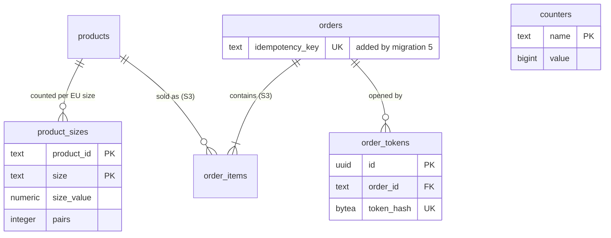

# ERD — Checkout and placing an order (plan item 5, "S5")

Module `orders` · Requirements ORD-003, ORD-004, ORD-005, ORD-008, ORD-010 (and the stored side of ORD-006) · Story `docs/orders/stories/checkout-and-placing-an-order.md` · UI PR #32 · Engine PostgreSQL 16, pgx v5, hand-written SQL.

This file defines **the entities this story creates or changes, and nothing else**: the per-size stock (`product_sizes`, the view `product_stock`), the order's access tokens (`order_tokens`), the order-number counter (`counters`) and one column of `orders` (`idempotency_key`). The ten collection tables, `order_items`, `rate_limits` and the two helper functions are `erd/site-data-from-the-database.md`'s; `payment_attempts`, `users`, `sessions`, `uploads` and `orders.account_id` belong to later stories' files.

Project decisions this story builds on, unchanged: **D1** (text slug ids for collections, `uuid` elsewhere), **D3** (one count of pairs per shoe and size; the four stock fields are derived), **D4** (an order's pairs live in `order_items`), **D5** (many hashed tokens per order), **D7** (order numbers from a one-row counter). The conventions of the S3 file §2 apply (`NOT NULL` by default, named constraints, explicit `ON DELETE`, no extensions, no `pg enum`).

## 1. What this story creates

| # | Migration (file-name part) | Creates or changes |
|---|---|---|
| 4 | `stock_per_size` | table `product_sizes` + `idx_product_sizes_size_in_stock` + trigger; view `product_stock`; backfill of every shoe's counts from the four S3 columns; an assertion that the view reproduces the seeded lists; **drops** `products.sizes`, `products.sizes_low`, `products.sizes_out`, `products.stock` |
| 5 | `order_checkout` | tables `order_tokens` and `counters`; `counters` seeded with the highest seeded order number; column `orders.idempotency_key` + check; assertions on the shop terms the order's expected date reads |
| 6 | `orders_idempotency_index` | `uq_orders_idempotency_key` built `CONCURRENTLY` |

Not created here: the `order_items` rows of the 14 seeded orders. S3's seed already writes exactly one per order (`line_no` 1, `unit_price = total / qty`); this story only **proves** it (SC-19, §7). No row of any collection table is added, edited or deleted except the four dropped columns.



`counters` has no relation: it is read and bumped by name.

## 2. Entities

### 2.1 `product_sizes` — the one count of pairs per shoe and EU size

**Purpose** — what is on the shelf, by size (D3). The only place a pair is counted: a shoe's `sizes`, `sizes_low`, `sizes_out` and `stock` are derived from it (§2.2), so no list or total can disagree with the counts (ORD-005 item 1: "there is no second copy"). **Traces to** — ORD-004, ORD-005, DATA-001 AC-2.

| Column | Type | Null | Default | Unique | Description |
|---|---|---|---|---|---|
| `product_id` | `text` | no | — | PK (1/2) | FK `products`. API field: the shoe's `id` |
| `size` | `text` | no | — | PK (2/2) | The EU size **exactly as the shoe lists it** and as the bag sends it: `38`, `36 2/3`, `35 1/2`. `CHECK ck_product_sizes_size_not_blank`: `btrim(size) <> '' AND length(size) <= 20`. Compared as written (`36 2/3` is not `36.67`): the order's pair must name a size the shoe lists |
| `size_value` | `numeric(5,2)` | no | — | | The size as a number: the ordering key for "growing order" in a shoe's `sizes` list. `38` → 38.00, `36 2/3` → 36.67, `35 1/2` → 35.50. Written by the migration's backfill (§4) and later by the staff screens; a size that cannot be read as a number is refused with 422 there. `CHECK ck_product_sizes_size_value_positive`: `size_value > 0` |
| `pairs` | `integer` | no | `0` | | Pairs on the shelf. `CHECK ck_product_sizes_pairs_not_negative`: `pairs >= 0` — the database floor under "never a count below 0" (ORD-004 item 2): even a handler bug cannot sell a pair twice |
| `created_at`, `updated_at` | `timestamptz` | no | `now()` | | `updated_at` moved by `trg_product_sizes_updated_at` (`set_updated_at()`, S3 migration 1) |

**Key** — composite primary key `(product_id, size)`. The row has no identity beyond "this shoe, this size", nothing references it, and it goes with either parent; a surrogate uuid nobody uses would add an index for nothing.

**Nullable columns** — none.

**Foreign keys**

| Column | References | On delete | On update | Why |
|---|---|---|---|---|
| `product_id` | `products(id)` | `CASCADE` | `NO ACTION` | Counts have no meaning without the shoe (ADMIN-014 item 2). Blast radius: only the dealer can delete a shoe and only one no order refers to (`order_items.product_id` is `RESTRICT`), so a cascade here never removes the count of a shoe that has been sold. There is **no** foreign key from `order_items` to this table: taking a size off a shoe deletes its count (ADMIN-015 item 3) and must not be blocked by old orders |

**Indexes**

| Name | Columns | Type | Query it serves |
|---|---|---|---|
| *(primary key)* | `(product_id, size)` | btree | Placement's `SELECT … FOR UPDATE` of the pairs an order names and the conditional `UPDATE … SET pairs = pairs - $q WHERE product_id = $1 AND size = $2 AND pairs >= $q` (ORD-004); a shoe's sizes (`WHERE product_id = $1`, the view's join); the staff count change and cancel's `pairs = pairs + $q` (later stories) |
| `idx_product_sizes_size_in_stock` | `(size, product_id) WHERE pairs > 0` | btree, partial | The shop filter `size=a,b` — "at least one given size is listed **and** has a pair" — answered as `EXISTS (… WHERE size = ANY($n) AND pairs > 0)` (CAT-001 item 6, search story) |

**Lifecycle** — rows are created by the migration's backfill and by the staff screens ("add a size", admin story); the order only ever lowers `pairs`. A row is deleted when staff take the size off the shoe or the shoe is deleted. A cancelled order whose size was taken off the shoe meanwhile changes zero rows when its pairs go back; that is correct (the size no longer exists).

### 2.2 `product_stock` — the derived view

**Purpose** — the only source of a shoe's `sizes`, `sizes_low`, `sizes_out` and `stock` (the API's field names). 0 pairs is sold out; 1 or 2 is "last pairs"; 3 or more is in neither list (ORD-005 item 1). Exactly the view of the project ERD §3.11:

```sql
CREATE VIEW product_stock AS
SELECT p.id AS product_id,
       coalesce(array_agg(s.size ORDER BY s.size_value, s.size)
                FILTER (WHERE s.size IS NOT NULL), '{}'::text[])        AS sizes,
       coalesce(array_agg(s.size ORDER BY s.size_value, s.size)
                FILTER (WHERE s.pairs BETWEEN 1 AND 2), '{}'::text[])   AS sizes_low,
       coalesce(array_agg(s.size ORDER BY s.size_value, s.size)
                FILTER (WHERE s.pairs = 0), '{}'::text[])               AS sizes_out,
       coalesce(sum(s.pairs), 0)::integer                               AS stock
FROM products p
LEFT JOIN product_sizes s ON s.product_id = p.id
GROUP BY p.id;
```

One row for **every** shoe (a shoe with no sizes has empty lists and `stock` 0), so `products JOIN product_stock` never drops a shoe. A view, not a materialised view: a list that is stale by one refresh is exactly what ORD-005 AC-1 to AC-3 forbid ("the moment an order is saved"). The view reads every `product_sizes` row (about 100 today, a few thousand at the planned volume); a join by shoe id is pushed into the group by the planner, and a 12-shoe page costs one pass over a few hundred rows.

**What reads it** — the `data` registry's four expressions for `products` (`ps.sizes`, `ps.sizes_low`, `ps.sizes_out`, `ps.stock`; S3 services §4.1), the shoe-page availability, the dealer's overview "running low" (later).

### 2.3 `order_tokens`

**Purpose** — the unguessable tokens that let one browser read one order (ORD-008, D5). An order has many: one at placement, a fresh one for every replay of the same key (ORD-010 item 3) and for every successful lookup (track story). **Traces to** — ORD-003 items 6–7, ORD-008 items 2–4, ORD-010 item 3.

| Column | Type | Null | Default | Unique | Description |
|---|---|---|---|---|---|
| `id` | `uuid` | no | `gen_random_uuid()` | PK | Not exposed |
| `order_id` | `text` | no | — | | FK `orders` |
| `token_hash` | `bytea` | no | — | `uq_order_tokens_token_hash` | SHA-256 of the token (32 bytes). `CHECK ck_order_tokens_hash_length`: `octet_length(token_hash) = 32`. The token itself — 24 bytes from `crypto/rand`, base64url without padding, 32 characters, 192 bits — exists only in the answer and in the customer's browser: never in the database, a log, an address or a message (ORD-008 item 4) |
| `created_at` | `timestamptz` | no | `now()` | | Append-only: no `updated_at`, no trigger |

**Nullable columns** — none. **Foreign keys** — `order_id` → `orders(id)` `ON DELETE CASCADE`, `ON UPDATE NO ACTION`: a token has no meaning without its order (an order is deletable only when cancelled and unpaid, so the cascade removes access to nothing the customer still needs).

| Name | Columns | Type | Query it serves |
|---|---|---|---|
| `uq_order_tokens_token_hash` | `(token_hash)` | unique | "Read this order with this token": `WHERE o.id = $1 AND EXISTS (SELECT 1 FROM order_tokens t WHERE t.order_id = o.id AND t.token_hash = $2)`. The lookup is **by hash**, so no comparison of the secret itself ever runs (no timing signal), and the unique index makes a hash collision impossible to store silently |
| `idx_order_tokens_order_id` | `(order_id)` | btree | Cascading an order's delete; an order's tokens |

**Lifecycle** — insert only; deleted with the order. A token never expires (the order page must keep working after a refresh, a week later); revoking one is not a requirement.

### 2.4 `counters` — the order-number counter

**Purpose** — "one more than the highest number held, never repeating" (ORD-003 item 3, D7). A `SEQUENCE` is not rolled back, so a refused order would burn a number and leave a gap; the counter row is bumped inside the order's transaction and rolls back with it.

| Column | Type | Null | Default | Unique | Description |
|---|---|---|---|---|---|
| `name` | `text` | no | — | PK | `order_number`. `CHECK ck_counters_name_not_blank`: `btrim(name) <> ''` |
| `value` | `bigint` | no | `0` | | The highest number issued. `CHECK ck_counters_value_not_negative`: `value >= 0`. Seeded by migration 5 with the highest number the orders hold (24817 today), **computed from the data, not written in the file** |
| `updated_at` | `timestamptz` | no | `now()` | | `trg_counters_updated_at` |

No surrogate `id` and no `created_at`: the name is the identity of a counter. **Nullable columns** — none. **Foreign keys** — none. **Indexes** — the key. **Lifecycle** — never deleted, never decremented: deleting the newest cancelled order (ADMIN-014 item 5) cannot make a number come back. `UPDATE … SET value = value + 1 … RETURNING value` locks the row until commit, so two simultaneous orders get different numbers (ORD-003 AC-2). The lock is the one point where placement serialises; the update is therefore the **last** statement before the inserts (services file §3.1 lock order), so it is held for a few milliseconds.

`orders.number` is unique (`uq_orders_number`, S3) and is the backstop: no code path other than `orders.Place` may insert an order. A test or a script that inserts one by hand must also move the counter.

### 2.5 `orders.idempotency_key` (the one column this story adds to `orders`)

| Column | Type | Null | Default | Unique | Description |
|---|---|---|---|---|---|
| `idempotency_key` | `text` | **yes** | — | `uq_orders_idempotency_key` | The client's key for one submission (ORD-010 item 3): a random UUID the browser makes once per bag and set of details. `CHECK ck_orders_idempotency_key_length`: `idempotency_key IS NULL OR length(idempotency_key) BETWEEN 8 AND 100`. The API also holds the key to `[A-Za-z0-9._-]` (services file) — the database checks only what a hand-run insert could break |

**Why nullable** — the 14 seeded orders were never submitted by a client, and `''` would collide with itself under a unique index; NULLs are distinct. **Why a column and not a table** — one key belongs to one order for ever, so a key table would be a second row to keep in step. **Retention** — for ever: it is a column of the order. A key is a bearer secret for the replay, so the replay also demands the same phone digits (services file §3.1); the key is never logged and never returned.

| Name | Columns | Type | Query it serves |
|---|---|---|---|
| `uq_orders_idempotency_key` | `(idempotency_key)` | unique (NULLs distinct) | "The same key again returns the first order" (ORD-010 AC-4): `SELECT … FROM orders WHERE idempotency_key = $1`; and the backstop under the advisory lock that makes two tabs with one key make one order (services file §3.1 step 0). Built by migration 6, `CONCURRENTLY` |

## 3. Access patterns this story adds

| # | Pattern | Frequency | Index used |
|---|---|---|---|
| 1 | Place an order: replay check by key; lock the named shoes (`FOR SHARE`) and sizes (`FOR UPDATE`); conditional decrement; counter bump; inserts into `orders`, `order_items`, `order_tokens` | Medium (every sale), p95 ≤ 1.5 s over 100 sequential orders (SC-22); about ten statements, each by key | `uq_orders_idempotency_key`; `products` PK; `product_sizes` PK; `counters` PK; `uq_order_items_order_id_line_no` |
| 2 | Read one order with a token (and its pairs, with each shoe's live name, colourway and picture) | High (every order page, refresh and poll) | `orders` PK; `uq_order_tokens_token_hash`; `uq_order_items_order_id_line_no`; `products` PK |
| 3 | A shoe list or record with its sizes, last-pairs, sold-out and stock | Very high (every shop view) | `product_sizes` PK through the view; `idx_product_sizes_size_in_stock` for `size=` |
| 4 | The shop's payment options | Medium | `payment_methods` PK (`WHERE id = ANY($1)`, one row) |

Nothing here needs another index: every statement of placement is by primary or unique key, and the views scan a few hundred rows.

## 4. Placeholder stock backfill (migration 4)

The 12 sample shoes carry lists and a total, not counts (ORD-005 item 4 leaves the fill to this design). For each shoe, for each size in its seeded `sizes` list:

| The size is in | Pairs written |
|---|---|
| `sizes_out` | 0 |
| `sizes_low` | 1 |
| neither | 3 |

The derived lists therefore equal the seeded lists exactly, every size that is not sold out can be ordered (SC-29), and a "last pairs" size can be bought once (SC-24 needs a one-pair size; the seeded last-pairs sizes are that, and the 3-pair sizes serve SC-27's 3 → 2 → 1 → 0 walk).

**This departs from the project ERD §8**, which also spread the seeded `stock` surplus over the sizes one pair at a time. Dropped: the surplus is a round-robin over arrays, the one part of the backfill that could not be written as three plain statements, in a project whose seed SQL has never yet run on a real Postgres before CI (the seed's own risk note); and the figure it protects is an `_invented` placeholder that no criterion pins (SC-29, project Q1). Cost: a sample shoe reads `2×1 + n×3` pairs, which may be a little more or less than the old figure (`samba-og-w-core-black`: 20, seeded 18; a shoe seeded at 40 with nine sizes reads about 25). The lists, which the shop page shows, are exact.

The size's number is read from its text in SQL, no function needed:

```sql
round(
  substring(s.size from '^[0-9]+(?:\.[0-9]+)?')::numeric
  + coalesce(substring(s.size from ' ([0-9]+)/[0-9]+$')::numeric
             / nullif(substring(s.size from ' [0-9]+/([0-9]+)$')::numeric, 0), 0),
  2)
```

`36 2/3` → 36.67, `35 1/2` → 35.50, `38` → 38.00. A size that does not start with a number gives NULL and the `NOT NULL` column fails the whole file, naming the shoe and the size in PostgreSQL's "failing row" detail; the migration does not guess. The insert is `INSERT INTO product_sizes (product_id, size, size_value, pairs) SELECT p.id, s.size, <expression>, CASE WHEN s.size = ANY(p.sizes_out) THEN 0 WHEN s.size = ANY(p.sizes_low) THEN 1 ELSE 3 END FROM products p CROSS JOIN LATERAL unnest(p.sizes) AS s(size)` — a size listed twice would break the primary key, loudly.

**The assertion that comes before the drop** (a `DO $$ … RAISE EXCEPTION … $$` block, in the same transaction as the drop, so a failure rolls the whole file back): for every shoe, the view's `sizes`, `sizes_low` and `sizes_out` equal the seeded columns **as sets** (compare `ARRAY(SELECT unnest(x) ORDER BY 1)`), and the exception names every shoe that differs. A seeded `sizes_low` or `sizes_out` entry that is not in `sizes` fails here: the data is wrong and Dev tells PM, the migration is not loosened. Order is not compared: the view's order is the defined one (growing size), the seed's order was only convention.

## 5. Decisions, and where this departs from the project design

| # | Question | Decision | Rejected alternative, and why |
|---|---|---|---|
| E1 | Is a count per size one row or one array/JSON on `products`? | One row per (shoe, size): `product_sizes` (D3). The conditional decrement, the lock and the `CHECK pairs >= 0` all work on one row | An `integer[]` or `jsonb` on `products`: a concurrent order for another size of the same shoe would lock and rewrite the whole shoe row, and `CHECK` could not say "never below 0" per size |
| E2 | Backfill rule | 0 / 1 / 3 without the surplus (§4) | The project ERD's surplus spread: closer totals, no visible benefit, one more risk in a seed file |
| E3 | How an order and a retry meet when two tabs send one key at once | **A transaction-scoped advisory lock on the key**, taken first in the transaction, then the replay check (services file §3.1 step 0). The unique index stays as the backstop | Relying on the unique index alone, as the project's services text says ("the second waits on the unique index and gets the replay"): the second order would first take stock and the counter, so with the last pair gone it would answer `409 stock_conflict` to a retry of an order that was in fact saved. The index can only fire after the stock step, which is too late. Reserving the order row first (insert, then take stock): the counter would be bumped for an order that may be refused, leaving gaps |
| E4 | Lock on the shoes during placement | `products` rows `FOR SHARE` (sorted by id), then `product_sizes` rows `FOR UPDATE` (sorted by `(product_id, size)`) | `FOR UPDATE` on `products` as the project's text says: it would make every order of one shoe wait for every other, for a lock whose only job is to hold the shoe's price and `live` status still while the order is saved. `FOR SHARE` gives the same guarantee (a dealer's price or status edit waits a few milliseconds) and lets orders of one shoe run side by side. The stock rows are where they must queue |
| E5 | Where the order-number counter lives | `counters` (D7), bumped late in the transaction | `SELECT max(number)+1`: two orders read the same maximum. A sequence: gaps from every refused order |
| E6 | `idempotency_key` as a column, not a table | Column on `orders` | A key table: a second row per order and a join on every replay, for no extra capability |
| E7 | Token size | 24 random bytes (192 bits), 32 URL-safe characters | 16 bytes / 22 characters, which is the SRS's floor (128 bits): it works, but there is no cost to the margin |
| E8 | The expected date's source text | `shop_terms.standard_days` ("2–4", the largest number), as the project ERD and services say | `delivery_options.days` ("2–4 working days"), which the SRS's wording ("the longest working days of the `standard` option") could also mean. The two texts hold the same figure and no endpoint writes either (`shop` and `delivery` have no write route), so they cannot drift except by a migration; migration 5 asserts the row and a number are there, so a missing figure fails at boot, not on a customer's order |

### Conflicts with merged decisions

E3 and E4 correct the mechanism the project's services text gives for placement (§3.10 step 1 and §2.6's "waits on the unique index") without changing any outcome it promises; they are written into this story's services file, which wins for placement. E2 changes a rule of the project ERD's §8 that no story has built. Nothing already merged (S3's tables, the free-delivery records) is restructured.

## 6. Migration plan

Files `code/backend/migrations/<UTC timestamp>_<name>.up.sql` and `.down.sql`, in this order, **stamped later than S3's `…seed_collections` (`20261125100200`)**; suggested `20261125120000_stock_per_size`, `20261125120100_order_checkout`, `20261125120200_orders_idempotency_index`. Applied on boot before the server listens; a merged file is never edited (convention `migrations`).

| # | Forward | Backward | Safe on a populated table |
|---|---|---|---|
| 4 `stock_per_size` | `CREATE TABLE product_sizes` + index + trigger; `CREATE VIEW product_stock`; the backfill insert (§4); the assertion (§4); `ALTER TABLE products DROP COLUMN sizes, DROP COLUMN sizes_low, DROP COLUMN sizes_out, DROP COLUMN stock` — plain `DROP COLUMN`, **no `CASCADE`**, so an object that still depends on a column (an index or view a later change added) fails the file instead of vanishing | Re-add the four columns (`text[] NOT NULL DEFAULT '{}'` ×3, `integer NOT NULL DEFAULT 0` with its `>= 0` check), fill them from `product_stock`, drop the view, drop `product_sizes`. Lossless: sold pairs stay sold; a sold-out size stays listed | Expand, migrate and contract in **one** file because the code and the migration ship together and the runner applies before listening. `DROP COLUMN` takes `ACCESS EXCLUSIVE` on `products` for the length of the file (hundreds of rows: milliseconds). **Deployment assumption**: one backend container is replaced, never two versions side by side (services map: one deploy unit); with two versions the old one would query a column that is gone, which is the reason a rolling deploy would need two releases |
| 5 `order_checkout` | `CREATE TABLE order_tokens` + two indexes; `CREATE TABLE counters` + trigger; `INSERT INTO counters (name, value) SELECT 'order_number', coalesce(max(substring(number from '^DOI-([0-9]+)$')::bigint), 0) FROM orders`; `ALTER TABLE orders ADD COLUMN idempotency_key text NULL` + `ADD CONSTRAINT ck_orders_idempotency_key_length CHECK (…)`; a `DO` block asserting that `counters.order_number` is at least the highest seeded number, that `shop_terms` row `shop` has a digit in `standard_days` and a `HH:MM` `dispatch_cutoff`, and that `delivery_options` holds `standard` | Drop the column, then `counters`, then `order_tokens` (after migration 6's down) | New tables and a nullable column with no default: instant, no rewrite. The `CHECK` scans the 14 existing rows. **Rolling this back after real orders exist deletes every customer's access token and every key**: those customers lose their order pages until they use Track, and a retry could duplicate an order. The backward file is for local resets only, as the project ERD says for every migration |
| 6 `orders_idempotency_index` | `DROP INDEX CONCURRENTLY IF EXISTS uq_orders_idempotency_key;` then `CREATE UNIQUE INDEX CONCURRENTLY uq_orders_idempotency_key ON orders (idempotency_key)` — two statements, run outside a transaction (a file with `CONCURRENTLY` does). The drop first, because a `CONCURRENTLY` build that fails leaves an **invalid** index of that name, and `IF NOT EXISTS` would then skip it silently | `DROP INDEX CONCURRENTLY IF EXISTS uq_orders_idempotency_key` | Safe at any size: no write lock on `orders`. The file runs again only when it was not recorded as applied, so the leading drop can only remove an index this file itself made or left invalid |

Nothing is irreversible in the sense of losing data the system cannot recreate before real orders exist. After they do, only 5's backward is destructive (above).

## 7. Verification hooks (what a test can read)

| Criterion | Read from |
|---|---|
| SC-19 — each of the 14 seeded orders holds exactly one pair; `doi-24817` is one pair of `samba-og-w-crystal-white`, EU `39 1/3` | A backend test with `TEST_DATABASE_URL`: `SELECT count(*) FROM order_items GROUP BY order_id` over `is_sample` orders is 14 rows of 1; the line of `doi-24817` by `line_no = 1`. No dealer session exists to read it any other way |
| SC-27, SC-28, SC-29 — lists and total follow the counts | `product_stock` after each order; the shoe's public record (`GET /v1/products/{id}`) shows the same lists |
| SC-23, SC-24 — exact counts, 50 simultaneous orders on a size holding 10 pairs | A backend test sets the count with plain SQL (`UPDATE product_sizes SET pairs = $n …`, or inserts a size on a shoe it creates) because no staff endpoint exists yet; the running-API verification uses the seeded sizes (3 pairs, 1 pair in a last-pairs size, 0 in a sold-out size) |
| SC-13 — numbering | The test reads `counters.value`; a test that inserts orders by hand moves it |

## 8. Privacy and integrity notes

- **Never stored in clear** — the order token and the idempotency key are bearer secrets: the token only as SHA-256, the key as given (it is useless without the same phone digits) and never logged.
- **Personal data** — this story writes `orders.customer`, `phone`, `address`, `city`, `note` and reads them back to nobody: the public view omits `phone`, `email`, `address` and `note` by construction (the statements never select them, services file §3.2). Retention is unchanged (project Q5).
- **Enforced by the database** — `pairs >= 0`; unique order number, unique token hash, unique idempotency key; every foreign key. **Enforced by the application** — `total = Σ unit_price × qty` (one function writes both), the status is `placed` and `paid` is `false` on every new order, `delivery_fee` is the constant 0.
