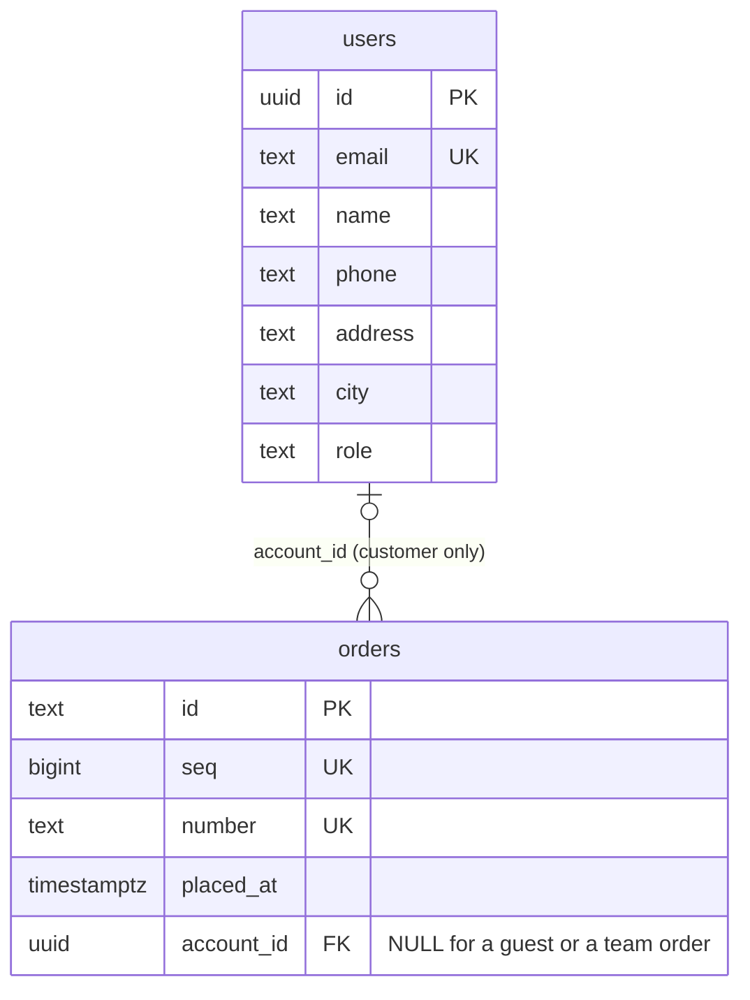

# Database design — Customer accounts: sign up, sign in, my orders (plan item 15, "S14")

Module `accounts` · Requirements ACC-001 to ACC-008 · Story `docs/accounts/stories/customer-accounts-sign-up-sign-in-my-orders.md` · UI PR #43 · Contracts: `docs/architecture/services/customer-accounts-sign-up-sign-in-my-orders.md` · Engine PostgreSQL 16, pgx v5, hand-written SQL.

This file **extends** `erd/_base.md`. `users` (§3.18), `sessions` (§3.19), `rate_limits` (§3.21) and `orders` (§3.12, with its `account_id` row) are designed there, and `erd/dealer-sign-in-and-protected-admin-area.md` (merged, PR #47) creates `users`, `sessions` and their constraints. Nothing in them is redesigned or restated here. This file adds the one column and the one index this story creates, answers the question the story left to TL ("which of `users.phone`, `address`, `city` does the sign-in migration already hold"), states the rules that keep `orders.account_id` true, and gives the migration plan.

## 1. What this story creates

| # | Migration (file-name part) | Creates or changes |
|---|---|---|
| 11 | `orders_account_id` | column `orders.account_id uuid NULL`; foreign key `fk_orders_account_id` to `users(id)` `ON DELETE SET NULL` |
| 12 | `orders_account_id_index` | `idx_orders_account_id_placed_at`, built `CONCURRENTLY`, in a file of its own |

**Answer to the story's open question: the sign-in migration holds all three.** `users_and_sessions` (item 9, ERD file §1 and §3) creates `users` with `phone`, `address` and `city` already (`text NOT NULL DEFAULT ''`) and says so in as many words: "the customer-accounts story needs no `ALTER TABLE users`". So this story has **no change to `users`**, none to `sessions`, and none to `rate_limits`: S3's migration 1 already lists `sign_up_address` in `ck_rate_limits_scope`, and the columns the sign-up counter needs (`hits`, `window_started_at`, `locked_until`) are the ones sign-in uses.



## 2. `orders.account_id`

**Purpose** — the link between an order and the customer account that owns it (ACC-005, ACC-006). It answers three questions: "my orders" (ACC-003), "may this session open this order without a token" (ACC-003 item 4, ACC-008 item 3), and "is this order already someone's" (ACC-006). **Traces to** — ACC-003, ACC-005, ACC-006, ACC-008.

| Column | Type | Null | Default | Unique | Description |
|---|---|---|---|---|---|
| `account_id` | `uuid` | **yes** | — | | The `users.id` of the **customer** the order belongs to. NULL for a guest order, for an order placed by a staff or admin session, for every order that existed before this story, and for an order whose customer row was deleted. Never returned by any endpoint, public or dealer (`orders` selects it only to compare it) |

**Why nullable** — a guest order is the normal case, not an exception (ACC-005 item 3), and `''` cannot be a foreign key. NULL is also what the 14 seeded orders and every order placed before this story hold, so the migration needs no backfill.

**Foreign key**

| Column | References | On delete | On update | Why |
|---|---|---|---|---|
| `account_id` | `users(id)` | `SET NULL` | `NO ACTION` | The order is history the shop keeps and carries the buyer's own typed details; losing the account must not lose the order or block the delete. No endpoint deletes a customer today (ACC out of scope), so this is a safety net — and it is what lets a future "delete my account" story anonymise the link without touching the order. (`sessions.user_id` is `CASCADE`, so deleting a user also ends their sessions.) |

**Invariants** — what makes the column mean what the SRS says. The first four are enforced in SQL, not only in a handler, so a later handler cannot break them by forgetting a check.

| # | Rule | Enforced by |
|---|---|---|
| I1 | Only a user whose `role = 'customer'` and who is `is_active` can be an order's `account_id`. A staff or admin id, a switched-off account and an id that no longer exists are never stored | Placement inserts `account_id` as `(SELECT u.id FROM users u WHERE u.id = $n AND u.role = 'customer' AND u.is_active)`, so a session that ended, or a role that is not customer, becomes NULL — "the order is placed as a guest, never refused" (ACC-005 item 4). The link statement (§4, A8) carries the same predicate in a join |
| I2 | An order is linked **once**: the link statement is `… WHERE account_id IS NULL`. No endpoint moves an order to another account, unlinks it, or overwrites it | The statement's `WHERE`; there is no other `UPDATE` of this column. `ON DELETE SET NULL` is the only other writer |
| I3 | Placement sets `account_id` only on the **insert** of a new order. A replay of an `Idempotency-Key` returns the first order and **never** links or relinks it | `orders.Place` writes the column only in the insert statement (services file §6) |
| I4 | Linking changes nothing else about the order: not `phone`, `customer`, `address`, `city`, `note`, its tokens or its status. The typed details stay what the buyer typed; a customer's saved details are never copied onto an order or back (ACC-005 item 2) | The `UPDATE` sets one column |
| I5 | A phone, an address or a number typed into "Add an order" is never stored; only a SHA-256 of the typed digits reaches `rate_limits` | The attempt function (services file §3.4) |

**Nullable columns** — this one only; the reason is above. **Lifecycle** — written by placement (insert) or by one successful "Add an order" (I2); read by "My orders", by the order read and by "is it already someone's"; set back to NULL only by the foreign key when a user row is deleted. An order deleted by the dealer (cancelled orders only, ADMIN-014) leaves the account's list one shorter; nothing else references it.

**Rejected: a join table `order_accounts (order_id, account_id, linked_at)`.** It would hold the link's history. The SRS has no unlink, no move, no audit and no screen that shows when an order was added, so the history would be written and never read; every "My orders" read would pay a join; and "is this order already someone's" would need a second unique index to keep one owner. The column gives one owner by construction and a one-index read. If a story ever asks for unlinking or an audit trail, that is a new table with its own migration; the column then becomes its cached copy or is migrated away.

**Rejected: `CHECK`ing the role in the database** (a trigger that reads `users.role` on `orders` writes). A cross-table trigger on the hottest write of the shop to protect a rule that two statements already carry (I1) and that a unit test per statement pins.

## 3. Indexes

| Name | Columns | Type | Query it serves |
|---|---|---|---|
| `idx_orders_account_id_placed_at` | `(account_id, placed_at DESC) WHERE account_id IS NOT NULL` | btree, partial | **"My orders", newest first, ten at a time** (A5): `WHERE account_id = $1 ORDER BY placed_at DESC, seq DESC LIMIT 10 OFFSET …` reads the customer's rows already in `placed_at` order, and the `seq DESC` tie-break is an incremental sort over runs of equal `placed_at` (a handful of rows at most). `count(*) WHERE account_id = $1` is an index-only count of that customer's rows. **"Is this order mine"** (A6) starts from the order's primary key and compares the column, so it does not need this index. The **foreign key's own check** — what `ON DELETE SET NULL` runs when a user row is deleted: `… WHERE account_id = $1` — is served by it too, because an equality with a non-null value implies the partial index's predicate. A guest order is never in the index, and guests are nearly all of the history, so the index stays as small as the accounts' orders |

The definition is the project ERD's (§3.12); this story only builds it. `seq DESC` is not added to the index: at the volume a customer reaches (tens of orders) the incremental sort costs nothing, and the index stays the one the merged design and the story's SC-17 name. **No other index is added.** `uq_orders_number` (S3) serves the number lookup (A7); `uq_users_email` serves sign-up's conflict (A1); the primary key of `users` serves every session-based read.

## 4. Access patterns this story adds

All SQL is parameterised; the only strings spliced into a statement are none. "The clock" is always the database's `now()`.

| # | Pattern | Frequency | Statement (shape) | Index |
|---|---|---|---|---|
| A1 | Sign-up: make the account | Low (≤ 10 an hour per address) | `INSERT INTO users (email, name, phone, address, city, password_hash, role) VALUES ($1, $2, $3, '', '', $4, 'customer') RETURNING id::text` — through `auth.CreateUser`; SQLSTATE 23505 on `uq_users_email` is `auth.ErrEmailTaken` → 409 | `uq_users_email` (the arbiter of a race) |
| A2 | Sign-up: the first session | Same | Q3 of the sign-in design, in the **same transaction** as A1, passing the hash just written | primary key of `users` |
| A3 | `GET /v1/account` | Medium (My account, every checkout of a signed-in customer) | `SELECT name, email, phone, address, city FROM users WHERE id = $1 AND role = 'customer' AND is_active`; no row = the account vanished since `Resolve` → 401 | primary key of `users` |
| A4 | `PUT /v1/account` | Low | `UPDATE users SET name = COALESCE($2, name), phone = COALESCE($3, phone), address = COALESCE($4, address), city = COALESCE($5, city) WHERE id = $1 AND role = 'customer' AND is_active RETURNING name, email, phone, address, city`. A field left out is bound as NULL and keeps its value; `''` is a value and clears `address` and `city`. `trg_users_updated_at` moves `updated_at`. No row = 401 | primary key of `users` |
| A5 | `GET /v1/account/orders` | Medium (every My account open and every "Show more") | Inside one `REPEATABLE READ`, read-only transaction so the page and the total agree: `SELECT id, number, placed_at, status, total FROM orders WHERE account_id = $1 ORDER BY placed_at DESC, seq DESC LIMIT $2 OFFSET $3`, then `SELECT count(*) FROM orders WHERE account_id = $1`. Public columns only | `idx_orders_account_id_placed_at` |
| A6 | Read one order as its linked customer (`GET /v1/orders/{id}`, `GET /v1/account/orders/{id}`, `POST /v1/orders/{id}/payment`) | High | The one statement of `authorize` (order-page design §4) with the third way in: `… WHERE o.id = $1 AND (EXISTS (SELECT 1 FROM order_tokens t WHERE t.order_id = o.id AND t.token_hash = $2) OR (o.account_id IS NOT NULL AND o.account_id = $3::uuid))`. `$2` and `$3` are NULL when the request carries no token / is not a customer's | `orders` primary key; `uq_order_tokens_token_hash` |
| A7 | Add an order / look an order up: find by number | Low | `SELECT id, number, placed_at, status, total, phone, coalesce(account_id::text, '') FROM orders WHERE number = $1`. The phone is read **only** to be compared in Go (`PhoneKey`) and is never copied into the value the function returns | `uq_orders_number` |
| A8 | Link a guest order | Low | `UPDATE orders o SET account_id = u.id FROM users u WHERE o.id = $2 AND o.account_id IS NULL AND u.id = $1 AND u.role = 'customer' AND u.is_active RETURNING o.id`. One row = linked; none = it was linked meanwhile or the account is gone (answered as "no match") | `orders` primary key |
| A9 | Place an order while signed in | Medium | The checkout design's `INSERT INTO orders (…)` gains one column, `account_id`, bound as `(SELECT u.id FROM users u WHERE u.id = $n AND u.role = 'customer' AND u.is_active)` (I1) | none new |
| A10 | The attempt counters | Low | `ratelimit` statements of the sign-in design §4.1 and, for sign-up, `Hit` (services file §3.3) | `rate_limits` primary key |

Nothing here scans a table: A1, A3, A4, A7, A8 and A9 are by primary or unique key; A5 is a range on one partial index; A6 is one primary-key row plus one unique-index probe. At 100 orders for one customer (SC-17) A5 reads at most ten index entries and ten rows plus an index-only count of 100: a few milliseconds, against the 300 ms budget.

## 5. Migration plan

Files `code/backend/migrations/<UTC timestamp>_<name>.up.sql` and `.down.sql`, in this order, **stamped later than item 9's `20261125140000_users_and_sessions`** (the foreign key needs `users`), later than S5's three files (they change `orders`), and later than S3's `…seed_collections`; suggested `20261125150000_orders_account_id` and `20261125150100_orders_account_id_index`. Applied on boot before the server listens; a merged file is never edited (convention `migrations`). Because the runner applies pending files in name order, a database that somehow held migration 11 without `users` would fail loudly at the constraint, never silently.

### Migration 11 — `orders_account_id` (one transaction)

**Forward**

```sql
ALTER TABLE orders ADD COLUMN account_id uuid;
ALTER TABLE orders ADD CONSTRAINT fk_orders_account_id
    FOREIGN KEY (account_id) REFERENCES users (id) ON DELETE SET NULL ON UPDATE NO ACTION NOT VALID;
ALTER TABLE orders VALIDATE CONSTRAINT fk_orders_account_id;
```

**Backward** — `ALTER TABLE orders DROP CONSTRAINT IF EXISTS fk_orders_account_id; ALTER TABLE orders DROP COLUMN IF EXISTS account_id;` (the index of migration 12 goes with the column; its own backward file runs first).

**Safe on a populated table** — yes. Adding a nullable column with no default is a catalog change (no rewrite). `ADD CONSTRAINT … NOT VALID` records the key without scanning; `VALIDATE` then scans `orders` once, and every row is NULL, which satisfies a foreign key trivially. **Correction to the project ERD §8 row 11**, which says the two steps take "only a weak lock": the runner puts this file in one transaction, so the `SHARE ROW EXCLUSIVE` lock of `ADD CONSTRAINT` on `orders` and `users` is held until the commit, and the validation scan runs under it. That blocks *writes* to those two tables (reads continue) for the length of one scan of `orders` — milliseconds at the planned 10,000 orders — and only at the boot that applies the file, before the server listens, when no request is being served. Splitting the validation into a file of its own would buy nothing and add a state (a constraint recorded but not validated) that a failed boot could leave behind. **Rolling back** deletes every link between an order and an account (the orders themselves stay), so the backward file is for a local reset or review only; in a deployment a wrong migration is fixed by a new file.

### Migration 12 — `orders_account_id_index` (no transaction: the file says `CONCURRENTLY`; one statement at a time)

**Forward**

```sql
DROP INDEX CONCURRENTLY IF EXISTS idx_orders_account_id_placed_at;
CREATE INDEX CONCURRENTLY IF NOT EXISTS idx_orders_account_id_placed_at
    ON orders (account_id, placed_at DESC) WHERE account_id IS NOT NULL;
```

The leading `DROP … IF EXISTS` is deliberate. A `CREATE INDEX CONCURRENTLY` that is interrupted (a crash, a cancelled boot) leaves an **invalid** index behind; the runner records the file only after every statement succeeded, so the next boot re-runs it, and a bare `IF NOT EXISTS` would then see the name, skip the build and keep an index the planner ignores for ever. Dropping first makes the re-run build a valid one. It cannot drop a good index: the file runs to completion once and is then recorded, so the `DROP` only ever finds the leftover of a failed earlier run. (A comment in the file must not contain a `;`: the runner splits on it.) SC-17 checks `indisvalid`.

**Backward** — `DROP INDEX CONCURRENTLY IF EXISTS idx_orders_account_id_placed_at;`

**Safe on a populated table** — yes: `CONCURRENTLY` takes no lock that blocks reads or writes, and the partial predicate means the build indexes only linked orders, so on a database where every order is a guest order it indexes nothing. Because it is in a file of its own, a failure here cannot undo migration 11.

### Order against the other stories

This story needs `orders` with its S5 columns and `users` from item 9, so its backend PR **cannot merge before** both ("Checkout and placing an order" and "Dealer sign-in and protected admin area" backends); the file stamps enforce the same order at boot. It touches no object that the search story (`products_search_text`), the VNPay story (`payments`, `idx_orders_unpaid_open`) or the staff story (no migration) touch, so those apply in either order. The track story (`order_tokens` rows, `rate_limits`) needs no migration.

## 6. Decisions

| # | Question | Decision | Rejected alternative, and why |
|---|---|---|---|
| E1 | Does the story need `ALTER TABLE users`? | No: item 9's migration creates `phone`, `address`, `city`. The story's backend writes them through `auth` functions | A second `ALTER TABLE users … ADD COLUMN IF NOT EXISTS` as insurance: a migration that changes a table another story owns, to guard against a state the merged design rules out |
| E2 | One owner per order, enforced where | By the column (a single FK) and `WHERE account_id IS NULL` (I2) | A join table (§2): history nobody reads and a second unique index for the same rule |
| E3 | Who may be an owner | A role-and-active guard inside the two statements that write the column (I1, A8) | Trusting the handler's `Require(Customer)`: the route guard stops a team session reaching `POST /v1/account/orders`, but `orders.Place` is also called by a public route where the role is read from the context; a SQL guard means the rule holds for every caller, including one written later |
| E4 | `ON DELETE` for the link | `SET NULL` (project ERD) | `CASCADE`: deleting a customer would delete their orders, which are the shop's sales history. `RESTRICT`: a customer row could never be removed once they bought, which a future "delete my account" story must be able to do |
| E5 | Index definition | The merged one, `(account_id, placed_at DESC) WHERE account_id IS NOT NULL` | Adding `seq DESC` to make the sort fully index-served: a wider index to save a sort over a few rows; the merged ERD and SC-17 name this definition |
| E6 | A leading `DROP INDEX CONCURRENTLY IF EXISTS` in migration 12 | Yes (§5) | `IF NOT EXISTS` alone, as the project ERD §8 row 12 writes: it can keep an invalid index after an interrupted build |
| E7 | Lock described for migration 11 | Corrected in place (§5) | Repeating "weak lock": inaccurate for a one-transaction file, harmless at this size, but a design should not carry a false sentence |

## 7. What is deliberately not stored

The password (only its argon2id hash, written by `auth`); the typed number and phone of an "Add an order" try (only a SHA-256 of the typed digits in `rate_limits`); the client address of a sign-up (only a hash, `sign_up_address`); when an order was linked; who linked it; the customer's saved details on an order (the order keeps what was typed at checkout); a second email, a verification flag or a reset token (out of scope, SRS open question 5).

## 8. Notes for the two files and their tests

- **The runner reads the SQL text, not the intent.** It runs a file outside a transaction when the text matches `\bconcurrently\b` anywhere, a comment included (`internal/db/migrate.go`). Migration 11's file must therefore never contain that word, or its three statements would run unwrapped; migration 12's must contain it and no `;` inside a comment, because it is split on `;`.
- **Tests (backend, `TEST_DATABASE_URL`, skipped without it):** after both files, `information_schema.columns` shows `orders.account_id` as `uuid`, nullable; `pg_constraint` shows `fk_orders_account_id` with `confdeltype = 'n'` (SET NULL) and `convalidated`; `pg_index` shows `idx_orders_account_id_placed_at` with `indisvalid` and a partial predicate; every order that existed before the files has `account_id` NULL; a second `db.Migrate` changes nothing; deleting a customer row (with orders linked to it) succeeds, leaves the orders with `account_id` NULL and removes the customer's sessions; with 100 orders linked to one customer, `EXPLAIN` of A5 names `idx_orders_account_id_placed_at` (SC-17).
- **Invariant tests (one per statement):** A9 stores NULL for a staff id, an admin id, a switched-off customer and an id that is not a user; A8 changes zero rows for a staff id and for an already-linked order, and one row for a guest order and a customer; A6 returns the order to its linked customer and to nobody else.
