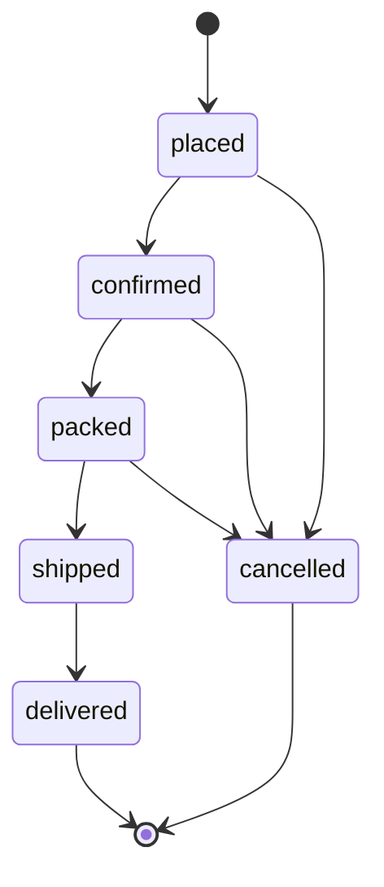

# ERD — Dealer handles orders: status, courier, payment (plan item 17, "S16")

Module `admin` · Requirements ADMIN-016, ADMIN-004 (AC-6, AC-9), ADMIN-011 (AC-12, AC-14, AC-15, AC-20), ADMIN-014 (AC-7, AC-8) · Story `docs/admin/stories/dealer-handles-orders-status-courier-payment.md` · UI PR #77 · Engine PostgreSQL 16, pgx v5, hand-written SQL.

## 1. Verdict: this story adds nothing to the schema

**No table, column, constraint, index, trigger, view, function or migration is created, changed or dropped.** Everything the story writes already has a column: `orders.status`, `carrier`, `tracking`, `eta`, `customer`, `phone`, `email`, `address`, `city`, `note`, and `product_sizes.pairs`; everything it reads already has a table. `erd/_base.md` §3.12 (`orders`) already said the allowed steps of `status` are "enforced by the API with `UPDATE … WHERE status = $from`, not by the database", and already holds every index this story's reads and deletes use (§5 below). What this file adds is what the schema alone cannot say: the state machine, the exact statements, the lock order that keeps a cancel from deadlocking with anything, the rule for the 14 sample orders, and what a delete removes.

The story asked TL to decide four things the schema leaves open; each is decided below and none needs DDL:

| Question | Decision | Where |
|---|---|---|
| How does a cancel, a placement, a shoe save and a second cancel never deadlock? | One canonical order: `orders` row → `product_sizes` rows in `(product_id, size)` order, taken by `stock.Lock`. Nobody takes an order row while holding a count | §4 |
| Does cancelling one of the 14 sample orders put pairs back? | **No.** Their pairs were never taken from the shelf | §3, E1 |
| Where does the dealer's `transaction_no` come from? | A read-only scalar subquery over `payment_attempts` and `payment_notices`, inside `orders`' own SQL — no Go import of `payments`, no column on `orders` | §6, E3 |
| What is the dealer list's default order? | `placed_at DESC, seq DESC` for this list only; the contract's `seq ASC` stays for every other collection | §5, E4 |

## 2. Entities this story touches — none changed

| Entity (defined elsewhere) | Read | Written | Never read or written |
|---|---|---|---|
| `orders` | every column of the dealer view (`id`, `number`, `placed_at`, `status`, `payment_method_id`, `paid`, `delivery_option_id`, `delivery_fee`, `carrier`, `tracking`, `eta`, `customer`, `phone`, `email`, `address`, `city`, `note`, `total`) and `is_sample` (by `Cancel`, never returned) | `status`, `carrier`, `tracking`, `eta`, `customer`, `phone`, `email`, `address`, `city`, `note` (`updated_at` by `trg_orders_updated_at`); the row itself on `DELETE` | `number`, `placed_at`, `payment_method_id`, `delivery_option_id`, `delivery_fee`, `total`, `paid` (only item 8's `MarkPaid` writes it), `is_sample`, `account_id`, `idempotency_key`, `source`, `invented`. A body that names one of the first seven is refused by name (services §3.3); the rest are not fields of an order |
| `order_items` | `order_id`, `line_no`, `product_id`, `size`, `qty`, `unit_price` | deleted with the order (`ON DELETE CASCADE`) | never inserted or updated here: "changing the pairs of a placed order" is not built (SRS open question 4) |
| `product_sizes` | `product_id`, `size`, `pairs` of the cancelled order's pairs (locked) | `pairs = pairs + qty` by `stock.Return`, **once per cancelled non-sample order** | no size is added or removed here; a size the dealer took off a shoe since the order was placed has no row to return to, which is correct (checkout ERD §2.1 lifecycle) |
| `product_stock` (view) | by every shop read | — | The shoe's sizes, last-pairs list, sold-out list and total follow a return with no statement of their own (D3) |
| `order_tokens` | the dealer's read ignores them | deleted with the order (`CASCADE`) | |
| `payment_attempts`, `payment_notices` | `transaction_no` of the order's one success notice (§6) | deleted with the order (`CASCADE`); a **paid** order is never deleted | never written by this story: `payments` is their only writer |
| `products` | `name`, `colourway`, `image` of each pair (live, draft or not), `name` of the first pair's shoe | — | `FOR SHARE`/`FOR UPDATE` is never taken on a shoe here |
| `users`, `sessions` | nothing here: `auth.Require` reads them before a handler runs | — | |

## 3. The status machine, and what a cancel does

`orders.status` has the six values of `ck_orders_status`. The API alone decides a move (`UPDATE … WHERE status = $from`); the database only refuses a seventh word.



| From | Allowed moves | Courier and customer fields (`carrier`, `tracking`, `eta`, `customer`, `phone`, `email`, `address`, `city`) | `note` |
|---|---|---|---|
| `placed` | `confirmed`, `cancelled` | writable | writable |
| `confirmed` | `packed`, `cancelled` | writable | writable |
| `packed` | `shipped`, `cancelled` | writable | writable |
| `shipped` | `delivered` (no `cancelled`) | writable | writable |
| `delivered` | none — no `status` at all, even the current one | refused | writable |
| `cancelled` | none | refused | writable |

The rule is judged on the status the order has **when the transaction holds its row lock**, before the move in the same body: one `PUT` may move a `shipped` order to `delivered` and set its `eta`.

**What a cancel changes — in one transaction, once:**

1. `orders.status` becomes `cancelled`, by a statement whose own `WHERE` repeats the allowed states (`status IN ('placed','confirmed','packed')`), so two cancels, a cancel and the 30-minute expiry, or a cancel and a late notice cannot both succeed.
2. **If that statement changed a row and the order is not a sample**, every pair goes back: the order's `(product_id, size, sum(qty))` lines are read, their counts are locked with `stock.Lock` (the canonical order, §4), and `stock.Return` adds `qty` to each. A line whose size no longer exists changes zero rows and is not an error.
3. `paid` is **not** touched. A paid order may be cancelled; it stays `paid = true`, and it can then never be deleted until the owner has refunded it in VNPay's portal by hand and the shop is told some other way (§7).

**The 14 sample orders (`is_sample`) return no pairs (E1).** Migration 4's backfill wrote every count as 0, 1 or 3 from the shoe's seeded lists, independent of the sample orders (checkout ERD §4): their pairs were never taken from `product_sizes`. A dealer's cancel of `DOI-24816` therefore moves the status and nothing on the shelf; returning the pair would put a pair on sale that was never there. Orders placed through checkout (`is_sample = false`) always return their pairs. The 30-minute expiry already skips samples (item 8, `NOT is_sample`), so only the dealer's cancel can reach one.

## 4. Locks: one order, no deadlock

Every transaction of this story sets `SET LOCAL lock_timeout = '3s'` and runs under the request's 5-second context, as placement does: a stuck lock is a retryable `500 internal`, never a hang.

| Transaction | Locks, in the order it takes them |
|---|---|
| `PUT` without a cancel; `DELETE` | the order's row `FOR UPDATE` (`orders.LockOrder`, item 8's one function that locks an order) — nothing else |
| `PUT` that cancels; the 30-minute expiry (item 8) | the order's row → the order's counts `FOR UPDATE` in `(product_id, size)` order (`stock.Lock`) → `Return`'s updates, on rows already held |
| `POST /v1/orders` (checkout, merged) | advisory key → shoes `FOR SHARE` by id → counts `FOR UPDATE` by `(product_id, size)` → `counters` → inserts of a **new** order, its pairs and token |
| A late VNPay notice (item 8) | the order's row (`UPDATE … WHERE NOT paid`) → the attempt's key share |
| A shoe save (item 10) | advisory `admin:records` → the shoe's row `FOR NO KEY UPDATE` → that shoe's counts by size |
| One size's count (item 10) | that one count's row |

**Why no cycle.** Edges only run *order row → counts*, *shoe row → counts* and *advisory → shoe → counts*. No transaction waits for an order row while holding a count or a shoe row: placement inserts a *new* order row nobody can yet refer to, and deleting an order's `order_items` takes no lock on the shoe they reference. Every transaction that holds several counts took them through `stock.Lock`'s `ORDER BY product_id, size`, so two of them meet in the same order.

**One refinement of item 8's `Cancel` (E2).** Item 8 specified `stock.Return` called directly, "lines are sorted". Go sorts the strings by byte; PostgreSQL's `ORDER BY` uses the database's collation, and `Lock`, `LockShoe` and checkout use PostgreSQL's. For the sizes the shop sells the two agree, but two different sorters is a deadlock waiting for the first size written as `36 2/3` and `36.5`. `Cancel` therefore calls `stock.Lock` on the order's keys first (the very call `Place` makes) and `Return` second: `Return`'s own statements then touch only rows this transaction holds, and its Go-side sort cannot make anything wait.

## 5. Statements, written out

The values bound are always placeholders. The only text spliced into SQL is a column name from the allow-lists in the code, never from a request.

```sql
-- 1  lock the order (item 8's LockOrder; the row every writer of an order takes first)
SELECT id, number, status, paid, total, placed_at, payment_method_id FROM orders WHERE id = $1 FOR UPDATE;

-- 2a  a move that is not a cancel, together with whatever fields were sent (columns from the allow-list)
UPDATE orders SET status = $2, carrier = $3, tracking = $4, eta = NULLIF($5, '')::date,
                  customer = $6, phone = $7, email = $8, address = $9, city = $10, note = $11
WHERE id = $1 AND status = $12;                      -- $12 = the status read under the lock; 0 rows = bug, 500
-- only the columns the body named appear in SET; a body that names nothing issues no UPDATE at all,
-- so {} changes nothing, not even updated_at

-- 2b  a cancel (orders.Cancel; the same statement the expiry runs, plus the 30-minute rule's four terms there)
UPDATE orders SET status = 'cancelled'
WHERE id = $1 AND status IN ('placed','confirmed','packed')
RETURNING is_sample;                                  -- 0 rows: changed = false, nothing else is touched
SELECT product_id, size, sum(qty)::integer FROM order_items
WHERE order_id = $1 GROUP BY product_id, size ORDER BY product_id, size;   -- skipped when is_sample
-- stock.Lock(keys)   : SELECT product_id, size, pairs FROM product_sizes
--                      WHERE (product_id, size) IN (SELECT * FROM unnest($1::text[], $2::text[]))
--                      ORDER BY product_id, size FOR UPDATE
-- stock.Return(lines): UPDATE product_sizes SET pairs = pairs + $3 WHERE product_id = $1 AND size = $2

-- 3  delete (after the two refusals of services §3.4)
DELETE FROM orders WHERE id = $1;   -- CASCADE: order_items, order_tokens, payment_attempts → payment_notices
```

`counters` is never touched, so deleting the newest order cannot make a number come back (D7): the next order is still one higher than any number ever issued.

The dealer's reads are the one-statement `SELECT json_build_object(…)` of services §3.1 and the generic list of §3.2; they take no lock.

**Access patterns this story adds**

| # | Pattern | Frequency | Index used |
|---|---|---|---|
| 1 | Lock one order by id | Low (a dealer's save) | `orders` PK |
| 2 | The order's pairs for a cancel | Low | `uq_order_items_order_id_line_no` (leading `order_id`) |
| 3 | Lock and return the counts of those pairs | Low | `product_sizes` PK `(product_id, size)` |
| 4 | Delete an order and its pairs, tokens and attempts | Rare | `orders` PK; the cascades use `uq_order_items_order_id_line_no`, `idx_order_tokens_order_id`, `idx_payment_attempts_order_id`, and `payment_notices`' `idx_payment_notices_attempt_id` |
| 5 | **The dealer's list, newest first**, 20 to 100 rows, with the first pair and its shoe's name | Medium (every open of `/admin/orders`) | `idx_orders_placed_at (placed_at DESC)`, then `uq_order_items_order_id_line_no` and `products` PK per row. The tie-break `seq DESC` needs no index of its own: equal `placed_at` is rare and an incremental sort finishes it |
| 6 | The list filtered by status or way to pay | Medium | `idx_orders_status_placed_at`, `idx_orders_payment_method_id_placed_at` |
| 7 | The menu's count `status IN ('placed','confirmed')`, `limit 1` | High (every admin page) | `idx_orders_status_placed_at`; the count reads the index only |
| 8 | A dealer's search by number or customer | Medium | none: `strpos` over folded text scans the orders the filters leave, a few milliseconds at 10,000 (project D6) |
| 9 | One order's `transaction_no` (per row of a list, once for a single read) | Medium | `idx_payment_attempts_order_id`, then `uq_payment_notices_attempt_id_success` |

Nothing here needs a new index: every statement of a write is by primary or unique key, and the reads are the ones the project ERD already indexed for the dealer's list (§3.12: "the dealer's list 'newest first'", "the dealer's Status filter", "the dealer's Payment filter").

## 6. The transaction number: read, never stored on the order

`transaction_no` is VNPay's `vnp_TransactionNo` of the order's one success notice, `""` when the order has none. It is **derived**, never a column of `orders` (a second copy of what `payment_notices` holds would drift from it, E3):

```sql
coalesce((SELECT n.transaction_no
          FROM payment_notices n JOIN payment_attempts a ON a.id = n.attempt_id
          WHERE a.order_id = <the order's id> AND n.is_success
          ORDER BY n.received_at LIMIT 1), '')
```

At most one notice per order can be a success: `orders.MarkPaid` runs `UPDATE … WHERE NOT paid`, so once an order is paid every later notice is answered `02` and writes nothing (item 8 ERD §6), and `uq_payment_notices_attempt_id_success` backs it per attempt. The `ORDER BY … LIMIT 1` is there so that a future second provider can never make the subquery return two rows.

The fragment is **written once** (`internal/orders`, one constant with the order's id alias as its only blank) and used by the two dealer statements: the single read (alias `o`) and the list's `transaction_no` column (alias `t`). It reads tables `payments` owns; that is a read, and the ownership rule of project §1.1 is about writers. It imports nothing from `payments`, so the import graph keeps item 8's rule that `payments → orders` and never the reverse. (`_base.md` §1.1's phrase "through `payments.TransactionNo`" is superseded by this: a Go function in `payments` would make `orders` import it, a cycle.)

**Before item 8's tables exist** (the story's soft dependency) the constant is `''::text` and every `transaction_no` is `""`; the day item 8 is on `main` the constant is replaced by the fragment above, in one place. A backend PR cut after item 8 merges starts with the fragment.

## 7. Delete: what goes, what stays

`DELETE /v1/orders/{id}` removes only a **cancelled, unpaid** order, and everything that hangs off it:

| Goes with it | By |
|---|---|
| `order_items` (its pairs) | `fk_order_items_order_id … ON DELETE CASCADE` |
| `order_tokens` (the customer's access) | `ON DELETE CASCADE` |
| `payment_attempts`, then their `payment_notices` | `ON DELETE CASCADE` (item 8). A cancelled, unpaid order can have attempts and *failed* notices; a *success* notice means `paid`, which refuses the delete |

| Stays | Why |
|---|---|
| `product_sizes` counts | The pairs came back at the cancel; deleting the order moves nothing |
| `counters.order_number` | Never decremented: the next order is numbered above every number ever issued |
| The shoes the order named | `order_items.product_id` is `RESTRICT` from the other side: the shoe could not be deleted while the order held it, and now can (ADMIN-014) |

A **delivered** order can never be deleted: only `cancelled` qualifies and a delivered order cannot be cancelled (story decision 5). A **paid** cancelled order is refused ("refund it in VNPay's portal first") because the notice's money is in the portal, not in the shop, and the order is the shop's only record that a customer paid.

## 8. Decisions, and where this departs from earlier designs

| # | Question | Decision | Rejected alternative, and why |
|---|---|---|---|
| E1 | Does cancelling a sample order return pairs? (item 8's design left it to this story) | **No** — `Cancel` reads `is_sample` from its own `UPDATE … RETURNING` and moves the status only | Always return: the 14 sample orders took nothing from `product_sizes`, so every cancel would add pairs that were never on the shelf and the "pairs in stock" figure would drift upward for ever. Refusing to cancel a sample: the dealer must be able to clear placeholders (the cancelled sample `DOI-24811` is already deletable) |
| E2 | How does `Cancel` meet the lock order of checkout and item 10? | `stock.Lock` on the order's keys, then `stock.Return` | Item 8's `Return` alone with a Go-side sort: two sorters (bytes in Go, collation in PostgreSQL) for one lock order |
| E3 | Where does `transaction_no` come from? | A read-only subquery in `orders`' dealer statements (§6) | `payments.TransactionNo(ctx, tx, id)` as `_base.md` §1.1 says: `payments` imports `orders`, so the call would be a cycle. A `transaction_no` column on `orders` copied by `MarkPaid`: a second place the number lives, and a change to item 8's merged `MarkPaid` |
| E4 | The dealer list's default order | `placed_at DESC, seq DESC` (this list only) | The contract's `seq ASC` (`_base.md` §2.4): it shows the 14 oldest samples first and a new order on the last page, against ADMIN-011 AC-12 ("newest first"). `ListPage` has no default sort and cannot be edited by this story, so the server's default is the only place the order can be set |
| E5 | May a paid order be cancelled? | Yes (story decision 6): `paid` stays true | Refusing: the dealer could not stop a parcel for an order that VNPay has paid; the refund is VNPay's portal's, not the shop's |
| E6 | Does the delete wait for the 30 minutes VNPay's page stays open? | No (SC-21 deletes a just-cancelled order at once) | A hold on young cancelled orders: it would answer SC-21 with a 409. The cost is Q1 below |
| E7 | Is a `PUT`'s lock `FOR UPDATE` or `FOR NO KEY UPDATE`? | `FOR UPDATE` through `LockOrder`, the one function every order writer calls | `FOR NO KEY UPDATE` (would let a replayed checkout's token insert proceed): a second locking statement for a wait of a few milliseconds |

**Open questions** (none blocks the backend; each has its default)

| # | Question | Owner | Default |
|---|---|---|---|
| Q1 | A customer who still has VNPay's page open pays after the dealer has cancelled **and deleted** the order. The notice finds no attempt (`01 Order not found`): the money is in VNPay's portal and the shop has no record. Should a cancelled order wait 30 minutes (VNPay's page expiry) before it can be deleted? | PM / owner | As designed: delete at once (SC-21). The window is at most 30 minutes and the order is cancelled, so the pairs are already back; the dealer sees the payment in VNPay's portal |
| Q2 | The list's Edit dialog offers all six status labels (UI review should-fix); the server judges the move and the dialog shows its sentence | PM | As built: the dialog stays item 10's plumbing |

## 9. Migration plan

| | Plan |
|---|---|
| **Forward** | **None.** No DDL, no data change, no seed, no setting, no secret. The code is deployed; the server applies the migrations it already has before it listens |
| **Backward** | None to run. Rolling the code back is safe: `PUT` and `DELETE /v1/orders/{id}` fall to the catch-all `404`, `GET /v1/orders/{id}` answers a dealer the public rules again (a token or `404`), and the list returns to the public columns and `seq` order. Nothing the story wrote needs undoing: the orders it changed hold ordinary values in existing columns |
| **Safe on a populated table** | Yes. No statement locks more than one `orders` row and the counts of that order's pairs, for milliseconds; no `ALTER`, no index build, no table rewrite. A cancel returns pairs once, however many times it is sent, so replaying a deploy or a request is harmless |
| **Data that exists only after it runs** | Cancelled orders whose pairs are back on the shelf; courier details and corrected customer details on existing columns; deleted orders (gone for good, with no record of who deleted them — SRS: no history). A deleted order cannot be restored; the pairs it held are already back |
| **Sequencing** | Item 8's `orders.Cancel`, `orders.LockOrder` and `stock.Return` (services file of item 8 §5) are used here. Whichever of item 8's backend (PR #83) and this story's backend merges first creates them as that file writes them **plus** E1 and E2; the second adopts them. Item 10's changes to `data` and `stock` are additive to this story's, and the second to merge adapts (services §8) |
