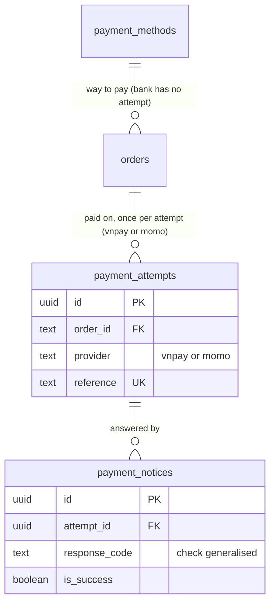

# ERD — More ways to pay: VietQR transfer and MoMo (plan item 12, "S11")

Module `payments` · Requirements PAY-020, PAY-021, PAY-022 (PAY-022 stores nothing) · Story `docs/payments/stories/more-ways-to-pay-vietqr-transfer-and-momo.md` · UI PR #91 · Engine PostgreSQL 16, pgx v5, hand-written SQL.

This file defines **the two schema changes this story makes and what it writes into tables that already exist, and nothing else.** There is **no new table, no new column and no new index**: the VNPay story's `payment_attempts`, `payment_notices` and `idx_orders_unpaid_open` (`erd/online-payment-with-vnpay.md`) were built for exactly this ("`provider = 'momo'` is already allowed", "the 24-hour rule reads the same set"), and a bank transfer needs no row of its own (it has no attempt: its QR is drawn from the order, and the dealer's "paid" is the one column `orders.paid`). `orders`, `order_items`, `order_tokens`, `product_sizes`, `counters`, `users`, `sessions` are other stories' and are **not changed**. Do not restate them; read them in their own files.

Project decisions this story builds on, unchanged: **D1** (`uuid` ids outside the ten collections), **D3** (a shoe's lists and "pairs in stock" are the view `product_stock`, never stored, so returning pairs needs no statement of its own), **D4** (an order's pairs live in `order_items`). The conventions of the checkout ERD §2 apply: `NOT NULL` by default, named constraints `fk_` / `uq_` / `ck_` / `idx_`, explicit `ON DELETE`, no extensions, no `pg enum`, append-only tables have no `updated_at`.

## 1. What this story changes

| # | Migration (file-name part) | Changes |
|---|---|---|
| 1 | `payment_notices_momo_success` | Replaces the check `ck_payment_notices_success_is_00` (written in VNPay's `00`/`00` only) by `ck_payment_notices_success_codes`, which also accepts MoMo's success (§2.1). No row is touched |
| 2 | `payment_methods_momo_note` | One conditional `UPDATE` of the `momo` record's `note` (SITE-016 item 5, SC-37) (§2.3) |

Each is its own file, in that order (§8). Neither creates, drops or rewrites a table.



## 2. Entities this story touches

### 2.1 `payment_notices` — one check replaced

**Why.** The table's only success rule is `CHECK ck_payment_notices_success_is_00`: `NOT is_success OR (response_code = '00' AND transaction_status = '00')`. A MoMo success has no `'00'` anywhere: its result code is the integer `0` and it has no transaction status. Without a change the database would refuse the first MoMo payment (`23514`) and the notice would answer a server error for ever.

**The check after this story**

```sql
CONSTRAINT ck_payment_notices_success_codes CHECK (
    NOT is_success
    OR (response_code = '00' AND transaction_status = '00')   -- VNPay: vnp_ResponseCode and vnp_TransactionStatus
    OR (response_code = '0'  AND transaction_status = '')     -- MoMo: resultCode 0, which has no status
)
```

The two arms are **disjoint by construction**: VNPay's response codes are always two digits (`00`…`99`) and MoMo's `resultCode` is written as a plain integer (`0`), so a VNPay row can never satisfy the MoMo arm nor the reverse. The database still refuses "a success the codes do not support" for each provider without knowing which provider the row belongs to (a `CHECK` cannot read `payment_attempts`). The application decides `is_success` per provider (VNPay: both `00`; MoMo: `resultCode == 0`); the check is the backstop.

**How a MoMo notice is stored** — the same columns, nothing added; every `NOT NULL` and default of the VNPay story's table stands:

| Column | MoMo field | Rule |
|---|---|---|
| `attempt_id` | — | The attempt whose `reference` equals the notice's `orderId` (`provider = 'momo'`) |
| `transaction_no` | `transId` | The integer as text, as sent. A failed payment may carry `0`; never `''` because `transId` is a required field of the notice (services §3.22) |
| `bank_code` | `payType` | The scheme the customer paid with (`webApp`, `app`, `qr`, `miniapp`), `''` when absent |
| `amount` | `amount` | Whole VND, as sent, **no ÷ 100** (VNPay's unit is the only one with ×100). Only a notice whose amount equals the attempt's is stored |
| `response_code` | `resultCode` | The integer as text, as sent: `'0'` is success, anything else is a failure. Never zero-padded |
| `transaction_status` | — | `''`: MoMo has none |
| `is_success` | `resultCode == 0` | Decided once by the handler |
| `paid_time` | `responseTime` | Epoch **milliseconds** → `timestamptz`; NULL when absent, not an integer or outside 2000–2100: a payment is never refused for a time |
| `received_at` | — | Default `now()`, as before |

The two partial unique indexes of the VNPay story serve MoMo unchanged: `uq_payment_notices_attempt_id_success` keeps one success per attempt (two copies at the same moment keep one row), and `uq_payment_notices_attempt_id_failure` collapses an identical failure notice into one row — MoMo sends the same notice again when it gets no `204`, so this is not theoretical. No card number or wallet identifier is received and none is stored: `extraData`, `orderInfo`, `message` and `signature` are **not** kept.

### 2.2 `payment_attempts` — written with `provider = 'momo'`, no schema change

`ck_payment_attempts_provider` already allows `'momo'`. A MoMo attempt is the same row as a VNPay one: `reference` `<order number>-<n>` (`DOI-24818-1`), `amount` the locked order's `total` in whole VND, `expires_at` `placed_at + 30 minutes`. Two facts specific to MoMo:

- **The reference is also MoMo's `orderId` and its `requestId`.** MoMo limits `orderId` to 50 characters; the table's check allows 100 (VNPay's own limit). An order number is `DOI-` plus at most 15 digits and `n` is at most 2 digits, so the reference is at most 22 characters and the application refuses to build one over 50 as a defect (500) rather than send MoMo a value it would refuse. No column changes.
- **A bank transfer has no attempt, ever.** Placing or showing a bank order writes nothing to this table (SC-5), and `provider` never gains `'bank'`.

An attempt row is written **before** MoMo is asked for its address (§7, E3), so an attempt may exist for which MoMo never gave an address; it holds no money and counts toward the 50-attempt bound of the VNPay story (ERD E9).

### 2.3 `payment_methods` — one note reworded

The `momo` record's note says "Confirm the payment in the MoMo app; the order is marked paid at once." Only a verified MoMo notice marks an order paid, so the clause is untrue (SITE-016 item 5, PAY-021). A new migration — never an edit to the merged seed — changes the note to `Confirm the payment in the MoMo app.`, **only while it still has its first text** (the owner may have reworded it in the Studio: a changed note is left alone), and a second run changes nothing more. The `bank` record is unchanged, all four rows stay (`cod` is still referenced by the sample orders, FK `RESTRICT`), and no other column is named. **Which ways are offered is not stored**: it is code plus the owner's settings (project ERD §3.7, order-page ERD E2).

### 2.4 `orders` — nothing added; one index serves a second rule

- **No column.** "Paid by the dealer" is `orders.paid` set through `orders.MarkPaid`, the same function a verified notice calls; `status` moves `placed → confirmed` in the same statement (`markPaidSQL`). Who pressed the button and when are **not** stored (§5, E7).
- **`idx_orders_unpaid_open`** (`(placed_at) WHERE NOT paid AND NOT is_sample AND status IN ('placed','confirmed','packed')`) is reused **as it is**: a bank order and a MoMo order are in its set exactly as a VNPay order is. The VNPay story's ERD already said so ("the later 24-hour bank-transfer rule reads the same set … without a new migration for the index"). The candidate query of §6 repeats the predicate literally so PostgreSQL uses it.

## 3. Access patterns

| # | Pattern | Frequency | Index used |
|---|---|---|---|
| 1 | **Reserve a MoMo attempt**: lock the order's row; judge its state; `count(*)` of its attempts; insert one; commit — **then** call MoMo with no transaction open (§6) | Low (a placing with MoMo, "Pay now", "Try again") | `orders` PK; `idx_payment_attempts_order_id` |
| 2 | **Find the attempt of a MoMo notice**: `SELECT a.id, a.order_id, a.amount, o.number, o.paid FROM payment_attempts a JOIN orders o ON o.id = a.order_id WHERE a.reference = $1 AND a.provider = 'momo'` | Low (one or two per payment; a few more while MoMo retries). p95 ≤ 2 s over 100 sequential notices (SC-38) | `uq_payment_attempts_reference`; `orders` PK |
| 3 | **Record a MoMo success**: `orders.MarkPaid`, then insert the notice `ON CONFLICT (attempt_id) WHERE is_success DO NOTHING`, one transaction | Low | `orders` PK; `uq_payment_notices_attempt_id_success` |
| 4 | **Record a MoMo failure**: insert `ON CONFLICT … WHERE NOT is_success DO NOTHING` | Low | `uq_payment_notices_attempt_id_failure` |
| 5 | **Give up the orders whose time ran out** — the 30-minute rule (VNPay and MoMo) and the 24-hour rule (bank transfer): one candidate query, then one cancel transaction per candidate | Every 30 s, forever; an empty result almost always | `idx_orders_unpaid_open`; then `orders` PK, `uq_order_items_order_id_line_no`, `product_sizes` PK |
| 6 | **The dealer marks a bank order paid**: `orders.LockOrder`, then the state rules, then `orders.MarkPaid`, then the dealer view read in the same transaction | Low (one press per bank order) | `orders` PK |
| 7 | **Read an order's transfer details**: the access statement alone (`accessSQL`: the order by id and by the hash of its token); the bank account comes from the settings, the amount and note from that row | Low (once per page view of an unpaid bank order) | `orders` PK; `uq_order_tokens_token_hash` |
| 8 | **An order's transaction number** (the dealer's reads, access pattern 6 of the VNPay ERD): `… JOIN payment_attempts a … WHERE a.order_id = $1 AND n.is_success` | Medium (every dealer read of one order) | `idx_payment_attempts_order_id`, then `uq_payment_notices_attempt_id_success` |

Pattern 8 is **provider-agnostic as written** and must stay so: the dealer's `transaction_no` carries MoMo's `transId` with no change (SC-22). The backend step greps the fragment for a `provider = 'vnpay'` filter and removes it if one slipped in.

Nothing else needs an index: every statement is by primary key, a unique key or the partial index.

## 4. What this story does not change

| Entity | Read by this story | Written by this story |
|---|---|---|
| `orders` | `id`, `number`, `placed_at`, `total`, `status`, `paid`, `payment_method_id`, `is_sample` | `paid` and `status`, **only** through `orders.MarkPaid` (a verified VNPay or MoMo notice, or the dealer on a bank-transfer order) and `orders.Cancel` (the two time rules; the dealer's cancel). No column is added |
| `order_items`, `product_sizes` | The pairs of a cancelled order | `product_sizes.pairs` `+ qty` only through `stock.Return` inside `orders.Cancel`, once per cancelled order |
| `payment_attempts` | — | Rows with `provider = 'momo'`, by `payments` only (the only writer, as before) |
| `payment_notices` | — | MoMo rows, by `payments` only; the check of §2.1 is the only structural change |
| `payment_methods` | The rows `vnpay`, `bank`, `momo` for `GET /v1/payment-options` | The `momo` note, once, by the migration |
| `order_tokens`, `counters`, `users`, `sessions`, `rate_limits` | `order_tokens` through the access statement | Nothing |

## 5. Left out of the schema, on purpose

- **No table of bank accounts, no column for the shop's account anywhere.** The account (bank, BIN, number, holder) is four settings (`VIETQR_*`). Story decision 7: it is served only by the order's own transfer-details call, so it must never be in a table that a collection or the generic list reader could serve (`GET /v1/payments` serves `payment_methods` and would serve a column added to it).
- **No stored QR, no stored payload.** The payload is a pure function of the settings, the order's `total` and its `number`; storing it would be a second copy that goes stale the day the owner changes the account.
- **No refund and no refund status**, as the VNPay story: a MoMo payment after the order was given up, or a bank transfer after 24 hours, is `paid = true` with `status = 'cancelled'`, which the dealer sees and refunds by hand.
- **No record of who marked a bank order paid, or when** (E7).
- **No MoMo request log, no MoMo response log.** The create-payment answer carries an address and codes, nothing the shop needs afterwards.
- **No `payment_attempts.provider = 'bank'`**, no `pay_url` column, no attempt state.

## 6. Locks and write shapes

Every transaction of this story takes the order's row first and never takes an order row after a `product_sizes` row (the VNPay ERD §6 rule, unchanged). Every one sets `SET LOCAL lock_timeout`: `2s` for an attempt, `3s` elsewhere.

| Transaction | Locks, in order |
|---|---|
| Reserve a MoMo attempt | `orders` row `FOR UPDATE` → insert into `payment_attempts` → **commit** → *then* MoMo is called, with no transaction and no lock held |
| MoMo success notice | `orders` row (by `UPDATE … WHERE NOT paid`) → insert into `payment_notices` |
| MoMo failure notice | the insert alone; no order lock |
| The dealer marks a bank order paid | `orders` row `FOR UPDATE` (`LockOrder`) → the status move and fields, if the body has any → `MarkPaid` → the dealer view read in the same transaction |
| Cancel (the 30-minute rule, the 24-hour rule, the dealer's) | `orders` row (by `UPDATE … SET status = 'cancelled' WHERE …`) → `product_sizes` rows in `(product_id, size)` order |

```sql
-- reserve a MoMo attempt (one transaction, committed before MoMo is called)
SELECT id, number, status, paid, total, placed_at, payment_method_id FROM orders WHERE id = $1 FOR UPDATE;   -- orders.LockOrder; CheckPayable under the lock
SELECT count(*) FROM payment_attempts WHERE order_id = $1;                                                    -- k; k = 50 is a refusal
INSERT INTO payment_attempts (order_id, provider, reference, amount, expires_at)
VALUES ($1, 'momo', $2 /* 'DOI-24818-' || k+1 */, $3 /* the locked row's total, whole VND */, $4 /* placed_at + 30 min */);

-- a MoMo success notice (one transaction; either 0-row result rolls it back and the answer is still 204)
UPDATE orders SET paid = true, status = CASE WHEN status = 'placed' THEN 'confirmed' ELSE status END
WHERE id = $1 AND NOT paid;
INSERT INTO payment_notices (attempt_id, transaction_no, bank_code, amount, response_code, transaction_status, is_success, paid_time)
VALUES ($1::uuid, $2 /* transId */, $3 /* payType */, $4 /* amount */, $5 /* '0' */, '', true, $6 /* responseTime */)
ON CONFLICT (attempt_id) WHERE is_success DO NOTHING;

-- a MoMo failure notice
INSERT INTO payment_notices (…, is_success, …) VALUES (…, false, …)
ON CONFLICT (attempt_id, transaction_no, response_code, transaction_status) WHERE NOT is_success DO NOTHING;

-- the dealer marks a bank order paid: orders.LockOrder, then the same statement as a notice's
UPDATE orders SET paid = true, status = CASE WHEN status = 'placed' THEN 'confirmed' ELSE status END
WHERE id = $1 AND NOT paid;                       -- zero rows = already paid: a 200 that changes nothing

-- the candidates of both time rules (one query; the rule for each row is chosen by its way to pay)
SELECT id, payment_method_id FROM orders
WHERE NOT paid AND NOT is_sample AND status IN ('placed', 'confirmed', 'packed')
  AND placed_at <= $1                                     -- now - 30 minutes: the shortest window bounds every rule, so the index range is tight
  AND (payment_method_id = ANY($2)                        -- {vnpay, momo}: due at 30 minutes
       OR (payment_method_id = ANY($3) AND placed_at <= $4))   -- {bank}: due at 24 hours (now - 24 h)
ORDER BY placed_at LIMIT 100;
```

**Two things that race, and how each ends.**

- **The dealer's "paid" against the 24-hour cancel** (SC-21). Both serialise on the order's row. If the mark wins, the order is paid and the cancel's own `AND NOT paid` changes zero rows: nothing is returned. If the cancel wins, the order is `cancelled` with its pairs returned once, and the mark then sets `paid` and leaves the status (`markPaidSQL`'s `CASE` only moves `placed`): `cancelled` and `paid`, which the dealer refunds by hand. Never pairs returned twice, never taken again.
- **Two marks at the same moment.** The second waits on the row, finds `paid` and changes zero rows; the answer is still `200` (the dealer asked for a state the order is already in).

## 7. Decisions, and where this departs from the merged design

| # | Question | Decision | Rejected alternative, and why |
|---|---|---|---|
| E1 | How does `payment_notices` accept MoMo's success when its check is written in VNPay's `00`/`00`? | **Two disjoint arms** in one check (§2.1): VNPay `('00','00')`, MoMo `('0','')`. No new column. The application sets `is_success` per provider; the check is the backstop | A `provider` column on `payment_notices`: a copy of `payment_attempts.provider`, written on every insert, only to let a `CHECK` see it. Writing MoMo's `0` as `'00'` with status `'00'`: the table would say MoMo sent codes it did not, and a refund query against MoMo's portal would read the wrong code. Dropping the check: the database would stop refusing an impossible "success" |
| E2 | Does a bank transfer get an attempt row? | **No.** There is no provider page, no reference to send and no notice to find it by; an attempt row would have nothing to answer it | A row per QR shown: unbounded writes on a token-only read route for a record nothing reads |
| E3 | When is a MoMo attempt written, relative to MoMo's create-payment call? | **Before**, in its own transaction, **committed before** the call, which runs with no transaction and no lock held | *After the call*: if MoMo gives an address and the insert then fails, the customer can pay a reference the shop does not know, MoMo's notice is refused (unknown reference) and the money is taken while the order stays unpaid. *Inside the transaction*: the order's row lock and a pooled connection would be held across up to 3 seconds of network I/O on every press, and up to 50 presses are allowed; a slow MoMo would pin the pool. Cost accepted: a call that fails leaves an attempt that no address ever referred to (it counts toward the 50 bound; no notice can come for an address MoMo never gave) |
| E4 | Where does the 24-hour rule live? | **In the same candidate query and the same loop** as the 30-minute rule (§6): one scan of the partial index per tick, the rule per row chosen by its way. `idx_orders_unpaid_open` is reused unchanged | A second index or a second loop for bank orders: the set is a handful of rows; a second scan every 30 seconds buys nothing and doubles the 25-second budget logic |
| E5 | Which orders do the two rules skip? | The 14 sample orders (`is_sample`, in the index predicate **and** in `cancelExpirySQL`), orders already paid, cancelled, shipped or delivered. A rule applies **by the order's way, not by today's settings**: an unpaid MoMo or bank order is still given up after the owner removes its keys, so its pairs never stay held for ever | Applying a rule only while the way is configured: an owner who removes the MoMo keys would freeze every open MoMo order's pairs on the shelf |
| E6 | Where does the shop's bank account live? | **Settings only** (`VIETQR_*`); §5 | A row in `payment_methods` or a new table: it would be served by the generic collections and break story decision 7 |
| E7 | Store who marked a bank order paid, and when? | **No column.** `orders.updated_at` already records the moment; the backend logs one `info` line (the order's number and the dealer's user id, no values of the account) | `orders.paid_by`, `orders.paid_at`: no criterion of the SRS or the story reads them, and the dealer sees "Paid" either way. If the owner later wants an audit trail it is its own item (a table of dealer actions across every edit, not a column for one) |
| E8 | The `momo` note | A **conditional** `UPDATE` in a new file (§2.3), never an edit to `20261125100200_seed_collections` | Editing the merged seed: every database already migrated keeps the old text, and the README forbids it |
| E9 | Down migrations | Written, **for local resets only**, with the reason in each file (§8) | None: every `.up.sql` has a `.down.sql` |
| E10 | Does a bank transfer's marked-paid order need a "transaction number"? | **No.** The dealer's `transaction_no` is `''` for it (no success notice exists) and the admin page draws the line only when the string is non-empty, as it does for the sample orders | A free-text reference column the dealer types into: not asked for |

**Conflicts with merged decisions, stated and resolved**

1. **`erd/online-payment-with-vnpay.md` §2.2, constraint `ck_payment_notices_success_is_00`** is **superseded** by `ck_payment_notices_success_codes` (E1). Every VNPay row satisfies the first arm unchanged; nothing of the VNPay story's behaviour changes.
2. **`orders.MarkPaid`'s comment** ("the only statement in the project that sets `orders.paid` for an online order, and only a verified notice from the provider calls it") is now true for **VNPay and MoMo orders**; the one other caller is the dealer's mark on a **bank-transfer** order (services §3.15). The backend step rewrites the comment and keeps the rule "no caller but these three".
3. **`erd/online-payment-with-vnpay.md` §4**, "`payment_methods`: not read by the payment code": still true of the payment code. `GET /v1/payment-options` reads the rows of the offered ways, as before.
4. **VNPay ERD E3** (identical failure notices are one row) now covers MoMo too: its retries are the same hazard.

No other. I read `erd/_base.md` §3.7 (`payment_methods`), §3.12 (`orders`), §3.16, §3.17; `erd/online-payment-with-vnpay.md` (all); `erd/order-page-and-pay-now.md` E2; `erd/dealer-handles-orders-status-courier-payment.md` §6; the migrations `20261125100100_collections`, `20261125100200_seed_collections`, `20261126100000` to `20261126100200`, and the migrations README.

## 8. Migration plan

Two files, in this order, stamped after item 8's `20261126100200_orders_unpaid_open_index` and item 10's `20261126110000_uploads` (the next free stamps; if another merged story took them, take the next free ones — the two only need to sort in this order). Neither contains `CONCURRENTLY`, so both run inside the runner's transaction with their `schema_migrations` row.

| Step | File | Forward | Backward | Safe on a populated table |
|---|---|---|---|---|
| 1 | `20261126120000_payment_notices_momo_success` | `ALTER TABLE payment_notices DROP CONSTRAINT IF EXISTS ck_payment_notices_success_is_00;` `ALTER TABLE payment_notices DROP CONSTRAINT IF EXISTS ck_payment_notices_success_codes;` `ALTER TABLE payment_notices ADD CONSTRAINT ck_payment_notices_success_codes CHECK (NOT is_success OR (response_code = '00' AND transaction_status = '00') OR (response_code = '0' AND transaction_status = ''));` | The reverse: drop the new check, add the old one. **It fails (`23514`) if a MoMo success row exists** — intended, and written in the file: those rows are the only record of what MoMo took, so the file never deletes them and a local reset drops the database instead | The table holds at most one success per paid order. Adding a check scans it once (milliseconds) under an `ACCESS EXCLUSIVE` lock held to the end of the file's transaction; **every existing row satisfies the first arm**, so the scan cannot fail and no row is rewritten. Nothing reads the table in a request path except the dealer's order read and the notice, both short. Safe to run twice (the `IF EXISTS` drops) |
| 2 | `20261126120100_payment_methods_momo_note` | `UPDATE payment_methods SET note = 'Confirm the payment in the MoMo app.' WHERE id = 'momo' AND note = 'Confirm the payment in the MoMo app; the order is marked paid at once.';` | `UPDATE payment_methods SET note = 'Confirm the payment in the MoMo app; the order is marked paid at once.' WHERE id = 'momo' AND note = 'Confirm the payment in the MoMo app.';` — reversible with no loss | Four rows, at most one touched; a note the owner already changed is left alone; a second run matches nothing. No lock beyond the one row |

**Schema test the backend PR ships** (`migrations_test.go`, against PostgreSQL): the two files apply in order on a database that already holds item 8's tables; with `is_success = true` the rows `('00','00')` and `('0','')` are stored and the rows `('0','00')`, `('00','')`, `('0','0')`, `('1','')`, `('','')` are refused with `23514`; with `is_success = false` any codes are stored; step 2 applied twice, and over a note the owner changed, leaves the changed note.

## 9. Arranging state for a test (no schema change)

The dealer's screens, MoMo's servers and the clock do not exist in a `.localhost` run, so the cases arrange state with SQL; each is undone by the case that ran it (`DELETE FROM orders WHERE id = $1` cascades to attempts and notices; put pairs back with `UPDATE product_sizes SET pairs = pairs + $q`).

```sql
UPDATE orders SET placed_at = now() - interval '25 hours' WHERE id = $1;   -- or '24 hours', '23 hours', '31 minutes', '29 minutes', '2 hours'
UPDATE orders SET status = 'packed' WHERE id = $1;                          -- or 'confirmed', 'shipped', 'delivered', 'cancelled'
UPDATE orders SET is_sample = true WHERE id = $1;                           -- only to prove both rules skip samples
UPDATE orders SET payment_method_id = 'momo' WHERE id = $1;                 -- an order of a way whose settings the run lacks (the FK allows it)
SELECT a.reference, n.transaction_no, n.bank_code, n.amount, n.response_code, n.transaction_status, n.is_success, n.paid_time
FROM payment_attempts a LEFT JOIN payment_notices n ON n.attempt_id = a.id WHERE a.order_id = $1 ORDER BY a.created_at, n.received_at;
```

A MoMo notice is signed by the test itself with the run's secret key (services §3.22, §6); the shop cannot be asked for one. Setting `paid` by hand is **not** how a case proves payment: a case sends a signed notice, or the dealer's `PUT`.

## 10. Who must know

| Who | What they must know from this design |
|---|---|
| Dev, backend step | Two migrations (§8) and **no new table, column or index**. `payments` stays the only writer of `payment_attempts` and `payment_notices`; it writes `provider = 'momo'` rows and MoMo notices through the same store as VNPay's. The attempt is committed **before** MoMo is called (E3). A bank order writes no attempt |
| Test lead | State is arranged with §9. A MoMo notice is signed by the case; the bank order's "paid" is the dealer's `PUT`. The check refuses `('0','00')`: a MoMo success written with VNPay's codes is a bug, not a pass |
| Items 10 and 17 | Item 17's `transaction_no` fragment must stay provider-agnostic (§3 pattern 8). Item 17's `DELETE` sentence for a paid, cancelled order names VNPay's portal; services §3.15 makes it follow the order's way to pay |
| The owner | Supplies the seven settings and registers MoMo's notice address; no data is entered anywhere |
