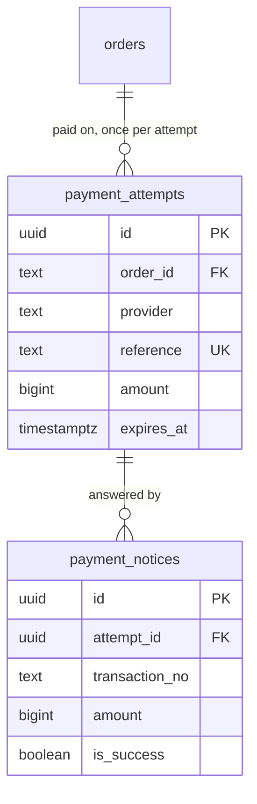

# ERD — Online payment with VNPay (plan item 8, "S7")

Module `payments` · Requirements PAY-001, PAY-002, PAY-003 (PAY-004 and PAY-005 store nothing) · Story `docs/payments/stories/online-payment-with-vnpay.md` · UI PR #75 · Engine PostgreSQL 16, pgx v5, hand-written SQL.

This file defines **the entities this story creates and the one index it adds to an existing table, and nothing else**: `payment_attempts`, `payment_notices` and `idx_orders_unpaid_open`. The project ERD (§3.16, §3.17, §3.12) already names all three; this file is what they are **as built**, and §7 lists every place it departs from that text and why. `orders`, `order_items`, `product_sizes`, `order_tokens` and `counters` are other stories' (`erd/site-data-from-the-database.md`, `erd/checkout-and-placing-an-order.md`) and are **not changed**: no column is added to `orders`, `paid` and `status` keep their meaning, and `is_sample` (which already exists) is only read.

Project decisions this story builds on, unchanged: **D1** (`uuid` ids outside the ten collections), **D3** (one count of pairs per shoe and size; a shoe's lists and "pairs in stock" are the view `product_stock`, never stored), **D4** (an order's pairs live in `order_items`). The conventions of the checkout ERD §2 apply (`NOT NULL` by default, named constraints `fk_` / `uq_` / `ck_` / `idx_`, explicit `ON DELETE`, no extensions, no `pg enum`, append-only tables have no `updated_at`).

## 1. What this story creates

| # | Migration (file-name part) | Creates |
|---|---|---|
| 1 | `payment_attempts` | table `payment_attempts`, its checks, `uq_payment_attempts_reference`, `idx_payment_attempts_order_id` |
| 2 | `payment_notices` | table `payment_notices`, its checks, `uq_payment_notices_attempt_id_success`, `uq_payment_notices_attempt_id_failure`, `idx_payment_notices_attempt_id` |
| 3 | `orders_unpaid_open_index` | `idx_orders_unpaid_open` on `orders`, built `CONCURRENTLY` (a table that already has rows) |

Each is its own file, in that order (§8). Nothing else in any table is added, changed, copied or deleted: the two new tables start empty.



## 2. Entities

### 2.1 `payment_attempts`

**Purpose** — one attempt to pay an order on a provider's page. Every "Pay now", "Try again" and placing with VNPay makes a **new** row with a **new** reference; every earlier reference still leads to its order, so a customer who pays on the first page after opening a second is still found (PAY-001 items 1, 5). **Traces to** — PAY-001, PAY-002 item 2, PAY-004 item 1, PAY-021 item 2 (the same table serves MoMo later).

| Column | Type | Null | Default | Unique | Description |
|---|---|---|---|---|---|
| `id` | `uuid` | no | `gen_random_uuid()` | PK | Not exposed |
| `order_id` | `text` | no | — | | FK `orders` (a text slug, `doi-24818`) |
| `provider` | `text` | no | — | | `CHECK ck_payment_attempts_provider`: `provider IN ('vnpay','momo')`. A bank transfer has no attempt: its QR is static and the dealer marks it paid (PAY-020). Today only `vnpay` is written |
| `reference` | `text` | no | — | `uq_payment_attempts_reference` | `<order number>-<n>` (`DOI-24818-1`): what is sent to the provider as `vnp_TxnRef`. `CHECK ck_payment_attempts_reference_length`: `length(reference) BETWEEN 1 AND 100` (VNPay's own limit). `n` is the number of the order's attempts + 1, counted under the order's row lock (§6) |
| `amount` | `bigint` | no | — | | VND, copied from `orders.total` **under the lock**, when the attempt is made; the browser never supplies one (PAY-001 item 3). `CHECK ck_payment_attempts_amount_not_negative`: `amount >= 0`. VNPay's ×100 unit exists only in the address and in the notice check, never in a column |
| `expires_at` | `timestamptz` | no | — | | `orders.placed_at + 30 minutes`: the moment the payment page stops taking payment, as it was told to VNPay (`vnp_ExpireDate`). It is derivable from the order and kept anyway, because it is the record of what VNPay was promised if the window ever changes (§7, E7) |
| `created_at` | `timestamptz` | no | `now()` | | Append-only: no `updated_at`, no trigger |

**Nullable columns** — none.

**Foreign keys**

| Column | References | On delete | On update | Why |
|---|---|---|---|---|
| `order_id` | `orders(id)` | `CASCADE` | `NO ACTION` | An attempt has no meaning without its order. Blast radius: an order is deletable only when cancelled (ADMIN-014) and **never when paid** (the dealer's `DELETE` answers 409, services §3.16 and project ERD Q3), so the cascade can only remove attempts of an order that took no money |

**Indexes**

| Name | Columns | Type | Query it serves |
|---|---|---|---|
| `uq_payment_attempts_reference` | `(reference)` | unique | The notice finds its attempt and order from `vnp_TxnRef` (`WHERE reference = $1 AND provider = 'vnpay'`, PAY-002 item 2); two attempts at the same moment cannot share a reference even if the lock were bypassed |
| `idx_payment_attempts_order_id` | `(order_id)` | btree | `SELECT count(*) FROM payment_attempts WHERE order_id = $1` under the lock (the next `n`, and the 50-attempt cap, §7 E9); an order's attempts joined to their success notice (the dealer reads the VNPay transaction number); the cascade |

**Lifecycle** — insert only, by `payments`; deleted only with its order. Nothing updates it.

### 2.2 `payment_notices`

**Purpose** — what VNPay told the shop about an attempt, **for each notice the shop accepted**: the dealer's "paid" badge and VNPay's transaction number come from here, and a refund in VNPay's portal is made against it. **Traces to** — PAY-002 items 3–9, ADMIN-016 item 4 / AC-9, PAY-021 item 3. No card number is received by the shop and none is stored: VNPay's page takes the card.

| Column | Type | Null | Default | Unique | Description |
|---|---|---|---|---|---|
| `id` | `uuid` | no | `gen_random_uuid()` | PK | Not exposed |
| `attempt_id` | `uuid` | no | — | | FK `payment_attempts` |
| `transaction_no` | `text` | no | — | | `vnp_TransactionNo`, as sent; `''` when the notice carries none |
| `bank_code` | `text` | no | `''` | | `vnp_BankCode` (the bank or scheme the customer paid with), `''` when absent |
| `amount` | `bigint` | no | — | | VND: `vnp_Amount ÷ 100`. Only a notice whose amount equals the attempt's is ever stored, so it equals the attempt's `amount`. `CHECK ck_payment_notices_amount_not_negative`: `amount >= 0` |
| `response_code` | `text` | no | — | | `vnp_ResponseCode` as sent (`00` = success, `24` = the customer cancelled); `''` when absent |
| `transaction_status` | `text` | no | `''` | | `vnp_TransactionStatus` as sent; `''` when absent |
| `is_success` | `boolean` | no | — | | `response_code = '00'` **and** `transaction_status = '00'` (PAY-002 item 4), decided once by the handler. `CHECK ck_payment_notices_success_is_00`: `NOT is_success OR (response_code = '00' AND transaction_status = '00')` — the database refuses a "success" the codes do not support |
| `paid_time` | `timestamptz` | **yes** | — | | `vnp_PayDate` (`yyyyMMddHHmmss`, Vietnam time, read as `+07:00`). NULL when the notice carries none or it does not parse: a payment is never refused for a date |
| `received_at` | `timestamptz` | no | `now()` | | When the shop received it. Append-only: no `updated_at` |

**Nullable columns** — `paid_time` only: a cancelled or failed payment has no payment time, and `''` cannot be a `timestamptz`.

**Foreign keys**

| Column | References | On delete | On update | Why |
|---|---|---|---|---|
| `attempt_id` | `payment_attempts(id)` | `CASCADE` | `NO ACTION` | A notice is the record of one attempt and goes with it; an attempt goes only with an order that took no money |

**What is stored and what is not** — a row is written **only when the shop answered `00`** (PAY-002 items 4, 5, 9): a notice with a bad signature (`97`), an unknown reference (`01`), a wrong amount (`04`), for an order already paid (`02`) or that hit a database error (`99`) leaves **no row**. The notice address needs no sign-in, so what strangers send is only logged (project ERD §3.17); the checks that gate a row are all cryptographic or arithmetic and run before the first write.

**Indexes**

| Name | Columns | Type | Query it serves |
|---|---|---|---|
| `uq_payment_notices_attempt_id_success` | `(attempt_id) WHERE is_success` | unique, partial | Two copies of one success notice at the same moment keep one transaction: the second finds the row and the shop answers `02` (PAY-002 AC-4). It is the backstop under `orders.MarkPaid` (§6), which already lets exactly one notice per order through. Also: "this order's transaction number" |
| `uq_payment_notices_attempt_id_failure` | `(attempt_id, transaction_no, response_code, transaction_status) WHERE NOT is_success` | unique, partial | A failure notice VNPay sends twice, or one a customer replays from their own return address (it carries the same signed fields), is **one** row: `INSERT … ON CONFLICT DO NOTHING`, still answered `00`. Without it a stranger holding one signed failure address could grow the table without bound (§7, E3). Failure notices that differ (another transaction number, another code) all stay |
| `idx_payment_notices_attempt_id` | `(attempt_id)` | btree | "Every notice of this attempt", unfiltered (the dealer's payment history), and the cascade from `payment_attempts`; neither partial index can serve a query that does not say `is_success` |

**Lifecycle** — insert only, by `payments`, in the same transaction as `orders.MarkPaid` for a success notice; deleted only with its attempt. "Paid exactly once" is **not** enforced by this table's index but by the conditional `UPDATE orders SET paid = true … WHERE id = $1 AND NOT paid` (§6): the index is the second line.

### 2.3 `idx_orders_unpaid_open` (the one index this story adds to `orders`)

| Name | Columns | Type | Query it serves |
|---|---|---|---|
| `idx_orders_unpaid_open` | `(placed_at) WHERE NOT paid AND NOT is_sample AND status IN ('placed','confirmed','packed')` | btree, partial | The expiry check that runs every 30 seconds (PAY-003): *"the unpaid, live, non-sample orders placed at least 30 minutes ago, oldest first"* — `WHERE NOT paid AND NOT is_sample AND status IN ('placed','confirmed','packed') AND placed_at <= $1 AND payment_method_id = ANY($2) ORDER BY placed_at LIMIT 100`. The candidate set is the orders waiting to be paid (a handful), so the scan reads a handful of index entries instead of the whole table; the later 24-hour bank-transfer rule (PAY-020) reads the same set. `payment_method_id` is not in the index: it is a filter over a tiny set and a wider key would be written on every order's every status change |

The predicate is exactly the project ERD's (§3.12 `idx_orders_unpaid_open`); the query must repeat its terms literally for PostgreSQL to use a partial index. A row leaves the index when it is paid, cancelled, shipped or delivered.

## 3. Access patterns

| # | Pattern | Frequency | Index used |
|---|---|---|---|
| 1 | **Make an attempt**: lock the order's row; `count(*)` of its attempts; insert one | Low (a press of "Pay now", "Try again", or a placing) | `orders` PK; `idx_payment_attempts_order_id` |
| 2 | **Find the attempt of a notice**: `SELECT a.id, a.order_id, a.amount, o.number, o.paid, o.status FROM payment_attempts a JOIN orders o ON o.id = a.order_id WHERE a.reference = $1 AND a.provider = 'vnpay'` | Low (one or two per payment; a few more when VNPay retries) | `uq_payment_attempts_reference`; `orders` PK. p95 ≤ 2 s over 100 sequential notices (SC-19) with about four statements each |
| 3 | **Record a success**: `UPDATE orders … WHERE id = $1 AND NOT paid`, then insert the notice | Low | `orders` PK; `uq_payment_notices_attempt_id_success` (the conflict check) |
| 4 | **Record a failure**: insert the notice, `ON CONFLICT DO NOTHING` | Low | `uq_payment_notices_attempt_id_failure` |
| 5 | **Give up the orders whose 30 minutes ran out**: the candidate scan (§2.3) every 30 seconds, then one single-cancel transaction per candidate (services §6) | Every 30 s, forever; an empty result almost always | `idx_orders_unpaid_open`; then `orders` PK, `uq_order_items_order_id_line_no` (the pairs), `product_sizes` PK (the counts) |
| 6 | **An order's VNPay transaction number** (read by the dealer's order screens, a later story's code, so named here once): `SELECT n.transaction_no, n.bank_code, n.amount, n.paid_time FROM payment_notices n JOIN payment_attempts a ON a.id = n.attempt_id WHERE a.order_id = $1 AND n.is_success` | Medium (every dealer read of one order) | `idx_payment_attempts_order_id`, then `uq_payment_notices_attempt_id_success` |

Nothing else needs an index: every statement is by primary key, a unique key or the partial index. A shoe's sold-out list, last-pairs list and "pairs in stock" are the view `product_stock` over `product_sizes` (D3), so **returning pairs updates them with no statement of their own** — there is no list to maintain (PAY-003 item 2, ORD-005).

## 4. What this story does not change

| Entity | Read by this story | Written by this story |
|---|---|---|
| `orders` | `id`, `number`, `placed_at`, `total`, `status`, `paid`, `payment_method_id`, `is_sample` | `paid` and `status`, **only** through `orders.MarkPaid` (a verified notice) and `orders.Cancel` (the expiry; the dealer's cancel is the same function). No column is added. The order's other columns are never written here |
| `order_items` | `product_id`, `size`, `qty` of every pair of a cancelled order | Nothing |
| `product_sizes` | — | `pairs` only, `+ qty`, only through `stock.Return` inside `orders.Cancel`, once per cancelled order |
| `payment_methods` | Not read by the payment code: the set of ways whose 30-minute rule this story enforces is **code** (`vnpay` today), as "offered" is (order-page ERD E2) | Nothing |
| `order_tokens`, `counters`, `users`, `sessions`, `rate_limits` | — | Nothing |

## 5. Left out of the schema, on purpose

- **No refund, no refund status.** A refund is made by the dealer in VNPay's portal and is not recorded (payments SRS §3). A paid, cancelled order is simply `paid = true` with `status = 'cancelled'`: the dealer sees both and refunds it (PAY-002 item 9).
- **No card data of any kind.** VNPay's page takes the card; the notice carries a bank code, a transaction number and amounts only, and those are the only columns.
- **No raw notice or request log table.** The query of a notice contains the signed fields and the signature; only the parsed, accepted facts are kept.
- **No attempt state** (`pending`, `expired`, `paid`). An attempt's outcome is the notice that answers it, or none; the order's own `paid` and `status` say what became of the order.

## 6. Locks and write shapes

**Every transaction of this story takes the order's row first** and never takes an order row after a `product_sizes` row:

| Transaction | Locks, in order |
|---|---|
| Make an attempt | `orders` row `FOR UPDATE` → insert into `payment_attempts` (its foreign key takes a key-share lock on the row already held by the same transaction) |
| Success notice | `orders` row (by `UPDATE … WHERE NOT paid`) → insert into `payment_notices` (key-share on the attempt row) |
| Failure notice | the insert alone; no order lock (a failure changes nothing about the order) |
| Cancel (expiry, and the dealer's later) | `orders` row (by `UPDATE … SET status = 'cancelled' WHERE status IN (…)`) → `product_sizes` rows in `(product_id, size)` order |

Against placement (`orders.Place`: advisory key → shoes `FOR SHARE` → counts `FOR UPDATE` → counter → inserts, checkout ERD §2.4): placement only **inserts** an order row nobody else can refer to yet, so a transaction here that holds an old order and wants counts, and a placement that holds counts and inserts a new order, can never wait on each other. Two cancels return pairs in the same sorted order, so they cannot deadlock either. Every transaction here sets `SET LOCAL lock_timeout = '3s'`, as placement does: a stuck lock is a retryable error (500 on the route, `99` on the notice, the next 30-second run for the expiry), never a hang.

```sql
-- make an attempt (one transaction)
SELECT id, number, status, paid, total, placed_at, payment_method_id FROM orders WHERE id = $1 FOR UPDATE;
SELECT count(*) FROM payment_attempts WHERE order_id = $1;                          -- n - 1
INSERT INTO payment_attempts (order_id, provider, reference, amount, expires_at)
VALUES ($1, 'vnpay', $2 /* 'DOI-24818-' || n */, $3 /* the locked row's total */, $4 /* placed_at + 30 min */);

-- a success notice (one transaction; either 0-row result rolls it back and the answer is 02)
UPDATE orders SET paid = true, status = CASE WHEN status = 'placed' THEN 'confirmed' ELSE status END
WHERE id = $1 AND NOT paid;
INSERT INTO payment_notices (attempt_id, transaction_no, bank_code, amount, response_code, transaction_status, is_success, paid_time)
VALUES ($1, $2, $3, $4, $5, $6, true, $7)
ON CONFLICT (attempt_id) WHERE is_success DO NOTHING;

-- a failure notice
INSERT INTO payment_notices (…, is_success, …) VALUES (…, false, …)
ON CONFLICT (attempt_id, transaction_no, response_code, transaction_status) WHERE NOT is_success DO NOTHING;
```

## 7. Decisions, and where this departs from the project design

| # | Question | Decision | Rejected alternative, and why |
|---|---|---|---|
| E1 | Where does the attempt number `n` of `DOI-24818-n` come from? | **Counted** under the order's row lock: `count(*) + 1`. Attempts are append-only and leave only with their order, so the count only grows. `uq_payment_attempts_reference` is the backstop | An `attempt_no` column with `UNIQUE (order_id, attempt_no)`: a second copy of what the reference already holds. A sequence: not per order, and the references would be `DOI-24818-7731`, not the `-1`, `-2` the story names (SC-2). A random suffix: same |
| E2 | Which notices are stored? | Only those the shop answered `00` (§2.2). The project ERD says the same in other words ("verified") | Every call, for an audit trail: the address needs no sign-in, so the table's size would be set by strangers |
| E3 | **May a failure notice repeat?** Project ERD §3.17: "Failed notices may repeat" | **No: identical failure notices are one row** (`uq_payment_notices_attempt_id_failure`, `ON CONFLICT DO NOTHING`, still answered `00`). **This departs from the project text.** The return address VNPay sends the customer carries the same signed fields as the notice, so anyone holding a failure address can replay it against the notice address as often as they like; every replay would otherwise be a row. Cost: a genuine second notice identical in transaction number, response code and status collapses into the first; nothing reads a count of failures | Leaving them to repeat, as written: unbounded growth from one captured address. Rate-limiting the notice address: VNPay's retries and one shared proxy address make a limit refuse real notices |
| E4 | **Statement order of a success notice.** Project services §3.17 step 6 and ERD §3.17 insert the notice first, then `UPDATE orders` | **`UPDATE orders` first, then the notice** (§6). **This departs from the project text; the observable result is the same** — one `00`, every other `02`, one row — and the table of §6 stays true: every writer takes the order's row first. A notice for an order already paid writes nothing at all, where the project's order would insert a row and roll it back | Notice first: two notices wait on a unique-index entry instead of on the order row, and a twin writes and rolls back a row for nothing |
| E5 | Which lock does an attempt take? | The order's row `FOR UPDATE`, then re-checks `paid`, `status` and the 30-minute deadline under it (order-page ERD E5, built here). A notice marking the order paid at the same instant either commits first (the attempt is refused 409) or after (the attempt exists, the order is paid; harmless) | No lock: an attempt could be written for an order a notice has just paid |
| E6 | Which clock decides "30 minutes"? | **The application's**, passed in (`orders.Options.Now`; `payments` takes the same). `orders.Place` writes `placed_at` from that clock, not from the column's `now()` default, so the three places that ask "has the window run out" — the refusal on the route, `payment_attempts.expires_at`, the expiry's `placed_at <= $now - interval '30 minutes'` — all use the one value and a test can set it | The database's `now()`: the boundary would move by the skew between two hosts, and "an order exactly 30 minutes old is cancelled by the next run" could not be tested without sleeping |
| E7 | Keep `payment_attempts.expires_at` although it is `placed_at + 30 min`? | **Yes** (as the project ERD has it): it is what VNPay was told, so if the window is ever changed the old attempts still say what each address promised | Dropping it: the record of the promise is lost. Putting it on `orders`: a derived value stored beside its source |
| E8 | A column on `orders` for the payment time, the transaction number or the deadline? | **No.** The transaction number, bank and time are the success notice's (access pattern 6, one join); the deadline is `placed_at + 30 min` | Copying them onto `orders`: a second copy written in the same transaction as the first, to save one join on the dealer's single-order read |
| E9 | How many attempts may one order have? | **50**, an application rule (a `409 conflict` on the 51st press) and no schema constraint: a `CHECK` cannot count other rows. Every press inserts a row, the order's token is a bearer secret and the window is 30 minutes, so without a bound one loop could write for half an hour; 50 is far above what a person retries | A rate limit in `rate_limits`: a second table write per press for the same bound. No bound: the red flag of an unbounded write on a token-only route |
| E10 | `idx_orders_unpaid_open`: how is it built? | In its own file, `CONCURRENTLY`, with a leading `DROP INDEX CONCURRENTLY IF EXISTS` (a failed concurrent build leaves an invalid index that `IF NOT EXISTS` would keep — the same rule as `uq_orders_idempotency_key` and the accounts ERD E6), because `orders` already has rows | `CREATE INDEX` in a transaction: a write lock on `orders` for the build. `IF NOT EXISTS` alone: may keep an invalid index |
| E11 | Down migrations | Written, **for local resets only**, with the reason in the file: dropping the two tables deletes the only record of what VNPay took | None: every `.up.sql` has a `.down.sql` (migrations README) |

### Conflicts with merged decisions

1. **E3** against project ERD §3.17 ("Failed notices may repeat") — resolved as written in E3; the project text is the one to read as superseded for `payment_notices`.
2. **E4** against project services §3.17 step 6 and ERD §3.17 lifecycle (statement order) — resolved as written in E4; the contract's answers (`00` / `02`, one row) do not change.
3. The project ERD's `payment_attempts` and `payment_notices` columns are carried **exactly** (names, types, nullability, `ON DELETE`); this file adds only constraints that make an impossible row unstorable (`ck_payment_attempts_reference_length`, `ck_payment_attempts_amount_not_negative`, `ck_payment_notices_amount_not_negative`, `ck_payment_notices_success_is_00`). A row the other stories' tests insert by hand (`INSERT INTO payment_attempts (order_id, provider, reference, amount, expires_at)`, `INSERT INTO payment_notices (attempt_id, transaction_no, amount, response_code, transaction_status, is_success)`) is valid as written: every column they leave out has a default or is nullable.

No other. I read `erd/_base.md` §3.12, §3.16, §3.17, decisions D1, D3, D4; `erd/checkout-and-placing-an-order.md` §2.3, §2.4 and §5 (lock order); `erd/order-page-and-pay-now.md` E2, E5; `erd/customer-accounts-sign-up-sign-in-my-orders.md` E6; the migrations README and `20261125120200_orders_idempotency_index`.

## 8. Migration plan

Three files, in this order, stamped after `20261125140000_users_and_sessions` (the next free stamps; if another merged story took them, take the next free ones — the three only need to sort in this order):

| Step | File | Forward | Backward | Safe on a populated table |
|---|---|---|---|---|
| 1 | `20261126100000_payment_attempts` | `CREATE TABLE payment_attempts` with its constraints, `uq_payment_attempts_reference`, `idx_payment_attempts_order_id` (the indexes on a table that is created in the same file are built in the transaction: it is empty) | `DROP TABLE IF EXISTS payment_attempts` — **local resets only** (comment in the file): it deletes every attempt and, through the cascade, every notice | New table, no rows: nothing to lock or rewrite. The foreign key reads `orders(id)`, which already has its primary key |
| 2 | `20261126100100_payment_notices` | `CREATE TABLE payment_notices` with its constraints and three indexes | `DROP TABLE IF EXISTS payment_notices` — **local resets only**: it deletes the record of what VNPay took | Same |
| 3 | `20261126100200_orders_unpaid_open_index` | `DROP INDEX CONCURRENTLY IF EXISTS idx_orders_unpaid_open;` then `CREATE INDEX CONCURRENTLY idx_orders_unpaid_open ON orders (placed_at) WHERE NOT paid AND NOT is_sample AND status IN ('placed','confirmed','packed');` — plain statements only, one `;` each, no `$$` (the runner runs a `CONCURRENTLY` file outside a transaction) | `DROP INDEX CONCURRENTLY IF EXISTS idx_orders_unpaid_open;` — reversible with no loss: an index holds no data of its own | No write lock on `orders` while it builds; `orders` has a few dozen rows today. Safe to run twice |

**Why each backward step is acceptable.** The two table drops are irreversible in the sense that matters — after real payments exist they erase the only shop-side record of a VNPay transaction (the refund is made against it) — so the file says so and the server never runs a `.down.sql` (overview §4). Reverting this story's code does **not** run them: the tables stay, unread, and a revert of the backend PR leaves a schema the previous build ignores (it neither reads nor writes either table). **No data is migrated or backfilled**: no order has ever had an attempt, and the 14 sample orders keep `is_sample = true` and are excluded by the index predicate itself.

**Assertions in the migrations.** None needed: nothing is seeded. Dev adds a database test (skips without `TEST_DATABASE_URL`, as the project's others) that applies the three files and proves the constraints of §2 refuse what they are there for: a 101-character reference, a second attempt with an existing reference, a success notice with response code `24`, two success notices of one attempt, two identical failure notices of one attempt.

## 9. Arranging test data

The dealer's screens and VNPay's page do not exist in a `.localhost` run, so the cases arrange state with SQL. None of these touches the schema; each is undone by the case that ran it (the order's delete cascades to its attempts and notices, so `DELETE FROM orders WHERE id = $1` cleans a case up; the pairs put back with `UPDATE product_sizes SET pairs = pairs + $q`).

```sql
-- an order that is N minutes old: the window and the expiry read placed_at
UPDATE orders SET placed_at = now() - interval '31 minutes' WHERE id = $1;
-- a state the dealer's screens would set
UPDATE orders SET status = 'packed' WHERE id = $1;            -- or 'confirmed', 'shipped', 'delivered', 'cancelled'
UPDATE orders SET is_sample = true WHERE id = $1;             -- only to prove the rule skips samples
-- what the shop kept
SELECT a.reference, n.transaction_no, n.bank_code, n.amount, n.response_code, n.transaction_status, n.is_success, n.paid_time
FROM payment_attempts a LEFT JOIN payment_notices n ON n.attempt_id = a.id WHERE a.order_id = $1 ORDER BY a.created_at, n.received_at;
```

An order placed through `POST /v1/orders` is made unpayable only by moving `placed_at`: **an order that is 31 minutes old is also past its attempt's `expires_at`** (its `placed_at + 30 minutes`), and `POST /v1/orders/{id}/payment` for it is `409` before any attempt is written (services §3). A notice is signed by the test itself with the sandbox secret (services §4.4); the shop cannot be asked for one. A test that inserts an *order* by hand also moves `counters`.

## 10. Hand-over

| Who | What they must know from this design |
|---|---|
| Dev, backend step | Three migrations (§8) and **no column on an existing table**. `payments` is the only writer of the two tables; it calls `orders.LockOrder`, `orders.MarkPaid` and `orders.Cancel` (services §5) rather than writing `orders`, and `stock.Return` is reached only through `orders.Cancel`. Every transaction takes the order's row first (§6). `payment_notices` rows are written only for an answer `00` (§2.2); a failure notice is `ON CONFLICT DO NOTHING` (E3) |
| Test lead | Hand-inserted rows are valid as the dealer story's cases write them (§7, conflict 3). To age an order set `placed_at` (§9); the 31-minute order is also unpayable. Clean-up is `DELETE FROM orders WHERE id = $1` (cascades) |
| "Dealer handles orders" (item 17) and "Manage … orders" (item 10) | Read an order's VNPay transaction number with access pattern 6, not a column of `orders`. Cancel through `orders.Cancel` (services §5): the same single-cancel rule, so a pair is never returned twice. A cancelled **paid** order must not be deleted (project ERD Q3: 409); the cascade here would delete the record a refund needs |
| "More ways to pay" (PAY-020 to PAY-022) | Reuses both tables (`provider = 'momo'` is already allowed) and `idx_orders_unpaid_open`; adds MoMo to the set of ways the 30-minute rule covers and its own 24-hour rule for bank transfer, **without a new migration for the index** |
