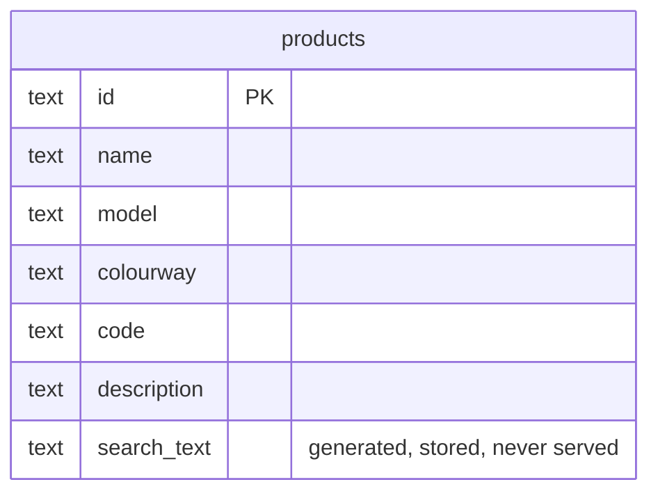

# ERD — Search, filters and sorting served by the API (plan item 4, "S4")

Module `catalogue` · Requirements CAT-001, CAT-002 (the options read), CAT-003 items 1–5 (the request side) · Story `docs/catalogue/stories/search-filters-and-sorting-served-by-the-api.md` · UI PR #38 · Engine PostgreSQL 16, pgx v5, hand-written SQL.

This file defines **the one column this story adds and the queries it runs**, and nothing else: no table, no index, no constraint, no change to a table another story owns. The project ERD (§8) listed this story as "queries only"; §3 below changes that to *queries and one derived column*, with the reason (decision E1). The endpoints and the query language are in `docs/architecture/services/search-filters-and-sorting-served-by-the-api.md`.

Project decisions this story builds on: **D1** (text slug ids), **D3** (a shoe's `sizes`, `sizes_low`, `sizes_out`, `stock` are plain columns until S5 moves them to `product_sizes` / `product_stock`), **D6** (accent folding by the one SQL function `doi_fold`, words matched with `strpos`, no extension) — D6 is **amended** by E1. The conventions of the S3 file §2 apply (`NOT NULL` by default, named constraints, no extensions, no `pg enum`).

## 1. What this story creates

| # | Migration (file-name part) | Creates or changes |
|---|---|---|
| 7 | `products_search_text` | column `products.search_text` (stored, generated, never served) |

Nothing else. Every other table, index and function this story reads exists already: `products`, `lines`, `categories`, `reviews`, `orders`, `order_items` and `doi_fold(text)` (S3 migrations 1–2), and — once S5 has merged — `product_sizes`, `idx_product_sizes_size_in_stock` and the view `product_stock` (S5 migration 4).

## 2. Entity change

### 2.1 `products.search_text`

**Purpose** — the folded text a shop search looks in, kept by the database itself so a search costs one `strpos` per word per shoe instead of a Unicode normalisation per shoe per word. **Traces to** — CAT-001 items 1–2, SC-1 to SC-4, SC-19.

| Column | Type | Null | Default | Unique | Description |
|---|---|---|---|---|---|
| `search_text` | `text` | no | `GENERATED ALWAYS AS (…) STORED` | | `doi_fold(name \|\| ' ' \|\| model \|\| ' ' \|\| colourway \|\| ' ' \|\| code \|\| ' ' \|\| description)`. The five searched own fields of CAT-001 item 2, one space between them so a word can never straddle two fields (a word holds no space). Every input is `NOT NULL`, so the value is never NULL; `NOT NULL` is stated on the column anyway |

The expression is written with `||`, not `concat_ws`: `concat_ws` is `STABLE` and a generated column needs an `IMMUTABLE` expression. `doi_fold` is `IMMUTABLE` (S3 file §5.2); the migration fails loudly with PostgreSQL's own "generation expression is not immutable" if the merged function is not, and Dev then stops and reports it rather than re-declaring the function.

**Nullable columns** — none. **Foreign keys** — none. **Constraints** — `NOT NULL`; the generation clause is the only rule.

**Indexes** — none. A btree cannot serve a substring match, and the one structure that can (`pg_trgm` GIN) is an extension the project's database role may not be allowed to create (D6, S3 file §2). The scan is over one narrow text column of at most ~10,000 shoes (§4).

**What it holds, and what it must never hold** — only public shoe fields (`name`, `model`, `colourway`, `code`, `description`), so it is not a private or bookkeeping value even if it were ever selected; it is nevertheless **never selected**: it is not a registry column (S3 services §4), not in a `SELECT` list, not in `schema.json`, and `TestPublicSQLNamesNoPrivateColumn` is extended to assert no read statement names it in a select list. It cannot be written: `GENERATED ALWAYS` refuses an `INSERT` or `UPDATE` that names the column, so a handler that lists its columns (every one does) cannot forget or corrupt it.

**Lifecycle** — recomputed by PostgreSQL on every `INSERT` of a shoe and on every `UPDATE` of one, in the same statement; there is nothing to keep in step and nothing to backfill. It disappears with the row. **A change to the body of `doi_fold` does not recompute stored values** (a generated column is not recomputed by `CREATE OR REPLACE FUNCTION`): such a change ships with its own migration that drops and re-adds this column (§5), and the S3 `TestTheHelpersExist` assertions (`Cửa Lò` → `cua lo`, `Đại` → `dai`, `100%` → `100%`) are the tripwire.

**Not stored here, on purpose** — the line's and the category's name (CAT-001 item 2). They are matched live (E3): a stored copy would go stale the moment the dealer renames a line, which is exactly what D6 set out to prevent.

## 3. Decisions and conflicts with merged decisions

| # | Question | Decision | Rejected alternative, and why |
|---|---|---|---|
| **E1** | **D6 says "no stored search column" and that a scan with `doi_fold` is fine to ~20,000 shoes. SC-19 asks 500 ms at p95 for 10,000 shoes with a two-word `q`, one `category` and a sort.** This is a conflict with a merged decision. | **Amend D6 for the shoe's own five fields only**: a generated, stored `search_text` (§2.1). The folding of the *typed words* stays in SQL (`doi_fold`, once per request — services file §3.5); line and category names stay live (E3); `orders`, `reviews` and the small collections keep D6's scan. Why D6's figure does not hold: it assumed "microseconds" per shoe, but the merged `doi_fold` is `normalize(…, NFD)` followed by a regular-expression replace, and a shoe's folded text is 300–500 characters. At an *estimated* 50–100 µs per shoe (this role cannot run SQL, so this is a model, not a measurement) a 10,000-shoe scan is 0.5–1 s, and the list statement reads the table twice (the count and the page). With the column the same scan is one `strpos` per word per shoe, an estimated 1–3 µs, so the list is tens of milliseconds. The owner's plan item also says "Indexed so a search on the full catalogue stays fast". **SC-19 stays the measurement that decides whether this is enough** (§6); the design does not wait for it to find out | Keep D6 and let SC-19 decide: a failed verification then costs a rework round and the same migration, written under pressure. A `pg_trgm` GIN index: needs `CREATE EXTENSION`, which D6 ruled out for good reason. An expression index on `doi_fold(...)`: it cannot serve a substring search. Folding in Go and sending folded text to SQL: two fold implementations that must agree on every character forever |
| **E2** | One column for the five fields, or one per field | One column. The searched fields are always matched together ("every word in at least one of them"), never singly, so a per-field column would only add storage and a bigger `OR` | Five columns: five times the storage and no query that could use any of them alone |
| **E3** | Line and category names | Matched live: `t.line_id IN (SELECT l.id FROM lines l WHERE strpos(doi_fold(l.name), <word>) > 0)`, and the same for categories. Each is an uncorrelated subquery over 5 and 3 rows, evaluated once per statement, not per shoe | Folding them into `search_text`: needs a trigger on `lines` and `categories` to rewrite every shoe on a rename, and a missed trigger is a silent stale search |
| **E4** | The `size=` condition before and after S5 | One meaning, two spellings, written in the services file §3.7. Before S5 it reads the S3 columns `sizes` and `sizes_out`; after S5 it reads `product_sizes` and is served by S5's `idx_product_sizes_size_in_stock`. **Whichever of the two stories merges second rewrites the clause** (S5's services file §5 `data` item 3 already says so). No migration of this story depends on either form | Waiting for S5: it would hold this story's backend for a story that only changes where the same two facts are read from |
| **E5** | `GET /v1/product-filters` | Computed from the live shoes on every request, no cache and no summary table. Before S5: distinct values of `products.colour` and `unnest(products.sizes)`; after: of `products.colour` and `product_sizes.size` | A materialised list or a cache: the dealer's edit must show on the next read (ADMIN-010 item 9), and the cost at 10,000 shoes is one pass over a few hundred thousand array elements — tens of milliseconds |
| **E6** | A shoe with no rating comes last, whichever way `rating` is sorted (CAT-001 item 5, AC-18) | `products.rating` is `NOT NULL DEFAULT 0` ("0 when none", project ERD §3.4), so "no rating" is `0`. The sort key of that one column is `NULLIF(t.rating, 0)` with `NULLS LAST`; a real average is 1.0–5.0 and is never 0. No column or default changes | Making `rating` nullable: a migration on a populated table, a null check in every reader of the shoe, and a changed contract field type (services §2.1 says a field never changes type) |

### Conflicts, stated

E1 amends D6 and nothing else. The S3 services file §4.1 ("Search, filters and sorting … inside `query.go`'s parameter loop … Adds no table") stays true: this story adds a column, not a table, and the loop is where the grammar goes. The S5 files' instruction to **remove** the `orders` collection from the `data` registry is refined, not contradicted: the orders search and sort definition must **move** with the collection to `internal/orders`, not be deleted (services file §5, "orders seam").

## 4. Access patterns

The queries that drove E1 to E6. "Form A" is the shape while the S3 columns `sizes`, `sizes_low`, `sizes_out` exist on `products`; "Form B" is the shape once S5's migration 4 has dropped them (services file §3.7 gives both spellings). Frequency and budget: the project's lists budget is p95 ≤ 300 ms (services `_base.md` §6); SC-19 allows 500 ms.

| # | Pattern | Frequency | Index or scan, and the estimated cost at 10,000 shoes |
|---|---|---|---|
| S4-1 | **The shop list**: `status = 'live'`, any-of `category` / `line` / `colour`, price ranges, `size`, every word of `q` found, `ORDER BY` one field then `seq`, twelve rows and the true count | Very high | Planner choice among `idx_products_status_released_seq`, `idx_products_category_id`, `idx_products_line_id` and a sequential scan. The structured conditions run first (cheapest quals first), so `strpos` runs only on the shoes that survive them. Words cost one `strpos` over `search_text` each. Estimate: a few ms per scan, two scans (count and page), so tens of ms in all |
| S4-2 | The shop's default order, no `q`: `status = 'live' ORDER BY released DESC, seq` | Very high | `idx_products_status_released_seq`, walked in order and stopped at the limit. The sort emits **no** `NULLS` clause for a `NOT NULL` column, so the index order matches (`released DESC` means `NULLS FIRST` in an index; an explicit `NULLS LAST` would break the match). One value in an any-of list is written as plain `=`, not `= ANY(array)`, for the same reason |
| S4-3 | `size=a,b` | High | Form A: `EXISTS` over the two arrays of the shoe, a few elements each, inside the S4-1 scan. Form B: `EXISTS` on `product_sizes (size, product_id) WHERE pairs > 0` — S5's `idx_product_sizes_size_in_stock` |
| S4-4 | `GET /v1/product-filters`: distinct colours and sizes of the live shoes | High (every shop view) | Scan of `products` and its size arrays (A) or `product_sizes` (B), `DISTINCT`. Estimate: tens of ms at 10,000 shoes, under 1 ms at the launch size |
| S4-5 | `q` on `orders` (number, customer) | Dealer only | Scan with `doi_fold` on ~30 characters per row, once per word. Estimate: ≤ 100 ms at 10,000 orders. No SLO is attached to it; if one is, the same generated-column step applies |
| S4-6 | `q` on `reviews` (customer, text, the shoe's name) | Dealer and, by `product=`, the shoe page | Scan with `doi_fold`. The shoe's name is matched by one uncorrelated subquery over `products`, evaluated once per word |
| S4-7 | `q` on `lines`, `categories`, `faqs`, `sizes`, `delivery`, `payments`, `shop` | Rare | Tables of under 20 rows |
| S4-8 | Any other filter, range or sort on a collection | Medium | Existing indexes where they exist (`idx_orders_placed_at`, `idx_orders_status_placed_at`, `idx_reviews_product_id_date`, the `seq` unique keys); otherwise a scan and a top-N sort of at most 10,000 narrow rows. Text sorts fold the first 100 characters (services §3.6) and are a dealer-only path |

No new index is added by this story. The ERD §6 volume table is unchanged except that `products` is now tested at 10,000 rows by SC-19 (a test fixture, not a planning figure; the planning figure stays "a few hundred").

## 5. Migration plan

File `code/backend/migrations/<UTC timestamp>_products_search_text.up.sql` and `.down.sql`, **stamped later than S3's `…seed_collections` (`20261125100200`)**; suggested `20261125130000_products_search_text`. Applied on boot, before the server listens, one transaction with its `schema_migrations` row. It touches no object S5's three migrations touch (S5 drops `sizes`, `sizes_low`, `sizes_out`, `stock`; this one reads none of them), so the two stories' files apply in either order; the runner applies whatever is pending by name.

| # | Forward | Backward | Safe on a populated table |
|---|---|---|---|
| 7 `products_search_text` | `ALTER TABLE products ADD COLUMN search_text text NOT NULL GENERATED ALWAYS AS (doi_fold(name \|\| ' ' \|\| model \|\| ' ' \|\| colourway \|\| ' ' \|\| code \|\| ' ' \|\| description)) STORED;` — plain `ADD COLUMN` (no `IF NOT EXISTS`: a column that already exists is a surprise the file must not hide). Then a `DO` block that asserts, in the migration itself, `doi_fold('Cửa Lò') = 'cua lo'`, `doi_fold('Đại') = 'dai'`, `doi_fold('100%') = '100%'`, and that no row has an empty `search_text` while its `name` is not empty | `ALTER TABLE products DROP COLUMN search_text;` — lossless: the column is derived, nothing else refers to it. The backward file is for local resets and review, as for every migration (the server never runs one) | **Rewrites the table** under `ACCESS EXCLUSIVE`, computing `doi_fold` once per row: ≈ 1 s at 10,000 shoes on the estimate above, milliseconds at the launch size of 12 and at a few hundred. It is safe because the migration runs **before the server listens** and the runner holds an advisory lock, so no request is waiting on `products` while it runs and no second instance can start it. Nothing is lost on failure: the transaction rolls back and the server does not start. At 100,000 shoes the rewrite would take ~10 s and would deserve a two-step (nullable column, batched fill, trigger) — outside every planning figure here |
| *(if `doi_fold` ever changes)* | A new file: `DROP COLUMN search_text`, then the forward statement again | — | Same rewrite; its own file, so a merged file is never edited |

Nothing is irreversible. A file with `CONCURRENTLY` is not needed: no index is created.

## 6. Verification hooks (what a test can read)

All DB tests read `TEST_DATABASE_URL`, build their rows with plain SQL in a schema of their own, and skip without it (as S3's do).

| Criterion | Read from |
|---|---|
| SC-1 to SC-4 — words, accents, `đ`, `%` and `_` | Shoes inserted by the test (a "Cửa Lò" description, an "Đại" name, a `100%` description, an `_` name); the list endpoint asked with `q=…`. A direct assertion that `search_text` of the "Cửa Lò" shoe contains `cua lo` and that an `UPDATE` of its description changes `search_text` in the same statement |
| SC-3 — line and category names are live | Rename a line with `UPDATE lines SET name = …` and ask again: the shoes follow with no write to `products` |
| SC-9, SC-10, SC-30 — the size condition | Fixtures through **one helper** (`insertShoe`) that knows which form is on `main`: Form A writes the three S3 arrays, Form B writes `product_sizes` rows (3 pairs, 1 pair in a last-pairs size, 0 in a sold-out size). The tests above the helper do not change when S5 lands |
| SC-12 — 30 matches, page 2 | 30 live shoes inserted by the test; `total` 30, 12 items |
| SC-19 — p95 | `generate_series(1, 10000)` inserts 10,000 shoes in one statement (`search_text` fills itself); 200 sequential requests of the SC-19 shape (two words, one `category`, `sort`) through the real handler on the real pool; the test prints p50 and p95 and fails above 500 ms. A run without `TEST_DATABASE_URL` skips, and the same run against the running API (`run_project`) is Verify's |
| Migration safety | `migrations_test.go` (pairs and ordering) passes with the new pair; a DB test runs the whole set on an empty schema and again on a schema holding 10,000 shoes made by the earlier files, and checks the forward file leaves `count(*)` unchanged |

## 7. Privacy and integrity notes

- **Personal data** — none is added. The orders search reads `number` and `customer` only; the statement for `orders?q=…` names none of `phone`, `email`, `address`, `note` (the existing SQL-capture test is extended with `q`, `sort` and `size` parameters for every collection).
- **Enforced by the database** — `search_text` cannot be written and cannot be NULL. **Enforced by the application** — which fields a collection's `q` reads (a registry value, services §3.5), which columns may be filtered or sorted (the registry's public columns), and that no request text reaches SQL except as a bound value.
- **Retention** — unchanged.

## 8. Open questions

None blocks the story.

| # | Question | Default used | Owner |
|---|---|---|---|
| 1 | Is the `search_text` column enough for SC-19 on the machine Verify uses? | It should be by two orders of magnitude on the estimate; the SC-19 test (§6) is the measurement. If it fails the cause is something else (a plan that ignores an index, a `doi_fold` evaluated per row), and the fix is a rewritten statement, not a new migration | TL, at Verify |
| 2 | After S5 the orders list is a 401 stub until the sign-in story, so SC-13 cannot be read over HTTP | SC-13 is proven by a DB test on the orders definition (services §5, "orders seam") and, over HTTP, only while the S3 reader still serves orders | TL |
