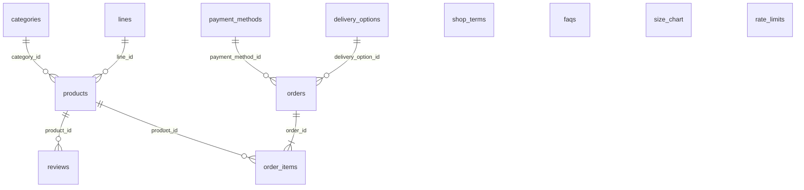

# ERD — Site data from the database (plan item 3, "S3")

Module `data` · Requirements DATA-001, DATA-002, DATA-003, DATA-004 (DATA-005 is frontend only and stores nothing) · Story `docs/data/stories/site-data-from-the-database.md` · Engine PostgreSQL 16, pgx v5, hand-written SQL.

This file defines **the entities this story creates and nothing else**: the ten collection tables, the order's pair lines, the two helper functions and the lock-counter table. They are the project's first migrations (the scaffold ships none). Entities of later stories (`product_sizes`, `order_tokens`, `counters`, `payment_*`, `users`, `sessions`, `uploads`) are defined in those stories' own files; the few columns a later story adds to a table defined here are named in §7 and not defined.

The project-wide decisions this story builds on, unchanged: **D1** text slug ids for the ten collection tables and `uuid` elsewhere; **D2** four tables are not named after their collection; **D3** a shoe's `sizes`, `sizes_low`, `sizes_out` and `stock` are plain columns until the orders story moves them; **D4** an order's pairs live in `order_items`; **D6** one SQL function `doi_fold(text)` does all accent folding; **D8** `rate_limits` is one row per (scope, hashed subject).

## 1. What this story creates

| Migration | Creates |
|---|---|
| 1 `helpers_and_rate_limits` | functions `doi_fold(text)` and `set_updated_at()`; table `rate_limits` |
| 2 `collections` | `categories`, `lines`, `products`, `reviews`, `shop_terms`, `delivery_options`, `payment_methods`, `faqs`, `size_chart`, `orders`, `order_items` — with their checks, triggers and indexes |
| 3 `seed_collections` | rows only: every record of the ten JSON files, one `order_items` row per sample order |

| Collection (API name) | Table | Rows seeded (at the time of writing) |
|---|---|---|
| `categories` | `categories` | 3 |
| `lines` | `lines` | 5 |
| `products` | `products` | 12 |
| `reviews` | `reviews` | 36 |
| `shop` | `shop_terms` | 1 |
| `delivery` | `delivery_options` | 1 (`standard`, fee 0) |
| `payments` | `payment_methods` | 4 (`cod`, `bank`, `vnpay`, `momo` — sample orders refer to all four; which are *offered* is code, not data) |
| `faqs` | `faqs` | 12 |
| `sizes` | `size_chart` | 17 |
| `orders` | `orders` (+ `order_items`) | 14 (+ 14) |

`shop_terms`, `faqs`, `size_chart` and `rate_limits` have no foreign keys by design.

## 2. Conventions applied

- `snake_case` plural tables, `{table}_id` foreign keys, `bigint` VND (no minor unit, no float), `text` + `CHECK` for closed sets (no `pg enum`), `timestamptz` for instants, `date` for days.
- `NOT NULL` by default. Optional text is `NOT NULL DEFAULT ''` (the JSON writes it as `""` and the frontend reads `string`). NULL only where `''` cannot be stored (a foreign key, a date, a timestamp) or `0` would be a sentinel (a number): each such column says why.
- Every foreign key states `ON DELETE`; `ON UPDATE` is `NO ACTION` everywhere (ids never change).
- Length limits (200 / 5,000 characters) are **not** `CHECK`s: seeded text may predate them and the seed must never fail on length (DATA-001 item 3). The write API checks them in the admin story.
- Constraint and index names are `ck_{table}_…`, `uq_{table}_…`, `idx_{table}_…`, `fk_{table}_{column}`, `trg_{table}_updated_at`; every one named, so a later story can drop or replace it by name.
- No soft delete. No PostgreSQL extension (`unaccent`, `pg_trgm`) — the project's database role may not have the privilege (D6). `gen_random_uuid()` is built in since PostgreSQL 13.

## 3. Columns every collection table has

Applies to `categories`, `lines`, `products`, `reviews`, `shop_terms`, `delivery_options`, `payment_methods`, `faqs`, `size_chart`, `orders`. Each table's section below lists only its own columns after these.

| Column | Type | Null | Default | Unique | Description |
|---|---|---|---|---|---|
| `id` | `text` | no | — | PK | The record's id (D1). `CHECK ck_{table}_id_slug`: `id ~ '^[a-z0-9][a-z0-9._-]*$' AND length(id) <= 100` — every seeded id already matches; one that did not would fail the seed loudly. The same pattern guards the `/v1/<collection>/{id}` route, so a path segment that cannot be an id never reaches a query |
| `seq` | `bigint` | no | `GENERATED ALWAYS AS IDENTITY` | `uq_{table}_seq` | Position in the seed, then insertion order: the one stable order of every list (DATA-002 item 5). The seed inserts in file order, so `seq` follows the file; `ALWAYS` means nobody can write a `seq` by hand and break the order |
| `source` | `text` | no | `''` | | The record's `_source` note (`owner`, `assumed`, `web:<url>`). **Bookkeeping: never returned to a caller with no session** (DATA-004 item 2) |
| `invented` | `text[]` | no | `'{}'` | | The record's `_invented` list. Present on **all ten** tables because the seed files carry it on records of collections whose schema does not list it. **Bookkeeping**, same rule |
| `created_at` | `timestamptz` | no | `now()` | | |
| `updated_at` | `timestamptz` | no | `now()` | | Moved by trigger `trg_{table}_updated_at` (`BEFORE UPDATE … EXECUTE FUNCTION set_updated_at()`), so no handler can forget it |

Neither `created_at` nor `updated_at` is in `schema.json`, so neither is served.

## 4. Tables

### 4.1 `categories`

| Column | Type | Null | Default | Description |
|---|---|---|---|---|
| *(§3)* | | | | |
| `name` | `text` | no | — | `CHECK ck_categories_name_not_blank`: `btrim(name) <> ''` |
| `blurb` | `text` | no | `''` | One line about it |
| `image` | `text` | no | `''` | A picture address (`/images/…` today, an upload address later) |

No other foreign key points out of this table. Referenced by `products.category_id`. Lifecycle: records are seeded; the admin story creates, edits and deletes them (a category a shoe uses cannot be deleted — `RESTRICT` below).

### 4.2 `lines`

| Column | Type | Null | Default | Description |
|---|---|---|---|---|
| *(§3)* | | | | |
| `name` | `text` | no | — | `CHECK ck_lines_name_not_blank` |
| `blurb` | `text` | no | `''` | |
| `since` | `integer` | **yes** | — | Year first made. NULL = "not known": `0` would be a sentinel. `CHECK ck_lines_since_positive`: `since > 0`. The API serves NULL as JSON `null` |
| `fit_note` | `text` | no | `''` | "How it fits" |

### 4.3 `products`

| Column | Type | Null | Default | Description |
|---|---|---|---|---|
| *(§3)* | | | | |
| `name` | `text` | no | — | `CHECK ck_products_name_not_blank` |
| `model` | `text` | no | `''` | Shoes with one model show as colour dots on each other's page |
| `line_id` | `text` | **yes** | — | FK `lines`. API field `line`. The schema does not make a line required; `''` cannot be a foreign key, so "no line" is NULL and the API shows it as `""` |
| `category_id` | `text` | **yes** | — | FK `categories`. API field `category`. Same |
| `price` | `bigint` | no | — | VND. `CHECK ck_products_price_not_negative`: `price >= 0` |
| `price_listed` | `text` | no | `''` | The price on the source shop's page (`US$130`). **Bookkeeping: never returned to a caller with no session** |
| `status` | `text` | no | `'draft'` | `CHECK ck_products_status`: `live` or `draft`. A shoe is public only when a person sets it live; the default means a half-filled shoe is never public. The seed sets every shoe's status as the file has it (all `live`) |
| `featured` | `boolean` | no | `false` | Opens the home page; one at a time (`uq_products_featured`) |
| `is_new` | `boolean` | no | `false` | "New this month" |
| `description` | `text` | no | `''` | |
| `code` | `text` | no | `''` | Style code |
| `colourway` | `text` | no | `''` | |
| `colour` | `text` | no | `''` | Main colour. `CHECK ck_products_colour`: `''` or one of `black white pink purple brown yellow blue grey green` |
| `swatch` | `text` | no | `''` | Dot colour — a CSS colour name the design reads. Returned (the design draws it) |
| `upper`, `lining`, `sole`, `fit`, `care` | `text` | no | `''` | Detail lines |
| `released` | `date` | no | today, Vietnam time | "In the shop since": `(now() AT TIME ZONE 'Asia/Ho_Chi_Minh')::date`. The seed always writes the file's date |
| `rating` | `numeric(2,1)` | no | `0` | `CHECK ck_products_rating_range`: `rating BETWEEN 0 AND 5`. Seeded as the file has it; recalculation arrives with the admin story (ADMIN-013) |
| `review_count` | `integer` | no | `0` | `CHECK ck_products_review_count_not_negative`: `>= 0`. Same |
| `image`, `image_back`, `image_detail` | `text` | no | `''` | Side view, front pair, back pair |
| `sizes`, `sizes_low`, `sizes_out` | `text[]` | no | `'{}'` | **S3 only (D3).** Seeded in the file's order; an empty list is `'{}'`, served as `[]`, never null. Dropped by the orders story and served from `product_stock` |
| `stock` | `integer` | no | `0` | **S3 only (D3).** `CHECK ck_products_stock_not_negative`: `>= 0`. Dropped with the three lists |

Foreign keys:

| Column | References | On delete | Why |
|---|---|---|---|
| `line_id` | `lines(id)` | `RESTRICT` | A line a shoe uses cannot be deleted (ADMIN-014 item 3); the API counts the shoes for its message |
| `category_id` | `categories(id)` | `RESTRICT` | Same |

Indexes:

| Name | Columns | Type | Query it serves |
|---|---|---|---|
| `uq_products_seq` | `(seq)` | unique | Every `products` list: `ORDER BY seq LIMIT n OFFSET m` (DATA-002 item 5) |
| `uq_products_featured` | `(featured) WHERE featured` | unique, partial | "One shoe at a time opens the home page" enforced by the database; the home page's `featured=true` read |
| `idx_products_status_released_seq` | `(status, released DESC, seq)` | btree | Created now because the search story's default order (live shoes, newest first, ties by seed position) needs it and an index on a populated table later would need its own `CONCURRENTLY` file. This story's `status=live` read uses `uq_products_seq` plus a filter: at ≤ 1,000 rows the difference is not measurable |
| `idx_products_line_id` | `(line_id)` | btree | `products?line=samba` and the "<n> shoes use this" count before a line is deleted |
| `idx_products_category_id` | `(category_id)` | btree | `products?category=women`, and the same count for categories |

### 4.4 `reviews`

| Column | Type | Null | Default | Description |
|---|---|---|---|---|
| *(§3)* | | | | |
| `product_id` | `text` | no | — | FK `products`. API field `product` |
| `name` | `text` | no | — | The customer's name. `CHECK ck_reviews_name_not_blank` |
| `rating` | `smallint` | **yes** | — | Stars; NULL = "no stars given" (`0` would read as a rating). `CHECK ck_reviews_rating_range`: `rating BETWEEN 1 AND 5`. Served as JSON `null` when unset |
| `date` | `date` | no | today, Vietnam time | Review date, `YYYY-MM-DD` in the API |
| `size_bought` | `text` | no | `''` | |
| `fit` | `text` | no | `''` | `CHECK ck_reviews_fit`: `''`, `small`, `true` or `large` |
| `body` | `text` | no | `''` | The review text |
| `status` | `text` | no | `'live'` | `CHECK ck_reviews_status`: `live` (shown) or `hidden` |

| Column | References | On delete | Why |
|---|---|---|---|
| `product_id` | `products(id)` | `CASCADE` | A review has no meaning without its shoe; ADMIN-014 item 2 deletes a shoe with its reviews. Blast radius: only the dealer can delete a shoe, and only one no order refers to (`order_items.product_id` is `RESTRICT`) |

| Name | Columns | Type | Query it serves |
|---|---|---|---|
| `uq_reviews_seq` | `(seq)` | unique | Every `reviews` list |
| `idx_reviews_product_id_date` | `(product_id, date DESC, seq)` | btree | `reviews?product=<id>` (the shoe page's three reviews) and, later, "that shoe's reviews, newest first" |

### 4.5 `shop_terms` (collection `shop`)

| Column | Type | Null | Default | Description |
|---|---|---|---|---|
| *(§3)* | | | | `id` is always `shop`: one row |
| `standard_days` | `text` | no | `''` | `2–4`. The longest number is the working days an order's expected date adds (checkout story) |
| `dispatch_cutoff` | `text` | no | `''` | `15:00`, Vietnam time |
| `reply_time` | `text` | no | `''` | "the same working day" |
| `rating` | `numeric(2,1)` | no | `0` | `CHECK ck_shop_terms_rating_range`: 0 to 5. Seeded as the file has it |
| `review_count` | `integer` | no | `0` | `CHECK ck_shop_terms_review_count_not_negative`: `>= 0` |

There is **no column** for a free-delivery threshold, express days or cities, exchange days or refund days: the owner chose free delivery on every order and "no exchanges", so the seed carries none of them even if a stale JSON file still holds them (DATA-001 item 3, SC-7).

### 4.6 `delivery_options` (collection `delivery`)

| Column | Type | Null | Default | Description |
|---|---|---|---|---|
| *(§3)* | | | | |
| `name` | `text` | no | — | `CHECK ck_delivery_options_name_not_blank` |
| `days` | `text` | no | `''` | "2–4 working days" |
| `fee` | `bigint` | no | `0` | VND. `CHECK ck_delivery_options_fee_not_negative`: `fee >= 0`. Always 0 at launch |
| `note` | `text` | no | `''` | Public (a column called `note` here is **not** private; only `orders.note` is) |

### 4.7 `payment_methods` (collection `payments`)

| Column | Type | Null | Default | Description |
|---|---|---|---|---|
| *(§3)* | | | | |
| `name` | `text` | no | — | `CHECK ck_payment_methods_name_not_blank` |
| `note` | `text` | no | `''` | What happens. Public |
| `online` | `boolean` | no | `false` | Paid online |
| `icon` | `text` | no | `''` | The design's icon key. Returned (the design draws it); `schema.json` calls it `hidden`, which means "not for the dealer's form", not "private" |

Whether a method is **offered** is not stored (code plus the owner's settings).

### 4.8 `faqs`

| Column | Type | Null | Default | Description |
|---|---|---|---|---|
| *(§3)* | | | | |
| `topic` | `text` | no | — | `CHECK ck_faqs_topic`: `shipping`, `returns`, `sizing`, `payment` or `orders` |
| `question` | `text` | no | — | `CHECK ck_faqs_question_not_blank` |
| `answer` | `text` | no | `''` | |

Public: the Returns, Delivery, Size chart and Track pages read it (PM correction recorded in the story).

### 4.9 `size_chart` (collection `sizes`)

| Column | Type | Null | Default | Unique | Description |
|---|---|---|---|---|---|
| *(§3)* | | | | | |
| `eu` | `text` | no | — | `uq_size_chart_eu` | EU size as written (`35 1/2`, `36 2/3`) |
| `uk`, `us_m`, `us_w` | `text` | no | `''` | | |
| `cm` | `numeric(4,1)` | **yes** | — | | Foot length (`21.6`). NULL = "not measured" (`0` would be a size of nothing); served as a JSON number or `null`. `CHECK ck_size_chart_cm_positive`: `cm > 0` |

### 4.10 `orders`

The 14 sample orders from the first design. Placing, numbering, tokens and payment arrive with later stories; this story only stores and reads them.

| Column | Type | Null | Default | Description |
|---|---|---|---|---|
| *(§3)* | | | | `id` is `doi-<n>` |
| `number` | `text` | no | — | `DOI-<n>`. `CHECK ck_orders_number_format`: `number ~ '^DOI-[0-9]+$'`. Unique: `uq_orders_number` |
| `placed_at` | `timestamptz` | no | `now()` | The seed writes the file's zone-less `2026-11-23T16:05:00` **as Vietnam time**, with an explicit `+07:00`. Served as RFC 3339 with `+07:00` (§7 C4) |
| `status` | `text` | no | `'placed'` | `CHECK ck_orders_status`: `placed`, `confirmed`, `packed`, `shipped`, `delivered`, `cancelled` |
| `payment_method_id` | `text` | no | — | FK `payment_methods`. API field `payment` |
| `paid` | `boolean` | no | `false` | |
| `delivery_option_id` | `text` | no | — | FK `delivery_options`. API field `delivery`; always `standard` |
| `delivery_fee` | `bigint` | no | `0` | The fee as sold; 0. `CHECK ck_orders_delivery_fee_not_negative`. **Not in `schema.json`, so never served** |
| `carrier` | `text` | no | `''` | |
| `tracking` | `text` | no | `''` | |
| `eta` | `date` | **yes** | — | Expected date. A cancelled order, or one nobody has dated, has no expected date and a date cannot be `''`: NULL, served as `""` (the JSON writes it as text) |
| `customer` | `text` | no | — | Name. `CHECK ck_orders_customer_not_blank` |
| `phone` | `text` | no | — | **Private.** `CHECK ck_orders_phone_not_blank` |
| `email` | `text` | no | `''` | **Private** |
| `address` | `text` | no | — | **Private.** `CHECK ck_orders_address_not_blank` |
| `city` | `text` | no | — | Public. `CHECK ck_orders_city_not_blank` |
| `note` | `text` | no | `''` | **Private** |
| `total` | `bigint` | no | — | VND. `CHECK ck_orders_total_not_negative` |
| `is_sample` | `boolean` | no | `false` | True for the 14 seeded orders. **Not in `schema.json`, never served.** Later stories read it (the 30-minute expiry never cancels a sample) |

| Column | References | On delete | Why |
|---|---|---|---|
| `payment_method_id` | `payment_methods(id)` | `RESTRICT` | History must keep saying how an order was paid |
| `delivery_option_id` | `delivery_options(id)` | `RESTRICT` | Same |

| Name | Columns | Type | Query it serves |
|---|---|---|---|
| `uq_orders_seq` | `(seq)` | unique | `GET /v1/orders` in seed order |
| `uq_orders_number` | `(number)` | unique | Lookup by number (the track story) and `orders?number=DOI-24817` |
| `idx_orders_placed_at` | `(placed_at DESC)` | btree | The dealer's list "newest first", the overview's latest orders and the 14-day series (admin stories). Created now: the table is tiny today and a later index on a populated `orders` needs its own file |
| `idx_orders_status_placed_at` | `(status, placed_at DESC)` | btree | `orders?status=…` and the dealer's "waiting to be packed" count |
| `idx_orders_payment_method_id_placed_at` | `(payment_method_id, placed_at DESC)` | btree | `orders?payment=…`; also what makes the `RESTRICT` check on a payment-method delete an index probe. `delivery_option_id` has no index: one value, no screen filters on it |

Later stories add to this table and define the additions themselves: `idempotency_key` (checkout), `account_id` (customer accounts). Neither exists here.

### 4.11 `order_items`

One row per pair line. An order's `product`, `size` and `qty` in the API are its first line (`line_no = 1`) — D4. The sample orders are one-pair orders; "orders hold several pairs" is the checkout story's.

| Column | Type | Null | Default | Description |
|---|---|---|---|---|
| `id` | `uuid` | no | `gen_random_uuid()` | PK. Not exposed |
| `order_id` | `text` | no | — | FK `orders`. Unique with `line_no` |
| `line_no` | `smallint` | no | — | 1, 2, … `CHECK ck_order_items_line_no_positive`: `line_no > 0` |
| `product_id` | `text` | no | — | FK `products` |
| `size` | `text` | no | — | EU size as sold. No foreign key to a size row (the table that would hold it belongs to the orders story and must not block removing a size) |
| `qty` | `integer` | no | — | `CHECK ck_order_items_qty_positive`: `qty > 0` |
| `unit_price` | `bigint` | no | — | VND per pair **as sold**; a later change of the shoe's price never touches it. `CHECK ck_order_items_unit_price_not_negative` |
| `created_at` | `timestamptz` | no | `now()` | Append-only: no `updated_at`, no trigger |

| Column | References | On delete | Why |
|---|---|---|---|
| `order_id` | `orders(id)` | `CASCADE` | A pair line has no meaning without its order |
| `product_id` | `products(id)` | `RESTRICT` | A shoe an order refers to cannot be deleted (ADMIN-014 item 1) |

| Name | Columns | Type | Query it serves |
|---|---|---|---|
| `uq_order_items_order_id_line_no` | `(order_id, line_no)` | unique | The `LEFT JOIN … ON oi.order_id = o.id AND oi.line_no = 1` the orders collection reads through; an order's pairs in order |
| `idx_order_items_product_id` | `(product_id)` | btree | `orders?product=<id>` (the filter reads `order_items.product_id`) and "does any order refer to this shoe" before a delete |

## 5. Helper objects (migration 1)

### 5.1 `set_updated_at()`

`CREATE OR REPLACE FUNCTION set_updated_at() RETURNS trigger LANGUAGE plpgsql AS $$ BEGIN NEW.updated_at := now(); RETURN NEW; END $$;`

Used by `trg_{table}_updated_at` on the ten collection tables and on `rate_limits`. `now()` is the transaction's start: a test that inserts and updates in one transaction sees equal values — commit between the two (SC-9).

### 5.2 `doi_fold(text)`

`doi_fold(t text) RETURNS text LANGUAGE sql IMMUTABLE STRICT PARALLEL SAFE`, body `lower(translate(normalize(t, NFC), <from>, <to>))`.

- `<from>` lists every Vietnamese letter that carries a diacritic, **lower and upper case**, plus `Đ` and `đ`: the `a` group (`à á ả ã ạ ă ằ ắ ẳ ẵ ặ â ầ ấ ẩ ẫ ậ`), `e` (`è é ẻ ẽ ẹ ê ề ế ể ễ ệ`), `i` (`ì í ỉ ĩ ị`), `o` (`ò ó ỏ õ ọ ô ồ ố ổ ỗ ộ ơ ờ ớ ở ỡ ợ`), `u` (`ù ú ủ ũ ụ ư ừ ứ ử ữ ự`), `y` (`ỳ ý ỷ ỹ ỵ`) and `d` (`đ`), each followed by its capital. `<to>` is the same number of plain letters in the same order. Both cases are written out so the result does not depend on the database's locale (an Alpine image may run in the `C` locale, where `lower()` does not fold non-ASCII).
- `normalize(…, NFC)` first, so a pasted decomposed `ử` (letter + combining marks) meets the composed one. It needs a UTF-8 database, which every image and the shared server use.
- A `to` shorter than `from` would silently **delete** letters. The migration's own test asserts `char_length(from) = char_length(to)`.
- Required results (SC-9): `doi_fold('Cửa Lò')` = `cua lo`; `doi_fold('Đại')` = `dai`; `doi_fold('100%')` = `100%` (`%` and `_` mean themselves); `doi_fold(NULL)` = NULL (callers `coalesce`).
- No endpoint calls it in this story. It is created here so the search, track and sign-in stories — which run in parallel after this one — never create it twice.

### 5.3 `rate_limits`

One row per (scope, hashed subject): the failure counters for sign-in, order lookup and sign-up (D8). Created here because the track story and the sign-in story both need it and run in parallel; neither may create it. No endpoint in this story reads or writes it.

| Column | Type | Null | Default | Unique | Description |
|---|---|---|---|---|---|
| `scope` | `text` | no | — | PK (1/2) | `CHECK ck_rate_limits_scope`: `sign_in_email`, `sign_in_address`, `order_lookup_number`, `order_lookup_address`, `sign_up_address` |
| `subject_hash` | `bytea` | no | — | PK (2/2) | SHA-256 of `scope ‖ ':' ‖ subject`. A hash, so the table holds no email, no network address and no order number. `CHECK ck_rate_limits_subject_hash_length`: `octet_length(subject_hash) = 32` |
| `hits` | `integer` | no | `0` | | Failures (or attempts) in the current window. `CHECK ck_rate_limits_hits_not_negative`: `hits >= 0` |
| `window_started_at` | `timestamptz` | no | `now()` | | When the current window began |
| `locked_until` | `timestamptz` | **yes** | — | | NULL = not locked; while in the future the subject is refused with 429 |
| `updated_at` | `timestamptz` | no | `now()` | | Trigger `trg_rate_limits_updated_at` |

No surrogate `id` and no `created_at`: the pair is the identity and `window_started_at` says when it began. Index `idx_rate_limits_window_started_at (window_started_at)` serves the purge of rows whose window began over a day ago and whose lock has ended — anyone can create rows by trying emails, so the table must not grow without bound. Rows are deleted by that purge only. Window rules (15 minutes, limit 5, 1-hour sign-up window) belong to the stories that use the table.

## 6. Seed rules (migration 3)

Plain `INSERT … VALUES`, **never** `ON CONFLICT`: an id that already exists fails the migration loudly and leaves that row untouched (DATA-001 conflict row, SC-5). The file is committed as literal SQL; it does **not** read the JSON at run time, because the frontend pull request deletes the JSON files and the backend image has no access to them.

| JSON | Column | Rule |
|---|---|---|
| `id` | `id` | as written |
| `_source` | `source` | as written; `''` when a record has none |
| `_invented` | `invented` | as written, in order; `'{}'` when absent |
| a text field | the column | as written, accents and quotes included (a `'` is doubled) |
| a field the file leaves out | the column default | `''` for text, `'{}'` for a list; NULL only where §4 says |
| `price`, `total`, `fee`, `stock`, `qty`, `review_count`, `since` | numeric column | the JSON number, not changed |
| `rating`, `cm` | `numeric(2,1)`, `numeric(4,1)` | the JSON number (`4.8`, `21.6`, `25.0`) |
| a list | `text[]` | the same items in the same order; an empty list is `'{}'`, not NULL |
| a true/false field | `boolean` | as written |
| `line`, `category`, `product`, `payment`, `delivery` | `*_id` | the referenced id; an empty value is NULL (shoe `line`/`category` only) |
| `released`, `date`, `eta` | `date` | `YYYY-MM-DD` as written; `eta: ""` is NULL |
| `placed_at` | `timestamptz` | `'<value>+07:00'` — the file's zone-less time read as Vietnam time |
| an order | `orders` + one `order_items` row | `line_no` 1, `product_id`/`size`/`qty` from the file, `unit_price` = `total / qty` (fee 0). `delivery_fee` 0. `is_sample` true |

**What is not seeded, whatever the files hold when the migration is written** (DATA-001 item 3, SC-7): any `delivery` record other than `standard`, a non-zero `fee` (`standard` is seeded with fee 0), and the `shop` fields `free_delivery_from`, `express_days`, `express_cities`, `exchange_days`, `refund_days`. Nothing else is re-priced or renamed. If a sample order's total does not equal its shoe's price times its pairs (the three former express orders, if "Free delivery on every order" has not landed), the seed's assertion below fails — the totals are **not** edited silently; Dev stops and tells PM.

**Assertions inside the migration** (a `DO $$ … RAISE EXCEPTION … $$` block at the end of the file, so a failure rolls back the whole file):

1. After the inserts, each table holds exactly the number of rows the file inserted (the generator writes the count it emitted; no number is hard-coded from this document).
2. Every `order_items` row of a sample order has `unit_price` equal to its shoe's `price`, and its order's `total = unit_price × qty + delivery_fee`.

"Every reference resolves" and "at most one featured shoe" are **not** re-asserted: the foreign keys and `uq_products_featured` already make a violation impossible, so a separate check could only repeat them. (The project ERD's migration table listed both; this is the one deviation, and it removes no protection.)

## 7. Decisions made in this design, and conflicts with merged ones

| # | Question | Decision | Rejected alternative, and why |
|---|---|---|---|
| C1 | The services contract (§2.4) says a visitor sees only live shoes and shown reviews, and that orders are "not public". The story serves every row and orders minus four fields | **The story wins for this story only.** The schema stores everything; visibility is a property of the *query*, not the table. The reader's column and row rules are a per-collection value that the sign-in and admin stories extend (services file §3). No draft shoe or hidden review can exist before the admin story, and no real order before checkout | Hiding drafts now: needs a session to tell dealer from visitor, which does not exist yet (story §3) |
| C2 | The sample orders' `unit_price` | Derived from `total / qty` and **asserted** equal to the shoe's price | Copying the shoe's price blindly: a stale total would then pass unnoticed |
| C3 | How SC-5 "names the id" when a seed id clashes | A duplicate-key failure carries the id in PostgreSQL's `DETAIL` line (`Key (id)=(samba) already exists.`), which `pgconn.PgError.Error()` omits. **`internal/db/migrate.go` appends the `DETAIL` to the error it returns** (one `errors.As` on `*pgconn.PgError`; covered by a test in `migrate_test.go`) | Wrapping each of the ten inserts in a `DO` block with an `EXCEPTION` handler that re-raises with the id: ten blocks of boilerplate the seed generator must keep in step, and no benefit to any later migration. The runner change helps every future migration fail readably |
| C4 | `placed_at` is zone-less text in the JSON | Stored as `timestamptz`, served as RFC 3339 with `+07:00` (`2026-11-23T16:05:00+07:00`) | Keeping text: no range query, no dashboard day-grouping, no ordering that survives a later zone. **Frontend impact: none.** `AdminOverview` does `placed_at.slice(0, 10)` (the Vietnam date, as before) and string-compares two values of one format; `formatDateTime` builds a `Date` and shows the same wall time to a visitor in Vietnam, and the correct instant to anyone elsewhere (zone-less text was read in the viewer's zone) |
| C5 | `delivery_fee` and `is_sample` have no `schema.json` entry | Stored, never served by the generic reader | Adding them to `schema.json`: a frozen file the admin forms are built from; they are not the dealer's to edit |
| C6 | `released`, `reviews.date` and `eta` are `text` in `schema.json` | `date` columns; the API serves `YYYY-MM-DD` and `""` | `text` to match the schema: allows `"next week"` into a column the shop sorts and filters on. The admin story's forms must answer a non-date with 422 (project open question Q2) |
| C7 | A seed value that a `CHECK` refuses (a `fit` outside `small/true/large`, a colour outside the closed set, a topic outside the five) | The migration fails and Dev reports it to PM; **the check is not loosened to fit the data** | Dropping the check: the closed sets are what the dealer forms offer |
| C8 | Per-collection tables or one `records(collection, id, data jsonb)` table | Ten tables | One jsonb table is simpler to seed but loses every foreign key, type and `CHECK` the SRS asks for (DATA-001 items 1, 2, 4) |

## 8. Migration plan

Files live in `code/backend/migrations/` as `YYYYMMDDHHMMSS_<name>.up.sql` + `.down.sql`, applied on boot, before the server listens, one transaction per file together with its `schema_migrations` row. **The server never runs a `.down.sql`**: the backward files are for local resets and review. Dev stamps each file with the UTC time it is written; the three keep the order below, and every later story's file sorts after `…seed_collections` because those stories start after this one merges.

| # | Name | Forward | Backward | Safe on a populated table |
|---|---|---|---|---|
| 1 | `helpers_and_rate_limits` | `CREATE OR REPLACE FUNCTION doi_fold`, `CREATE OR REPLACE FUNCTION set_updated_at`, `CREATE TABLE IF NOT EXISTS rate_limits` + `CREATE INDEX IF NOT EXISTS idx_rate_limits_window_started_at` + its trigger | `DROP TABLE rate_limits; DROP FUNCTION doi_fold(text); DROP FUNCTION set_updated_at()` — the last, only after migration 2's down has dropped the triggers that use it (downs run newest first) | New objects only; nothing existing is touched. `IF NOT EXISTS` / `OR REPLACE` because the objects are shared: running the file by hand twice changes nothing |
| 2 | `collections` | Plain `CREATE TABLE` for the eleven tables in foreign-key order (`categories`, `lines`, `products`, `reviews`, `shop_terms`, `delivery_options`, `payment_methods`, `faqs`, `size_chart`, `orders`, `order_items`), then their indexes and `trg_{table}_updated_at` triggers | `DROP TABLE` in reverse order (`order_items`, `orders`, …, `categories`); triggers and indexes go with the tables | New, empty tables. Plain `CREATE` (not `IF NOT EXISTS`): a table that already exists is a surprise the migration must not hide |
| 3 | `seed_collections` | Plain inserts in file order, in foreign-key order (`categories`, `lines`, `products`, `reviews`, `shop_terms`, `delivery_options`, `payment_methods`, `faqs`, `size_chart`, `orders`, `order_items`); then the assertions of §6 | `DELETE` the seeded ids in reverse order. It stops with a foreign-key error once later orders refer to seeded shoes — acceptable: it is a local reset tool and the error says why | Inserts only. Never `ON CONFLICT`. The runner skips an applied file, so a restart inserts nothing and overwrites nothing (SC-5); a pre-existing id fails the file, which rolls back whole, so no half-seeded database exists |

No migration needs `CONCURRENTLY`: every index is created on a table that is empty at that moment. No migration is irreversible in the sense of losing data the system cannot recreate before the admin story (nothing writes these tables until then); after it, rolling back migration 2 would drop dealer-entered records, which is why the backward files are for local resets only.

A **deployment that already holds a database** gets the three files on its next boot, in order, before the listener starts; an empty database gets the same three. The two-instance case is covered by the runner's advisory lock.

## 9. Query patterns and volumes

| # | Pattern | Frequency | Served by |
|---|---|---|---|
| 1 | A page of one collection: `WHERE <exact filters> ORDER BY seq LIMIT n OFFSET m`, plus the matching `count(*)` | Very high (every page view reads 1–4) | `uq_{table}_seq` for the order; `idx_products_line_id`, `idx_products_category_id`, `idx_reviews_product_id_date`, `idx_orders_status_placed_at` and `uq_orders_number` when their column is filtered; every other filter scans — see below |
| 2 | One record: `WHERE id = $1` | Very high (twelve shoe cards each read their line) | the primary key |
| 3 | An order's first pair: `LEFT JOIN order_items oi ON oi.order_id = o.id AND oi.line_no = 1` | With every order read | `uq_order_items_order_id_line_no` |

Planning figures (no volume is promised; these are for an online shoe dealer with a handful of staff): `products` 12 today and a few hundred later (SC-38 tests 1,000), `reviews` dozens, `orders` 14 (the overview is later tested at 10,000), every other table under 20 rows. At these sizes a filter on an unindexed column (`featured`, `is_new`, `colour`, `sizes_low`, a list `= ANY(...)`) scans a table that fits in a few pages; no GIN index is justified. `OFFSET` paging is acceptable because no screen goes deeper than a few pages and `limit` is capped at 100. Deep pages are not a pattern here.

## 10. Privacy of columns

The classification the reader's allow-list is built from (services file §3):

| Table | Never returned to a caller with no session | Returned |
|---|---|---|
| every collection table | `source`, `invented` (bookkeeping, DATA-004 item 2), `created_at`, `updated_at`, `seq` (not in `schema.json`) | everything else the schema lists |
| `products` | `price_listed` | including `swatch`, `image`, `image_back`, `image_detail` |
| `orders` | `phone`, `email`, `address`, `note` (DATA-004 item 1); `delivery_fee`, `is_sample` (not in the schema) | `customer` and `city` — **temporarily public** until the checkout, track and sign-in stories make orders readable only with an order token or a dealer session (DATA-004 item 4, D-7) |
| `payment_methods` | — | `icon`, `online`, `note` |
| `delivery_options` | — | `note` |

`rate_limits` holds only hashes and is never served. No column in this story is encrypted or hashed: nothing here is a credential.

## 11. Open items

None blocks the story.

| # | Question | Default used | Owner |
|---|---|---|---|
| 1 | The seed is generated from JSON that "Free delivery on every order, wording to match" (PR #24) rewrites. At the time of this design that PR is open and the files on `main` still hold two delivery rows, a fee of 30,000 and three express orders with the old totals | The seed follows SC-7 whatever the files hold; if the three totals are still 5940000 / 3340000 / 3140000 when Dev reaches the seed, the assertion fails and Dev stops and tells PM rather than editing them | PM (merge order) |
| 2 | `shop_terms.rating` and `review_count` (4.8 / 181) and each shoe's `rating` / `review_count` are the first design's placeholders and do not equal the 36 seeded reviews | Stored as the file has them (SC-2); the admin story recalculates them on the first review event (ADMIN-013) | PM |
