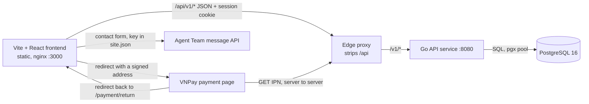

<!-- GENERATED from docs/architecture/services/ — DO NOT EDIT THIS FILE.
     Every write here is overwritten the next time a story's technical design
     merges. This document is the whole contract and is what every reader,
     review and gate reads; it is assembled from one file per story so that
     twenty stories do not edit one file. Add or change what YOUR story needs
     in docs/architecture/services/<your-story-slug>.md. -->

# Service & Interface Design — Đôi

Last updated: 2026-11-25
Source: `docs/{accounts,admin,catalogue,data,orders,payments,site}/SRS.md`, `docs/architecture/erd.md`, `docs/architecture/overview.md`

Every path below is written the way the Go backend mounts it — **no `/api` prefix**. Browsers reach `/v1/products` as `/api/v1/products`; the edge proxy strips `/api` before the request reaches the backend. A route mounted under `/api` is wrong.

## 1. Service map



| Service | Responsibility | Owns (tables) | Depends on | Deploy unit |
|---|---|---|---|---|
| **api** (Go, one `main` package) | Every `/v1` endpoint: public catalogue reads, search, orders, payment notice, sessions, customer accounts, dealer writes, overview, staff | All of them — see the ownership table below | PostgreSQL; VNPay only as a caller of the notice endpoint (the API never calls VNPay) | one container |
| **frontend** | Static pages; reads the API through `src/data/index.ts` and `src/lib/*` | none | the edge proxy's `/api` | one container (nginx) |
| **PostgreSQL** | Storage | the schema of `erd.md` | — | compose service / the shared server |

**Why these boundaries** — *Single backend service: no boundary is justified yet.* One team, one deploy cadence, one database, one scale knob; the work that could be split off (the 30-minute expiry ticker, the notice endpoint) needs the same row locks as the order it touches, and two services that must deploy together are one service. The one boundary that exists is **ownership inside the service**: each table has exactly one owning package, and every other package changes it only by calling that package's functions inside its own transaction, never by writing the table.

### 1.1 Ownership of every ERD entity

"Package" is `code/backend/internal/<name>`. `stock` and `ratelimit` are small internal packages with no routes; they exist so that two callers never write one table.

| ERD entity | Owning package (the only writer) | Everyone else |
|---|---|---|
| `categories`, `lines`, `reviews`, `shop_terms` (rating, review count) | `admin` | read through `data` / `catalogue` |
| `products` | `admin` | read through `data` / `catalogue`; `orders` never writes it |
| `product_sizes` (and view `product_stock`) | `stock` (`Take`, `Return`, `Set`, `SetOne`) | `orders` calls `Take` and `Return` in the order's transaction; `admin` calls `Set` / `SetOne`; `payments` reaches `Return` only through `orders.Cancel` |
| `delivery_options`, `payment_methods`, `faqs`, `size_chart` | `data` — seeded by migration; **no endpoint writes them** | read through `data` |
| `orders`, `order_items`, `order_tokens`, `counters` | `orders` (`Place`, `Update`, `Cancel`, `MarkPaid`, `Link`, `Delete`) | `admin` handlers call `orders.Update` / `Cancel` / `Delete`; `payments` calls `orders.MarkPaid` and `orders.Cancel`; `account` calls `orders.Link` |
| `payment_attempts`, `payment_notices` | `payments` | `orders` reads an order's transaction number through `payments.TransactionNo` |
| `users`, `sessions` | `auth` (`CreateUser`, `UpdateProfile`, `SetActive`, `SetPassword`, `Delete`, `SignIn`, `SignOut`, `Resolve`) | `account` (sign-up, profile) and `admin` (staff) are HTTP handlers over these functions; the start-up admin is made by `auth.EnsureAdmin` |
| `uploads` | `admin` | served by `GET /v1/uploads/{name}` |
| `rate_limits` | `ratelimit` (`Check`, `Fail`, `Hit`, `Purge`) | `auth` (sign-in), `orders` (lookup) and `account` (sign-up, add an order) call it |

A package never imports another package's store. Cross-package calls are the function names above, passed the caller's `pgx.Tx`.

## 2. Cross-cutting contract

### 2.1 Base

- Base URL: `{scheme}://{host}/api/v1` from a browser; `/v1` at the backend. Health lives outside the version: `GET /healthz`.
- Content type: `application/json; charset=utf-8` for every request body and response, except `POST /v1/uploads` (multipart in) and `GET /v1/uploads/{name}` (an image out). A `POST`, `PUT` or `PATCH` with another content type, except the upload, is `415 unsupported_media_type`.
- Versioning: URL path major version (`/v1`). A new major only for a breaking change (§8).
- Trace header: `X-Request-Id` is accepted from the caller when it matches `^[A-Za-z0-9._-]{8,64}$`, otherwise generated (16 random hex characters); it is echoed on every response and is a field of every log line. (`AccessLog` in `internal/httpx` gains this; it has none today.)
- JSON field names are `snake_case`, exactly the names `schema.json` uses for the ten collections. Timestamps are RFC 3339 with the Vietnam offset (`2026-11-25T08:40:00+07:00`); dates are `YYYY-MM-DD`. Money is an integer number of VND (JSON number, never a string, never a fraction). Ids are strings.
- Field names of a stored record never change type: a text field is `""` when unset, a numeric field is `null` when unset (`lines.since`, `sizes.cm`, `reviews.rating`) — `erd.md` §2.1.
- The browser sends `credentials: "include"` (same origin in a deployment). With `CORS_ALLOWED_ORIGINS` set for local development the CORS middleware already reflects the request headers, so `X-Order-Token` and `Idempotency-Key` need no extra configuration.

### 2.2 Authentication and authorization

| Aspect | Decision |
|---|---|
| Mechanism | Opaque random session token (≥ 128 bits, `crypto/rand`) in the cookie `session`; the row in `sessions` holds its SHA-256. No signing key exists, so nothing can be forged by guessing a secret |
| Cookie | `HttpOnly`, `SameSite=Lax`, `Path=/`, `Secure` when `X-Forwarded-Proto` is `https`, `Max-Age=604800` (7 days) |
| Lifetime | 7 days from sign-in, **fixed, not sliding**. A session exactly 7 days old is expired |
| Refresh | None. After 7 days the person signs in again |
| Revocation | `POST /v1/auth/sign-out` deletes the row. Every request re-reads `users.is_active` and `users.role`, so switching an account off or removing it ends its sessions at once |
| Transport | The cookie only. There is no `Authorization` header and no token in a URL |
| Order access token | A second, unrelated credential: an order token (≥ 128 bits, URL-safe, ≥ 22 characters) sent in the request header `X-Order-Token`. Only its SHA-256 is stored (`order_tokens`). It opens exactly one order and nothing else |
| Roles | visitor (no session), `customer`, `staff`, `admin`. "**Dealer**" = `staff` or `admin` |
| Enforcement | Middleware `auth.Resolve` runs on every request and puts the user (or none) in the context. Each route is wrapped with `auth.Require(roles…)` (401 with no session, 403 for another role). A per-resource check (is this order mine?) is inside the handler |
| Client address | The **right-most** `X-Forwarded-For` entry (the one the edge proxy appended), else the connection's remote address. Never the left-most (the client can forge it). Used by every limit |
| CSRF | Cookies are `SameSite=Lax` (not sent on a cross-site `POST`), every state change is `POST`/`PUT`/`PATCH`/`DELETE`, every `GET` is free of side effects, and JSON bodies need a content type a cross-site form cannot send |

| Endpoint group | Visitor | Customer | Staff | Admin |
|---|---|---|---|---|
| Public reads (`GET` products, lines, categories, reviews, delivery, payments, shop, sizes, faqs, product-filters, payment-options, uploads) | yes — *live shoes and shown reviews only, no bookkeeping* | same as visitor | yes — *drafts, hidden reviews and bookkeeping included* | same as staff |
| Place an order, look one up, read/pay one with its token | yes | yes (the order is linked to the account) | yes (never linked) | yes (never linked) |
| `/v1/account…` | 401 | yes, own data only | 403 | 403 |
| `GET /v1/orders` list; `PUT`/`DELETE /v1/orders/{id}` | 401 | 403 | yes | yes |
| Writes on products, lines, categories, reviews; `PATCH` a size count; `POST /v1/uploads`; `GET /v1/admin/overview` | 401 | 403 | yes | yes |
| `/v1/admin/staff…` | 401 | 403 | 403 | yes |
| `POST /v1/auth/sign-in`, `/v1/account/sign-up`, `/v1/order-lookups`, the notice | yes (limits of §2.7) | | | |

### 2.3 Error contract

**One shape for every non-2xx response, from every endpoint** (it is `httpx.ErrorBody`, already in the scaffold):

```json
{
  "error": "invalid",
  "message": "Check the form.",
  "errors": { "price": "Price cannot be below 0" }
}
```

`error` is the closed machine code below — consumers branch on it. `message` is a sentence safe to show a person and may be reworded at any time. `errors` maps an input name to its sentence and is present **only** on `bad_request` (400), `invalid` (422), `stock_conflict` (409) and the 409 `conflict` of sign-up; it is absent otherwise. A key is the field's JSON name; a nested key is a dotted path (`items.1`, `pairs.38`); a query parameter is its own name (`page`, `sort`). Nothing in a body is ever SQL, a stack trace, a file path, a hash, a secret, or another person's data; the cause is logged with the `X-Request-Id`.

The one exception to this shape is the VNPay notice (§3.5), which answers in VNPay's own `{"RspCode","Message"}` with status 200.

**Error catalog — the full closed set** (code spelling follows the merged scaffold, which already emits `not_found` and `unavailable`; see §2.9).

| Code | HTTP | Meaning | Retryable |
|---|---|---|---|
| `bad_request` | 400 | Body is not valid JSON, a field has the wrong type, a field the contract does not define was sent, or a query parameter is malformed (`page=0`, an unknown `sort`, `q` over 100 characters, a filter on a private field). `errors` names it | no |
| `unauthenticated` | 401 | No session, an expired or ended session, or a switched-off account | no |
| `invalid_credentials` | 401 | `POST /v1/auth/sign-in` only: unknown email, wrong password and switched-off account all answer this, with one status, one body and a similar time | no |
| `forbidden` | 403 | A session of the wrong role for the route | no |
| `not_found` | 404 | The record or route does not exist, **or is hidden from this caller** — "not yours" answers with exactly the body of "does not exist" | no |
| `conflict` | 409 | A uniqueness or state rule: email taken, shoe still ordered, line still used, order not cancelled, payment not possible for this order, protected admin account, an idempotency key reused with different details, stale stock count | no |
| `stock_conflict` | 409 | `POST /v1/orders` only: one or more pairs cannot be taken; `errors` names every pair as `items.<index>` | no |
| `payload_too_large` | 413 | An upload over 5 MiB (5,242,880 bytes); any other body over its cap | no |
| `unsupported_media_type` | 415 | An upload that is not JPEG, PNG or WebP by content; a JSON endpoint called with another content type | no |
| `invalid` | 422 | A well-formed request whose values break a rule (length, range, format, a reference to nothing, a forbidden state step). `errors` names every field at fault | no |
| `rate_limited` | 429 | A limit of §2.7. The wait in whole seconds is in the `Retry-After` header | yes, after the wait |
| `internal` | 500 | Anything unexpected, including a query or insert that failed and a database that cannot be reached. Generic message; details logged | yes |
| `payment_unavailable` | 503 | `VNPAY_TMN_CODE` or `VNPAY_HASH_SECRET` is not set, so no payment can be completed | yes, once the owner supplies the keys |
| `unavailable` | 503 | The process is shutting down, or `/healthz` finds the database unreachable | yes |

### 2.4 Pagination and the list query language

One scheme for the whole project: **offset paging**, because every list is small and read by page number (a shop of hundreds of shoes, admin tables with "page numbers and page size", a customer's own orders). Cursor paging would add nothing the screens could use and would make "Show more" and the dealer's page numbers harder; the cost is that a page read while records are added can repeat or skip one. The order is stable and unique, so two identical requests give identical pages.

Every list is `GET /v1/<collection>` and answers:

```json
{ "items": [ { } ], "total": 30, "page": 2, "limit": 12 }
```

(The project uses `items`, not `data`, because `src/data/index.ts` and DATA-002 name it so.) `total` is the number of **all** matches, never the page's length.

| Aspect | Decision |
|---|---|
| `page` | Whole number ≥ 1, default 1. `0`, negative or not a whole number → `400 bad_request`, `errors.page`. A page past the last is `200` with `items: []` and the true `total` |
| `limit` | Whole number ≥ 1, default **12**. `0`, negative or not a whole number → `400`, `errors.limit`. **Above 100 is served as 100 and the answer's `limit` says 100** (DATA-002 item 2 — a deliberate exception to "reject, never clamp"; the answer states what was applied) |
| Default order | `seq` ascending: the order of the seed, then the order records were added. Unique, so stable |
| `sort` | A field name (ascending) or `-` and a field name (descending). Any non-private field of the collection. Equal values and records with no value keep `seq` order; a record with no value for the field comes last either way. An unknown or private field → `400`, `errors.sort` |
| `q` | Free text, ≤ 100 characters after trimming (more → `400`, `errors.q`); spaces only means no search. Case, accents and `đ` are folded (`doi_fold`). Split on spaces into words; a record matches when **every** word occurs, as part of a value, in at least one searched field. `%` and `_` mean themselves |
| Searched fields (`q`) | products: name, model, colourway, code, description, the line's name, the category's name · orders: number, customer · reviews: name (the customer), body, the shoe's name · lines, categories: name, blurb · every other collection: all its text fields. A private field is never searched |
| `<field>=a,b` | Any-of: field equals `a` or `b` (a list field: contains `a` or `b`; a bool field: `true` / `false`). Different parameters combine with AND. An empty value is ignored |
| `<field>_from`, `<field>_to` | Inclusive range on a number (`price`, `rating`, `total`, `stock`, `qty`) or a date (`released`, `date`, `eta` as `YYYY-MM-DD`, `placed_at` as a date). A value that is not a number/date → `400`, naming the parameter |
| `size=a,b` | **Products only.** Keeps shoes in which at least one given EU size is listed **and** has at least one pair. A size on its last pairs counts; `size=99` is `200` with `total: 0`. On any other collection `size` is an ordinary field filter (`orders.size`) |
| Parameters this contract does not define | On a list: **ignored** — `?zzz=1` answers as without it (DATA-002 AC-11; the one place where an undefined input is not refused, because it is a URL a person edited, not a body a client built) |
| Private fields | A filter or `sort` on `phone`, `email`, `address`, `note` (orders), or on `_source`, `_invented`, `price_listed` → `400 bad_request` naming the field, for every caller including a dealer |

Filterable and sortable fields are the keys of the collection in `schema.json` (plus `id`), minus the private ones above; Dev builds the column allow-list from that file, and the **only** text spliced into SQL is a column name taken from the allow-list, never from the request.

**What a caller sees** — the same endpoint, two views:

| | Public view (visitor, customer) | Dealer view (staff, admin) |
|---|---|---|
| `products` | Only `status = live`: a draft is absent from lists, answers 404 by id, and `?status=draft` gives `total: 0`. No `_source`, `_invented`, `price_listed`, `pairs` | Every shoe, drafts included, with `_source`, `_invented`, `price_listed` and `pairs` |
| `reviews` | Only `status = live` | Every review |
| `orders` | **Not public**: list → 401 / 403; one order → by token or link (§3.4) | Every field, private ones included |
| other collections | Every record, minus `_source` and `_invented` | Every record with them |

### 2.5 Validation boundary

**The edge is the handler's decode step.** Every handler, before it calls its package's function, (1) caps the body (`http.MaxBytesReader`: 64 KiB for JSON, 5 MiB + 64 KiB for the upload), (2) decodes JSON with `DisallowUnknownFields`, (3) checks type, length, range, format and closed sets, and (4) resolves references (a shoe's line, a pair's shoe). Code below that line — the packages' functions and SQL — trusts what it is given and does not re-validate defensively; the database's `CHECK`s and foreign keys are the backstop, and a violation that gets through is `internal` or the endpoint's `conflict`, never a field message.

- **A request field the contract does not define is refused, never accepted and ignored** — `400 bad_request`, `errors.<field>`. Wrong type or invalid JSON: the same `400`. A body larger than its cap: `413 payload_too_large`.
- **Three SRS-forced exceptions** where the refusal is `422 invalid` naming the field, because the acceptance criteria say so: (a) a write to `products`, `lines`, `categories`, `reviews` carrying a field the collection does not have, a read-only one, or a value of the wrong type (`price: "abc"`, a count of `2.5`) — ADMIN-010 item 3, AC-6, AC-11 and ADMIN-015 AC-8; only a body that is not a JSON object is `400` there; (b) `PUT /v1/account` carrying `email`, `role` or `password` (ACC-004 AC-4); (c) `PUT /v1/orders/{id}` and `PUT /v1/admin/staff/{id}` carrying a field that may not change — `total`, `number`, `role`, … (ADMIN-016 item 5, ADMIN-031 item 5). Everywhere else an undefined or wrongly typed body field is `400`.
- **Tolerated extras, read and discarded** (the only two): `id` in the body of a `PUT` — the id in the path is the one changed (ADMIN-010 AC-15); and on `POST /v1/orders` the amounts `items[].price`, `items[].unit_price`, `delivery_fee` and `total` — the shop never uses a client's amount (ORD-003 AC-6, AC-9).
- Text is trimmed; "required" means present and not empty after trimming. Limits are in characters (runes), not bytes. Dealer text fields: 200; long text (`description`, `care`, `blurb`, `fit_note`, `body`, `note`, `answer`): 5,000. Checkout: name 100, phone 20 (≥ 9 digits), address 200, city 100, note 500.
- A phone's digits are what it contains after removing spaces, `+`, `-`, `(`, `)`; fewer than 9 digits is invalid. Order numbers and phones for lookups are compared by digits (§3.4).
- `id` and `{name}` path segments are matched against `^[a-z0-9][a-z0-9._-]*$` (and the upload name's own pattern) before any query; a segment that does not match is `404 not_found`.
- Passwords: customers 8–100 characters, staff and the admin ≥ 10 (and ≤ 100), never trimmed, never logged.

### 2.6 Idempotency

| Endpoint | Key | Retention | A replay returns |
|---|---|---|---|
| `POST /v1/orders` | Header `Idempotency-Key`, **required**, 8–100 characters of `[A-Za-z0-9._-]`; the browser makes a random UUID once per bag and per set of details | For ever — it is a column of the order (`uq_orders_idempotency_key`) | The **first** order, with `200` (the first send answered `201`), `Idempotent-Replayed: true`, a **new** order token (a stored hash cannot be reversed) and a fresh `payment_url` when the order is still payable. No pair leaves the shelf again. The same key from two tabs at once makes one order: the second waits on the unique index and gets the replay |
| `POST /v1/orders/{id}/payment` | none | — | Each call builds a **new** attempt with a new reference (PAY-001 item 1); the earlier references stay valid |
| The VNPay notice | VNPay's `vnp_TxnRef` + the partial unique index on a successful notice | For ever | `RspCode 02` and no change |
| `PUT`, `PATCH`, `DELETE` | Naturally idempotent (a `PATCH` of a size count is compare-and-set; a repeated `DELETE` is `404`) | — | — |
| every other `POST` | none; a duplicate is stopped by its own uniqueness (an email, a number) | — | `409 conflict` |

A key is a bearer secret for the replay, so the replay also demands the **same phone digits** as the stored order; a different phone with a used key is `409 conflict` and reveals nothing. A key is never logged.

### 2.7 Limits that refuse with 429

Counters live in `rate_limits` (hashed subject, no email, address or number stored). A refused call answers `429 rate_limited` with `Retry-After: <seconds left>`, **without counting**, even if the credentials or the pair are right.

| Scope | What counts | Limit | Lock |
|---|---|---|---|
| `sign_in_email`, `sign_in_address` | A failed `POST /v1/auth/sign-in` (wrong password, unknown email, switched-off account). A success neither counts nor clears | 5 failures in 15 minutes, for one lower-cased email **or** one address | 15 minutes from the fifth failure |
| `order_lookup_number`, `order_lookup_address` | A failed `POST /v1/order-lookups` or `POST /v1/account/orders` (wrong phone, unknown number, an order of another account). The subject is the typed digits, so a number that does not exist counts like any other. A right pair neither counts nor clears | 5 failures in 15 minutes, per number **or** per address | 15 minutes from the fifth failure |
| `sign_up_address` | Every `POST /v1/account/sign-up` attempt | 10 in 1 hour per address | Until the window's hour ends |

The order page opened with a token already held is not affected by a lookup lock (ORD-022 item 6).

### 2.8 Shapes shared by several endpoints

**Product** (`GET /v1/products`, `/{id}`; the body of a create/update answer). Field names are `schema.json`'s.

| Field | Type | Notes |
|---|---|---|
| `id` | string | slug; never changes |
| `name`, `model`, `code`, `colourway`, `description`, `upper`, `lining`, `sole`, `fit`, `care`, `swatch` | string | `""` when unset |
| `line`, `category` | string | id of a line / category, `""` when unset |
| `price` | integer | VND, ≥ 0 |
| `status` | `"live"` \| `"draft"` | |
| `featured`, `is_new` | boolean | at most one shoe is `featured` |
| `colour` | string | `""` or `black`, `white`, `pink`, `purple`, `brown`, `yellow`, `blue`, `grey`, `green` |
| `released` | string | `YYYY-MM-DD` |
| `image`, `image_back`, `image_detail` | string | `/images/…` or `/api/v1/uploads/<name>` |
| `sizes` | string[] | the EU sizes, growing order (`"35 1/2"`, `"36"`, `"36 2/3"`) — **derived** from the per-size counts |
| `sizes_low` | string[] | sizes with 1 or 2 pairs — derived |
| `sizes_out` | string[] | sizes with 0 pairs — derived |
| `stock` | integer | sum of the pairs of every size — derived |
| `rating` | number | one decimal, average of the shoe's live reviews, 0 when none — derived |
| `review_count` | integer | live reviews — derived |
| **dealer view only:** `pairs` | object | size → whole number of pairs, e.g. `{"38": 4, "39": 2, "40": 0}`; the keys are exactly `sizes` |
| **dealer view only:** `price_listed`, `_source`, `_invented` | string, string, string[] | bookkeeping |

**Order — public view** (the answer to a token / linked-account read, to placing an order, and each item of `GET /v1/account/orders` is the subset `id, number, placed_at, status, total`). **Never** `phone`, `email`, `address`, `note`.

| Field | Type | Notes |
|---|---|---|
| `id`, `number` | string | `doi-24818`, `DOI-24818` |
| `placed_at` | string | RFC 3339, `+07:00` |
| `status` | `"placed"` \| `"confirmed"` \| `"packed"` \| `"shipped"` \| `"delivered"` \| `"cancelled"` | `shipped` is "On its way" to a customer |
| `items` | array | one object per pair, in the order sent: `{ "product": id, "name", "colourway", "image", "size", "qty", "unit_price" }` — `name`, `colourway` and `image` are read live from the shoe even if it is now a draft; `unit_price` is as sold |
| `product`, `size`, `qty` | string, string, integer | the first pair, kept for the collection's shape (ORD-003 AC-12) |
| `total`, `delivery_fee` | integer | VND; `total` = Σ `unit_price × qty` + `delivery_fee`; `delivery_fee` is always 0 |
| `payment` | string | id of the way to pay (`vnpay`) |
| `paid` | boolean | |
| `delivery` | string | always `standard` |
| `carrier`, `tracking` | string | `""` until the dealer sets them |
| `eta` | string | `YYYY-MM-DD` or `""` |
| `customer`, `city` | string | |

**Order — dealer view** adds `phone`, `email`, `address`, `note` and `transaction_no` (VNPay's transaction number, `""` when none; read-only) to every order read by a dealer (single read and list; a list item has `product`, `size`, `qty` of the first pair and no `items`).

**Team account** (an item of `/v1/admin/staff`): `{ "id": uuid string, "name", "email", "role": "admin"|"staff", "is_active": boolean }`.

### 2.9 Deviations from `api-conventions.md`

Each is forced by a requirement or by the merged scaffold, and none is silent.

| Convention | This project | Reason |
|---|---|---|
| Error `code` and enum values `UPPER_SNAKE` | Lowercase snake (`not_found`; `live`, `placed`) | The scaffold's `httpx.Error` already emits `not_found` / `unavailable`; the stored enums are the design's records (`status: "live"`) and the frontend reads them as they are |
| Error body `{error:{code,message,details,request_id}}` | `{error, message, errors}` flat; the request id is the `X-Request-Id` header | Merged `httpx.ErrorBody`, and the SRS's `{"errors":{field: sentence}}` |
| Collections `{data, next_cursor, has_more}` | `{items, total, page, limit}`, offset paging | DATA-002 and the data module `src/data/index.ts` |
| A `limit` over the max is rejected `422` | Served as 100 | DATA-002 item 2 |
| Undefined body field always `400` | `422` in the three cases of §2.5 | ADMIN-010 AC-11, ACC-004 AC-4, ADMIN-016 AC-15 |
| An undefined query parameter is refused | Ignored on lists | DATA-002 AC-11 |
| `PATCH` for partial updates | `PUT /v1/<collection>/{id}` is partial: only the fields sent change | ADMIN-010 AC-14 fixes the verb and the behaviour. A field sent as `null` is refused for required fields and clears an optional one |
| Booleans `is_`/`has_`, ids as uuid strings, UTC timestamps | Record fields keep the JSON's names (`featured`, `paid`, `online`); collection ids are slugs; times carry `+07:00` | The approved design's records; ADMIN-020 requires Vietnam time. New fields this design adds follow the convention (`is_active`, `is_available`) |
| Resource names are plural nouns | `delivery`, `payments`, `shop`, `sizes` stay as the collections are named | DATA-002 AC-12 names these routes |

## 3. Endpoints

### 3.0 Index

| # | Method and path | Auth | Story | Traces to |
|---|---|---|---|---|
| 3.1 | `GET /healthz` | none | scaffold | — |
| 3.2 | `GET /v1/{collection}` — `products`, `lines`, `categories`, `reviews`, `delivery`, `payments`, `shop`, `sizes`, `faqs` | public | S3, S4 | DATA-002, DATA-004, CAT-001, ADMIN-013 |
| 3.3 | `GET /v1/{collection}/{id}` — the same nine | public | S3 | DATA-003, ADMIN-013 |
| 3.4 | `GET /v1/product-filters` | public | S4 | CAT-002 item 8 |
| 3.5 | `GET /v1/payment-options` | public | S5 | ORD-006, PAY-022 |
| 3.6 | `GET /v1/uploads/{name}` | public | S9 | ADMIN-012 |
| 3.7 | `POST /v1/auth/sign-in` | public, limited | S8 | ADMIN-001, ADMIN-003, ACC-002 |
| 3.8 | `POST /v1/auth/sign-out` | any | S8 | ADMIN-002, ACC-007 |
| 3.9 | `GET /v1/auth/me` | session | S8 | ADMIN-002, ACC-007 |
| 3.10 | `POST /v1/orders` | public (customer session links) | S5 | ORD-002…006, ORD-009, ORD-010, ACC-005 |
| 3.11 | `GET /v1/orders/{id}` | order token, linked customer, or dealer | S5 | ORD-007, ORD-008, ORD-023 |
| 3.12 | `POST /v1/order-lookups` | public, limited | S6 | ORD-021, ORD-022 |
| 3.13 | `POST /v1/orders/{id}/payment` | order token or linked customer | S5 (409), S7 | ORD-006, ORD-007, PAY-001 |
| 3.14 | `GET /v1/orders` | dealer | S5, S9 | ORD-008, ADMIN-011, ADMIN-016, CAT-001 |
| 3.15 | `PUT /v1/orders/{id}` | dealer | S9 | ADMIN-016 |
| 3.16 | `DELETE /v1/orders/{id}` | dealer | S9 | ADMIN-014 |
| 3.17 | `GET /v1/payments/vnpay/ipn` | VNPay signature | S7 | PAY-002 |
| 3.18 | `POST /v1/account/sign-up` | public, limited | S14 | ACC-001 |
| 3.19 | `GET /v1/account`, `PUT /v1/account` | customer | S14 | ACC-004, ACC-005 |
| 3.20 | `GET /v1/account/orders`, `GET /v1/account/orders/{id}` | customer | S14 | ACC-003 |
| 3.21 | `POST /v1/account/orders` | customer, limited | S14 | ACC-006 |
| 3.22 | `POST /v1/{products\|lines\|categories\|reviews}`, `PUT …/{id}`, `DELETE …/{id}` | dealer | S9 | ADMIN-010, ADMIN-011, ADMIN-013, ADMIN-014 |
| 3.23 | `PATCH /v1/products/{id}/sizes` | dealer | S9 | ADMIN-015 |
| 3.24 | `POST /v1/uploads` | dealer | S9 | ADMIN-012 |
| 3.25 | `GET /v1/admin/overview` | dealer | S10 | ADMIN-020, ADMIN-021 |
| 3.26 | `GET /v1/admin/staff`, `POST /v1/admin/staff` | admin | S13 | ADMIN-030 |
| 3.27 | `PUT /v1/admin/staff/{id}`, `DELETE /v1/admin/staff/{id}` | admin | S13 | ADMIN-031 |

Routes are mounted explicitly, one literal pattern per collection (`GET /v1/products`, `GET /v1/products/{id}`, …) — there is **no** `GET /v1/{collection}` wildcard, so an unknown collection falls through to `not_found`, and `GET /v1/orders/{id}` (token rules) can never be shadowed by a generic reader. A collection with no write route (`delivery`, `payments`, `shop`, `sizes`, `faqs`) answers `POST`/`PUT`/`DELETE` with `404 not_found`.

### 3.1 `GET /healthz`

**Purpose** — liveness and database check, used by compose and CI (`--wait`). **Auth** — none. Already built.

Success `200` `{"status":"ok"}`. Error: `unavailable` 503 when `SELECT 1` fails or takes over 2 s. It is outside `/v1`, so the edge proxy does not expose it as `/api/healthz`.

### 3.2 `GET /v1/{collection}` — the nine public collections

**Purpose** — the paged, searchable, filterable list. **Traces to** — DATA-002, DATA-004, CAT-001, ADMIN-013. **Auth** — none; a dealer session widens the view (§2.4).

**Query parameters** — `page`, `limit`, `q`, `sort`, `<field>`, `<field>_from`, `<field>_to` and (products) `size`, all as §2.4.

**Success** — `200` `{"items":[…],"total":n,"page":p,"limit":l}`. Each item is the collection's record:

| Collection | Fields of an item (public view) |
|---|---|
| `products` | the Product of §2.8 |
| `lines` | `id`, `name`, `blurb`, `since` (integer or `null`), `fit_note` |
| `categories` | `id`, `name`, `blurb`, `image` |
| `reviews` | `id`, `product` (shoe id), `name`, `rating` (1–5 or `null`), `date` (`YYYY-MM-DD`), `size_bought`, `fit` (`""`, `small`, `true`, `large`), `body`, `status` (`live`, `hidden`) |
| `delivery` | `id`, `name`, `days`, `fee` (0), `note` — one record, `standard` |
| `payments` | `id`, `name`, `note`, `online` (boolean), `icon` — all four rows; **what is offered is `GET /v1/payment-options`** |
| `shop` | `id` (`shop`), `standard_days`, `dispatch_cutoff`, `reply_time`, `rating`, `review_count` — one record |
| `faqs` | `id`, `topic` (`shipping`, `returns`, `sizing`, `payment`, `orders`), `question`, `answer` |
| `sizes` | `id`, `eu`, `uk`, `us_m`, `us_w`, `cm` (number or `null`) — the size chart |

The dealer view adds `_source` (string) and `_invented` (string[]) to every record, and the extras of §2.4 / §2.8.

**Errors**

| Code | HTTP | Trigger |
|---|---|---|
| `bad_request` | 400 | `page` / `limit` not a whole number ≥ 1; `sort` names an unknown or private field; `q` over 100 characters; `*_from` / `*_to` not a number or date; a filter or sort on a private field. `errors` names the parameter |
| `internal` | 500 | The database cannot be reached or a query fails |

**Notes** — Responses carry no cache headers: a change by the dealer shows on the next read (ADMIN-010 item 9). The two lists the home page and the shop need are plain filters: the opening shoe is `?featured=true&status=live&limit=1`, "New this month" is `?is_new=true&status=live`, a shoe's colour dots are `?model=<model>&status=live`, a shoe's reviews are `/v1/reviews?product=<id>&sort=-date`. A request for `/v1/products` by the shop page carries `status=live&limit=12` (CAT-002 AC-5); a visitor gets live shoes whether or not it says so.

### 3.3 `GET /v1/{collection}/{id}` — one record

**Purpose** — one record with the same fields as the list. **Traces to** — DATA-003, ADMIN-013. **Auth** — none (view as §2.4).

| Code | HTTP | Trigger |
|---|---|---|
| `not_found` | 404 | The id does not exist, does not match the id pattern, or is a **draft shoe or hidden review seen by a non-dealer** (the same body for all) |
| `internal` | 500 | Database failure |

**Success** `200` the record. `GET /v1/delivery/express` is `404`; `GET /v1/shop/shop` is the shop's terms.

### 3.4 `GET /v1/product-filters`

**Purpose** — the options of the shop page's Colour group and Size (EU) pills, which list **every** colour and size of the live shoes whatever filters are set (CAT-002 item 8, AC-20). **Traces to** — CAT-002. **Auth** — none. No parameters (any given is ignored).

**Success** `200`

```json
{ "colours": ["black", "white", "pink"], "sizes": ["35 1/2", "36", "36 2/3", "37 1/3"] }
```

| Field | Type | Description |
|---|---|---|
| `colours` | string[] | Distinct non-empty `colour` of live shoes, in the order of the closed set (black, white, pink, purple, brown, yellow, blue, grey, green) |
| `sizes` | string[] | Distinct sizes **listed** by at least one live shoe (in stock or not), by numeric value ascending, so `36 2/3` follows `36` |

Errors: `internal` 500. Drafts never contribute, even for a dealer.

### 3.5 `GET /v1/payment-options`

**Purpose** — the ways to pay the shop can complete right now; checkout step 03 and the shoe page's "Payment options" read it instead of the `payments` collection. **Traces to** — ORD-006 items 2 and 6, PAY-001 item 6, PAY-022. **Auth** — none. Any parameter is ignored.

**Success** `200` `{"items":[…],"total":1,"page":1,"limit":100}`, each item:

| Field | Type | Description |
|---|---|---|
| `id`, `name`, `note`, `icon` | string | From the `payment_methods` row |
| `online` | boolean | From the row |
| `is_available` | boolean | `true` when the shop can take this payment now |

**Rules** — rows come in the `payment_methods` order. `vnpay` is **always listed**; its `is_available` is `true` only when both `VNPAY_TMN_CODE` and `VNPAY_HASH_SECRET` are set (otherwise checkout shows "Online payment is not available right now. Please try again later." and disables "Place order"). `bank` is listed only from story 11 and only when the shop's bank account is set; `momo` only from story 11 and only when its keys are set; `cod` is never listed. A row that is listed has `is_available: true` unless it is `vnpay` without keys.

Errors: `internal` 500.

### 3.6 `GET /v1/uploads/{name}`

**Purpose** — serve an uploaded picture. **Traces to** — ADMIN-012 item 2. **Auth** — none.

`{name}` must match `^[a-f0-9]{32}\.(jpg|png|webp)$`, else `404`. **Success** `200` with the stored bytes, `Content-Type` as stored, `Content-Length`, `Cache-Control: public, max-age=31536000, immutable` (the name is random and never reused), `X-Content-Type-Options: nosniff`. Errors: `not_found` 404, `internal` 500. The row's `data` is read with a single `SELECT` by the unique name.

### 3.7 `POST /v1/auth/sign-in`

**Purpose** — one sign-in for admin, staff and customers. **Traces to** — ADMIN-001, ADMIN-002, ADMIN-003, ACC-002. **Auth** — none; limited by `sign_in_email` and `sign_in_address` (§2.7).

**Request body**

```json
{ "email": "dealer@example.com", "password": "correct horse battery" }
```

| Field | Type | Required | Constraints |
|---|---|---|---|
| `email` | string | yes | non-empty after trimming, ≤ 200 characters; compared lower-cased |
| `password` | string | yes | non-empty, ≤ 100 characters |

**Success** `200`, with `Set-Cookie: session=<token>; HttpOnly; SameSite=Lax; Path=/; Max-Age=604800` (+ `Secure` over HTTPS):

```json
{ "email": "dealer@example.com", "name": "Dealer", "role": "admin" }
```

`name` is the account's own name, or — when it has none (the admin made from the settings) — the part of the email before `@` with its words (split on `.`, `_`, `-`) capitalised: `lan.tran@example.com` → `Lan Tran`. `role` is `admin`, `staff` or `customer`. A team member who signs in from `/account/sign-in` gets the same answer; the page routes by `role`.

| Code | HTTP | Trigger |
|---|---|---|
| `bad_request` | 400 | Not JSON, a wrong type, an undefined field |
| `unsupported_media_type` | 415 | Not `application/json` |
| `invalid` | 422 | `email` or `password` empty (`errors.email` "An email address is needed", `errors.password`) — not counted as a failed try |
| `invalid_credentials` | 401 | Unknown email, wrong password, switched-off account, or no admin made because `ADMIN_EMAIL` / `ADMIN_PASSWORD` is unset: **the same status, body and (to within noise) time** |
| `rate_limited` | 429 | The email or the address is locked; `Retry-After` is the seconds left; the right password does not help |
| `internal` | 500 | Database failure |

**Notes** — an argon2id verification runs for every attempt, against a fixed dummy hash when the email is unknown or the account is off, so the time does not tell them apart. A success creates a new `sessions` row (one person may hold several sessions) and neither counts nor clears the failure counters. The password and the token are never logged.

### 3.8 `POST /v1/auth/sign-out`

**Purpose** — end the session. **Traces to** — ADMIN-002 items 6, AC-14; ACC-007 item 3. **Auth** — none required. No body (a body is `400`).

**Success** `204`, always, including with no or an unknown session; the `sessions` row (if any) is deleted and the cookie is cleared (`Max-Age=0`). The old cookie then opens nothing (`GET /v1/auth/me` → 401). Errors: `internal` 500 only if the delete itself fails.

### 3.9 `GET /v1/auth/me`

**Purpose** — who is signed in; the single source for the admin gate and the header's "Account" entry. **Traces to** — ADMIN-002, ACC-007. **Auth** — a session.

**Success** `200` `{"email":"…","name":"…","role":"admin"|"staff"|"customer"}`, `Cache-Control: no-store`.

| Code | HTTP | Trigger |
|---|---|---|
| `unauthenticated` | 401 | No cookie, an unknown or expired token (≥ 7 days old), a removed or switched-off account |
| `internal` | 500 | Database failure |

### 3.10 `POST /v1/orders`

**Purpose** — place an order: the shop re-reads every price, takes the pairs off the shelf, saves the order and answers with its token and the address to pay at. **Traces to** — ORD-002, ORD-003, ORD-004, ORD-005, ORD-006, ORD-009, ORD-010, ACC-005. **Auth** — none. If the request carries the session of a **customer**, the order is linked to that account (`orders.account_id`); with no session, a staff or an admin session, it is linked to none. A session that has ended in between is a guest.

**Headers** — `Idempotency-Key` (required, §2.6), `Content-Type: application/json`.

**Request body**

```json
{
  "items": [ { "product": "samba-og-w-core-black", "size": "38", "qty": 1 } ],
  "delivery": "standard",
  "payment": "vnpay",
  "customer": "Lan Nguyen",
  "phone": "0912 345 678",
  "address": "12 Example Street, Ward 1",
  "city": "Da Nang",
  "note": ""
}
```

| Field | Type | Required | Constraints |
|---|---|---|---|
| `items` | array | yes | 1 to 50 lines; no two lines with the same `product` and `size` (`422`, `errors.items.<index>`) |
| `items[].product` | string | yes | a shoe id |
| `items[].size` | string | yes | an EU size exactly as the shoe lists it (`36 2/3`) |
| `items[].qty` | integer | yes | 1 to 1,000 (the shelf is the real cap) |
| `delivery` | string | yes | must be `standard`; any other or unknown id is `422`, `errors.delivery` |
| `payment` | string | yes | the id of a way to pay **offered** (§3.5); `cod`, `bank` (before story 11), `momo` or an unknown id is `422`, `errors.payment` |
| `customer` | string | yes | 1–100 characters |
| `phone` | string | yes | ≥ 9 digits, ≤ 20 characters |
| `address` | string | yes | 1–200 characters |
| `city` | string | yes | 1–100 characters |
| `note` | string | no | ≤ 500 characters; default `""` |

**Tolerated and discarded** — `items[].price`, `items[].unit_price`, `delivery_fee` and `total` may be present and are **ignored**: the stored amounts are the shop's own (ORD-003 AC-6, AC-9). No other undefined field is accepted.

**Success** — `201 Created`, `Location: /v1/orders/doi-24818`, `Cache-Control: no-store`:

```json
{
  "order": { "id": "doi-24818", "number": "DOI-24818", "placed_at": "2026-11-25T10:00:00+07:00", "status": "placed", "total": 6180000, "…": "the public view of §2.8, with items" },
  "token": "q3J0n8…22+ URL-safe characters…",
  "payment_url": "https://sandbox.vnpayment.vn/paymentv2/vpcpay.html?vnp_Amount=618000000&…&vnp_SecureHash=…"
}
```

| Field | Type | Description |
|---|---|---|
| `order` | object | Order, public view, with `items` |
| `token` | string | The order token — in this answer **only** (and the lookup's). ≥ 128 bits, URL-safe, ≥ 22 characters |
| `payment_url` | string | VNPay's payment address for this order, `""` when none could be built: before story 7, or when building it failed — the order is still saved and payable with `POST /v1/orders/{id}/payment` |

A replay of a used key answers `200` and `Idempotent-Replayed: true` with the same `order`, a new `token` and a fresh `payment_url` (§2.6).

**What the shop computes** — `unit_price` = the shoe's price now; `total` = Σ `unit_price × qty`; `delivery_fee` = 0; `status` `placed`; `paid` `false`; `placed_at` = now; `eta` = the base day plus the **last** number of `shop_terms.standard_days` ("2–4" → 4) working days, where the base day is today (Vietnam time) when the order is placed before `dispatch_cutoff` (15:00) on a weekday, otherwise the next weekday; each working day skips Saturday and Sunday (Monday 10:00 → Friday; Monday 16:00 → next Monday; Saturday → Friday after next Monday). Vietnamese holidays are not skipped.

**Order of checks** — body cap and JSON (`400`, `413`, `415`) → header (`400`) → every field at once (`422`, with `errors` for each fault) → keys of the chosen provider (`503`) → the transaction (`409`, `201`). So a request that names a way to pay that is not offered is `422` whatever the settings, and a valid request is `503` while VNPay's keys are missing.

**The transaction** (one, `READ COMMITTED`, 5 s limit):

1. Sort the distinct `(product, size)` pairs and `SELECT … FOR UPDATE` their `product_sizes` rows and the shoes' `status` in that order (no deadlock between two orders). A shoe that does not exist or is not `live` is "no longer in the shop"; a size the shoe does not list is a `422` on that line, decided before the transaction.
2. Evaluate **every** line. If any fails, roll back and answer `409 stock_conflict` naming **all** failing lines; nothing is taken for the lines that were fine.
3. `stock.Take` each line with `UPDATE … SET pairs = pairs - $q WHERE … AND pairs >= $q` (the floor `CHECK pairs >= 0` is the backstop).
4. `UPDATE counters SET value = value + 1 WHERE name = 'order_number' RETURNING value` → `DOI-<value>` / `doi-<value>`; insert `orders`, `order_items` (with `unit_price`), one `order_tokens` row (SHA-256 of the new token); commit.
5. After the commit, for VNPay, build the attempt and address (§3.13). A failure here is logged and leaves `payment_url` empty.

**Errors**

| Code | HTTP | Trigger |
|---|---|---|
| `bad_request` | 400 | Invalid JSON, a wrong type, an undefined field, a missing or malformed `Idempotency-Key` (`errors."Idempotency-Key"`) |
| `payload_too_large` | 413 | Body over 64 KiB |
| `unsupported_media_type` | 415 | Not `application/json` |
| `invalid` | 422 | Any field rule: empty `customer` / `address` / `city`, a phone under 9 digits or over 20 characters, a note over 500, `qty` < 1, a size the shoe does not list, an empty or oversized `items`, an unknown or non-`standard` `delivery`, a `payment` not offered, a duplicate line. `errors` names each, the message of a limit names the limit |
| `stock_conflict` | 409 | One or more pairs are sold out, short, or no longer in the shop. `errors` keys are `items.<index>` and the sentences `<shoe name> · EU <size> — sold out in your size.`, `… — only <n> left in your size.`, `… — no longer in the shop.` (the shoe's id stands in for a name that does not exist). The shelf is exactly as before |
| `conflict` | 409 | The `Idempotency-Key` was used by an order with a different phone |
| `payment_unavailable` | 503 | The chosen provider's keys are not set. No order, no pair taken |
| `internal` | 500 | Database failure, nothing saved, nothing taken |

**Notes** — Concurrency: 50 simultaneous orders for one size holding 10 pairs sell exactly 10 and refuse the rest with `stock_conflict`. Not rate limited (open question 2); a stock-hoarding order is undone by the 30-minute expiry. Until story 7 lands, `payment_url` is always `""` and the order waits unpaid ("awaiting payment"). The customer's phone, address and note are stored and never appear in the answer.

### 3.11 `GET /v1/orders/{id}`

**Purpose** — read one order. **Traces to** — ORD-007, ORD-008, ORD-023, PAY-004 item 1, ACC-005. **Auth** — any **one** of: (1) a dealer session → the dealer view; (2) the header `X-Order-Token: <token>` that opens **this** order → the public view; (3) the session of the customer the order is linked to → the public view. Checked in that order; the first that applies wins. The token is never accepted in a URL.

**Success** `200`, `Cache-Control: no-store`: the Order of §2.8 (public view with `items`, or the dealer view). The answer for a visitor never holds `phone`, `email`, `address` or `note`, whatever the token.

| Code | HTTP | Trigger |
|---|---|---|
| `not_found` | 404 | The id does not exist, the id is malformed, there is no token or session, the token belongs to another order, or the session is another customer's. **One body for every one of these** |
| `internal` | 500 | Database failure |

**Notes** — the payment result page (`/payment/return`) polls this endpoint every 3 s for up to 30 s with the token it holds; `paid` and `status` are the whole truth it needs. A lookup lock (§2.7) does not affect this endpoint.

### 3.12 `POST /v1/order-lookups`

**Purpose** — find an order with its number and phone and receive a token for it, from `/track`. A `POST` so the phone never sits in a URL or a log. **Traces to** — ORD-021, ORD-022, ORD-023 item 4. **Auth** — none; limited by `order_lookup_number` and `order_lookup_address`.

**Request body** `{ "number": "doi 24817", "phone": "+84938410552" }` — both strings, required to be present; their content is judged by the match, not by a `422`.

**Matching** — `number`: the digits of it (`DOI-24817`, `doi 24817` and `24817` all give `24817`); `phone`: its digits, with a leading `84` read as `0`, compared in full with the stored phone read the same way (`552` never matches). An empty phone or a number with no digits is simply a miss.

**Success** `200`, `Cache-Control: no-store`:

```json
{ "id": "doi-24817", "number": "DOI-24817", "placed_at": "2026-11-24T09:12:00+07:00", "token": "…" }
```

A new `order_tokens` row is made on every success; earlier tokens stay valid. Nothing else about the order is returned (no `customer`, `city`, `phone`…).

| Code | HTTP | Trigger |
|---|---|---|
| `bad_request` | 400 | Invalid JSON, a wrong type, an undefined field |
| `unsupported_media_type` | 415 | Not JSON |
| `not_found` | 404 | A wrong number, a wrong phone, a number that does not exist: **the same status and body**; counts as a failure |
| `rate_limited` | 429 | 5 failures in 15 minutes for the number or the address; `Retry-After` set |
| `internal` | 500 | Database failure |

### 3.13 `POST /v1/orders/{id}/payment`

**Purpose** — "Pay now" and the result page's "Try again": a fresh signed payment address for an unpaid order. **Traces to** — ORD-006 items 4–6, ORD-007 items 8–9, PAY-001, PAY-004 item 3. **Auth** — the order's `X-Order-Token`, or the linked customer's session. A dealer session without the token is `404`. No body.

**Success** `200` `{"payment_url":"https://sandbox.vnpayment.vn/paymentv2/vpcpay.html?…"}`.

**The address** — built by the backend, no call to VNPay. Parameters (VNPay 2.1.0): `vnp_Version=2.1.0`, `vnp_Command=pay`, `vnp_TmnCode=<VNPAY_TMN_CODE>`, `vnp_Amount=<orders.total × 100>` (read from the database; the browser sends none), `vnp_CurrCode=VND`, `vnp_TxnRef=<reference>`, `vnp_OrderInfo="Thanh toan don hang DOI-24818"` (ASCII, no diacritics), `vnp_OrderType=other`, `vnp_Locale=en`, `vnp_ReturnUrl=<public origin>/payment/return`, `vnp_IpAddr=<client address>`, `vnp_CreateDate=<now, yyyyMMddHHmmss, Vietnam time>`, `vnp_ExpireDate=<placed_at + 30 minutes, same format>`, and last `vnp_SecureHash` = hex HMAC-SHA512, keyed with `VNPAY_HASH_SECRET`, of the other parameters (every `vnp_` field except `vnp_SecureHash` and `vnp_SecureHashType`) sorted by name, each `name=value` with the value URL-encoded as VNPay's reference code does (`application/x-www-form-urlencoded`: a space is `+`), joined by `&`; the same string is what goes in the address's query. The reference is `<order number>-<n>` (`DOI-24818-1`, `-2`, …), `n` being the count of the order's attempts + 1 taken under the order's row lock, unique (`uq_payment_attempts_reference`), ≤ 100 characters; the return page may read the order number from it only to choose which stored token to ask with. The public origin is `PUBLIC_BASE_URL` when set, else `X-Forwarded-Proto` + `X-Forwarded-Host` (falling back to `Host`). The payment base address is `VNPAY_PAYMENT_URL` (default the sandbox's). Each call inserts a `payment_attempts` row (`provider`, `reference`, `amount`, `expires_at = placed_at + 30 minutes`).

| Code | HTTP | Trigger |
|---|---|---|
| `bad_request` | 400 | A body was sent |
| `not_found` | 404 | No access to this order (as §3.11) |
| `conflict` | 409 | The order is paid; is cancelled; its way to pay is not an online one the shop completes (a sample order's `cod`, a `bank` order); its 30 minutes have run out; **or, before story 7, always** ("Online payment is not available yet.") |
| `payment_unavailable` | 503 | The keys are not set |
| `internal` | 500 | Database failure |

Checks run in that order: access, then state, then keys.

### 3.14 `GET /v1/orders`

**Purpose** — the dealer's orders list and the menu's "orders waiting" count. **Traces to** — ORD-008 items 1 and 5, ADMIN-011 items 2–3, ADMIN-016 item 7, CAT-001 AC-27. **Auth** — dealer (`401` with no session, `403` for a customer).

**Query** — §2.4. Useful: `status=placed,confirmed`, `payment=vnpay`, `q=<number or customer>`, `sort=-placed_at`, `placed_at_from=2026-11-01`, `page`, `limit`. The menu count is `?status=placed,confirmed&limit=1` and reads `total`. A filter on `phone`, `email`, `address` or `note` is `400`.

**Success** `200` `{"items":[…],"total":n,"page":p,"limit":l}`; each item is the **dealer view** without `items`: `id`, `number`, `placed_at`, `status`, `product`, `size`, `qty` (the first pair), `total`, `payment`, `paid`, `delivery`, `carrier`, `tracking`, `eta`, `customer`, `city`, `phone`, `email`, `address`, `note`, `transaction_no`. `Cache-Control: no-store`.

Errors: `unauthenticated` 401, `forbidden` 403, `bad_request` 400, `internal` 500.

### 3.15 `PUT /v1/orders/{id}`

**Purpose** — move an order along, set the courier's details, correct the customer's details. **Traces to** — ADMIN-016, ADMIN-004. **Auth** — dealer. Partial: only the fields sent change.

**Request body** — any of:

| Field | Type | Rule |
|---|---|---|
| `status` | string | One step forward along `placed → confirmed → packed → shipped → delivered`, or `cancelled` from `placed`, `confirmed` or `packed`. Anything else, including a skip, a step back, leaving `delivered` / `cancelled`, or cancelling `shipped`, is `422` "An order cannot go from <status> to <status>." The current status sent again is a no-op, except on `delivered` and `cancelled`, which accept no `status` at all |
| `carrier`, `tracking` | string | ≤ 200 characters; only while the order is not `delivered` / `cancelled` |
| `eta` | string | `YYYY-MM-DD` or `""` (clears); only while not `delivered` / `cancelled` |
| `customer`, `phone`, `email`, `address`, `city` | string | the limits of §2.5 (`email` empty or a valid address ≤ 200); only while not `delivered` / `cancelled` |
| `note` | string | ≤ 5,000; at any time |

**Refused with `422 invalid` naming the field** — `number`, `placed_at`, `product`, `size`, `qty`, `items`, `total`, `delivery_fee`, `payment`, `delivery`, `transaction_no`; `paid` (sentence **"Only the payment provider marks this order paid."**; from story 11 `paid: true` is accepted for an order whose way to pay is `bank`, `paid: false` never); and a customer/delivery field on a `delivered` or `cancelled` order. `id` in the body is ignored.

**Success** `200` the dealer view. **Cancelling** (`status: "cancelled"`) is one transaction: `UPDATE orders SET status = 'cancelled' WHERE id = $1 AND status IN ('placed','confirmed','packed')`; only if a row changed are the pairs returned (`stock.Return` per `order_items` line). A second cancel changes no row and is `422`, so pairs return once, also against the expiry ticker and a late notice.

| Code | HTTP | Trigger |
|---|---|---|
| `bad_request` | 400 | Not JSON, an undefined field |
| `unauthenticated` / `forbidden` | 401 / 403 | No session / a customer |
| `not_found` | 404 | No such order |
| `invalid` | 422 | Any rule above |
| `internal` | 500 | Database failure |

### 3.16 `DELETE /v1/orders/{id}`

**Purpose** — remove an order. **Traces to** — ADMIN-014 item 5. **Auth** — dealer. **Success** `204`; the order's pairs, tokens and payment records go with it (`CASCADE`).

| Code | HTTP | Trigger |
|---|---|---|
| `conflict` | 409 | The order is not `cancelled` ("Cancel the order first."), or it is `paid` ("A paid order cannot be deleted; refund it in VNPay's portal first." — open question 5) |
| `not_found`, `unauthenticated`, `forbidden`, `internal` | 404, 401, 403, 500 | as above |

### 3.17 `GET /v1/payments/vnpay/ipn`

**Purpose** — VNPay's server-to-server notice of a payment's result. It is **the only thing that marks an order paid**. **Traces to** — PAY-002, PAY-003 item 9. **Auth** — none; the signature is the proof. The browser never calls it, and the return page never marks anything.

**Two exceptions to the project's contract, both required by VNPay and by PAY-002 item 3**: every `vnp_*` parameter VNPay sends is accepted (no undefined-field `400` — the signature is the validation), and **every** answer is `HTTP 200` with VNPay's own body `{"RspCode":"<code>","Message":"<text>"}`, never the project's error envelope.

**Query parameters** — the ones VNPay sends: `vnp_TmnCode`, `vnp_Amount`, `vnp_BankCode`, `vnp_BankTranNo`, `vnp_CardType`, `vnp_PayDate`, `vnp_OrderInfo`, `vnp_TransactionNo`, `vnp_ResponseCode`, `vnp_TransactionStatus`, `vnp_TxnRef`, `vnp_SecureHashType`, `vnp_SecureHash` (and any other `vnp_` field, which is signed with the rest).

**Processing, in this order** — the first rule that fails answers and changes nothing:

| # | Check | Answer |
|---|---|---|
| 1 | `vnp_SecureHash` present, and equal (constant-time, case-insensitive hex) to the HMAC-SHA512 of the received `vnp_` parameters except `vnp_SecureHash` and `vnp_SecureHashType`, sorted and encoded exactly as §3.13 builds them, and `vnp_TmnCode` is ours; an empty query fails here | `97` "Invalid signature" |
| 2 | `vnp_TxnRef` is the `reference` of a `payment_attempts` row (any earlier reference of an order qualifies) | `01` "Order not found" |
| 3 | `vnp_Amount` is digits and `÷ 100` equals the attempt's `amount` (which equals the order's `total`) | `04` "Invalid amount" |
| 4 | The order is not already paid | `02` "Order already confirmed" |
| 5 | **Failure notice** (`vnp_ResponseCode` ≠ `00` or `vnp_TransactionStatus` ≠ `00`, a cancelled payment included): insert a `payment_notices` row with `is_success = false`; the order stays unpaid | `00` "Confirm Success" |
| 6 | **Success notice**: one transaction — insert the `payment_notices` row with `is_success = true` (the partial unique index on the attempt stops a twin at the same instant → `02`), then `UPDATE orders SET paid = true, status = CASE WHEN status = 'placed' THEN 'confirmed' ELSE status END WHERE id = $1 AND NOT paid` (0 rows → `02`). An order already `cancelled` is still marked paid and **stays `cancelled`** so the dealer sees it and refunds it | `00` "Confirm Success" |
| — | A database error at any point (nothing half-written: one transaction) | `99` "Unknown error", so VNPay sends the notice again |

Two identical notices at the same moment: one answers `00`, the other `02`; one transaction row is kept. `vnp_PayDate` (`yyyyMMddHHmmss`, Vietnam time) is stored as `paid_time`; `vnp_TransactionNo`, `vnp_BankCode`, `vnp_TransactionStatus` are stored beside the amount `÷ 100`.

**Notes** — p95 ≤ 2 s. The log line holds the order number and the code answered, never the query's secret, never the hash secret. With the keys unset the endpoint answers `97` to everything. VNPay must be able to reach it: on a `.localhost` run it cannot, and the "paid exactly once" checks use notices signed with the sandbox secret (`PAY` SRS §7).

### 3.18 `POST /v1/account/sign-up`

**Purpose** — make a customer account and sign it in. **Traces to** — ACC-001. **Auth** — none; limited by `sign_up_address` (10 per hour per address).

**Request body** `{ "name": "Lan Nguyen", "email": "lan@example.com", "phone": "0912 345 678", "password": "ten chars+" }`

| Field | Type | Required | Constraints |
|---|---|---|---|
| `name` | string | yes | 1–100 characters |
| `email` | string | yes | looks like an email (one `@`, a dot in the domain, no spaces), ≤ 200 characters; stored lower-cased |
| `phone` | string | yes | ≥ 9 digits, ≤ 20 characters |
| `password` | string | yes | 8–100 characters; stored as argon2id; never trimmed |

The role is `customer` and is never taken from the request.

**Success** `201`, `Set-Cookie: session=…` as §3.7, `{"name":"Lan Nguyen","email":"lan@example.com","role":"customer"}`.

| Code | HTTP | Trigger |
|---|---|---|
| `bad_request` | 400 | Not JSON, wrong type, an undefined field (`role` included) |
| `unsupported_media_type` | 415 | Not JSON |
| `invalid` | 422 | Each field at fault in `errors` |
| `conflict` | 409 | The email belongs to **any** account (customer, staff, admin), compared without regard to case; `errors.email` names it. Two sign-ups at once: the unique index lets one in |
| `rate_limited` | 429 | The eleventh attempt from one address within the hour |
| `internal` | 500 | Database failure |

### 3.19 `GET /v1/account` and `PUT /v1/account`

**Purpose** — the signed-in customer's own details, which fill checkout. Neither takes an id: they work on the session's account. **Traces to** — ACC-004, ACC-005 item 1, ACC-008. **Auth** — customer.

`GET` → `200` `{"name","email","phone","address","city"}` (no password, no hash, no role).

`PUT` body — any of `name` (1–100), `phone` (≥ 9 digits, ≤ 20 characters), `address` (≤ 200, may be `""`), `city` (≤ 100, may be `""`); a field left out is unchanged. `email`, `role` and `password` are refused with **`422`** naming the field (nothing changes); any other undefined field is `400`. → `200` the same shape as `GET`.

| Code | HTTP | Trigger |
|---|---|---|
| `unauthenticated` | 401 | No session |
| `forbidden` | 403 | A staff or admin session |
| `bad_request` | 400 | Not JSON, wrong type, an undefined field |
| `invalid` | 422 | A limit is broken; `email` / `role` / `password` sent |
| `internal` | 500 | Database failure |

### 3.20 `GET /v1/account/orders` and `GET /v1/account/orders/{id}`

**Purpose** — "My orders". **Traces to** — ACC-003, ACC-008. **Auth** — customer; the orders are those whose `account_id` is the session's.

`GET /v1/account/orders?page=1&limit=10` → `200` `{"items":[{"id","number","placed_at","status","total"}],"total":n,"page":p,"limit":l}`, newest first (`placed_at DESC`, then `seq DESC`). An item has **no** `phone`, `email`, `address`, `note`, `customer` or `city`. Other query parameters are ignored. p95 ≤ 300 ms for 100 orders.

`GET /v1/account/orders/{id}` → `200` the order's public view with `items` (the same as §3.11 by link).

| Code | HTTP | Trigger |
|---|---|---|
| `unauthenticated` | 401 | No session |
| `forbidden` | 403 | A staff or admin session |
| `bad_request` | 400 | Invalid `page` / `limit` |
| `not_found` | 404 | (`{id}` only) The order does not exist **or is another customer's** or a guest's — one body |
| `internal` | 500 | Database failure |

### 3.21 `POST /v1/account/orders`

**Purpose** — add a guest order to my account. **Traces to** — ACC-006. **Auth** — customer; limited as a lookup (the same `order_lookup_*` counters).

**Request body** `{ "number": "doi 24818", "phone": "+84912345678" }` — matched exactly as §3.12.

**Success** `200` `{"id","number","placed_at","status","total"}`. The order is linked with `UPDATE orders SET account_id = $1 WHERE id = $2 AND account_id IS NULL`; **already linked to this account** is also `200` (no second row). The guest browser's tokens keep working; tracking by number and phone still works.

| Code | HTTP | Trigger |
|---|---|---|
| `unauthenticated` / `forbidden` | 401 / 403 | No session / a team session |
| `bad_request` | 400 | Not JSON, wrong type, an undefined field |
| `not_found` | 404 | A wrong phone, an unknown number, an empty phone, **or an order already linked to another customer's account** — one body; counts as a failure |
| `rate_limited` | 429 | The number or the address is locked |
| `internal` | 500 | Database failure |

### 3.22 `POST`, `PUT`, `DELETE` on `products`, `lines`, `categories`, `reviews`

**Purpose** — the dealer creates, changes and deletes the records the shop shows. **Traces to** — ADMIN-010, ADMIN-011, ADMIN-013, ADMIN-014, ADMIN-004. **Auth** — dealer. Routes: `POST /v1/<collection>`, `PUT /v1/<collection>/{id}`, `DELETE /v1/<collection>/{id}`.

**Writable fields** — everything `schema.json` lists for the collection except the read-only ones; each is checked for type and rule, and **a wrong value, a wrong type, a read-only field or a field the collection does not have is `422` naming the field** (the SRS-forced exception of §2.5). Only a body that is not a JSON object is `400`. All text ≤ 200 characters, long text ≤ 5,000.

| Collection | Required | Writable | Read-only (sent → `422`) |
|---|---|---|---|
| `products` | `name`, `price` | `name`, `model`, `line`, `category`, `price` (integer ≥ 0), `price_listed`, `status` (`live`\|`draft`, default `draft`), `featured`, `is_new`, `description`, `code`, `colourway`, `colour` (closed set of §2.8 or `""`), `swatch`, `upper`, `lining`, `sole`, `fit`, `care`, `released` (`YYYY-MM-DD`), `image`, `image_back`, `image_detail`, `sizes`, `pairs` | `sizes_low`, `sizes_out`, `stock`, `rating`, `review_count`, `_source`, `_invented` |
| `lines` | `name` | `name`, `blurb`, `since` (integer > 0 or `null`), `fit_note` | `_source`, `_invented` |
| `categories` | `name` | `name`, `blurb`, `image` | `_source`, `_invented` |
| `reviews` | `product`, `name` | `product` (an existing shoe), `name`, `rating` (integer 1–5 or `null`), `date` (`YYYY-MM-DD`, default today in Vietnam), `size_bought`, `fit` (`""`\|`small`\|`true`\|`large`), `body`, `status` (`live`\|`hidden`, default `live`) | `_source`, `_invented` |

A `line` / `category` / `product` that names no record is `422` on that field; `""` unsets a shoe's line or category.

**Per-size counts on a shoe** (ADMIN-015 items 1–3) — `pairs` is an object `size → whole number ≥ 0` and is authoritative: its keys are the shoe's sizes. `sizes` may also be sent and must list exactly the same set (else `422`, `errors.sizes`); `sizes` without `pairs` is `422` for each size that has no count (`errors."pairs.<size>"`, "Enter the pairs in this size"); a size not in `pairs` is taken off the shoe and loses its count. A bad count (`-1`, `2.5`, `"abc"`) is `422` naming `pairs.<size>`. A size is written as the dealer types it (`38`, `36 2/3`, `35 1/2`, `35.5`), whitespace collapsed, ≤ 20 characters; one the shop cannot read as a number is `422` naming it; duplicates are `422`. A `PUT` that sends neither `sizes` nor `pairs` leaves every count and list untouched. `sizes`, `sizes_low`, `sizes_out`, `stock` in every answer are derived from the counts through `product_stock`.

**Ids** — a new shoe, line or category gets the slug of its name (lower case, accents removed, `đ`→`d`, anything but letters and digits becomes a hyphen, trimmed, ≤ 80 characters; `item` if nothing is left) with `-2`, `-3` … added while the id is taken; a new review gets `r-` and 8 random lower-case hex characters. A race on the same slug (`23505` on the key) retries with the next suffix (up to 5 times). The id never changes; the body's `id` on a `PUT` is ignored.

**Side effects, all in the one transaction of the write**

- `featured: true` on a shoe first clears it on every other shoe; a concurrent twin loses on `uq_products_featured` and retries once.
- A change to a shoe's `status`, or any review event (create; change of `rating`, `status` or `product`; delete), recomputes the affected shoe's `rating` (mean of its live reviews, one decimal, `0` with none) and `review_count`, and the shop's `rating` / `review_count` over the live reviews of live shoes (`shop_terms`, id `shop`). Deleting a shoe recomputes the shop's.
- `product_sizes` rows are changed only through `stock.Set`.

**Responses** — `POST` → `201`, `Location: /v1/<collection>/<id>`, the record in the **dealer view**. `PUT` → `200`, the record in the dealer view. `DELETE` → `204`.

**Delete rules** (`409 conflict`, nothing deleted; the `message` is shown in the dialog)

| Collection | Refused when | Message |
|---|---|---|
| `products` | any `order_items` row names the shoe | "Orders refer to this shoe. Set it to draft instead." Otherwise the shoe goes with its reviews and counts |
| `lines`, `categories` | any shoe uses it | "<n> shoes use this. Move them first." |
| `reviews` | never | — |

| Code | HTTP | Trigger |
|---|---|---|
| `bad_request` | 400 | The body is not a JSON object |
| `unsupported_media_type` | 415 | Not JSON |
| `invalid` | 422 | Any rule above; `errors` names **every** field at fault: `{"errors":{"price":"Price cannot be below 0"}}` |
| `unauthenticated` / `forbidden` | 401 / 403 | No session / a customer |
| `not_found` | 404 | `PUT` / `DELETE` of an id that does not exist; any write to `delivery`, `payments`, `shop`, `sizes`, `faqs` |
| `conflict` | 409 | A delete rule |
| `internal` | 500 | Database failure |

**Notes** — Two `PUT`s of one record: the later wins (no version column); the answer shows what was saved last. A save answers within 1 s at p95. A change is visible on the next public read.

### 3.23 `PATCH /v1/products/{id}/sizes`

**Purpose** — change **one** size's count on its own, refusing the change if an order has moved the count since the person looked. **Traces to** — ADMIN-015 item 4. **Auth** — dealer.

**Request body** `{ "size": "36 2/3", "pairs": 6, "seen_pairs": 4 }` — all three required; `pairs` and `seen_pairs` whole numbers ≥ 0.

**Success** `200` `{"size":"36 2/3","pairs":6,"sizes":[…],"sizes_low":[…],"sizes_out":[…],"stock":18}` — the shoe's derived lists redrawn from the database.

The change is `UPDATE product_sizes SET pairs = $pairs WHERE product_id = $id AND size = $size AND pairs = $seen_pairs`; no row changed means either the size does not exist (`404`) or the count moved (`409`).

| Code | HTTP | Trigger |
|---|---|---|
| `bad_request` | 400 | Not JSON, an undefined field |
| `invalid` | 422 | A missing or bad number |
| `conflict` | 409 | "Pairs were just taken by an order. Check the number and save again." Nothing is overwritten; the client re-reads the shoe (`GET /v1/products/{id}`, dealer view, `pairs`) to show the current count |
| `not_found` | 404 | No such shoe, or the shoe does not list that size |
| `unauthenticated` / `forbidden` / `internal` | 401 / 403 / 500 | as above |

### 3.24 `POST /v1/uploads`

**Purpose** — store a shoe or category picture. **Traces to** — ADMIN-012. **Auth** — dealer.

**Request** — `multipart/form-data` with exactly one part, `file`. Any other part is `400`. The request is capped at 5 MiB + 64 KiB; the file part is read up to 5 MiB + 1 byte.

**Success** `201`, `Location: /api/v1/uploads/<name>`:

```json
{ "url": "/api/v1/uploads/3f9c0a6e5b2d4c7f8a1e0b9d6c5a4f3e.jpg" }
```

The `url` is what a record keeps in `image`, `image_back`, `image_detail`. It is a **browser-facing address** (hence the `/api` prefix, which the edge proxy strips); the route that serves it is `GET /v1/uploads/{name}` (§3.6) and the backend mounts nothing under `/api`. The file is stored in `uploads` (`bytea`) under the server's own name — 32 random hex characters plus an extension chosen from the **detected** type; the uploaded file name is discarded, so `../../x.png` can name nothing.

| Code | HTTP | Trigger |
|---|---|---|
| `bad_request` | 400 | Not multipart, no `file` part, an extra part |
| `payload_too_large` | 413 | The file is over 5,242,880 bytes (exactly 5 MiB is accepted). Message "That picture is too large (5 MB at most)." |
| `unsupported_media_type` | 415 | The content is not JPEG, PNG or WebP (`http.DetectContentType` on the first 512 bytes; the name and the part's declared type are ignored). Message "Choose a JPEG, PNG or WebP picture." |
| `invalid` | 422 | An empty file |
| `unauthenticated` / `forbidden` / `internal` | 401 / 403 / 500 | as above |

### 3.25 `GET /v1/admin/overview`

**Purpose** — every figure and chart of `/admin`, added up in SQL; no order list is sent to the browser. **Traces to** — ADMIN-020, ADMIN-021. **Auth** — dealer. No parameters. `Cache-Control: no-store`. p95 ≤ 500 ms with 10,000 orders and 1,000 shoes.

**Success** `200`

```json
{
  "month":  { "sales": 47660000, "orders": 13 },
  "waiting_orders": 2,
  "pairs_on_shelf": 73,
  "shoes": 3,
  "running_low": [
    { "id": "gazelle-indoor-solar-gold", "name": "Gazelle Indoor Solar Gold", "category": "men",
      "image": "/images/…", "stock": 5, "sizes_low": ["40", "41"] }
  ],
  "sales_by_day": [ { "date": "2026-11-12", "sales": 0 }, { "date": "2026-11-13", "sales": 0 } ],
  "pairs_by_line": [ { "line": "samba", "name": "Samba", "pairs": 8 } ],
  "latest_orders": [
    { "id": "doi-24816", "number": "DOI-24816", "customer": "Trang", "product": "handball-spezial-earth-strata",
      "product_name": "Handball Spezial Earth Strata", "size": "37 1/3", "status": "placed",
      "placed_at": "2026-11-25T08:40:00+07:00", "total": 3290000 }
  ]
}
```

| Field | Definition |
|---|---|
| `month.sales`, `month.orders` | Σ `total` and count of orders whose `placed_at` is in the current calendar month **in Vietnam time** (from 00:00:00 on the 1st), **status not `cancelled`** |
| `waiting_orders` | Orders with status `placed` or `confirmed` |
| `pairs_on_shelf`, `shoes` | Σ `product_sizes.pairs` and the number of shoes, **drafts included** |
| `running_low` | Shoes (drafts included) that have a size with 1 or 2 pairs **and** `stock` < 15; fewest `stock` first, ties in the shoes' own order; `category` is the category id; `sizes_low` as in the shoe |
| `sales_by_day` | Exactly 14 entries, today and the 13 days before, **oldest first**, days cut at Vietnam midnight, `0` when nothing sold, cancelled orders excluded (`generate_series` joined to the grouped orders) |
| `pairs_by_line` | Every line, `0` when none, Σ `order_items.qty` of non-cancelled orders joined to the shoe's line; most pairs first, ties in the lines' own order. Shoes with no line are in no row |
| `latest_orders` | The five newest orders of any status (cancelled included, shown as cancelled), newest first; `product` and `size` are of the first pair. **No phone, email, address or note** |

With no orders, no shoes and no lines: zeros, 14 zero days, no `latest_orders`.

| Code | HTTP | Trigger |
|---|---|---|
| `unauthenticated` / `forbidden` | 401 / 403 | No session / a customer |
| `internal` | 500 | Database failure |

### 3.26 `GET /v1/admin/staff` and `POST /v1/admin/staff`

**Purpose** — the team's accounts, and adding a staff member. **Traces to** — ADMIN-030. **Auth** — **admin only** (`401` with no session; `403` for staff and customers).

`GET` (`page`, `limit`; the page sends `limit=100`) → `200` `{"items":[{"id","name","email","role","is_active"}],"total","page","limit"}` — accounts whose role is `admin` or `staff`, the admin first, then by creation. No password, no hash. (The SRS calls the flag "active"; the wire name is `is_active` per the convention.)

`POST` body `{ "name": "Lan Tran", "email": "lan@example.com", "password": "at least ten" }` — `name` 1–100 required; `email` a valid address ≤ 200, **not belonging to any account** (customer, staff or admin, case-insensitive); `password` 10–100. → `201` `{"id","name","email","role":"staff","is_active":true}`. The new account can sign in at once.

| Code | HTTP | Trigger |
|---|---|---|
| `bad_request` | 400 | Not JSON, wrong type, an undefined field |
| `invalid` | 422 | Each field at fault, **a taken email included** (`errors.email`, as the SRS says — not 409) |
| `unauthenticated` / `forbidden` / `internal` | 401 / 403 / 500 | as above |

### 3.27 `PUT /v1/admin/staff/{id}` and `DELETE /v1/admin/staff/{id}`

**Purpose** — rename, switch off or on, reset the password of, or remove a staff account. **Traces to** — ADMIN-031. **Auth** — admin only. `{id}` is a uuid; anything else is `404`.

`PUT` body — any of `name` (1–100), `is_active` (boolean), `password` (10–100); a field left out is unchanged. `role` is refused with **`422`** naming `role` (no endpoint changes a role); any other undefined field (`email` included) is `400`. → `200` `{"id","name","email","role","is_active"}`.

- **Switching off** (`is_active: false`) and **a password reset** delete the account's `sessions` rows in the same transaction: the next request of that person is `401`, and **switching on does not bring the old sessions back**. `DELETE` removes the account (its sessions go by `CASCADE`); the email may be used again.
- **The admin account is protected.** Any `PUT` or `DELETE` whose `{id}` is an account of role `admin` is `409 conflict` — "The admin account cannot be switched off, changed or removed." — and checked before the body's fields.
- A customer's id and an unknown id are `404` for both methods.

`DELETE` → `204`.

| Code | HTTP | Trigger |
|---|---|---|
| `conflict` | 409 | The target is the admin |
| `not_found` | 404 | The target is a customer or does not exist |
| `invalid` | 422 | A bad `name` / `password` (nothing changes); `role` sent |
| `bad_request`, `unauthenticated`, `forbidden`, `internal` | 400, 401, 403, 500 | as above |

## 4. Asynchronous work

There is no queue and no second process. Three in-process jobs run in the one container; each is idempotent under row locks, so a second instance (or a slow tick overlapping the next) cannot double-act.

| Name | Trigger | Payload | Retry | Backoff | Dead letter | Idempotent |
|---|---|---|---|---|---|---|
| **Unpaid-order expiry** (`orders` package, ticker started by `main`) | Every 60 s, and once at start-up | None. Selects up to 100 orders `NOT paid AND NOT is_sample AND status IN ('placed','confirmed','packed')` whose way to pay is `vnpay` or `momo` and `placed_at <= now() − 30 minutes`, or `bank` and `placed_at <= now() − 24 hours`, `FOR UPDATE SKIP LOCKED`; cancels each with `orders.Cancel` (conditional status update, then `stock.Return` once per `order_items` line). An order that is `shipped` or `delivered`, paid, a sample (`DOI-24804`…`DOI-24817`), or `cod` is never selected | The next tick | Fixed 60 s | None: a failing order is logged with its number and tried again at the next tick | Yes — `UPDATE … WHERE status IN (…)` changes a row once; a notice that arrives as the tick runs is decided by that one update (PAY-003 conflict row) |
| **Purge** | Every 10 minutes | Deletes `sessions` with `expires_at < now()` and `rate_limits` whose window began over a day ago and whose lock has ended | The next run | Fixed | None | Yes |
| **Admin bootstrap** (`auth.EnsureAdmin`) | Once at start-up, after migrations, before listening | `ADMIN_EMAIL`, `ADMIN_PASSWORD` (§5.1) | None; logged | — | — | Yes — updates the one admin row (`uq_users_one_admin`) when the email or password setting changed |

## 5. External integrations and settings

### 5.1 Systems the service talks to or hears from

"On failure" is what the person sees. **The API makes no outbound HTTP call to anyone**: VNPay is reached by the browser (a redirect) and calls the API (the notice); no email or SMS is sent anywhere.

| System | Purpose | Protocol | Timeout | Retry | Idempotency | On failure | Secrets |
|---|---|---|---|---|---|---|---|
| PostgreSQL 16 | All state | pgx v5 pool (max 10 connections), `DATABASE_URL` | Connect: wait up to 30 s at start. Each request: context deadline 10 s; each statement 5 s (`statement_timeout`); the order transaction 5 s | None on reads. A deadlock (`40P01`) is retried once. A unique violation is retried only where §3.22 says (slug, `featured`) | n/a | `500 internal` with a generic body, nothing half-saved; `/healthz` answers `503 unavailable`. The pages show their own "could not load" states | `DATABASE_URL` (never logged) |
| VNPay payment page | The customer pays | A signed address built locally (§3.13); the browser is redirected; no call from the API | n/a | A customer who comes back uses "Pay now" / "Try again", which makes a **new** attempt with a new reference | `vnp_TxnRef`, unique per attempt | Keys unset → `503 payment_unavailable`, and checkout shows "Online payment is not available right now. Please try again later." with "Place order" disabled. An address that cannot be built → the order is kept, `payment_url` is `""`, the customer lands on the order page with "Pay now" | `VNPAY_TMN_CODE`, `VNPAY_HASH_SECRET` |
| VNPay notice (IPN) | Marks an order paid | Inbound `GET /v1/payments/vnpay/ipn`, signed | Answer p95 ≤ 2 s; a statement over 5 s fails to `99` | VNPay's own: it sends again until it receives `00` or `02`; `99` asks for a retry | The reference and the partial unique index on a successful notice | Bad signature `97`, no order `01`, wrong amount `04`, repeat `02`, failure to write `99`. While it cannot be reached the customer sees "We are confirming your payment…" then, after 30 s, "We have not heard from VNPay yet." and the order page's "Pay now" | the same two keys |
| Agent Team message API | The contact form (SITE-012) — "a way to call or message" | **Not the backend**: the browser posts from `src/site.ts` with the site key in `src/site.json` | The form's own | The form's own; the visitor presses send again | n/a | The form shows its own error; nothing in this service is involved | the key is a frontend file, never a backend variable |
| Browser → this API | Everything | HTTPS through the edge proxy | The frontend client (`src/lib/api.ts`) aborts after 15 s | Safe `GET`s are tried once more; **no `POST`/`PUT`/`PATCH`/`DELETE` is retried automatically**, except `POST /v1/orders`, which the checkout page re-sends with the **same** `Idempotency-Key` when the person presses "Place order" again | `Idempotency-Key` on `POST /v1/orders` only | The page's state for it ("We cannot reach the server. Please try again.", "We could not place your order. Nothing was charged. Please try again.") | — |
| MoMo, VietQR (story 11, P3) | More ways to pay | Specified when that story's design step runs; additive (§8) | — | — | — | — | Requested when the story starts |

### 5.2 Settings this contract reads

None is a default in the source, none is a constant, none is ever logged. The frontend never receives any of them.

| Variable | Read by | Absent or empty |
|---|---|---|
| `DATABASE_URL` | scaffold | The server cannot connect and exits after 30 s |
| `PORT` (then `APP_PORT`, then 8080) | scaffold | 8080 |
| `ADMIN_EMAIL`, `ADMIN_PASSWORD` | `auth.EnsureAdmin` | The server **starts**; no admin account is made and every sign-in answers `invalid_credentials` (**fails closed**). A password under 10 characters is refused at start: the account is not made or changed and the log says why |
| `VNPAY_TMN_CODE`, `VNPAY_HASH_SECRET` | `payments` | The server starts; `GET /v1/payment-options` reports VNPay unavailable; placing an order and "Pay now" answer `503 payment_unavailable`; the notice answers `97` (**fails closed**) |
| `VNPAY_PAYMENT_URL` | `payments` | Defaults to VNPay's sandbox page `https://sandbox.vnpayment.vn/paymentv2/vpcpay.html`; going live changes this value, not the code (this replaces `VNPAY_PAY_URL` of `overview.md` §6) |
| `PUBLIC_BASE_URL` | `payments` | The return address is built from `X-Forwarded-Proto` + `X-Forwarded-Host` (else `Host`) |
| `CORS_ALLOWED_ORIGINS` | scaffold | Empty in a deployment (same origin) |

**Secrets the project issues itself: there are none.** Sessions and order tokens are random values made per issue and stored only as SHA-256; nothing is signed or verified with a key the project keeps, so there is no signing secret to generate, to default, or to fail closed on, and no restart ever invalidates a session. The only credentials are the owner's (`ADMIN_*`) and VNPay's. Each is listed, key names only, in the service's `.env.example` by the story that reads it (`ADMIN_EMAIL`, `ADMIN_PASSWORD` by story 8; `VNPAY_TMN_CODE`, `VNPAY_HASH_SECRET`, `VNPAY_PAYMENT_URL`, `PUBLIC_BASE_URL` by story 7).

**Registered at the provider** — the owner registers `/api/v1/payments/vnpay/ipn` (the deployed site's address) as the terminal's IPN URL in VNPay's merchant portal; it is declared to the console (`request_setup`, provider calls in). The return address travels inside each payment address and is no setup step.

## 6. Non-functional targets

| Aspect | Target |
|---|---|
| p95 latency, read | Lists, records, `product-filters`: ≤ 300 ms at the sizes of `erd.md` §7. `GET /v1/account/orders` ≤ 300 ms for 100 orders. `GET /v1/admin/overview` ≤ 500 ms with 10,000 orders and 1,000 shoes |
| p95 latency, write | `POST /v1/orders` ≤ 1.5 s over 100 sequential orders; a dealer save or delete ≤ 1 s; the notice ≤ 2 s |
| Integrity | 50 simultaneous orders for one size holding 10 pairs sell exactly 10; no count below 0; a notice delivered twice pays once |
| Availability | One container; no target beyond "restart and apply migrations on boot" |
| Rate limits | §2.7 |
| Payload cap | JSON 64 KiB; upload 5 MiB + 64 KiB (file 5,242,880 bytes); `items` ≤ 50 lines; `limit` ≤ 100 |
| Timeout, inbound | Request deadline 10 s (the upload 30 s); read-header timeout 5 s; graceful shutdown 15 s, during which new requests get `503 unavailable` |

## 7. Observability

- One JSON log line per request (`log/slog`, stdout): `request_id`, `method`, route **pattern** (`/v1/orders/{id}`), status, `duration_ms`, role (`visitor`/`customer`/`staff`/`admin`), and for a refused call the error `code`. Counters per route, status and duration are read from these lines; the service exposes no metrics endpoint.
- **Never logged**: a password, a hash, a cookie, an order token, an `Idempotency-Key`, `DATABASE_URL`, the VNPay secret; a request or response body; a query string (it can hold a phone, an order number, `q`, or `vnp_` fields); an email, a phone or an address. A failure's cause is logged beside its `request_id` and the client receives only the generic body.
- A start-up that skips the admin account, a missing VNPay key, a failed expiry, an address that could not be built and every `99` answer to VNPay are logged at `warn` or `error` with the order number where there is one.

## 8. Contract evolution

Within `/v1`: a new optional request field, a new response field, a new endpoint, a new optional query parameter and a new error code for a new condition are additive. **Clients must ignore response fields they do not know, and show an unknown payment-method id as plain text.** A new order status, a new role, a changed status code, a removed or renamed field, a changed default, a tightened rule are breaking and need a `/v2` with a migration path; two live major versions are never kept (extend instead).

| Change | Additive or breaking | Migration path |
|---|---|---|
| S3 serves a shoe's `sizes`, `sizes_low`, `sizes_out`, `stock` from columns; S5 serves them from `product_sizes` | **No contract change** — the fields, their types and their values are identical; `pairs` (dealer view) appears with S5 | none |
| S5 `POST /v1/orders/{id}/payment` answers 409 "not available yet"; S7 makes it work | Additive behaviour behind the same shape | The checkout and order pages already handle both (ORD-006 AC-12) |
| S5 `payment_url` is `""`; S7 fills it | Additive value | The browser already branches on empty / not empty |
| S11 adds `bank` and `momo` to `GET /v1/payment-options`, a MoMo notice endpoint, a QR block on a bank order, and accepts `paid: true` on `PUT /v1/orders/{id}` for a `bank` order | Additive (new endpoint, new optional response field, a new accepted value in a previously refused field) | The checkout page already draws what `payment-options` returns |
| S11 raises the order-expiry rule for `bank` to 24 h | Behavioural only; already in §4 | none |
| `GET /v1/orders` becomes dealer-only (it is open to everyone, minus private fields, between S3 and S5/S8 — DATA-004 item 4) | **Breaking by design, announced by the data story's PR** | The frontend reads orders only after story 5; the dealer's screens read them after story 8 |
| A cursor scheme replaces `page` / `limit` | Breaking | Not planned; would be `/v2` |

## 9. Open questions

None blocks a story; each has the default this document uses.

| # | Question | Default used | Owner | Blocking |
|---|---|---|---|---|
| 1 | The SRS refuses an undefined or wrongly typed body field with `422` in the places listed in §2.5 (ADMIN-010 AC-6/AC-11, ACC-004 AC-4, ADMIN-016 AC-15, ADMIN-015 AC-8), where the house rule is `400`. Should the SRS move to `400`? | The SRS wins; the exceptions are enumerated, everywhere else `400` | PM | no |
| 2 | `POST /v1/orders` has no per-address limit; a person could hold pairs by placing unpaid orders | The 30-minute expiry undoes it; a limit would be additive | stakeholder | no |
| 3 | The SRS names no header for the order token or the idempotency key | `X-Order-Token` and `Idempotency-Key`; a replay must carry the same phone | TL (decided here) | no |
| 4 | The SRS says an account has an "active flag"; the wire name here is `is_active` | `is_active`; test cases should use it | PM | no |
| 5 | ADMIN-014 lets a cancelled order be deleted, which would delete the record of a payment the dealer must refund (ERD Q3) | `409` for a paid order | PM (wording) | no |
| 6 | VNPay's `vnp_TxnRef` is built as `DOI-24818-1`; the sandbox must echo the hyphens unchanged | Dev confirms in the sandbox; if refused the separator becomes an underscore-free `T` (`DOI24818T1`) and §3.13's note changes | Dev | no |
| 7 | "Running low" and "pairs on the shelf" count draft shoes, as ADMIN-020 AC-11 says literally; the placeholder shoes would inflate them until the team sets them to draft | As written | PM | no |
| 8 | `GET /v1/payments` still returns `cod`, `bank` and `momo` rows (DATA-002 AC-12), which are not offered | Pages read `GET /v1/payment-options` for what is offered and the collection only for names | PM | no |

## 10. Traceability

Every SRS requirement that reads or writes data, and its endpoint; a presentation-only requirement is named as mapping to none. Section numbers are §3 subsections.

| Requirement | Endpoint(s) / where |
|---|---|
| DATA-001 seed | no endpoint — the seed migrations of `erd.md` §8 |
| DATA-002, DATA-003 | 3.2, 3.3 |
| DATA-004 | 3.2, 3.3 (views of §2.4), 3.14 |
| DATA-005 | none — the frontend data module consumes 3.2 and 3.3 |
| CAT-001 | 3.2 (query language of §2.4) |
| CAT-002 | 3.2, 3.4 |
| CAT-003, CAT-004 | none — address-bar state and page states; they send 3.2 / 3.4 requests |
| ORD-001 | 3.5; the rest is presentation |
| ORD-002, ORD-003, ORD-004, ORD-005 | 3.10 (and 3.2, 3.3 for the derived stock lists, 3.15 for the cancel that returns pairs) |
| ORD-006 | 3.5, 3.10, 3.13 |
| ORD-007 | 3.11, 3.13 |
| ORD-008 | 3.11, 3.14 |
| ORD-009, ORD-010 | 3.10 (the page's behaviour after it; the `Idempotency-Key`) |
| ORD-020 | none — a static page; the questions are 3.2 `faqs?topic=orders,shipping` |
| ORD-021, ORD-022 | 3.12, §2.7 |
| ORD-023 | none — the browser's storage; each row opens 3.11 |
| PAY-001 | 3.13, 3.10 |
| PAY-002 | 3.17 |
| PAY-003 | §4 (the expiry job); 3.15 for the dealer's cancel |
| PAY-004 | 3.11 (polled with the stored token); the wording is presentation |
| PAY-005 | §5.2 |
| PAY-020, PAY-021, PAY-022 | not specified now (story 11, P3); the additive path is §8 |
| ADMIN-001, ADMIN-002, ADMIN-003 | 3.7, 3.8, 3.9, §2.7, §4 (admin bootstrap) |
| ADMIN-004 | the role matrix of §2.2; every dealer row of the index |
| ADMIN-010, ADMIN-011, ADMIN-014 | 3.22, 3.14, 3.16 |
| ADMIN-012 | 3.24, 3.6 |
| ADMIN-013 | 3.2, 3.3 (views), 3.22 (recalculation) |
| ADMIN-015 | 3.22 (`pairs`), 3.23 |
| ADMIN-016 | 3.14, 3.15 |
| ADMIN-020, ADMIN-021 | 3.25 (the page itself is presentation) |
| ADMIN-030, ADMIN-031 | 3.26, 3.27 |
| ACC-001 | 3.18 |
| ACC-002 | 3.7 |
| ACC-003 | 3.20 |
| ACC-004 | 3.19 |
| ACC-005 | 3.19 (fills checkout), 3.10 (links the order) |
| ACC-006 | 3.21 |
| ACC-007 | 3.8, 3.9; the header is presentation |
| ACC-008 | 3.19, 3.20, 3.21, §2.2 |
| SITE-004, SITE-005, SITE-006 | 3.2, 3.3 (`featured`, `is_new`, `model`, stock lists, reviews), 3.5 |
| SITE-008, SITE-009, SITE-010, SITE-011, SITE-016 | 3.2 (`sizes`, `delivery`, `shop`, `faqs`, `reviews`) |
| SITE-001, SITE-002, SITE-003, SITE-007, SITE-013, SITE-014, SITE-015 | none — header, footer, call dock, the bag (kept in the browser), titles, the not-found timing and motion are presentation |
| SITE-012 | none — the form posts to Agent Team from the browser (§5.1) |

Every endpoint of the index above traces to at least one row here.

<!-- story 2: Free delivery on every order, wording to match -->
# Service contracts — Free delivery on every order, wording to match (plan item 2)

Module `site` · Requirement SITE-016 · Story `docs/site/stories/free-delivery-on-every-order-wording-to-match.md` · UI PR #24 · Tables: `docs/architecture/erd/free-delivery-on-every-order-wording-to-match.md` (none changed).

## 1. Verdict: this story adds, changes and removes no endpoint

Every path is written the way the Go backend mounts it — **no `/api` prefix**: the browser's `/api/v1/delivery` reaches Go as `/v1/delivery`.

The story is frontend and JSON only, and the backend it will one day read from is built by later stories. No request, response, status code or error code is introduced here, and the project's error catalog (`{error, message, errors}`, lowercase codes) and offset paging (`{items, total, page, limit}`) are reused untouched. What this design adds is the **list of answers the existing endpoints must give once the files are as this story leaves them**, and the three server-side rules that make the owner's decisions hold on the write side too. They are checks for S3, S5 and the Test lead, not new contracts.

## 2. What the existing reads answer after this story

All are public `GET`s of S3 (`docs/architecture/services/site-data-from-the-database.md`). The frontend already reads these records through `src/data/index.ts`, so S3 changes the source, not any page.

| Request | Answer the files imply | Read by |
|---|---|---|
| `GET /v1/delivery` | `{"items":[{"id":"standard","name":"Standard","days":"2–4 working days","fee":0,"note":"Nationwide with GHN or GHTK, tracked from our door to yours."}],"total":1,"page":1,"limit":12}` — one item, never two | `Shipping` (the options table; its Cost cell reads the string `pages.cart.free`, **not** `fee`), `Checkout` step 02 (name, days, note) |
| `GET /v1/delivery/standard` | the item above, unwrapped | `Checkout`, `Order` (the "Delivery" detail) |
| `GET /v1/delivery/express` | `404 not_found` — "Not found." The id never exists | nothing |
| `GET /v1/shop/shop` | `{"id":"shop","standard_days":"2–4","dispatch_cutoff":"15:00","reply_time":"…","rating":4.8,"review_count":181}` — five fields besides `id`; **no** `free_delivery_from`, `express_days`, `express_cities`, `exchange_days`, `refund_days` | `PromiseRow`, `Shipping` (second figure), `Product` (delivery sentence) |
| `GET /v1/payments` | four items in the order `cod`, `bank`, `vnpay`, `momo`; `vnpay`'s `note` is "Pay by card or banking app on VNPay's secure page." with no "marked paid at once" | dealer screens and the five sample orders' pages (they name the stored `cod` record) |
| `GET /v1/payments/vnpay` | the `vnpay` item, unwrapped | `Checkout` step 03 and `Product` "Payment options" until the Checkout story moves them to `GET /v1/payment-options` |
| `GET /v1/faqs?topic=payment` | first row `f-payment-how` ("How do I pay?"), then `f-payment-genuine`; **no** row mentions cash on delivery | `Returns`, `Size chart`, `Track` pages |
| `GET /v1/faqs?topic=shipping` | four rows (`f-delivery-time` … `f-delivery-gift`), unchanged count | `Shipping` |
| `GET /v1/orders/{id}` for DOI-24815, -24810, -24806 | `delivery` `"standard"`; `total` 5890000, 3290000, 3090000 | `Order`, dealer screens |

These are the same fields, kinds and names as the JSON; S3's §6 table of "where the API differs from the files" is unaffected.

## 3. The write side already holds the owner's decisions

`POST /v1/orders` and the payment routes are S5's and S7's contracts, defined in `services/_base.md` §3.10, §3.13. They already enforce what this story only words; this table is what Test and Dev must be able to show, so the two sides cannot disagree.

| Rule | Where it is fixed | What the caller sees |
|---|---|---|
| Delivery is always `standard` | `_base.md` §3.10 request table: "`delivery` must be `standard`" | `delivery: "express"` or any other id → `422 invalid`, `errors.delivery` |
| `delivery_fee` is a constant 0, `total` = Σ `unit_price × qty` | `_base.md` §3.10 "What the shop computes" | A body that carries `delivery_fee: 50000` or `total: 1` is read and **discarded** (the tolerated extras, §2.5); the stored order has fee 0 and the shop's own total |
| `cod` is never a way to pay | `_base.md` §3.10 request table and §3.5 | `payment: "cod"` → `422 invalid`, `errors.payment`; `GET /v1/payment-options` never lists it |
| Only VNPay's own notice marks an order paid | `_base.md` §3.17 (the notice) | No other route sets `paid`; `POST /v1/orders` always answers `paid: false` |

No new code is added to the catalog and no existing code changes meaning. The codes reachable through this story's records are `not_found` (404, `GET /v1/delivery/express` or an unknown id), `bad_request` (400, a malformed `page`/`limit`) and `internal` (500, a failed query — never `unavailable`).

## 4. The mock, read and judged

The UI PR adds **no mock module**: the story trims `src/lib/mock/orders.ts` (the placed-order mock the Checkout story deletes) and edits JSON. There is therefore no mock to swap in this story; the file's shape is judged here because the Checkout story, which replaces it with the real client, is queued behind this one and must not inherit a field the contract does not have.

| Mock (`lib/mock/orders.ts` after PR #24) | Contract (`_base.md` §2.8, §3.10) | Judgment | Frontend change when the API lands (Checkout story) |
|---|---|---|---|
| `NewOrder` has **no** `delivery` field; `placeOrder` stores `delivery: "standard"` | `delivery` is a required request field and must be `standard` | The mock is right that the **user** has no choice, but the real request still carries the field | `lib/orders.ts` sends the literal `"delivery": "standard"`. It is a constant, not state: no delivery state, no radio, no Express branch comes back (SC-21, SC-32) |
| `NewOrder.payment` and `online` | `payment` is the offered id; `online` is not a request field (an undefined field is `400`) | `online` is derived from the chosen method; sending it would be refused | The request sends `payment: "vnpay"` and no `online` |
| `PlacedOrder.delivery_fee` **removed** | `Order.delivery_fee` is in the answer, always 0 | Nothing on the site reads it. The answer carries a field the client's type need not declare | None: the client's `Order` type omits `delivery_fee`. The page's "Free" is the string `pages.cart.free`, never a number |
| `PlacedOrder.subtotal` and `total` (`total = subtotal`) | Only `total`, plus `items[].unit_price` and `qty` | `subtotal` is a mock convenience, equal to `total` while the fee is 0 | The client derives it from `items` if a page needs it, or drops it; the displayed Total is the answer's `total` |
| `PlacedOrder.eta` from a hard-coded `STANDARD_DAYS = 4` | `eta` is computed by the shop (S3 ERD §4.5: the longest number of `standard_days`) | The constant is a mock stand-in for the shop's own rule | None: the page shows the answer's `eta`; the constant dies with the mock |
| `PlacedOrder.paid = input.online` | `paid` is `false` on every new order; only the VNPay notice sets it | The mock marks an online order paid at once; the shop never does (PAY-002) | The Checkout story's mock/clients already treat a new order as unpaid; this story does not touch `next_online` (story §4) |

Where the contract's `Order` shape differs from the mock, the contract wins (services `_base.md` decided it first). None of these differences is introduced by this story.

## 5. Contracts reused unchanged

| What | Where | How this story uses it |
|---|---|---|
| Error envelope and the closed code catalog | `_base.md` §2.3 | Reads of `delivery`, `shop`, `payments`, `faqs`, `orders` use `not_found`, `bad_request`, `internal` only |
| Offset paging | `_base.md` §2.4 | `GET /v1/delivery` is `{items, total: 1, page: 1, limit: 12}` |
| Records served as the JSON names them | S3 §3 | The only change is that three fields no longer exist on `shop` and one record no longer exists on `delivery` |
| Idempotency, rate limits, jobs, outbound calls | — | None in this story |

## 6. Decisions

| # | Question | Decision | Rejected alternative, and why |
|---|---|---|---|
| G1 | Does any page need an endpoint that says "delivery is free"? | **No.** "Free" is the content string `pages.cart.free`, shown wherever delivery is shown. The Cart, Checkout and Order pages never read `delivery.fee`; the Shipping page's Cost cell reads the same string | An endpoint or a `shop` field that returns the fee: it would put a number back in front of five pages that the owner decided have none, and the "total on the page is the total paid" guarantee would depend on every page remembering to ignore it |
| G2 | Server-side price and fee | The server computes `delivery_fee = 0` and `total` itself and ignores any client amount (existing contract). It does **not** read `delivery_options.fee` (ERD F1) | Reading the row: a stale or edited value would be charged while the pages say "Free" |
| G3 | A threshold or an express option "for later" | None kept. No field, no branch, no unused enum value: `orders.delivery` has one option and the API accepts one id | Keeping `express` in the contract "disabled": a refused value is cheaper to add back than a dead one is to explain, and SC-32 forbids the word in `src` |

### Conflicts with merged decisions

None. I read `services/_base.md` §2.3–2.8, §3.2–3.5, §3.10, §3.17, the S3 services file §1–§4, and `overview.md` §8 (rows 2 and 5): each already says `delivery` is `standard`, fee 0, and `cod` is never offered.

## 7. Rollout and ordering

| Check | Rule |
|---|---|
| S3 before or after PR #24 | **After.** S3's seed assertion (`total = unit_price × qty + delivery_fee`) and its drift-guard test (`collections_test.go` reads `schema.json`) both fail on `main`'s old files. This is the intended tripwire (S3 ERD open question 1, S3 services §4): Dev stops and tells PM, never edits a total or a schema key |
| S5 after this story | Builds on the one-row delivery step and the VNPay-only payment step PR #24 leaves; its `lib/orders.ts` follows §4 |
| Migration | None (ERD §6). No endpoint is added, so there is no route to mount, no `/api` prefix to check and no new test fixture |
| Verification for the Test lead | The reads of §2 against the files; and, once S5 lands, the three write-side refusals of §3 (`express` → 422, `cod` → 422, a client `delivery_fee` ignored) |


<!-- story 3: Site data from the database -->
# Service contracts — Site data from the database (plan item 3, "S3")

Module `data` · Requirements DATA-002, DATA-003, DATA-004, DATA-005 · Story `docs/data/stories/site-data-from-the-database.md` · Tables: `docs/architecture/erd/site-data-from-the-database.md`.

This file defines **the endpoints this story ships and the one frontend client it adds**, and nothing else. It reuses the project's error envelope, error catalog and offset-paging scheme; it adds no code to the catalog and no second list format. Every path is written the way the Go backend mounts it — **no `/api` prefix**: the browser's `/api/v1/products` reaches Go as `/v1/products`.

There is **no UI pull request and no mock** for this story (the pages already read the JSON files through `src/data/index.ts`). The evidence of what the frontend renders is therefore the ten JSON files themselves; §6 lists every place the API's answer differs from them and what each costs the frontend (nothing is edited).

## 1. Endpoints

Twenty literal routes — `GET /v1/<collection>` and `GET /v1/<collection>/{id}` for each of `categories`, `delivery`, `faqs`, `lines`, `orders`, `payments`, `products`, `reviews`, `shop`, `sizes` — and nothing else. Both are **public: no session, no cookie is read**. There is no `GET /v1/{collection}` wildcard: an unknown collection falls through to the existing catch-all and answers `404 not_found`, and `POST` / `PUT` / `DELETE` on any of these paths answers the same `404` (the catch-all matches before Go's `405`), as the project contract says for collections with no write route.

| # | Method and path | Auth | Traces to |
|---|---|---|---|
| 3.2 | `GET /v1/<collection>` | public | DATA-002, DATA-004 |
| 3.3 | `GET /v1/<collection>/{id}` | public | DATA-003, DATA-004 |

### 1.1 `GET /v1/<collection>` — a page of records

**Request** — query string only. Parameters are read in this order:

| Parameter | Rule | Failure |
|---|---|---|
| `page` | ASCII digits only, value 1 to 2,147,483,647. Default 1 when the parameter is absent. An empty `page=` is not a whole number | `400 bad_request`, `errors.page` "page must be a whole number from 1." — for `0`, `-1`, `abc`, `1.5`, an empty value, a value above the maximum |
| `limit` | ASCII digits only, value ≥ 1. Default **12**. **Above 100 is served as 100** (and a number too long to parse is "above 100"); the answer's `limit` says what was applied | `400 bad_request`, `errors.limit` "limit must be a whole number from 1." — for `0`, `-1`, `abc`, `1.5`, an empty value |
| `<field>` | Any **public** field of the collection (§3), plus `id`. Exact match; several parameters combine with AND (§1.2) | `400 bad_request`, `errors.<field>` when the value cannot be read as the field's kind |
| a **private** field of the collection | `phone`, `email`, `address`, `note` on `orders`; `price_listed` on `products`; `_source` and `_invented` on every collection. **The presence of the key is enough**, whatever its value, even empty | `400 bad_request`, `errors.<field>` "<field> cannot be used as a filter." Nothing is returned, never an empty list |
| `q`, `sort` | Reserved for the search story. **Accepted and ignored** here, whatever they hold | none |
| any other name, and any `<field>_from` / `<field>_to` | Not a field of this collection. **Ignored** (DATA-002 item 8) | none |
| a public field's value that contains a comma (`category=women,kids`) or is empty | A comma list is "any of", which belongs to the search story: **the parameter is ignored**, as is an empty one | none |

Names are case-sensitive. When a name is repeated the first value is used. All faults of one request are reported together (`errors` holds every one), `page` and `limit` first. `private` is per collection: `note` is private on `orders` but an ordinary filter on `delivery` and `payments`; `price_listed` is private on `products` only.

### 1.2 Filter values by kind

Every value is bound as a query parameter; none is ever concatenated into SQL. The kind of each field is in §3.

| Kind | Accepted | Match | Sentence on failure |
|---|---|---|---|
| text (incl. ids and references) | any non-empty string without a comma | exact, case- and accent-sensitive | — |
| whole number | `-?` and 1–18 digits | numeric equality | "<field> must be a whole number." |
| decimal | `-?` digits, optionally `.` and 1–6 digits | numeric equality (`rating=4.8`, `cm=21.6`) | "<field> must be a number." |
| true/false | `true` or `false` | equality | "<field> must be true or false." |
| date | a real date written `YYYY-MM-DD` | equality | "<field> must be a date written YYYY-MM-DD." |
| instant (`orders.placed_at`) | RFC 3339 with an offset | the same instant | "<field> must be a date and time such as 2026-11-23T16:05:00+07:00." |
| list (`sizes`, `sizes_low`, `sizes_out`) | any non-empty string without a comma | **contains**: the list has an element equal to the value (`sizes_low=40` matches `["37 1/3","40"]`; `sizes_low=4` matches nothing — no substring) | — |

A record whose value is NULL (a shoe with no line, a line with no `since`) never matches a value.

### 1.3 Response `200`

```json
{
  "items": [ { "id": "samba-og-w-core-black", "name": "Samba OG Black Crystal", "price": 3290000, "sizes": ["36", "36 2/3"], "…": "…" } ],
  "total": 12,
  "page": 1,
  "limit": 12
}
```

| Field | Type | Description |
|---|---|---|
| `items` | array | The records of the page, in `seq` order — the seed's order, then the order added. **Always an array**, `[]` past the last page, never `null` |
| `total` | integer | Every record that matches the filters, whatever page was asked for; never the page's length |
| `page` | integer | The page asked for, echoed (a page past the last is `200` with `items: []`, the true `total` and the page asked) |
| `limit` | integer | The limit **applied** (100 when more was asked) |

Each item has exactly the public fields of §3 under the names the JSON used. Values keep their types: money is a JSON integer (`3290000`), `rating` and `cm` are JSON numbers, `featured`/`paid`/`online` are booleans, a list is an array of strings (`[]` when empty, never `null`), a text field the data leaves empty is `""`, and a number the data leaves out is `null` (`lines.since`, `reviews.rating`, `sizes.cm`). Headers: `Content-Type: application/json; charset=utf-8`, `Cache-Control: no-store`, `X-Content-Type-Options: nosniff`. `no-store` because a dealer's edit must be on the page at once and the orders list carries customer names; ETags can be added later without a contract change.

### 1.4 Errors

| Code | HTTP | Trigger |
|---|---|---|
| `bad_request` | 400 | `page` or `limit` not a whole number ≥ 1; a value that does not read as its field's kind; a filter on a private field. `errors` names **every** parameter at fault. `message` is "Some parameters are not valid." |
| `not_found` | 404 | The collection is not one of the ten (including a `POST` to one), via the existing catch-all |
| `internal` | 500 | The database cannot be reached, a statement times out or fails. The body is the generic `{"error":"internal","message":"Something went wrong. Please try again."}`: no record data, SQL, stack trace, host name or connection string. The cause is logged beside the request's route and status, never in the answer. (`unavailable` 503 is for `/healthz` and shutdown, not for a failed query) |

### 1.5 One record — `GET /v1/<collection>/{id}`

`{id}` must match `^[a-z0-9][a-z0-9._-]*$` and be at most 100 characters **before any query is made**; a segment that does not (uppercase, a space, `%2F`, `..`, a 101-character slug) is `404 not_found`, exactly like an id that does not exist. The query string is ignored.

**Response `200`** — the record alone (not wrapped), with the same fields, names, values and headers as the matching item of the list: both are built from the same column list, so they are equal field for field (DATA-003 AC-4).

| Code | HTTP | Trigger |
|---|---|---|
| `not_found` | 404 | The id does not exist or does not match the pattern; the collection does not exist; `delivery/express` (never seeded). Body `{"error":"not_found","message":"Not found."}` — never an empty `200` |
| `internal` | 500 | Database failure, as §1.4 |

Examples of what a stranger sees: `GET /v1/delivery/standard` → `{"id":"standard","name":"Standard","days":"2–4 working days","fee":0,"note":"…"}`; `GET /v1/shop/shop` → `{"id":"shop","standard_days":"2–4","dispatch_cutoff":"15:00","reply_time":"…","rating":4.8,"review_count":181}` with **no** `free_delivery_from`; `GET /v1/orders/doi-24817`:

```json
{"id":"doi-24817","number":"DOI-24817","placed_at":"2026-11-23T16:05:00+07:00","status":"shipped","product":"samba-og-w-crystal-white","size":"39 1/3","qty":1,"total":3090000,"payment":"momo","paid":true,"delivery":"standard","carrier":"GHN","tracking":"GHN-PT27XM","eta":"2026-11-26","customer":"Hoàng Nam","city":"Đà Nẵng"}
```

— sixteen keys; `phone`, `email`, `address` and `note` are **absent** (`email` is absent although the data holds an empty one).

## 2. Contracts reused unchanged

| What | Where it is defined | How this story uses it |
|---|---|---|
| Error envelope `{error, message, errors}` | `internal/httpx.Error`; project §2.3 | Every non-2xx body. `errors` only on 400 |
| Offset paging `{items,total,page,limit}`, default 12, max 100 served as 100, `page` ≥ 1 → else 400 | project §2.4 | §1.3. The `sort`, `q`, `a,b`, `_from`/`_to` and `size=` parts of §2.4 are **not implemented here** and are ignored (§1.1); the search story gives them meaning |
| Default order `seq` ascending | project §2.4 | The only order |
| JSON names `snake_case`, dates `YYYY-MM-DD`, instants RFC 3339 with `+07:00`, money an integer | project §2.1 | §3 |
| Request id header, access log line | project §2.1 | The access log records the path, never the query string (it can hold a filter value); this story adds no log line that does |
| Timeouts | project external-systems table | The request context is 10 s; the data handlers run their statements inside a **5 s** context of their own, and cancel the query when it ends |
| Idempotency, rate limits, background jobs, outbound calls | — | **None** in this story. Reads are naturally idempotent; the edge proxy's own limits apply; nothing is queued; the API calls nobody |

## 3. What a caller with no session may read — the column allow-lists

This is the **public view**: the column list the handlers put in `SELECT`, per collection. Columns not in it are not in the query, so they cannot be read off the wire and no later code can forget to delete them.

Legend — kind: **t** text, **i** whole number, **d** decimal, **b** true/false, **D** date, **T** instant, **L** list of text. *ref* is a text id. A field marked **null** is NULL in the table and `null` in the answer when unset. The `SELECT` expression is the plain column of the same name (alias `t`) unless the line says otherwise.

| Collection → table | Public fields, in output order | Expressions that are not the plain column | Left out of the query |
|---|---|---|---|
| `products` → `products` | `id` `name` `model` `line` *ref* `category` *ref* `price` i `status` `featured` b `is_new` b `description` `code` `colourway` `colour` `swatch` `upper` `lining` `sole` `fit` `care` `released` D `sizes` L `sizes_low` L `sizes_out` L `stock` i `rating` d `review_count` i `image` `image_back` `image_detail` (29) | `line` = `coalesce(t.line_id,'')` (filter on `t.line_id`); `category` = `coalesce(t.category_id,'')` (filter `t.category_id`); `released` = `to_char(t.released,'YYYY-MM-DD')`; `rating` = `t.rating::float8` | `price_listed`, `source`, `invented`, `seq`, `created_at`, `updated_at` |
| `lines` → `lines` | `id` `name` `blurb` `since` i **null** `fit_note` | — | `source`, `invented`, `seq`, `created_at`, `updated_at` |
| `categories` → `categories` | `id` `name` `blurb` `image` | — | same |
| `reviews` → `reviews` | `id` `product` *ref* `name` `rating` i **null** `date` D `size_bought` `fit` `body` `status` | `product` = `t.product_id`; `date` = `to_char(t.date,'YYYY-MM-DD')` | same |
| `orders` → `orders t LEFT JOIN order_items oi ON oi.order_id = t.id AND oi.line_no = 1` | `id` `number` `placed_at` T `status` `product` *ref* `size` `qty` i `total` i `payment` *ref* `paid` b `delivery` *ref* `carrier` `tracking` `eta` D `customer` `city` (16) | `placed_at` = `to_char(t.placed_at AT TIME ZONE 'Asia/Ho_Chi_Minh', 'YYYY-MM-DD"T"HH24:MI:SS') \|\| '+07:00'` (the `T` is quoted so `to_char` reads it as text, not as the `TH` pattern); `product` = `coalesce(oi.product_id,'')`; `size` = `coalesce(oi.size,'')`; `qty` = `coalesce(oi.qty,0)`; `payment` = `t.payment_method_id`; `delivery` = `t.delivery_option_id`; `eta` = `coalesce(to_char(t.eta,'YYYY-MM-DD'),'')` (filter on `t.eta`) | **`phone`, `email`, `address`, `note`**, `delivery_fee`, `is_sample`, `source`, `invented`, `seq`, `created_at`, `updated_at` |
| `shop` → `shop_terms` | `id` `standard_days` `dispatch_cutoff` `reply_time` `rating` d `review_count` i | `rating` = `t.rating::float8` | `source`, `invented`, `seq`, `created_at`, `updated_at` |
| `delivery` → `delivery_options` | `id` `name` `days` `fee` i `note` | — | same |
| `payments` → `payment_methods` | `id` `name` `note` `online` b `icon` | — | same |
| `faqs` → `faqs` | `id` `topic` `question` `answer` | — | same |
| `sizes` → `size_chart` | `id` `eu` `uk` `us_m` `us_w` `cm` d **null** | `cm` = `t.cm::float8` | same |

`::float8` makes `rating` and `cm` JSON numbers in their shortest form (`4.8`, `21.6`, `25.0` is served as `25` — the same value to JavaScript). A `date` is formatted in SQL, not by the driver's zone, so the answer never depends on the server's time zone; Vietnam has no daylight saving, so the offset is the constant `+07:00`.

The private/bookkeeping classification is therefore **by collection**, not global: `note` is public on `delivery` and `payments` (`Shipping.tsx` draws each delivery option's `note`), and a global "never serve a field called `note`" would break the delivery and payment pages.

## 4. How the reader is built

| Concern | Decision |
|---|---|
| Package | `code/backend/internal/data/` (`collections.go`, `query.go`, `handler.go`, `store.go`, tests), registered by one line in `server.New`: `data.Register(mux, pool, log)`. Packages do not import each other's stores (overview §3) |
| The registry | `collections.go` holds the ten collections as Go values: name, table, `FROM` clause, and for each field its API name, kind, `SELECT` expression, filter expression and **access class** — `Public`, `Bookkeeping` or `Private`. The handlers use **only** the `Public` columns. The registry is a hand-written mirror of `schema.json` and §3, because the backend image is built from `code/backend` and cannot embed a file of the frontend. A registry in Go is also what keeps every column name out of reach of the request: the query string can only *select* a registry entry, never name a column |
| Drift guard | `collections_test.go` reads `../../../frontend/src/data/schema.json` (the repository root is checked out whole in CI; the test `t.Skip`s when the file is not there, as in a backend-only image build) and fails when: a schema key is neither a registry field nor `_source`/`_invented`; a registry field is not a schema key (except `id`); a schema field marked `"private": true` is not `Private`; or `price_listed`, `_source`, `_invented` is `Public` anywhere. It is also the tripwire for "Free delivery on every order" not having landed: `free_delivery_from` and the express fields would still be in the schema and the test fails |
| SQL | One statement shape per operation, built from registry text only: `SELECT <public expressions> FROM <from> WHERE <filter expr> = $n [AND …] ORDER BY t.seq LIMIT $a OFFSET $b`, and `SELECT count(*) FROM <from> WHERE <same filters>`. The only text spliced into SQL comes from the registry; every value, `LIMIT` and `OFFSET` included, is a bound parameter. `total` and `items` come from one snapshot (one statement with a CTE, or one read-only `REPEATABLE READ` transaction) so a record added between them cannot make `total` disagree with the page |
| N+1 | None: the order's first pair is a join, a list is one statement, a record is one statement |
| Privacy proof | The store depends on a two-method interface (`Query`, `QueryRow`). **`store_test.go` records the SQL a no-session read sends** and asserts, for every collection, that it contains none of the identifiers `source`, `invented`; for `orders`, none of `phone`, `email`, `address`, `note`; for `products`, not `price_listed` (word-boundary match, so `delivery_option_id` is not a false hit). The columns are absent from the query; they are not removed from the answer afterwards (SC-24). The same test covers the list and the record statements |
| Upstream failure | A test hands the store an interface that fails with `dial tcp 10.0.0.1:5432: connection refused` and asserts the answer is `500 internal` and contains neither the address nor `dial` nor `SELECT` (SC-17) |
| Not found | The record handler checks the id pattern, queries, and answers `404 not_found` on no row; the list handler never answers 404 for a known collection |
| Logging | One error-level line per failed statement: collection, error text, request id when the project adds one. Never the query string, never a filter value |
| Orders are not special-cased in the handler | `orders` is one more registry value whose `FROM` has the join. Its private columns are simply not in its `Public` list |

### 4.1 Hand-over to later stories (so nobody has to re-open this design)

| Story | What it changes here |
|---|---|
| Search, filters and sorting | Gives meaning to `q`, `sort`, `a,b`, `<field>_from/_to` and `size=` inside `query.go`'s parameter loop; adds `400` for an unknown or private `sort`. Reuses `doi_fold`. Adds no table |
| Checkout and placing an order | **Removes `orders` from the registry** in the same PR that mounts `GET /v1/orders/{id}` (order token or dealer) and `GET /v1/orders` (dealer): from then on `/v1/orders…` is served by the `orders` package and the temporary public read ends. Moves a shoe's `sizes`, `sizes_low`, `sizes_out`, `stock` from columns to `product_stock` by changing four registry expressions, not their names or kinds |
| Dealer sign-in | `auth.Resolve` puts a viewer in the context. The reader passes the registry the viewer's access classes: a dealer additionally gets `Bookkeeping` (`_source`, `_invented`, `price_listed`) and, for `orders`, the `Private` fields. **No code for this is written now**: the access class is already on every column, so the dealer view is a different argument, not a different reader |
| Manage shoes, lines, categories, reviews and orders | **May not merge a create or edit route for `products` or `reviews` without, in the same PR, the visitor rule of the project contract §2.4**: a visitor sees only `status = live` shoes and shown reviews, a draft answers 404 by id. Until then no draft or hidden record can exist, because no endpoint can create one |

### 4.2 The temporary exposure (DATA-004 item 4, D-7)

Until the checkout, track and sign-in stories land, `GET /v1/orders` and `GET /v1/orders/{id}` answer anyone, and a stranger can read each order's number, time, status, shoe, size, pairs, total, payment, paid, delivery, carrier, tracking number, expected date, customer name and city — but **not** phone, email, address or note, which are not selected. The 14 orders are the first design's samples with invented customers; no real order exists until checkout does. The backend pull request must say so (§7).

## 5. The frontend client this story adds

`src/lib/api.ts` is the project's **single API client** (overview §5): checkout and sign-in, which run in parallel after this story, import it rather than write their own. `src/data/index.ts` is rewritten over it. No component, page, style, `content.json`, `theme.css`, `index.css` or `package.json` is touched, and `schema.json` stays.

### 5.1 `src/lib/api.ts`

| Aspect | Contract |
|---|---|
| Base | `import.meta.env.VITE_API_URL ?? "/api"`. An **empty** `VITE_API_URL` is not unset and is used as given. A request goes to `${base}/v1/<path>` (`/api/v1/products`, or `https://api.example.test/v1/products`) |
| Credentials | `credentials: "include"` on every request, so a session cookie travels (same origin in a deployment) |
| Success | Parses the JSON body and returns it |
| Failure | A non-2xx answer throws `ApiError` carrying `status`, `code` (the envelope's `error`), `message` and `errors` (when present). A body that is not the envelope still throws `ApiError` with `code` `internal` and a generic message. No connection or a timeout throws an `ApiError` with `status` 0 and `code` `network` — a client-side word, never sent by the server |
| Timeout | Aborts after **15 s** (`AbortController`); the abort counts as a failure |
| Retry | A failed `GET` — no connection, a timeout, or a 5xx — is tried **once more** before the error is thrown. **A 404 is an answer, never retried**, and neither is any other 4xx. No `POST`/`PUT`/`PATCH`/`DELETE` is ever retried automatically (the checkout story re-sends its own `Idempotency-Key`) |
| Exports | `api.get(path, params?)`, `ApiError`, `apiBase()`; a later story adds `post`/`put`/`delete` here, not a second client (a second file with `api` in its name makes CI warn) |
| Sharing | Identical simultaneous `GET`s may share one in-flight request: `ProductCard` asks for the same line twelve times on one page. Allowed and welcome; no criterion requires it |

### 5.2 `src/data/index.ts` against this API

The exports and their return shapes are unchanged (`useCollection`, `useRecord`, `schema`, `setCollection`, `collections`, and the types `Source`, `Row`, `Field`, `Collection`, `Filter`, `Query`). What the module sends and relies on:

| Hook input | Request |
|---|---|
| `useCollection(name, { where, q, sort, pageSize, page })` | `GET /v1/<name>?page=<n>&limit=<pageSize or 12>&…` — `page` is 1 on mount, +1 per `loadMore()`; with `query.page` given, that page alone |
| `where: { f: "a" }` / number / boolean | `f=a` — booleans as `true`/`false`, numbers as written |
| `where: { f: ["a","b"] }` | `f=a,b` (sent now; the search story gives it meaning) |
| `where: { f: { from, to } }` | `f_from=…&f_to=…`; a range with one end sends only that end |
| `where: { f: "" }`, `[]`, `{}` or `undefined` | nothing — an unset filter must not narrow the list |
| `q`, `sort` | as given (ignored by this story's API) |
| `useRecord(name, id)` | `GET /v1/<name>/<id>` with `name` and `id` passed through `encodeURIComponent` |

What the hook trusts from the answer: `total` (never `items.length`); `limit` (the **applied** one — asking for 500 and being told 100 makes `pages = ceil(total / 100)`); `items: []` with `total > 0` on a page above 1 means "past the last" — the hook asks **once** for the last page and reports that page (the old behaviour of standing on page 7 while a filter narrows the list; story D-3). A 404 on a record is `item` undefined, `loading` false, `error` null; any other failure sets `error` (an `Error`) and keeps the items already loaded. The latest query wins: an answer to an older query that arrives last is discarded.

`collections()` and `setCollection()` keep their meaning: `collections()` returns the rows loaded so far per name, `setCollection(name, rows)` replaces a name's rows in the module's store and redraws mounted hooks **without a request**. The Studio's and `/admin`'s edits therefore keep editing the browser's copy and save nothing; a reload brings back what the database holds.

## 6. Where the answer differs from the JSON the frontend reads today

There is no mock to judge; the JSON files are the shape the pages render. Every difference, and its cost:

| # | Difference | Frontend change | Why it is right |
|---|---|---|---|
| 1 | No record has `_source` or `_invented`; no shoe has `price_listed` | **None.** `Row._source` is optional; `fields.tsx` already hides `_source`; no page reads `_invented` or `price_listed` (grep of `src/`, SRS DATA-004 item 2) | Bookkeeping is nobody's business but the owner's |
| 2 | An order has no `phone`, `email`, `address`, `note` | **None to code.** Visible effect: until the dealer-sign-in story, the `/admin` order page and edit form draw those four boxes empty. No public page reads them: a search of `src/pages` and `src/components` finds `.phone`, `.address`, `.note` and `.email` only on contact content and on a delivery option's `note` | Left out of the query (DATA-004 item 1). The admin story returns them to a dealer |
| 3 | `placed_at` ends in `+07:00` (`2026-11-23T16:05:00+07:00`), where the JSON had no zone | **None** — see the project ERD file §7 C4: `slice(0,10)` still gives the Vietnam date, comparison of two values of one format still orders, `formatDateTime` shows the same wall time in Vietnam | A zone-less time means three things to three viewers |
| 4 | `eta` is `""` when there is no date; `lines.since`, `reviews.rating`, `sizes.cm` are `null` when absent | **None** — the JSON already wrote `""` for `eta`; the numeric fields were never absent in the seed, and the types read as `number \| undefined` | A field never changes type |
| 5 | A list is always an array, `[]` when empty | **None** — `samba-og-w-crystal-white.sizes_out` was `[]` in the file | — |
| 6 | At most 100 records per request | **None** — the Home, Cart, Checkout, shoe and `/admin` pages ask for up to 500 or 1,000 and get at most 100; the shop holds 12 shoes and 14 orders (SRS §7 assumption: fewer than 100 live shoes). A shop past 100 live shoes needs those pages paged — recorded, not built | DATA-002 item 2 |
| 7 | The search box, sort order, price band, size filter and a multi-value category/line/colour filter on the Shop page change nothing | **None** — story decision D-5: the search story, built straight after this one, makes them work | Accepted and ignored by design (DATA-002 items 7–8) |
| 8 | A page waits for the network | **None** — no loading or error screen is drawn (story D-1); while an answer is awaited, or after a failure, a page shows what it shows for empty data. The shoe page may say "not found" for a moment: the bug story "Product page waits for the shoe before saying it is missing" | The design draws none |

## 7. The pull-request note (DATA-004 item 4, SC-25)

The backend pull request states, in its description:

1. **(a)** the public read of orders is temporary: it ends when "Checkout and placing an order", "Track an order by number and phone" and "Dealer sign-in and protected admin area" make orders readable only with an order token or a dealer session;
2. **(b)** until then a stranger can read each order's number, time, status, shoe, size, pairs, total, payment, paid, delivery, carrier, tracking number, expected date, customer name and city;
3. **(c)** which handler and which column allow-list leave the private and bookkeeping fields out of the query, per collection: the handlers are `data.list` and `data.record` in `internal/data/handler.go`; the allow-lists are the `Public` columns of `internal/data/collections.go`, reproduced from §3 of this file; the test that proves it is `TestPublicSQLNamesNoPrivateColumn` in `store_test.go`.

`faqs` is public by the PM's correction (the Returns, Delivery, Size chart and Track pages read it). No other collection is closed to visitors in this story, and none is behind a session: **there is no session code in this story at all.**

## 8. Non-functional targets

| Aspect | Target |
|---|---|
| p95 latency | `GET /v1/products?page=1&limit=12` ≤ **300 ms** with 1,000 shoes seeded, over 200 sequential requests on the project's own host (SC-38). The statement is an ordered index scan on `uq_products_seq` with `LIMIT 12`, plus a `count(*)` over a table of 1,000 rows |
| Payload | At most 100 records a page; a record is about 1.5 KB (a shoe), so a page is at most about 150 KB |
| Availability | One container; "restart and apply migrations on boot". The server does not listen before the migrations succeeded |
| Security | Reads are unauthenticated by contract; SQL is parameterised, identifiers come from the registry; a private filter is `400`, never an empty list; no body carries SQL, a host or a stack |

## 9. Compatibility

Additive within `/v1` (project §8): the search story adds the meaning of `q`, `sort`, `a,b`, ranges and `size=` to parameters this story already accepts and ignores, so **no client built against this story breaks**. Two changes are breaking by design and announced here: `GET /v1/orders` and `GET /v1/orders/{id}` stop being public (§4.1), and a visitor stops seeing draft shoes and hidden reviews once they can exist.

## 10. Traceability

| Criterion | Where |
|---|---|
| SC-10, SC-11, SC-12, SC-13, SC-14, SC-15 | §1.1–§1.4 |
| SC-16, SC-20, SC-21, SC-22, SC-23, SC-24, SC-25 | §1.1, §3, §4, §7 |
| SC-17 | §1.4, §4 |
| SC-18, SC-19 | §1.5 |
| SC-1 … SC-9 | the ERD file §4–§8 (storage, seed, helpers) |
| SC-26 … SC-37 | §5 |
| SC-38 | §8 |

## 11. Open items

None blocks the story.

| # | Question | Default used | Owner |
|---|---|---|---|
| 1 | The story says a value containing a comma is "any of" and is ignored here. A **text** value that legitimately contains a comma (`customer=Lê, Văn`) is therefore ignored too | Accepted: no page filters on such a value; the search story decides what an escaped comma means | TL, in the search story |
| 2 | Between this story and the checkout story every order, with the customer's name and city, is publicly listable | Accepted and written into the pull request (§7) | Stakeholder informed through the PR |
| 3 | `GET /v1/payments` serves `cod`, `bank` and `momo` although only VNPay is offered at launch | The pages read the offered methods from `GET /v1/payment-options` (a later story) and this collection only for names; the sample orders need all four rows | PM |


<!-- story 4: Search, filters and sorting served by the API -->
# Service contracts — Search, filters and sorting served by the API (plan item 4, "S4")

Module `catalogue` · Requirements CAT-001, CAT-002 (options and paging), CAT-003 items 1–5 (the request side) · Story `docs/catalogue/stories/search-filters-and-sorting-served-by-the-api.md` · UI PR #38 · Tables: `docs/architecture/erd/search-filters-and-sorting-served-by-the-api.md`.

This file defines **the query language the list endpoints answer, the one new endpoint, and the frontend swap**, and nothing else. It extends `services/_base.md` §2.4 (the project's list contract) and `services/site-data-from-the-database.md` (S3's reader); it reuses the error envelope and closed error catalog (`_base.md` §2.3), adds **no code to the catalog**, no second list format and no second pagination scheme. Every path is written the way the Go backend mounts it — **no `/api` prefix**: the browser's `/api/v1/product-filters` reaches Go as `/v1/product-filters`.

## 1. Endpoints

| # | Method and path | Auth | Package | Traces to |
|---|---|---|---|---|
| 3.2 | `GET /v1/{collection}` — **extended**, no new route: `q`, any-of, `_from` / `_to` / `_ranges`, `sort` and (products) `size` get their meaning. Applies to the ten collections S3 mounts (`orders` while S3's reader still serves it) | public; a dealer's wider view is the sign-in story's, unchanged | `internal/data` | CAT-001, CAT-003 items 1–5, DATA-002 item 7 |
| 3.4 | `GET /v1/product-filters` — **new** | public | `internal/catalogue` (new, this one route) | CAT-002 item 8, SC-18 |

`GET /v1/product-filters` is one literal pattern mounted by `catalogue.Register(mux, pool, log)`, one line in `server.New` after `data.Register`. `POST`, `PUT`, `DELETE` and `PATCH` on it fall through to the catch-all `404 not_found` (as S3 says for every read-only path). No other route changes.

## 2. The mock, judged (UI PR #38)

`src/lib/mock/search-filters-and-sorting-served-by-the-api.ts` (`listProducts`, `getProductFilters`) and the request type in `src/lib/shop-request.ts` are **unreviewed input** (the UI review covered isolation, not contents). Read against the contract below:

| What the UI does | What the contract does | Judgment | Frontend change at the swap |
|---|---|---|---|
| Answer `{items, total, page, limit}`; `total` is every match | Identical (`_base.md` §2.4) | Sound | None |
| `ProductFilters { colours: string[], sizes: string[] }`; colours in the closed-set order, sizes ascending by value | Identical (§4) | Sound | None |
| Request fields `status`, `page`, `limit`, `q`, `sort`, `category`, `line`, `colour`, `size` (EU sizes), as arrays | Same names; a list is written `a,b` (any-of). `size` is an **EU size** on the API and the page size is `limit`, so the two never meet | Sound | `toParams` joins lists with `,` |
| `price: PriceRange[]` — a union of inclusive ranges, either end open | The wire carries it as `price_ranges=..2999999,4000000..` (§3.4). The in-app type is right as it is | Sound as the in-app form; only its wire spelling was open (story §10.1) | New `toParams` in `shop-request.ts`; `bandRanges` and `ProductsRequest` unchanged |
| Sorts `-released` (default, sent explicitly), `price`, `-price`, `-rating` | Same fields; any public field may be sorted (§3.6) | Sound | None |
| "A shoe with no rating comes last" by `rating ?? 0` | Same outcome by `NULLIF(rating, 0)` and `NULLS LAST`, and also for `sort=rating` ascending (CAT-001 item 5) | Sound (the mock only covers `-rating`) | None |
| Equal values keep the records' order | `seq` is the tie-break of every sort (SC-8) | Sound | None |
| Every word found in name, model, colourway, code, the line's name, the category's name or description; accents, case and `đ` ignored | Same fields; folding by `doi_fold` (§3.5) | Sound | None |
| A size matches only a pair that lists it and has not sold it out | Same (§3.7) | Sound | None |
| Appending a page drops a shoe already shown | Pages are offset-paged, so a shoe added between two requests can repeat; the de-duplication is needed, not defensive | Sound | None |
| `total` is `null` until the first answer, so "No pair matches that." is never claimed early | Not an API concern | Sound | None |
| `ProductCard` receives the shop's already-loaded `line` | A page of twelve cards makes no request of its own | Sound — this is the answer to story §10.3 (T3) | None |
| The shop reads `lines` with `pageSize: 30`; the header reads them with `pageSize: 20` | Two different URLs cannot share one in-flight request (S3 services §5.1), so `/shop` asks for the lines twice and SC-22 ("no more than one request for the lines") fails | **Departure** | `Shop.tsx`: `pageSize: 20` (T3) |
| `useShopList` is the only importer of the mock | The swap is two imports in one file | Sound | `shop-list.ts` imports the new client (§6) |

## 3. The query language

### 3.1 How a key of the query string is read

In this order; the first rule that fits decides.

1. `page`, `limit` — unchanged from S3 (`limit` above 100 is served as 100; `limit` is the only page size the API knows).
2. `q` — §3.5. 3. `sort` — §3.6.
4. `size`, **on `products` only** — §3.7. On any other collection `size` falls through to rule 5.
5. A key equal to the API name of a **public** column of the collection (or `id`) — an any-of filter, §3.3. A key equal to the name of a column that is not public (`phone`, `email`, `address`, `note` on `orders`; `price_listed` on `products`; `_source`, `_invented`) — `400`, as S3 says, whatever the value.
6. A key `<name>_from`, `<name>_to` or `<name>_ranges` where `<name>` is a public column of kind whole number, decimal, date or instant — a range, §3.4. Where `<name>` is a column that is not public — `400` naming the key (`phone_from` is as refused as `phone`). Where `<name>` is of any other kind — ignored.
7. Anything else — **ignored**, so a URL a person edited still answers (DATA-002 AC-11). No column of any collection may end in `_from`, `_to` or `_ranges`; the registry test asserts it, so rule 5 can never swallow a range key.

Conditions of different keys are combined with **AND** (CAT-001 item 8). The only text spliced into SQL is a column or table expression from the registry; every value, `LIMIT` and `OFFSET` is a bound parameter.

### 3.2 Values

- A repeated key uses its **first** value (S3).
- The value is trimmed. In a list (`a,b`) every item is trimmed and empty items are dropped; a value that leaves nothing (`category=`, `category=,`, `q=%20`) makes the key **ignored** (CAT-001 item 3, AC-12).
- A value holding invalid UTF-8 or a NUL byte is `400` naming the key (`<key> holds a character that is not allowed.`): PostgreSQL would refuse it with an error, and a visitor must not be able to turn an edited URL into a logged `500`. This holds for **every** key this section reads, `q` and `sort` included.
- **A comma is always a separator.** There is no escape. A text value that contains a comma (`customer=Lê, Văn`) cannot be matched by an exact filter; the dealer finds it with `q`. This settles S3's open question 1.
- Names are case-sensitive.

### 3.3 Any-of: `<field>=a,b`

A record is kept when the field equals `a` **or** `b`. Each item is read as the field's kind; one item that cannot be is `400` naming the field (the S3 sentences stand: `price must be a whole number.`, `rating must be a number.`, `featured must be true or false.`, `released must be a date written YYYY-MM-DD.`, `placed_at must be a date and time such as 2026-11-23T16:05:00+07:00.`).

| Kind | An item is | One item | Several items |
|---|---|---|---|
| text, id, reference | any non-empty text | `col = $n` | `col = ANY($n::text[])` |
| whole number | `^-?[0-9]{1,18}$` | `col = $n::bigint` | `col = ANY($n::bigint[])` |
| decimal | `^-?[0-9]+(\.[0-9]{1,6})?$` | `col = $n::numeric` | `col = ANY($n::numeric[])` |
| true/false | `true` or `false` | `col = $n::boolean` | `col = ANY($n::boolean[])` |
| date | a real date `YYYY-MM-DD`, year 1–9999 (`0000-01-01` passes Go's parser and is refused by PostgreSQL: it is `400`) | `col = $n::date` | `col = ANY($n::date[])` |
| instant (`orders.placed_at`) | RFC 3339 with an offset | `col = $n::timestamptz` | `col = ANY($n::timestamptz[])` |
| list (`sizes`, `sizes_low`, `sizes_out`) | any non-empty text | `$n = ANY(col)` | `col && $n::text[]` (any element in common) |

A NULL column never matches (a shoe with no line is in no `line=` answer). **One item is written as the plain `=`, never as a one-element `ANY`**: the shop's `status=live` then keeps the equality that `idx_products_status_released_seq` is walked on, in order. Several `status` or `category` values are `ANY`.

### 3.4 Ranges: `<field>_from`, `<field>_to`, `<field>_ranges`

Both ends are **included**. Applies to whole-number, decimal, date and instant columns: `price`, `rating`, `review_count`, `stock`, `qty`, `total`, `fee`, `since`, `cm`, `released`, `date`, `eta`, `placed_at`.

- **Numbers** (whole-number and decimal columns alike) are read as decimals (`^-?[0-9]+(\.[0-9]{1,6})?$`) and compared as numbers: `price >= $n::numeric`. `price_to=2999999.5` is a number and is accepted.
- **Dates** (`released`, `date`, `eta`): `YYYY-MM-DD`, compared as dates.
- **`placed_at`** is an instant but is ranged by **Vietnam calendar days**: `placed_at_from=2026-11-01` is `placed_at >= ($n::date::timestamp AT TIME ZONE 'Asia/Ho_Chi_Minh')` and `placed_at_to=2026-11-30` is `placed_at < (($n::date + 1)::timestamp AT TIME ZONE 'Asia/Ho_Chi_Minh')`, so `idx_orders_placed_at` is usable and the whole of the last day is in. (`placed_at=<RFC 3339>` stays an exact-instant any-of filter, as in S3.)
- An empty end is ignored. `from` greater than `to` is **not an error**: nothing matches (`total: 0`).
- A value that is not a number or a date is `400` naming the key: `price_from must be a number.` / `released_to must be a date written YYYY-MM-DD.`

**A union of ranges — `<field>_ranges`** (story §10.1, decision T1). A comma-separated list of ranges, each written `from..to`; either end may be left empty, not both. A record is kept when it is in **any** of them. Examples: `price_ranges=..2999999,4000000..` is "under 3.000.000 ₫ or 4.000.000 ₫ and over"; `released_ranges=2026-01-01..2026-03-31,2026-07-01..2026-09-30`. SQL: `((col <= $a) OR (col >= $b))`, each range the `AND` of the ends it has, the ranges `OR`ed, every end its own bound parameter. A part with no `..`, with both ends empty, or an end that is not a number or date is `400` naming the key (`price_ranges must be ranges written from..to, such as ..2999999,4000000..`); more than **20** ranges is `400` (`price_ranges can hold at most 20 ranges.`). The first `..` splits a part, so `4.5..5` is the range 4.5 to 5. `_ranges` combines with `_from` / `_to` of the same field by AND, like every pair of different keys.

### 3.5 `q`: free text

1. The value is trimmed. Empty means **no search** (`q=%20%20`, SC-16).
2. More than **100 characters** (runes, after trimming) is `400`, `errors.q` = `q can have at most 100 characters.` (SC-15: 101 characters).
3. The text is split on white space (`strings.Fields`); exact repeats are dropped. Each word is bound as its own text parameter.
4. A word is folded **in SQL, once per statement**: `(SELECT doi_fold($n))`. An uncorrelated scalar subquery is evaluated once per execution, whether the plan is custom or generic; `doi_fold($n)` written inline would be evaluated for every shoe. Case, accents and `đ` are therefore folded by the one function that folded the stored text (D6), never by a second implementation in Go.
5. A record matches when **every** word is found, **as part of a value**, in at least one searched field: `strpos(<folded haystack>, <folded word>) > 0`. `strpos` reads `%` and `_` as themselves (CAT-001 AC-8, AC-9); no `LIKE` is used, so nothing is escaped. A word that folds to nothing (a lone combining mark) is found everywhere.
6. The searched fields are fixed per collection; a column that is not public is **never** searched:

| Collection | For each word `w`, a record matches when |
|---|---|
| `products` | `strpos(t.search_text, w) > 0` — the five own fields (ERD §2.1) — **or** `t.line_id IN (SELECT l.id FROM lines l WHERE strpos(doi_fold(l.name), w) > 0)` **or** `t.category_id IN (SELECT c.id FROM categories c WHERE strpos(doi_fold(c.name), w) > 0)` |
| `orders` | `strpos(doi_fold(t.number \|\| ' ' \|\| t.customer), w) > 0` — and nothing else: no phone, email, address, note, city |
| `reviews` | `strpos(doi_fold(t.name \|\| ' ' \|\| t.body), w) > 0` **or** `t.product_id IN (SELECT p.id FROM products p WHERE strpos(doi_fold(p.name), w) > 0)` — the customer's name, the review text, the shoe's name |
| `lines`, `categories` | `strpos(doi_fold(t.name \|\| ' ' \|\| t.blurb), w) > 0` |
| `delivery` | the same over `name`, `days`, `note` |
| `payments` | over `name`, `note` |
| `faqs` | over `topic`, `question`, `answer` |
| `shop` | over `standard_days`, `dispatch_cutoff`, `reply_time` |
| `sizes` | over `eu`, `uk`, `us_m`, `us_w` |

   Pictures (`image*`), design keys (`icon`, `swatch`), ids and references are not "words" and are not searched. The words are `AND`ed; the per-word groups above are the registry's `Search` value of each collection.
7. `q` is never written to a log (S3: the access log records the path, never the query string).

### 3.6 `sort`

- Absent or empty: `ORDER BY t.seq` (S3's order). Otherwise `sort=<field>` ascending or `sort=-<field>` descending, **one** field: a comma, a space, an empty name (`sort=-`) or a name that is not a public column of the collection (or `id`) is `400`, `errors.sort` = `sort must be a field of this list, such as price or -price.`; a column that is not public is `400`, `<field> cannot be sorted.`
- The order is always `<key>, t.seq ASC`: **equal values keep the seed's order whichever way the key goes**, so a page never repeats or skips a record (SC-8). The tie-break is unique, so the order is total.
- **A record with no value comes last in both directions.** For a column that can be NULL (`lines.since`, `reviews.rating`, `sizes.cm`, `orders.eta`, `orders.product` / `size` / `qty` — they come from a `LEFT JOIN` —, `products.line`, `products.category`) the key is written `… ASC NULLS LAST` / `… DESC NULLS LAST`. For a column that is `NOT NULL` **no `NULLS` clause is written** (it would stop `released DESC` from using the index; ERD §4, S4-2). `products.rating` is the one stored `0` that means "none": its key is `NULLIF(t.rating, 0)` with `NULLS LAST` (ERD E6).
- Key by kind: whole number, decimal, true/false, date, instant — the column itself. Text — `doi_fold(left(<column>, 100)), <column>` (so `Đại` sorts with the D's and `samba` with `Samba`, whatever collation the database was created with; 100 characters bound the cost of a sort on a long text column, which only the dealer's lists can ask for). List columns — the array, compared element by element.
- A reference column (`line`, `category`, `product`, `payment`, `delivery`) sorts by its id, not by the referenced name.

### 3.7 `size`: the EU size filter, shoes only

`size=a,b` keeps the shoes in which **at least one given size is listed and is not sold out**. A size on its last pairs is not sold out. `size=99` is `200` with `total: 0` and `items: []`. Items are trimmed and empty items dropped; an item may be any text (a size is `36 2/3`; the browser sends it percent-encoded). One condition, spelled for whichever form the stock is in on `main`:

| Form | Where the stock is | The condition (`$n` is the size list as `text[]`) |
|---|---|---|
| **A** — before S5 | the S3 columns `sizes` and `sizes_out` of `products` | `EXISTS (SELECT 1 FROM unnest($n::text[]) AS w(s) WHERE w.s = ANY(t.sizes) AND NOT (w.s = ANY(t.sizes_out)))` |
| **B** — after S5 | `product_sizes` | `EXISTS (SELECT 1 FROM product_sizes sz WHERE sz.product_id = t.id AND sz.size = ANY($n::text[]) AND sz.pairs > 0)` — served by `idx_product_sizes_size_in_stock`. The inner alias is `sz`, not `ps`: after S5 the products `FROM` already uses `ps` for `product_stock`, and a shadowed alias is legal SQL that nobody reads correctly |

The two are the same fact (the shoe lists the size, and its pairs are not 0); S5's `product_stock` makes `sizes_out` exactly "pairs = 0" and `sizes` exactly "has a row". **Whichever of S4 and S5 merges second rewrites this one clause** and `product-filters`' size statement (§4); S5's services file §5 says the same from its side. Tests reach the shoes through one fixture helper that knows the form (ERD §6), so no test changes when the form does.

On any other collection `size` is not this filter: `orders` has a `size` column (`oi.size`, the first pair's) and is filtered by it exactly, as any-of text; a collection with no `size` column ignores the key.

### 3.8 The statement

S3's one statement per list stays: the count and the page, together, so they are one snapshot and `total` can never disagree with the page.

```sql
SELECT (SELECT count(*) FROM <from> WHERE <cond>) AS total,
       coalesce((SELECT json_agg(p) FROM (
           SELECT <public select list> FROM <from>
           WHERE <cond> ORDER BY <order> LIMIT $L OFFSET $O) p), '[]'::json)::text AS items
```

`<cond>` is built in a fixed order — filters in the registry's column order, then ranges (`_from`, `_to`, `_ranges`), then `size`, then the words in the order typed — joined by `AND`, with `TRUE` when there is none. Bound parameters are numbered in that order, `LIMIT` and `OFFSET` last. `<order>` is §3.6. The page subquery carries the `ORDER BY`; if the sort key is projected, `json_agg(p ORDER BY …)` repeats it so the order does not rest on the planner's habit (S3's review asked for it); either way SC-8 is a DB test that reads every page of size one and finds no record twice.

The request `GET /v1/products?status=live&category=women&line=samba&size=38&price_to=2999999&q=og&sort=price` (SC-10), Form B:

```sql
WHERE t.status = $1 AND t.category_id = $2 AND t.line_id = $3
  AND t.price <= $4::numeric
  AND EXISTS (SELECT 1 FROM product_sizes sz WHERE sz.product_id = t.id AND sz.size = ANY($5::text[]) AND sz.pairs > 0)
  AND (strpos(t.search_text, (SELECT doi_fold($6))) > 0
       OR t.line_id IN (SELECT l.id FROM lines l WHERE strpos(doi_fold(l.name), (SELECT doi_fold($6))) > 0)
       OR t.category_id IN (SELECT c.id FROM categories c WHERE strpos(doi_fold(c.name), (SELECT doi_fold($6))) > 0))
ORDER BY t.price ASC, t.seq ASC LIMIT $7 OFFSET $8
```

The shop's default (`status=live&sort=-released&limit=12`) is `WHERE t.status = $1 ORDER BY t.released DESC, t.seq ASC`, which is exactly `idx_products_status_released_seq`.

### 3.9 Answer and errors

**Success** — `200`, `{ "items": [ … ], "total": n, "page": p, "limit": l }`, exactly S3's: `items` is always an array, `total` every match, `page` and `limit` as applied. Headers as S3: `Content-Type: application/json; charset=utf-8`, `Cache-Control: no-store`, `X-Content-Type-Options: nosniff`.

**Errors** — every non-2xx body is the project's `{error, message, errors}`; `message` is "Some parameters are not valid." for a 400. `errors` is keyed by the **parameter's own name** and holds **every** fault of the request (S3: `page` and `limit` first).

| Code | HTTP | Trigger | `errors.<key>` |
|---|---|---|---|
| `bad_request` | 400 | `q` over 100 characters | `q` — `q can have at most 100 characters.` |
| `bad_request` | 400 | `sort` that is not `[-]<public field>` | `sort` — `sort must be a field of this list, such as price or -price.` |
| `bad_request` | 400 | `sort` on a column that is not public | `sort` — `<field> cannot be sorted.` |
| `bad_request` | 400 | A value that is not the field's kind | `<field>` — the S3 sentence |
| `bad_request` | 400 | A range end that is not a number / date | `<field>_from`, `<field>_to` — `… must be a number.` / `… must be a date written YYYY-MM-DD.` |
| `bad_request` | 400 | A `_ranges` part that is not `from..to`, empty at both ends, or more than 20 parts | `<field>_ranges` — the two sentences of §3.4 |
| `bad_request` | 400 | A filter, or a range key, on a column that is not public | `<key>` — `<key> cannot be used as a filter.` |
| `bad_request` | 400 | Invalid UTF-8 or a NUL byte in any value | `<key>` — `<key> holds a character that is not allowed.` |
| `bad_request` | 400 | `page` / `limit` not whole numbers from 1 | as S3 |
| `internal` | 500 | The database cannot be reached, a statement fails or times out (5 s) | none. Generic body `Something went wrong. Please try again.`: no SQL, table, column or stack trace (SC-17). `unavailable` 503 is not used for a failed query |

No `401`, `403`, `404` or `422`: a list is public, the collection is fixed by the route, and a bad value is a malformed parameter, not a field of a body.

### 3.10 What the criteria ask, as requests

| Request | Reads as |
|---|---|
| `products?q=samba%20og` and `?q=og%20samba` | both words, either order, in the five own fields or the line's / category's name (SC-1) |
| `products?q=CUA%20L%C3%92` | folded to `cua lo`, finds "Cửa Lò" (SC-2) |
| `products?q=100%25`, `?q=_` | the literal `100%` and `_` (SC-4) |
| `products?category=women,kids&line=samba` | `category` any-of AND `line` (SC-5) |
| `products?price_from=3000000&price_to=3999999` | inclusive range as numbers (SC-6) |
| `products?price_ranges=..2999999,4000000..&status=live` | the shop with "Under" and "4.000.000 ₫ and over" ticked (SC-36) |
| `products?sort=-rating` | highest first, unrated last; ties by `seq` (SC-7) |
| `products?size=38,40` | either size listed and not sold out (SC-9) |
| `products?size=99` | `200`, `total: 0`, `items: []` (SC-16) |
| `orders?q=nam`, `orders?size=39%201%2F3` | number or customer contains "nam"; `size` is the first pair's size, exact (SC-13, SC-16) |
| `reviews?product=samba-og-w-core-black&sort=-date` | that shoe's reviews, newest first (SC-14) |
| `products?sort=zzz`, `?price_from=abc`, `?released_to=2026-13-40`, `?q=<101 characters>` | `400` naming `sort`, `price_from`, `released_to`, `q` (SC-15) |

## 4. `GET /v1/product-filters`

**Purpose** — the options of the shop page's Colour group and Size (EU) pills: **every** colour and size of the live shoes, whatever filters the visitor has set (CAT-002 item 8, AC-20). **Traces to** — CAT-002, SC-18, SC-29. **Auth** — none. **Parameters** — none; any given is ignored, as is every header but the standard ones.

**Success** — `200`

```json
{ "colours": ["black", "white", "pink"], "sizes": ["35 1/2", "36", "36 2/3", "37 1/3"] }
```

| Field | Type | Description |
|---|---|---|
| `colours` | string[] | Each distinct non-empty `colour` of the shoes with `status = 'live'`, in the order of the closed set: `black`, `white`, `pink`, `purple`, `brown`, `yellow`, `blue`, `grey`, `green` (`ck_products_colour`). `[]` when there is none, never `null` |
| `sizes` | string[] | Each distinct size **listed** by at least one live shoe — in stock or sold out, a listed size is a size the shop sells — by numeric value ascending: `35 1/2`, `36`, `36 2/3`, `37 1/3`, …, `45 1/3` (`36 2/3` follows `36`; plain text order would put `40` before `9`). `[]` when there is none |

**Drafts never contribute, even to a dealer** (the contract's existing rule): the statement is `status = 'live'` for every caller, and no session is read.

**One statement, read with `QueryRow`** (S3's `Querier` has that one method), returning the two arrays as JSON text; `$1` is the closed colour set as `text[]`, owned by the package as one constant and checked against `schema.json`'s `colour` options by a test (the one place that set is written outside the migration).

Form A (before S5) — sizes are sorted by the handler, with `sizeValue`: `35 1/2` is 35.5, `36 2/3` is 36 + 2/3, a whole number is itself; a size that does not read as a number sorts last, by text:

```sql
SELECT coalesce((SELECT json_agg(c.colour ORDER BY array_position($1::text[], c.colour))
                 FROM (SELECT DISTINCT t.colour FROM products t
                       WHERE t.status = 'live' AND t.colour <> '') c), '[]'::json)::text AS colours,
       coalesce((SELECT json_agg(s.size)
                 FROM (SELECT DISTINCT x AS size FROM products t, unnest(t.sizes) AS x
                       WHERE t.status = 'live') s), '[]'::json)::text AS sizes
```

Form B (after S5) — the same colours, and the sizes ordered by `product_sizes.size_value` in SQL (ERD §3.11 of the project file), so `sizeValue` and the handler's sort are deleted by S5:

```sql
… coalesce((SELECT json_agg(s.size ORDER BY s.size_value, s.size)
            FROM (SELECT DISTINCT ps.size, ps.size_value FROM product_sizes ps
                  JOIN products t ON t.id = ps.product_id WHERE t.status = 'live') s), '[]'::json)::text AS sizes
```

**Headers** — `Content-Type: application/json; charset=utf-8`, `Cache-Control: no-store` (a dealer's edit shows on the next read), `X-Content-Type-Options: nosniff`.

| Code | HTTP | Trigger |
|---|---|---|
| `internal` | 500 | The database cannot be reached, the statement fails or times out (5 s). Generic body; the cause is logged beside the route; no query string is logged |

p95 ≤ 300 ms at 10,000 shoes (estimated tens of milliseconds).

## 5. Packages and code that changes

| Package | Change |
|---|---|
| `internal/data` (S3, in PR #39) | **The grammar of §3 goes here**, in `query.go`'s parameter loop, as S3's services file §4.1 already says: `parseList` also returns `ranges`, `words`, `sizes` and `sort`; `where()` builds the any-of forms, ranges, words and size; `listSQL` gains `ORDER BY`. `collections.go`: each `Column` gains `Nullable bool` and an optional `SortExpr` (`products.rating`: `NULLIF(t.rating, 0)`); each `Collection` gains a `Search` value (the per-word condition of §3.5) and `products` a `Sizes` clause (§3.7). The store keeps its one-statement, `QueryRow`-only shape. The `access` classes are untouched: a non-public column is neither filtered, sorted, ranged nor searched. S3's value rule that "a comma list is ignored" and "`q`, `sort`, `_from`, `_to`, `size` are ignored" is **replaced** by §3 |
| `internal/catalogue` (**new**) | `Register(mux, db, log)` mounts `GET /v1/product-filters` (§4): `handler.go`, `store.go` (its own one-method `Querier`), the colour-order constant, `sizeValue` (Form A only), and tests. Reads `products` (and `product_sizes` after S5), writes nothing. It is the shop's read side named in the project's ownership table ("read through `data` / `catalogue`"). It does **not** import `data`'s registry or store (overview §3: packages do not import each other's stores) |
| `internal/server` | One line: `catalogue.Register(mux, pool, log)` after `data.Register`; the route test (`routes_test.go`) asserts `GET /v1/product-filters` answers `200` and `POST` answers `404` |
| `migrations/` | One pair, `products_search_text` (ERD §5) |
| **The orders seam** | `parseList` and `listSQL` already take the `*Collection` they work on and look nothing up by name; that stays true. S5 removes `orders` from the registry **that `data` mounts**. The `orders` Collection value — its columns, the `LEFT JOIN`, the `number` + `customer` search, the sort keys — must **move to `internal/orders`**, not be deleted, and the two functions are exported (`data.ParseList`, `data.ListSQL`) the day the dealer's orders list (sign-in / manage-orders stories) calls them: the language is written once and the dealer's lists get it free (ADMIN SRS §7 depends on that). Until then SC-13 is a DB test on the Collection value, and over HTTP it is readable only while S3's reader still serves `orders` |
| Frontend | §6. `src/data/index.ts` and `src/lib/table.ts` are **not** touched |

Unit and DB tests the backend PR carries (Dev writes them; each names a criterion): the grammar table (every sentence of §3.9, every kind of §3.3); the SQL-capture test extended to `q`, `sort`, `size` and `_ranges` for **every** collection (no private column named, `search_text` never in a select list, a hostile `q` such as `'); DROP TABLE products; --` appears only as an argument); the registry tests (no column ends in `_from`, `_to`, `_ranges`; the closed colour set equals `schema.json`'s); the DB tests of ERD §6 (SC-1 to SC-16, SC-18, SC-19 with 10,000 shoes); SC-17 with a failing `Querier` as S3's test does.

## 6. Frontend change at the swap

The UI PR (#38) is merged first (§8). The backend PR then does exactly this, and nothing else:

| Change | Where |
|---|---|
| New `toParams(req: ProductsRequest): Record<string, string>`: `status=live`, `page`, `limit=12`, `sort` (always, `-released` included), `q` when not empty, `category` / `line` / `colour` / `size` each as `a,b` when not empty, and `price_ranges` as `from..to` parts joined by `,` (`[{to: 2999999}, {from: 4000000}]` → `..2999999,4000000..`). A test pins the union and that `limit` stays 12 whatever `size` holds | `src/lib/shop-request.ts`, `src/test/shop-request.test.ts` |
| New API client: `listProducts(req)` = `api.get<Page<Product>>("products", toParams(req))` and `getProductFilters()` = `api.get<ProductFilters>("product-filters")`, over `src/lib/api.ts` (S3 services §5.1). `ApiError` propagates; `useShopList` already turns a rejection into `error` and keeps `total` null | `src/lib/search-filters-and-sorting-served-by-the-api.ts` (the layout's `src/lib/{story-slug}.ts`) |
| Point the two imports at it; the hook's own logic (latest request wins, page 1 on a new or earlier query, de-duplication) is unchanged | `src/lib/shop-list.ts` |
| Delete the mock — including the `doi:mock` fault knobs plan item 16 added to it — and fix the `vi.mock` path in the test | `src/lib/mock/search-filters-and-sorting-served-by-the-api.ts`, `src/test/shop-list.test.tsx` |
| Read the lines with `pageSize: 20`, the header's, so `/shop` makes one lines request (T3) | `src/pages/Shop.tsx` |

Not changed: `src/data/index.ts` (the shop does not go through `useCollection`, so `Filter` needs no way to say "union"), `src/lib/table.ts` (the address keeps `size=<eu size>`; the page size is the constant 12 and never `t.size`; how "Clear all" removes the size is plan item 16's, already built so that this does not get harder), `ProductCard`, `Grid`, `FilterRail`, `Select`, every other page, `content.json`, `theme.css`, `App.tsx`. A grep of `src/` for `sort:` with `useCollection` finds only public fields today (`-placed_at` on orders, `-date` on reviews, the dealer's table columns); Dev repeats the grep at the swap, because an unknown `sort` is now a `400` where S3 ignored it.

Plan item 16's loading and error views read their states from `useShopList`; once the mock is gone they are exercised by the browser's request interception and offline mode, which is also how SC-40 here is read ("held for 3 seconds", "a 500 or the browser offline").

## 7. Decisions, and what was rejected

| # | Question | Decision | Rejected alternative, and why |
|---|---|---|---|
| T1 | How one request carries a union of price bands (story §10.1) | A generic `<field>_ranges=from..to,from..to` on every numeric and date field (§3.4). The shop sends `price_ranges=..2999999,4000000..`. Combines with `_from` / `_to` by AND | Repeating `price_from` / `price_to` (`price_from=0&price_to=2999999&price_from=4000000`): pairs ends by position, which no URL parser promises. Band names on the server (`price=under-3m,4m-plus`): `price` is an exact-value any-of, and the API would have to know the shop's copy. Two requests merged in the browser: `total` and "Show more" would be wrong. A richer `Filter` in `src/data/index.ts`: the shop does not use it |
| T2 | `size` on `/shop` (story §10.2) | On the API `size` is the EU-size filter of shoes and the page size is `limit`; the shop always sends `limit=12`, so the two never meet. `table.ts` is untouched | Renaming the address parameter (`sizes=`, `eu=`): a shared link and every home / footer entry would change for no gain on the API side |
| T3 | One lookup per line, not one per card (story §10.3) | The shop passes the lines it already holds to the cards (already built, PR #38). **No cache in the data module.** `/shop` reads the lines with the same `pageSize` as the header, so the two identical simultaneous `GET`s are one request (`api.ts` shares them) | A cache in `src/data/index.ts`: a dealer's edit must be on the page at once (`no-store`), and `setCollection` would need to invalidate it. A `lines` field in `product-filters`: SC-18 pins that answer to `{colours, sizes}` |
| T4 | Where the code lives | The grammar in **`internal/data`**, next to the registry, the access classes and the one list statement; `internal/catalogue` for `product-filters` (the story and overview call the package `catalogue`) | Grammar in `catalogue` "over `data`": it needs the registry, so it either imports `data`'s internals (forbidden) or copies them (drift), and a second handler for `GET /v1/products` is a duplicate pattern, which Go's mux refuses at start-up. Moving `Column` and `Kind` out of PR #39: rework of reviewed code |
| T5 | Where `status=live` is enforced | Unchanged: the shop sends it and the exact filter does the rest (SC-11, SC-23); the API refusing a draft to a visitor whatever is asked is ADMIN-013 | Enforcing it here: needs a session to tell dealer from visitor, which does not exist yet |
| T6 | A comma inside a text value | Always a separator; no escape syntax | An escape (`\,`): every client would need it and none of the criteria does |
| T7 | Sort order and missing values | §3.6: `seq` last; NULLs last in both directions; `NULLIF(rating, 0)`; text by `doi_fold(left(…, 100))`; no `NULLS` clause on `NOT NULL` columns | `NULLS LAST` everywhere: the default shop order would stop using its index. Database collation for text: a `C` collation sorts `Đ` after `Z` |
| T8 | Folding a typed word | In SQL, once per statement (`(SELECT doi_fold($n))`) | In Go: a second fold that must equal the first on every character. Inline `doi_fold($n)`: evaluated per row under a generic plan |
| T9 | A NUL byte or invalid UTF-8 in a value | `400` naming the key, for every key | Letting PostgreSQL refuse it: a `500` and an error log that any visitor can produce (the review of PR #39 found it for filters) |
| T10 | The `size` clause before and after S5 | Two spellings of one fact, §3.7; the second story to merge rewrites the clause | Waiting for S5, or building a compatibility view: a view over columns S5 drops |
| T11 | The orders search while S5 empties the data registry | The `orders` Collection moves to `internal/orders` with its search and sort (§5) | Deleting it with S5 and rebuilding it for the dealer's list: two implementations of one grammar |
| T12 | Caching `product-filters` | `Cache-Control: no-store`, no server cache | A cache: a dealer who hides the last live shoe in a colour would still see the option for a while |

## 8. Sequencing and dependencies

| Matter | Rule |
|---|---|
| PR #24 → PR #39 (S3) → this story's backend | In that order. The new migration is stamped later than `20261125100200` and uses `doi_fold` and `products` from S3's migrations 1 and 2 |
| This story's backend and S5's backend (PR #32 is its UI) | **Either order.** Each rewrites the `size` condition and the `product-filters` size statement if the other merged first (§3.7, §4); the migrations are independent (ERD §5) |
| PR #38 (this story's UI) | Merges before this story's backend PR, which edits `shop-list.ts` and deletes the mock |
| PR #40 (plan item 16, stacked on #38) | Edits the mock (fault knobs) and `shop-list.ts`. Whichever of #40 and this backend PR merges second rebases; the mock's deletion wins and the knobs go with it |
| PR #39's review finding on `bindValue` (NUL, invalid UTF-8, year 0) | If it has landed, this story reuses the rule; if not, §3.2 and §3.3 add it for every key |
| Dealer's lists (ADMIN-010/011/013/016) | Use this language with no change; they need only the registry's public columns and, for orders, the seam of §5 |
| `docs/architecture/erd.md` and `services.md` | Generated from the per-story files when this design merges; not edited here |

## 9. Non-functional

| Aspect | Target and how |
|---|---|
| p95 latency | `GET /v1/products` with a two-word `q`, one `category` and a `sort`: ≤ 500 ms (SC-19), design target ≤ 300 ms (the project list budget), at 10,000 shoes, 200 sequential requests. By `search_text` (ERD E1) and the structured conditions running first; `product-filters` ≤ 300 ms |
| Payload | At most 100 records a page, as S3 |
| Query bounds | `q` ≤ 100 characters; ≤ 20 ranges per key; 5 s statement timeout (S3's); one statement per request (two roundtrips never) |
| Security | Every value is a bound parameter; the only spliced text is registry text; no `LIKE`, so no wildcard injection; a non-public column can be neither filtered, sorted, ranged nor searched; `q` and every filter value stay out of logs |
| Compatibility | Additive within `/v1` (project §8): parameters S3 accepted and ignored now act. A client that sent an unknown `sort` and relied on its being ignored now gets `400` (§6 lists the check). The answer's shape is unchanged |
| Observability | Failed statement: one error line with the collection or route and the error text, never a query string (S3) |

## 10. Where each criterion is met

| Criteria | Met by |
|---|---|
| SC-1, SC-2, SC-3, SC-4 | §3.5; ERD §2.1, E3 |
| SC-5, SC-6 | §3.3, §3.4 |
| SC-7, SC-8 | §3.6 |
| SC-9, SC-10, SC-30 | §3.7 |
| SC-11, SC-23 | T5; `status=live` is an exact filter |
| SC-12 | S3's paging, unchanged |
| SC-13, SC-14 | §3.5 table, §3.6; §5 "orders seam" |
| SC-15, SC-16 | §3.2, §3.4, §3.5, §3.6, §3.9 |
| SC-17 | §3.9 `internal` row; S3's `fail` |
| SC-18, SC-29 | §4 |
| SC-19 | ERD E1, §6; §9 |
| SC-20 to SC-22, SC-24 to SC-28, SC-31 to SC-34, SC-37 to SC-39 | The UI PR (#38) with `toParams` (§6); SC-22's one lines request by T3 |
| SC-35, SC-36 | §3.4 `_ranges`, §6 |
| SC-40 | The UI PR; read through request interception (§6) |

## 11. Open questions

None blocks the story.

| # | Question | Default used | Owner |
|---|---|---|---|
| 1 | The estimate in ERD E1 is a model, not a measurement | SC-19 (the DB test, then Verify against the running API) is the measurement; a miss is fixed in the statement, not by another column | TL |
| 2 | `price_ranges` is a new name in the project's list grammar | Written into this file, which becomes part of `services.md` when it merges; no SRS criterion names it | TL |


<!-- story 5: Checkout and placing an order -->
# Service contracts — Checkout and placing an order (plan item 5, "S5")

Module `orders` · Requirements ORD-002 to ORD-006, ORD-008 (privacy half), ORD-009, ORD-010 · Story `docs/orders/stories/checkout-and-placing-an-order.md` · UI PR #32 · Tables: `docs/architecture/erd/checkout-and-placing-an-order.md`.

This file defines **the endpoints this story ships, the payment seam, and the three changes it makes to code that already exists**, and nothing else. It reuses the project's error envelope and closed error catalog (`services/_base.md` §2.3), its idempotency table (§2.6) and its validation boundary (§2.5); it adds **no code to the catalog**, no second list format and no second error shape. Every path is written the way the Go backend mounts it — **no `/api` prefix**: the browser's `/api/v1/orders` reaches Go as `/v1/orders`. The Order page's own endpoint `POST /v1/orders/{id}/payment` is the next item's (`_base.md` §3.13).

## 1. Endpoints

| # | Method and path | Auth | Traces to |
|---|---|---|---|
| 3.10 | `POST /v1/orders` | none (a customer session links the order — accounts story) | ORD-002 to ORD-006, ORD-009, ORD-010 |
| 3.11 | `GET /v1/orders/{id}` | the order's `X-Order-Token` | ORD-008 AC-4 to AC-6, AC-8, AC-10 |
| 3.14 | `GET /v1/orders` | dealer — answers `401` to everyone until the sign-in story | ORD-008 AC-1, AC-9 |
| 3.5 | `GET /v1/payment-options` | none | ORD-006 AC-1, AC-3, AC-5 |

Routes are literal patterns, one per line above. **Changes to code that already exists** (§5): the `data` reader stops serving `orders`; its `products` expressions move to the view `product_stock`; the `stock` package gains `Take`.

## 2. The mock, read and judged

The UI PR adds `src/lib/mock/checkout-and-placing-an-order.ts`, imported only by `src/lib/orders.ts`. It is unreviewed input; its shape is compared with the contract below. **Where the contract (`_base.md` §3.5, §3.10) already decided a shape it wins**; the mock matches it everywhere that matters, and the differences cost the frontend nothing.

| Mock | Contract (this file, `_base.md`) | Judgment | Frontend change at the swap |
|---|---|---|---|
| Request `{items:[{product,size,qty}], delivery:"standard", payment:"vnpay", customer, phone, address, city, note}`, no amount | Same, field for field. The name is **`customer`** (the stored column's name), so `errors.customer` names it | Sound | None |
| Answer `{order:{id,number,placed_at,status,paid,total,delivery_fee,delivery,payment}, token, payment_url:""}` | `order` is the full public view of `_base.md` §2.8 (also `items`, `carrier`, `tracking`, `eta`, `customer`, `city`, and the first pair's `product`, `size`, `qty`); `token`; `payment_url` | The client's `PlacedOrder` type names six fields and ignores the rest. `placed_at` becomes RFC 3339 with `+07:00`; `formatDateTime` already builds a `Date` from it | None |
| Token: 48 hex characters | 32 base64url characters | The page treats it as an opaque string and keeps it in `doi:placed` | None |
| `409 {error:"stock_conflict", errors:{"items.<i>": sentence}}`; the "only 2 left" count is a constant (`LOW_LEFT`) | Same keys; the number in "only <n> left" is the real remaining count | The sentences are the shop's data, shown as sent | None |
| Repeated key → `200`, first order, new token; same key with other phone digits → `409 conflict` | Same (§3.1 step 0). The real replay also answers `Idempotent-Replayed: true` | Sound | None |
| `422` with `errors` sentences | Same shape; the sentences are in §3.1 | Sound | None |
| `503 payment_unavailable`, `is_available:false` through `localStorage["doi:mock"]` | **Not produced by this story**: `is_available` is `true` and placing never answers 503 until the VNPay story adds the key check (§4) | The states stay drawn; only the VNPay story can make the shop trigger them | None. The knob goes with the mock |
| `getPaymentOptions()` → `{items:[vnpay],total:1,page:1,limit:100}` | Same (§3.4) | Sound | None |
| Prices read with a `pageSize: 500` products read | A page is capped at 100 and `id=a,b` (any-of) belongs to the search story | Cannot survive the swap | `Checkout` reads **each distinct shoe in the bag with `GET /v1/products/{id}`** (a bag holds a few); how a `404` line is drawn is Dev's, the shop's answer to placing is the authority |
| Offline detected with `navigator.onLine` before sending | — | Sound, a browser state | None |

## 3. Contracts

### 3.1 `POST /v1/orders`

**Purpose** — place an order: the shop re-reads every price, takes the pairs off the shelf, saves the order and answers with its token and the address to pay at. **Auth** — none. `Content-Type: application/json`. **Headers** — `Idempotency-Key` (required).

**Request body** — exactly `_base.md` §3.10:

```json
{
  "items": [ { "product": "samba-og-w-core-black", "size": "38", "qty": 2 } ],
  "delivery": "standard",
  "payment": "vnpay",
  "customer": "Lan Nguyen",
  "phone": "0912 345 678",
  "address": "12 Example Street, Ward 1",
  "city": "Da Nang",
  "note": ""
}
```

`items[].price`, `items[].unit_price`, `delivery_fee` and `total` are the only tolerated extras: decoded into discarded fields and ignored (ORD-003 AC-6, AC-9). Every other undefined field, a wrong type (`"qty": "2"`, `"qty": 2.5`) or a body that is not an object is `400 bad_request` (§2.5). Text is trimmed before it is checked and stored; limits count characters (runes).

**Order of checks** — body cap 64 KiB and JSON (`400`, `413`, `415`) → the header (`400`) → **every field at once** (`422`, one `errors` entry per fault; a request with a field fault never reaches the database except for the one read below) → the keys of the chosen provider (`503`, §4: not produced yet) → the transaction (`409`, `201`, `200`).

| Field | Rule | `errors.<name>` sentence |
|---|---|---|
| `Idempotency-Key` | present, `^[A-Za-z0-9._-]{8,100}$` | `400`, `errors."Idempotency-Key"`: "Send an Idempotency-Key header of 8 to 100 letters, digits, dots, dashes or underscores." |
| `items` | 1 to 50 lines | `items`: "Add at least one pair." / "An order can hold at most 50 pairs." |
| `items[i].product`, `.size` | non-empty; at most 100 and 20 characters | `items.<i>`: "Choose a shoe and a size." |
| `items[i].qty` | integer 1 to 1,000 | `items.<i>`: "Quantity must be from 1 to 1,000." |
| a repeated (`product`, `size`) | the second and later lines | `items.<i>`: "This pair is listed twice." |
| a size the shoe does not list | only when the shoe **exists and is `live`**; decided by one read of the named shoes' sizes before the transaction | `items.<i>`: "`<shoe name> · EU <size>` — not a size this shoe comes in." |
| `delivery` | the string `standard` | `delivery`: "Delivery must be the standard option." (`express`, any other id, a missing value) |
| `payment` | the id of a way to pay **offered** (§3.4): `vnpay`. `cod`, `bank`, `momo` and unknown ids are refused whatever the settings | `payment`: "That way to pay is not offered." |
| `customer` | 1 to 100 characters | "Enter your name." / "Name can have at most 100 characters." |
| `phone` | at most 20 characters, and at least 9 **digits**: the ASCII digits it contains (spaces, `+`, `-`, brackets and any other character are simply not counted) | "Phone can have at most 20 characters." / "Check the phone number — we text you when the pair is on its way." |
| `address` | 1 to 200 characters | "Enter the street address." / "Street address can have at most 200 characters." |
| `city` | 1 to 100 characters | "Enter the city or province." / "City or province can have at most 100 characters." |
| `note` | at most 500 characters; default `""` | "Note can have at most 500 characters." |

A fault in a limit names the limit (ORD-002 item 3). The top-level `message` is "Check the details of your order." A shoe that does not exist or is not `live` is **not** a `422`: it is the `409` below ("no longer in the shop"), whatever size the line names.

**Success** — `201 Created`, `Location: /v1/orders/doi-24818`, `Cache-Control: no-store`:

```json
{
  "order": {
    "id": "doi-24818", "number": "DOI-24818", "placed_at": "2026-11-25T10:00:00+07:00",
    "status": "placed", "paid": false, "total": 6580000, "delivery_fee": 0,
    "delivery": "standard", "payment": "vnpay", "carrier": "", "tracking": "", "eta": "2026-12-01",
    "customer": "Lan Nguyen", "city": "Da Nang",
    "product": "samba-og-w-core-black", "size": "38", "qty": 2,
    "items": [ { "product": "samba-og-w-core-black", "name": "Samba OG Black Crystal", "colourway": "Core Black / Core Black / Cloud White",
                 "image": "/images/ref/samba-og-w-core-black.jpg", "size": "38", "qty": 2, "unit_price": 3290000 } ]
  },
  "token": "q3J0n8Zk1x…32 URL-safe characters",
  "payment_url": ""
}
```

`order` is the public view of `_base.md` §2.8 and **never** holds `phone`, `email`, `address` or `note`: the statement that builds it does not select them. `token` is in this answer and in a replay's only. `payment_url` is `""` whenever no provider gave an address (§4).

**What the shop computes** — `unit_price` = the shoe's price read in the transaction; `total` = Σ `unit_price × qty` (computed in 64-bit integers; an overflow is `422` `items`: "That order is too large."); `delivery_fee` = the constant 0 (never read from `delivery_options`); `status` `placed`; `paid` `false`; `payment` `vnpay`; `delivery` `standard`; `account_id` empty. The expected date:

1. `now` is the Go clock read **after** the stock rows are locked (so the number order and the time order agree), in the fixed offset UTC+7 (`time.FixedZone`, no tzdata needed in the image; Vietnam has no daylight saving). It is also `placed_at`.
2. `days` = the **largest whole number** in `shop_terms.standard_days` ("2–4" → 4); `cutoff` = `shop_terms.dispatch_cutoff` as `HH:MM` (15:00). Both are read in the transaction. A text with no number is `500 internal` (migration 5 asserts it cannot be).
3. `base` = the date of `now`; if it is a Saturday or Sunday **or** `now` is at or after `cutoff`, `base` = the next weekday after it.
4. `eta` = `base` plus `days` weekdays (each step moves to the next Monday-to-Friday day). Vietnamese holidays are not skipped.

Monday 10:00 → that Friday; Monday 16:00 → base Tuesday → the next Monday; Saturday → base Monday → the Friday of the next week; Friday 15:00 → base Monday → next Friday (SC-17). The function is pure and takes the instant as an argument; the service takes a clock so a test can set it.

**The transaction** — one, `READ COMMITTED`, context limit 5 s, `SET LOCAL lock_timeout = '3s'` (a stuck lock is an `internal` error the customer retries safely, never a hang). **Lock order — every later piece of code that locks several of these takes them in this order**: advisory key lock → `products` rows (by id) → `product_sizes` rows (by `(product_id, size)`) → `counters` → the inserts. Orders therefore never deadlock with one another.

0. `SELECT pg_advisory_xact_lock(hashtextextended($key, 0))`, then `SELECT id, phone FROM orders WHERE idempotency_key = $key`. The lock makes two tabs with one key run one after the other; a hash collision between two different keys only makes them wait, never merges them (the read is by the exact key). **Found:** if the stored phone's digits differ from the request's → rollback, `409 conflict` ("That order key was already used for a different order.") and nothing else is said; if they match → **the replay**: insert a new `order_tokens` row, read the order (public view, with `items`) in the same transaction, commit, then ask the provider for a fresh address if the order is unpaid and not cancelled → `200`, `Idempotent-Replayed: true`, the same `order`, the new `token`, `payment_url`. No pair leaves the shelf again; the items of the repeated request are **not** compared (the key and the phone identify the submission; the browser makes a new key when the bag or a detail changes). **Not found:** continue.
1. `SELECT id, name, price, status FROM products WHERE id = ANY($ids) ORDER BY id FOR SHARE` — the price and `live` status are held still until commit; a dealer's edit of them waits a few milliseconds.
2. `SELECT product_id, size, pairs FROM product_sizes WHERE (product_id, size) IN (SELECT * FROM unnest($products::text[], $sizes::text[])) ORDER BY product_id, size FOR UPDATE`. Under `READ COMMITTED` a waiter re-reads the row after the lock is released, so it sees the pairs the earlier order left.
3. Evaluate **every** line, in the order sent: the shoe is missing or not `live`, **or its size row is gone** (staff took the size off since the pre-read) → `<name or id> · EU <size> — no longer in the shop.`; else `pairs = 0` → `… — sold out in your size.`; else `pairs < qty` → `… — only <pairs> left in your size.`; else fine. The name is the shoe's `name` (the shoe's id stands in for one that does not exist). If any line fails: rollback and `409 stock_conflict` naming **all** failing lines as `errors."items.<i>"`; nothing was taken for the lines that were fine, and the shelf is exactly as before.
4. Take the pairs: `UPDATE product_sizes SET pairs = pairs - $q WHERE product_id = $p AND size = $s AND pairs >= $q`, one statement per line in the locked order (or one `UPDATE … FROM unnest(…)`); anything other than one row updated is `internal` (it cannot happen under the lock; the `CHECK pairs >= 0` is the last floor). This is `stock.Take(ctx, tx, lines)`.
5. `UPDATE counters SET value = value + 1 WHERE name = 'order_number' RETURNING value` → `DOI-<value>` / `doi-<value>`.
6. `INSERT INTO orders` (all columns including `idempotency_key`, `placed_at`, `eta`, `total`, `delivery_fee` 0, `is_sample` false), `INSERT INTO order_items` (one statement; `line_no` 1, 2, … in the order sent, each `unit_price`), `INSERT INTO order_tokens` (SHA-256 of a fresh token: 24 bytes from `crypto/rand`, base64url, no padding). Commit.
7. After the commit and **outside** the transaction (§4): the chosen provider is asked for an address (3 s limit). An error or a timeout is logged and leaves `payment_url` empty; the order stays saved and unpaid.

A unique violation on `uq_orders_idempotency_key` or `uq_orders_number` cannot happen under the advisory lock and the counter; if one does it is `internal` and logged, and the customer's retry with the same key replays the order.

**Errors**

| Code | HTTP | Trigger |
|---|---|---|
| `bad_request` | 400 | Invalid JSON; a wrong type; an undefined field; a missing or malformed `Idempotency-Key` (`errors."Idempotency-Key"`) |
| `payload_too_large` | 413 | Body over 64 KiB |
| `unsupported_media_type` | 415 | Not `application/json` |
| `invalid` | 422 | Any field rule of the table above; `errors` names every fault. No order, no pair taken |
| `stock_conflict` | 409 | Any pair sold out, short, or no longer in the shop; `errors."items.<i>"` for **each**. No order, the shelf and the counter unchanged. The key is not remembered: the same key sent again is evaluated afresh |
| `conflict` | 409 | The key was used by an order with another phone |
| `internal` | 500 | The database cannot be reached, a statement fails or times out, a lock times out. Generic body; nothing saved, nothing taken. The cause is logged with the request id (never the key, the token, the phone or the address) |
| `payment_unavailable` | 503 | **Reserved, not produced by this story.** The VNPay story adds it: with no keys the chosen provider is unavailable and no order is made (§4) |

**Notes** — 50 simultaneous orders for one size holding 10 pairs sell exactly 10; the other 40 are refused with `stock_conflict`, no count falls below 0 (the locks queue them; the floor `CHECK` is the backstop). Placement is **not** rate-limited (project open question 2); a hoarding order is undone by the 30-minute expiry of the VNPay story. The access log records the route and the status, never the headers or the body.

### 3.2 `GET /v1/orders/{id}`

**Purpose** — read one order. **Auth** — the header `X-Order-Token: <token>` that opens **this** order; never in an address. In this story the token is the only credential: the dealer and linked-customer paths of `_base.md` §3.11 are added by the sign-in and accounts stories through one seam, `orders.Read(ctx, id, access)`, where `access` is a struct that today holds only `Token` and later gains `Dealer` and `AccountID`. The handler does not import `auth`.

**Checks, in order** — (1) `{id}` must match `^[a-z0-9][a-z0-9._-]*$` and be at most 100 characters, else `404`; (2) the token must be present, at most 128 characters and made of `[A-Za-z0-9_-]`, else it counts as absent: `404` with **no query made**; (3) one read-only snapshot (one statement with a `json_agg` of the pairs, or a `REPEATABLE READ` read-only transaction) so the order and its pairs agree:

```sql
SELECT … FROM orders o
WHERE o.id = $1
  AND EXISTS (SELECT 1 FROM order_tokens t WHERE t.order_id = o.id AND t.token_hash = sha256($2))
```

then the pairs: `order_items JOIN products` by `line_no`, giving each pair's `name`, `colourway` and `image` **live** (a shoe set to draft since still names its pair). The statement lists its columns and does **not** select `phone`, `email`, `address`, `note` or `is_sample`: they cannot be returned by a bug in code that runs after it (SC-36). "No token", "wrong token", "another order's token", "no such id", "malformed id" and every one of the 14 seeded orders (no token exists for them until the track story) run the same statement shape and answer the same body.

**Success** `200`, `Cache-Control: no-store`: the public view of `_base.md` §2.8 with `items`, as in §3.1's example `order`. `eta` is `""` when the order has none.

| Code | HTTP | Trigger |
|---|---|---|
| `not_found` | 404 | Any of the six cases above. Body `{"error":"not_found","message":"Not found."}`, byte for byte the same for all (SC-36) |
| `internal` | 500 | Database failure |

**Notes** — the token never appears in a log line, an address, a response header or any page text (SC-37): the access log records the route (`/v1/orders/doi-24818`) and the status only, never headers. A lookup lock (track story) does not affect this endpoint.

### 3.3 `GET /v1/orders`

**Purpose** — the dealer's list (`_base.md` §3.14). **In this story** the route is mounted by the `orders` package and answers **`401 unauthenticated`** ("Sign in to see orders.") to **every** request, with any query string — it is answered **before** the query string is read, so `?phone=0912…` is `401`, never `400` and never a list (SC-35). No dealer session can exist before the sign-in story, and the list's body (the dealer view, paging, filters) is the "Manage … orders" story's. The route is a literal pattern, so no generic reader can answer it. The sign-in story's `auth.Require(admin, staff)` replaces the unconditional `401` there (and `403` for a customer); this story's code does not import `auth`.

| Code | HTTP | Trigger |
|---|---|---|
| `unauthenticated` | 401 | Always (this story) |

### 3.4 `GET /v1/payment-options`

**Purpose** — the ways to pay the shop can complete; Checkout step 03 reads it instead of the `payments` collection. **Auth** — none; any parameter is ignored. **Traces to** — ORD-006 AC-1, AC-3, AC-5.

**Success** `200`, `Cache-Control: no-store`:

```json
{ "items": [ { "id": "vnpay", "name": "VNPay — ATM, Visa, Mastercard", "note": "Pay by card or banking app on VNPay's secure page.",
               "icon": "card", "online": true, "is_available": true } ],
  "total": 1, "page": 1, "limit": 100 }
```

**Rules** — what is **offered** is code, never data: the ordered list of ids in the `orders` package, today `["vnpay"]`. The rows come from `SELECT id, name, note, icon, online FROM payment_methods WHERE id = ANY($1) ORDER BY seq`, so `cod`, `bank` and `momo` are never listed although `GET /v1/payments` still returns all four rows (SC-30). `is_available` is the registered provider's `Available()`; **a way to pay with no provider registered is reported available** (the story's rule: `true` until the VNPay story adds the key check; no VNPay provider ships here). Errors: `internal` 500.

## 4. The payment seam

Placing goes through one interface that each way to pay plugs into (ORD-006 item 1). The **consumer** (`orders`) declares it, so a provider package satisfies it without `orders` importing it — `payments` already imports `orders` (`MarkPaid`, `Cancel`) and the reverse would be a cycle:

```go
type Provider interface {
    // Available: the shop can take a payment through this provider now (its keys are set).
    Available() bool
    // PaymentURL returns the address the customer pays at. An error means "none could be given".
    PaymentURL(ctx context.Context, o Payable, c Client) (string, error)
}
type Payable struct { ID, Number string; Total int64; PlacedAt time.Time } // read from the saved order, never from the browser
type Client  struct { IP, Origin string }                                  // right-most X-Forwarded-For; the public origin
// orders.Options{ Providers map[string]Provider /* key = payment_methods.id */, Now func() time.Time }
```

| Case | Result |
|---|---|
| No provider registered for the order's way to pay (this story: `vnpay` has none) | The order is saved unpaid; `payment_url` is `""` |
| A registered provider returns `https://pay.example.test/x` | Exactly that string is `payment_url` (SC-31) |
| A registered provider returns an error or takes longer than 3 s | Logged with the order's id; `payment_url` is `""`; the order stays saved and unpaid |
| Every case | `paid` is `false`: nothing but a provider's own confirmation will ever mark an order paid |

The next item's `POST /v1/orders/{id}/payment` calls the **same** `PaymentURL` for an unpaid order; with no provider it answers `409` "Online payment is not available yet." The VNPay story registers the provider, makes `Available()` the key check, adds `503 payment_unavailable` to placing **between the field checks and the transaction** (§3.1 "order of checks"), and writes `payment_attempts` inside `PaymentURL`. Nothing in `Place` changes for it. Tests use two fakes: one returning an address, one returning an error (SC-31).

## 5. Packages, and the changes to code that already exists

| Package | Change |
|---|---|
| `internal/orders` (new) | `Register(mux, pool, log, Options)` mounts the four routes of §1. Functions `Place`, `Read`, the pure expected-date function, token and key helpers, the provider seam. The only writer of `orders`, `order_items`, `order_tokens`, `counters` |
| `internal/stock` (new, no routes) | The only writer of `product_sizes`. Two functions here: `Lock(ctx, tx, keys)` (§3.1 step 2: the rows `FOR UPDATE` in `(product_id, size)` order, returning the pairs held) and `Take(ctx, tx, lines)` (step 4). `Return`, `Set` and `SetOne` arrive with the cancel and staff stories |
| `internal/data` (S3) | (1) **Remove the `orders` collection** from the registry and from `server.New`'s mounts. Go's mux panics on a duplicate pattern, so the removal and `orders.Register` are one PR. The drift test (`collections_test.go`) keeps reading `schema.json`, which still lists `orders`: it learns one explicit `servedElsewhere = {"orders"}` list and a route-table test asserts `GET /v1/orders` answers `401` and `GET /v1/orders/doi-24817` answers `404`; the per-collection privacy test in `store_test.go` loses its `orders` loop. (2) `products`: `FROM products t JOIN product_stock ps ON ps.product_id = t.id`; the four list fields' expressions become `ps.sizes`, `ps.sizes_low`, `ps.sizes_out`, `ps.stock`; the list kind's filter is `$n = ANY(ps.sizes_low)` and so on; **names, kinds and the 29 public fields do not change**, so `GET /v1/products` is byte-for-byte the same shape (SC-29). (3) Every other statement that names `products.sizes`, `sizes_low`, `sizes_out` or `stock` is rewritten in the same PR: `grep -rn "sizes_low\|sizes_out" internal/` must find only the registry's view expressions. If the search story's backend has merged, its `size=a,b` clause becomes `EXISTS (SELECT 1 FROM product_sizes ps WHERE ps.product_id = t.id AND ps.size = ANY($n) AND ps.pairs > 0)` here; if it merges after, it is built on `product_sizes` directly |
| `internal/server` | `orders.Register(mux, pool, log, orders.Options{})` after `data.Register`; no provider is passed |
| `internal/httpx`, `internal/config` | Reused as they are. No new setting, no new secret, no `.env.example` change: nothing here needs a credential |

## 6. The frontend at the swap (the backend PR's frontend half)

| Change | Where |
|---|---|
| Replace the two mock imports (`getPaymentOptions`, `postOrder`) with `src/lib/api.ts` calls; map an `ApiError` to the `Wire` shape (status and `{error, message, errors}`); send `Idempotency-Key` as a request header. If `api.ts` has no way to add a header, an optional `headers` argument is the one permitted edit to it | `src/lib/orders.ts` |
| Delete `src/lib/mock/checkout-and-placing-an-order.ts` (its bridge into `mock/orders.ts` goes with it). `src/lib/mock/orders.ts` **stays**: `Order.tsx` and `Track.tsx` still import it | `src/lib/mock/` |
| Read each distinct shoe in the bag with `GET /v1/products/{id}` instead of one `pageSize: 500` read | `src/pages/Checkout.tsx` |
| An options read that **finished** without `vnpay` (empty or failed) is drawn as the unavailable state (alert, button disabled) rather than an empty step (the UI review's first "should fix") | `src/pages/Checkout.tsx`, `CheckoutSummary.tsx` |
| Follow `payment_url` only when it is an `https:` address (UI review nit) | `src/pages/Checkout.tsx` |
| No new content key; `src/content.json`, `theme.css`, `index.css`, `App.tsx`, `Order.tsx`, `Track.tsx`, `Product.tsx` are not touched | — |

## 7. Decisions, and conflicts with merged ones

| # | Question | Decision | Rejected alternative, and why |
|---|---|---|---|
| S1 | The project text says `vnpay`'s `is_available` is true only with both VNPay keys set | **For this story only: `true`** while no provider is registered; the key check is the VNPay story's (the story fixes this). The contract's rule is untouched and becomes true again the day the provider registers | Reading `VNPAY_TMN_CODE` here: the keys are not requested until the VNPay story, so Checkout would be disabled in every environment |
| S2 | Where the provider interface lives | In `orders`, declared by the consumer (§4) | In `payments`: `orders.Place` would import `payments`, which imports `orders` — a cycle |
| S3 | Two tabs, one key (the project text: "the second waits on the unique index and gets the replay") | An advisory lock on the key first, then the replay read (§3.1 step 0); the unique index remains the backstop. Cost: one extra statement per order | The index alone: the second order would take stock and the counter before it reached the index, so with the last pair gone it would answer `409 stock_conflict` to a retry of an order that was saved. Same outcome the text promises, a mechanism that delivers it |
| S4 | Row locks during placement (the project text: `FOR UPDATE` on the shoes) | `products` `FOR SHARE`, `product_sizes` `FOR UPDATE` (§3.1) | `FOR UPDATE` on `products`: every order of one shoe queues behind every other for no gain |
| S5 | "A size the shoe does not list is a `422`, decided before the transaction" — the database must be read to know | One read of the named shoes' sizes alongside the field checks. It reports `422` only for a shoe that exists and is `live`; a missing or draft shoe is `409` (SC-25), and a size that vanishes after the read is `409` "no longer in the shop" inside the transaction | Deciding everything inside the transaction: a request with a field fault would open a transaction and take locks to say something a read could say |
| S6 | The orders list until a session exists | `401` unconditionally, without importing `auth`; the sign-in story swaps one line | Importing `auth` now: the package is not on `main`; two stories would edit one handler |
| S7 | The name field's key in `errors` | **`customer`**, the wire name the mock and the column use; the story's "name" is the page's word | Renaming the wire field `name`: breaks the merged contract and the stored column for a label |
| S8 | What counts as a phone digit | The ASCII digits the string contains; other characters are not counted and not refused (`0912.345.678` has 10 digits and is accepted). At most 20 characters | Refusing a phone that holds anything but digits and `+ - ( )`: stricter than the SRS asks and refuses what Vietnamese users type |
| S9 | The expected date's source and clock | `shop_terms.standard_days` (largest number) and `dispatch_cutoff`, at the fixed offset UTC+7; the mock's hard-coded 4 dies with it (§3.1) | `time.LoadLocation("Asia/Ho_Chi_Minh")`: needs tzdata in a minimal image, for a zone with no daylight saving |
| S10 | A replay with different items but the same key and phone | Returns the first order; items are not compared | Comparing items: a second code path and a new refusal the story does not ask for; the browser makes a new key whenever the bag or a detail changes (ORD-010 item 3) |
| S11 | Key refused for stock | A `409 stock_conflict` stores nothing, so the key stays free | Remembering refusals: a customer who restocks the bag with the same key would see a stale refusal |
| S12 | Checkout's price read | One `GET /v1/products/{id}` per distinct shoe (§2) | `id=a,b` any-of: belongs to the search story and is *ignored* by the reader until it lands |

## 8. Ordering with the open stories, and hand-over

| Matter | Rule |
|---|---|
| PR #24 (free delivery) → PR #39 (site data) → this story's backend | In that order. The migrations are stamped later than S3's `…seed_collections`; the checkout UI branch is stacked on #24 and is re-diffed against `main` once #24 merges |
| Search story (PR #38 is its UI) | If its backend merges first, this PR rewrites its `size=` clause (§5 `data` item 3); if second, it uses `product_sizes` and `product_stock` and needs no change |
| "Order page and Pay now" | Reads `GET /v1/orders/{id}` with the token this story stores; calls the same `PaymentURL` seam; before the VNPay story its `POST /v1/orders/{id}/payment` answers `409` "Online payment is not available yet." |
| "Track an order by number and phone" | Inserts `order_tokens` rows and reads the same `X-Order-Token` rule; reuses `rate_limits` |
| "Online payment with VNPay" | §4 |
| "Dealer sign-in", "Customer accounts" | Add `Dealer` and `AccountID` to the `access` struct of `orders.Read`, the session path to `GET /v1/orders`, and `orders.account_id` (migrations 11, 12 of the project ERD) |
| "Manage … orders" and the cancel stories | Add `stock.Return`; lock `orders` then `product_sizes`, never the reverse of §3.1's lock order |
| Test data | The running-API verification uses seeded sizes: 3 pairs in an ordinary size, 1 pair in each seeded last-pairs size, 0 in each sold-out size. Counts of 2 and 10 (SC-23, SC-24's 50-order case) are set by a backend test with plain SQL on a shoe the test creates; no staff endpoint exists yet. A test that inserts an order by hand moves `counters` too |

## 9. Where each criterion is enforced

| Criteria | Enforced by |
|---|---|
| SC-9 to SC-12 | The field table of §3.1 (page rules mirror it; the shop repeats them) |
| SC-13 to SC-18, SC-20 | §3.1 transaction steps 5–6, "What the shop computes", the success body |
| SC-17 | The pure expected-date function (a table test over the clock: Mon 10:00, Mon 16:00, Sat, Fri 15:00) |
| SC-19 | `erd/checkout-and-placing-an-order.md` §7 |
| SC-21, SC-22 | `internal` row of §3.1; the statement count and key-only access (ERD §3) |
| SC-23 to SC-29 | §3.1 steps 1–4, `product_stock`, the `data` registry change |
| SC-30, SC-31 | §3.4 and §4 |
| SC-33, SC-34 | `Idempotency-Key` rows, step 0 and the `conflict` row; the page's key keeper (UI PR) |
| SC-35 to SC-37 | §3.2, §3.3 and the log rule |
| SC-1 to SC-8, SC-26, SC-32 | The UI PR and §6; SC-8 is proven with a stubbed response here |


<!-- story 6: Order page and Pay now -->
# Service contracts — Order page and Pay now (plan item 6, "S6")

Module `orders` · Requirements ORD-007, ORD-006 items 4–6 and AC-12, ORD-009 AC-5 · Story `docs/orders/stories/order-page-and-pay-now.md` · UI PR #41 · Tables: `docs/architecture/erd/order-page-and-pay-now.md` (none changed).

This file defines **the one endpoint this story ships, the one function that decides who may open an order (shared with `GET /v1/orders/{id}`), the order of the route's refusals, and the frontend's swap from its mock**, and nothing else. It reuses the project's error envelope and closed error catalog (`services/_base.md` §2.3), its no-body and path rules (§2.5), and S5's `orders` package, provider seam and access seam (`services/checkout-and-placing-an-order.md` §3.2, §4, §5). It adds **no error code to the catalog**, no second list or error shape, no table and no setting. Every path is written the way the Go backend mounts it — **no `/api` prefix**: the browser's `/api/v1/orders/doi-24818/payment` reaches Go as `/v1/orders/doi-24818/payment`.

## 1. Endpoints

| # | Method and path | Auth | Traces to |
|---|---|---|---|
| 3.13 | `POST /v1/orders/{id}/payment` | the order's `X-Order-Token` (the linked customer's session joins it in the accounts story, through §4) | ORD-006 items 4–6 and AC-12; ORD-007 items 8–9 and AC-17 to AC-20 |
| 3.11 | `GET /v1/orders/{id}` | unchanged (S5 §3.2) | **No change of contract.** Its access step becomes the shared function of §4; its answers are byte-for-byte what S5 fixed |

The route is **one literal pattern**, `POST /v1/orders/{id}/payment`, mounted by `orders.Register` (S5 §5 — the package that owns `orders`) beside S5's four. It is the fifth route of that call and the only line `server.New` and `orders.Register` gain. Any other method on that path falls through to the server's catch-all and answers `404 not_found` (project contract §3, "no wildcard"); it is not given its own handler. **No new package, setting, secret or `.env.example` line.**

## 2. The mock, read and judged

The UI PR adds `src/lib/mock/order-page-and-pay-now.ts`, imported only by `src/lib/order-page-and-pay-now.ts`. It is unreviewed input; its shape is compared with the contract. **Where `_base.md` §2.8 / §3.11 / §3.13 and S5 already decided a shape, they win.**

| Mock | Contract | Judgment | Frontend change at the swap |
|---|---|---|---|
| `getOrder` answers `{status: 200, body: PublicOrder}`: `id`, `number`, `placed_at` (RFC 3339, `+07:00`), `status`, `items[]`, `total`, `payment`, `paid`, `delivery`, `carrier`, `tracking`, `eta`, `customer`, `city` | The public view of `_base.md` §2.8 with `items` (S5 §3.1 example `order`) | **Sound.** Names, types, units and "text is `""` when unset" match field for field. The real answer also carries `delivery_fee`, `product`, `size`, `qty`, which the page's type does not name and ignores | None |
| `items[]`: `product`, `name`, `colourway`, `image`, `size`, `qty`, `unit_price` (as sold) | Same (§2.8); `name`, `colourway`, `image` are read live from the shoe | **Sound.** `image` is `""` for a shoe that has none; the page already draws no picture and no empty box for that (SC-18) | None |
| Every answer is `{status, body}`, success or not; a network failure **throws** | `src/lib/api.ts` (S3 §5.1) resolves a 2xx with the parsed body and **throws `ApiError`** (`status`, `code`, `message`) for any other status and for a failure to connect (`status` 0, `code` `network`) | **The mock's shape is not the real client's.** It is hidden inside one file | `src/lib/order-page-and-pay-now.ts` only: its two calls become `api.ts` calls and `readOrder` / `requestPayment` read `ApiError` instead of `answer.status`. `Order.tsx` and every component are untouched (§7) |
| Any `404` is "not found" (`answer.status === 404`) | "Not found" is `404` **and** the API's code `not_found`. A `404` that is not the envelope (a gateway's own page, a mis-routed `/api`) reaches the client as `ApiError` 404 with code `internal` (S3 §5.1) | **Too loose, and the one departure that matters.** If any 404 counted, a broken proxy rule would tell every customer that their order does not exist, and SC-11 ("never the not-found view when the shop cannot be asked") would fail in production while passing against the mock | `readOrder` returns `missing` only for `ApiError` with `status === 404 && code === "not_found"`; every other failure is `failed` (§7, row 3) |
| The not-found body is `{error:"not_found", message:"We can't find that."}` | `{"error":"not_found","message":"Not found."}` (S5 §3.2) | The page never reads `message` | None |
| `postPayment` answers 409 `conflict` "Online payment is not available yet." for every found order, 404 for an unknown one | 404, 400, four different 409 sentences, 500; later 200 / 503 (§3, §5) | **Sound for what the page reads**: only the status code and `payment_url`. The page draws one failure line for all of them (SC-27) | None |
| `requestPayment` succeeds only on `200` with an `http(s)://` `payment_url` | Same | Sound; this is what makes SC-29 true | None |
| `doi-slow`, `doi-error`, `doi-offline`, `doi-flaky`, and a read of `localStorage["doi:orders"]` | — | Mock-only controls. **No delay, fault or sleep route, header or query parameter is added to the backend** (project decision S4 of the product-page design): the 2-second answer is a gateway- or browser-side hold of one URL, the 500 is `set_db_available`, the network failure is a stopped container | Go with the mock |
| The mock draws orders placed by the mock checkout from `doi:orders` | The order placed through `POST /v1/orders` is read with the token S5's store holds | Goes with the mock | Deleted with it |
| The whole page reads `delivery` and `payments` names through the collection hooks | Unchanged: `GET /v1/delivery`, `GET /v1/payments` (S3) serve them | **Sound, and the contract wins**: `_base.md` §2.8 fixes `delivery` and `payment` as **ids**, so the names come from the records; nothing is embedded in the order | None. A failed names read leaves the two rows out and the order still drawn (`OrderDetails` skips a row whose record is missing); that is the page's own, already-approved degradation |

## 3. Contract — `POST /v1/orders/{id}/payment` (project §3.13)

**Purpose** — "Pay now": ask the shop for the address of the payment page of an unpaid order. In this story **every order that can be reached is refused** (state, or "not available yet"): the route's job is to refuse correctly and to be the exact place where the VNPay story plugs in. **Auth** — the header `X-Order-Token: <token>` that opens **this** order, the same credential and the same check as `GET /v1/orders/{id}` (§4); never in an address or a body. No dealer path: a dealer session without the token is `404` (§3.13). **Request** — **no body, no query parameter that matters** (a query string is ignored). The browser sends `credentials: "include"` and, when it holds a token for this id, the header; with none held it sends the call without the header (§7). **Headers on every answer** — `Content-Type: application/json; charset=utf-8`, `Cache-Control: no-store`.

### 3.1 Order of checks

Each step runs only when the earlier ones passed. A request is answered by **the first step that refuses it**.

| # | Check | Refusal | Notes |
|---|---|---|---|
| 1 | **Access.** `{id}` matches `^[a-z0-9][a-z0-9._-]*$` and is at most 100 characters; the header is present, at most 128 characters and only `[A-Za-z0-9_-]`; **and** one statement finds the order with a token that opens it (§4) | `404 not_found`, `{"error":"not_found","message":"Not found."}` | A bad id or a missing / malformed token is answered **with no query made**. A missing order, another order's token and a seeded order that no token opens run the same statement and answer the same bytes. The body is the **same Go function's output** as `GET /v1/orders/{id}`'s 404 (SC-1) |
| 2 | **A body was sent.** Read at most **one byte** of the request body (`io.ReadFull` over `io.LimitReader(r.Body, 1)`); a byte read, or a read error other than `io.EOF`, is a body — whatever its content type or declared length | `400 bad_request`, message "This call takes no body.", `errors: {"body": "This call takes no request body."}` | After step 1, so a stranger who sends a body still learns nothing but `404` (SC-6). No content-type check and no `415` on this route: a call with no body has no content type (decision P5). Nothing of the body is parsed, stored or logged |
| 3 | **State** (§5): cancelled → paid → way to pay not one the shop completes | `409 conflict`, one of three **different** sentences | Reads only the row step 1 already returned: no second statement |
| 4 | **Availability** (§5): a provider is registered for the order's way to pay | No provider → `409 conflict` "Online payment is not available yet." A provider that is not `Available()` → `503 payment_unavailable` (S7 only) | Until S7 registers `vnpay` the first outcome is the answer for **every** order that gets this far (SC-5) |
| 5 | **The address.** The provider's `PaymentURL` (S5 §4) is asked, with a 3-second limit | `200 {"payment_url": "<address>"}`. An error, a timeout or an empty address is `500 internal` | Unreachable in this story's production build (no provider is registered); reached by the two fakes of S5's SC-31 in tests. S7 owns what happens inside `PaymentURL` (the attempt row, the reference, the 30-minute deadline) |

**The route writes nothing, opens no transaction and takes no lock in this story.** A press leaves the order, its tokens and every other row exactly as they were. It makes **no outbound call**: `orders` imports no HTTP client (a review rule, SC-5).

### 3.2 Success — `200`

```json
{ "payment_url": "https://sandbox.vnpayment.vn/paymentv2/vpcpay.html?vnp_Amount=…&vnp_SecureHash=…" }
```

`payment_url` is the string the provider returned, unchanged. **No code in this story can produce this answer**: it needs a registered provider, which the VNPay story adds. It is specified here so that story changes no line of the route, the handler or the page. The browser follows the address only when it is an `http://` or `https://` one (the page's rule, SC-27).

### 3.3 Errors

| Code | HTTP | Trigger | Body |
|---|---|---|---|
| `not_found` | 404 | Step 1: bad id, no token, malformed or over-long token, a token that does not open this order, an order that does not exist | `{"error":"not_found","message":"Not found."}` — byte-for-byte the body of `GET /v1/orders/{id}` for the same cases |
| `bad_request` | 400 | Step 2: the request carried a body | `{"error":"bad_request","message":"This call takes no body.","errors":{"body":"This call takes no request body."}}` |
| `conflict` | 409 | The order was **cancelled** (paid or not) | message "This order was cancelled, so it cannot be paid." |
| `conflict` | 409 | The order is **already paid** (and not cancelled) | message "This order is already paid." |
| `conflict` | 409 | Unpaid, not cancelled, and its way to pay is **not an online one the shop completes** (`cod`, `bank`, `momo`, any other id) | message "This order cannot be paid online." |
| `conflict` | 409 | Unpaid, not cancelled, an offered way to pay, **no provider registered** (until S7) | message "Online payment is not available yet." — **exactly** these words (SC-5, ORD-006 AC-12) |
| `payment_unavailable` | 503 | **S7 only**: a provider is registered and its keys are not set (`Available()` is false). Message owned by that story; this story's fake-driven test checks the status and the code only | `{"error":"payment_unavailable","message":"…"}` |
| `internal` | 500 | The access statement fails or times out; a provider returns an error, takes over 3 s, or returns an empty address. Generic body, `{"error":"internal","message":"Something went wrong. Please try again."}`: no SQL, no stack, no id, no token, nobody's data (SC-6). The cause is logged with the request id and the order id — **never the token** | generic |

The four 409 sentences are four different sentences (SC-2 to SC-5). All carry the one code `conflict` because the catalog is closed (decision P4): the page branches on none of them, and a person reads the message. The 409 bodies have **no** `errors` key (it exists only on `bad_request`, `invalid`, `stock_conflict` and the sign-up `conflict`).

### 3.4 Notes

- **Idempotent and safe to repeat.** With nothing written, a second or third press (SC-5) answers what the first did. The project's idempotency table (`_base.md` §2.6) says this route has no key; S7 changes its meaning (each call a new attempt), not its shape.
- **No rate limit.** A token is 192 bits and the only credential; a flood of valid-token calls costs one single-row indexed read each. S7 may add one with the attempt row; none exists in the contract.
- **CSRF.** The credential is a header a cross-site form cannot set; when the cookie path arrives (accounts story) `SameSite=Lax` keeps the cookie off a cross-site `POST` (`_base.md` §2.2).
- **Logging.** The access log records the method, the route (`/v1/orders/doi-24818/payment`) and the status; never a header or a body. The order id is not a secret. A `500` logs `order`, the request id and the error; a `409` logs nothing beyond the access line.
- **CORS.** `X-Order-Token` is already reflected by the CORS middleware (`_base.md` §2.1); a same-origin deployment sends no preflight.

## 4. The one function that decides who may open an order

The story requires the access check to be **written once**, so the dealer and accounts stories extend one function and cannot make `GET` and `POST` disagree. It lives in `internal/orders` (S5 §5's package) and both routes call it.

```go
// Access says who is asking. Today only a token; the dealer and accounts stories add fields.
type Access struct{ Token string }

type mode int
const ( modeRead mode = iota; modePay )   // today the two behave alike; the dealer branch is modeRead only

// Ref is the order's row exactly as the access statement returns it: the public columns, never
// phone, email, address, note, is_sample, idempotency_key or account_id.
type Ref struct {
    ID, Number, Status, Delivery, Payment, Carrier, Tracking, Customer, City string
    PlacedAt time.Time; Paid bool; Total, DeliveryFee int64; ETA *time.Time
}

var ErrNotFound = errors.New("order not found")           // → 404 not_found, one body, for every cause

func authorize(ctx context.Context, q querier, id string, a Access, m mode) (Ref, error)
```

`querier` is the one-method interface `QueryRow(ctx, sql string, args ...any) pgx.Row`, satisfied by the pool and by a transaction, so a unit test can hand it a fake that fails (SC-6's `500`) without stopping a database.

**Steps, in order** — (1) `id` must match `^[a-z0-9][a-z0-9._-]*$` and be at most 100 characters, else `ErrNotFound` with no query; (2) the token must be non-empty, at most 128 characters and only `[A-Za-z0-9_-]`, else `ErrNotFound` with no query; (3) the token is hashed **in Go** with SHA-256 (`sha256.Sum256`, 32 bytes) and the hash is passed as a `bytea` parameter — the token itself is never a SQL parameter, never logged and never compared; (4) one statement:

```sql
SELECT o.id, o.number, o.placed_at, o.status, o.paid, o.total, o.delivery_fee,
       o.delivery_option_id, o.payment_method_id, o.carrier, o.tracking, o.eta,
       o.customer, o.city
FROM orders o
WHERE o.id = $1
  AND EXISTS (SELECT 1 FROM order_tokens t WHERE t.order_id = o.id AND t.token_hash = $2)
```

`pgx.ErrNoRows` is `ErrNotFound`; any other error is returned wrapped and is `500 internal`. The column list is fixed in the source, so no later code can return a private column (S5 SC-36).

**What changes in `GET /v1/orders/{id}`** — nothing a caller can see. If S5's `Read` was written as one statement with the access `WHERE` inline, this story's backend PR **extracts** that predicate into `authorize` and gives `Read` one snapshot — `BEGIN ISOLATION LEVEL REPEATABLE READ, READ ONLY`, `authorize`, the pairs (`order_items JOIN products` by `line_no`, S5 §3.2), commit — which S5 §3.2 allows ("a `REPEATABLE READ` read-only transaction"). S5's own tests for the six not-found cases, the private fields and the token-in-no-log rule are the safety net; they must pass unchanged. After the PR, `FROM order_tokens` appears in **one** read statement in the package (the access `EXISTS`), plus the inserts of S5's placement and the track story.

**How later stories extend it (they edit this function and nothing else):**

| Story | Change | `modePay` |
|---|---|---|
| "Dealer sign-in and protected admin area" | `Access.Dealer bool`; in `modeRead` a dealer reads without a token and gets the dealer view | **Never** — a dealer session without the token is `404` on this route (§3.13) |
| "Customer accounts" | `Access.AccountID` (zero = none) and `… AND (EXISTS (token) OR o.account_id = $3)` | Yes — the linked customer may press "Pay now" with no header; the page needs no change (it already asks with cookies and no header when it holds no token) |
| "Track an order by number and phone" | Inserts `order_tokens` rows | No change |

## 5. What the route refuses, and in which order (steps 3 and 4)

`decide(ref Ref) (Provider, error)` is **pure** — it reads `ref` and the provider map and nothing else — so a table test covers every combination. The offered ways to pay are the ordered list S5 §3.4 fixes (`["vnpay"]`).

| Status | `paid` | Way to pay | Provider for it | Answer |
|---|---|---|---|---|
| `cancelled` | any | any | any | `409 conflict` "This order was cancelled, so it cannot be paid." |
| not `cancelled` | `true` | any | any | `409 conflict` "This order is already paid." |
| not `cancelled` | `false` | not in the offered list (`cod`, `bank`, `momo`, anything) | any | `409 conflict` "This order cannot be paid online." |
| not `cancelled` | `false` | offered (`vnpay`) | none registered | `409 conflict` "Online payment is not available yet." |
| not `cancelled` | `false` | offered | registered, `Available()` false | `503 payment_unavailable` (S7) |
| not `cancelled` | `false` | offered | registered, available, `PaymentURL` returns an address | `200 {"payment_url"}` (S7) |
| not `cancelled` | `false` | offered | registered, available, `PaymentURL` errors, times out (3 s) or returns `""` | `500 internal` |

`placed`, `confirmed`, `packed`, `shipped` and `delivered` are all payable while unpaid — the page offers "Pay now" for exactly that set (SC-25) and the shop does not second-guess it. **Precedence: cancelled before paid** (decision P3): an order cancelled after it was paid (refunded in VNPay's portal) must say it was cancelled, which SC-3 requires ("cancelled, paid or not"). **S7 adds one case** to `decide` — "its thirty minutes have run out" — between the third and fourth rows, and replaces nothing.

## 6. Code seams and tests (what Dev builds)

**Files** (names are Dev's; the split is not): `access.go` — `Access`, `Ref`, `ErrNotFound`, `authorize`, the token filter and hash; `pay.go` — the four sentences as constants, `Refusal` (a type with the message), `ErrPaymentUnavailable`, `decide`, and `Pay(ctx, ref, client)` which runs steps 3–5; the handler in the package's handler file. Each file stays well under 300 lines.

```go
func (s *Service) payHandler(w http.ResponseWriter, r *http.Request) {
    w.Header().Set("Cache-Control", "no-store")
    ref, err := authorize(r.Context(), s.pool, r.PathValue("id"), Access{Token: r.Header.Get("X-Order-Token")}, modePay)
    if err != nil { s.fail(w, r, err); return }                       // 1  access
    if hasBody(r) { httpx.Error(w, 400, "bad_request", "This call takes no body.",
                    map[string]string{"body": "This call takes no request body."}); return }   // 2  body
    url, err := s.Pay(r.Context(), ref, clientOf(r))                  // 3–5  state, availability, address
    if err != nil { s.fail(w, r, err); return }
    httpx.JSON(w, 200, map[string]string{"payment_url": url})
}
```

`fail` is **the one error mapper both routes use**: `ErrNotFound` → `404` through the single function that writes the not-found body (so the bytes cannot differ between `GET` and `POST`); `*Refusal` → `409 conflict` with its message; `ErrPaymentUnavailable` → `503 payment_unavailable`; anything else → log `order`, request id and the error, then `500 internal` with the generic message. `clientOf(r)` is the helper S5's `Place` already uses to build `Client{IP, Origin}`; this story does not write a second one. `server.New` is unchanged (S5 already calls `orders.Register`).

**Tests the backend PR carries** (database cases run in CI, which has Postgres via `TEST_DATABASE_URL`; the pure ones run everywhere):

| Test | Proves |
|---|---|
| `decide` table test over every row of §5 and every status | SC-2 to SC-5 and the precedence |
| Handler cases, token arranged by `docs/architecture/erd/order-page-and-pay-now.md` §6: no header, another order's token, unknown id, malformed ids (`DOI-24818`, 101 characters, `-x`), a token with a space or 129 characters — **bodies compared byte-for-byte to each other and to `GET /v1/orders/{id}`'s** | SC-1 |
| Paid sample, cancelled sample (paid and unpaid), unpaid `cod`, `bank` and `momo` samples, each with its token; the order row (and its `updated_at`) unchanged after | SC-2, SC-3, SC-4 |
| An order placed through `POST /v1/orders` (S5), then three `POST …/payment` with the returned token → three identical `409` "Online payment is not available yet."; the order still unpaid; `to_regclass('payment_attempts') IS NULL` or no row for it | SC-5 |
| A body (`{}`) with the right token → `400`; the same with a stranger's token → `404`; a `querier` that returns an error → `500` with the generic body, which contains none of `SELECT`, `orders`, the token or a path | SC-6 |
| Two fake providers (the ones S5's SC-31 uses) registered for `vnpay`: returns `https://pay.example.test/x` → `200` with exactly that string; `Available()` false → `503 payment_unavailable`; returns an error / `""` → `500`; a cancelled or paid order with an available provider is still `409` and **the provider is not called** | The seam and SC-29's "no change to the page" |
| Every answer of the route carries `Cache-Control: no-store`; the package imports no `net/http` client | §3.4, SC-5 |
| `GET /v1/orders/{id}` cases of S5 re-run unchanged after the extraction | §4 |

## 7. The frontend at the swap (the backend PR's frontend half)

All of it is in `src/lib/order-page-and-pay-now.ts`, its test, and the five words. `Order.tsx` and the components keep their code (two of them change a word source, row 8).

| # | Change | Why |
|---|---|---|
| 1 | Replace the two mock imports with `src/lib/api.ts` calls: `GET /v1/orders/${encodeURIComponent(id)}` and `POST /v1/orders/${encodeURIComponent(id)}/payment`. Both send `credentials: "include"` (`api.ts`'s default) | The mock is deleted |
| 2 | Send `X-Order-Token` **only when the browser's store holds a token for that id**, read through the store's own reader in `src/lib/orders.ts` (S5's UI; no second store, no new storage key, that file is not edited). With none held, send the same call without the header. The token is never in the address, the query or a log | §3, §4; SC-8, SC-9, SC-24; the accounts story's no-token read |
| 3 | `readOrder`: **`missing` only for an `ApiError` with `status === 404 && code === "not_found"`**; a resolved body that is not an object with an `items` array, and every other failure (any other 404, 401, 5xx, `network`), is `failed` | §2, row 4: the one departure from the mock |
| 4 | The `POST` sends **no body** (`body` undefined). If `api.ts`'s post helper always serialises something (`"null"`, `"{}"`), use its lower-level request function: **any byte is a `400`**. It is **never retried** (`api.ts` retries a failed `GET` once, never a `POST`); a network failure sends exactly one request | §3.1 step 2; SC-26, SC-28 |
| 5 | `requestPayment`: success is a resolved answer with a string `payment_url` that starts `http://` or `https://`; every rejection and every other body is `{ok:false}` — the same line and the same enabled button (SC-27). The 15-second timeout of `api.ts` bounds "Opening the payment page…" | SC-27, SC-28 |
| 6 | `src/test/order-page.test.tsx`: stub `../lib/api` instead of the mock module; keep the 37 cases' assertions; add cases that the header is sent with a held token and not without one, `credentials` is `include`, the token is not in the URL, and the `POST` has no body and is sent once on a network failure | SC-24, SC-26, SC-28 |
| 7 | Delete `src/lib/mock/order-page-and-pay-now.ts`. Delete `src/lib/mock/orders.ts` **only if** `grep -rn "mock/orders" code/frontend/src` finds no importer afterwards; `Track.tsx` still imports it, so today it stays and the PR says so | SC-31 |
| 8 | **Content keys — a one-time lift of the freeze, new keys only, additive, in this PR** (decision P11), under `pages.order`, in the file's alphabetical order: `load_failed` "We could not load your order. Please try again." (after `items`); `pay_failed` "We could not open the payment page. Please try again.", `pay_now` "Pay now", `paying` "Opening the payment page…" (after `paid`, in that order); `retry` "Try again" (before `spec`). Then delete `src/lib/order-words.ts` and read each word with `useContent("pages.order.<key>")` in `OrderStates.tsx` and `PayNow.tsx`. Existing keys are untouched — `pages.order.due` changes only through PR #24 | The owner edits these words like the rest of the site |

Not edited by this PR: `Order.tsx`, `OrderHead.tsx`, `OrderLines.tsx`, `OrderDetails.tsx`, `Track.tsx`, `Checkout.tsx`, `Product.tsx`, `App.tsx`, `src/lib/orders.ts`, `theme.css`, `index.css`, `package.json`.

## 8. Where each criterion is enforced

| Criteria | Enforced by |
|---|---|
| SC-1 | §3.1 step 1, §4 (one function, one not-found writer); the byte-comparison test of §6 |
| SC-2, SC-3, SC-4 | §3.3's three sentences; §5's rows 1–3 |
| SC-5 | §3.3's fourth sentence, §5's row 4, §3.1's "writes nothing, no outbound call" |
| SC-6 | §3.1 step 2 after step 1; §3.3 `internal`; the failing-`querier` test |
| SC-7 to SC-23, SC-25, SC-32 | The UI PR (#41); the page already reads the §2.8 view as the contract fixes it |
| SC-24 | §4's fixed column list (never a private column); §3.4 logging; §7 rows 1–2 (header only, never an address) |
| SC-26, SC-27, SC-28, SC-29 | §3.3 (every failure is a status the page treats alike), §7 rows 4–5; the fake provider's `200` proves "no change to the page" |
| SC-30 | The running stack: S5's placement, §4's read, §3 |
| SC-31 | §7 rows 6–8 |

## 9. Decisions, and conflicts with merged ones

| # | Question | Decision | Rejected alternative, and why |
|---|---|---|---|
| P1 | Which package owns the route? | **`orders`** — the owner of `orders`, `order_items`, `order_tokens` (S5 §5 ownership table), the package that already declares the provider seam. The route is the fifth line of `orders.Register` | A new `pay` package, or `payments`: `payments` does not exist and imports `orders` (`MarkPaid`, `Cancel`), so the route there would force `orders` to be imported back; a `pay` package would copy the access check |
| P2 | How is "written once" met? | One function, `authorize(ctx, q, id, access, mode)`, called by `GET` and `POST`; `Read` takes one `REPEATABLE READ` read-only snapshot around it (S5 §3.2 allowed either form). The dealer branch is `modeRead` only; the accounts branch is both | Copying the predicate into the pay handler (two places to extend, and the first divergence is a security bug); calling `Read` and discarding the view (builds the pairs and joins `products` to answer a `409`); a middleware that loads the order into the context (it would also run on `GET /v1/orders`, which has no order) |
| P3 | Which 409 wins when several apply? | **Cancelled, then paid, then "not an online one", then "not available yet"** (§5). SC-3 says "cancelled (paid or not)"; a paid order of any way to pay says it is paid; only an unpaid, live order reaches the question of how | Paid before cancelled: a paid order that was then cancelled would read "already paid", which tells the customer the pair is coming |
| P4 | New error codes for "already paid" / "cancelled" / "cannot be paid online"? | **No.** The catalog is closed (`_base.md` §2.3): all four refusals are `conflict`, which that table already defines for "payment not possible for this order". Four sentences separate them for a person; the page branches on none | `already_paid`, `order_cancelled`: a code the only consumer would never read, and a change to a catalog every story shares |
| P5 | A `POST` with no body: `415`? `400`? | **`400 bad_request` when a body arrives, no `415`, no content-type check**; one byte is read, after access. This route has no body, so it has no content type: the browser's call carries neither, and the project's "a `POST` with another content type is `415`" (`_base.md` §2.1) cannot apply to a call that has none | `415` on a missing or wrong `Content-Type`: a body-less `fetch` sends none and would be refused; parsing `{}` as valid: it blesses a body the contract says does not exist, and S7 would inherit a route that accepts input it never reads |
| P6 | What is "an online one the shop completes"? | The ordered list of offered ways to pay in code (`["vnpay"]`), not `payment_methods.online` — `bank` and `momo` are `online = true` in the seed (ERD E2) | Reading the column: SC-4 would fail for `bank` and `momo` |
| P7 | Does this story call the provider seam or leave it to S7? | **It calls it** (S5 §4: "the next item's route calls the same `PaymentURL`"), with a 3-second limit; no provider is registered, so production never reaches step 5. The step is covered by fakes now so S7 registers a provider and changes **no line** of the route, which is what the story promises the page | Stopping at "always 409" and rewriting the handler in S7: the promise "no change to the Order page" would rest on a handler nobody has run with a provider. Mapping a provider error to `409`: the catalog marks `conflict` not retryable and the customer should retry an outage (`internal`, retryable) |
| P8 | No provider registered: which status? | `409 conflict` "Online payment is not available yet." exactly as `_base.md` §3.13 and ORD-006 AC-12 say | `503 unavailable`: that code means the process is shutting down or `/healthz` found no database. `501`: not in the catalog. `payment_unavailable` is reserved for "a provider is registered and its keys are not set" (S7) |
| P9 | Caching of the answers | `Cache-Control: no-store` on every answer of the route (200, 4xx, 5xx); a refusal must never be replayed from a cache after the order was paid | None considered |
| P10 | Which 404 is "not found" for the page? | Only the API's own (`error: "not_found"`); any other 404 is "could not load" (§2, §7 row 3) | The mock's "any 404": a broken proxy would tell every customer their order is gone |
| P11 | Who adds the five content keys, and when? | **Dev, in the backend PR, new keys only** (§7 row 8) — the one-time lift of `overview.md` §5's freeze that the staff-accounts and shop stories already received, confirmed here. This revises the earlier note that TL adds them in the backend step: PR #24 (open) edits `content.json` too, and a design PR that touched the file now would put a conflict on it; the backend PR is built after #24 by the dependency order, so it cannot | Leaving the fallbacks in `src/lib/order-words.ts` for good: the owner could never edit those words in the Studio. Adding them in this design PR: the conflict above |

### Conflicts with merged decisions

1. **`_base.md` §2.1 ("a `POST`, `PUT` or `PATCH` with another content type … is `415`")** against this route, which has no body. Resolved as P5: the rule applies to endpoints with a JSON body; this one's refusal of a body is `400`. Cost: the carve-out is written here and in the route's tests, not in the middleware.
2. **S5 §3.2's `Read` as "one statement"** against the story's "access check written once". S5 itself offered "or a `REPEATABLE READ` read-only transaction"; the choice is made here (P2). Cost: one extra statement per order page (the access row, then the pairs, inside one snapshot) — two indexed reads where there was one aggregated statement. Accepted: the extraction is what lets the dealer and accounts stories change one place.
3. **`_base.md` §3.13's list of 409 causes is not ordered.** The story's SC-3 ("cancelled, paid or not") fixes the order of the first two (P3); no earlier document says otherwise.

No other. I read `services/_base.md` §2.1–2.6, §3.11, §3.13; `services/checkout-and-placing-an-order.md` §2–§5, §7, §8; `services/site-data-from-the-database.md` §5.1 (the API client); and `docs/orders/SRS.md` ORD-006 and ORD-007.

## 10. Ordering with the open stories, and hand-over

| Matter | Rule |
|---|---|
| Build order | PR #24 (free delivery; changes `pages.order.due`) → PR #39 (site data: `api.ts`, `delivery` and `payments` reads) → S5's PRs (the UI's `src/lib/orders.ts` token store, PR #32; the backend's `internal/orders` with `Read`) → **this** story's backend PR on top. Until S5's backend merges there is no `orders` package to extend and `/orders/:id` has no real order to show |
| PR #41 (this story's UI) | Keeps merging first; it ships the mock-backed page. The backend PR swaps it (§7) |
| "Online payment with VNPay" (S7) | Registers the `vnpay` provider in `orders.Options{Providers}`; its `Available()` is the key check; its `PaymentURL` writes `payment_attempts` under the order's row lock (ERD E5) and may refuse an expired order (one new `case` in `decide`, §5). `/payment/return`'s "Try again" calls this same route. **No line of `Order.tsx`, `PayNow.tsx` or the client changes** |
| "Customer accounts", "Dealer sign-in" | Extend `authorize` only (§4 table) |
| "Track an order by number and phone" | Inserts tokens through the same hash; deletes `src/lib/mock/orders.ts` if this story could not (§7 row 7) |
| Test lead | SC-1 to SC-6 are called directly on the API; the arrangement SQL is in the ERD file §6. SC-5's "no `payment_attempts` row" is asserted with `to_regclass` (ERD §7). SC-30 needs S5's placement and a real shoe in a size with pairs. The 2-second answer of SC-10, the 500 and the network failure of SC-11 are produced outside the backend (a hold on one URL, `set_db_available`, a stopped container); **no test-only route exists** |
| Dev, backend step | One route, one extracted function, the tests of §6, the swap of §7. **No migration, no new setting, no new package.** If anything in §3–§5 cannot be done as written, reply with the blocker rather than widening the contract |

## 11. Migration plan

**None.** This story creates no table, column, index, constraint or function and adds no `.sql` file (ERD file §5). Forward: nothing runs. Backward: revert the backend PR; the schema is exactly S5's before and after, so there is no populated table to protect and no irreversible step to justify.


<!-- story 7: Track an order by number and phone -->
# Service contracts — Track an order by number and phone (plan item 7)

Module `orders` (package `internal/orders`; additive constants in `internal/ratelimit`) · Requirements ORD-020 to ORD-023 · Story `docs/orders/stories/track-an-order-by-number-and-phone.md` · UI PR #71 · Tables: `docs/architecture/erd/track-an-order-by-number-and-phone.md` (no schema change).

This file **extends** `services/_base.md`; it does not redesign it. The route is `_base.md` §3.12, the limits are §2.7, the error catalog is §2.3, the validation boundary is §2.5, and the matcher is `services/customer-accounts-sign-up-sign-in-my-orders.md` §3.4 and §3.6 — all **fixed and not repeated** except where this file fills a gap. Every path is written the way the Go backend mounts it: **no `/api` prefix** (the browser's `/api/v1/order-lookups` reaches Go as `/v1/order-lookups`). A failed query is `internal` (500), never `unavailable`. This file adds **no error code**, no second error shape, no second limit scheme and no endpoint but the one the contract already names.

What this file decides because `_base.md` or the story left it open: the order of the route's checks and every sentence it sends (§2); the one thing it needs from the shared matcher and the rule for adopting it (§3, §4); what the UI's mock got right and the frontend's swap, exactly (§5); the decisions with their rejected alternatives and the accepted risks (§6); the lines of merged documents this design corrects (§7); the review checklist and how each criterion is proved (§8); and the build order (§9).

## 1. The endpoint, and what changes on `main`

| Method and path | Auth | Limited by | Traces to |
|---|---|---|---|
| `POST /v1/order-lookups` (`_base.md` §3.12) | none — any caller, a guest, a customer and the team alike | `order_lookup_number`, `order_lookup_address` (§2.7) | ORD-021, ORD-022, ORD-023 item 4 |

The plan item's text names the call `POST /v1/orders/lookup`; the contract named it `/v1/order-lookups` first, and the accounts story and its test cases already use that name. **The contract's name stands.** The route is a literal pattern: any other method falls to the server's catch-all and answers the JSON `404 not_found`, never a plain-text 405.

| Change | Where | Size |
|---|---|---|
| The route's handler | new `internal/orders/lookup_route.go` (§2) | ~110 lines |
| One line in `orders.Register`: `mux.HandleFunc("POST /v1/order-lookups", s.lookup)`; the package comment gains one sentence naming the lookup | `internal/orders/orders.go` | 2 lines |
| Two scope constants `OrderLookupNumber = "order_lookup_number"`, `OrderLookupAddress = "order_lookup_address"` — **only if** S14 did not already add them | `internal/ratelimit/ratelimit.go` | 2 lines |
| The matcher, the phone rule and `ratelimit.Hit`'s wait | **S14's** `internal/orders/lookup.go`, `phone.go`, `internal/ratelimit` — adopted, not written (§4) | 0 lines |
| The frontend swap | `src/lib/track-an-order-by-number-and-phone.ts`, two test files, delete one mock (§5) | one line of code |

Nothing else of the backend changes: `GET /v1/orders/{id}` and `POST /v1/orders/{id}/payment` never call `ratelimit`, so a lookup lock cannot touch them (ORD-022 item 6, SC-11), and **neither may ever import it**.

## 2. `POST /v1/order-lookups` — answers, checks and sentences

Body `{"number": "doi 24817", "phone": "+84938410552"}`. Every answer of the route — success and every error — carries `Content-Type: application/json; charset=utf-8` and **`Cache-Control: no-store`** (set first, before any check, so no path can forget it, and so SC-4's "same headers" cannot differ between a miss and a refusal). No answer sets a cookie. The handler never reads the session: `Resolve` runs as for every route and its result is ignored.

**Order of checks.** Each runs only when the earlier ones passed; the first that refuses answers. Steps 1–3 run **before** any database call and touch **no counter**, so a refused request is not a try (story §9).

1. **Media type** — not `application/json` (parameters such as `; charset=utf-8` allowed, `mime.ParseMediaType`) → `415 unsupported_media_type`, "Send the lookup as application/json."
2. **Body cap** — `http.MaxBytesReader` at 64 KiB (`maxBody`) → `413 payload_too_large`, "The request is too large."
3. **Shape** — read with the package's own `object(raw)` (`body.go`): exactly one JSON object, its values left undecoded so each can be judged on its own. Every fault is named at once, at most `maxFaults` (50), and only a key that matches `^[A-Za-z0-9_]{1,40}$` is echoed:

   | Fault | `errors.<key>` |
   |---|---|
   | invalid JSON, an array, `null`, data after the object | `errors.body`: "Send the lookup as one JSON object." |
   | a key other than `number` and `phone` | "The shop does not take this field." |
   | `number` or `phone` missing | "This field is needed." |
   | `number` or `phone` not a string (a number, `null`, an object) | "Send this as text." |

   → `400 bad_request`, message "Check the number and the phone." The **empty string is present** and is judged by the match: `"phone":""` is the 404 of step 5, a missing `phone` key is this 400. Neither string is ever bound to a statement as text (only the number's digits are), so a NUL in either is harmless and needs no refusal.
4. **The match** — `orders.Attempt` (§4) with the typed pair, `httpx.ClientAddr(r)` and a `hit` that gives the order a token (below), under `context.WithTimeout(r.Context(), txTimeout)` (5 s: a stuck lock ends as `internal`, nothing counted, never a hang).
5. **The answer**, from what `Attempt` returned.

**The `hit` callback** runs inside `Attempt`'s transaction, after the pair matched: `token, err = addToken(ctx, tx, m.ID)` — the function that already makes the token at placement (192 bits from `crypto/rand`, 32 URL-safe characters; only its SHA-256 is inserted). The token is kept in a local variable of the handler for the answer. **A new row is made on every right pair; earlier tokens stay valid; none expires.**

**Success** — `200`, the answer is built from four named fields and **never** by marshalling `Matched` or a row:

```json
{ "id": "doi-24817", "number": "DOI-24817", "placed_at": "2026-11-24T09:12:00+07:00", "token": "q3J0n8Zk2LmPa7Vx9TrBwE-fUj1a0Pd5" }
```

`placed_at` is `m.PlacedAt.In(ict).Format("2006-01-02T15:04:05-07:00")` (`ict` is the package's `time.FixedZone("ICT", 7*3600)`), the same text `GET /v1/orders/{id}` gives for the same order. No `phone`, `email`, `address`, `note`, `customer`, `city`, `status`, `total` or `items` — and none of the order's private values appears in any other field (SC-1).

| Code | HTTP | Trigger | `message` |
|---|---|---|---|
| `unsupported_media_type` | 415 | Step 1 | "Send the lookup as application/json." |
| `payload_too_large` | 413 | Step 2 (an addition to §3.12's table: the catalog's rule for any body over its cap, §2.3 and §2.5) | "The request is too large." |
| `bad_request` | 400 | Step 3; `errors` names each fault | "Check the number and the phone." |
| `not_found` | 404 | `orders.ErrNoMatch`: a wrong phone, an unknown number, an empty phone, a phone that matches only in part, a number with no digits or over 18. **One status, one body, one code path** (R5). Counts one failure | "No order matches that number and phone." (the same sentence as `POST /v1/account/orders`, decision A14 of the accounts design) |
| `rate_limited` | 429 | `*orders.LockedError`: the number's counter **or** the address's is locked; counts nothing, moves nothing. `Retry-After` is the wait in whole seconds, **the longer of the two**, clamped to 1–900 | "Too many tries. Please wait N minutes." — N is the wait in minutes rounded up, at least 1 ("1 minute" in the singular), the words of the account route |
| `internal` | 500 | Any other error from `Attempt`, **including a database that cannot be reached** and a statement that fails. Nothing is counted (the transaction rolled back), no token exists | "Something went wrong. Please try again." through the package's `s.internal` (logs the request id and the error; **never** the body, the number, the phone, the address or a token) |

A refused try does not extend the lock; a right pair neither counts nor clears; tries are counted only as `Attempt` counts them (§4). The 404 and the 429 are each written by **one** function, so the bytes cannot differ between two paths that mean the same.

**What the page does with it** (unchanged by this file; `Track` reads status and `code`, not words): `429` by status alone; `404` only with the code `not_found`; anything else — a 5xx, a `0`, a 404 that is not the shop's — is "We could not look that up. Please try again."

## 3. What this route needs from the matcher

The matcher is `docs/architecture/services/customer-accounts-sign-up-sign-in-my-orders.md` §3.4: `Pair`, `Matched`, `ErrNoMatch`, `LockedError`, `NumberKey`, `PhoneKey` and `Attempt(ctx, db, addr, pair, hit)`, with the statement of its steps. **This design does not change it.** It restates only what this story's criteria rely on, so the review can check a merged `lookup.go` against them:

| Behaviour of `Attempt` | Criterion that proves it |
|---|---|
| The number is its **ASCII digits**, 1 to 18; `DOI-24817`, `doi-24817`, `doi 24817`, `  DOI - 24817 `, `24817` are one number; none or more than 18 digits is a miss that counts on the address only | SC-2, SC-4 |
| The phone is its digits with a **leading** `84` read as `0`, compared **in full** with the stored phone read the same way; `552`, `410552`, `938410552`, a longer phone containing it and a one-digit difference never match; `938 410 552 84` is not `0938 410 552` | SC-2, SC-3 |
| One transaction at **`READ COMMITTED`** (`pgx.TxOptions{}`); the first statement is the number's advisory lock; then `Check` of both scopes; a locked scope **rolls back** and returns `*LockedError` (the longer wait) | SC-6, SC-9, SC-10 |
| A miss **commits** its two `Fail`s (number with digits, address) — a miss must not roll back its own count — and returns `ErrNoMatch` | SC-6, SC-7, SC-10 |
| A right pair commits only what `hit` wrote; **nothing is counted or cleared** | SC-8 |
| `Fail` is called with limit 5, window 15 minutes, lock 15 minutes | SC-6, SC-9 |

If the merged file differs from any row, **the difference is fixed in `lookup.go`, with a test, in this story's PR**: both routes depend on it and no copy is made.

## 4. Adopting the matcher: the gate, and the file layout

`internal/orders/lookup.go` and `phone.go` do not exist on `main` today. PR #69 (customer accounts, plan item 15) creates them as its design says (`Attempt` and `AddToAccount`, `ratelimit.Hit` returning the wait, the `orders.account_id` migrations that the matcher's statement reads). The account story's design (§3.4, decision A1) says the matcher is **never written twice**: whichever backend merges first creates it, the second adopts it unchanged.

**Decision T1 — this story's backend is built after PR #69 is on `main`.** Reasons: the matcher selects `orders.account_id`, a column only PR #69's migrations add; PR #69 is already built and in review; and this story has no schema and about 110 lines of its own, so it costs nothing to wait and a second matcher would cost a conflict in a file both routes depend on. If the step is dispatched before PR #69 is on `main`, Dev replies with that precise blocker rather than copying anything; the alternative that needs no waiting is to cut the branch from PR #69's head (not from `main`) and open the pull request against that branch, so the matcher is inherited, never copied.

```
internal/orders/
  lookup.go            S14's: Pair, Matched, ErrNoMatch, LockedError, NumberKey, PhoneKey, Attempt — adopted
  phone.go             S14's: PhoneDigits, ValidPhone — adopted
  lookup_route.go      NEW: (s *service) lookup — §2
  lookup_route_test.go NEW: refusals before any query (a nil DB panics if one is made); the answer's four keys; the 500 for a DB whose BeginTx fails
  lookup_db_test.go    NEW: SC-1 to SC-12 against PostgreSQL (skips without TEST_DATABASE_URL, as every database test; the first run is CI)
```

`lookup_route.go` calls the matcher under whatever name S14 merged (`Attempt` in its design; if the merged function is unexported, the call is the same — the handler lives in the same package). It does no SQL of its own except through `addToken`.

## 5. The mock, read and judged, and the frontend swap

The mock (`src/lib/mock/track-an-order-by-number-and-phone.ts`, PR #71) was read in the PR's diff, together with the client that calls it and the two components that render the answers. It is unreviewed input: the UI review checked that it is isolated in one module and not what it says. The mock's own inside (a 700 ms delay, the sample order, the sliding "recent misses" list, the number `50000` that errors) is test scaffolding and goes with it.

| Frontend (client `track-an-order-by-number-and-phone.ts`, `TrackForm`, `HeldOrders`) | Contract | Judgment | Change at the swap |
|---|---|---|---|
| The transport's contract: **resolves** with the answer, **rejects** with `ApiError(status, code, message)` for a refusal | `src/lib/api.ts`: a 2xx resolves with the parsed body; anything else — and no answer at all (`status` 0, `code` `network`) — rejects with `ApiError`; a non-JSON body (a gateway's own page) gives `code` `internal` | **Sound, and unlike the accounts mock, the same shape as the real client**, so the swap is one line and nothing is reshaped | `send` becomes `api.post<unknown>("order-lookups", body)` (the path has no `/v1`, no `/api`: `api.ts` adds them) |
| `LookupBody {number, phone}` sent **as typed**; the page checks and rewrites nothing | §3.12 and §2 above: both strings, present; the shop reads the digits | Sound — and required: the shop's 400 is for a missing key, never for a bad value | None |
| `LookupAnswer {id, number, placed_at, token}` read by `readAnswer`: four fields, kept as four; extra keys ignored; an answer that is not those four is "could not look that up"; `id` must match `^[a-z0-9][a-z0-9._-]*$` | §2: exactly those four keys; `id` is `doi-<n>`; `placed_at` RFC 3339 `+07:00`; `token` 32 URL-safe characters | Sound. The code is the safer reading of the PR text's "not exactly" (it ignores extras, which the contract never sends) and the PR body is the part that is off | None |
| `failureOf`: `429` by status; `404` **only** with code `not_found`; `status 0` and offline → offline; everything else (5xx, a 404 with code `internal`, a 400, a 413, a 415) → failed; the call is never retried | §2: the shop's 404 carries `not_found`, its 429 `rate_limited`; `api.post` never retries; a gateway's 404 page has code `internal` | **Sound, and it is what keeps a broken `/api` proxy rule from telling a customer "No order matches that number and phone."** | None |
| The 429 sentence says "15 minutes" and the page does not parse `Retry-After` | The header is whole seconds, 1–900 | Sound: the header serves any other client and the tests (SC-6, SC-9) | None |
| `keepOrder` is the one writer of `doi:placed`: id, number, placed time, token, **nothing else**; a looked-up order replaces its entry | The answer holds nothing else to keep | Sound | None |
| `heldOrders()`: the five newest by `placed_at`, from the store, no request | Nothing in the API is needed: a browser holds its own tokens (ORD-023 item 3) | Sound. No endpoint lists "my orders" for a guest, by design | None |
| The mock locks on any five recent misses, and counts a miss even for a number with no digits | §2.7 and §3 above: per number **or** per address, 15 minutes from the fifth failure, a no-digit number on the address only | Scaffolding that is close to the real rule and not the rule | Deleted |

**The swap, exactly.**

| Change | File | Why |
|---|---|---|
| `send` → `api.post<unknown>("order-lookups", body)`; import `api` beside `ApiError`; delete the `postLookup` import; update the transport's comment | `src/lib/track-an-order-by-number-and-phone.ts` | The one place the client reaches the shop; no second client, no `fetch` of its own (SC-29) |
| Delete the module | `src/lib/mock/track-an-order-by-number-and-phone.ts` | The backend step deletes its own mock |
| Repoint both tests' `vi.mock` at `../lib/api`, keeping the real `ApiError` (`vi.mock("../lib/api", async (orig) => ({ ...(await orig<typeof import("../lib/api")>()), api: { …, post: vi.fn() } }))`); every `postLookup` stub becomes `api.post`; one assertion pins the first argument `"order-lookups"` and the second `{number, phone}` exactly as typed | `src/test/track-lookup.test.tsx` (and `track-held-orders.test.tsx` only if it imports the mock) | The page keeps its assertions; only the thing stubbed moves |
| Delete `src/lib/mock/orders.ts` **if** `grep -rn "mock/orders" code/frontend/src` finds no importer afterwards (items 6 and 15 do not import it; `Track.tsx` no longer does) | `src/lib/mock/orders.ts` | The story's clean-up and PR #71's note: whichever of items 6 and 7 lands last deletes it |

**Not edited by the backend PR:** every component and page (`Track.tsx`, `TrackForm.tsx`, `HeldOrders.tsx`), `orders.ts`, `api.ts`, `App.tsx`, `Order.tsx`, `Checkout.tsx`, `theme.css`, `index.css`, `package.json` — and **`content.json`**. The four new `pages.track.*` keys (`searching`, `too_many`, `offline`, `failed`; new keys only, existing keys untouched) are **already in PR #71's diff**, which is the one PR that carries them; the backend PR does not touch the file. The branch is cut from `main` after PR #71 merged (the pipeline merges the UI first); if it is cut earlier, re-apply PR #71's own files **except the mock**, as items 6 and 15 did.

## 6. Decisions, and what was rejected

| # | Question | Decision | Rejected alternative, and why |
|---|---|---|---|
| T1 | Build before or after the accounts backend | After (§4): the matcher is S14's | A copy of the matcher in this PR: two matchers drift, the story forbids it, and the second merge conflicts in a file both routes need |
| T2 | Where the handler lives | `internal/orders/lookup_route.go`; `orders.Register` mounts it | A new `lookup` package: ~110 lines that must read `orders` rows and call `addToken`, a second reader and writer of two tables |
| T3 | `Cache-Control` on errors | `no-store` on **every** answer of the route, set first | Only on the 200: SC-4 compares the headers of a miss with those of every other miss, and a shared cache could keep a 404 or a 429 that stands for one caller |
| T4 | How the body is read | Key by key through `object()`, so a **missing** key, an **empty** string and a `null` are three different things | A struct decoded with `DisallowUnknownFields`: a missing `phone` and `"phone":""` both become `""`, and the contract says the first is 400 and the second a miss (A11 of the accounts design) |
| T5 | Does a refused request count as a try | No: 415, 413 and 400 are decided before `Attempt`, and nothing is counted (story §9) | Counting them on the address: a client bug would lock a household, and a malformed body costs one parse |
| T6 | Both scopes locked | The **longer** wait is `Retry-After` | The number's or the address's alone: the header would promise a retry that is refused again |
| T7 | Does the route read the session | No. A customer, a team member and a guest are treated alike, count alike and are minted tokens alike | Different rules by role: two rules and two answers for one pair, and the account link is the accounts story's `POST /v1/account/orders` |
| T8 | Time bound | One `txTimeout` (5 s) over the whole `Attempt`, the wait for the number's lock included | No bound: a held lock would hang requests until the proxy cut them. A separate short `lock_timeout`: ten tries at once each wait for the one before them and a few milliseconds each is nothing, so the extra setting buys nothing |
| T9 | Padding a number (`00024817`) | Not normalised: the digits are the digits, and it matches no order | Stripping leading zeros: two spellings of one order would be two counters, and padding would dodge the number's limit |
| T10 | Isolation of `Attempt` | `READ COMMITTED` (the default) | `REPEATABLE READ`: the second of two waiting tries would count from a snapshot taken before the first committed, and the sixth failure would get through |
| T11 | The 429's words | The account route's: "Too many tries. Please wait N minutes." from the same seconds as `Retry-After` | "Wait 15 minutes" always: wrong from the second try on |

**Accepted risks** (named so a later reader does not rediscover them). **R-1** a right pair mints one token each time and is not limited (ERD file §4): the caller already holds the phone. **R-2** a phone is a weak secret: anyone who holds a number and its phone (a courier, a relative) opens the order, and a token never expires or can be revoked — the SRS's choice, listed for the owner in the story reply. **R-3** the address limit is exact for one try at a time but **a burst of tries at once for different numbers from one address can pass more than five** before the sixth finds the lock (the matcher serialises per number, not per address; the accounts design's R-5). The bound that protects a phone is the number's own, and each number stays at five tries per 15 minutes: under 500 guesses a day against a space of a billion ten-digit phones. Closing R-3 is a second advisory lock on the address, taken before the number's, in `Attempt` — one change in one file for both routes; it is not made here because ORD-022's conflict row and SC-10 ask for one number, and changing a function PR #69 has built would reopen that story's review for a risk its design accepted. **R-4** an unknown number and a wrong phone cost the same statements and so the same time; a number with no digits costs one `Fail` fewer and so slightly less, which tells a caller only what the caller typed.

## 7. Where this design corrects or departs from a merged document

| # | Document and line | Departure | Cost |
|---|---|---|---|
| C1 | `_base.md` §3.12's error table lists 400, 415, 404, 429, 500 | Adds `413 payload_too_large` for a body over 64 KiB, which §2.3 and §2.5 already require of every JSON endpoint | None: an existing code, in an existing shape |
| C2 | The plan item's text: `POST /v1/orders/lookup` | The contract's `POST /v1/order-lookups` stands (§1) | None: the client, the story and the accounts tests already use it |
| C3 | Accounts design §3.4: "whichever backend merges first creates [the matcher]" | This story's backend waits for S14 (§4, T1) instead of racing it | The step starts after PR #69 merges |

Nothing else is changed. The ERD is untouched (`erd/track-an-order-by-number-and-phone.md` §1).

## 8. BE review checklist, and how each criterion is proved

The backend review blocks on any of these.

| # | Requirement |
|---|---|
| R1 | The route is the literal `POST /v1/order-lookups`, mounted without `/api`; another method answers the catch-all JSON 404 |
| R2 | Checks run in the order of §2, and steps 1–3 touch **no** database and **no** counter: a test with a nil `DB` proves 415, 413 and each 400 (a nil `DB` panics if one is made) |
| R3 | One matcher: `NumberKey`, `PhoneKey` and `Attempt` each have **one** definition in the repository; the account route and this one both call it; no `orders` SQL by number and phone exists outside `lookup.go` |
| R4 | `Attempt` is `READ COMMITTED`, takes the number's advisory lock first, `Check`s both scopes, **commits** a miss's `Fail`s and **rolls back** a refusal (§3) |
| R5 | Every miss is the same bytes: status, `Content-Type`, `Cache-Control` and body of a wrong phone, an unknown number, `""`, `"   "`, a number with no digits and a number over 18 digits are compared in one test |
| R6 | The answer is four named fields; `Matched` and the row are never marshalled; `placed_at` equals the one `GET /v1/orders/{id}` gives |
| R7 | The token comes from `addToken`; no log line, error or answer holds a token, a number, a phone, an address or a body; the handler logs through `s.internal` only |
| R8 | `Retry-After` is the longer wait in whole seconds, clamped 1–900; the message's minutes are the same seconds, rounded up |
| R9 | No role check and no session read; a refusal, a miss and a right pair are the same for every caller |
| R10 | `read.go`, the pay route and every other handler do not import `ratelimit` |
| R11 | `txTimeout` bounds the whole call; every non-2xx body is `{"error","message"}` and `errors` appears only on 400; the database unreachable is `500 internal`, never 503 |
| R12 | The frontend diff is exactly the table of §5 and nothing else; no mock remains for this story |

| Criterion | Proved by |
|---|---|
| SC-1, SC-5 | `lookup_db_test.go`: the keys of the answer, the headers, the private values absent as text; `GET /v1/orders/{id}` with the token; two lookups, two tokens, both work; the placing token still works; `order_tokens` holds hashes only |
| SC-2, SC-3 | `lookup_db_test.go`: every combination of the five numbers and six phones; the partial, longer, one-digit and `84` cases (they exercise `NumberKey` and `PhoneKey`, which S14's own unit tests also pin) |
| SC-4 | `lookup_db_test.go`: one comparison of the six miss kinds (R5); no `Set-Cookie`; no `order_tokens` row |
| SC-6 to SC-9 | `lookup_db_test.go`: five misses then the sixth; address and number locks across five numbers and two addresses; a number that does not exist; the right pair in the middle; `Retry-After` falling; the 14- and 16-minute shifts of ERD file §6 |
| SC-10 | `lookup_db_test.go`: ten goroutines, one number — exactly five 404 and five 429, `hits = 5` |
| SC-11 | `lookup_db_test.go`: a locked number, then `GET /v1/orders/doi-24817` with a held token: 200 |
| SC-12 | `lookup_route_test.go` with a nil `DB` (415, 413, 400s, missing key vs `""`) and with a `DB` whose `BeginTx` fails (500 `internal`, generic body, no SQL or stack text) — both run in `go test` with no database; the database variant of the missing-key and `""` cases is in `lookup_db_test.go` |
| SC-13 to SC-28 | The two frontend test files (what is sent, each failure's sentence, the store, the list) and Verify against the running stack |
| SC-24, SC-25, SC-30 | Verify, after the Order page story (plan item 6) is on `main`: the route is proved here, the page's drawing is item 6's |
| SC-29 | The frontend diff against §5; `npm run lint` and `npm test` |

## 9. Build order

1. **Already on `main`:** orders and tokens (PR #50), the auth package and `ratelimit.Check`/`Fail` (PR #53), `api.post` (never retried).
2. **Before this story's backend:** PR #69 (customer accounts) — the matcher, `phone.go`, the scope constants, `Hit`'s wait and the `orders.account_id` migrations (§4). PR #71 (this story's UI) merges first by the pipeline's order.
3. **This story's backend PR:** `lookup_route.go` and its two tests, one line in `Register`, the frontend swap of §5. No migration, no `content.json`, no new dependency.
4. **For Verify (not for building):** the Order page story's backend and UI (PR #65, plan item 6) — SC-13, SC-22, SC-24, SC-25 and SC-30 open `/orders/<id>` with the token this route returns.


<!-- story 9: Dealer sign-in and protected admin area -->
# Service contracts — Dealer sign-in and protected admin area (plan item 9, "S8")

Module `admin` (package `internal/auth`, helper `internal/ratelimit`) · Requirements ADMIN-001 to ADMIN-004 · Story `docs/admin/stories/dealer-sign-in-and-protected-admin-area.md` · Test cases `docs/admin/test-cases/dealer-sign-in-and-protected-admin-area.md` · UI PR #34 · Tables: `docs/architecture/erd/dealer-sign-in-and-protected-admin-area.md`.

This file **extends** `services/_base.md`; it does not redesign it. The three endpoints (`_base.md` §3.7 `POST /v1/auth/sign-in`, §3.8 `POST /v1/auth/sign-out`, §3.9 `GET /v1/auth/me`), the session and cookie rules (§2.2), the error catalog (§2.3: `bad_request`, `unauthenticated`, `invalid_credentials`, `forbidden`, `invalid`, `rate_limited`, `internal`, `unsupported_media_type`, `payload_too_large`), the limits (§2.7) and the role table are **fixed and are not repeated**. Every path is written the way the Go backend mounts it — **no `/api` prefix**; the browser's `/api/v1/auth/me` reaches Go as `/v1/auth/me`. A failed query is `internal` (500), never `unavailable`. This file adds **no error code**, no second error shape and no second list format.

What this file decides, because `_base.md` left it open: the exact answers (§1), what the mock got right and wrong (§2), the Go surface other stories call (§3), the order of checks and the limits (§4), the start-up admin (§5), how `GET /v1/orders` becomes team-only whichever of two stories merges first (§6), every change to code that already exists (§7), the decisions with their rejected alternatives (§8), the test-case ambiguities answered (§9) and the BE review checklist (§10).

## 1. Endpoints and their exact answers

| # | Method and path | Auth | Traces to |
|---|---|---|---|
| 3.7 | `POST /v1/auth/sign-in` | none; limited by `sign_in_email` and `sign_in_address` | ADMIN-001, -002, -003 |
| 3.8 | `POST /v1/auth/sign-out` | none required | ADMIN-002 items 1, 6; AC-10, -11, -14 |
| 3.9 | `GET /v1/auth/me` | a session (any role) | ADMIN-002 items 1–2, 8–10; AC-2 to AC-4, -13 |

Every route is a literal pattern. A wrong method on these paths falls to the catch-all and answers `404 not_found` in the envelope (the server registers `"/"`), never a plain-text 405. Every answer below carries `Content-Type: application/json; charset=utf-8` (except `204`) and `Cache-Control: no-store`; the three bodies never contain an id, a hash, a token, the typed password or, on an error, the typed email.

### 1.1 `POST /v1/auth/sign-in`

Request, fields and constraints: `_base.md` §3.7 (`email` non-empty after trimming and ≤ 200 characters, `password` non-empty and ≤ 100 characters, never trimmed). Characters are counted in runes.

| Outcome | Status | Body | Notes |
|---|---|---|---|
| Signed in (any of the three roles) | `200` | `{"email":"dealer@example.com","name":"Dealer","role":"admin"}` | Exactly these three keys, `email` as stored (lower case). `Set-Cookie: session=<token>; Path=/; Max-Age=604800; HttpOnly; SameSite=Lax` plus `Secure` when the request came over HTTPS (§3.5). Exactly one `Set-Cookie` |
| `Content-Type` is not `application/json` (parameters such as `; charset=utf-8` allowed) | `415` | `unsupported_media_type` — "Send the request as JSON." | Nothing is counted |
| Not JSON, a wrong type (`"email": 5`), a field the contract does not define, trailing data after the object, or a body over 64 KiB | `400` `bad_request` (`413 payload_too_large` for the size) | `errors` names the field when it is one | Nothing is counted |
| `email` blank / over 200 / `password` blank / over 100 | `422` `invalid` — "Check the form." | `errors.email`: "An email address is needed" / "That email address is too long"; `errors.password`: "A password is needed" / "That password is too long". Both keys appear when both are at fault | **Not a failed try** and no password hash is computed (SC-8; answers the ambiguity in the test cases, §9 item 2) |
| Unknown email · wrong password · switched-off account · any email while no admin exists | `401` `invalid_credentials` | `{"error":"invalid_credentials","message":"Wrong email or password."}` — byte for byte the same in all four | One argon2id verification ran in every case (§4); the failure is counted (§4.2) |
| Email or address locked | `429` `rate_limited` | "Too many tries. Please wait N minutes." (N = the wait in minutes, rounded up, at least 1) and header `Retry-After: <whole seconds, 1–900>` | A refused call neither counts nor extends the lock; the right password does not help. The sign-in page shows its own fixed sentence for any 429 |
| Database failure | `500` `internal` | "Something went wrong. Please try again." | The page shows "We cannot reach the server" for any 5xx |

### 1.2 `POST /v1/auth/sign-out`

No body: any request body (`Content-Length` above 0, or a chunked body with one byte) is `400 bad_request`, nothing is deleted and the cookie is not cleared. Otherwise `204`, always — with a live session, an unknown one, an expired one, or no cookie. With a well-formed `session` cookie the matching `sessions` row is deleted (Q4); the answer clears the cookie: `Set-Cookie: session=; Path=/; Max-Age=0; HttpOnly; SameSite=Lax` (+ `Secure` as above). `500 internal` only when the delete itself fails (then the cookie is **not** cleared, so the browser still holds a token the server may still honour and the person can try again).

### 1.3 `GET /v1/auth/me`

`200 {"email","name","role"}` (`role` is `admin`, `staff` or `customer`) from the context `auth.Resolve` filled, with no second query. `401 unauthenticated` — "Sign in to continue." — for no cookie, a malformed one, an unknown token, an expired session (`expires_at <= now()`), and a switched-off or deleted account; the body is the same for all of them. `500 internal` when the session lookup itself fails (the failure is `Resolve`'s, §3.2).

## 2. The mock, read and judged

`src/lib/mock/dealer-sign-in-and-protected-admin-area.ts` (PR #34) is imported only by `src/lib/session.ts`. Read in full; it is unreviewed input and its shape is compared with §1.

| Mock | Contract | Judgment | Frontend change at the swap |
|---|---|---|---|
| `Answer = {status, body}`; `postSignIn(email, password)` returns `200 {email,name,role}` | Same three keys, same names, same types | Sound | `session.ts` stops reading `answer.status` and reads the thrown `ApiError` instead (table below) |
| `401 {error:"invalid_credentials", message:"Wrong email or password."}` | Byte for byte the same | Sound | None |
| `429 {error:"rate_limited", message:"Too many tries. Please wait 15 minutes."}`, no header | Message carries the real wait; `Retry-After` header | The mock's fixed 15 minutes is wrong when 3 minutes remain. The page never shows the server's sentence for a 429 (it has its own, SC-29), so nothing visible changes | None |
| `down@example.com` throws a `TypeError` | A refused connection throws inside `fetch`, which `api.ts` turns into `ApiError(0, "network")`; a 5xx is an `ApiError` too | Sound | `unreachable` is now "status 0 or ≥ 500" |
| `getMe()` → `200 {email,name,role}` or `401 {error:"unauthenticated"}` | Same | Sound | None |
| `postSignOut()` → `204`, body `null`, 400 ms latency | `204`, no body | Sound | `api.post` must accept an empty `204` |
| The sample accounts, the per-email failure map, `LATENCY_MS` | Replaced by the database | Test scaffolding | The mock file is **deleted** with its sample accounts; `src/test/dealer-sign-in.test.tsx` stubs `api` (`vi.mock("../lib/api")`) instead of the mock path and keeps every case |

**Swap, exactly.** `session.ts` keeps `useAuth`, `useSession`, `useRole`, `signIn`, `signOut`, `allowed`, `Session`, `SignInResult` and the `epoch` guard unchanged; `Role` (`"admin" | "staff" | "customer"`) moves into `session.ts` from the mock. Only the three calls change:

| Call | New body | Mapping |
|---|---|---|
| `check()` (was `getMe`) | `api.get<{email,name,role}>("auth/me")` | Resolves → `toSession(body)`; **any** rejection (401, 5xx, network) → nobody, as `check()`'s `catch` already does (SC-38) |
| `signIn` (was `postSignIn`) | `api.post<{email,name,role}>("auth/sign-in", {email, password})` | Resolves → `toSession` then `"ok"`; `ApiError` status `429` → `"limited"`; `401` or `422` → `"wrong"`; status `0` or `≥ 500` → `"unreachable"`; a 200 whose body is not an account → `"unreachable"` |
| `signOut` (was `postSignOut`) | `api.post("auth/sign-out")` with no body | Every rejection is swallowed, as today |

**`src/lib/api.ts` exports only `get` today** (PR #39). This story needs `api.post<T>(path, body?)`: `credentials: "include"`, `Content-Type: application/json` only when a body is given, the same 15 s timeout, the same `ApiError` mapping, **never retried** (a POST is not idempotent), and a `204` resolves `undefined` instead of failing (today `send` treats an empty body as a failure, which is right for a GET). If the checkout or order-page backend PR has already added a `post`, reuse it and extend only for the `204`; otherwise this PR adds it as an additive export. Whichever merges second keeps one `post`.

The customer-accounts UI (plan item 15, PR #43) adds `useMe` and `refreshMe` over the same `GET /v1/auth/me` for the shop header, and expects `session.ts`'s `signIn` and `signOut` to call `refreshMe()` once. This story's `session.ts` does not know them: whichever of the two backend PRs merges second makes that one-line addition and keeps `useAuth`'s `epoch` guard. Both read one endpoint, so there is no backend consequence.

Nothing else in the frontend changes: no `Admin*.tsx`, no `DashboardLayout.tsx`, no `RequireRole.tsx`, no `App.tsx` line (SC-39). `credentials: "include"` on `api.get` already carries the cookie to every existing data call.

## 3. The Go surface (`internal/auth`)

Package layout: `auth.go` (types, context, `Resolve`, `Require`), `signin.go` (the three handlers and `Register`), `password.go` (hash, verify, dummy), `session.go` (token, cookie, Q3/Q4), `admin.go` (`EnsureAdmin`), `purge.go`, `email.go`, with `*_test.go` beside each. `internal/ratelimit` is its own package (§4.1) — `auth` calls it; nothing else writes `rate_limits`.

### 3.1 Types and what other stories call

```go
type Role string
const (Admin Role = "admin"; Staff Role = "staff"; Customer Role = "customer")

type User struct { ID, Email, Name string; Role Role; Active bool } // Name is the stored name, possibly ""; Active is true on every row Resolve and CreateUser return
func DisplayName(name, email string) string              // §3.4, the one rule for a display name
func (u User) DisplayName() string                       // DisplayName(u.Name, u.Email)

func FromContext(ctx context.Context) (User, bool)       // what Resolve found
func Require(roles ...Role) httpx.Middleware             // 401 / 403 / pass
func NormalizeEmail(raw string) (string, bool)           // the one rule for every write to users.email
func HashPassword(plain string) (string, error)          // argon2id, outside any transaction
func CreateUser(ctx, q Querier, n NewUser) (User, error) // NewUser{Email, Name, Phone, Address, City, Role, PasswordHash}
var ErrEmailTaken error                                  // CreateUser's translation of 23505 on uq_users_email
func EnsureAdmin(ctx, db Beginner, email, password string, log *slog.Logger) error
func RunPurge(ctx context.Context, db Querier, log *slog.Logger)        // blocks until ctx is done
func New(db Querier, log *slog.Logger) *Service          // holds the dummy hash and the hash slots
func (s *Service) Resolve() httpx.Middleware
func (s *Service) Register(mux *http.ServeMux)
func (s *Service) IssueSession(ctx, q Querier, userID, passwordHash string) (token string, err error) // Q3, shared with sign-up
func SetCookie(w http.ResponseWriter, r *http.Request, token string)
func ClearCookie(w http.ResponseWriter, r *http.Request)
```

`Querier` is the slice of `pgxpool.Pool` the package needs (`Query`, `QueryRow`, `Exec`) so a test passes a pool or a transaction; `Beginner` adds `Begin`. `Require` takes `auth.Admin`, `auth.Staff`, `auth.Customer` (and `auth.Require("admin")` compiles with an untyped constant). `CreateUser` is what this story's tests use to insert staff and customer rows, and what the staff and accounts stories call; it **never** hashes (R6): callers pass `PasswordHash` from `HashPassword`. `SetActive`, `SetPassword`, `UpdateProfile` and `Delete` of `_base.md` §1.1 are **not built here**; the staff and accounts stories add them to this package under the rules R1–R6 of the ERD file §6 (every one of them ends the user's sessions in its own transaction).

**Reconciliation with the staff design (plan item 14, merged in PR #46).** That design calls `auth.NormalizeEmail`, `auth.HashPassword`, `auth.CreateUser`, `auth.ErrEmailTaken` and a display-name rule, and names its own list-row type `auth.Account{ID, Name, Email, Role string; Active bool}` with `Team`, `Target`, `EmailTaken`, `SetName`, `SetActive`, `SetPassword` and `DeleteStaff`. This story ships the first four exactly as listed above plus the package function `DisplayName(name, email)`; `NewUser` here is a superset of the four fields the staff story passes (`Name`, `Email`, `PasswordHash`, `Role`; the omitted `Phone`, `Address` and `City` are `''`). The staff story's backend PR adds the rest, and its `Account.DisplayName()` calls `DisplayName(name, email)`, so the admin row's empty stored name is shown the way `GET /v1/auth/me` shows it. `CreateUser` returns a `User` with `Active` true, from which the staff story builds its `201` body. **One `CreateUser` and one `NewUser`, never two:** if the staff backend merges first and already declares them, this story's backend adopts them and adds only the fields it needs.

### 3.2 `Resolve` and `Require`

- `server.New` wraps the mux with `Resolve`: `Recover → AccessLog → CORS → Resolve → route-recorder → mux`. It reads the `session` cookie **only on paths under `/v1/`** (so `/healthz` never depends on the database) and **only when the cookie is well formed**: exactly 43 characters of `[A-Za-z0-9_-]` (a 32-byte token in unpadded base64url). Anything else is "no session" with no query.
- A well-formed cookie runs Q1 with a 3-second timeout. One row → the user goes in the context and `Trace.Role` is set (§3.6). No row → no user. Any other error → logged with the route pattern (never the cookie) and the request is answered `500 internal`, **for every route and every method** (it is not a 401: the person may be signed in). `Resolve` never denies by role; only `Require` does.
- `Require(roles…)` reads the context only. No user → `401 unauthenticated` "Sign in to continue."; a user whose role is not listed → `403 forbidden` "You do not have access to this."; otherwise the next handler. Both bodies are the bare envelope (no `errors`, no data) with `Cache-Control: no-store`. **A `Require` mounted where no `Resolve` ran answers 401 to everyone** — it fails closed, so a test must wrap its routes with `Resolve` (SC-18).
- "Dealer" = `Require(auth.Admin, auth.Staff)`. Account management (the staff story) = `Require(auth.Admin)`. A customer is `403` on both; no session is `401` on both.
- Because Q1 runs on every request that carries a cookie, a role change, a switch-off or a removal takes effect on the next request (SC-16). There is no cache.

### 3.3 Passwords

- **New hashes**: argon2id, `m=19456` KiB, `t=2`, `p=1`, a 16-byte random salt, a 32-byte key, encoded `$argon2id$v=19$m=19456,t=2,p=1$<unpadded base64 salt>$<unpadded base64 key>`. Dependency `golang.org/x/crypto` (go.mod changed through `run_go_mod_tidy`, never by hand).
- **Verification reads the parameters from the stored string**, not from constants. The test accounts' hash is `m=65536,t=3,p=4` (test cases, Fixtures) and a later change of the constants must not lock anybody out. Accepted: version 19 only, `m ≤ 262144`, `t ≤ 10`, `p ≤ 16`, key 16–64 bytes; compared with `subtle.ConstantTimeCompare`. A string that does not parse, or is out of range, verifies **false after running the dummy verification** (so a damaged row costs the same time as any other).
- **At most 4 hashes or verifications run at once** (a buffered channel `hashSlots`); a fifth waits, bounded by the request's context. This is the only protection the unauthenticated, expensive sign-in has against a flood from many addresses, each of which would otherwise cost 19 MiB at once in a container with a memory limit.
- **The dummy hash** is made once in `auth.New` — at start-up, never lazily, so the first unknown email does not pay for making it — from 32 random bytes with the current parameters, and used for every attempt that has no usable account.
- Passwords are never trimmed, logged, stored or returned; `Verify` and `HashPassword` log nothing.

### 3.4 Names and emails

- `NormalizeEmail(raw)`: trim surrounding whitespace, lower-case, then accept only printable ASCII (`!`–`~`, no space), 3–200 characters, exactly one `@`, a non-empty part before it, a domain that contains a `.` and neither starts nor ends with one. Returns `("", false)` otherwise. Used by every writer of `users.email` (start-up, staff, sign-up). **Sign-in does not call it**: it looks up `strings.ToLower(strings.TrimSpace(typed))`, so an address that could never be stored simply finds no row and takes the normal 401 path.
- `DisplayName()`: the stored `name` when it is not blank; otherwise the part of the email before `@`, split on `.`, `_` and `-`, empty parts dropped, **each word's first letter upper-cased**, joined with one space (`lan.tran@…` → `Lan Tran`, `mai_linh-pham@…` → `Mai Linh Pham`, `dealer@…` → `Dealer`); if nothing is left, the email.

### 3.5 Session token and cookie

- Token: 32 bytes from `crypto/rand`, unpadded base64url → 43 characters (256 bits; the contract needs ≥ 128). Stored only as `sha256(raw token bytes)` in `sessions.token_hash`; the token appears in no body and no log. Expiry: `now() + interval '7 days'` **in Q3**, never sliding.
- Cookie: `session`, `Path=/`, `HttpOnly`, `SameSite=Lax`, `Max-Age=604800` on sign-in and `0` on sign-out. `Secure` when the **last** entry of `X-Forwarded-Proto` (the one the edge proxy appended) equals `https` case-insensitively, or `r.TLS != nil`; otherwise absent. No `Domain`.
- A sign-in does **not** end the session the request already carried (no rotation): the token is server-made, so there is nothing to fixate, and ending it would make "two sign-ins, two rows" (SC-11) depend on whether the browser sent a cookie.

### 3.6 Log line

`httpx.AccessLog` writes `method`, **`pattern`** (the matched route pattern such as `POST /v1/auth/sign-in`; empty when nothing matched — the raw path is no longer logged, so an attacker's path never reaches the log), `status`, `ms` and **`role`** (`admin`, `staff`, `customer`, or empty). It still never logs a query string. Mechanism, so Dev does not invent another: `AccessLog` puts a `*httpx.Trace{Role, Pattern string}` in the request context (`httpx.TraceFrom(ctx)` returns a throw-away value when `AccessLog` is not mounted, so tests need no setup); `Resolve` sets `Role`; a tiny `httpx.RecordRoute(mux)` wrapper placed **directly around the mux** sets `Pattern` from `r.Pattern` after `mux.ServeHTTP` returns (the mux fills `r.Pattern` on the request it was given). Sign-in, sign-out and `Resolve` write no log line of their own except `internal` failures: `log.Error("…", "route", pattern, "error", err)`. **A constraint error is logged by its SQLSTATE and constraint name only**, never `err.Error()` or `PgError.Detail`, because Postgres puts the offending email in the detail (`Key (email)=(…) already exists`).

### 3.7 `httpx.ClientAddr(r) string`

The client address every limit uses (`_base.md` §2.2): the **right-most** non-empty entry of all `X-Forwarded-For` header lines joined with `,`, trimmed, if it parses as an IP (`netip.ParseAddr`, `Unmap`ped, in its canonical text); otherwise the host part of `r.RemoteAddr`. Never the left-most. It lives in `httpx` because the order-lookup and sign-up stories use it too.

## 4. Sign-in: order of checks, and the limits

### 4.1 `internal/ratelimit` (the only writer of `rate_limits`)

```go
func Subject(scope, subject string) []byte                                  // sha256(scope ‖ ":" ‖ subject), 32 bytes
func Check(ctx, q Querier, scope string, subject []byte) (wait time.Duration, err error)   // 0 = not locked
func Fail(ctx, q Querier, scope string, subject []byte, limit int, window, lock time.Duration) error
func Hit(ctx, q Querier, scope string, subject []byte, limit int, window time.Duration) (refused bool, err error) // sign-up
func Purge(ctx, q Querier) (int64, error)
```

All durations are bound as seconds (`make_interval(secs => $n)`); the clock is the database's `now()`.

- **`Check`** — `SELECT ceil(extract(epoch FROM locked_until - now()))::int FROM rate_limits WHERE scope = $1 AND subject_hash = $2 AND locked_until > now()`; no row means 0. The answer is at least 1 when locked, at most the lock (900), which is the `Retry-After`.
- **`Fail`** — one atomic upsert, so concurrent failures are counted exactly (a `SELECT` then an `UPDATE` would lose some):

```sql
INSERT INTO rate_limits AS r (scope, subject_hash, hits, window_started_at, locked_until)
VALUES ($1, $2, 1, now(), CASE WHEN $3 <= 1 THEN now() + make_interval(secs => $5) END)
ON CONFLICT (scope, subject_hash) DO UPDATE SET
  hits = CASE
    WHEN r.locked_until > now() THEN r.hits                                  -- locked: a failure never counts
    WHEN r.window_started_at <= now() - make_interval(secs => $4) OR r.locked_until <= now() THEN 1   -- a new window
    ELSE r.hits + 1 END,
  window_started_at = CASE
    WHEN r.locked_until > now() THEN r.window_started_at
    WHEN r.window_started_at <= now() - make_interval(secs => $4) OR r.locked_until <= now() THEN now()
    ELSE r.window_started_at END,
  locked_until = CASE
    WHEN r.locked_until > now() THEN r.locked_until                          -- never extended
    WHEN r.window_started_at <= now() - make_interval(secs => $4) OR r.locked_until <= now()
         THEN CASE WHEN $3 <= 1 THEN now() + make_interval(secs => $5) END
    WHEN r.hits + 1 >= $3 THEN now() + make_interval(secs => $5)             -- the fifth failure starts the lock
    ELSE NULL END
```

  (In an `UPDATE`, every right-hand side sees the **old** row, which is what the `CASE`s rely on.) The `updated_at` trigger is S3's.
- **`Hit`** — the sign-up counter of `_base.md` §3.21 (window 1 hour, the eleventh attempt sets `locked_until = window_started_at + window`); written here beside `Fail` so the accounts story does not create a second package, and tested there. Same upsert shape; it counts every call and reports whether this call is refused.
- **`Purge`** — `DELETE FROM rate_limits WHERE window_started_at < now() - interval '1 day' AND (locked_until IS NULL OR locked_until < now())`.

Scopes and numbers for sign-in: `sign_in_email` and `sign_in_address`, `limit 5`, `window 15 min`, `lock 15 min`. The subject of the first is `strings.ToLower(strings.TrimSpace(typed))`, of the second `httpx.ClientAddr(r)`.

### 4.2 The order of checks

1. **Media type** → `415`. 2. **Body**: cap 64 KiB (`413`), decode with `DisallowUnknownFields`, exactly one JSON object (`400`). 3. **Field checks** → `422` with every fault at once (nothing hashed, nothing counted). 4. **Limits**: `Check` both scopes; if either is locked → `429` with `Retry-After` = the larger wait (nothing hashed, nothing counted). 5. **Q2** by the lower-cased email. 6. **One verification**, always: against the row's hash when the row exists, against the dummy hash otherwise; an unparseable stored hash verifies false (§3.3). An inactive account's real hash is verified too, so it costs what a wrong password costs. 7. **Not signed in** (no row, inactive, or password false) → `Fail` on both scopes, then `401`. 8. **Signed in so far** → `Check` both scopes **again** (a lock may have begun while the hash ran); locked → `429`, no session. This second check is what makes "a sixth try with the right password is refused" hold under concurrent tries: a right password completes only if fewer than five failures were recorded when it finished. 9. **Q3**: no row inserted (the account changed after Q2, rule R2) → the same as step 7. 10. Set the cookie, answer `200`. A success neither counts nor clears the counters (SC-9).

A failure of any query is `500 internal` and counts nothing.

## 5. Start-up (`cmd/api/main.go`)

Order, a contract: configuration → connect → migrate → **`auth.EnsureAdmin`** → `go auth.RunPurge` → listen. The write rules for the admin row are in the ERD file §5. A settings problem (unset, short password, bad address, address taken) is logged and skipped and **the server always starts** (SC-4, SC-5); a **database error** in `EnsureAdmin` returns the error and the process exits non-zero, like a failed migration, so a deployment that cannot write the admin row is restarted instead of running with nobody able to sign in. The password is compared with `ADMIN_PASSWORD` exactly as supplied (never trimmed; length counted in characters, 10 to 100); the email is read through `NormalizeEmail`. The values appear in no log line.

`RunPurge` runs once at start and then every hour until the context is done: `DELETE FROM sessions WHERE expires_at < now()` (Q5), then `ratelimit.Purge`; each failure is logged and the loop goes on. It is the hourly ticker `_base.md` §3.19 names; the unpaid-order ticker of the payments story is a separate goroutine.

The owner supplies `ADMIN_EMAIL` and `ADMIN_PASSWORD` in the console (declared with `request_secret`; the story says they are already supplied). The backend `.env.example` already names both with no value; its comment should read "10 to 100 characters".

## 6. `GET /v1/orders` becomes team-only — two states, one rule

Story item 6 and SC-17: `GET /v1/orders` answers `401` with no valid session, `403` for a customer, and `200` with the **same list** it gives today for admin and staff. `GET /v1/orders/{id}` is **not** this story's: it stays as it is until the checkout story replaces it (the order's token, a dealer session, or the linked customer — `_base.md` §3.11). Which code answers the list when this backend PR is cut is decided by `main`, and **both** states are designed so the PR is correct whichever lands first:

| State of `main` | What this PR does |
|---|---|
| **A. `orders` is still a registry collection of `internal/data`** (S3 merged, checkout's backend not yet) | Add a bool `TeamOnly` to `data.Collection` (set on `orders` only). In `data.Register`, mount the list route of a `TeamOnly` collection as `mux.Handle("GET /v1/"+c.Name, auth.Require(auth.Admin, auth.Staff)(h.list(c)))`; the `/{id}` route is unchanged. `data` imports `auth` (allowed: packages share through `httpx` and `auth`); `auth` imports neither `data` nor `orders`. The comment on `Register` ("public: no session, no cookie is read") is corrected for this one route. The checkout PR deletes the `orders` collection with the flag |
| **B. `internal/orders` already mounts `GET /v1/orders` as the unconditional `401` stub** (checkout's backend merged first) | Replace the stub with `auth.Require(auth.Admin, auth.Staff)(list)`. The 200 body is the list envelope `{items,total,page,limit}` of the public columns of an order — exactly what S3's reader answered (no `phone`, `email`, `address`, `note`; the dealer's wider view is the manage story's) — served from the `orders` collection definition that the search and checkout designs moved into `internal/orders`. If that package has no list code yet, export the generic list handler constructor from `internal/data` and call it with that definition rather than writing a second query language; **no new filter, sort or paging rule** is added. The checkout story's own tests assert the stub's `401` for a request with no session; they stay true (401), and this PR adds the 403 and 200 cases |

Either way the tests of SC-17 are the same: no cookie → 401; a forged cookie (`session=AAAA…`, 43 characters) → 401; customer → 403; staff → 200; admin → 200; `GET /v1/products` with no session → 200. The BE review confirms by `grep -rn '"GET /v1/orders"' internal/` and reading the route table test that **exactly one** handler answers it and it sits behind `Require`.

## 7. Changes to code that already exists (and nothing else)

| File | Change |
|---|---|
| `internal/config/config.go`, `config_test.go`, `.env.example` | Fields `AdminEmail` (`ADMIN_EMAIL`, trimmed) and `AdminPassword` (`ADMIN_PASSWORD`, as supplied). Neither is required and neither is ever logged or put in an error. The test asserts both read, both empty without them |
| `cmd/api/main.go` | `EnsureAdmin` and `go RunPurge`, in the order of §5 |
| `internal/server/server.go` | `svc := auth.New(pool, log)`; `svc.Register(mux)` beside the other `Register` lines; the chain of §3.2 (`httpx.RecordRoute(mux)` directly around the mux, then `svc.Resolve()`, then CORS, AccessLog, Recover). `server_test.go` keeps its cases |
| `internal/httpx` | `Trace`, `TraceFrom`, `RecordRoute`, `ClientAddr`; `AccessLog` logs `pattern` and `role` instead of `path` (§3.6). `httpx_test.go` gains the cases |
| `internal/data` **or** `internal/orders` | §6 |
| `go.mod`, `go.sum` | `golang.org/x/crypto`, through `run_go_mod_tidy` |
| `migrations/` | the `users_and_sessions` pair (ERD file §3) |
| `code/frontend/src/lib/api.ts` | additive `post` (§2) |
| `code/frontend/src/lib/session.ts` | the three calls (§2); `Role` type moves in |
| `code/frontend/src/lib/mock/dealer-sign-in-and-protected-admin-area.ts` | **deleted** |
| `code/frontend/src/test/dealer-sign-in.test.tsx` | stubs `api` instead of the mock; the cases and their words are unchanged |

New packages: `internal/auth`, `internal/ratelimit`. Go tests that need a database read `TEST_DATABASE_URL` and skip without it; the rest run in CI with none. Required unit tests that need no database, because SC-7 and SC-18 are proved on the code path: (1) `signin` with a stub store and a counting verifier — the verifier is called exactly once for unknown email, wrong password, inactive account, no admin, and an unparseable stored hash, and **zero** times for a blank field, a bad media type and a locked address; (2) `Require` on two routes behind `Resolve` with a stub store for each of none/customer/staff/admin; (3) `NormalizeEmail`, `DisplayName` and the PHC parser with the fixture hash (`m=65536,t=3,p=4`); (4) `ClientAddr` with forged left-most entries.

## 8. Decisions, and what was rejected

| # | Decision | Rejected, and why |
|---|---|---|
| T1 | `Resolve` runs a query only for a well-formed cookie on a `/v1/` path, answers `500` when that query fails, and never denies; `Require` denies | *Lazy resolution at first use* — a route could forget to ask and treat a dealer as a visitor; one query per cookie-carrying request is cheap at this scale. *`401` on a lookup failure* — it tells the browser the person is signed out when the database is down, and the gate would redirect a signed-in dealer to sign-in for no reason |
| T2 | The 429 `Check` runs **twice** (before and after the hash) | One check — a burst of concurrent tries lets a right guess finish after the lock began. *A transaction holding an advisory lock per email across the hash* — it holds a pool connection for the whole hash and turns a flood into an outage of the whole API |
| T3 | Verification reads its parameters from the stored string; 4 hashes at most at once | Constants only — the first change of cost would lock everybody out; no cap — a flood from many addresses exhausts the container's memory before any address reaches its limit |
| T4 | `EnsureAdmin` writes nothing when nothing changed, ends **all** the admin's sessions on any change of email or password, and leaves an existing admin alone when a setting is removed | Re-hash on every start — a new salt each restart, an `updated_at` that lies, and a window where two instances disagree. Ending sessions only on a password change — a changed `ADMIN_EMAIL` usually means a different person. Locking out on a missing setting — an empty variable on one redeploy would end the owner's access |
| T5 | The admin row cannot take an address another account holds; it is logged and skipped | Taking over the other account's row — would silently turn a customer into the admin |
| T6 | `GET /v1/orders` guard in two states (§6) | A path-prefix guard in `server.New` — it would still reach checkout's unconditional `401` stub for a dealer; waiting for the checkout story — the plan runs both at once |
| T7 | `AccessLog` logs the route pattern and the role, not the path | Logging the path — an attacker chooses it, and SC-20 asks for the pattern |
| T8 | `httpx.ClientAddr` lives in `httpx` | In `auth` — the order-lookup story would import `auth` for an address |
| T9 | No rotation of the session the request already carried (§3.5) | Rotation — adds a rule the SRS never states and makes SC-11 depend on the cookie jar |

## 9. The test cases' ambiguities, answered

1. **SC-20 "no response body contains the email typed"** — read as the test cases read it: no **error** answer (400, 401, 413, 415, 422, 429, 500) echoes the typed email or password, and no answer of any kind carries a password, a hash or a token. The `200` of sign-in and of `GET /v1/auth/me` carry the account's own `email`, as the contract says.
2. **An over-long email or password** — `422` (§1.1), not counted, nothing hashed.
3. **SC-3's second sentence** (a cookie issued before a changed `ADMIN_PASSWORD` stops working) — adopted, and extended to a changed `ADMIN_EMAIL` (ERD file §5). `_base.md` §3.9 is not changed: a `401 unauthenticated` is already what an ended session answers.
4. **SC-10 "right-most entry"** — `httpx.ClientAddr` (§3.7). If the verifier's gateway appends its own entry, every request shares it; that is the verifier's observation limit, not a defect.
5. **SC-12 `Secure`** — decided by the **last** `X-Forwarded-Proto` entry or `r.TLS` (§3.5).
6. **"The only link to `/admin`"** — a frontend reading, unchanged by this design.
7. **"A similar time"** — one argon2id verification on every attempt that reaches step 6; the unit test of §7 is the proof.

## 10. Backend review checklist (item 9 BE review)

- [ ] R1 `Resolve`'s query has `AND u.is_active` and `expires_at > now()`; R2 the session insert is the `INSERT … SELECT … FOR SHARE OF u` of Q3 with `u.password_hash = $3`; R3 `EnsureAdmin`'s update writes `is_active = true`.
- [ ] A database test (`TEST_DATABASE_URL`) proves Q3 inserts **no** session for a user switched off, deleted or given a new hash after Q2 read it, and that `INSERT … SELECT … FOR SHARE OF u` is accepted by the server's Postgres 16 (the statement is the one non-obvious SQL of the story).
- [ ] Exactly one verification per attempt that passes step 4; none for 415/400/422/429; the dummy hash is made in `New`.
- [ ] Verification reads `m`, `t`, `p` from the string and passes the fixture hash.
- [ ] The cookie flags and the `Secure` rule of §3.5; `Cache-Control: no-store` on the three routes; the token is in no body and no log.
- [ ] `Fail` is the one upsert (no read-then-write); `Check` is called twice on a success path; a refused call writes nothing.
- [ ] `EnsureAdmin` is one transaction with `FOR UPDATE`, writes nothing when unchanged, ends sessions on a change, never logs a value or `PgError.Detail`.
- [ ] A route-table test: `GET /v1/orders` is behind `Require` and is answered by one handler (§6); `GET /v1/products` is still public.
- [ ] No `auth` import in `ratelimit`; no package writes `users`, `sessions` or `rate_limits` outside `auth` / `ratelimit`; no route is mounted under `/api`.
- [ ] `go build ./...`, `go vet ./...`, `go test ./...` pass with no database; the migration applies on boot twice with no change; no SQL string is built by concatenation.
- [ ] Frontend: `session.ts` reads and writes no `localStorage` or `sessionStorage`; the mock is deleted and nothing imports it; `api.post` is never retried and accepts a `204`; no `Admin*.tsx` (other than `AdminSignIn.tsx`), `DashboardLayout.tsx`, `RequireRole.tsx` or `<Route>` line changed.

## 11. Deployment order

Migration `users_and_sessions` applies before the listener (nothing reads it until `EnsureAdmin`, which runs right after). With neither setting supplied the shop runs and nobody can sign in as admin; supplying them and restarting makes the account. No data is migrated and no existing endpoint changes except `GET /v1/orders` (§6) and the access-log fields (§3.6). Rolling the code back leaves the two tables in place, which nothing older reads.


<!-- story 13: Product page waits for the shoe before saying it is missing -->
# Service contracts — Product page waits for the shoe before saying it is missing (plan item 13)

> **Revision 2 (the design step ran again after "Site data from the database" merged, PR #39).** The contract below stands; nothing in it is redesigned. What changed is evidence: §3.1 reads the merged `useRecord` against H1–H5 (all hold), §3.2 replaces the `renderToString` check, which cannot run, with a check that can, §5 and §8 are updated to the state of `main`, and §8 records that `main`'s `Product.tsx` has the bug today.

Module `site` · Requirement SITE-014 (with the not-found row of SITE-005; ADMIN-013 item 1 for the draft case) · Story `docs/site/stories/product-page-waits-for-the-shoe-before-saying-it-i.md` · UI PR #27 · Tables: `docs/architecture/erd/product-page-waits-for-the-shoe-before-saying-it-i.md` (none changed).

Every path is written the way the Go backend mounts it — **no `/api` prefix**: the browser's `/api/v1/products/samba-og-w-crystal-white` reaches Go as `/v1/products/samba-og-w-crystal-white`.

## 1. Verdict: this story adds, changes and removes no endpoint

The story is one page file and one test file. It reads **`GET /v1/products/{id}`** (project contract §3.3, served by S3's reader — `services/site-data-from-the-database.md` §1.5) and nothing else that is new. No request, response field, status code or error code is introduced; the project's error envelope `{error, message, errors}` and its closed lowercase code catalog are reused untouched; offset paging is not used (a single record is not a list).

What this design adds is **(a)** the table of answers the page branches on, so that a wrong status from the API is named as the cause and not blamed on the page (§2); **(b)** what the page needs from the data hook beyond what the data story's documents say (§3: four requirements, H1–H4, and one already-agreed behaviour, H5); **(c)** the verdict on the UI PR's test stub, which is the only "mock" (§4); and **(d)** one ordering fact about the draft case (§5).

## 2. The one read, and what the page does with each answer

`GET /v1/products/{id}` — public, no session needed, no request body, no query parameter that matters (the query string is ignored). `{id}` is read from the address (`/shop/:id`) and sent through `encodeURIComponent`. It must match `^[a-z0-9][a-z0-9._-]*$` and be at most 100 characters before any query is made; anything else is `404 not_found`, the same as an id that does not exist.

| What the shop answers | Body | What `useRecord` reports (S3 §5.2, with §3 below) | What the page draws between the header and the footer |
|---|---|---|---|
| `200` | the record alone, unwrapped (S3 §1.5) | `item` set, `loading` false, `error` null | The shoe |
| `404` with `error: "not_found"` — an unknown id, an id outside the pattern, a draft shoe for a visitor | `{"error":"not_found","message":"Not found."}` (no `errors` key) | `item` undefined, `loading` false, `error` null | The missing view: the h1 `pages.product.missing` and the "All shoes" pill to `/shop` |
| `500` `internal` — the database cannot be reached, a statement fails or times out | `{"error":"internal","message":"Something went wrong. Please try again."}` | `item` undefined, `loading` false, `error` set | Nothing |
| `502`, `503`, `504` from the edge proxy while the API is stopped, restarting or unreachable | not the API's envelope (a gateway page or empty body) | `error` set (S3 §5.1: a body that is not the envelope throws `ApiError` with code `internal`) | Nothing |
| No answer: connection refused, browser offline, the 15-second timeout | none | `error` set (`ApiError`, `status` 0, code `network`) | Nothing |
| Any other 4xx or 5xx (for example a `404` that is **not** the API's `not_found`, §3 H3) | whatever it holds | `error` set | Nothing |
| The request has been sent and nothing has come back, and the first render of an address before the request is sent | — | `item` undefined, `loading` **true** (§3 H1) | Nothing |

`401` and `403` cannot happen on this route: it is public, and a signed-in dealer is answered `200` for a draft shoe (ADMIN-013 item 1) — the page follows the answer and adds no status check and no "preview" banner (story §4).

Response headers are S3's: `Content-Type: application/json; charset=utf-8`, `Cache-Control: no-store` (a dealer's edit, or a shoe set back to live, is on the page at once).

### 2.1 Waiting is bounded, and the page adds no timer

Waiting for the shoe is the request's own life. `src/lib/api.ts` (S3 §5.1) aborts a request after **15 s** and tries a failed `GET` **once more** (no connection, timeout, 5xx; never a 404), so the longest an unreachable or hung shop keeps the page empty is about 30 seconds before `error` is set. The page then stays empty until the visitor reloads or leaves (story §4: no retry, no polling). I accept that: a shorter timeout for records would be a second knob in `api.ts`, and the story asks for "nothing until the shop answers".

## 3. What this page needs from `useRecord(name, id)` — the contract S3's hook must meet

DATA-005 item 7 and AC-8/AC-9/AC-11, and S3 §5.2, say `useRecord` returns `{ item, loading, error }`, that a request in flight is `loading`, that a 404 is `item` undefined with `loading` false and `error` null, and that any other failure sets `error`. They do **not** say four things this page depends on (H1–H4); H5 is already in S3's wording and is repeated so a refactor does not lose it. They extend S3; they do not change an export, a signature or a returned field. S3 has now merged (PR #39), so the hook is read, not promised: §3.1.

| # | Requirement on the hook | Why this page needs it | How it is checked |
|---|---|---|---|
| H1 | **`loading` is true on the first render of a `(name, id)` that has no answer yet** — derived while rendering, not set by an effect afterwards. A hook that starts at `loading: false` and flips to `true` in `useEffect` renders one frame of `{ item: undefined, loading: false, error: null }`, which is exactly "answered not found" | SC-3: the page must not read "no request yet" as "not found". Without it the missing view flashes for a frame on every shoe page and on every address change, which is the bug this story exists to remove | A render of `Product` with the **real** hook and a `fetch` that is held pending: the first commit contains neither `That pair is not in the shop any more.` nor the pill (TC-05, §3.2). `renderToString` cannot be used (§3.1). `data.test.tsx` already asserts `loading: true` and `item` undefined on the hook's first render |
| H2 | **A record answered for another `(name, id)` is never returned as this one's.** When `id` changes, `item` is `undefined` (or the record's own `id` differs from the one asked) until the new answer arrives; `loading` is true for that interval | SC-4, SC-13: going from one shoe to another must not show the first shoe's name or price under the new address, and must not show the missing view before the new answer. The page also compares `item.id` with the address (belt and braces, UI PR #27), but a hook that leaks is still a defect: other pages read it | S3's hook unit tests: change `id`, read the very next render |
| H3 | **"Not found" means status `404` and the API's own code `not_found`.** A `404` whose body is not the envelope — a gateway's or a static server's own 404 page, a mis-routed `/api` — arrives from `api.ts` as `ApiError` `status` 404, code `internal` (S3 §5.1), and the hook reports it as an **error**, not as "not found" | SITE-014 item 2 says the missing view follows an answer from the shop. If any 404 counted, a broken proxy rule would tell every visitor that every shoe has been withdrawn | A hook test with a `404` whose body is `<html>…` → `error` set, `item` undefined. The API's real 404 (`{"error":"not_found",…}`) still gives `error` null, so DATA-005 AC-11 holds unchanged |
| H4 | **A late answer for an earlier id never replaces the current one** (DATA-005 AC-10, "the latest query wins", applied to `useRecord` as well as `useCollection`) | SC-4/SC-13 hop between ids quickly (a colour dot, a related-pair card); the first shoe's slow answer must not land under the second address | A hook test: ask `a`, ask `b`, answer `b` then `a`; the hook holds `b` |
| H5 | **A failure after a record is in hand keeps the record** (S3 §5.2 "keeps the items already loaded"), and `error` may be set beside it. Not new | The page draws the shoe "whatever the other flags say" (story §3, UI PR #27 test) | Already in S3's wording; listed so a refactor does not drop it for `useRecord` |

None of these changes a response the API sends. If the hook ever stops meeting H1–H5, the finding is raised against the data story and `src/data/` is **not** patched here (story §4).

### 3.1 The merged hook, read against H1–H5

Read in `code/frontend/src/data/index.ts` on `main` (lines 379–421) and in `src/lib/api.ts`. Every row holds; none needs a change.

| # | Where it is met in `useRecord` | Existing test | Verdict |
|---|---|---|---|
| H1 | `useState({ key: "", loading: true, … })` and, **during render**, `fresh = state.key === key`, `waiting = id !== undefined && (!fresh \|\| state.loading)`. The first render of any id has `fresh` false, so `loading` is true and `item` undefined before any effect runs | `data.test.tsx` "is loading until the answer, then holds the record" asserts it on the first render | Holds |
| H2 | `item: fresh ? state.item : undefined`, `error: fresh ? state.error : null`: another key's state is never returned | "drops the old record the moment the id changes" (rerender with `b`: `item` undefined, `loading` true) | Holds |
| H3 | `isNotFound(e)` is `e instanceof ApiError && e.status === 404 && e.code === "not_found"`; `api.ts` `failure()` gives a body that is not the envelope code `internal` | "reads a 404 that does not carry the API's not_found code as an error" and "reads a 404 as no record and no error" | Holds. The API's own 404 is `httpx.Error(w, 404, "not_found", "Not found.", nil)` (`internal/data/handler.go`) |
| H4 | The effect's cleanup sets `live = false`, and `setState` runs only `if (live)`; a late answer is also ignored because `fresh` compares `state.key` with the current key | **None for `useRecord`** ("latest wins" is tested for `useCollection`) | Holds by the code. The one gap is a test: the colour-dot sequence in §3.2 (a slow first answer landing after the second address) closes it, so it belongs in the product-page real-hook test, not in `src/data/` |
| H5 | `setState` replaces the whole state, so `item` and `error` are never set together | — | Holds vacuously. The page's "a record in hand wins whatever the flags say" stays the safe rule if a refresh is ever added |

Three more facts about the hook that matter to this page:

- **`useEdited` has no `getServerSnapshot`** (`useSyncExternalStore(subscribe, getSnapshot)` with two arguments). React refuses to server-render a component that uses it, so the parenthetical in story SC-3 and the `renderToString` of TC-05 **cannot be run as written**. This is a limit of the instrument, not a defect of the page or of the hook, and the criterion itself ("the first render shows no missing text") is met by H1. §3.2 gives the check that can run. Not patched here: `src/data/` is the data story's.
- **The Studio's hand-edited copy is an answer.** When the dealer's Studio has set a copy of `products` (`edit !== undefined`), the hook answers from it at once with `loading: false` and no request, so an unknown id draws the missing view immediately. That is correct (nothing is in flight) and is not a violation of SITE-014; the visitor's site never has an edited copy.
- **A failed GET is asked twice** (`api.ts`: one retry on status 0 or 5xx, never on a 404), and identical GETs asked at the same moment **share one request** (`shared()`, keyed by URL). Both matter to how a test holds or fails a request (§3.2).

### 3.2 Holding one request in a test, with no backend route

The waiting rows (SC-1, 2, 4, 6, 8, 11, 12, 13) need a request that is held, delayed or failed on purpose, and the verify notes record that no tool of the pipeline holds one URL. Decision S4 (below) keeps the backend free of any such route, so the instrument is in the frontend's own test layer, with the **real** `useRecord` and the **real** `api.ts`:

| Need | How |
|---|---|
| Hold the shoe's request | `vi.stubGlobal("fetch", …)` as `data.test.tsx`'s `serve()` does; the stub answers `/api/v1/products/<id>` with a promise the test resolves (or with fake timers advanced by 2 000 ms), and every other URL the page asks for (the live list, `lines/<id>`, `categories/<id>`, `shop/shop`, `payments/vnpay`, `reviews`) at once, or at 4 000 ms for SC-6 |
| Prove "nothing at the first paint" (SC-3) | Render `Product` in a `MemoryRouter` at `/shop/<id>` beside a probe component whose `useLayoutEffect` copies the container's `innerHTML`. Layout effects run in the first commit, **before** the passive effect that sends the request, so the copy is the first paint. Assert it is empty. A second copy taken while the request is held is also empty |
| Answer 404 / 500 / offline | 404: `new Response(JSON.stringify({error:"not_found",message:"Not found."}), {status:404})`, asked **once**. 500 with the envelope, or `fetch` rejecting: asked **twice** (the retry), then `error` is set. A 404 whose body is `<html>` is an `error`, not the missing view (H3) |
| Unreachable for 5 seconds (SC-11) | With fake timers, `fetch` rejects; advance 5 000 ms in steps and assert the container is empty at each |
| Colour dot to a slow shoe (SC-4, SC-13) | Navigate to the second id, hold its URL, assert empty, then resolve it. The first id's answer, resolved **after** the second, must not replace the second (H4) |
| Do not leak between tests | `shared()` keeps a held GET in `inflight` until it settles, so a request left pending joins the next test that asks the same URL. Settle (resolve or reject) every held request before the test ends, or give each test its own id |

This is test code in `src/test/` and edits nothing in `src/data/`. It complements the nine stubbed tests of PR #27 (which prove the page's decision); it proves that the real hook and the page agree. It is the story's backend-independent evidence for the rows a running site cannot hold; the running site still carries the 404, 500 and unreachable rows, whose faults need no hold (§5).

## 4. The "mock", read and judged

The UI PR adds **no mock module** (the story needs no data of its own). The only stand-in is inside `src/test/product-page.test.tsx`: the hook is stubbed per state, and every other record and list comes back empty.

| What the stub returns | What the contract says | Judgment |
|---|---|---|
| `useRecord` → `{ item, loading, error }` with `item` a `Product` or undefined, `loading` boolean, `error` an `Error` or `null` | DATA-005 item 7; S3 §5.2 | Matches field for field and in kind. No difference |
| `useCollection` → `{ items: [], total: 0, pages: 1, page: 1, hasMore: false, loading: false, error: null, loadMore }` | DATA-005 item 4 (`{ items, total, pages, page, hasMore, loading, error, loadMore }`) | Matches. The real hook reports `loading: true` for a moment; the page tolerates an undefined or empty related list (reviewed in the UI PR, SC-6), so the stub's `loading: false` hides nothing |
| The 404 stub is `{ item: undefined, loading: false, error: null }` | S3 §5.2 and H3 | Matches the only form of "answered not found" the hook is allowed to report |
| The test shoe's `id` is `samba-og-w-crystal-white` with `sizes` `["36","38","40"]` | The seeded record has nine sizes from `36` | Harmless: the stub is not a fixture of the API. TC-10 and TC-11 read the real record |

Revision 2 re-read the UI PR at head `5518928`: still no mock module, still nine tests, and the stub's `useRecord` shape still matches the merged hook field for field (`{ item, loading, error }`); the verdicts above stand.

**Frontend change required when the API lands: none.** Nothing is swapped and no file is deleted: the page already reads through `src/data/index.ts`, which S3 re-points at the API. The stub never ships (it is in `src/test/`).

## 5. Ordering: what can be verified when

| Criteria | Needs | Until then |
|---|---|---|
| SC-3 / TC-05 (real hook, no flash on the first render) | S3's hook with H1 (**landed**, §3.1) and the UI PR's page | Runnable now through §3.2 (first-commit probe, real hook, `fetch` held). Not through `renderToString`, which React refuses for `useEdited` (§3.1). Against the running site it needs a build **of the UI PR's head**: a bundle built from `main`'s `Product.tsx` draws the missing view on every first paint, which is the bug, not a failure of the fix |
| SC-1, 2, 4, 5, 6, 8, 9, 11, 12, 13 and TC-27, 28, 30 | S3's reader and hook (**landed**), served through `run_project` from a build of PR #27's head | The 404 row (unknown id), the 500 row (database down) and the unreachable row (API stopped, a gateway answer) need no hold and can be run against the site. The **held** rows (SC-1, 2, 4, 6, 8's pre-answer half) have no instrument on the running site; their evidence is §3.2 plus the stubbed tests (TC-25). Report them as covered by unit evidence, not as unverified failures |
| **SC-10 / TC-29 (a draft shoe, as a visitor)** | **The visitor rule of ADMIN-013 item 1: `GET /v1/products/{id}` answers a no-session caller `404 not_found` for a `draft` shoe** | **S3 does not serve it.** S3's decision C1 (`erd/site-data-from-the-database.md` §7) serves every row, because no draft can exist before an endpoint can create one, and S3 §4.1 hands the rule to "Manage shoes, lines, categories, reviews and orders" (plan item 10). Test's arrangement T sets a shoe to `draft` directly in the database, which S3's reader would still answer `200` |

The last row is a conflict between this story's SC-10 and a merged decision, so it is stated and resolved here rather than quietly overridden:

| Option | Cost |
|---|---|
| **A (chosen). Leave S3's C1 and §4.1 as merged; SC-10's draft half waits for plan item 10** | Zero rework: S3 is being built against C1 and the manage story already carries the rule (S3 §4.1: it may not merge a write route for `products` without it). The page-side half of SC-10 (an answer `404` draws the missing view only after the answer, and never draws the shoe) is the same path as SC-8 and is verified there with an unknown id. Only "the API answers a visitor 404 for a draft" is deferred |
| B. Add the visitor predicate (`status = 'live'`) to S3's `products` reader now | Reopens an in-flight story and overrides its recorded decision C1; adds the dealer widening question (`auth.Resolve` does not exist until the sign-in story) to S3. It buys nothing for production, where no draft can exist yet |

**Decision:** option A. For the Test lead: TC-29 and the draft half of SC-10 are **UNVERIFIED, blocked by plan item 10 (ADMIN-013 item 1)** until that story lands — not a failure of this story. A draft produced by a direct database update before that story is **not** a valid arrangement, because the visitor rule is not there to hide it.

## 6. Contracts reused unchanged

| What | Where | How this story uses it |
|---|---|---|
| Error envelope and the closed code catalog | `_base.md` §2.3 | The page branches on `not_found` (404) versus anything else. Codes reachable here: `not_found`, `internal`. No new code; `unavailable` (503) stays for `/healthz` and shutdown, a failed query is `internal` |
| Public read, `Cache-Control: no-store` | S3 §1.3, §1.5 | The shoe is as fresh as the dealer's last save |
| One API client, one retry of a failed `GET`, 15 s timeout | S3 §5.1 | The page never calls `fetch` itself and adds no timer or retry (story §4) |
| Request id, access log | `_base.md` §2.1 | The access log records the path; a shoe's id is not a secret. Nothing new is logged |
| Idempotency, rate limits, background jobs, outbound calls | — | None. A read is naturally idempotent, no limit is added, nothing is queued, the API calls nobody |

## 7. Decisions

| # | Question | Decision | Rejected alternative, and why |
|---|---|---|---|
| S1 | Which answer means "the pair is missing"? | **Only a `404` carrying the API's `not_found`** (H3) | Any `404`, or any 4xx: a gateway's own 404 page would withdraw every shoe at once. The story's whole point is that the missing view follows the shop's answer |
| S2 | Does the page need a lighter "does it exist" call (`HEAD /v1/products/{id}`, an `exists` flag) so it can show the missing view sooner? | **No.** The record is the answer; one request per shoe | A second route for the same row: two requests to learn what one tells, and a route to keep in step with the visitor rule |
| S3 | Should a draft or a deleted shoe answer differently from an unknown id so the page can word it differently? | **No.** One body for all three (ERD D1); one missing view | `403`/`410` for a draft: it tells a stranger the shoe exists before it is published |
| S4 | Does the API need a way to be slow or to fail on request so that SC-1, SC-11 and SC-12 can be shown? | **No.** The hold is a browser-side or gateway-side delay of one URL, a stopped API container gives the 502, and `set_db_available` gives the 500. **No test-only delay, fault or sleep route, header or query parameter is added to the backend** | A `?delay=` parameter or `/v1/_debug/fail`: a production route that exists only for a test, and a way for a stranger to make the shop slow |
| S5 | Should the page show something after a long wait (30 s, §2.1)? | **No** (story §4: no loading or error view; the approved design draws none) | A timeout view or "Try again": a design addition and new words in `content.json`, which the owner can ask for as its own story |

### Conflicts with merged decisions

One, in §5: SC-10's draft half against S3's decision C1 / §4.1. Resolved as option A with the alternative recorded. No other: I read `services/_base.md` §2.2, §2.3, §3.3, `services/site-data-from-the-database.md` §1.5, §4, §5 and `docs/data/SRS.md` DATA-005, and every status and code above is in them.

## 8. Hand-over

| Who | What they must know |
|---|---|
| Everyone, **merge order** | `main`'s `Product.tsx` (line 202) still reads only `item` from `useRecord`, and `main`'s `useRecord` has been the real API hook since PR #39, so **every shoe page on `main` flashes the missing view while its request is in flight today.** PR #27 is the fix and has no dependency left (S3 landed). It should merge ahead of any story that waits on a shoe page, and the site served for any verification must be built from its head, not from `main` |
| Dev, backend step of this story | **There is no backend work.** No route, handler, migration, test fixture or `/api` prefix to check. The step has nothing to implement; the orchestrator may close it without a pull request |
| S3 "Site data from the database" | Merged and met H1–H5 (§3.1); no action. If `useRecord` is refactored, keep its first-render `loading: true` (H1) and the `not_found`-only rule (H3) |
| "Manage shoes, lines, categories, reviews and orders" | The visitor rule (`draft` → `404 not_found`, byte-identical to an unknown id) is what makes SC-10 and TC-29 of this story verifiable (§5); a dealer session gets `200` |
| Test lead | Report TC-29 and the draft half of SC-10 as blocked by plan item 10, not as a failure. TC-05 is no longer blocked: run it as §3.2 describes (first-commit probe with the real hook), since `renderToString` cannot run. Run the rest of §5 against a build of PR #27's head |
| "Free delivery on every order" (PR #24) | Shares `Product.tsx` with this story but in `DetailRows`, not in `Product()` (story §7); whichever merges second rebases |


<!-- story 14: Staff accounts managed by the owner -->
# Service contracts — Staff accounts managed by the owner (plan item 14, "S13")

Module `admin` · Requirements ADMIN-030, ADMIN-031, ADMIN-004 (the account-endpoint half) · Story `docs/admin/stories/staff-accounts-managed-by-the-owner.md` · UI PR #36 · Tables: `docs/architecture/erd/staff-accounts-managed-by-the-owner.md` (none changed).

This file defines **the four endpoints this story ships, the order in which each refuses a request, the functions `internal/auth` must offer them, the two statements of "Dealer sign-in" this story relies on, and the frontend's swap from its mock** — and nothing else. It reuses the project's error envelope and closed error catalog (`services/_base.md` §2.3), its list scheme (§2.4), validation boundary (§2.5) and roles (§2.2). It adds **no error code to the catalog**, no second list or error shape, no table and no setting. Every path is written the way the Go backend mounts it — **no `/api` prefix**: the browser's `/api/v1/admin/staff` reaches Go as `/v1/admin/staff`.

## 1. Endpoints

| # | Method and path | Auth | Traces to |
|---|---|---|---|
| 3.26 | `GET /v1/admin/staff` | role `admin` only | ADMIN-030 items 1, 4, 5 |
| 3.26 | `POST /v1/admin/staff` | role `admin` only | ADMIN-030 items 2–5 |
| 3.27 | `PUT /v1/admin/staff/{id}` | role `admin` only | ADMIN-031 items 1, 2, 3, 5 |
| 3.27 | `DELETE /v1/admin/staff/{id}` | role `admin` only | ADMIN-031 items 1, 4, 5 |

**The contracts of `_base.md` §3.26 and §3.27 stand.** This file adds the order of checks, every sentence, every code, and five points where those sections are silent (§4.5). It changes none of their statuses, fields or codes.

**Mounting.** The four routes are four literal patterns registered by one function, `admin.RegisterStaff(mux, deps)`, in `internal/admin/staff.go` (the ownership table of `_base.md` §1.1 puts the staff handlers in `admin`, over the functions of `auth`). `server.New` gains **one line** calling it; `internal/admin` has no other file this story edits, so "Manage shoes, lines, categories, reviews and orders" (which also adds files to `internal/admin`, in parallel) collides with nothing. Each handler is wrapped `auth.Require("admin")`. Any other method on these paths (for example `GET /v1/admin/staff/{id}`) falls through to the server's catch-all and answers `404 not_found` (project contract §3, "no wildcard"); no handler is written for it. **No new package, setting, secret or `.env.example` line.**

**On every answer of all four routes:** `Content-Type: application/json; charset=utf-8` (except `204`, which has no body), `Cache-Control: no-store`. `201` carries no `Location`.

## 2. The mock, read and judged

The UI PR adds `src/lib/mock/staff.ts`, imported only by `src/lib/staff.ts` (checked at the UI review). It is unreviewed input; its shape is compared with the contract. **Where `_base.md` §2.3, §2.4, §3.26 and §3.27 decided a shape, they win.**

| Mock | Contract | Judgment | Frontend change at the swap |
|---|---|---|---|
| List answers `{items,total,page,limit:100}`; an item is `id`, `name`, `email`, `role` (`"admin"` \| `"staff"`), `is_active` | `_base.md` §3.26: the same five names and types | **Sound.** Wire names, types and the envelope match field for field | None to the types |
| `useStaff` keeps `items` only; `StaffAccounts` passes `total={items.length}` to `DataTable` | The answer's `total` is the count of all matches (§2.4) | **Too thin**, and the UI review already asked for it (should-fix 1) | `useStaff` also returns the answer's `total`; `AdminStaff` hands it to `StaffAccounts`, which passes it to `DataTable` |
| The admin's row is named "Shop owner" | The admin made from settings has **no stored name** (`users.name = ''`) | **A mock that hides a real case.** A row with an empty name cell would show at SC-1 | None in the frontend. The API gives the same display name `/v1/auth/me` gives (decision S6): `auth.DisplayName`, §5 |
| `mockCreate` / `mockUpdate` throw `MockFault(422, {error:"validation_failed", message, errors})` | `422` is `{"error":"invalid","message":"Check the form.","errors":{…}}` | The page reads only the status and `errors`, never the code | `failure()` reads `ApiError.status === 422 && ApiError.errors` (§7) |
| 409 for the admin row: `{error:"conflict", message:"The admin account cannot be switched off, changed or removed."}` | The same code and the same sentence | **Sound** (the sentence is the SRS's) | None |
| 404 for an unknown id: `{error:"not_found", message:"That account was not found."}` | `404 not_found`, one body for an unknown id, a customer's id and a non-uuid id | **Sound, and the sentence is kept** (decision S9): a dialog that says "Not found." tells a person nothing | None |
| No answer when `navigator.onLine` is false (`MockFault(0, {error:"network"})`) | `api.ts` throws `ApiError` with `status` 0 and `code` `network` for no connection or the 15-second timeout | **Same idea, other type** | `failure()` treats `status` 0 and every 5xx as `unreachable`; `MockFault` goes with the mock |
| After a refusal the hook asks the list again so the table is "the shop's answer" | Nothing in the contract forbids it; a `GET` is free of side effects | **Sound** (ADMIN-031 item 6) | None |
| `mockRemove` resolves with nothing | `DELETE` answers `204` with **no body** | The real client must not parse JSON from an empty answer | `api.ts`'s `delete` resolves `void` on `204` (§7) |
| The mock accepts `{}` for `mockUpdate` as "nothing to change" and `id` as an ignored extra | `{}` is a no-op `200`; `id` in the body is a tolerated extra (§4.5) | Same behaviour | None |
| The mock adds a created account at the end of the list | The list is ordered admin first, then by creation (`created_at`, `id`) | Same order | None |

**Nothing else changes in the frontend**: no page, no component beyond the `total` pass-through, no `content.json` key. The field and refusal sentences come from the API (§4.4) and are shown as they arrive.

## 3. Order of checks

Each step runs only when the earlier ones passed; a request is answered by **the first step that refuses it**. Steps 1–2 are common to all four routes.

| # | Check | Refusal |
|---|---|---|
| 1 | `auth.Resolve` has found a session | `401 unauthenticated` |
| 2 | The session's role is `admin` (re-read from `users` on this request, so a staff member just switched off is a `401`, not a `403`) | `403 forbidden` for `staff` and `customer`. **Nothing of the request has been read yet**: no body, no id, no query other than the session's |

### 3.1 `GET /v1/admin/staff`

| # | Check | Refusal |
|---|---|---|
| 3 | `page` and `limit` as `_base.md` §2.4 (`page` ≥ 1 default 1, `limit` ≥ 1 default 12, above 100 served as 100); any other parameter is ignored | `400 bad_request`, `errors.page` / `errors.limit` |
| 4 | One `REPEATABLE READ, READ ONLY` transaction: the count, then the page (ERD §3 #1) | `500 internal` |

### 3.2 `POST /v1/admin/staff`

| # | Check | Refusal |
|---|---|---|
| 3 | `Content-Type` is `application/json` (a charset parameter is fine) | `415 unsupported_media_type` |
| 4 | The body is at most **64 KiB** (`http.MaxBytesReader`) | `413 payload_too_large` |
| 5 | The body is one JSON object (no second value after it) whose keys are among `name`, `email`, `password` and whose values are strings. A key outside that set — **`role` included** — and a value of another type (a number, `null`, a list) are refused, naming the field | `400 bad_request`, `errors.<field>` (§4.4) |
| 6 | **Every** field is judged and every fault collected (§4.4): name, email (shape, then whether any account holds it), password | `422 invalid`, `errors` naming each field at fault, **a taken email included** |
| 7 | The password is hashed (`auth.HashPassword`); no transaction is open | — |
| 8 | One `INSERT` (ERD §3 #4). `23505` on `uq_users_email` is the race of S2 | `422 invalid`, `errors.email` "That email already belongs to an account." Any other database error: `500 internal` |
| — | Success | `201` the account (§4.1) |

### 3.3 `PUT /v1/admin/staff/{id}`

| # | Check | Refusal |
|---|---|---|
| 3 | `{id}` is a canonical uuid (`^[0-9a-f]{8}-[0-9a-f]{4}-[0-9a-f]{4}-[0-9a-f]{4}-[0-9a-f]{12}$`) | `404 not_found`, **no query made** |
| 4 | `auth.Target(id)`: the row exists and its role is not `customer` | `404 not_found` for no row and for a customer — **the same bytes** as step 3's |
| 5 | The target's role is not `admin` | `409 conflict`, "The admin account cannot be switched off, changed or removed." — **before the body is read**, so an admin id with an unparseable, wrong-typed or `role`-carrying body is still `409` |
| 6 | `Content-Type` `application/json`; body at most 64 KiB; one JSON object | `415`; `413`; `400` (an empty body is `400`; `{}` is accepted) |
| 7 | Keys are among `name`, `is_active`, `password`, **`role`** (read so it can be refused) and `id` (read and discarded, §4.5); every other key — **`email` included** — and a wrong type for `name` (not a string), `password` (not a string) or `is_active` (not a boolean; `null` is a wrong type) are refused naming the field | `400 bad_request`, `errors.<field>` — wins over every `422` below, because a body the contract does not define is judged before its values |
| 8 | Each field sent is judged and every fault collected: `name` (trimmed, 1–100, §4.4), `password` (10–100 characters), and **`role`, whatever its value or type** | `422 invalid`, `errors.name` / `errors.password` / `errors.role` ("The role cannot be changed."). Nothing is changed |
| 9 | `password`, if sent, is hashed (no transaction is open). `{}`: stop here and answer `200` with the target of step 4 | — |
| 10 | One transaction (`READ COMMITTED`): `auth.Target(id, lock)` (`FOR UPDATE`) — gone meanwhile → `404`; role `admin` → `409` (cannot happen; the same code path guards it); then `SetName`, `SetActive`, `SetPassword` for the fields sent, in that order (§5: `SetActive(false)` and `SetPassword` end the account's sessions inside the call); `COMMIT`. A deadlock (`40P01`) retries the whole transaction once | `404`; `500 internal` |
| — | Success | `200` the account as saved (§4.2) |

### 3.4 `DELETE /v1/admin/staff/{id}`

| # | Check | Refusal |
|---|---|---|
| 3–5 | As `PUT`: canonical uuid → `404`; `auth.Target` → `404` for none or a customer; role `admin` → `409` with the same sentence. A request body, if any, is neither read nor limited | as `PUT` |
| 6 | One statement, `auth.DeleteStaff`: `DELETE FROM users WHERE id = $1 AND role = 'staff'`. The sessions go by `CASCADE`; `uploads.uploaded_by` and `orders.account_id` by `SET NULL` | zero rows (removed between steps 4 and 6) `404`; `500 internal` |
| — | Success | `204`, no body. A second `DELETE` of the same id is `404` (project idempotency table §2.6) |

## 4. Contracts

### 4.1 The account, and the two answers that carry it

An account is **exactly five keys**, in every answer that holds one:

```json
{ "id": "0b1c7a52-1f0e-4a52-9d57-0f0d3c1a0002", "name": "Minh Nguyen", "email": "minh@example.com", "role": "staff", "is_active": true }
```

`id` is a canonical lower-case uuid string; `role` is `"admin"` or `"staff"` (never `"customer"`: a customer is never listed or returned); `is_active` is a JSON boolean; `name` is the **display name** (decision S6: the stored name, or the email's local part with its words capitalised when none is stored — `auth.DisplayName`). The answer is written from a struct of these five fields, not from a row or a map, so no password, hash or other column can reach a body by accident (SC-11).

**`GET /v1/admin/staff`** → `200 {"items":[<account>…],"total":n,"page":p,"limit":l}`. The accounts whose role is `admin` or `staff`: **the admin first**, then by creation (`ORDER BY (role <> 'admin'), created_at, id` — unique, so two reads give one order). `total` is the number of all such accounts. The page sends `?limit=100`; with no parameter the project default is 12.

**`POST /v1/admin/staff`** — body `{"name","email","password"}`, all three required strings:

| Field | Rule |
|---|---|
| `name` | trimmed, 1–100 characters, no control character; stored trimmed |
| `email` | `auth.NormalizeEmail` (decision S7): trimmed, ASCII only, lower-cased, one `@`, a dot in the domain, no space or control character, ≤ 200 characters; belongs to **no** account of any role. Stored lower-case |
| `password` | 10–100 **characters** (not bytes), **never trimmed**, stored as an argon2id hash, never returned, shown or logged |

→ `201` the account, `role: "staff"`, `is_active: true`. It can sign in at once.

### 4.2 `PUT /v1/admin/staff/{id}`

Body: any of `name` (as above), `is_active` (boolean), `password` (10–100 characters, as above); a field left out is unchanged; the fields sent are applied together or not at all (one transaction). `role` is judged and refused (`422`); `id` is discarded; any other key is `400`. → `200` the account **as saved**.

| Sent | Effect on sessions |
|---|---|
| `is_active: false` | The account's `sessions` rows are deleted in the same transaction (sent again for an account already off: still deleted, harmlessly) |
| `password` | Deleted in the same transaction, even when the new password equals the old one |
| `is_active: true` | Nothing is restored; the rows deleted earlier are gone (SC-29) |
| `name` alone, or `{}` | Nothing ends (SC-38) |

### 4.3 `DELETE /v1/admin/staff/{id}`

→ `204`. The account goes; its sessions go with it (`CASCADE`); the email can be added again at once, as a new account with a new id; no earlier session is valid for it. Nothing else changes (SC-33).

### 4.4 Errors, and every sentence

The body of every refusal is the project envelope (`{"error","message"}`, plus `errors` **only** on `400` and `422`). Messages this story owns:

| Code | HTTP | Trigger | `message` |
|---|---|---|---|
| `unauthenticated` / `forbidden` | 401 / 403 | Steps 1–2. Owned by `auth.Require` ("Dealer sign-in"); this story adds no wording | the guard's |
| `bad_request` | 400 | Not a JSON object, trailing data, an empty body, an undefined key, a wrong type | "The request could not be read." |
| `payload_too_large` | 413 | Body over 64 KiB | "The request is too large." |
| `unsupported_media_type` | 415 | Not `application/json` | "Send the request as JSON." |
| `not_found` | 404 | Non-uuid id, no such id, a customer's id — **one body for all three** | "That account was not found." |
| `conflict` | 409 | The target's role is `admin` (PUT, DELETE) | "The admin account cannot be switched off, changed or removed." (exactly these words — SRS ADMIN-031 item 5; no `errors`) |
| `invalid` | 422 | A rule below; `errors` holds **every** field at fault | "Check the form." |
| `internal` | 500 | Any failed query, insert, hash or transaction, a deadlock that survived its one retry | "Something went wrong. Please try again." — nothing else: no SQL, no id, no email, no hash |

`errors` sentences (English; the frontend shows them as they arrive, tests assert the field name and that a sentence is there — wording may change):

| Field | Status | Condition | Sentence |
|---|---|---|---|
| `name` | 422 | missing (POST), empty or only spaces | "A name is needed" |
| `name` | 422 | over 100 characters after trimming | "The name can have at most 100 characters." |
| `name` | 422 | contains a control character (NUL included — PostgreSQL cannot store it) | "The name cannot contain control characters." |
| `email` | 422 | missing, empty or only spaces | "An email address is needed" |
| `email` | 422 | not an address by `NormalizeEmail`, or over 200 characters | "That does not look like an email address." |
| `email` | 422 | held by any account, any case (pre-check or the `23505` race) | "That email already belongs to an account." |
| `password` | 422 | missing, or under 10 characters (an empty string included) | "The password needs at least 10 characters." |
| `password` | 422 | over 100 characters | "The password can have at most 100 characters." |
| `role` | 422 | `PUT` carries it, any value, any type | "The role cannot be changed." |
| any key outside the allowed set (`role` on `POST`, `email` on `PUT` included) | 400 | — | "This field is not accepted." |
| `name`, `email`, `password` | 400 | not a string (a number, `null`, a list, an object) | "This must be text." |
| `is_active` | 400 | not a boolean | "This must be true or false." |

### 4.5 Five points where `_base.md` §3.26 and §3.27 are silent, decided here

1. **The admin row's name.** The list shows the display name, not the stored `''` (decision S6).
2. **The shape of `{id}`.** `_base.md` §2.5 matches path segments against a slug pattern, which a uuid does not fit; §3.27 says "a uuid; anything else is `404`". The id must be a canonical lower-case uuid; an upper-case, braced or hyphen-less spelling is `404` (PostgreSQL would accept them; the API never issues them). No query is made for a bad id, and PostgreSQL's `22P02` can never reach a body as a `500`.
3. **`PUT {}` and `id` in the body.** `{}` is a valid partial update that changes nothing: `200` with the account as it is (decision S10). `id` in the body is one of the two tolerated extras of `_base.md` §2.5 ("`id` in the body of a `PUT`"): read and discarded, any value; the path's id is the one acted on.
4. **A taken email beside other faults.** The `422` names every field at fault in one answer (SC-18), so the email is looked up even when `name` or `password` already failed; the password is hashed only when nothing failed (decision S11).
5. **Messages** for 400, 404, 413, 415, 422 and 500 are the sentences above, because the frontend shows the shop's `message` of a refusal in the open dialog (SC-39).

## 5. What `internal/auth` offers, and what this story relies on in "Dealer sign-in"

### 5.1 The functions (the ownership table of `_base.md` §1.1 names the package; this fixes the surface this story calls)

`internal/admin` contains **no statement on `users` or `sessions`**; it calls these. `Q` is the pool or a `pgx.Tx`.

```go
type Account struct{ ID, Name, Email, Role string; Active bool }
func (a Account) DisplayName() string          // §3.7: stored name, else email local part, words split on . _ - capitalised

var ErrNotFound   = errors.New("account not found")
var ErrEmailTaken = errors.New("email already belongs to an account")

func NormalizeEmail(raw string) (email string, ok bool)     // pure; decision S7; also used by sign-in and sign-up
func HashPassword(password string) (string, error)          // argon2id, no database; the hasher sign-in verifies against
func Team(ctx context.Context, tx pgx.Tx, limit, offset int) ([]Account, int, error)   // ERD §3 #1
func Target(ctx context.Context, q Q, id string, lock bool) (Account, error)           // ErrNotFound: no row or a customer; the admin row IS returned (the handler answers 409); lock adds FOR UPDATE
func EmailTaken(ctx context.Context, q Q, email string) (bool, error)
func CreateUser(ctx context.Context, q Q, u NewUser) (Account, error)                  // NewUser{Name, Email, PasswordHash, Role}; ErrEmailTaken only for SQLSTATE 23505 on constraint uq_users_email
func SetName(ctx context.Context, tx pgx.Tx, id, name string) error                    // UPDATE … WHERE id = $1 AND role = 'staff'; 0 rows → ErrNotFound
func SetActive(ctx context.Context, tx pgx.Tx, id string, active bool) error           // same guard; active == false also DELETE FROM sessions WHERE user_id = $1
func SetPassword(ctx context.Context, tx pgx.Tx, id, hash string) error                // same guard; also DELETE FROM sessions WHERE user_id = $1
func DeleteStaff(ctx context.Context, q Q, id string) error                            // DELETE … WHERE id = $1 AND role = 'staff'; 0 rows → ErrNotFound
```

`SetActive(false)` and `SetPassword` end the sessions **themselves**, so no caller — this story's handler, a later one, a test — can switch an account off or reset it and forget to. The `UPDATE` runs first and the `DELETE FROM sessions` second, in that order, so the row lock is taken before the sessions are read (ERD §4). A violation of any constraint other than `uq_users_email` is returned wrapped and is `500`; **the logged error carries the SQLSTATE and the constraint name only, never `PgError.Detail`**, which holds the row — the email for `23505`, and for a `CHECK` the whole row **including the password hash**.

### 5.2 Three statements of "Dealer sign-in" this story depends on

Item 9's backend lands first. Its review checks these; if one is not as written when this story's backend PR starts, **this PR edits that one statement** and says so in its description (the item-9 tests that exist must still pass).

| # | Where | Required | Why this story needs it |
|---|---|---|---|
| R1 | `auth.Resolve` | `… FROM sessions s JOIN users u ON u.id = s.user_id WHERE s.token_hash = $1 AND s.expires_at > now() AND u.is_active` — every request, no cache | A switched-off account's cookie answers `401` at once (SC-27); a role change or removal does too |
| R2 | `auth.SignIn`, the insert of the session, after the password has been verified against the hash `$3` read from the row `$1` | `INSERT INTO sessions (user_id, token_hash, expires_at) SELECT u.id, $2, now() + interval '7 days' FROM users u WHERE u.id = $1 AND u.is_active AND u.password_hash = $3 FOR SHARE OF u` — **zero rows inserted is answered exactly as a wrong password** (`invalid_credentials`, counted as a failure) | Closes the two races of ERD §4: a switch-off or a password reset that commits between "verified" and "inserted" can no longer leave a live session behind (SC-30) |
| R3 | `auth.EnsureAdmin` | Its `INSERT … ON CONFLICT` / `UPDATE` of the admin row writes `is_active = true` | An admin row can never be left off by a stray flag: there is no endpoint that could switch it on again |

## 6. Code seams and tests (what Dev builds)

**Files** (names are Dev's; each stays under 300 lines): `internal/admin/staff.go` (`RegisterStaff`, the four handlers, the retry-once on `40P01`); `internal/admin/staff_input.go` (decode to `map[string]json.RawMessage` so a missing key, `null` and a wrong type are told apart; the allowed-key sets; the rules of §4.4 — **pure**, no database); `internal/auth/accounts.go` (§5.1) and `normalize.go` if `NormalizeEmail` does not exist yet. The handler maps `auth.ErrNotFound` → the one `404` body, `auth.ErrEmailTaken` → the `422`, anything else → `500` with the cause logged against `X-Request-Id`.

**Logging.** The access log records method, route and status only — never a header, a cookie or a body. A `500` logs the request id, the operation (`staff.create`, `staff.update`, `staff.delete`, `staff.list`) and the error with SQLSTATE and constraint name. **Never** the password, the hash, the email typed, a request body or a pgx `Detail` (SC-21).

**Targets.** `GET` and `DELETE` p95 ≤ 300 ms; `POST` and a `PUT` carrying a password p95 ≤ 1 s (the argon2id hash is 50–150 ms and the only slow step); a `PUT` without a password ≤ 300 ms.

**Tests** (`go test ./...` passes with no database; DB cases read `TEST_DATABASE_URL` and skip without it):

| # | Test | Proves |
|---|---|---|
| T1 | Table test over the pure validators: name 0/1/100/101 characters, only spaces, NUL, a tab; email 200/201 characters, upper-case, a non-ASCII letter, no `@`, two `@`, no dot, a space; password 9/10/100/101 characters **counted in characters** (a 10-character Vietnamese password is accepted, a 101-rune one refused), leading and trailing spaces kept | SC-15 to SC-17, S7 |
| T2 | Handler tests over a fake `auth`: the guard answers before anything is read (a bad body sent as staff is `403`); a customer's id with a bad body is `404`; the admin's id with an invalid, empty or `role`-carrying body is `409`; `PUT` with `role` is `422` naming `role`, `POST` with `role` is `400`, `PUT` with `email` is `400`, `PUT` with `email` and `role` together is `400`; `{}` is `200`; `id` in the body is ignored; `null` is `400`; no response body of any status contains `argon2` or a key named like a password | SC-9, SC-34 to SC-38, SC-11 |
| T3 | DB: add, list order (admin first, then creation, ties by id), `total` with `page=2`, role `customer` never listed, the admin's display name, the email stored lower-case, two equal passwords → two different hashes that both begin `$argon2id$` | SC-11, SC-13, SC-21 |
| T4 | DB: two concurrent `POST`s of one email, repeated 50 rounds: one `201` and one `422` naming `email` each round, one row; a fake store that returns `23505` for another constraint name is `500` | SC-20, S2 |
| T5 | DB: `PUT` of `is_active:false` and of `password` delete the account's sessions; `name` alone and `is_active:true` delete none; `DELETE` removes the user, the sessions and frees the email; an `uploads` row (when the table exists) keeps its row with `uploaded_by` `NULL`; the counts of orders, shoes, lines, categories and reviews do not move | SC-24, SC-26, SC-29, SC-32, SC-33 |
| T6 | DB race: 100 rounds of one goroutine signing in (R2) while another switches the account off, and 100 rounds of sign-in against a password reset and against a removal; after every round `SELECT count(*) FROM sessions s JOIN users u ON u.id = s.user_id WHERE NOT u.is_active` is 0, and after a reset no session row predates it | SC-30, ERD §4 |
| T7 | `TestStaffSchemaAssumptions` (ERD §6) | the schema this story stands on |
| T8 | Log capture around a `POST`, a password `PUT` and a forced `500` (a store that fails with a `CHECK` error carrying a `Detail`): the captured output holds no password, no `$argon2id`, no typed email and no `Failing row` text | SC-21 |

## 7. The frontend's swap from its mock (Dev, backend step)

| Change | File |
|---|---|
| Four calls become `api.get("admin/staff", { limit: 100 })`, `api.post("admin/staff", body)`, `api.put(\`admin/staff/${id}\`, patch)`, `api.delete(\`admin/staff/${id}\`)` — paths as `api.ts` takes them (`${base}/v1/<path>`, as `api.get("products")` in the search story), no `/v1`, no leading slash | `src/lib/staff.ts` |
| `failure(e)` reads `ApiError`: `status === 422 && errors` → fields; any other 4xx → `refused` with `e.message`; `status` 0, any 5xx, a timeout → `unreachable`. `MockFault` is gone. A `401` or `403` (the admin's own session ended mid-visit) is a `refused` with the guard's sentence: no new state; the gate sends the admin to sign-in on the next navigation | `src/lib/staff.ts` |
| `useStaff` returns the answer's `total`; `AdminStaff` passes it to `StaffAccounts`, which passes it to `DataTable` instead of `items.length` (UI review should-fix 1). It keeps asking `limit=100` and draws what it gets (story §3) | `src/lib/staff.ts`, `src/pages/AdminStaff.tsx`, `src/components/StaffAccounts.tsx` |
| `api.ts` gains `post`, `put` and `delete` **if they are not there yet** (the checkout story may add `post` first; one client, never a second file). They send `Content-Type: application/json` (the API answers `415` to anything else) and are **never retried**; `delete` resolves with nothing on `204` instead of parsing an empty body | `src/lib/api.ts` |
| Delete the mock | `src/lib/mock/staff.ts` |
| `src/test/staff.test.tsx` mocks `../lib/staff` and needs no change except the one test that signs in with the current mock session API: whichever of PR #34 and PR #36 merges second adapts it to the real session (UI review should-fix 2) | `src/test/staff.test.tsx` |
| List `/admin/staff` with `"roles": ["admin"]` (`"auth": true, "dashboard": true`) so the walk covers the page and the role-leak check sees it (UI review should-fix 3). **Not Dev's, and not in this design PR**: TL adds the line when the story's PR merges, because a path listed before its route is on `main` makes the Studio walk and the generated sitemap (`vite.config.ts`) visit a page that does not exist | `design/pages.json` |

`Page`, the components, `content.json` and the routes are untouched; the 12 UI tests keep passing against the real hook's shape.

## 8. Decisions made in this design (S1–S8 are in the ERD file)

| # | Question | Decision | Rejected alternative, and why |
|---|---|---|---|
| S9 | What does the one `404` say? | "That account was not found." — the mock's sentence, kept, for an unknown id, a customer's id and a non-uuid id alike | The generic "Not found.": it is what a person would read in the Switch-off question when someone else removed the account first. A different sentence per cause: it would tell the admin which ids are customers |
| S10 | What is `PUT {}`? Is `id` in the body refused? | `{}` is a no-op `200` (partial update, "a field left out is unchanged"); `id` is discarded as `_base.md` §2.5 allows for every `PUT` | `{}` as `400`/`422`: no field to name. `id` as `400`: the one tolerated extra of §2.5 would then differ from route to route |
| S11 | When is the password hashed? | **After** every rule passed and **before** any transaction: invalid requests cost no hashing, and no row lock is held while 19 MiB of argon2id runs | Hashing first (simpler code): every `422` would cost 100 ms and a lock-free but memory-heavy step for nothing. Hashing inside the transaction: holds the user's row lock for the hash |
| S12 | Rate limit or audit log on these routes? | **Neither.** They are admin-only behind a session; the SRS asks for no log of who added or removed whom (story §3) | A limit: nothing to protect from. An audit table: S1 in the ERD |
| S13 | Is the target looked up before the body is read? | **Yes** (an unlocked lookup, then a locked re-check inside the transaction): the SRS orders `409` before the body and a test sends `{"role":"admin"}` to a customer's id expecting `404`. A body is never read while a row lock is held | Reading the body first: the admin's id with a bad body would answer `400`, not `409`. Locking first and then reading the body: a slow client holds the lock |

### Conflicts with merged decisions

None. Refinements of silence only: §4.5 points 1–5 and the display-name and ASCII-email decisions of the ERD file. `_base.md` §3.26 and §3.27 are quoted, not edited; the merged `erd.md` and `services.md` are untouched (they are regenerated from the per-story files when this design merges).

## 9. Hand-over

| Who | What they must know from this design |
|---|---|
| Dev, backend step | Four routes, the functions of §5.1, the swap of §7, T1–T8. **No migration.** Check R1–R3 first and edit what is missing |
| Test lead | SC-9/SC-10 are guard-first: a bad body or a bad id as staff or with no session is `403` / `401`, never `404`/`400`. SC-37: `PUT {"role":"admin"}` to a customer's id is `404` (target before body); to the admin's id `409`. SC-36: `POST` with `role` is `400`, `PUT` with `role` is `422`. The 404 sentence is "That account was not found." |
| "Dealer sign-in" (item 9) | R1, R2, R3 and the shared `NormalizeEmail` are checked at its backend review |
| "Customer accounts" (item 15) | Reuses `NormalizeEmail`, `HashPassword`, `CreateUser` and `DisplayName` from §5.1 rather than writing a second copy. Call them by the names in §10 (`auth.User`, `auth.Querier`), not by §5.1's `Account` and `Q` |

## 10. As built: reconciliation with the merged backend (PR #56)

This design merged in PR #46. The backend and the frontend swap landed in PR #56 (verified at a30b1428f9ff, merged as e81029fa), and the UI PR #36 was then caught up with main and approved at its head 9448adb25a9b. The design step ran again after that review, so this section is the one place the design was checked against the code on `main` instead of against a plan.

**Behaviour is unchanged.** Every route, status, error code, sentence, check order (§3), account shape (§4.1) and decision (S1–S13) stands as written; the code was read against them and no row of §3 or §4 differs. **No endpoint, table, column, index or migration is added or changed by this reconciliation.** What differs is only what things are *called*, which matters because "Customer accounts" (plan item 15) calls these functions.

| §1 / §5.1 says | The code on `main` has | Why it matters |
|---|---|---|
| `admin.RegisterStaff(mux, deps)` | `RegisterStaff(mux *http.ServeMux, db Pool, log *slog.Logger)` in `internal/admin/staff.go`; `Pool` is `auth.Querier` plus `Begin` and `BeginTx`; `server.New` calls `admin.RegisterStaff(mux, pool, log)` | The one line `server.go` gained |
| Files `staff.go`, `staff_input.go` | Three: `staff.go` (the four handlers, the shared target check, `readObject`), `staff_input.go` (the pure rules and `readPaging`), `staff_store.go` (the `store` interface and `pgStore`: the `REPEATABLE READ, READ ONLY` list transaction, the locked `READ COMMITTED` update transaction, the one retry on `40P01`) | `internal/admin` still holds **no SQL**; every statement is a function of `internal/auth` |
| A new type `auth.Account` with `DisplayName()` | **None.** The account is item 9's `auth.User`; `User.DisplayName()` calls the package function `auth.DisplayName(name, email)` | Do not declare a second account type |
| `Q` | `auth.Querier` | Same meaning: the pool or a `pgx.Tx` |
| `Team(ctx, tx pgx.Tx, limit, offset int) ([]Account, int, error)` | `Team(ctx, q Querier, limit, offset int64) ([]User, int64, error)`; the caller passes the read-only transaction | Counts and offsets are `int64` |
| `Target(ctx, q, id, lock) (Account, error)` | Same contract, returns `auth.User`; a non-uuid id is `ErrNotFound` **without a query** | The §4.5 point 2 rule lives here as well as in the handler |
| (not listed) | `auth.IsID(s string) bool` (a canonical lower-case uuid) and `auth.LogFailure(log, msg, operation, err)` (logs SQLSTATE and constraint name only, never `PgError.Detail`) | Both are exported for the handler; `LogFailure` is the one way `internal/admin` logs a database error |
| `ErrNotFound`, `ErrEmailTaken`, `NormalizeEmail`, `HashPassword`, `CreateUser`, `NewUser` listed with this story | `ErrNotFound`, `IsID`, `Team`, `Target`, `EmailTaken`, `SetName`, `SetActive`, `SetPassword`, `DeleteStaff` and `LogFailure` are new, in `internal/auth/accounts.go`. `ErrEmailTaken`, `NormalizeEmail`, `HashPassword`, `CreateUser` and `NewUser` are item 9's (`admin.go`, `email.go`, `password.go`), unchanged | **One** `CreateUser` and one `NewUser`; item 15 calls the same ones |

**The list's paging faults.** §3.1 step 3 left the sentences open. As built: `400 bad_request`, message "Some parameters are not valid.", `errors.page` or `errors.limit` "page must be a whole number from 1." / "limit must be a whole number from 1." for a value that is not digits only, for `page` or `limit` of `0`, and for a `page` above 2147483647; a `limit` above 100 is served as 100; any other parameter is ignored. No other sentence of §4.4 changes.

**R1–R3 (§5.2)** were found on `main` as written and no statement of item 9 was edited: `Resolve` filters `AND u.is_active` (`auth.go`), the session insert is the `INSERT … SELECT … FOR SHARE OF u … AND u.password_hash = $3` (`session.go`), and `EnsureAdmin` writes `is_active = true` on both its insert and its update (`admin.go`).

**Tests.** `go test ./...` passes with no database. The suites are in `internal/admin`: `staff_input_test.go` (the pure rules), `staff_test.go` and `staff_write_test.go` (the handlers over `fake_test.go`'s in-memory store), `staff_log_test.go` (nothing secret reaches the log) and `staff_db_test.go` (the database cases and `TestStaffSchemaAssumptions`, which skip without `TEST_DATABASE_URL`, so their first run is CI).

**The frontend swap (§7), as it landed.** `src/lib/staff.ts` calls `api.get("admin/staff", { limit: 100 })`, `api.post`, `api.put` and `api.delete`, keeps the answer's `total`, and `failure()` reads `ApiError` exactly as §7 says; `src/lib/api.ts` gained `put` and `delete`. **The mock was never merged:** `main`'s `src/lib/mock/` holds only `orders.ts` (read by Track until its story lands), there is no `src/lib/mock/staff.ts`, and nothing imports one. PR #36's head differs from `main` by added assertions in `src/test/staff.test.tsx` only, so it must never be merged with a mock-backed `staff.ts`.

**`design/pages.json`.** The last row of §7 said TL adds `/admin/staff` when the route is on `main`. It is (`App.tsx`, inside `SignedIn`), so this PR adds `{ "path": "/admin/staff", "name": "Staff", "auth": true, "dashboard": true, "roles": ["admin"] }` as the file's last entry. That is the whole of the change outside these two documents.


<!-- story 15: Customer accounts: sign up, sign in, my orders -->
# Service contracts — Customer accounts: sign up, sign in, my orders (plan item 15, "S14")

Module `accounts` (package `internal/account`; additive changes in `internal/auth`, `internal/orders`, `internal/ratelimit`) · Requirements ACC-001 to ACC-008 · Story `docs/accounts/stories/customer-accounts-sign-up-sign-in-my-orders.md` · Test cases `docs/accounts/test-cases/customer-accounts-sign-up-sign-in-my-orders.md` · UI PR #43 · Tables: `docs/architecture/erd/customer-accounts-sign-up-sign-in-my-orders.md`.

This file **extends** `services/_base.md`; it does not redesign it. The four endpoint groups of `_base.md` §3.18 to §3.21, the three routes they touch (§3.10, §3.11, §3.13), the session and cookie rules (§2.2), the error catalog (§2.3), pagination (§2.4), the validation boundary (§2.5) and the limits (§2.7) are **fixed and are not repeated** except where this file fills a gap or corrects a line. Every path is written the way the Go backend mounts it — **no `/api` prefix**; the browser's `/api/v1/account` reaches Go as `/v1/account`. A failed query is `internal` (500), never `unavailable`. This file adds **no error code**, no second error shape and no second list format.

What this file decides, because `_base.md` or the story left it open: the order of each endpoint's checks and every sentence the shop sends (§2); the Go surface other stories call, and the one shared place of the number-and-phone matcher (§3); what the UI's mock got right and wrong, and the frontend's swap (§4, §5); the limits (§6); the decisions with their rejected alternatives (§7); the lines of merged documents this design corrects (§8); the BE review checklist and how each criterion is proved (§9); and the build order (§10).

## 1. Endpoints, and the three routes this story changes

| # | Method and path | Auth | Traces to |
|---|---|---|---|
| 3.18 | `POST /v1/account/sign-up` | none; limited by `sign_up_address` | ACC-001 |
| 3.19 | `GET /v1/account`, `PUT /v1/account` | `auth.Require(auth.Customer)` | ACC-004, ACC-005 item 1, ACC-008 |
| 3.20 | `GET /v1/account/orders`, `GET /v1/account/orders/{id}` | `auth.Require(auth.Customer)` | ACC-003, ACC-008 |
| 3.21 | `POST /v1/account/orders` | `auth.Require(auth.Customer)`; limited by `order_lookup_number`, `order_lookup_address` | ACC-006 |
| 3.10 | `POST /v1/orders` | none; a **customer** session links the order | ACC-005 |
| 3.11 | `GET /v1/orders/{id}` | token, **or the linked customer's session**, or a dealer | ACC-003 item 4, ACC-008 item 3 |
| 3.13 | `POST /v1/orders/{id}/payment` | token, **or the linked customer's session** | order-page design §4 |

Every route is a **literal pattern** (`POST /v1/account/sign-up`, `GET /v1/account`, `PUT /v1/account`, `GET /v1/account/orders`, `GET /v1/account/orders/{id}`, `POST /v1/account/orders`). A wrong method on these paths falls to the server's catch-all and answers `404 not_found` in the envelope, never a plain-text 405; `DELETE /v1/account` and the like do not exist (deleting an account is out of scope). **No route takes an account id** and the handlers never read `?id=`, `?account=` or `?user=` (ACC-008 item 2): the account is always `auth.FromContext(ctx)`. Every answer of every route below carries `Content-Type: application/json; charset=utf-8` and `Cache-Control: no-store`, and none ever holds a password, a hash, a token, a role (except sign-up's own three-key body), an id of a user, or another person's data.

For the three routes that need a session, `auth.Require(auth.Customer)` runs **before the body is read**: no session is `401 unauthenticated` ("Sign in to continue."), a staff or admin session is `403 forbidden` ("You do not have access to this."), whatever the body or the media type. A switched-off or removed account has no session (`Resolve` requires `is_active`), so it is `401`.

## 2. Answers, checks and sentences

### 2.1 `POST /v1/account/sign-up` (§3.18)

**Order of checks.** Each runs only when the earlier ones passed; the first that refuses answers.

1. **Media type** — not `application/json` (parameters such as `; charset=utf-8` allowed) → `415 unsupported_media_type`, "Send the request as JSON." Not counted.
2. **Body** — cap 64 KiB (`413 payload_too_large`); exactly one JSON object, decoded with `DisallowUnknownFields` into `{name, email, phone, password}` as strings (`400 bad_request`, `errors.<field>` when the fault is a field: an undefined field — `role` and `is_active` included, SC-1 — or a wrong type). A missing or `null` field is the empty string and is judged in step 4. Not counted.
3. **The address limit** — `ratelimit.Hit` on `sign_up_address` for `httpx.ClientAddr(r)`, 10 an hour (§3.3). Refused → `429 rate_limited`, "Too many tries. Please wait and try again.", `Retry-After` the whole seconds left (1 to 3600). **From here on every request counts**, whether it ends 201, 409 or 422; a request refused here counts nothing and does not move the lock (SC-4). Nothing is hashed and nothing is written for a refused call.
4. **Fields** — every fault at once → `422 invalid`, "Check the form.", `errors` naming each (table below). Nothing is hashed and no cookie is set.
5. **Hash** — `auth.HashPassword(password)` runs **outside any transaction** (rule R6) and through the same bounded slots as sign-in's verification (at most 4 hashes or verifications at once, `auth` design §3.3): a sign-up flood from many addresses is bounded by the slots exactly as a sign-in flood is. This is requirement **R7** of this story's BE review: if the merged `HashPassword` is not bounded, this PR bounds it.
6. **One transaction** — `auth.CreateUser` (role `customer`, `Phone` as typed and trimmed, `Address` and `City` `''`) then `(*auth.Service).IssueSession` with the hash just written (Q3's twin), then commit. `auth.ErrEmailTaken` (SQLSTATE 23505 on `uq_users_email`) → rollback → `409 conflict`. There is **no `SELECT` of the email before the insert**: the unique index is the only arbiter, so two sign-ups at the same moment give one `201` and one `409` and one row (SC-2), and a taken email costs the same time as a free one because the hash ran in step 5 either way. Account and session are made together, so a failure never leaves an account the customer cannot use behind a `500`.
7. `auth.SetCookie` (§2.2 of the base: `HttpOnly`, `SameSite=Lax`, `Path=/`, `Secure` over HTTPS, `Max-Age=604800`) and `201 Created`:

```json
{ "name": "Lan Nguyen", "email": "lan@example.com", "role": "customer" }
```

Exactly these three keys; `name` as stored (trimmed), `email` as stored (lower case), `role` always `customer`. A sign-up does **not** end a session the request already carried (no rotation, as sign-in), so a team member who signs up while signed in keeps their old session row too; the new cookie replaces it in the browser.

**Field rules, and the sentences — the same words as the page's own (`src/lib/account-words.ts`, `W.rules`), so the shop's sentence and the page's never disagree.** Text is trimmed (the password never is); lengths count runes; a value containing U+0000 is refused with the field's own sentence, because PostgreSQL cannot store it and the insert would otherwise fail as a `500`.

| Field | Rule | `errors.<field>` |
|---|---|---|
| `name` | 1 to 100 characters | "Fill in your name" (missing, empty, or only spaces) · "Use at most 100 characters" |
| `email` | `auth.NormalizeEmail` accepts it (printable ASCII, one `@`, a dot in the domain, no space) and it is at most 200 characters | "Enter a valid email address" (every fault, the length included) |
| `phone` | at most 20 characters and at least 9 ASCII digits (`orders.ValidPhone`, the checkout's rule, §3.6) | "Check the phone number" |
| `password` | 8 to 100 characters, counted as typed | "Use at least 8 characters" (missing, empty, or short) · "Use at most 100 characters" |

| Code | HTTP | Trigger |
|---|---|---|
| `unsupported_media_type` | 415 | Step 1 |
| `bad_request` | 400 | Step 2: not an object, a wrong type, an undefined field; `errors.<field>` names it |
| `payload_too_large` | 413 | Step 2 |
| `rate_limited` | 429 | Step 3 |
| `invalid` | 422 | Step 4 |
| `conflict` | 409 | Step 6. Message "An account with this email already exists."; `errors.email` "An account with this email already exists. Sign in instead." — for a customer's, a staff member's and the admin's email, in any case (SC-2). The only `conflict` that carries `errors` |
| `internal` | 500 | Any other failure; "Something went wrong. Please try again." Nothing was created; the cause is logged by route and request id, a constraint error by SQLSTATE and constraint name **only** (never `err.Error()` or `PgError.Detail`, which holds the email) |

**Notes.** The password and its hash appear in no response, no log line and no error (SC-1). The server confirms that an email is taken (SRS ACC-001 item 4 demands it), so sign-up can be used to test whether an address has an account; the only brake is the 10-an-hour limit (accepted risk R-1, §7).

### 2.2 `GET /v1/account` and `PUT /v1/account` (§3.19)

`GET` → `200 {"name","email","phone","address","city"}` — those five keys in that order and nothing else (A3). No row for the session's id (the account vanished since `Resolve`) → `401 unauthenticated`.

**`PUT` order of checks** (after `Require`): (1) media type → `415`; (2) body cap `413`, one JSON **object** (`400` for an array, `null`, a string or trailing data); (3) **every key must be one of `name`, `phone`, `address`, `city`, `email`, `role`, `password`** — any other key (`id` included: this route "takes no id", so the project's tolerated `id` of a collection `PUT` does not apply, test finding 5) is `400 bad_request`, `errors.<key>`; a wrong type for `name`, `phone`, `address` or `city` (a number, `null`, an object) is `400`; (4) **then** `422 invalid`, "Check the form.", with `errors` naming every fault together: `email`, `role` and `password` present **whatever their value or type** ("This cannot be changed here"), and each limit that is broken; (5) the write (A4) — only when the body has at least one of the four fields; `{}` is `200` with the current values and no write; (6) `200` the same five keys as `GET`.

| Field | Rule | `errors.<field>` |
|---|---|---|
| `name` | trimmed, 1 to 100 characters, no U+0000 | "Fill in your name" · "Use at most 100 characters" |
| `phone` | trimmed, at most 20 characters, at least 9 ASCII digits | "Check the phone number" |
| `address` | trimmed, at most 200 characters; `""` clears it | "Use at most 200 characters" |
| `city` | trimmed, at most 100 characters; `""` clears it | "Use at most 100 characters" |
| `email`, `role`, `password` | refused if present | "This cannot be changed here" |

A refused body changes nothing, **even for the other fields in the same body** (SC-7): step 4 runs before step 5. Two `PUT`s at once: the later wins, the answer shows what was saved last. Saving never touches an order: an order keeps what was typed at checkout, and placing an order never writes the account (ACC-005 item 2). Codes: `unauthenticated` 401, `forbidden` 403, `unsupported_media_type` 415, `bad_request` 400, `payload_too_large` 413, `invalid` 422, `internal` 500.

### 2.3 `GET /v1/account/orders` and `GET /v1/account/orders/{id}` (§3.20)

**The list.** `200 {"items":[…],"total":n,"page":p,"limit":l}`; an item is exactly `{"id","number","placed_at","status","total"}` — `placed_at` RFC 3339 with `+07:00`, `status` one of the six, `total` an integer — and never `phone`, `email`, `address`, `note`, `customer`, `city` or `account_id` (the statement does not select them). Newest first: `placed_at DESC`, then the order's own `seq DESC` (A5).

| Parameter | Rule |
|---|---|
| `page` | whole number ≥ 1, default 1; anything else `400 bad_request`, `errors.page`. A page past the last is `200` with `items: []` and the true `total` |
| `limit` | whole number ≥ 1; anything else `400`, `errors.limit`. **Default 10 for this route** (the one departure from the base's 12, §8 C1: the story's SC-8 pins `"limit":10` for a call with no parameters, and "Show more" works in tens). **Above 100 is served as 100** and the answer says `100` (§2.4 of the base wins over the line in §3.20 that lists "invalid `limit`" as `400`: the clamp is the project rule, `400` is for `0`, negative and non-numeric values — test finding 4) |
| anything else | ignored (`?sort=`, `?q=`, `?account=`) |

A customer with no order gets `{"items":[],"total":0,"page":1,"limit":10}`. The page and the total are read in one `REPEATABLE READ`, read-only transaction, so a "Show more" never shows a row twice or skips one that a concurrent placement moved.

**One order.** `GET /v1/account/orders/{id}` → `200` the public view with `items`, **the same bytes** as `GET /v1/orders/{id}` gives for the same order: it calls `orders.Read(ctx, id, Access{AccountID: <the session's id>})` and writes the view the same way. `{id}` must match `^[a-z0-9][a-z0-9._-]*$` and be at most 100 characters, else `404` with no query. An order that is another customer's, a guest's (linked to none), or does not exist is `404 not_found`, `{"error":"not_found","message":"Not found."}`, written by the **one function** that writes the order not-found body (order-page design §4), so the bytes cannot differ between this route, `GET /v1/orders/{id}` and the pay route (SC-9, SC-10).

Codes: `unauthenticated` 401, `forbidden` 403, `bad_request` 400 (list only), `not_found` 404 (`{id}` only), `internal` 500.

### 2.4 `POST /v1/account/orders` (§3.21)

Body `{"number": "doi 24818", "phone": "+84912345678"}`. After `Require`: (1) media type `415`; (2) body cap `413`, one object with exactly the keys `number` and `phone`, both strings and **both present** (`400`, `errors.<key>` for a missing key, a `null`, a wrong type or an undefined field; an **empty string is present** and is judged by the match, as §3.12 says: "their content is judged by the match, not by a `422`"); (3) **`orders.Attempt`** (§3.4), which does everything else in one transaction:

1. takes a transaction advisory lock on the typed order number (so tries for one number run one after another), then `ratelimit.Check`s `order_lookup_number` (the typed digits) and `order_lookup_address` (`httpx.ClientAddr`). Either locked → `429 rate_limited`, "Too many tries. Please wait N minutes." (N = the wait in minutes, rounded up, at least 1), `Retry-After` the whole seconds left (1 to 900). **A refused call counts nothing** and a right pair does not help (SC-15);
2. finds the order by number and compares phones (§3.6). No such order, or a phone that does not match in full, or an empty phone → **a miss**;
3. a match is handed to this route's callback: an order linked to **no one** is linked to this account (A8); one **already linked to this account** is left as it is (`200`, no second row, no write); one linked to **another** account is a miss — *indistinguishable from the others*; a race that linked the order between the find and the link (zero rows updated) is a miss as well;
4. a miss counts one failure on both scopes (`order_lookup_number` only when the typed number has digits), then answers `404`; a success neither counts nor clears.

**Success** `200` `{"id","number","placed_at","status","total"}` (the same item shape as the list). The guest browser's tokens keep working and `POST /v1/order-lookups` still finds the order (SC-13): nothing is deleted or changed about the order but its owner (I4).

**Not found** `404 not_found`, message "No order matches that number and phone." — **one status and one body** for a wrong phone, an unknown number, an empty phone, a phone that matches only in part, and an order of another customer's account (SC-14). The body never says which.

Codes: `unauthenticated` 401, `forbidden` 403, `unsupported_media_type` 415, `bad_request` 400, `payload_too_large` 413, `not_found` 404, `rate_limited` 429, `internal` 500. A database failure inside `Attempt` rolls everything back (nothing counted, nothing linked) and is `500`.

### 2.5 The three routes this story changes

**`POST /v1/orders` (§3.10) links the order.** The handler reads `auth.FromContext(r.Context())`; when the user's role is `customer` it passes that id as the placement's `AccountID`, and for every other case — no session, a session that ended since the page opened (`Resolve` then found nobody), a staff session, the admin — it passes `""`. The insert binds `account_id` as `(SELECT u.id FROM users u WHERE u.id = $n AND u.role = 'customer' AND u.is_active)` (ERD A9, invariant I1), so the rule also holds for a caller written later and an account that vanishes between `Resolve` and the insert gives a guest order, never a refusal (SC-12, SC-38). The typed `customer`, `phone`, `address`, `city` and `note` are stored as typed whatever the account holds, and the account is never written (SC-11). The answer is unchanged: it never mentions the account. **A replay** of a used `Idempotency-Key` returns the first order and **never links or relinks it** (I3), whoever sends it.

**`GET /v1/orders/{id}` (§3.11) gains its third way in** by extending `authorize`, the one function the order-page design made for exactly this (order-page design §4): `Access` gains `AccountID` (`""` = none), set by the handler to the session's id **only for role `customer`**, and the access statement becomes `… WHERE o.id = $1 AND (EXISTS (SELECT 1 FROM order_tokens t WHERE t.order_id = o.id AND t.token_hash = $2) OR (o.account_id IS NOT NULL AND o.account_id = $3::uuid))` (A6). Its steps change in one place: **a missing or malformed token no longer ends the request before the query when the caller is a customer** — step 2 of that design ("no token → `ErrNotFound` with no query") becomes "no valid token **and** no `AccountID` **and** not a dealer → `ErrNotFound` with no query", so a guest with no token still costs no query and a customer with no token costs one. A customer who sends a wrong token for an order linked to them still reads it (the first way that applies wins, and the token is only one of them); a customer B asking for A's order, a guest order with no token and an id that does not exist all run the same statement and answer the same bytes (SC-10). The answer is the public view; it never holds `phone`, `email`, `address` or `note`, whatever the way in.

**`POST /v1/orders/{id}/payment` (§3.13)** reads the same `Access` through the same function in `modePay`, so the linked customer may press "Pay now" with no header; nothing else about it changes. A dealer session without the token is still `404` there.

## 3. The Go surface

### 3.1 Packages and who imports whom

```
account  ──►  auth, orders, ratelimit (Hit, for sign-up only), httpx
orders   ──►  auth (FromContext, Role constants — in the handlers only), ratelimit, stock, httpx
auth     ──►  ratelimit, httpx
```

No cycle: `auth` never imports `orders` or `account`; `orders` never imports `account`. **`internal/account` contains no SQL at all.** It reads and writes `users` only through `auth` functions, and `orders` only through `orders` functions, so "a package never imports another package's store" (`_base.md` §1.1) holds and each table keeps its one writer. This is also the answer to the story's question "how does `GET /v1/orders/{id}` find the session of the customer the order is linked to without importing another package's store": the `orders` handler asks `auth` **who the caller is** (`auth.FromContext`, a public function of the package that owns sessions) and passes the id as a plain string in `Access.AccountID`; the SQL that compares it with `orders.account_id` is `orders`' own. `orders` imports `auth` from this story on (the checkout design said its handler "does not import `auth`" only because the package did not exist yet; "Dealer sign-in" and this story both add the import, as the checkout design's dependency table anticipated: "Add `Dealer` and `AccountID` to the `access` struct").

Signatures below are the **shape**: where the merged `orders` or `auth` code already uses package functions over a `q`, or methods on a service `Register` builds, the new functions follow that convention; what is passed and returned is the contract.

### 3.2 `internal/auth` — two functions added

```go
type Profile struct{ Name, Email, Phone, Address, City string }
type ProfilePatch struct{ Name, Phone, Address, City *string } // nil = leave as it is, "" = clear (address, city)
var ErrNoAccount = errors.New("account not found")             // no customer row for that id, or it is switched off

func GetProfile(ctx context.Context, q Querier, id string) (Profile, error)                 // A3
func UpdateProfile(ctx context.Context, q Querier, id string, p ProfilePatch) (Profile, error) // A4
```

Both carry `role = 'customer' AND is_active` in their `WHERE`, so a staff row can never be read or edited through them. `UpdateProfile` is the function `_base.md` §1.1 already names for `users`; the staff story's `SetName` stays its own. Sign-up uses what item 9 already ships: `NormalizeEmail`, `HashPassword`, `CreateUser` (`NewUser{Email, Name, Phone, Role: Customer, PasswordHash}`), `ErrEmailTaken`, `(*Service).IssueSession`, `SetCookie`, `DisplayName`. **One `CreateUser`, never two** (item 9 §3.1): if the staff backend merged first and declared them, this PR adopts them.

### 3.3 `internal/ratelimit` — `Hit`, pinned

Item 9's design (§4.1) says `Hit` is "written beside `Fail` so the accounts story does not create a second package" and only sketches it as `Hit(…) (refused bool, err error)`. Two changes, so that sign-up has what it needs: it returns the **wait** (the `Retry-After` is a number of seconds, §8 C3), and its SQL is fixed here so the item 9 PR and this PR cannot differ.

```go
// Hit counts one attempt and reports how long the subject is locked: 0 = this attempt may go on.
func Hit(ctx context.Context, q Querier, scope string, subject []byte, limit int, window time.Duration) (wait time.Duration, err error)
```

```sql
INSERT INTO rate_limits AS r (scope, subject_hash, hits, window_started_at, locked_until)
VALUES ($1, $2, 1, now(), NULL)
ON CONFLICT (scope, subject_hash) DO UPDATE SET
  hits = CASE
    WHEN r.window_started_at <= now() - make_interval(secs => $4) THEN 1      -- the hour is over: a new window
    WHEN r.hits >= $3 THEN r.hits                                             -- at the limit: refused, not counted
    ELSE r.hits + 1 END,
  window_started_at = CASE
    WHEN r.window_started_at <= now() - make_interval(secs => $4) THEN now()
    ELSE r.window_started_at END,
  locked_until = CASE
    WHEN r.window_started_at <= now() - make_interval(secs => $4) THEN NULL
    WHEN r.hits >= $3 THEN r.window_started_at + make_interval(secs => $4)    -- the lock ends with the window, never extended
    ELSE r.locked_until END
RETURNING CASE WHEN locked_until > now() THEN greatest(1, ceil(extract(epoch FROM locked_until - now()))::int) END
```

(In an `UPDATE`, every right-hand side sees the **old** row — the same fact `Fail`'s `CASE`s rely on.) For `$3 = 10`, `$4 = 3600`: attempts 1 to 10 return NULL (go on) and raise `hits` to 10; the **eleventh** finds `hits = 10 ≥ 10`, leaves `hits` at 10, sets `locked_until` to the window's end and returns the seconds left; the twelfth and later find `hits ≥ 10` again and return the shrinking wait without moving anything (SC-4: "a call refused with 429 does not extend the lock"); once `window_started_at` is an hour old the next call starts a new window. A concurrent pair is exact: the upsert takes the row lock. The subject is `ratelimit.Subject("sign_up_address", httpx.ClientAddr(r))`; the clock is the database's `now()`, so a test moves `window_started_at` back instead of sleeping. `Purge` already removes a row a day after its window and once unlocked. Sign-in's `Fail` and this `Hit` share the table and never a row (different scopes), so sign-in failures do not count toward sign-up and the reverse (SC-4).

### 3.4 `internal/orders` — what this story adds

```go
// access: Access gains AccountID (order-page design §4); authorize's statement is A6.
type Access struct{ Token string; AccountID string; Dealer bool } // "" = none; Dealer is item 9's

// Placement gains the caller's account. The handler sets it ONLY for role customer.
// Place binds it through the guarded subselect of invariant I1 and writes it on the insert only (I3).
//   Placement.AccountID string

// "My orders", newest first (A5). page >= 1, 1 <= limit <= 100.
type AccountOrder struct {
    ID, Number, Status string
    PlacedAt           time.Time
    Total              int64
} // JSON: id, number, placed_at (+07:00), status, total
func ListFor(ctx context.Context, db Beginner, accountID string, page, limit int) (rows []AccountOrder, total int, err error)

// Link makes a guest order the account's (A8). linked is false when no row changed.
func Link(ctx context.Context, q Querier, accountID, orderID string) (linked bool, err error)
```

**The number-and-phone matcher has one home, `internal/orders/lookup.go`.** The story (§8) says: if the matcher is not on `main` when this design is written, TL places it in one shared place both stories import and it is never written twice. "Track an order by number and phone" (plan item 7) has no merged backend and no design yet, so this is that place. The owner of `orders` is the right package: it owns the table, and its ownership row already lists `Link`, the lookup and `ratelimit` as its callers. Both `POST /v1/order-lookups` (item 7) and `POST /v1/account/orders` (this story) call the **same function**; whichever backend merges first creates the file exactly as below and the second adopts it unchanged. Item 7's design must read this section rather than redesign it.

```go
type Pair struct{ Number, Phone string }          // as typed
type Matched struct {                             // never holds the phone
    ID, Number, Status string
    PlacedAt           time.Time
    Total              int64
    AccountID          string                     // "" = a guest order
}
var ErrNoMatch = errors.New("no order matches that number and phone")
type LockedError struct{ Wait time.Duration }      // 1s to 900s; implements error

// NumberKey: the ASCII digits of the typed number; ok only when there are 1 to 18 of them.
// "DOI-24818", "doi 24818" and "24818" all give "24818"; the stored number is "DOI-" + the digits.
func NumberKey(raw string) (digits string, ok bool)
// PhoneKey: the ASCII digits of the phone, a leading "84" read as "0". "" when there are none.
// "+84 912 345 678" and "0912345678" both give "0912345678". Compared in full; "552" never matches.
func PhoneKey(raw string) string

// Attempt is one try, for both callers. All of it is ONE transaction:
//   1. if the number has digits, SELECT pg_advisory_xact_lock(hashtextextended('order_lookup:' || digits, 0));
//   2. ratelimit.Check order_lookup_number (only with digits) and order_lookup_address; either locked ->
//      rollback, return *LockedError (nothing counted);
//   3. SELECT … FROM orders WHERE number = 'DOI-' || digits (A7); no row, or PhoneKey(typed) == ""
//      or != PhoneKey(stored) -> miss;
//   4. otherwise call hit(ctx, tx, matched):
//        nil          -> commit; return the matched order. Nothing is counted or cleared;
//        ErrNoMatch   -> miss (hit must have written NOTHING before returning it);
//        any other    -> rollback; return it (500);
//   miss: ratelimit.Fail order_lookup_number (only with digits) and order_lookup_address
//        (limit 5, window 15 min, lock 15 min), commit, return ErrNoMatch.
func Attempt(ctx context.Context, db Beginner, addr string, p Pair,
    hit func(ctx context.Context, tx pgx.Tx, m Matched) error) (Matched, error)
```

`POST /v1/order-lookups` passes a `hit` that inserts an `order_tokens` row and returns; `POST /v1/account/orders` passes one that switches on `m.AccountID`: `""` → `Link` (zero rows → `ErrNoMatch`), the caller's own id → `nil`, anything else → `ErrNoMatch`. A number with no digits (or over 18) counts on the address scope only: a shared "empty number" bucket would let one visitor lock every other empty try. The advisory lock is what makes "five failures, then a sixth refused" hold when tries for one number arrive at once, and is the reason `Attempt` is one function: the sign-in design's second `Check` after its hash covers a *right* password finishing late; a lookup has no slow step, so serialising per number closes the gap instead, and the number is the thing a guesser aims at (a ten-digit phone behind five guesses per 15 minutes). Tries across *different* numbers from one address may exceed five in a burst; each number stays at five.

### 3.5 `internal/account` — the package

```
internal/account/
  handler.go   Register(mux, Deps): the six routes of §1, each wrapped as §1 says
  signup.go    §2.1
  profile.go   §2.2
  orders.go    §2.3, §2.4
  validate.go  the field rules and every sentence of §2.1 and §2.2, in one table
  *_test.go
```

`Deps{ Auth *auth.Service; DB orders.Beginner; Log *slog.Logger }`. `server.New` calls `account.Register` after `auth` and `orders` have registered (the mux panics on a duplicate pattern, and none repeats); the middleware chain is the sign-in design's, unchanged: `Recover → AccessLog → CORS → Resolve → route-recorder → mux`. The access log gets `role` from `Resolve` as before, and **no handler of this package logs a body, a header, a password or a hash**; an `internal` failure logs `route`, the request id and the error (a constraint error by SQLSTATE and constraint name only).

### 3.6 One phone rule, one place

The checkout's phone rule ("at most 20 characters, at least 9 ASCII digits; spaces, `+`, `-` and brackets are simply not counted", checkout design S8) is needed by checkout, sign-up, `PUT /v1/account` and the matcher. It lives in `internal/orders/phone.go` as `PhoneDigits(raw) string` and `ValidPhone(raw) bool`, beside `PhoneKey`. If checkout's backend wrote it as a private helper, this PR **moves** it there (no behaviour change; checkout's own tests are the safety net) and `account` imports it.

## 4. The mock, read and judged

The mock module (`src/lib/mock/customer-accounts-sign-up-sign-in-my-orders.ts`) is the one file of PR #43 whose body the pull-request view does not carry: it is listed as added without its diff, and this task forbids standing on the UI branch to open it. It is imported only by the story's client, `src/lib/customer-accounts-sign-up-sign-in-my-orders.ts`, which **is** in the diff in full, together with every component that renders the answers. So the shapes the frontend renders, the statuses it branches on and the words it shows are read from the client and the components and from the PR's own account of the mock ("follows `services.md` §3.7–3.9 and §3.18–3.21 for status and body; nothing in it was invented beyond that"). What the mock does inside — its latency, the sample customers, the `down…`/`limit…`/`slow…` switches — is test scaffolding and goes with it. It is unreviewed input; where `_base.md` already decided a shape, that wins.

| Frontend (client and components) | Contract | Judgment | Change at the swap |
|---|---|---|---|
| `ask()` takes `Promise<Reply>` — a `{status, body}` that **resolves** for every answer — and sorts by `status` | `src/lib/api.ts` resolves a 2xx with the parsed body and **throws `ApiError`** (`status`, `code`, `message`, `errors`) for anything else, and for no answer (`status` 0, `code` `network`) | **The mock's shape is not the real client's**, hidden inside one file | `ask()` takes a `Promise<T>` and catches `ApiError`. A status is sorted into its kind **only when `code` is the envelope's own for that status**: 401 with `unauthenticated` or `invalid_credentials` → `unauthenticated`; 403 `forbidden`; 404 `not_found`; 409 `conflict`; 422 `invalid`; 429 `rate_limited`. **Everything else — status 0, a 5xx, a 400, 413, 415, and a 401, 403 or 404 whose code is `internal` (a gateway's own page, a mis-routed `/api`) — is `unreachable`.** A broken proxy rule must never tell a customer "No order matches that number and phone" or "Wrong email or password" (the same departure the order-page design makes for its 404). A 2xx body that lacks the expected keys (`Me`, `Account`, `OrdersPage`, `OrderRow`) is `unreachable` too |
| `Me` `{email, name, role}` from `GET /v1/auth/me`, and sign-up's answer read as the same type | `/v1/auth/me` → `{email,name,role}`; sign-up → `{name,email,role}` | Sound: the same three keys, order is irrelevant to JSON | None |
| `Account` `{name, email, phone, address, city}`; `Details` is the four editable | §2.2: the same five keys | Sound | None |
| `OrdersPage {items,total,page,limit}`, `OrderRow {id,number,placed_at,status,total}`; `listOrders(page, 10)`; `STATUS_WORDS` covers the six statuses | §2.3: the same keys and types; `placed_at` RFC 3339 `+07:00` (`formatDate` builds a `Date` from it); `limit=10` sent explicitly and also the route's default | Sound; `PAGE_SIZE = 10` stays | `listOrders` → `api.get("account/orders", {page, limit})` |
| `conflict` and `invalid` read `errors` as `field → sentence`; sign-up keys `name`, `email`, `phone`, `password`; details keys `name`, `phone`, `address`, `city` | §2.1, §2.2: the same JSON field names, and the shop's sentences are the page's own (`W.rules`) | Sound — and now guaranteed, because §2 fixes the sentences. The page shows the shop's sentence for a details refusal and its own for "email taken" (identical words) | None |
| `limited` shows the page's own sentence and reads nothing from the body | `429` with `Retry-After` | Sound | None |
| `addOrder(number, phone)` sends both **as typed**; `OrderRow` answers; `notfound` and `limited` are the two refusals the block words | §2.4: the shop normalises; `404` and `429` | Sound; the page never needs to normalise | `api.post("account/orders", {number, phone})` |
| `customerSignOut()` = `shop.signOut()` then `refreshMe()` | `POST /v1/auth/sign-out` answers `204` with no body | Needs `api.post` to accept an empty `204` (item 9 adds it) | `await signOut()` of `session.ts` (it clears the screen's session at once and tells the server, swallowing a failure), then `await refreshSession()` so the shop's answer, not the page, decides the header (SC-34) |
| **`useMe` / `refreshMe` keep their own copy of `GET /v1/auth/me`**, separate from `session.ts`'s `useAuth` | One endpoint, one truth | **Wrong once the real session lands.** `session.ts` caches its first answer. A visitor who opened `/admin` (so `useAuth` answered "nobody", and the page went to `/admin/sign-in`) and then signed in as staff or admin on `/account/sign-in` leaves `useAuth` at "nobody": `/admin` bounces to `/admin/sign-in` again, which SC-23 forbids ("without passing through `/admin/sign-in`"). A customer who has just signed up and opens `/admin` would be sent to the sign-in page instead of reading "This area is for the shop's team" (SC-40). The review's "separate caches" nit is therefore a defect, not a style point | **One cache, `session.ts`'s.** It gains one **additive** export, `refreshSession(): Promise<void>` (bump `epoch`, run the existing `check()`; it does not set `phase` back to "checking", so nothing flashes). `useMe()` becomes `const { checking, session } = useAuth(); return { checking, me: session }`; `refreshMe` is `refreshSession`; the client's own `state`, `asked`, `listeners`, `publish` and `subscribe` are deleted. `customerSignUp` and `customerSignIn` end with `await refreshSession()` on success. `useSession`, `signIn`, `signOut`, `useRole`, `allowed` and `useAuth` keep their names and meanings (story §3 item 8) |
| `SavedDetails` on a successful save draws the saved values and "Saved." and does nothing else | `PUT /v1/account` may change `name`, which the header's entry and "Hello, <name>" read from `/v1/auth/me` | **A gap**: after a rename the header shows the old name until a reload | `saveAccount` (the client file) ends with `await refreshSession()` when the answer is `ok`. No component changes |
| `useSavedDetails` calls `GET /v1/account` only when `me.role === "customer"` | §2.2 | Sound: a guest or a team member never sends it, so no `401` or `403` noise and no console error | None |
| Every call carries the cookie | `credentials: "include"` | `api.ts` sets it on every request | None |
| Calls to `/v1/account/*` that answer `unauthenticated` or `forbidden` call `refreshMe()` | A real `401` means the session ended | Sound with the real server | None |

## 5. The frontend swap, exactly

| Change | File | Why |
|---|---|---|
| Point `shop` at `src/lib/api.ts` and rewrite `ask()` as in §4; `getMe` → `api.get("auth/me")`; `signUp` → `api.post("account/sign-up", input)`; `signIn` → `api.post("auth/sign-in", {email, password})`; `getAccount` → `api.get("account")`; `putAccount` → `api.put("account", details)`; `listOrders`, `addOrder` as §4 | `src/lib/customer-accounts-sign-up-sign-in-my-orders.ts` | The mock is deleted; the file keeps its exports and their types, so **no component changes** |
| `useMe`, `refreshMe`, `customerSignOut`, `saveAccount`, `customerSignUp`, `customerSignIn` as §4 | the same file | One cache of `/v1/auth/me` |
| Add `refreshSession()` | `src/lib/session.ts` | Additive; everything the story may do to this file |
| Add `api.post<T>(path, body?)` and `api.put<T>(path, body)`: `credentials: "include"`, `Content-Type: application/json` only when a body is given, the 15-second timeout, the same `ApiError` mapping (`errors` kept), **never retried**, a `204` resolves `undefined`. If item 9's backend (or the checkout's) already added `post`, reuse it and add only `put` | `src/lib/api.ts` (additive) | A `POST` and a `PUT` are not idempotent; `api.ts` has `get` only today |
| Delete `src/lib/mock/customer-accounts-sign-up-sign-in-my-orders.ts`; point the three test files' mock path at `../lib/api` (and keep their assertions); stub `GET auth/me` where a component reads `useMe` | `src/test/customer-accounts-*.test.ts(x)`, `account-rules.test.ts` is untouched | The mock is deleted with the story's backend |

Not edited by this PR: any component or page of the story, `SiteHeader.tsx`, `Checkout.tsx` (its starting values already come from `useSavedDetailsFill`), `Order.tsx` (item 6's backend sends the cookie and no header when it holds no token), `App.tsx`, `content.json`, `theme.css`, `index.css`. The words of this story stay in `src/lib/account-words.ts` (story §4: `content.json` is frozen).

## 6. Limits, in one place

| Scope | What counts | Limit | Lock | Called by |
|---|---|---|---|---|
| `sign_up_address` | Every `POST /v1/account/sign-up` that parsed (steps 1–2 of §2.1 passed), whether it ends 201, 409 or 422; never a call refused 429 | 10 in 1 hour per address | Until the window's hour ends; `Retry-After` 1 to 3600 | `account` through `ratelimit.Hit` |
| `order_lookup_number`, `order_lookup_address` | A **miss** of `POST /v1/account/orders` or of `POST /v1/order-lookups`: wrong phone, unknown number, empty phone, an order of another account. The subject is the typed digits (a number that does not exist counts like any other). A right pair neither counts nor clears | 5 in 15 minutes per number **or** per address | 15 minutes from the fifth; `Retry-After` 1 to 900 | `orders.Attempt` |
| `sign_in_email`, `sign_in_address` | Unchanged (item 9). A customer, a staff member and the admin sign in through the same route and the same counters | 5 in 15 minutes | 15 minutes | `auth` |

The address is `httpx.ClientAddr(r)`: the right-most `X-Forwarded-For` entry. Sign-up attempts never count toward sign-in and the reverse; the three families use different scopes and therefore different rows. Nothing else of this story is limited: `GET /v1/account`, `PUT /v1/account` and the order reads need a session, and a session is the thing a stranger does not have.

## 7. Decisions, and what was rejected

| # | Question | Decision | Rejected alternative, and why |
|---|---|---|---|
| A1 | Where the number-and-phone matcher and its counters live | `internal/orders/lookup.go`, one `Attempt` function both routes call (§3.4) | A copy in `account`: two matchers drift, and the story forbids writing it twice. `account` owning the lookup: `orders` owns the table and the track story's route is in `orders`. A new `lookup` package: ~150 lines that must read `orders` rows, which would make a second reader of the table |
| A2 | Concurrent tries for one number | A transaction advisory lock on the typed digits inside `Attempt`, so the sixth try always sees five recorded failures | A second `Check` after the work (the sign-in design's answer to a slow hash): a lookup has no slow step to wait on, and a burst would still pass the first `Check` together. An in-process mutex: wrong the day two instances run |
| A3 | Which sign-up requests count against the hour | Those that **parsed** (not 415, not 400), counted **before** the field checks | Counting every byte received: a body that is not JSON creates nothing and costs a parse, and counting it would let a test of 400 and 415 use up the hour. Counting after field validation: an attacker could probe with invalid bodies for free. Counting only successes: SC-4 says a refused 422 or 409 counts |
| A4 | How an email already taken is found | The insert decides (`uq_users_email`); the password is hashed first, in every case | A `SELECT` before the insert: a race between the check and the insert, and a taken email would answer faster than a free one. A hash after the check: same timing signal |
| A5 | Account and first session | One transaction (`CreateUser` + `IssueSession`) | Two: a failure between them leaves an account whose creator saw a `500` and whose retry is a `409` |
| A6 | Default page size of `GET /v1/account/orders` | 10 (§2.3), explicit in the story's SC-8; the page also sends `limit=10` | The base's 12 with the client sending 10: SC-8 calls with no parameters and expects `"limit":10` |
| A7 | Who tells `GET /v1/orders/{id}` which customer is calling | `auth.FromContext` in the handler, an id string in `Access.AccountID`, one SQL predicate in `authorize` (A6) | `orders` reading `sessions` or calling `auth` with a cookie: a second reader of `sessions`. A middleware that loads the order into the context: it would also run on routes with no order |
| A8 | Who may own an order | The role-and-active guard **inside** the two statements that write the column (ERD I1, A8) | The handler's `Require(Customer)` alone: `Place` is reached by a public route and by whatever is written later |
| A9 | A replay of an `Idempotency-Key` | Returns the first order, never links or relinks it (I3) | Linking on replay: an order's owner would depend on who retried it last |
| A10 | `PUT /v1/account` precedence | 400 (malformed, unknown key including `id`, wrong type) before 422 (forbidden fields and limits, all at once); `{}` is a no-op `200` | Tolerating `id` as collection `PUT`s do: this route "takes no id", and a client that sends one has a bug worth a `400`. 422 first: a body with an unknown key would be answered as a validation problem |
| A11 | A lookup body with a key missing | `400` (the contract says both are "required to be present"); an **empty string** is present and is a miss | Treating a missing key as `""`: the same bytes would mean two things. Refusing an empty phone with `422`: SC-14 and ACC-006 AC-8 want `404` and one body |
| A12 | A U+0000 in a text field | `422` naming the field with its own sentence | Letting the insert fail: a `500` and a log line for something a client can send |
| A13 | Does `internal/account` hold SQL | No (§3.5) | SQL in the handlers: three packages writing `users` and `orders` |
| A14 | The message of a miss | "No order matches that number and phone." for the lookup **and** the add (the page shows its own words either way) | A message per route: item 7's page would read a different sentence for the same event |
| A15 | Sign-up while a session already exists | Allowed; the new cookie replaces the old one in the browser; the old session row lives its 7 days (no rotation, as sign-in) | Ending the old session: "two sign-ins, two rows" (item 9's SC-11) would depend on whether a cookie was sent |
| A16 | Can a seeded sample order be added | Yes, with its pair, like any guest order | A special case: the lookup already answers for a sample order (it mints a token), and a refusal here would be a second rule to test for no stated reason |
| A17 | The header's and `/admin`'s two caches of `/v1/auth/me` | One: `session.ts`'s, with an additive `refreshSession()` (§4) | Two caches kept in step by each calling the other: two places to forget. `session.ts` importing the story's client: a scaffold file knowing a story's file |

**Accepted risks** (named so a later reader does not rediscover them): **R-1** sign-up says when an email is taken (SRS ACC-001 item 4), so it can be used to test whether an address has an account; the brake is 10 an hour per address. **R-2** there is no "forgot password" and no email check (SRS open question 5): a customer who loses the password loses the account, and nobody can reset it; the owner may ask for a story. **R-3** accounts are not verified and no CAPTCHA exists, so many addresses can each make ten accounts an hour; the brakes are the four hash slots (the server cannot be made to hash faster than that) and the cost per row. **R-4** a guest order can be added by anyone who holds its number **and** phone, and once added the guest's browser keeps its token: there is no unlink (out of scope). **R-5** the per-address burst across many different numbers can exceed five tries (§3.4); each number stays at five.

## 8. Where this design corrects or departs from a merged document

| # | Document and line | Departure | Cost |
|---|---|---|---|
| C1 | `_base.md` §2.4: default `limit` 12 | `GET /v1/account/orders` defaults to **10** (SC-8) | One route with its own default; the client sends it anyway |
| C2 | `_base.md` §3.20: "`bad_request` — Invalid `page` / `limit`" | §2.4's clamp wins: `limit` above 100 is served as 100; `400` for `0`, negative, non-numeric | None |
| C3 | Item 9 design §4.1: `Hit(…) (refused bool, err error)`, SQL "same upsert shape" | Returns the wait; SQL pinned in §3.3 | If item 9's PR merged the sketch as written, this PR changes its signature (its only other caller: none) |
| C4 | Order-page design §4, step 2: "token absent → `ErrNotFound` with no query" | Absent token **and** no `AccountID` **and** no dealer | None for a guest (still no query); one statement for a customer |
| C5 | Checkout design §3.2: "the handler does not import `auth`" | `orders` imports `auth.FromContext` | None: the same design said the sign-in and accounts stories add it |
| C6 | `erd/_base.md` §8 rows 11 and 12 | Lock sentence corrected; leading `DROP INDEX CONCURRENTLY IF EXISTS` (ERD file §5) | None |
| C7 | PR #43's review nit "`useMe` keeps a separate cache" | Upgraded to a **defect** with a stated failure (SC-23, SC-40) and fixed in the BE step (§4) | Two more edits in the client file and `session.ts` |
| C8 | Item 9 design §3.1/§3.3: `HashPassword` is a package function, but the "at most 4 at once" slots belong to `auth.New`'s `Service` | Requirement R7: sign-up hashes through the same bound | If the merged code leaves `HashPassword` unbounded, this PR bounds it |
| C9 | `_base.md` §3.12, §3.21: both fields "required to be present" | A missing key is `400`; an empty string is a miss (A11) | None |

## 9. How each criterion is proved, and what the backend review checks

| Criteria | Mechanism |
|---|---|
| SC-1 to SC-4 | §2.1, §3.2, §3.3, ERD A1, A2. The hash slots (R7), the exact `Hit` SQL and a table test over attempts 1, 10, 11, 12 and a moved window |
| SC-5 | Nothing new: the shared `POST /v1/auth/sign-in` (item 9); the customer's path through it is a test of this story |
| SC-6, SC-7 | §2.2, ERD A3, A4 |
| SC-8, SC-9 | §2.3, ERD A5, A6; one `orders.WriteNotFound` |
| SC-10 | §2.5, ERD A6; byte comparison of the four 404s |
| SC-11, SC-12 | §2.5, ERD A9, invariant I1; sessions of customer, staff, admin, none and an ended one |
| SC-13 to SC-15 | §2.4, §3.4 `Attempt` and the matcher; counters shared with the lookup because they are the same code |
| SC-16 | `auth.Require` of items 9 and 10; the account routes of §1 take no id |
| SC-17 | ERD §5 and §8 |
| SC-18 to SC-40 | The UI PR (#43) for the six judged on the mock; the swap of §4 and §5 for the rest, proved against the running story |

**Notes for Test.** Until the VNPay story lands, `POST /v1/orders` never answers `503 payment_unavailable` (checkout design §3.1: the code is reserved), so the run's cases that place an order (SC-11, SC-12, SC-37, SC-38) can use the real call without keys; after it lands they need the keys, as the test cases say. The 15-minute and 1-hour windows move `rate_limits.window_started_at` and `locked_until`, never a sleep. `SC-4.5` needs the edge proxy's `X-Forwarded-For`.

**The backend review checks** (the list a reviewer opens the PR with):

1. `internal/account` imports no `pgx` and writes no SQL; no handler logs a body, a header, a password, a hash or a token; a constraint error is logged by SQLSTATE and constraint name only.
2. Sign-up's order is §2.1's: media type → body → `Hit` → fields → hash (bounded, outside the transaction) → one transaction → cookie. There is no `SELECT` of the email. A test fires 12 sign-ups with a moved window and checks 201/409/422 counted, the eleventh `429` with `Retry-After` ≤ 3600, the twelfth not extending it, and a new window after the hour.
3. The sentences of §2.1 and §2.2 equal `src/lib/account-words.ts` `W.rules` letter for letter (a test reads both).
4. `PUT /v1/account`: unknown key and wrong type `400`; `email`/`role`/`password` `422` with the other fields untouched; `{}` writes nothing; `"address": ""` clears.
5. `authorize` is still the **only** place `FROM order_tokens` is read; a customer B, a guest with no token, a wrong token and a missing id give byte-identical 404s; a guest with no token costs **no query** (a fake querier counts calls).
6. `Place` writes `account_id` only in the insert and only through the guarded subselect; a staff, an admin, a switched-off customer and an ended session store NULL; a replay with a customer session does not link.
7. `orders.Attempt`: one transaction; the advisory lock; the five misses return identical bytes; a refused call counts nothing and does not extend the lock; a success counts and clears nothing; `hit` writes nothing before `ErrNoMatch`; `grep order_lookup_` finds the two scopes **only** in `lookup.go`; the matcher is written once.
8. The migrations are exactly the ERD file's §5, with the runner notes of its §8.
9. The frontend swap is §4–§5: the client sorts a status only with its envelope code; **one** cache of `/v1/auth/me`; `refreshSession` is additive; no `localStorage` or `sessionStorage`; the mock and its imports are gone; `api.post`/`api.put` are never retried.

## 10. Build order, and what blocks the backend

PR #43 (the UI, reviewed) merges first. This story's backend then builds **on top of** the backends of two stories that are still open:

| Needs | From | If it is not on `main` when Dev starts |
|---|---|---|
| `internal/orders` (`Place`, `Read`, `authorize`, `order_tokens`, the 404 writer), `orders` columns of S5 | "Checkout and placing an order" and "Order page and Pay now" backends | Reply with the blocker, do not build them here (as item 6's backend did) |
| `internal/auth` (`Require`, `Resolve`, `CreateUser`, `IssueSession`, `HashPassword`, cookie helpers), `internal/ratelimit` (`Check`, `Fail`, `Hit`), `httpx.ClientAddr`, the real `session.ts`, `api.post` | "Dealer sign-in and protected admin area" backend | Same |

Independent of this story and free to merge in either order: "Staff accounts managed by the owner" (shares `CreateUser`; first merged wins, the second adopts) and "Track an order by number and phone" (shares `orders/lookup.go`; first merged creates it as §3.4 says, the second adopts it and reads this file rather than redesigning). The migration stamps (`20261125150000`, `20261125150100`) are later than item 9's `20261125140000`, so the files apply in order whatever order the PRs merge.


<!-- story 16: Shop phone filters, Clear all, loading and errors -->
# Service contracts — Shop phone filters, Clear all, loading and errors (plan item 16)

Module `catalogue` · Requirements CAT-003 items 6–8, CAT-004 in full · Story `docs/catalogue/stories/shop-phone-filters-clear-all-loading-and-errors.md` · UI PR #40 · Tables: `docs/architecture/erd/shop-phone-filters-clear-all-loading-and-errors.md` (none changed).

Every path is written the way the Go backend mounts it — **no `/api` prefix**: the browser's `/api/v1/products` reaches Go as `/v1/products`.

## 1. Verdict: this story adds, changes and removes no endpoint

The story is `/shop` in the browser. It reads four routes that other stories define and serve, and adds no request, response field, status code, error code, header or route:

| Read | Defined by | Used for |
|---|---|---|
| `GET /v1/products?status=live&limit=12&page=n&…` | item 4, `services/search-filters-and-sorting-served-by-the-api.md` §3 (envelope `{items, total, page, limit}`, `_base.md` §2.4) | The list, the count, "Show more" |
| `GET /v1/product-filters` | item 4, same file §4 | The Colour options and the Size (EU) pills |
| `GET /v1/categories`, `GET /v1/lines` | S3, `services/site-data-from-the-database.md` | Names for the heading and the For and Line groups |

All four are public, answer `Cache-Control: no-store`, and fail with the project's envelope `{error, message, errors}` and its closed lowercase catalog (`_base.md` §2.3). A failed query is `internal` (500); `unavailable` (503) is only `/healthz` and shutdown. Offset paging is the project's only scheme and is reused untouched.

What this design adds is **(a)** the table of answers the page branches on, so a wrong status from the API is named as the cause and not blamed on the page (§2); **(b)** how many requests each visitor action sends, which the verifying tester counts (§2.1); **(c)** the mock read and judged (§3); **(d)** the four decisions the story leaves to TL, ruled, and four more that follow from them (§4); **(e)** what plan item 4's backend swap must keep and the order the two pull requests meet in (§5, §6).

## 2. The reads, and what the page draws for each answer

`useShopList` (`src/lib/shop-list.ts`) reports `{ items, total, hasMore, loading, error, loadMore, retry }` for the **current query only** and `ShopResults` draws one thing at a time:

| What the shop answers | What the hook reports | What the results area draws |
|---|---|---|
| `200`, `items` of up to twelve, `total` above `items.length` | `items`, `total` = the API's total, `hasMore` true, `loading` false, `error` null | The cards, then "Show more"; the line `<total> matching` |
| `200`, `total` 0, `items: []` — a search or filter that matches nothing: `q=zzzz`, `line=zzz`, `colour=zzz`, `size=99` | `items: []`, `total` 0, `loading` false, `error` null | The empty state: "No pair matches that.", its line, "Clear all" with an arrow, and `0 matching`. **This is the only way the empty state is reached** |
| The first request of a query is on its way (a first visit, a ticked box, "Try again") | `items: []`, `total` null, `loading` true, `error` null | "Loading the shoes…" (`role="status"`). No cards of the previous list, no count, no empty state |
| The next page is on its way | `items` kept, `total` kept, `loading` true | The cards, and "Show more" disabled and reading "Loading…" |
| The first page is **rejected** — see the list below | `items: []`, `total` null, `loading` false, `error` set | "We could not load the shoes." (`role="alert"`) and "Try again". No count, no empty state, no card |
| Page 2 or later is **rejected** | `items` kept, `total` kept, `loading` false, `error` set | The cards stay and `<total> matching` stays; the message and "Try again" take the place of "Show more" |
| An older query's answer **or failure** arrives after a newer one | Dropped by the hook (`current` flag of the effect) | Whatever the newest query says (SC-30) |

**Rejected** means `api.get` rejects with an `ApiError` or the hook receives any `Error`. All of these are one view, because the page can do one thing about any of them (ask again) and must claim nothing it does not know:

- `500` `internal` — the database cannot be reached, a statement fails or times out (item 4 §3.9).
- `502`, `503`, `504` from the edge proxy while the API is stopped or restarting — a body that is not the envelope arrives as `ApiError` with code `internal` (`api.ts` `failure`).
- No answer — the browser is offline, the connection is refused, the request is aborted, or 15 s pass (`ApiError` `status` 0, code `network`).
- `200` whose body is not JSON — a static server answering for a missing proxy rule. `api.ts` turns an undefined body into `ApiError`, so it is an error and never an empty list.
- Any `4xx`, including `400 bad_request` for an address a person edited by hand (`q` over 100 characters, for example). The shop's own requests never produce one (the page sends only bands and sorts it knows), so the view is the honest one: "could not load".

The page draws **no part** of the rejection: not the status, not the `error` code, not the `message`, not `errors`. SC-25's test answers a 500 with a marker message and reads the page for it; no component reads an `ApiError` field.

### 2.1 What each action sends (the tester counts these)

The one retry is `api.ts`'s, not the hook's: `api.get` tries a failed `GET` once more (no answer, timeout, 5xx; never a 4xx), and each try is abandoned after 15 s. The hook adds none of its own.

| Action | Requests | Notes |
|---|---|---|
| First page, answered | 1 | `GET /v1/products?status=live&limit=12&page=1&sort=-released[&…]` |
| First page, every request answers 500 or no answer | **2**, then the error view | The try and `api.ts`'s retry. Longest wait before the error view appears: 2 × 15 s, all of it under "Loading the shoes…" |
| First page, `4xx` | 1, then the error view | A `4xx` is an answer; it is not retried |
| "Try again" on a failed first page, server back | 1 | Same filters, `limit=12`, `status=live`, `page=1` (SC-26) |
| "Try again", server still failing | 2, then the error view again | The message is replaced by "Loading the shoes…" for the whole attempt |
| "Show more" | 1, the button disabled until it settles | A disabled button sends nothing, so a second press sends no second request (SC-24) |
| "Try again" on a failed page 2 | 1 (2 if it fails again) | The **same** page: `page=2`, the same filters. Page 1's cards stay; none is repeated or skipped (SC-27) |
| A filter changed while a request is in flight | 1 more | The earlier request is **not aborted** (`api.get` takes no signal); its answer or failure is dropped by the hook. A few concurrent `GET`s of twelve shoes is the whole cost |
| Back from a shoe | 1 for the list, plus the options and the names the page reads on every visit | The list is re-read from the address and starts at its first twelve (SC-10, SC-11); nothing is restored from an earlier visit (ERD D1) |

A page is ordered by the sort key and then `seq`, a total order (item 4 §3.6), so asking the same page again returns the same shoes unless the dealer changed the catalogue in between; the hook drops a shoe it already holds before appending, so a shifted offset repeats nothing on screen (item 4 §2).

## 3. The mock, read and judged

This story has **no mock module of its own**. PR #40 adds fault knobs to **plan item 4's** mock, `src/lib/mock/search-filters-and-sorting-served-by-the-api.ts`, and changes `src/lib/shop-list.ts`. Both are unreviewed input as far as their contents go (the UI review covered isolation and the story's behaviours). Read against the contract above:

| What the UI stage does | What the contract does | Judgment | Frontend change at the swap |
|---|---|---|---|
| `localStorage["doi:mock"]` = `shop-slow` (3 s), `shop-error` (every list read fails), `shop-more-error` (page 2 and later fail); `navigator.onLine === false` fails like a 5xx | The real failures are a 5xx, a stopped API, a refused connection and an offline browser, made by the tester's request interception. The story says the product carries **no** switch for delay or failure (story §9) | **Departure — must not survive.** A storage flag that makes the production shop fail is a switch a visitor could be talked into setting, in a file the build ships | The whole file is deleted by item 4's backend step, which already deletes the mock; no importer remains (`shop-list.ts` is its only importer). Nothing else in the page reads `doi:mock` |
| A failed read rejects with `new Error("The shoes could not be read")` | The real rejection is an `ApiError` (`status`, `code`, `message`, `errors`) | Sound: the hook keeps `e instanceof Error ? e : new Error(String(e))`, and no component reads a field of it | None |
| A slow read resolves after 3000 ms | Slowness is the network; neither the hook nor the page has a timer of its own | Sound | None |
| Answer `{items, total, page, limit}` and `ProductFilters { colours, sizes }` | Identical (item 4 §2 and §4) | Sound | None |
| `useShopList` returns `{items, total: number \| null, hasMore, loading, error, loadMore, retry}` | S3's `useCollection` returns `{items, total, pages, page, hasMore, loading, error, loadMore}`. The shop does not go through `useCollection` (item 4 §6) | Sound, and the right shape for the page: `total` is `null` until the query's first answer, so "0 matching" is never claimed for a list that has not come; `pages` and `page` are drawn nowhere. The story's §3 says the shop needs "the data story's hook"; what it needs from S3 is `api.ts` (its `ApiError`, its one retry, its 15 s limit), which `listProducts` reaches through `api.get` | None |
| `useProductFilters` turns a failed read into "no options" | `GET /v1/product-filters` can fail like any read | Accepted, see decision T6 | None |

### 3.1 Revision after the UI's fix 1 (PR #40 head `f45c569`, re-reviewed: approved for testing)

Verify's first run found a direct open of `/shop` drawing the empty state, because item 4's UI-stage mock read the shoes from `src/data`'s store, which only other pages fill. Fix 1 rewrote **the mock's reading**, not the contract, and added one test file. Read and judged:

| What fix 1 does | What the contract does | Judgment | Frontend change at the swap |
|---|---|---|---|
| The mock's `listProducts` and `getProductFilters` read every live shoe through `api.get("products", { status: "live", page, limit: 100 })`, a page after another, on every call, and narrow, sort and slice them in the browser; the lines' and categories' names are read the same way, only when `q` is set | The real list is **one request** of `limit=12` that the database narrows (item 4 §3); the options are one `GET /v1/product-filters` | **Departure — a stand-in, and it must not survive.** It is the right stand-in for the UI stage because it fails the way the real client does (a failed page rejects, so a refused database, a 502 and an offline browser are "could not load", never an empty list — K1 already holds for the mock). But it sends no `limit=12`, reads the whole catalogue per visit, and its page size is the ceiling, so none of §2.1's request counts can be read from a build that still holds it | None beyond the swap already listed: `shop-list.ts` is the mock's only importer and changes two imports; the mock is deleted (§5 K6) |
| New `src/test/shop-mock.test.ts` tests that mock (a failed read rejects; a direct open lists the catalogue) | After the swap there is no mock to test; the same facts are item 4's `shop-request` and `shop-list` tests against `api.get` | **Companion of the mock — deleted with it.** Left behind, it imports a file that no longer exists and fails the suite and CI lint | Deleted at the catch-up of #40 (§5 K6, §6) |
| The mock's `doi:mock` knobs (`shop-slow`, `shop-error`, `shop-more-error`) are unchanged by fix 1 | T7 (§4.2): the product carries no switch for delay or failure | Unchanged ruling; still deleted with the mock | None |

Two consequences, so nobody finds them later. **Run local must serve a build with the mock gone** (item 4's backend merged and #40 caught up, §6): only then does the page send `limit=12&status=live&page=n`, which SC-24, SC-26 and SC-27 read from the network log. And **no contract of this file changes**: the §2 table of answers, the §2.1 request counts, T1–T8 and K1–K5 stand as merged.

### 3.2 Revision after the catch-up (UI fix 2, PR #40 head `28b30a5`, re-reviewed: approved for testing)

The catch-up that §6 predicted has happened: `main` (with plan item 4's backend, PR #49) was merged into #40 and its conflicts resolved. Nothing here is a new decision; it is the check of §5 against the code, so Run local and Verify start from facts and not from the pull request's description. Read from `main` and from #40's diff against it (twelve files: `FilterRail`, `ShopFilterToggle`, `ShopNotice`, `ShopResults`, `ShopSizes`, `content.json`, `shop-list.ts`, `table.ts`, `Shop.tsx`, `shop-list.test.tsx`, `shop-states.test.tsx`, `table.test.tsx`):

| Rule | What the code says | Holds |
|---|---|---|
| K1 | `main`'s `src/lib/search-filters-and-sorting-served-by-the-api.ts`: `listProducts` is `api.get<Page<Product>>("products", toParams(req))` with no `catch`; `getProductFilters` is `api.get("product-filters")`. #40 does not touch the file | Yes |
| K2 | `ShopResults` takes `error: Error \| null` and draws only whether it is set; no component reads a field of an `ApiError`; `shop-states.test.tsx` asserts the alert carries no status or `Error` text | Yes |
| K3 | #40's hunks in `shop-list.ts` are logic only (current-query answer, `retry`, `attempt`, paging reset); its two import lines are `main`'s, unchanged | Yes |
| K4 | `useProductFilters` is not in #40's diff and still turns a failed read into "no options" | Yes |
| K5 | `Shop.tsx` keeps `useCollection<Line>("lines", { pageSize: 20 })` as unchanged context | Yes |
| K6 | `code/frontend/src/lib/mock/` holds only `orders.ts` (the checkout story's, not this story's); no `search-filters-and-sorting-served-by-the-api` mock and no `shop-mock.test.ts` exist on `main` or in #40's diff; no file under `code/` contains `doi:mock`; `shop-list.test.tsx`'s `vi.mock` already names the new client | Yes |

Three consequences:

- **§6 is history.** The pull request's own description still says "against the mock" and "stacked on plan item 4"; both paragraphs are stale. The facts are this section and §2–§2.1. **Run local** serves `main` with #40's head and no mock, so the request counts of §2.1 and the `limit=12&status=live&page=n` of SC-24, SC-26 and SC-27 can be read from the network log.
- **No contract changes.** The §2 table of answers, §2.1, T1–T8 and K1–K6 stand as merged. Still no route, table, column or migration; the Story BE step has nothing to build.
- **Two UI follow-ups are now ruled, not left open** (R1 is the third follow-up of the last row of §9, R2 is the one the review of the caught-up head added; neither blocks Verify):

| # | Behaviour that must hold | Why it is a flicker and not a wrong list | If Dev takes it |
|---|---|---|---|
| R1 | A failure belongs to the request that failed. Going A (failed) → B → back to A before B answers must show "Loading the shoes…" for A's **new** request, never A's old error | The success handler already clears `failure`, so the error view is replaced when the new request answers; it only shows too early | Clear `failure` when the effect that issued it is cleaned up (the key changes), not in the effect body (the lint rule on state set in an effect body refuses that). Add one case to `shop-list.test.tsx`: after the A→B→A detour `error` is `null` and `loading` is `true` |
| R2 | A stored answer is used only while its `pages` is not above the current `pages`. Going A (24 shoes, `pages` 2) → B → A must start at the first twelve, not flash 24 cards with "Show more" reading "Loading…" | The next answer replaces it with 12 cards; it is a flash, not a wrong count | `const shown = answer?.key === key && answer.pages <= pages ? answer : null`. **Not** "`pages` equal to the current": while "Show more" is on its way the page-1 answer (`pages` 1) must stay on screen with `pages` 2 (SC-24) |

## 4. Decisions

### 4.1 The four the story leaves to TL (story §8)

| # | Question | Decision | Rejected alternative, and why |
|---|---|---|---|
| T1 | How "Clear all" removes the size without touching the dealer's lists | **`useTableQuery({ sizeIsFilter: true })`**, the shop's opt-in (confirmed from the UI review). With it `size` is never read as a page size, `clear()` removes it and `filtering` counts it; without it every caller is unchanged (`size` is the page size, `clear()` keeps it, `filtering` ignores it). The address parameter stays `size`. `FilterRail` takes an optional `table` prop so the page and the rail are **one** instance; every call on one page passes the same value, so the page's `clear()` and the rail's cannot disagree. `ListPage` (the dealer's lists) calls `useTableQuery({ size: 20 })` and sends `size` as `limit`; it never forwards it as a filter, so item 4 making `size` the EU-size filter of `products` does not reach it | Renaming the address parameter (`sizes=`, `eu=`): CAT-003 item 1, CAT-004 AC-1 and AC-2, item 4's SC-34 and S4 decision T2 all name `size`, and every shared link, home tile and footer entry would change. A second copy of the hook for the shop: two sources of truth for `clear()`. Dropping `size` from the hook's own parameters for everyone: the dealer's `?size=50` would stop being a page size (SC-19) |
| T2 | Retry and "more is loading" in the list hook | **`useShopList.retry()`**, additive: it re-runs the read for the same `(query, page)`, so a failed page 2 is asked as page 2 and a failed first page as page 1 — never skipped, never a page already shown. **"More is loading" is derived**: `loading` with `items` on screen. An older request's failure cannot set `error` (the effect's `current` flag, SC-30). The hook also returns only the current query's answer and resets paging with the query, which SC-23 and SC-11 need | Putting retry in `api.ts` or `useCollection`: the shop uses neither's list state, and `api.ts` is every page's client — a retry policy there is a policy for the whole site. Automatic back-off retry: out of scope (story §5); the visitor's "Try again" is the only second chance beyond `api.ts`'s one |
| T3 | Where the four strings live | **`src/content.json`, four new keys, existing keys untouched** — a one-time exception to the freeze in `overview.md` §5, for new keys only: `pages.shop.loading` = "Loading the shoes…", `pages.shop.error` = "We could not load the shoes.", `pages.shop.retry` = "Try again", `pages.shop.loading_more` = "Loading…" (the single character `…`). Confirmed from the diff: they sit in alphabetical position inside `pages.shop`, so a textual conflict can only be with a neighbouring key and the second pull request to merge keeps both | Typing the strings into the components (what the dealer sign-in story did): SC-31 asks that the owner edit them in the Studio. TL adding the keys in a separate pull request: it would hold this story for a four-line change nobody else edits |
| T4 | Where the group-hiding rule for the size pills sits | **Inside `ShopSizes`** — fewer than two sizes draws nothing, heading included (so no "Size (EU)" over an empty grid). `FilterRail` keeps its own rule for the checkbox groups and also stays drawn when something is set but every group has one option, so "Clear all" is never unreachable (SC-13). A value ticked in a group that is not drawn still filters, still counts in "Filter (n)" and is still removed by "Clear all" | A shared "group" component for both: it would rewrite a component every dealer list imports |

### 4.2 Four that follow

| # | Question | Decision | Rejected alternative, and why |
|---|---|---|---|
| T5 | Does any rejection other than a 5xx or "no answer" get its own view? | **No.** Every rejection of a list read is "We could not load the shoes." (§2). Unlike the product page, which must tell a `404 not_found` from any other failure (item 13, H3), a list has no "not found": an empty list is a `200` | Showing "No pair matches that." for a `4xx`: a claim the page cannot make. Separate words for a `400`: a second error message nobody drew, for an address only a hand can produce |
| T6 | A read of the options, the categories or the lines fails | **Not shown.** The list is the page's one job; the Colour and Size groups are not drawn while `product-filters` has not answered or has failed, and a heading named from a line or a category falls back to "All shoes" until its name arrives. No error view, no retry of its own | An error line in the rail: no criterion asks for it, it needs new words and a design nobody drew, and the visitor's way out is the same "Try again" or a reload. It can be its own story if the owner asks |
| T7 | Does the backend need a way to be slow or to fail on request, so SC-22 to SC-30 can be shown? | **No.** The hold is request interception in the tester's browser; a 500 is an intercepted answer, or the database taken away (`set_db_available`); a 502 is the API stopped; "offline" is the browser's own. **No delay, fault or sleep route, header or query parameter is added to the backend**, and no storage flag stays in the frontend (§3) | A `?delay=` parameter or a `/v1/_debug/fail`: a production route that exists only for a test, and a way for a stranger to make the shop slow |
| T8 | Is the number in "Filter (n)" or the `<N> matching` line asked of the server? | **No.** `n` is counted in the browser from the address — every ticked box and every pressed pill, one each; the search words and the sort are not counted. `<N>` is the list answer's `total`, drawn only once a list has arrived | A server-computed count of filters: a second reading of what the address already says |

### 4.3 Conflicts with merged decisions

None is overridden. Two interactions, stated so nobody finds them later:

| Where | The interaction | Resolution |
|---|---|---|
| Item 4's services §6 ("Not changed: `src/lib/table.ts`, `FilterRail`") | Item 4's own backend PR leaves both files alone; this story edits them (T1) | Consistent. Item 4 §6 says in so many words that how "Clear all" removes the size is plan item 16's. The two pull requests touch different lines of `FilterRail` and `table.ts`: item 4's backend touches neither |
| Item 4's services §6 ("the hook's own logic … is unchanged") | PR #40 changes `useShopList`: current-query-only answer, `retry()`, paging reset with the query, and the fault knobs in the mock (T2, §3) | Item 4's backend swap changes **imports** in `shop-list.ts`, not logic; #40 changes **logic**, not imports. The merge is mechanical and spelled out in §6 |

## 5. What item 4's backend swap must keep (checked at its review, and at the catch-up of #40)

Item 4's backend (PR #49) replaces the mock with the real client. The loading and error states of this story are only true if the real client behaves as the mock did on failure. Dev's work there, and the review's checks:

| # | Rule | Why this story needs it |
|---|---|---|
| K1 | `listProducts(req)` is `api.get<Page<Product>>("products", toParams(req))` and **rejects** on a non-2xx answer, on a network failure and on an offline browser. It never `catch`es into `{ items: [], total: 0 }` | A resolved empty list is the empty state, "No pair matches that." — a false claim for a failed read (SC-25 to SC-28) |
| K2 | `ApiError` propagates to `useShopList`; the page reads none of its fields (§2) | SC-25: no status, code or server message on the page |
| K3 | `useShopList`'s logic from #40 survives the swap: only the answers of the current query are returned, `retry()` re-asks the same `(query, page)`, paging resets with the query, a stale failure is ignored. Only the two imports change | SC-11, SC-23, SC-26, SC-27, SC-30 |
| K4 | `getProductFilters()` may still resolve to "no options" when its read fails (T6); `listProducts` may not | The rail must not grow an error the story did not ask for; the list must |
| K5 | The lines are read with `pageSize: 20`, the header's, so `/shop` makes one request for them (item 4's T3) | Item 4's SC-22; the line stays in #40's `Shop.tsx` after the catch-up |
| K6 | The mock file, with the `doi:mock` knobs, **and its test `src/test/shop-mock.test.ts` (added by fix 1, §3.1)** are deleted; no code reads `doi:mock`; the `vi.mock` path in `src/test/shop-list.test.tsx` points at the new client | T7: the product carries no switch for failure or delay; a test of a deleted file fails the suite |

## 6. Ordering: how the two pull requests meet

Story §3 says: build only after item 4 has merged. The facts that make that concrete:

- PR #40's branch was cut from **item 4's UI branch** (PR #38), and its diff against `main` still shows item 4's frontend files. Item 4's backend PR (#49) was cut from `main` and re-applies #38's frontend files itself, with the mock left out. So the two do not merge in any order without a catch-up.
- Write tools cannot merge `main` into a branch, and hand-copying `main`'s files is not accepted. **After #49 has merged, the pipeline catches #40 up with `main`.** If #38 merges first, the same applies: its mock is `git rm`ed at that merge.
- Expected result of the catch-up, file by file (K1–K6 above are the review of it):

| File | In #40 | On `main` after #49 | Resolution |
|---|---|---|---|
| `src/lib/mock/search-filters-and-sorting-served-by-the-api.ts` | fault knobs added; after fix 1 it reads the live shoes through `api.get` (§3.1) | deleted | Stays deleted; the knobs and the stand-in reading go with it |
| `src/test/shop-mock.test.ts` | tests that mock (fix 1) | does not exist | Deleted with the mock; not carried into the caught-up branch |
| `src/lib/shop-list.ts` | current-query-only answer, `retry()`, paging reset | imports the new client | #49's two imports, #40's logic |
| `src/test/shop-list.test.tsx` | five new cases | `vi.mock` of the new client's path | #40's cases, #49's path |
| `src/pages/Shop.tsx` | the page rewired for the states | lines read with `pageSize: 20` | #40's page, with `pageSize: 20` |
| `src/lib/shop-request.ts` | item 4's file, unchanged by #40 | adds `toParams` | #49's |
| `src/lib/table.ts`, `src/components/FilterRail.tsx`, `ShopResults`, `ShopNotice`, `ShopFilterToggle`, `ShopSizes`, `content.json` | this story's | untouched by #49 | #40's |

- **Run local** runs `main` with #40 caught up. **Verify** reads SC-22 to SC-30 through request interception on that running site, and SC-25b with the database taken away. SC-19b (the dealer's list with `size=50`) needs a signed-in dealer; if the dealer sign-in story's backend (plan item 9) is not on `main` when Verify runs, SC-19b is reported as waiting for it, not as a failure of this story, and SC-19a (the unit test of the hook) is the evidence for the hook.

## 7. Verification map

| Criteria | Met by |
|---|---|
| SC-1 to SC-5, SC-6 to SC-10, SC-12, SC-13 | The UI PR (#40) and item 4's served list and `product-filters`; no contract of this file |
| SC-11 (Back shows the first twelve) | The address is the whole state (ERD D1); the hook resets paging with the query (T2) |
| SC-14 to SC-18, SC-19a | T1 |
| SC-19b | T1; the dealer's list sends `size` as `limit` only (§4.1 T1) |
| SC-20, SC-21 | §2 row 2: `200` with `total` 0 is the one road to the empty state |
| SC-22 to SC-24 | §2 rows 3 and 4; §2.1 (the disabled button sends nothing) |
| SC-25 to SC-30 | §2 rejection list, §2.1, K1–K3 |
| SC-31, SC-32, SC-33 | T3; the UI PR |

## 8. Contracts reused unchanged

| What | Where | How this story uses it |
|---|---|---|
| Error envelope and the closed code catalog | `_base.md` §2.3 | Codes reachable here: `internal` (500), and `bad_request` (400) only for an address edited by hand. No new code; `unavailable` stays for `/healthz` and shutdown |
| The list envelope and offset paging | `_base.md` §2.4 | `limit=12`, `page=n`; `total` is every match. No second scheme, no cursor |
| One API client, one retry of a failed `GET`, 15 s limit | S3 §5.1 (`src/lib/api.ts`) | The shop never calls `fetch` itself and adds no timer and no retry of its own beyond the visitor's "Try again" |
| Public reads, `Cache-Control: no-store` | S3 §1.3 | A failed read is never cached by the browser, so "Try again" and Back reach the server |
| Idempotency, rate limits, background work, outbound calls | — | None: every read is naturally idempotent, no limit is added, nothing is queued, the API calls nobody |

## 9. Hand-over

| Who | What they must know |
|---|---|
| Dev, backend step of this story | **There is no backend work**: no route, handler, migration or fixture. The step has nothing to implement; the orchestrator may close it without a pull request |
| Dev, item 4's backend (PR #49) | K1–K6 (§5). The mock and its `doi:mock` knobs are deleted there; nothing of #40 is needed to merge it |
| Dev, the catch-up of #40 | The table of §6. Only imports, the mock's deletion **and its test `shop-mock.test.ts`'s**, `pageSize: 20` and the `vi.mock` path differ; do not carry the knobs, the stand-in reading of the shoes or the test of either |
| Test lead | Count requests by §2.1 (a failing read is two requests, because of `api.ts`'s one retry); a failed list is the same view for every rejection (§2); the shop's one way to the empty state is `total` 0; fault, delay and offline come from interception, never from the product |
| UI follow-ups from the review of PR #40 (not backend, not blocking) | "Clear all" sits between Price and the Size pills (SC-3 lists it last; the test cases do not pin the place); keyboard focus after "Try again" falls to the page when its button unmounts; a failure for `(query, page 1)` shows at once if the visitor returns to that query before another read settles (clearing the failure when the effect starts fixes it); `filtering` counts any unknown parameter; a long sort label can wrap at 320px beside "Filter (n)". Dev may take them with the next change to the file or leave them; none changes a contract here. The third of them, and one more the review of the caught-up head found, are ruled in §3.2 as R1 and R2 |

