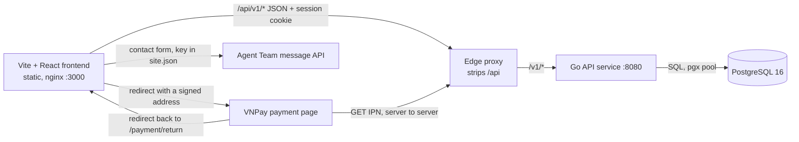

# Service & Interface Design — Đôi

Last updated: 2026-11-25
Source: `docs/{accounts,admin,catalogue,data,orders,payments,site}/SRS.md`, `docs/architecture/erd.md`, `docs/architecture/overview.md`

Every path below is written the way the Go backend mounts it — **no `/api` prefix**. Browsers reach `/v1/products` as `/api/v1/products`; the edge proxy strips `/api` before the request reaches the backend. A route mounted under `/api` is wrong.

## 1. Service map



| Service | Responsibility | Owns (tables) | Depends on | Deploy unit |
|---|---|---|---|---|
| **api** (Go, one `main` package) | Every `/v1` endpoint: public catalogue reads, search, orders, payment notice, sessions, customer accounts, dealer writes, overview, staff | All of them — see the ownership table below | PostgreSQL; VNPay only as a caller of the notice endpoint (the API never calls VNPay) | one container |
| **frontend** | Static pages; reads the API through `src/data/index.ts` and `src/lib/*` | none | the edge proxy's `/api` | one container (nginx) |
| **PostgreSQL** | Storage | the schema of `erd.md` | — | compose service / the shared server |

**Why these boundaries** — *Single backend service: no boundary is justified yet.* One team, one deploy cadence, one database, one scale knob; the work that could be split off (the 30-minute expiry ticker, the notice endpoint) needs the same row locks as the order it touches, and two services that must deploy together are one service. The one boundary that exists is **ownership inside the service**: each table has exactly one owning package, and every other package changes it only by calling that package's functions inside its own transaction, never by writing the table.

### 1.1 Ownership of every ERD entity

"Package" is `code/backend/internal/<name>`. `stock` and `ratelimit` are small internal packages with no routes; they exist so that two callers never write one table.

| ERD entity | Owning package (the only writer) | Everyone else |
|---|---|---|
| `categories`, `lines`, `reviews`, `shop_terms` (rating, review count) | `admin` | read through `data` / `catalogue` |
| `products` | `admin` | read through `data` / `catalogue`; `orders` never writes it |
| `product_sizes` (and view `product_stock`) | `stock` (`Take`, `Return`, `Set`, `SetOne`) | `orders` calls `Take` and `Return` in the order's transaction; `admin` calls `Set` / `SetOne`; `payments` reaches `Return` only through `orders.Cancel` |
| `delivery_options`, `payment_methods`, `faqs`, `size_chart` | `data` — seeded by migration; **no endpoint writes them** | read through `data` |
| `orders`, `order_items`, `order_tokens`, `counters` | `orders` (`Place`, `Update`, `Cancel`, `MarkPaid`, `Link`, `Delete`) | `admin` handlers call `orders.Update` / `Cancel` / `Delete`; `payments` calls `orders.MarkPaid` and `orders.Cancel`; `account` calls `orders.Link` |
| `payment_attempts`, `payment_notices` | `payments` | `orders` reads an order's transaction number through `payments.TransactionNo` |
| `users`, `sessions` | `auth` (`CreateUser`, `UpdateProfile`, `SetActive`, `SetPassword`, `Delete`, `SignIn`, `SignOut`, `Resolve`) | `account` (sign-up, profile) and `admin` (staff) are HTTP handlers over these functions; the start-up admin is made by `auth.EnsureAdmin` |
| `uploads` | `admin` | served by `GET /v1/uploads/{name}` |
| `rate_limits` | `ratelimit` (`Check`, `Fail`, `Hit`, `Purge`) | `auth` (sign-in), `orders` (lookup) and `account` (sign-up, add an order) call it |

A package never imports another package's store. Cross-package calls are the function names above, passed the caller's `pgx.Tx`.

## 2. Cross-cutting contract

### 2.1 Base

- Base URL: `{scheme}://{host}/api/v1` from a browser; `/v1` at the backend. Health lives outside the version: `GET /healthz`.
- Content type: `application/json; charset=utf-8` for every request body and response, except `POST /v1/uploads` (multipart in) and `GET /v1/uploads/{name}` (an image out). A `POST`, `PUT` or `PATCH` with another content type, except the upload, is `415 unsupported_media_type`.
- Versioning: URL path major version (`/v1`). A new major only for a breaking change (§8).
- Trace header: `X-Request-Id` is accepted from the caller when it matches `^[A-Za-z0-9._-]{8,64}$`, otherwise generated (16 random hex characters); it is echoed on every response and is a field of every log line. (`AccessLog` in `internal/httpx` gains this; it has none today.)
- JSON field names are `snake_case`, exactly the names `schema.json` uses for the ten collections. Timestamps are RFC 3339 with the Vietnam offset (`2026-11-25T08:40:00+07:00`); dates are `YYYY-MM-DD`. Money is an integer number of VND (JSON number, never a string, never a fraction). Ids are strings.
- Field names of a stored record never change type: a text field is `""` when unset, a numeric field is `null` when unset (`lines.since`, `sizes.cm`, `reviews.rating`) — `erd.md` §2.1.
- The browser sends `credentials: "include"` (same origin in a deployment). With `CORS_ALLOWED_ORIGINS` set for local development the CORS middleware already reflects the request headers, so `X-Order-Token` and `Idempotency-Key` need no extra configuration.

### 2.2 Authentication and authorization

| Aspect | Decision |
|---|---|
| Mechanism | Opaque random session token (≥ 128 bits, `crypto/rand`) in the cookie `session`; the row in `sessions` holds its SHA-256. No signing key exists, so nothing can be forged by guessing a secret |
| Cookie | `HttpOnly`, `SameSite=Lax`, `Path=/`, `Secure` when `X-Forwarded-Proto` is `https`, `Max-Age=604800` (7 days) |
| Lifetime | 7 days from sign-in, **fixed, not sliding**. A session exactly 7 days old is expired |
| Refresh | None. After 7 days the person signs in again |
| Revocation | `POST /v1/auth/sign-out` deletes the row. Every request re-reads `users.is_active` and `users.role`, so switching an account off or removing it ends its sessions at once |
| Transport | The cookie only. There is no `Authorization` header and no token in a URL |
| Order access token | A second, unrelated credential: an order token (≥ 128 bits, URL-safe, ≥ 22 characters) sent in the request header `X-Order-Token`. Only its SHA-256 is stored (`order_tokens`). It opens exactly one order and nothing else |
| Roles | visitor (no session), `customer`, `staff`, `admin`. "**Dealer**" = `staff` or `admin` |
| Enforcement | Middleware `auth.Resolve` runs on every request and puts the user (or none) in the context. Each route is wrapped with `auth.Require(roles…)` (401 with no session, 403 for another role). A per-resource check (is this order mine?) is inside the handler |
| Client address | The **right-most** `X-Forwarded-For` entry (the one the edge proxy appended), else the connection's remote address. Never the left-most (the client can forge it). Used by every limit |
| CSRF | Cookies are `SameSite=Lax` (not sent on a cross-site `POST`), every state change is `POST`/`PUT`/`PATCH`/`DELETE`, every `GET` is free of side effects, and JSON bodies need a content type a cross-site form cannot send |

| Endpoint group | Visitor | Customer | Staff | Admin |
|---|---|---|---|---|
| Public reads (`GET` products, lines, categories, reviews, delivery, payments, shop, sizes, faqs, product-filters, payment-options, uploads) | yes — *live shoes and shown reviews only, no bookkeeping* | same as visitor | yes — *drafts, hidden reviews and bookkeeping included* | same as staff |
| Place an order, look one up, read/pay one with its token | yes | yes (the order is linked to the account) | yes (never linked) | yes (never linked) |
| `/v1/account…` | 401 | yes, own data only | 403 | 403 |
| `GET /v1/orders` list; `PUT`/`DELETE /v1/orders/{id}` | 401 | 403 | yes | yes |
| Writes on products, lines, categories, reviews; `PATCH` a size count; `POST /v1/uploads`; `GET /v1/admin/overview` | 401 | 403 | yes | yes |
| `/v1/admin/staff…` | 401 | 403 | 403 | yes |
| `POST /v1/auth/sign-in`, `/v1/account/sign-up`, `/v1/order-lookups`, the notice | yes (limits of §2.7) | | | |

### 2.3 Error contract

**One shape for every non-2xx response, from every endpoint** (it is `httpx.ErrorBody`, already in the scaffold):

```json
{
  "error": "invalid",
  "message": "Check the form.",
  "errors": { "price": "Price cannot be below 0" }
}
```

`error` is the closed machine code below — consumers branch on it. `message` is a sentence safe to show a person and may be reworded at any time. `errors` maps an input name to its sentence and is present **only** on `bad_request` (400), `invalid` (422), `stock_conflict` (409) and the 409 `conflict` of sign-up; it is absent otherwise. A key is the field's JSON name; a nested key is a dotted path (`items.1`, `pairs.38`); a query parameter is its own name (`page`, `sort`). Nothing in a body is ever SQL, a stack trace, a file path, a hash, a secret, or another person's data; the cause is logged with the `X-Request-Id`.

The one exception to this shape is the VNPay notice (§3.5), which answers in VNPay's own `{"RspCode","Message"}` with status 200.

**Error catalog — the full closed set** (code spelling follows the merged scaffold, which already emits `not_found` and `unavailable`; see §2.9).

| Code | HTTP | Meaning | Retryable |
|---|---|---|---|
| `bad_request` | 400 | Body is not valid JSON, a field has the wrong type, a field the contract does not define was sent, or a query parameter is malformed (`page=0`, an unknown `sort`, `q` over 100 characters, a filter on a private field). `errors` names it | no |
| `unauthenticated` | 401 | No session, an expired or ended session, or a switched-off account | no |
| `invalid_credentials` | 401 | `POST /v1/auth/sign-in` only: unknown email, wrong password and switched-off account all answer this, with one status, one body and a similar time | no |
| `forbidden` | 403 | A session of the wrong role for the route | no |
| `not_found` | 404 | The record or route does not exist, **or is hidden from this caller** — "not yours" answers with exactly the body of "does not exist" | no |
| `conflict` | 409 | A uniqueness or state rule: email taken, shoe still ordered, line still used, order not cancelled, payment not possible for this order, protected admin account, an idempotency key reused with different details, stale stock count | no |
| `stock_conflict` | 409 | `POST /v1/orders` only: one or more pairs cannot be taken; `errors` names every pair as `items.<index>` | no |
| `payload_too_large` | 413 | An upload over 5 MiB (5,242,880 bytes); any other body over its cap | no |
| `unsupported_media_type` | 415 | An upload that is not JPEG, PNG or WebP by content; a JSON endpoint called with another content type | no |
| `invalid` | 422 | A well-formed request whose values break a rule (length, range, format, a reference to nothing, a forbidden state step). `errors` names every field at fault | no |
| `rate_limited` | 429 | A limit of §2.7. The wait in whole seconds is in the `Retry-After` header | yes, after the wait |
| `internal` | 500 | Anything unexpected, including a query or insert that failed and a database that cannot be reached. Generic message; details logged | yes |
| `payment_unavailable` | 503 | `VNPAY_TMN_CODE` or `VNPAY_HASH_SECRET` is not set, so no payment can be completed | yes, once the owner supplies the keys |
| `unavailable` | 503 | The process is shutting down, or `/healthz` finds the database unreachable | yes |

### 2.4 Pagination and the list query language

One scheme for the whole project: **offset paging**, because every list is small and read by page number (a shop of hundreds of shoes, admin tables with "page numbers and page size", a customer's own orders). Cursor paging would add nothing the screens could use and would make "Show more" and the dealer's page numbers harder; the cost is that a page read while records are added can repeat or skip one. The order is stable and unique, so two identical requests give identical pages.

Every list is `GET /v1/<collection>` and answers:

```json
{ "items": [ { } ], "total": 30, "page": 2, "limit": 12 }
```

(The project uses `items`, not `data`, because `src/data/index.ts` and DATA-002 name it so.) `total` is the number of **all** matches, never the page's length.

| Aspect | Decision |
|---|---|
| `page` | Whole number ≥ 1, default 1. `0`, negative or not a whole number → `400 bad_request`, `errors.page`. A page past the last is `200` with `items: []` and the true `total` |
| `limit` | Whole number ≥ 1, default **12**. `0`, negative or not a whole number → `400`, `errors.limit`. **Above 100 is served as 100 and the answer's `limit` says 100** (DATA-002 item 2 — a deliberate exception to "reject, never clamp"; the answer states what was applied) |
| Default order | `seq` ascending: the order of the seed, then the order records were added. Unique, so stable |
| `sort` | A field name (ascending) or `-` and a field name (descending). Any non-private field of the collection. Equal values and records with no value keep `seq` order; a record with no value for the field comes last either way. An unknown or private field → `400`, `errors.sort` |
| `q` | Free text, ≤ 100 characters after trimming (more → `400`, `errors.q`); spaces only means no search. Case, accents and `đ` are folded (`doi_fold`). Split on spaces into words; a record matches when **every** word occurs, as part of a value, in at least one searched field. `%` and `_` mean themselves |
| Searched fields (`q`) | products: name, model, colourway, code, description, the line's name, the category's name · orders: number, customer · reviews: name (the customer), body, the shoe's name · lines, categories: name, blurb · every other collection: all its text fields. A private field is never searched |
| `<field>=a,b` | Any-of: field equals `a` or `b` (a list field: contains `a` or `b`; a bool field: `true` / `false`). Different parameters combine with AND. An empty value is ignored |
| `<field>_from`, `<field>_to` | Inclusive range on a number (`price`, `rating`, `total`, `stock`, `qty`) or a date (`released`, `date`, `eta` as `YYYY-MM-DD`, `placed_at` as a date). A value that is not a number/date → `400`, naming the parameter |
| `size=a,b` | **Products only.** Keeps shoes in which at least one given EU size is listed **and** has at least one pair. A size on its last pairs counts; `size=99` is `200` with `total: 0`. On any other collection `size` is an ordinary field filter (`orders.size`) |
| Parameters this contract does not define | On a list: **ignored** — `?zzz=1` answers as without it (DATA-002 AC-11; the one place where an undefined input is not refused, because it is a URL a person edited, not a body a client built) |
| Private fields | A filter or `sort` on `phone`, `email`, `address`, `note` (orders), or on `_source`, `_invented`, `price_listed` → `400 bad_request` naming the field, for every caller including a dealer |

Filterable and sortable fields are the keys of the collection in `schema.json` (plus `id`), minus the private ones above; Dev builds the column allow-list from that file, and the **only** text spliced into SQL is a column name taken from the allow-list, never from the request.

**What a caller sees** — the same endpoint, two views:

| | Public view (visitor, customer) | Dealer view (staff, admin) |
|---|---|---|
| `products` | Only `status = live`: a draft is absent from lists, answers 404 by id, and `?status=draft` gives `total: 0`. No `_source`, `_invented`, `price_listed`, `pairs` | Every shoe, drafts included, with `_source`, `_invented`, `price_listed` and `pairs` |
| `reviews` | Only `status = live` | Every review |
| `orders` | **Not public**: list → 401 / 403; one order → by token or link (§3.4) | Every field, private ones included |
| other collections | Every record, minus `_source` and `_invented` | Every record with them |

### 2.5 Validation boundary

**The edge is the handler's decode step.** Every handler, before it calls its package's function, (1) caps the body (`http.MaxBytesReader`: 64 KiB for JSON, 5 MiB + 64 KiB for the upload), (2) decodes JSON with `DisallowUnknownFields`, (3) checks type, length, range, format and closed sets, and (4) resolves references (a shoe's line, a pair's shoe). Code below that line — the packages' functions and SQL — trusts what it is given and does not re-validate defensively; the database's `CHECK`s and foreign keys are the backstop, and a violation that gets through is `internal` or the endpoint's `conflict`, never a field message.

- **A request field the contract does not define is refused, never accepted and ignored** — `400 bad_request`, `errors.<field>`. Wrong type or invalid JSON: the same `400`. A body larger than its cap: `413 payload_too_large`.
- **Three SRS-forced exceptions** where the refusal is `422 invalid` naming the field, because the acceptance criteria say so: (a) a write to `products`, `lines`, `categories`, `reviews` carrying a field the collection does not have, a read-only one, or a value of the wrong type (`price: "abc"`, a count of `2.5`) — ADMIN-010 item 3, AC-6, AC-11 and ADMIN-015 AC-8; only a body that is not a JSON object is `400` there; (b) `PUT /v1/account` carrying `email`, `role` or `password` (ACC-004 AC-4); (c) `PUT /v1/orders/{id}` and `PUT /v1/admin/staff/{id}` carrying a field that may not change — `total`, `number`, `role`, … (ADMIN-016 item 5, ADMIN-031 item 5). Everywhere else an undefined or wrongly typed body field is `400`.
- **Tolerated extras, read and discarded** (the only two): `id` in the body of a `PUT` — the id in the path is the one changed (ADMIN-010 AC-15); and on `POST /v1/orders` the amounts `items[].price`, `items[].unit_price`, `delivery_fee` and `total` — the shop never uses a client's amount (ORD-003 AC-6, AC-9).
- Text is trimmed; "required" means present and not empty after trimming. Limits are in characters (runes), not bytes. Dealer text fields: 200; long text (`description`, `care`, `blurb`, `fit_note`, `body`, `note`, `answer`): 5,000. Checkout: name 100, phone 20 (≥ 9 digits), address 200, city 100, note 500.
- A phone's digits are what it contains after removing spaces, `+`, `-`, `(`, `)`; fewer than 9 digits is invalid. Order numbers and phones for lookups are compared by digits (§3.4).
- `id` and `{name}` path segments are matched against `^[a-z0-9][a-z0-9._-]*$` (and the upload name's own pattern) before any query; a segment that does not match is `404 not_found`.
- Passwords: customers 8–100 characters, staff and the admin ≥ 10 (and ≤ 100), never trimmed, never logged.

### 2.6 Idempotency

| Endpoint | Key | Retention | A replay returns |
|---|---|---|---|
| `POST /v1/orders` | Header `Idempotency-Key`, **required**, 8–100 characters of `[A-Za-z0-9._-]`; the browser makes a random UUID once per bag and per set of details | For ever — it is a column of the order (`uq_orders_idempotency_key`) | The **first** order, with `200` (the first send answered `201`), `Idempotent-Replayed: true`, a **new** order token (a stored hash cannot be reversed) and a fresh `payment_url` when the order is still payable. No pair leaves the shelf again. The same key from two tabs at once makes one order: the second waits on the unique index and gets the replay |
| `POST /v1/orders/{id}/payment` | none | — | Each call builds a **new** attempt with a new reference (PAY-001 item 1); the earlier references stay valid |
| The VNPay notice | VNPay's `vnp_TxnRef` + the partial unique index on a successful notice | For ever | `RspCode 02` and no change |
| `PUT`, `PATCH`, `DELETE` | Naturally idempotent (a `PATCH` of a size count is compare-and-set; a repeated `DELETE` is `404`) | — | — |
| every other `POST` | none; a duplicate is stopped by its own uniqueness (an email, a number) | — | `409 conflict` |

A key is a bearer secret for the replay, so the replay also demands the **same phone digits** as the stored order; a different phone with a used key is `409 conflict` and reveals nothing. A key is never logged.

### 2.7 Limits that refuse with 429

Counters live in `rate_limits` (hashed subject, no email, address or number stored). A refused call answers `429 rate_limited` with `Retry-After: <seconds left>`, **without counting**, even if the credentials or the pair are right.

| Scope | What counts | Limit | Lock |
|---|---|---|---|
| `sign_in_email`, `sign_in_address` | A failed `POST /v1/auth/sign-in` (wrong password, unknown email, switched-off account). A success neither counts nor clears | 5 failures in 15 minutes, for one lower-cased email **or** one address | 15 minutes from the fifth failure |
| `order_lookup_number`, `order_lookup_address` | A failed `POST /v1/order-lookups` or `POST /v1/account/orders` (wrong phone, unknown number, an order of another account). The subject is the typed digits, so a number that does not exist counts like any other. A right pair neither counts nor clears | 5 failures in 15 minutes, per number **or** per address | 15 minutes from the fifth failure |
| `sign_up_address` | Every `POST /v1/account/sign-up` attempt | 10 in 1 hour per address | Until the window's hour ends |

The order page opened with a token already held is not affected by a lookup lock (ORD-022 item 6).

### 2.8 Shapes shared by several endpoints

**Product** (`GET /v1/products`, `/{id}`; the body of a create/update answer). Field names are `schema.json`'s.

| Field | Type | Notes |
|---|---|---|
| `id` | string | slug; never changes |
| `name`, `model`, `code`, `colourway`, `description`, `upper`, `lining`, `sole`, `fit`, `care`, `swatch` | string | `""` when unset |
| `line`, `category` | string | id of a line / category, `""` when unset |
| `price` | integer | VND, ≥ 0 |
| `status` | `"live"` \| `"draft"` | |
| `featured`, `is_new` | boolean | at most one shoe is `featured` |
| `colour` | string | `""` or `black`, `white`, `pink`, `purple`, `brown`, `yellow`, `blue`, `grey`, `green` |
| `released` | string | `YYYY-MM-DD` |
| `image`, `image_back`, `image_detail` | string | `/images/…` or `/api/v1/uploads/<name>` |
| `sizes` | string[] | the EU sizes, growing order (`"35 1/2"`, `"36"`, `"36 2/3"`) — **derived** from the per-size counts |
| `sizes_low` | string[] | sizes with 1 or 2 pairs — derived |
| `sizes_out` | string[] | sizes with 0 pairs — derived |
| `stock` | integer | sum of the pairs of every size — derived |
| `rating` | number | one decimal, average of the shoe's live reviews, 0 when none — derived |
| `review_count` | integer | live reviews — derived |
| **dealer view only:** `pairs` | object | size → whole number of pairs, e.g. `{"38": 4, "39": 2, "40": 0}`; the keys are exactly `sizes` |
| **dealer view only:** `price_listed`, `_source`, `_invented` | string, string, string[] | bookkeeping |

**Order — public view** (the answer to a token / linked-account read, to placing an order, and each item of `GET /v1/account/orders` is the subset `id, number, placed_at, status, total`). **Never** `phone`, `email`, `address`, `note`.

| Field | Type | Notes |
|---|---|---|
| `id`, `number` | string | `doi-24818`, `DOI-24818` |
| `placed_at` | string | RFC 3339, `+07:00` |
| `status` | `"placed"` \| `"confirmed"` \| `"packed"` \| `"shipped"` \| `"delivered"` \| `"cancelled"` | `shipped` is "On its way" to a customer |
| `items` | array | one object per pair, in the order sent: `{ "product": id, "name", "colourway", "image", "size", "qty", "unit_price" }` — `name`, `colourway` and `image` are read live from the shoe even if it is now a draft; `unit_price` is as sold |
| `product`, `size`, `qty` | string, string, integer | the first pair, kept for the collection's shape (ORD-003 AC-12) |
| `total`, `delivery_fee` | integer | VND; `total` = Σ `unit_price × qty` + `delivery_fee`; `delivery_fee` is always 0 |
| `payment` | string | id of the way to pay (`vnpay`) |
| `paid` | boolean | |
| `delivery` | string | always `standard` |
| `carrier`, `tracking` | string | `""` until the dealer sets them |
| `eta` | string | `YYYY-MM-DD` or `""` |
| `customer`, `city` | string | |

**Order — dealer view** adds `phone`, `email`, `address`, `note` and `transaction_no` (VNPay's transaction number, `""` when none; read-only) to every order read by a dealer (single read and list; a list item has `product`, `size`, `qty` of the first pair and no `items`).

**Team account** (an item of `/v1/admin/staff`): `{ "id": uuid string, "name", "email", "role": "admin"|"staff", "is_active": boolean }`.

### 2.9 Deviations from `api-conventions.md`

Each is forced by a requirement or by the merged scaffold, and none is silent.

| Convention | This project | Reason |
|---|---|---|
| Error `code` and enum values `UPPER_SNAKE` | Lowercase snake (`not_found`; `live`, `placed`) | The scaffold's `httpx.Error` already emits `not_found` / `unavailable`; the stored enums are the design's records (`status: "live"`) and the frontend reads them as they are |
| Error body `{error:{code,message,details,request_id}}` | `{error, message, errors}` flat; the request id is the `X-Request-Id` header | Merged `httpx.ErrorBody`, and the SRS's `{"errors":{field: sentence}}` |
| Collections `{data, next_cursor, has_more}` | `{items, total, page, limit}`, offset paging | DATA-002 and the data module `src/data/index.ts` |
| A `limit` over the max is rejected `422` | Served as 100 | DATA-002 item 2 |
| Undefined body field always `400` | `422` in the three cases of §2.5 | ADMIN-010 AC-11, ACC-004 AC-4, ADMIN-016 AC-15 |
| An undefined query parameter is refused | Ignored on lists | DATA-002 AC-11 |
| `PATCH` for partial updates | `PUT /v1/<collection>/{id}` is partial: only the fields sent change | ADMIN-010 AC-14 fixes the verb and the behaviour. A field sent as `null` is refused for required fields and clears an optional one |
| Booleans `is_`/`has_`, ids as uuid strings, UTC timestamps | Record fields keep the JSON's names (`featured`, `paid`, `online`); collection ids are slugs; times carry `+07:00` | The approved design's records; ADMIN-020 requires Vietnam time. New fields this design adds follow the convention (`is_active`, `is_available`) |
| Resource names are plural nouns | `delivery`, `payments`, `shop`, `sizes` stay as the collections are named | DATA-002 AC-12 names these routes |

## 3. Endpoints

### 3.0 Index

| # | Method and path | Auth | Story | Traces to |
|---|---|---|---|---|
| 3.1 | `GET /healthz` | none | scaffold | — |
| 3.2 | `GET /v1/{collection}` — `products`, `lines`, `categories`, `reviews`, `delivery`, `payments`, `shop`, `sizes`, `faqs` | public | S3, S4 | DATA-002, DATA-004, CAT-001, ADMIN-013 |
| 3.3 | `GET /v1/{collection}/{id}` — the same nine | public | S3 | DATA-003, ADMIN-013 |
| 3.4 | `GET /v1/product-filters` | public | S4 | CAT-002 item 8 |
| 3.5 | `GET /v1/payment-options` | public | S5 | ORD-006, PAY-022 |
| 3.6 | `GET /v1/uploads/{name}` | public | S9 | ADMIN-012 |
| 3.7 | `POST /v1/auth/sign-in` | public, limited | S8 | ADMIN-001, ADMIN-003, ACC-002 |
| 3.8 | `POST /v1/auth/sign-out` | any | S8 | ADMIN-002, ACC-007 |
| 3.9 | `GET /v1/auth/me` | session | S8 | ADMIN-002, ACC-007 |
| 3.10 | `POST /v1/orders` | public (customer session links) | S5 | ORD-002…006, ORD-009, ORD-010, ACC-005 |
| 3.11 | `GET /v1/orders/{id}` | order token, linked customer, or dealer | S5 | ORD-007, ORD-008, ORD-023 |
| 3.12 | `POST /v1/order-lookups` | public, limited | S6 | ORD-021, ORD-022 |
| 3.13 | `POST /v1/orders/{id}/payment` | order token or linked customer | S5 (409), S7 | ORD-006, ORD-007, PAY-001 |
| 3.14 | `GET /v1/orders` | dealer | S5, S9 | ORD-008, ADMIN-011, ADMIN-016, CAT-001 |
| 3.15 | `PUT /v1/orders/{id}` | dealer | S9 | ADMIN-016 |
| 3.16 | `DELETE /v1/orders/{id}` | dealer | S9 | ADMIN-014 |
| 3.17 | `GET /v1/payments/vnpay/ipn` | VNPay signature | S7 | PAY-002 |
| 3.18 | `POST /v1/account/sign-up` | public, limited | S14 | ACC-001 |
| 3.19 | `GET /v1/account`, `PUT /v1/account` | customer | S14 | ACC-004, ACC-005 |
| 3.20 | `GET /v1/account/orders`, `GET /v1/account/orders/{id}` | customer | S14 | ACC-003 |
| 3.21 | `POST /v1/account/orders` | customer, limited | S14 | ACC-006 |
| 3.22 | `POST /v1/{products\|lines\|categories\|reviews}`, `PUT …/{id}`, `DELETE …/{id}` | dealer | S9 | ADMIN-010, ADMIN-011, ADMIN-013, ADMIN-014 |
| 3.23 | `PATCH /v1/products/{id}/sizes` | dealer | S9 | ADMIN-015 |
| 3.24 | `POST /v1/uploads` | dealer | S9 | ADMIN-012 |
| 3.25 | `GET /v1/admin/overview` | dealer | S10 | ADMIN-020, ADMIN-021 |
| 3.26 | `GET /v1/admin/staff`, `POST /v1/admin/staff` | admin | S13 | ADMIN-030 |
| 3.27 | `PUT /v1/admin/staff/{id}`, `DELETE /v1/admin/staff/{id}` | admin | S13 | ADMIN-031 |

Routes are mounted explicitly, one literal pattern per collection (`GET /v1/products`, `GET /v1/products/{id}`, …) — there is **no** `GET /v1/{collection}` wildcard, so an unknown collection falls through to `not_found`, and `GET /v1/orders/{id}` (token rules) can never be shadowed by a generic reader. A collection with no write route (`delivery`, `payments`, `shop`, `sizes`, `faqs`) answers `POST`/`PUT`/`DELETE` with `404 not_found`.

### 3.1 `GET /healthz`

**Purpose** — liveness and database check, used by compose and CI (`--wait`). **Auth** — none. Already built.

Success `200` `{"status":"ok"}`. Error: `unavailable` 503 when `SELECT 1` fails or takes over 2 s. It is outside `/v1`, so the edge proxy does not expose it as `/api/healthz`.

### 3.2 `GET /v1/{collection}` — the nine public collections

**Purpose** — the paged, searchable, filterable list. **Traces to** — DATA-002, DATA-004, CAT-001, ADMIN-013. **Auth** — none; a dealer session widens the view (§2.4).

**Query parameters** — `page`, `limit`, `q`, `sort`, `<field>`, `<field>_from`, `<field>_to` and (products) `size`, all as §2.4.

**Success** — `200` `{"items":[…],"total":n,"page":p,"limit":l}`. Each item is the collection's record:

| Collection | Fields of an item (public view) |
|---|---|
| `products` | the Product of §2.8 |
| `lines` | `id`, `name`, `blurb`, `since` (integer or `null`), `fit_note` |
| `categories` | `id`, `name`, `blurb`, `image` |
| `reviews` | `id`, `product` (shoe id), `name`, `rating` (1–5 or `null`), `date` (`YYYY-MM-DD`), `size_bought`, `fit` (`""`, `small`, `true`, `large`), `body`, `status` (`live`, `hidden`) |
| `delivery` | `id`, `name`, `days`, `fee` (0), `note` — one record, `standard` |
| `payments` | `id`, `name`, `note`, `online` (boolean), `icon` — all four rows; **what is offered is `GET /v1/payment-options`** |
| `shop` | `id` (`shop`), `standard_days`, `dispatch_cutoff`, `reply_time`, `rating`, `review_count` — one record |
| `faqs` | `id`, `topic` (`shipping`, `returns`, `sizing`, `payment`, `orders`), `question`, `answer` |
| `sizes` | `id`, `eu`, `uk`, `us_m`, `us_w`, `cm` (number or `null`) — the size chart |

The dealer view adds `_source` (string) and `_invented` (string[]) to every record, and the extras of §2.4 / §2.8.

**Errors**

| Code | HTTP | Trigger |
|---|---|---|
| `bad_request` | 400 | `page` / `limit` not a whole number ≥ 1; `sort` names an unknown or private field; `q` over 100 characters; `*_from` / `*_to` not a number or date; a filter or sort on a private field. `errors` names the parameter |
| `internal` | 500 | The database cannot be reached or a query fails |

**Notes** — Responses carry no cache headers: a change by the dealer shows on the next read (ADMIN-010 item 9). The two lists the home page and the shop need are plain filters: the opening shoe is `?featured=true&status=live&limit=1`, "New this month" is `?is_new=true&status=live`, a shoe's colour dots are `?model=<model>&status=live`, a shoe's reviews are `/v1/reviews?product=<id>&sort=-date`. A request for `/v1/products` by the shop page carries `status=live&limit=12` (CAT-002 AC-5); a visitor gets live shoes whether or not it says so.

### 3.3 `GET /v1/{collection}/{id}` — one record

**Purpose** — one record with the same fields as the list. **Traces to** — DATA-003, ADMIN-013. **Auth** — none (view as §2.4).

| Code | HTTP | Trigger |
|---|---|---|
| `not_found` | 404 | The id does not exist, does not match the id pattern, or is a **draft shoe or hidden review seen by a non-dealer** (the same body for all) |
| `internal` | 500 | Database failure |

**Success** `200` the record. `GET /v1/delivery/express` is `404`; `GET /v1/shop/shop` is the shop's terms.

### 3.4 `GET /v1/product-filters`

**Purpose** — the options of the shop page's Colour group and Size (EU) pills, which list **every** colour and size of the live shoes whatever filters are set (CAT-002 item 8, AC-20). **Traces to** — CAT-002. **Auth** — none. No parameters (any given is ignored).

**Success** `200`

```json
{ "colours": ["black", "white", "pink"], "sizes": ["35 1/2", "36", "36 2/3", "37 1/3"] }
```

| Field | Type | Description |
|---|---|---|
| `colours` | string[] | Distinct non-empty `colour` of live shoes, in the order of the closed set (black, white, pink, purple, brown, yellow, blue, grey, green) |
| `sizes` | string[] | Distinct sizes **listed** by at least one live shoe (in stock or not), by numeric value ascending, so `36 2/3` follows `36` |

Errors: `internal` 500. Drafts never contribute, even for a dealer.

### 3.5 `GET /v1/payment-options`

**Purpose** — the ways to pay the shop can complete right now; checkout step 03 and the shoe page's "Payment options" read it instead of the `payments` collection. **Traces to** — ORD-006 items 2 and 6, PAY-001 item 6, PAY-022. **Auth** — none. Any parameter is ignored.

**Success** `200` `{"items":[…],"total":1,"page":1,"limit":100}`, each item:

| Field | Type | Description |
|---|---|---|
| `id`, `name`, `note`, `icon` | string | From the `payment_methods` row |
| `online` | boolean | From the row |
| `is_available` | boolean | `true` when the shop can take this payment now |

**Rules** — rows come in the `payment_methods` order. `vnpay` is **always listed**; its `is_available` is `true` only when both `VNPAY_TMN_CODE` and `VNPAY_HASH_SECRET` are set (otherwise checkout shows "Online payment is not available right now. Please try again later." and disables "Place order"). `bank` is listed only from story 11 and only when the shop's bank account is set; `momo` only from story 11 and only when its keys are set; `cod` is never listed. A row that is listed has `is_available: true` unless it is `vnpay` without keys.

Errors: `internal` 500.

### 3.6 `GET /v1/uploads/{name}`

**Purpose** — serve an uploaded picture. **Traces to** — ADMIN-012 item 2. **Auth** — none.

`{name}` must match `^[a-f0-9]{32}\.(jpg|png|webp)$`, else `404`. **Success** `200` with the stored bytes, `Content-Type` as stored, `Content-Length`, `Cache-Control: public, max-age=31536000, immutable` (the name is random and never reused), `X-Content-Type-Options: nosniff`. Errors: `not_found` 404, `internal` 500. The row's `data` is read with a single `SELECT` by the unique name.

### 3.7 `POST /v1/auth/sign-in`

**Purpose** — one sign-in for admin, staff and customers. **Traces to** — ADMIN-001, ADMIN-002, ADMIN-003, ACC-002. **Auth** — none; limited by `sign_in_email` and `sign_in_address` (§2.7).

**Request body**

```json
{ "email": "dealer@example.com", "password": "correct horse battery" }
```

| Field | Type | Required | Constraints |
|---|---|---|---|
| `email` | string | yes | non-empty after trimming, ≤ 200 characters; compared lower-cased |
| `password` | string | yes | non-empty, ≤ 100 characters |

**Success** `200`, with `Set-Cookie: session=<token>; HttpOnly; SameSite=Lax; Path=/; Max-Age=604800` (+ `Secure` over HTTPS):

```json
{ "email": "dealer@example.com", "name": "Dealer", "role": "admin" }
```

`name` is the account's own name, or — when it has none (the admin made from the settings) — the part of the email before `@` with its words (split on `.`, `_`, `-`) capitalised: `lan.tran@example.com` → `Lan Tran`. `role` is `admin`, `staff` or `customer`. A team member who signs in from `/account/sign-in` gets the same answer; the page routes by `role`.

| Code | HTTP | Trigger |
|---|---|---|
| `bad_request` | 400 | Not JSON, a wrong type, an undefined field |
| `unsupported_media_type` | 415 | Not `application/json` |
| `invalid` | 422 | `email` or `password` empty (`errors.email` "An email address is needed", `errors.password`) — not counted as a failed try |
| `invalid_credentials` | 401 | Unknown email, wrong password, switched-off account, or no admin made because `ADMIN_EMAIL` / `ADMIN_PASSWORD` is unset: **the same status, body and (to within noise) time** |
| `rate_limited` | 429 | The email or the address is locked; `Retry-After` is the seconds left; the right password does not help |
| `internal` | 500 | Database failure |

**Notes** — an argon2id verification runs for every attempt, against a fixed dummy hash when the email is unknown or the account is off, so the time does not tell them apart. A success creates a new `sessions` row (one person may hold several sessions) and neither counts nor clears the failure counters. The password and the token are never logged.

### 3.8 `POST /v1/auth/sign-out`

**Purpose** — end the session. **Traces to** — ADMIN-002 items 6, AC-14; ACC-007 item 3. **Auth** — none required. No body (a body is `400`).

**Success** `204`, always, including with no or an unknown session; the `sessions` row (if any) is deleted and the cookie is cleared (`Max-Age=0`). The old cookie then opens nothing (`GET /v1/auth/me` → 401). Errors: `internal` 500 only if the delete itself fails.

### 3.9 `GET /v1/auth/me`

**Purpose** — who is signed in; the single source for the admin gate and the header's "Account" entry. **Traces to** — ADMIN-002, ACC-007. **Auth** — a session.

**Success** `200` `{"email":"…","name":"…","role":"admin"|"staff"|"customer"}`, `Cache-Control: no-store`.

| Code | HTTP | Trigger |
|---|---|---|
| `unauthenticated` | 401 | No cookie, an unknown or expired token (≥ 7 days old), a removed or switched-off account |
| `internal` | 500 | Database failure |

### 3.10 `POST /v1/orders`

**Purpose** — place an order: the shop re-reads every price, takes the pairs off the shelf, saves the order and answers with its token and the address to pay at. **Traces to** — ORD-002, ORD-003, ORD-004, ORD-005, ORD-006, ORD-009, ORD-010, ACC-005. **Auth** — none. If the request carries the session of a **customer**, the order is linked to that account (`orders.account_id`); with no session, a staff or an admin session, it is linked to none. A session that has ended in between is a guest.

**Headers** — `Idempotency-Key` (required, §2.6), `Content-Type: application/json`.

**Request body**

```json
{
  "items": [ { "product": "samba-og-w-core-black", "size": "38", "qty": 1 } ],
  "delivery": "standard",
  "payment": "vnpay",
  "customer": "Lan Nguyen",
  "phone": "0912 345 678",
  "address": "12 Example Street, Ward 1",
  "city": "Da Nang",
  "note": ""
}
```

| Field | Type | Required | Constraints |
|---|---|---|---|
| `items` | array | yes | 1 to 50 lines; no two lines with the same `product` and `size` (`422`, `errors.items.<index>`) |
| `items[].product` | string | yes | a shoe id |
| `items[].size` | string | yes | an EU size exactly as the shoe lists it (`36 2/3`) |
| `items[].qty` | integer | yes | 1 to 1,000 (the shelf is the real cap) |
| `delivery` | string | yes | must be `standard`; any other or unknown id is `422`, `errors.delivery` |
| `payment` | string | yes | the id of a way to pay **offered** (§3.5); `cod`, `bank` (before story 11), `momo` or an unknown id is `422`, `errors.payment` |
| `customer` | string | yes | 1–100 characters |
| `phone` | string | yes | ≥ 9 digits, ≤ 20 characters |
| `address` | string | yes | 1–200 characters |
| `city` | string | yes | 1–100 characters |
| `note` | string | no | ≤ 500 characters; default `""` |

**Tolerated and discarded** — `items[].price`, `items[].unit_price`, `delivery_fee` and `total` may be present and are **ignored**: the stored amounts are the shop's own (ORD-003 AC-6, AC-9). No other undefined field is accepted.

**Success** — `201 Created`, `Location: /v1/orders/doi-24818`, `Cache-Control: no-store`:

```json
{
  "order": { "id": "doi-24818", "number": "DOI-24818", "placed_at": "2026-11-25T10:00:00+07:00", "status": "placed", "total": 6180000, "…": "the public view of §2.8, with items" },
  "token": "q3J0n8…22+ URL-safe characters…",
  "payment_url": "https://sandbox.vnpayment.vn/paymentv2/vpcpay.html?vnp_Amount=618000000&…&vnp_SecureHash=…"
}
```

| Field | Type | Description |
|---|---|---|
| `order` | object | Order, public view, with `items` |
| `token` | string | The order token — in this answer **only** (and the lookup's). ≥ 128 bits, URL-safe, ≥ 22 characters |
| `payment_url` | string | VNPay's payment address for this order, `""` when none could be built: before story 7, or when building it failed — the order is still saved and payable with `POST /v1/orders/{id}/payment` |

A replay of a used key answers `200` and `Idempotent-Replayed: true` with the same `order`, a new `token` and a fresh `payment_url` (§2.6).

**What the shop computes** — `unit_price` = the shoe's price now; `total` = Σ `unit_price × qty`; `delivery_fee` = 0; `status` `placed`; `paid` `false`; `placed_at` = now; `eta` = the base day plus the **last** number of `shop_terms.standard_days` ("2–4" → 4) working days, where the base day is today (Vietnam time) when the order is placed before `dispatch_cutoff` (15:00) on a weekday, otherwise the next weekday; each working day skips Saturday and Sunday (Monday 10:00 → Friday; Monday 16:00 → next Monday; Saturday → Friday after next Monday). Vietnamese holidays are not skipped.

**Order of checks** — body cap and JSON (`400`, `413`, `415`) → header (`400`) → every field at once (`422`, with `errors` for each fault) → keys of the chosen provider (`503`) → the transaction (`409`, `201`). So a request that names a way to pay that is not offered is `422` whatever the settings, and a valid request is `503` while VNPay's keys are missing.

**The transaction** (one, `READ COMMITTED`, 5 s limit):

1. Sort the distinct `(product, size)` pairs and `SELECT … FOR UPDATE` their `product_sizes` rows and the shoes' `status` in that order (no deadlock between two orders). A shoe that does not exist or is not `live` is "no longer in the shop"; a size the shoe does not list is a `422` on that line, decided before the transaction.
2. Evaluate **every** line. If any fails, roll back and answer `409 stock_conflict` naming **all** failing lines; nothing is taken for the lines that were fine.
3. `stock.Take` each line with `UPDATE … SET pairs = pairs - $q WHERE … AND pairs >= $q` (the floor `CHECK pairs >= 0` is the backstop).
4. `UPDATE counters SET value = value + 1 WHERE name = 'order_number' RETURNING value` → `DOI-<value>` / `doi-<value>`; insert `orders`, `order_items` (with `unit_price`), one `order_tokens` row (SHA-256 of the new token); commit.
5. After the commit, for VNPay, build the attempt and address (§3.13). A failure here is logged and leaves `payment_url` empty.

**Errors**

| Code | HTTP | Trigger |
|---|---|---|
| `bad_request` | 400 | Invalid JSON, a wrong type, an undefined field, a missing or malformed `Idempotency-Key` (`errors."Idempotency-Key"`) |
| `payload_too_large` | 413 | Body over 64 KiB |
| `unsupported_media_type` | 415 | Not `application/json` |
| `invalid` | 422 | Any field rule: empty `customer` / `address` / `city`, a phone under 9 digits or over 20 characters, a note over 500, `qty` < 1, a size the shoe does not list, an empty or oversized `items`, an unknown or non-`standard` `delivery`, a `payment` not offered, a duplicate line. `errors` names each, the message of a limit names the limit |
| `stock_conflict` | 409 | One or more pairs are sold out, short, or no longer in the shop. `errors` keys are `items.<index>` and the sentences `<shoe name> · EU <size> — sold out in your size.`, `… — only <n> left in your size.`, `… — no longer in the shop.` (the shoe's id stands in for a name that does not exist). The shelf is exactly as before |
| `conflict` | 409 | The `Idempotency-Key` was used by an order with a different phone |
| `payment_unavailable` | 503 | The chosen provider's keys are not set. No order, no pair taken |
| `internal` | 500 | Database failure, nothing saved, nothing taken |

**Notes** — Concurrency: 50 simultaneous orders for one size holding 10 pairs sell exactly 10 and refuse the rest with `stock_conflict`. Not rate limited (open question 2); a stock-hoarding order is undone by the 30-minute expiry. Until story 7 lands, `payment_url` is always `""` and the order waits unpaid ("awaiting payment"). The customer's phone, address and note are stored and never appear in the answer.

### 3.11 `GET /v1/orders/{id}`

**Purpose** — read one order. **Traces to** — ORD-007, ORD-008, ORD-023, PAY-004 item 1, ACC-005. **Auth** — any **one** of: (1) a dealer session → the dealer view; (2) the header `X-Order-Token: <token>` that opens **this** order → the public view; (3) the session of the customer the order is linked to → the public view. Checked in that order; the first that applies wins. The token is never accepted in a URL.

**Success** `200`, `Cache-Control: no-store`: the Order of §2.8 (public view with `items`, or the dealer view). The answer for a visitor never holds `phone`, `email`, `address` or `note`, whatever the token.

| Code | HTTP | Trigger |
|---|---|---|
| `not_found` | 404 | The id does not exist, the id is malformed, there is no token or session, the token belongs to another order, or the session is another customer's. **One body for every one of these** |
| `internal` | 500 | Database failure |

**Notes** — the payment result page (`/payment/return`) polls this endpoint every 3 s for up to 30 s with the token it holds; `paid` and `status` are the whole truth it needs. A lookup lock (§2.7) does not affect this endpoint.

### 3.12 `POST /v1/order-lookups`

**Purpose** — find an order with its number and phone and receive a token for it, from `/track`. A `POST` so the phone never sits in a URL or a log. **Traces to** — ORD-021, ORD-022, ORD-023 item 4. **Auth** — none; limited by `order_lookup_number` and `order_lookup_address`.

**Request body** `{ "number": "doi 24817", "phone": "+84938410552" }` — both strings, required to be present; their content is judged by the match, not by a `422`.

**Matching** — `number`: the digits of it (`DOI-24817`, `doi 24817` and `24817` all give `24817`); `phone`: its digits, with a leading `84` read as `0`, compared in full with the stored phone read the same way (`552` never matches). An empty phone or a number with no digits is simply a miss.

**Success** `200`, `Cache-Control: no-store`:

```json
{ "id": "doi-24817", "number": "DOI-24817", "placed_at": "2026-11-24T09:12:00+07:00", "token": "…" }
```

A new `order_tokens` row is made on every success; earlier tokens stay valid. Nothing else about the order is returned (no `customer`, `city`, `phone`…).

| Code | HTTP | Trigger |
|---|---|---|
| `bad_request` | 400 | Invalid JSON, a wrong type, an undefined field |
| `unsupported_media_type` | 415 | Not JSON |
| `not_found` | 404 | A wrong number, a wrong phone, a number that does not exist: **the same status and body**; counts as a failure |
| `rate_limited` | 429 | 5 failures in 15 minutes for the number or the address; `Retry-After` set |
| `internal` | 500 | Database failure |

### 3.13 `POST /v1/orders/{id}/payment`

**Purpose** — "Pay now" and the result page's "Try again": a fresh signed payment address for an unpaid order. **Traces to** — ORD-006 items 4–6, ORD-007 items 8–9, PAY-001, PAY-004 item 3. **Auth** — the order's `X-Order-Token`, or the linked customer's session. A dealer session without the token is `404`. No body.

**Success** `200` `{"payment_url":"https://sandbox.vnpayment.vn/paymentv2/vpcpay.html?…"}`.

**The address** — built by the backend, no call to VNPay. Parameters (VNPay 2.1.0): `vnp_Version=2.1.0`, `vnp_Command=pay`, `vnp_TmnCode=<VNPAY_TMN_CODE>`, `vnp_Amount=<orders.total × 100>` (read from the database; the browser sends none), `vnp_CurrCode=VND`, `vnp_TxnRef=<reference>`, `vnp_OrderInfo="Thanh toan don hang DOI-24818"` (ASCII, no diacritics), `vnp_OrderType=other`, `vnp_Locale=en`, `vnp_ReturnUrl=<public origin>/payment/return`, `vnp_IpAddr=<client address>`, `vnp_CreateDate=<now, yyyyMMddHHmmss, Vietnam time>`, `vnp_ExpireDate=<placed_at + 30 minutes, same format>`, and last `vnp_SecureHash` = hex HMAC-SHA512, keyed with `VNPAY_HASH_SECRET`, of the other parameters (every `vnp_` field except `vnp_SecureHash` and `vnp_SecureHashType`) sorted by name, each `name=value` with the value URL-encoded as VNPay's reference code does (`application/x-www-form-urlencoded`: a space is `+`), joined by `&`; the same string is what goes in the address's query. The reference is `<order number>-<n>` (`DOI-24818-1`, `-2`, …), `n` being the count of the order's attempts + 1 taken under the order's row lock, unique (`uq_payment_attempts_reference`), ≤ 100 characters; the return page may read the order number from it only to choose which stored token to ask with. The public origin is `PUBLIC_BASE_URL` when set, else `X-Forwarded-Proto` + `X-Forwarded-Host` (falling back to `Host`). The payment base address is `VNPAY_PAYMENT_URL` (default the sandbox's). Each call inserts a `payment_attempts` row (`provider`, `reference`, `amount`, `expires_at = placed_at + 30 minutes`).

| Code | HTTP | Trigger |
|---|---|---|
| `bad_request` | 400 | A body was sent |
| `not_found` | 404 | No access to this order (as §3.11) |
| `conflict` | 409 | The order is paid; is cancelled; its way to pay is not an online one the shop completes (a sample order's `cod`, a `bank` order); its 30 minutes have run out; **or, before story 7, always** ("Online payment is not available yet.") |
| `payment_unavailable` | 503 | The keys are not set |
| `internal` | 500 | Database failure |

Checks run in that order: access, then state, then keys.

### 3.14 `GET /v1/orders`

**Purpose** — the dealer's orders list and the menu's "orders waiting" count. **Traces to** — ORD-008 items 1 and 5, ADMIN-011 items 2–3, ADMIN-016 item 7, CAT-001 AC-27. **Auth** — dealer (`401` with no session, `403` for a customer).

**Query** — §2.4. Useful: `status=placed,confirmed`, `payment=vnpay`, `q=<number or customer>`, `sort=-placed_at`, `placed_at_from=2026-11-01`, `page`, `limit`. The menu count is `?status=placed,confirmed&limit=1` and reads `total`. A filter on `phone`, `email`, `address` or `note` is `400`.

**Success** `200` `{"items":[…],"total":n,"page":p,"limit":l}`; each item is the **dealer view** without `items`: `id`, `number`, `placed_at`, `status`, `product`, `size`, `qty` (the first pair), `total`, `payment`, `paid`, `delivery`, `carrier`, `tracking`, `eta`, `customer`, `city`, `phone`, `email`, `address`, `note`, `transaction_no`. `Cache-Control: no-store`.

Errors: `unauthenticated` 401, `forbidden` 403, `bad_request` 400, `internal` 500.

### 3.15 `PUT /v1/orders/{id}`

**Purpose** — move an order along, set the courier's details, correct the customer's details. **Traces to** — ADMIN-016, ADMIN-004. **Auth** — dealer. Partial: only the fields sent change.

**Request body** — any of:

| Field | Type | Rule |
|---|---|---|
| `status` | string | One step forward along `placed → confirmed → packed → shipped → delivered`, or `cancelled` from `placed`, `confirmed` or `packed`. Anything else, including a skip, a step back, leaving `delivered` / `cancelled`, or cancelling `shipped`, is `422` "An order cannot go from <status> to <status>." The current status sent again is a no-op, except on `delivered` and `cancelled`, which accept no `status` at all |
| `carrier`, `tracking` | string | ≤ 200 characters; only while the order is not `delivered` / `cancelled` |
| `eta` | string | `YYYY-MM-DD` or `""` (clears); only while not `delivered` / `cancelled` |
| `customer`, `phone`, `email`, `address`, `city` | string | the limits of §2.5 (`email` empty or a valid address ≤ 200); only while not `delivered` / `cancelled` |
| `note` | string | ≤ 5,000; at any time |

**Refused with `422 invalid` naming the field** — `number`, `placed_at`, `product`, `size`, `qty`, `items`, `total`, `delivery_fee`, `payment`, `delivery`, `transaction_no`; `paid` (sentence **"Only the payment provider marks this order paid."**; from story 11 `paid: true` is accepted for an order whose way to pay is `bank`, `paid: false` never); and a customer/delivery field on a `delivered` or `cancelled` order. `id` in the body is ignored.

**Success** `200` the dealer view. **Cancelling** (`status: "cancelled"`) is one transaction: `UPDATE orders SET status = 'cancelled' WHERE id = $1 AND status IN ('placed','confirmed','packed')`; only if a row changed are the pairs returned (`stock.Return` per `order_items` line). A second cancel changes no row and is `422`, so pairs return once, also against the expiry ticker and a late notice.

| Code | HTTP | Trigger |
|---|---|---|
| `bad_request` | 400 | Not JSON, an undefined field |
| `unauthenticated` / `forbidden` | 401 / 403 | No session / a customer |
| `not_found` | 404 | No such order |
| `invalid` | 422 | Any rule above |
| `internal` | 500 | Database failure |

### 3.16 `DELETE /v1/orders/{id}`

**Purpose** — remove an order. **Traces to** — ADMIN-014 item 5. **Auth** — dealer. **Success** `204`; the order's pairs, tokens and payment records go with it (`CASCADE`).

| Code | HTTP | Trigger |
|---|---|---|
| `conflict` | 409 | The order is not `cancelled` ("Cancel the order first."), or it is `paid` ("A paid order cannot be deleted; refund it in VNPay's portal first." — open question 5) |
| `not_found`, `unauthenticated`, `forbidden`, `internal` | 404, 401, 403, 500 | as above |

### 3.17 `GET /v1/payments/vnpay/ipn`

**Purpose** — VNPay's server-to-server notice of a payment's result. It is **the only thing that marks an order paid**. **Traces to** — PAY-002, PAY-003 item 9. **Auth** — none; the signature is the proof. The browser never calls it, and the return page never marks anything.

**Two exceptions to the project's contract, both required by VNPay and by PAY-002 item 3**: every `vnp_*` parameter VNPay sends is accepted (no undefined-field `400` — the signature is the validation), and **every** answer is `HTTP 200` with VNPay's own body `{"RspCode":"<code>","Message":"<text>"}`, never the project's error envelope.

**Query parameters** — the ones VNPay sends: `vnp_TmnCode`, `vnp_Amount`, `vnp_BankCode`, `vnp_BankTranNo`, `vnp_CardType`, `vnp_PayDate`, `vnp_OrderInfo`, `vnp_TransactionNo`, `vnp_ResponseCode`, `vnp_TransactionStatus`, `vnp_TxnRef`, `vnp_SecureHashType`, `vnp_SecureHash` (and any other `vnp_` field, which is signed with the rest).

**Processing, in this order** — the first rule that fails answers and changes nothing:

| # | Check | Answer |
|---|---|---|
| 1 | `vnp_SecureHash` present, and equal (constant-time, case-insensitive hex) to the HMAC-SHA512 of the received `vnp_` parameters except `vnp_SecureHash` and `vnp_SecureHashType`, sorted and encoded exactly as §3.13 builds them, and `vnp_TmnCode` is ours; an empty query fails here | `97` "Invalid signature" |
| 2 | `vnp_TxnRef` is the `reference` of a `payment_attempts` row (any earlier reference of an order qualifies) | `01` "Order not found" |
| 3 | `vnp_Amount` is digits and `÷ 100` equals the attempt's `amount` (which equals the order's `total`) | `04` "Invalid amount" |
| 4 | The order is not already paid | `02` "Order already confirmed" |
| 5 | **Failure notice** (`vnp_ResponseCode` ≠ `00` or `vnp_TransactionStatus` ≠ `00`, a cancelled payment included): insert a `payment_notices` row with `is_success = false`; the order stays unpaid | `00` "Confirm Success" |
| 6 | **Success notice**: one transaction — insert the `payment_notices` row with `is_success = true` (the partial unique index on the attempt stops a twin at the same instant → `02`), then `UPDATE orders SET paid = true, status = CASE WHEN status = 'placed' THEN 'confirmed' ELSE status END WHERE id = $1 AND NOT paid` (0 rows → `02`). An order already `cancelled` is still marked paid and **stays `cancelled`** so the dealer sees it and refunds it | `00` "Confirm Success" |
| — | A database error at any point (nothing half-written: one transaction) | `99` "Unknown error", so VNPay sends the notice again |

Two identical notices at the same moment: one answers `00`, the other `02`; one transaction row is kept. `vnp_PayDate` (`yyyyMMddHHmmss`, Vietnam time) is stored as `paid_time`; `vnp_TransactionNo`, `vnp_BankCode`, `vnp_TransactionStatus` are stored beside the amount `÷ 100`.

**Notes** — p95 ≤ 2 s. The log line holds the order number and the code answered, never the query's secret, never the hash secret. With the keys unset the endpoint answers `97` to everything. VNPay must be able to reach it: on a `.localhost` run it cannot, and the "paid exactly once" checks use notices signed with the sandbox secret (`PAY` SRS §7).

### 3.18 `POST /v1/account/sign-up`

**Purpose** — make a customer account and sign it in. **Traces to** — ACC-001. **Auth** — none; limited by `sign_up_address` (10 per hour per address).

**Request body** `{ "name": "Lan Nguyen", "email": "lan@example.com", "phone": "0912 345 678", "password": "ten chars+" }`

| Field | Type | Required | Constraints |
|---|---|---|---|
| `name` | string | yes | 1–100 characters |
| `email` | string | yes | looks like an email (one `@`, a dot in the domain, no spaces), ≤ 200 characters; stored lower-cased |
| `phone` | string | yes | ≥ 9 digits, ≤ 20 characters |
| `password` | string | yes | 8–100 characters; stored as argon2id; never trimmed |

The role is `customer` and is never taken from the request.

**Success** `201`, `Set-Cookie: session=…` as §3.7, `{"name":"Lan Nguyen","email":"lan@example.com","role":"customer"}`.

| Code | HTTP | Trigger |
|---|---|---|
| `bad_request` | 400 | Not JSON, wrong type, an undefined field (`role` included) |
| `unsupported_media_type` | 415 | Not JSON |
| `invalid` | 422 | Each field at fault in `errors` |
| `conflict` | 409 | The email belongs to **any** account (customer, staff, admin), compared without regard to case; `errors.email` names it. Two sign-ups at once: the unique index lets one in |
| `rate_limited` | 429 | The eleventh attempt from one address within the hour |
| `internal` | 500 | Database failure |

### 3.19 `GET /v1/account` and `PUT /v1/account`

**Purpose** — the signed-in customer's own details, which fill checkout. Neither takes an id: they work on the session's account. **Traces to** — ACC-004, ACC-005 item 1, ACC-008. **Auth** — customer.

`GET` → `200` `{"name","email","phone","address","city"}` (no password, no hash, no role).

`PUT` body — any of `name` (1–100), `phone` (≥ 9 digits, ≤ 20 characters), `address` (≤ 200, may be `""`), `city` (≤ 100, may be `""`); a field left out is unchanged. `email`, `role` and `password` are refused with **`422`** naming the field (nothing changes); any other undefined field is `400`. → `200` the same shape as `GET`.

| Code | HTTP | Trigger |
|---|---|---|
| `unauthenticated` | 401 | No session |
| `forbidden` | 403 | A staff or admin session |
| `bad_request` | 400 | Not JSON, wrong type, an undefined field |
| `invalid` | 422 | A limit is broken; `email` / `role` / `password` sent |
| `internal` | 500 | Database failure |

### 3.20 `GET /v1/account/orders` and `GET /v1/account/orders/{id}`

**Purpose** — "My orders". **Traces to** — ACC-003, ACC-008. **Auth** — customer; the orders are those whose `account_id` is the session's.

`GET /v1/account/orders?page=1&limit=10` → `200` `{"items":[{"id","number","placed_at","status","total"}],"total":n,"page":p,"limit":l}`, newest first (`placed_at DESC`, then `seq DESC`). An item has **no** `phone`, `email`, `address`, `note`, `customer` or `city`. Other query parameters are ignored. p95 ≤ 300 ms for 100 orders.

`GET /v1/account/orders/{id}` → `200` the order's public view with `items` (the same as §3.11 by link).

| Code | HTTP | Trigger |
|---|---|---|
| `unauthenticated` | 401 | No session |
| `forbidden` | 403 | A staff or admin session |
| `bad_request` | 400 | Invalid `page` / `limit` |
| `not_found` | 404 | (`{id}` only) The order does not exist **or is another customer's** or a guest's — one body |
| `internal` | 500 | Database failure |

### 3.21 `POST /v1/account/orders`

**Purpose** — add a guest order to my account. **Traces to** — ACC-006. **Auth** — customer; limited as a lookup (the same `order_lookup_*` counters).

**Request body** `{ "number": "doi 24818", "phone": "+84912345678" }` — matched exactly as §3.12.

**Success** `200` `{"id","number","placed_at","status","total"}`. The order is linked with `UPDATE orders SET account_id = $1 WHERE id = $2 AND account_id IS NULL`; **already linked to this account** is also `200` (no second row). The guest browser's tokens keep working; tracking by number and phone still works.

| Code | HTTP | Trigger |
|---|---|---|
| `unauthenticated` / `forbidden` | 401 / 403 | No session / a team session |
| `bad_request` | 400 | Not JSON, wrong type, an undefined field |
| `not_found` | 404 | A wrong phone, an unknown number, an empty phone, **or an order already linked to another customer's account** — one body; counts as a failure |
| `rate_limited` | 429 | The number or the address is locked |
| `internal` | 500 | Database failure |

### 3.22 `POST`, `PUT`, `DELETE` on `products`, `lines`, `categories`, `reviews`

**Purpose** — the dealer creates, changes and deletes the records the shop shows. **Traces to** — ADMIN-010, ADMIN-011, ADMIN-013, ADMIN-014, ADMIN-004. **Auth** — dealer. Routes: `POST /v1/<collection>`, `PUT /v1/<collection>/{id}`, `DELETE /v1/<collection>/{id}`.

**Writable fields** — everything `schema.json` lists for the collection except the read-only ones; each is checked for type and rule, and **a wrong value, a wrong type, a read-only field or a field the collection does not have is `422` naming the field** (the SRS-forced exception of §2.5). Only a body that is not a JSON object is `400`. All text ≤ 200 characters, long text ≤ 5,000.

| Collection | Required | Writable | Read-only (sent → `422`) |
|---|---|---|---|
| `products` | `name`, `price` | `name`, `model`, `line`, `category`, `price` (integer ≥ 0), `price_listed`, `status` (`live`\|`draft`, default `draft`), `featured`, `is_new`, `description`, `code`, `colourway`, `colour` (closed set of §2.8 or `""`), `swatch`, `upper`, `lining`, `sole`, `fit`, `care`, `released` (`YYYY-MM-DD`), `image`, `image_back`, `image_detail`, `sizes`, `pairs` | `sizes_low`, `sizes_out`, `stock`, `rating`, `review_count`, `_source`, `_invented` |
| `lines` | `name` | `name`, `blurb`, `since` (integer > 0 or `null`), `fit_note` | `_source`, `_invented` |
| `categories` | `name` | `name`, `blurb`, `image` | `_source`, `_invented` |
| `reviews` | `product`, `name` | `product` (an existing shoe), `name`, `rating` (integer 1–5 or `null`), `date` (`YYYY-MM-DD`, default today in Vietnam), `size_bought`, `fit` (`""`\|`small`\|`true`\|`large`), `body`, `status` (`live`\|`hidden`, default `live`) | `_source`, `_invented` |

A `line` / `category` / `product` that names no record is `422` on that field; `""` unsets a shoe's line or category.

**Per-size counts on a shoe** (ADMIN-015 items 1–3) — `pairs` is an object `size → whole number ≥ 0` and is authoritative: its keys are the shoe's sizes. `sizes` may also be sent and must list exactly the same set (else `422`, `errors.sizes`); `sizes` without `pairs` is `422` for each size that has no count (`errors."pairs.<size>"`, "Enter the pairs in this size"); a size not in `pairs` is taken off the shoe and loses its count. A bad count (`-1`, `2.5`, `"abc"`) is `422` naming `pairs.<size>`. A size is written as the dealer types it (`38`, `36 2/3`, `35 1/2`, `35.5`), whitespace collapsed, ≤ 20 characters; one the shop cannot read as a number is `422` naming it; duplicates are `422`. A `PUT` that sends neither `sizes` nor `pairs` leaves every count and list untouched. `sizes`, `sizes_low`, `sizes_out`, `stock` in every answer are derived from the counts through `product_stock`.

**Ids** — a new shoe, line or category gets the slug of its name (lower case, accents removed, `đ`→`d`, anything but letters and digits becomes a hyphen, trimmed, ≤ 80 characters; `item` if nothing is left) with `-2`, `-3` … added while the id is taken; a new review gets `r-` and 8 random lower-case hex characters. A race on the same slug (`23505` on the key) retries with the next suffix (up to 5 times). The id never changes; the body's `id` on a `PUT` is ignored.

**Side effects, all in the one transaction of the write**

- `featured: true` on a shoe first clears it on every other shoe; a concurrent twin loses on `uq_products_featured` and retries once.
- A change to a shoe's `status`, or any review event (create; change of `rating`, `status` or `product`; delete), recomputes the affected shoe's `rating` (mean of its live reviews, one decimal, `0` with none) and `review_count`, and the shop's `rating` / `review_count` over the live reviews of live shoes (`shop_terms`, id `shop`). Deleting a shoe recomputes the shop's.
- `product_sizes` rows are changed only through `stock.Set`.

**Responses** — `POST` → `201`, `Location: /v1/<collection>/<id>`, the record in the **dealer view**. `PUT` → `200`, the record in the dealer view. `DELETE` → `204`.

**Delete rules** (`409 conflict`, nothing deleted; the `message` is shown in the dialog)

| Collection | Refused when | Message |
|---|---|---|
| `products` | any `order_items` row names the shoe | "Orders refer to this shoe. Set it to draft instead." Otherwise the shoe goes with its reviews and counts |
| `lines`, `categories` | any shoe uses it | "<n> shoes use this. Move them first." |
| `reviews` | never | — |

| Code | HTTP | Trigger |
|---|---|---|
| `bad_request` | 400 | The body is not a JSON object |
| `unsupported_media_type` | 415 | Not JSON |
| `invalid` | 422 | Any rule above; `errors` names **every** field at fault: `{"errors":{"price":"Price cannot be below 0"}}` |
| `unauthenticated` / `forbidden` | 401 / 403 | No session / a customer |
| `not_found` | 404 | `PUT` / `DELETE` of an id that does not exist; any write to `delivery`, `payments`, `shop`, `sizes`, `faqs` |
| `conflict` | 409 | A delete rule |
| `internal` | 500 | Database failure |

**Notes** — Two `PUT`s of one record: the later wins (no version column); the answer shows what was saved last. A save answers within 1 s at p95. A change is visible on the next public read.

### 3.23 `PATCH /v1/products/{id}/sizes`

**Purpose** — change **one** size's count on its own, refusing the change if an order has moved the count since the person looked. **Traces to** — ADMIN-015 item 4. **Auth** — dealer.

**Request body** `{ "size": "36 2/3", "pairs": 6, "seen_pairs": 4 }` — all three required; `pairs` and `seen_pairs` whole numbers ≥ 0.

**Success** `200` `{"size":"36 2/3","pairs":6,"sizes":[…],"sizes_low":[…],"sizes_out":[…],"stock":18}` — the shoe's derived lists redrawn from the database.

The change is `UPDATE product_sizes SET pairs = $pairs WHERE product_id = $id AND size = $size AND pairs = $seen_pairs`; no row changed means either the size does not exist (`404`) or the count moved (`409`).

| Code | HTTP | Trigger |
|---|---|---|
| `bad_request` | 400 | Not JSON, an undefined field |
| `invalid` | 422 | A missing or bad number |
| `conflict` | 409 | "Pairs were just taken by an order. Check the number and save again." Nothing is overwritten; the client re-reads the shoe (`GET /v1/products/{id}`, dealer view, `pairs`) to show the current count |
| `not_found` | 404 | No such shoe, or the shoe does not list that size |
| `unauthenticated` / `forbidden` / `internal` | 401 / 403 / 500 | as above |

### 3.24 `POST /v1/uploads`

**Purpose** — store a shoe or category picture. **Traces to** — ADMIN-012. **Auth** — dealer.

**Request** — `multipart/form-data` with exactly one part, `file`. Any other part is `400`. The request is capped at 5 MiB + 64 KiB; the file part is read up to 5 MiB + 1 byte.

**Success** `201`, `Location: /api/v1/uploads/<name>`:

```json
{ "url": "/api/v1/uploads/3f9c0a6e5b2d4c7f8a1e0b9d6c5a4f3e.jpg" }
```

The `url` is what a record keeps in `image`, `image_back`, `image_detail`. It is a **browser-facing address** (hence the `/api` prefix, which the edge proxy strips); the route that serves it is `GET /v1/uploads/{name}` (§3.6) and the backend mounts nothing under `/api`. The file is stored in `uploads` (`bytea`) under the server's own name — 32 random hex characters plus an extension chosen from the **detected** type; the uploaded file name is discarded, so `../../x.png` can name nothing.

| Code | HTTP | Trigger |
|---|---|---|
| `bad_request` | 400 | Not multipart, no `file` part, an extra part |
| `payload_too_large` | 413 | The file is over 5,242,880 bytes (exactly 5 MiB is accepted). Message "That picture is too large (5 MB at most)." |
| `unsupported_media_type` | 415 | The content is not JPEG, PNG or WebP (`http.DetectContentType` on the first 512 bytes; the name and the part's declared type are ignored). Message "Choose a JPEG, PNG or WebP picture." |
| `invalid` | 422 | An empty file |
| `unauthenticated` / `forbidden` / `internal` | 401 / 403 / 500 | as above |

### 3.25 `GET /v1/admin/overview`

**Purpose** — every figure and chart of `/admin`, added up in SQL; no order list is sent to the browser. **Traces to** — ADMIN-020, ADMIN-021. **Auth** — dealer. No parameters. `Cache-Control: no-store`. p95 ≤ 500 ms with 10,000 orders and 1,000 shoes.

**Success** `200`

```json
{
  "month":  { "sales": 47660000, "orders": 13 },
  "waiting_orders": 2,
  "pairs_on_shelf": 73,
  "shoes": 3,
  "running_low": [
    { "id": "gazelle-indoor-solar-gold", "name": "Gazelle Indoor Solar Gold", "category": "men",
      "image": "/images/…", "stock": 5, "sizes_low": ["40", "41"] }
  ],
  "sales_by_day": [ { "date": "2026-11-12", "sales": 0 }, { "date": "2026-11-13", "sales": 0 } ],
  "pairs_by_line": [ { "line": "samba", "name": "Samba", "pairs": 8 } ],
  "latest_orders": [
    { "id": "doi-24816", "number": "DOI-24816", "customer": "Trang", "product": "handball-spezial-earth-strata",
      "product_name": "Handball Spezial Earth Strata", "size": "37 1/3", "status": "placed",
      "placed_at": "2026-11-25T08:40:00+07:00", "total": 3290000 }
  ]
}
```

| Field | Definition |
|---|---|
| `month.sales`, `month.orders` | Σ `total` and count of orders whose `placed_at` is in the current calendar month **in Vietnam time** (from 00:00:00 on the 1st), **status not `cancelled`** |
| `waiting_orders` | Orders with status `placed` or `confirmed` |
| `pairs_on_shelf`, `shoes` | Σ `product_sizes.pairs` and the number of shoes, **drafts included** |
| `running_low` | Shoes (drafts included) that have a size with 1 or 2 pairs **and** `stock` < 15; fewest `stock` first, ties in the shoes' own order; `category` is the category id; `sizes_low` as in the shoe |
| `sales_by_day` | Exactly 14 entries, today and the 13 days before, **oldest first**, days cut at Vietnam midnight, `0` when nothing sold, cancelled orders excluded (`generate_series` joined to the grouped orders) |
| `pairs_by_line` | Every line, `0` when none, Σ `order_items.qty` of non-cancelled orders joined to the shoe's line; most pairs first, ties in the lines' own order. Shoes with no line are in no row |
| `latest_orders` | The five newest orders of any status (cancelled included, shown as cancelled), newest first; `product` and `size` are of the first pair. **No phone, email, address or note** |

With no orders, no shoes and no lines: zeros, 14 zero days, no `latest_orders`.

| Code | HTTP | Trigger |
|---|---|---|
| `unauthenticated` / `forbidden` | 401 / 403 | No session / a customer |
| `internal` | 500 | Database failure |

### 3.26 `GET /v1/admin/staff` and `POST /v1/admin/staff`

**Purpose** — the team's accounts, and adding a staff member. **Traces to** — ADMIN-030. **Auth** — **admin only** (`401` with no session; `403` for staff and customers).

`GET` (`page`, `limit`; the page sends `limit=100`) → `200` `{"items":[{"id","name","email","role","is_active"}],"total","page","limit"}` — accounts whose role is `admin` or `staff`, the admin first, then by creation. No password, no hash. (The SRS calls the flag "active"; the wire name is `is_active` per the convention.)

`POST` body `{ "name": "Lan Tran", "email": "lan@example.com", "password": "at least ten" }` — `name` 1–100 required; `email` a valid address ≤ 200, **not belonging to any account** (customer, staff or admin, case-insensitive); `password` 10–100. → `201` `{"id","name","email","role":"staff","is_active":true}`. The new account can sign in at once.

| Code | HTTP | Trigger |
|---|---|---|
| `bad_request` | 400 | Not JSON, wrong type, an undefined field |
| `invalid` | 422 | Each field at fault, **a taken email included** (`errors.email`, as the SRS says — not 409) |
| `unauthenticated` / `forbidden` / `internal` | 401 / 403 / 500 | as above |

### 3.27 `PUT /v1/admin/staff/{id}` and `DELETE /v1/admin/staff/{id}`

**Purpose** — rename, switch off or on, reset the password of, or remove a staff account. **Traces to** — ADMIN-031. **Auth** — admin only. `{id}` is a uuid; anything else is `404`.

`PUT` body — any of `name` (1–100), `is_active` (boolean), `password` (10–100); a field left out is unchanged. `role` is refused with **`422`** naming `role` (no endpoint changes a role); any other undefined field (`email` included) is `400`. → `200` `{"id","name","email","role","is_active"}`.

- **Switching off** (`is_active: false`) and **a password reset** delete the account's `sessions` rows in the same transaction: the next request of that person is `401`, and **switching on does not bring the old sessions back**. `DELETE` removes the account (its sessions go by `CASCADE`); the email may be used again.
- **The admin account is protected.** Any `PUT` or `DELETE` whose `{id}` is an account of role `admin` is `409 conflict` — "The admin account cannot be switched off, changed or removed." — and checked before the body's fields.
- A customer's id and an unknown id are `404` for both methods.

`DELETE` → `204`.

| Code | HTTP | Trigger |
|---|---|---|
| `conflict` | 409 | The target is the admin |
| `not_found` | 404 | The target is a customer or does not exist |
| `invalid` | 422 | A bad `name` / `password` (nothing changes); `role` sent |
| `bad_request`, `unauthenticated`, `forbidden`, `internal` | 400, 401, 403, 500 | as above |

## 4. Asynchronous work

There is no queue and no second process. Three in-process jobs run in the one container; each is idempotent under row locks, so a second instance (or a slow tick overlapping the next) cannot double-act.

| Name | Trigger | Payload | Retry | Backoff | Dead letter | Idempotent |
|---|---|---|---|---|---|---|
| **Unpaid-order expiry** (`orders` package, ticker started by `main`) | Every 60 s, and once at start-up | None. Selects up to 100 orders `NOT paid AND NOT is_sample AND status IN ('placed','confirmed','packed')` whose way to pay is `vnpay` or `momo` and `placed_at <= now() − 30 minutes`, or `bank` and `placed_at <= now() − 24 hours`, `FOR UPDATE SKIP LOCKED`; cancels each with `orders.Cancel` (conditional status update, then `stock.Return` once per `order_items` line). An order that is `shipped` or `delivered`, paid, a sample (`DOI-24804`…`DOI-24817`), or `cod` is never selected | The next tick | Fixed 60 s | None: a failing order is logged with its number and tried again at the next tick | Yes — `UPDATE … WHERE status IN (…)` changes a row once; a notice that arrives as the tick runs is decided by that one update (PAY-003 conflict row) |
| **Purge** | Every 10 minutes | Deletes `sessions` with `expires_at < now()` and `rate_limits` whose window began over a day ago and whose lock has ended | The next run | Fixed | None | Yes |
| **Admin bootstrap** (`auth.EnsureAdmin`) | Once at start-up, after migrations, before listening | `ADMIN_EMAIL`, `ADMIN_PASSWORD` (§5.1) | None; logged | — | — | Yes — updates the one admin row (`uq_users_one_admin`) when the email or password setting changed |

## 5. External integrations and settings

### 5.1 Systems the service talks to or hears from

"On failure" is what the person sees. **The API makes no outbound HTTP call to anyone**: VNPay is reached by the browser (a redirect) and calls the API (the notice); no email or SMS is sent anywhere.

| System | Purpose | Protocol | Timeout | Retry | Idempotency | On failure | Secrets |
|---|---|---|---|---|---|---|---|
| PostgreSQL 16 | All state | pgx v5 pool (max 10 connections), `DATABASE_URL` | Connect: wait up to 30 s at start. Each request: context deadline 10 s; each statement 5 s (`statement_timeout`); the order transaction 5 s | None on reads. A deadlock (`40P01`) is retried once. A unique violation is retried only where §3.22 says (slug, `featured`) | n/a | `500 internal` with a generic body, nothing half-saved; `/healthz` answers `503 unavailable`. The pages show their own "could not load" states | `DATABASE_URL` (never logged) |
| VNPay payment page | The customer pays | A signed address built locally (§3.13); the browser is redirected; no call from the API | n/a | A customer who comes back uses "Pay now" / "Try again", which makes a **new** attempt with a new reference | `vnp_TxnRef`, unique per attempt | Keys unset → `503 payment_unavailable`, and checkout shows "Online payment is not available right now. Please try again later." with "Place order" disabled. An address that cannot be built → the order is kept, `payment_url` is `""`, the customer lands on the order page with "Pay now" | `VNPAY_TMN_CODE`, `VNPAY_HASH_SECRET` |
| VNPay notice (IPN) | Marks an order paid | Inbound `GET /v1/payments/vnpay/ipn`, signed | Answer p95 ≤ 2 s; a statement over 5 s fails to `99` | VNPay's own: it sends again until it receives `00` or `02`; `99` asks for a retry | The reference and the partial unique index on a successful notice | Bad signature `97`, no order `01`, wrong amount `04`, repeat `02`, failure to write `99`. While it cannot be reached the customer sees "We are confirming your payment…" then, after 30 s, "We have not heard from VNPay yet." and the order page's "Pay now" | the same two keys |
| Agent Team message API | The contact form (SITE-012) — "a way to call or message" | **Not the backend**: the browser posts from `src/site.ts` with the site key in `src/site.json` | The form's own | The form's own; the visitor presses send again | n/a | The form shows its own error; nothing in this service is involved | the key is a frontend file, never a backend variable |
| Browser → this API | Everything | HTTPS through the edge proxy | The frontend client (`src/lib/api.ts`) aborts after 15 s | Safe `GET`s are tried once more; **no `POST`/`PUT`/`PATCH`/`DELETE` is retried automatically**, except `POST /v1/orders`, which the checkout page re-sends with the **same** `Idempotency-Key` when the person presses "Place order" again | `Idempotency-Key` on `POST /v1/orders` only | The page's state for it ("We cannot reach the server. Please try again.", "We could not place your order. Nothing was charged. Please try again.") | — |
| MoMo, VietQR (story 11, P3) | More ways to pay | Specified when that story's design step runs; additive (§8) | — | — | — | — | Requested when the story starts |

### 5.2 Settings this contract reads

None is a default in the source, none is a constant, none is ever logged. The frontend never receives any of them.

| Variable | Read by | Absent or empty |
|---|---|---|
| `DATABASE_URL` | scaffold | The server cannot connect and exits after 30 s |
| `PORT` (then `APP_PORT`, then 8080) | scaffold | 8080 |
| `ADMIN_EMAIL`, `ADMIN_PASSWORD` | `auth.EnsureAdmin` | The server **starts**; no admin account is made and every sign-in answers `invalid_credentials` (**fails closed**). A password under 10 characters is refused at start: the account is not made or changed and the log says why |
| `VNPAY_TMN_CODE`, `VNPAY_HASH_SECRET` | `payments` | The server starts; `GET /v1/payment-options` reports VNPay unavailable; placing an order and "Pay now" answer `503 payment_unavailable`; the notice answers `97` (**fails closed**) |
| `VNPAY_PAYMENT_URL` | `payments` | Defaults to VNPay's sandbox page `https://sandbox.vnpayment.vn/paymentv2/vpcpay.html`; going live changes this value, not the code (this replaces `VNPAY_PAY_URL` of `overview.md` §6) |
| `PUBLIC_BASE_URL` | `payments` | The return address is built from `X-Forwarded-Proto` + `X-Forwarded-Host` (else `Host`) |
| `CORS_ALLOWED_ORIGINS` | scaffold | Empty in a deployment (same origin) |

**Secrets the project issues itself: there are none.** Sessions and order tokens are random values made per issue and stored only as SHA-256; nothing is signed or verified with a key the project keeps, so there is no signing secret to generate, to default, or to fail closed on, and no restart ever invalidates a session. The only credentials are the owner's (`ADMIN_*`) and VNPay's. Each is listed, key names only, in the service's `.env.example` by the story that reads it (`ADMIN_EMAIL`, `ADMIN_PASSWORD` by story 8; `VNPAY_TMN_CODE`, `VNPAY_HASH_SECRET`, `VNPAY_PAYMENT_URL`, `PUBLIC_BASE_URL` by story 7).

**Registered at the provider** — the owner registers `/api/v1/payments/vnpay/ipn` (the deployed site's address) as the terminal's IPN URL in VNPay's merchant portal; it is declared to the console (`request_setup`, provider calls in). The return address travels inside each payment address and is no setup step.

## 6. Non-functional targets

| Aspect | Target |
|---|---|
| p95 latency, read | Lists, records, `product-filters`: ≤ 300 ms at the sizes of `erd.md` §7. `GET /v1/account/orders` ≤ 300 ms for 100 orders. `GET /v1/admin/overview` ≤ 500 ms with 10,000 orders and 1,000 shoes |
| p95 latency, write | `POST /v1/orders` ≤ 1.5 s over 100 sequential orders; a dealer save or delete ≤ 1 s; the notice ≤ 2 s |
| Integrity | 50 simultaneous orders for one size holding 10 pairs sell exactly 10; no count below 0; a notice delivered twice pays once |
| Availability | One container; no target beyond "restart and apply migrations on boot" |
| Rate limits | §2.7 |
| Payload cap | JSON 64 KiB; upload 5 MiB + 64 KiB (file 5,242,880 bytes); `items` ≤ 50 lines; `limit` ≤ 100 |
| Timeout, inbound | Request deadline 10 s (the upload 30 s); read-header timeout 5 s; graceful shutdown 15 s, during which new requests get `503 unavailable` |

## 7. Observability

- One JSON log line per request (`log/slog`, stdout): `request_id`, `method`, route **pattern** (`/v1/orders/{id}`), status, `duration_ms`, role (`visitor`/`customer`/`staff`/`admin`), and for a refused call the error `code`. Counters per route, status and duration are read from these lines; the service exposes no metrics endpoint.
- **Never logged**: a password, a hash, a cookie, an order token, an `Idempotency-Key`, `DATABASE_URL`, the VNPay secret; a request or response body; a query string (it can hold a phone, an order number, `q`, or `vnp_` fields); an email, a phone or an address. A failure's cause is logged beside its `request_id` and the client receives only the generic body.
- A start-up that skips the admin account, a missing VNPay key, a failed expiry, an address that could not be built and every `99` answer to VNPay are logged at `warn` or `error` with the order number where there is one.

## 8. Contract evolution

Within `/v1`: a new optional request field, a new response field, a new endpoint, a new optional query parameter and a new error code for a new condition are additive. **Clients must ignore response fields they do not know, and show an unknown payment-method id as plain text.** A new order status, a new role, a changed status code, a removed or renamed field, a changed default, a tightened rule are breaking and need a `/v2` with a migration path; two live major versions are never kept (extend instead).

| Change | Additive or breaking | Migration path |
|---|---|---|
| S3 serves a shoe's `sizes`, `sizes_low`, `sizes_out`, `stock` from columns; S5 serves them from `product_sizes` | **No contract change** — the fields, their types and their values are identical; `pairs` (dealer view) appears with S5 | none |
| S5 `POST /v1/orders/{id}/payment` answers 409 "not available yet"; S7 makes it work | Additive behaviour behind the same shape | The checkout and order pages already handle both (ORD-006 AC-12) |
| S5 `payment_url` is `""`; S7 fills it | Additive value | The browser already branches on empty / not empty |
| S11 adds `bank` and `momo` to `GET /v1/payment-options`, a MoMo notice endpoint, a QR block on a bank order, and accepts `paid: true` on `PUT /v1/orders/{id}` for a `bank` order | Additive (new endpoint, new optional response field, a new accepted value in a previously refused field) | The checkout page already draws what `payment-options` returns |
| S11 raises the order-expiry rule for `bank` to 24 h | Behavioural only; already in §4 | none |
| `GET /v1/orders` becomes dealer-only (it is open to everyone, minus private fields, between S3 and S5/S8 — DATA-004 item 4) | **Breaking by design, announced by the data story's PR** | The frontend reads orders only after story 5; the dealer's screens read them after story 8 |
| A cursor scheme replaces `page` / `limit` | Breaking | Not planned; would be `/v2` |

## 9. Open questions

None blocks a story; each has the default this document uses.

| # | Question | Default used | Owner | Blocking |
|---|---|---|---|---|
| 1 | The SRS refuses an undefined or wrongly typed body field with `422` in the places listed in §2.5 (ADMIN-010 AC-6/AC-11, ACC-004 AC-4, ADMIN-016 AC-15, ADMIN-015 AC-8), where the house rule is `400`. Should the SRS move to `400`? | The SRS wins; the exceptions are enumerated, everywhere else `400` | PM | no |
| 2 | `POST /v1/orders` has no per-address limit; a person could hold pairs by placing unpaid orders | The 30-minute expiry undoes it; a limit would be additive | stakeholder | no |
| 3 | The SRS names no header for the order token or the idempotency key | `X-Order-Token` and `Idempotency-Key`; a replay must carry the same phone | TL (decided here) | no |
| 4 | The SRS says an account has an "active flag"; the wire name here is `is_active` | `is_active`; test cases should use it | PM | no |
| 5 | ADMIN-014 lets a cancelled order be deleted, which would delete the record of a payment the dealer must refund (ERD Q3) | `409` for a paid order | PM (wording) | no |
| 6 | VNPay's `vnp_TxnRef` is built as `DOI-24818-1`; the sandbox must echo the hyphens unchanged | Dev confirms in the sandbox; if refused the separator becomes an underscore-free `T` (`DOI24818T1`) and §3.13's note changes | Dev | no |
| 7 | "Running low" and "pairs on the shelf" count draft shoes, as ADMIN-020 AC-11 says literally; the placeholder shoes would inflate them until the team sets them to draft | As written | PM | no |
| 8 | `GET /v1/payments` still returns `cod`, `bank` and `momo` rows (DATA-002 AC-12), which are not offered | Pages read `GET /v1/payment-options` for what is offered and the collection only for names | PM | no |

## 10. Traceability

Every SRS requirement that reads or writes data, and its endpoint; a presentation-only requirement is named as mapping to none. Section numbers are §3 subsections.

| Requirement | Endpoint(s) / where |
|---|---|
| DATA-001 seed | no endpoint — the seed migrations of `erd.md` §8 |
| DATA-002, DATA-003 | 3.2, 3.3 |
| DATA-004 | 3.2, 3.3 (views of §2.4), 3.14 |
| DATA-005 | none — the frontend data module consumes 3.2 and 3.3 |
| CAT-001 | 3.2 (query language of §2.4) |
| CAT-002 | 3.2, 3.4 |
| CAT-003, CAT-004 | none — address-bar state and page states; they send 3.2 / 3.4 requests |
| ORD-001 | 3.5; the rest is presentation |
| ORD-002, ORD-003, ORD-004, ORD-005 | 3.10 (and 3.2, 3.3 for the derived stock lists, 3.15 for the cancel that returns pairs) |
| ORD-006 | 3.5, 3.10, 3.13 |
| ORD-007 | 3.11, 3.13 |
| ORD-008 | 3.11, 3.14 |
| ORD-009, ORD-010 | 3.10 (the page's behaviour after it; the `Idempotency-Key`) |
| ORD-020 | none — a static page; the questions are 3.2 `faqs?topic=orders,shipping` |
| ORD-021, ORD-022 | 3.12, §2.7 |
| ORD-023 | none — the browser's storage; each row opens 3.11 |
| PAY-001 | 3.13, 3.10 |
| PAY-002 | 3.17 |
| PAY-003 | §4 (the expiry job); 3.15 for the dealer's cancel |
| PAY-004 | 3.11 (polled with the stored token); the wording is presentation |
| PAY-005 | §5.2 |
| PAY-020, PAY-021, PAY-022 | not specified now (story 11, P3); the additive path is §8 |
| ADMIN-001, ADMIN-002, ADMIN-003 | 3.7, 3.8, 3.9, §2.7, §4 (admin bootstrap) |
| ADMIN-004 | the role matrix of §2.2; every dealer row of the index |
| ADMIN-010, ADMIN-011, ADMIN-014 | 3.22, 3.14, 3.16 |
| ADMIN-012 | 3.24, 3.6 |
| ADMIN-013 | 3.2, 3.3 (views), 3.22 (recalculation) |
| ADMIN-015 | 3.22 (`pairs`), 3.23 |
| ADMIN-016 | 3.14, 3.15 |
| ADMIN-020, ADMIN-021 | 3.25 (the page itself is presentation) |
| ADMIN-030, ADMIN-031 | 3.26, 3.27 |
| ACC-001 | 3.18 |
| ACC-002 | 3.7 |
| ACC-003 | 3.20 |
| ACC-004 | 3.19 |
| ACC-005 | 3.19 (fills checkout), 3.10 (links the order) |
| ACC-006 | 3.21 |
| ACC-007 | 3.8, 3.9; the header is presentation |
| ACC-008 | 3.19, 3.20, 3.21, §2.2 |
| SITE-004, SITE-005, SITE-006 | 3.2, 3.3 (`featured`, `is_new`, `model`, stock lists, reviews), 3.5 |
| SITE-008, SITE-009, SITE-010, SITE-011, SITE-016 | 3.2 (`sizes`, `delivery`, `shop`, `faqs`, `reviews`) |
| SITE-001, SITE-002, SITE-003, SITE-007, SITE-013, SITE-014, SITE-015 | none — header, footer, call dock, the bag (kept in the browser), titles, the not-found timing and motion are presentation |
| SITE-012 | none — the form posts to Agent Team from the browser (§5.1) |

Every endpoint of the index above traces to at least one row here.

